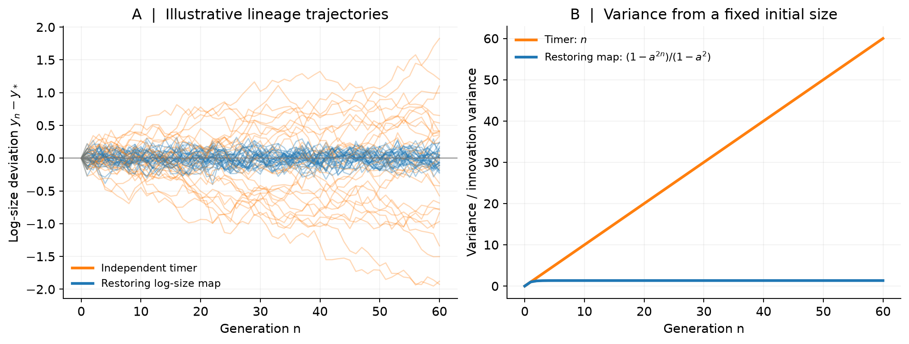
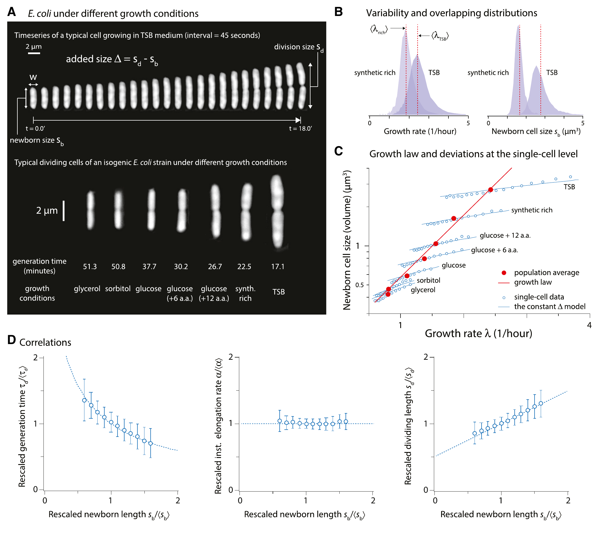
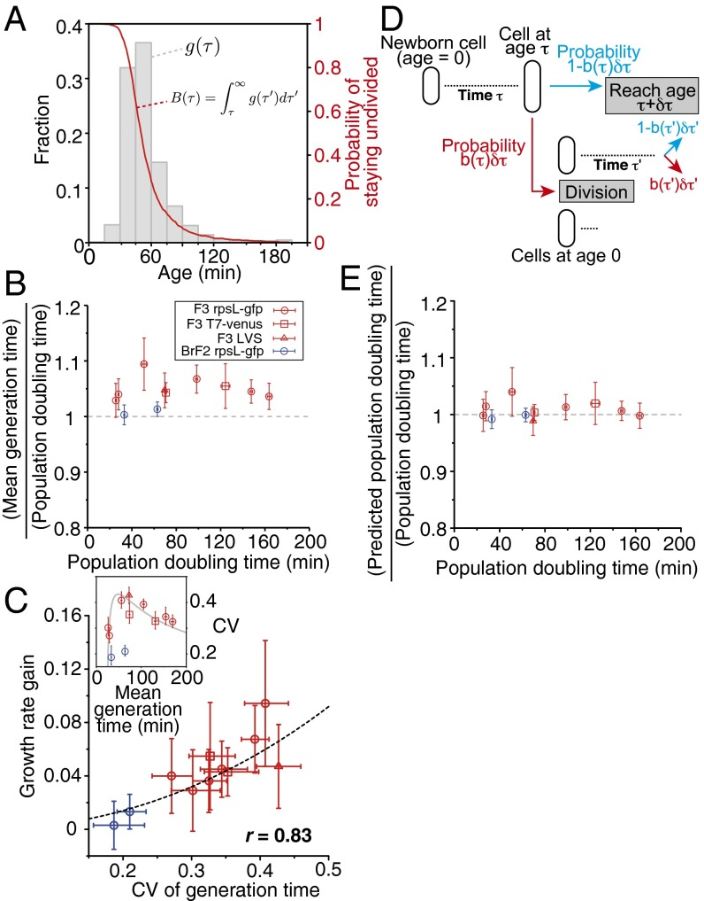
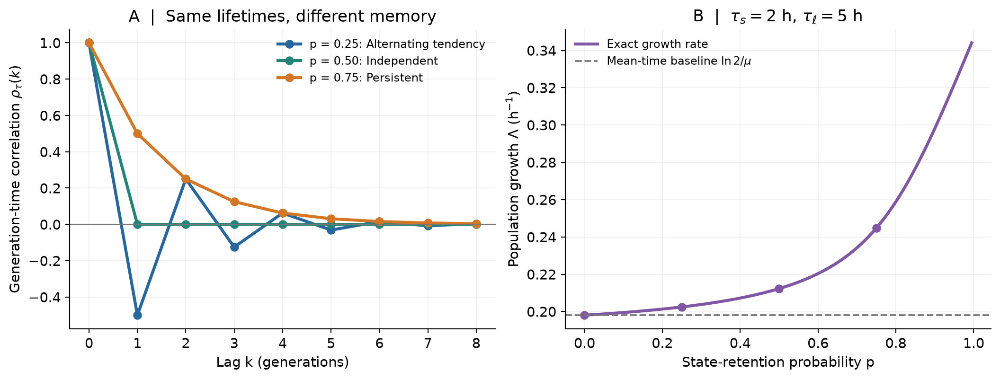
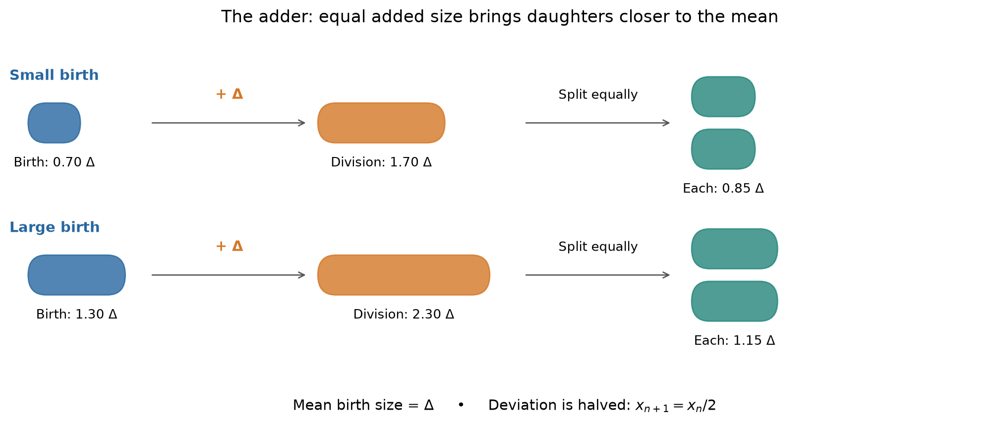
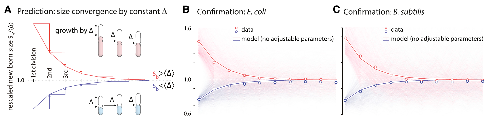
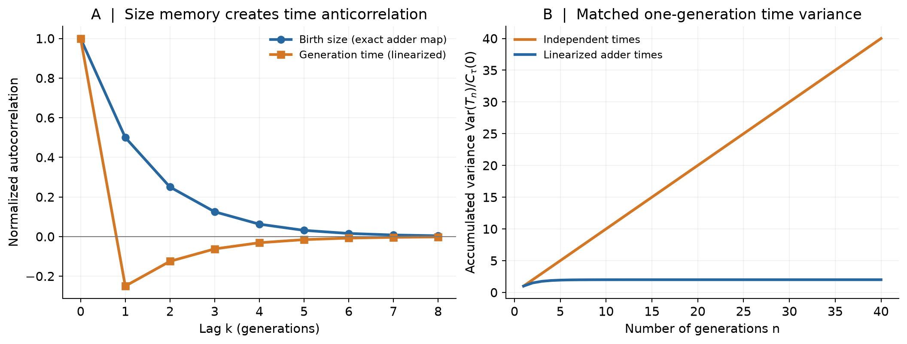
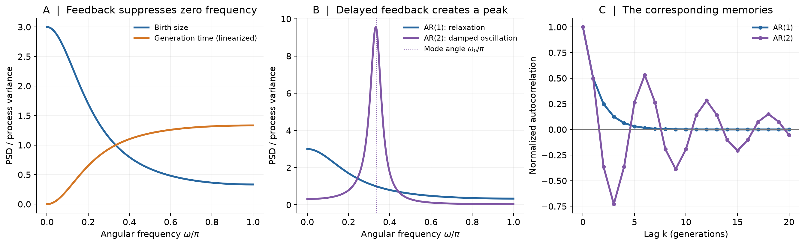

# From Single-Cell Noise to Population Growth
## Cell-Cycle Regulation, Temporal Correlations, and Stochastic Dynamics

> **Central question.** How can stochastic division times accelerate population growth, while size-regulating cells exhibit correlated divisions that appear to eliminate this advantage? What does the same feedback dynamics predict about fluctuations and oscillations?

---

## 0. The physical problem and the roadmap

A proliferating cell population displays at least three kinds of variability:

1. Different cells have different birth sizes and division times.
2. A cell's characteristics are statistically related to those of its ancestors.
3. The number of cells in the population grows exponentially, even though individual division events are stochastic.

Single-cell tracking experiments show both variability and **size homeostasis**: birth sizes fluctuate, but do not wander indefinitely across generations. In bacteria, a useful coarse-grained description of division is often the **adder**: a cell adds approximately a size increment independent of its birth size.

Our theoretical sequence is

$$\boxed{
\begin{gathered}
\text{independent division-time noise}\\
\downarrow\\
\text{population growth}\\
\downarrow\\
\text{temporal correlations}\\
\downarrow\\
\text{size-control feedback}\\
\downarrow\\
\text{fluctuation spectra}
\end{gathered}}
$$

Two quantities will recur throughout the lecture:

- $\Lambda$: **population growth rate**, defined by $N(t)\asymp e^{\Lambda t}$.
- $\lambda$: **single-cell size growth rate**, defined by $\dot v=\lambda v$, when that rate is constant.

These are conceptually different quantities. One of the main results is a set of conditions under which they must coincide.

### Notation

| Symbol | Meaning |
|---|---|
| $v_n$ | Birth size in generation $n$, following one chronological lineage |
| $v_n^{\mathrm d}$ | Division size of that cell |
| $\tau_n$ | Time from birth to division in generation $n$ |
| $T_n=\sum_{j=0}^{n-1}\tau_j$ | Elapsed time across $n$ generations |
| $\Delta$ | Mean added size in the adder model |
| $\Lambda$ | Population Malthusian growth rate |
| $\lambda$ | Constant exponential growth rate of cell size |
| $C_y(k)$ | Lag-$k$ covariance of a stationary lineage variable $y_n$ |
| $S_y(\omega)$ | Power spectral density in **radians per generation** |

A *chronological lineage* is constructed by following one of the two daughters at each division, without weighting by its eventual number of descendants. This sampling convention matters.

---

## 1. Why an independent division timer does not regulate size

### 1.1 Exponential growth between divisions

A reasonable first approximation for some bacterial growth conditions is

$$
\frac{dv}{dt}=\lambda v,
\qquad
v(t)=v_n e^{\lambda t},
$$

where $t=0$ denotes birth. If the cell divides after time $\tau_n$, then

$$
v_n^{\mathrm d}=v_n e^{\lambda\tau_n}.
$$

Assuming symmetric division, each daughter receives half of the mother's volume:

$$
v_{n+1}=\frac12 v_n e^{\lambda\tau_n}.\tag{1.1}
$$

The assumptions here are important: $\lambda$ is the same for all cells, sizes grow exponentially between divisions, and the two daughters divide the mother size equally.

### 1.2 The timer becomes a random walk in log size

Take logarithms of (1.1):

$$
\ln v_{n+1}-\ln v_n=\lambda\tau_n-\ln2.
$$

Define the logarithmic birth size $y_n=\ln v_n$. Then

$$
y_{n+1}=y_n+\lambda\tau_n-\ln2.\tag{1.2}
$$

A timer model sets division times without responding to size. Suppose the $\tau_n$ are independent and identically distributed, with mean $\bar\tau$ and variance $\sigma_\tau^2$. Iterating the map gives

$$
y_n-y_0=\sum_{j=0}^{n-1}(\lambda\tau_j-\ln2).
$$

Consequently,

$$
\begin{aligned}
\mathbb E[y_n-y_0]
  &=n(\lambda\bar\tau-\ln2),\\[3pt]
\operatorname{Var}(y_n-y_0)
  &=n\lambda^2\sigma_\tau^2.
\end{aligned}
\tag{1.3}
$$

If we tune the mean time to $\bar\tau=\ln2/\lambda$, the mean drift vanishes, but

$$
\operatorname{Var}(\ln v_n-\ln v_0)
      =n\lambda^2\sigma_\tau^2.\tag{1.4}
$$

Thus log size performs an unbiased random walk. Its fluctuations grow without bound: **the timer is not a size-homeostatic mechanism**. If division times are perfectly deterministic, the random walk disappears, but the initial size is still never corrected; the system has neutral rather than restorative dynamics.

This gives a physical reason not to assume independent division times indiscriminately: with constant $\lambda$ and symmetric division, correlations or feedback are needed for size regulation.

*Fig 1. Why feedback matters.* The orange trajectories obey the zero-drift log-size timer map (1.2). The blue trajectories illustrate a restoring **log-size** map, $y_{n+1}-y_*=a(y_n-y_*)+\epsilon_n$ with $a=1/2$, using the same innovations and a fixed initial size. This blue map is an illustrative feedback model, not the exact additive-size adder. Panel B shows the analytic variances divided by the innovation variance: unbounded timer diffusion versus saturation with feedback. Trajectories are synthetic model realizations.

*Fig 2. Testing size-control strategies.* Original Figure 1 from [Taheri-Araghi et al., *Current Biology* (2015)](https://doi.org/10.1016/j.cub.2014.12.009). Focus on panel D: generation time decreases with birth size, whereas division size increases. These trends challenge a size-independent timer and a fixed-threshold sizer, respectively. Panels A–C provide microscopy and growth-condition context. Read alongside the timer instability in (1.4).

**Question to carry forward.** What does independent division-time noise predict for the *population*, even though it is inconsistent with size homeostasis?

---

## 2. Euler–Lotka theory: why division-time noise can accelerate a population

### 2.1 A renewal argument

Consider an idealized binary branching population:

- Every cell divides into exactly two daughters.
- Each newborn cell draws an independent lifetime $\tau$ from a density $p(\tau)$, with $\tau>0$.
- The two daughters subsequently reproduce according to the same statistical rule.
- There is no death, and no common environment that imposes correlated lifetimes on the whole population.

Let $M(t)$ denote the expected number of living descendants, including the initial cell. The initial cell has either not yet divided by time $t$, or it divided at a time $\tau\lt t$. Therefore

$$
M(t)=\underbrace{\mathbb P(\tau>t)}_{\text{initial cell survives}}
     +\underbrace{2\int_0^t p(\tau)M(t-\tau)\,d\tau}_{\text{renewal term}}.
\tag{2.1}
$$

At long times we seek a growing solution

$$
M(t)\sim A e^{\Lambda t}.
$$

Substitution into the renewal term, and division by $Ae^{\Lambda t}$, give

$$
1=2\int_0^\infty p(\tau)e^{-\Lambda\tau}\,d\tau.
$$

Thus the **Euler–Lotka equation** is

$$
\boxed{2\,\mathbb E[e^{-\Lambda\tau}]=1.}\tag{2.2}
$$

The survival term in (2.1) does not contribute to the leading exponential asymptotics under the usual conditions for a supercritical age-dependent branching process. Equation (2.2) also identifies the long-time growth exponent of a typical sufficiently large branching population under standard nondegeneracy assumptions.

If every lifetime is identical, $\tau=\tau_0$, then

$$
2e^{-\Lambda\tau_0}=1
\quad\Rightarrow\quad
\Lambda=\frac{\ln2}{\tau_0}.
\tag{2.3}
$$

### 2.2 Jensen's inequality and the apparent growth advantage

For random division times, the exponential is convex:

$$
\mathbb E[e^{-\Lambda\tau}]
\ge e^{-\Lambda\mathbb E[\tau]}.
$$

Using (2.2),

$$
\frac12\ge e^{-\Lambda\bar\tau}.
$$

Taking logarithms yields

$$
\Lambda\ge\frac{\ln2}{\bar\tau}.\tag{2.4}
$$

For a nondegenerate lifetime distribution, the inequality is strict. Accordingly, the population doubling time

$$
t_{\mathrm{double}}=\frac{\ln2}{\Lambda}
$$

is **shorter** than the average single-cell division time $\bar\tau$.

**Physical interpretation.** Division time is not averaged arithmetically by the population. Short-lived cells produce descendants earlier, and these descendants have more time to reproduce. Branching amplifies early reproduction.

*Fig 3. Experimental population growth advantage.* Original Figure 3 from [Hashimoto et al., *PNAS* (2016)](https://doi.org/10.1073/pnas.1519412113). Panel B compares mean generation time with population doubling time; ratios above one indicate faster population doubling. Panel C relates the gain to generation-time variability; panel E compares Euler–Lotka predictions with measurements. Panels A and D show the lifetime distribution and model, respectively. Original figure reproduced without modification; source: [PMC](https://pmc.ncbi.nlm.nih.gov/articles/PMC4812751/#fig03).

**Notation and scope.** In this paper's gain definition, $\lambda=\ln2/\langle\tau\rangle_g$; our $\lambda$ denotes the exponential growth rate of cell size. These definitions must be distinguished when comparing this figure with (2.8). The figure supports the experimental doubling-time comparison; it does not establish that a size-homeostatic population with one common constant size-growth rate violates mass conservation.

### 2.3 A weak-noise estimate

Let $\bar\tau=\mu$, $\operatorname{Var}(\tau)=\sigma_\tau^2$. For small relative fluctuations, expand the logarithm of (2.2):

$$
\begin{aligned}
0
&=\ln2+\ln\mathbb E[e^{-\Lambda\tau}]\\
&=\ln2-\Lambda\mu
   +\frac{\Lambda^2}{2}\sigma_\tau^2
   -\frac{\Lambda^3}{6}\kappa_3(\tau)+\cdots.
\end{aligned}
\tag{2.5}
$$

Keeping terms through second order in the noise and writing
$\Lambda=\Lambda_0+\delta\Lambda$, where
$\Lambda_0=\ln2/\mu$, gives

$$
-\mu\,\delta\Lambda
+\frac{\Lambda_0^2}{2}\sigma_\tau^2\simeq0.
$$

Therefore

$$
\Lambda\simeq
\frac{\ln2}{\mu}
+\frac{(\ln2)^2}{2\mu^3}\sigma_\tau^2.
\tag{2.6}
$$

This is the simplest demonstration of **noise-driven growth-rate gain**.

### 2.4 The first paradox: volume conservation

Return to the biological setting of cells growing in size at the *same constant* rate $\lambda$. Define the total population volume

$$
V_{\mathrm{tot}}(t)=\sum_{i\text{ alive at }t}v_i(t).
$$

Between divisions, $\dot v_i=\lambda v_i$, so

$$
\frac{dV_{\mathrm{tot}}}{dt}=\lambda V_{\mathrm{tot}}.
$$

At division, a mother is replaced by two daughters whose volumes sum to the mother's. Therefore $V_{\mathrm{tot}}$ does not jump. The exact result is

$$
V_{\mathrm{tot}}(t)=V_{\mathrm{tot}}(0)e^{\lambda t}.\tag{2.7}
$$

Let

$$
\overline v_{\mathrm{snap}}(t)=\frac{V_{\mathrm{tot}}(t)}{N(t)}
$$

be the average size per cell in a population snapshot. If size homeostasis holds at the population level, and this average approaches a finite, strictly positive, non-exponentially changing value, then

$$
N(t)=\frac{V_{\mathrm{tot}}(t)}{\overline v_{\mathrm{snap}}(t)}
\asymp e^{\lambda t}.
$$

Hence

$$
\Lambda=\lambda.\tag{2.8}
$$

In the same setting, (1.2) gives, for a size-homeostatic lineage,

$$
\bar\tau=\frac{\ln2}{\lambda}
$$

(provided $\mathbb E|\ln v|\lt \infty$). Comparing this identity with the independent-lifetime prediction, we appear to have a contradiction:

$$
\underbrace{\Lambda>\frac{\ln2}{\bar\tau}=\lambda}_{\text{independent noisy lifetimes}}
\qquad\text{versus}\qquad
\underbrace{\Lambda=\lambda}_{\text{constant mass growth + homeostasis}}.
$$

**Resolution:** the independent-lifetime model cannot also describe size-homeostatic cells growing at the same constant $\lambda$. The missing ingredient is **temporal correlation between divisions**.

We should therefore not interpret (2.4) as claiming that any measurable noise necessarily increases growth above the single-cell size growth rate. It compares population growth with $\ln2/\bar\tau$ *within a specified branching model*; imposing cell-size physics changes the correlations and constraints.

---

## 3. Correlated division times: a generalized Euler–Lotka relation

### 3.1 From one lifetime to an entire lineage

Consider a chronological lineage with correlated division times

$$
\tau_0,\tau_1,\ldots,\tau_{n-1}.
$$

Its $n$-th division/birth generation is reached at time

$$
T_n=\sum_{j=0}^{n-1}\tau_j.\tag{3.1}
$$

After $n$ binary divisions there are $2^n$ possible descendant paths. For a locally defined branching process in which the statistical law along a uniformly sampled daughter path is the chronological-lineage law, linearity of expectation gives

$$
\mathbb E\!\left[\sum_{\text{generation-}n\text{ descendants}}
   e^{-s\,T_{n,\mathrm{path}}}\right]
=2^n\,\mathbb E_{\mathrm{chron}}[e^{-sT_n}].
\tag{3.2}
$$

This is the elementary *many-to-one* identity. It does not require all descendant paths to be statistically independent: it requires the correct marginal law for a randomly chosen daughter path.

Define the expected discounted number of generation-$n$ births,

$$
Z_n(s)=2^n\mathbb E_{\mathrm{chron}}[e^{-sT_n}].
\tag{3.3}
$$

The expected Laplace transform of all birth events is formally

$$
\widehat B(s)=\sum_{n=0}^{\infty}Z_n(s).
\tag{3.4}
$$

The exponential growth rate is the boundary between convergence and divergence of this series. If the correlated process admits an appropriate large-$n$ limit and the usual branching-process regularity conditions, define

$$
\psi(s)=\lim_{n\to\infty}
\frac1n\ln\mathbb E[e^{-sT_n}].
\tag{3.5}
$$

Then $Z_n(s)$ has exponential rate $\ln2+\psi(s)$. Its critical value is determined by

$$
\boxed{\ln2+\psi(\Lambda)=0.}\tag{3.6}
$$

Equivalently,

$$
\ln2+
\lim_{n\to\infty}\frac1n
\ln\mathbb E\!\left[
\exp\left(-\Lambda\sum_{j=0}^{n-1}\tau_j\right)
\right]=0.
\tag{3.7}
$$

This is the correlated-lineage generalization we will use. Its derivation is particularly transparent, and mathematically exact, for the finite-state Markov model of Section 5.

**Assumption check.** Equation (3.7) is an asymptotic relation, not a universal identity for every imaginable correlated or environmentally forced population. We assume a stationary/ergodic lineage law, an appropriate scaled cumulant-generating-function limit, and a branching population in which a well-defined Malthusian exponent is selected by this discounted-birth condition. Strong common-environment noise, nonergodic mixtures, or unbounded-growth pathologies require separate care.

### 3.2 Independent times reappear as a special case

If $\tau_0,\ldots,\tau_{n-1}$ are independent,

$$
\mathbb E[e^{-sT_n}]
=\prod_{j=0}^{n-1}\mathbb E[e^{-s\tau_j}]
=\big(\mathbb E[e^{-s\tau}]\big)^n.
$$

Thus

$$
\psi(s)=\ln\mathbb E[e^{-s\tau}],
$$

and (3.6) reduces immediately to

$$
2\mathbb E[e^{-\Lambda\tau}]=1.
$$

The original Euler–Lotka equation has **not been discarded**; it is the uncorrelated limit of the new calculation.

### 3.3 The mean-time inequality still holds

For stationary generation times with mean $\mu=\mathbb E[\tau_n]$, Jensen's inequality applied to the *entire sum* gives

$$
\begin{aligned}
\frac1n\ln\mathbb E[e^{-sT_n}]
&\ge-\frac{s}{n}\mathbb E[T_n]\\
&=-s\mu.
\end{aligned}
$$

Therefore $\psi(s)\ge-s\mu$. At $s=\Lambda$,

$$
-\ln2=\psi(\Lambda)\ge-\Lambda\mu,
$$

so

$$
\Lambda\ge\frac{\ln2}{\mu}.\tag{3.8}
$$

Unlike the independent case, equality can hold **even when each $\tau_n$ has nonzero variance**. The key is whether fluctuations of $T_n$ accumulate extensively as $n$ grows.

---

## 4. Why integrated temporal correlations control growth

### 4.1 Variance of the accumulated generation time

Assume the $\tau_n$ form a stationary process. Write

$$
C_\tau(k)
=\operatorname{Cov}(\tau_n,\tau_{n+k}),
\qquad C_\tau(-k)=C_\tau(k).
$$

Since $T_n=\sum_{j=0}^{n-1}\tau_j$,

$$
\operatorname{Var}(T_n)
=\sum_{i,j=0}^{n-1}
\operatorname{Cov}(\tau_i,\tau_j).
$$

There are $n$ terms of separation zero, and $2(n-k)$ ordered pairs separated by $k$. Hence the exact finite-$n$ formula is

$$
\operatorname{Var}(T_n)
=nC_\tau(0)
+2\sum_{k=1}^{n-1}(n-k)C_\tau(k).
\tag{4.1}
$$

If correlations are absolutely summable, division by $n$ and passage to the limit give

$$
\boxed{
D_\tau
\equiv\lim_{n\to\infty}\frac{\operatorname{Var}(T_n)}{n}
=C_\tau(0)+2\sum_{k=1}^{\infty}C_\tau(k).
}\tag{4.2}
$$

$D_\tau$ has units of time squared per generation. It measures *long-run fluctuations of accumulated division time*, not just fluctuations of a single generation. It is nonnegative because it is a limit of variances divided by $n$.

For independent division times, all nonzero-lag covariances vanish and $D_\tau=\sigma_\tau^2$. Positive correlations increase $D_\tau$; negative correlations can reduce it, even to zero.

### 4.2 Cumulant expansion of the correlated Euler–Lotka equation

For small enough $s$ and a process with well-behaved asymptotic cumulants,

$$
\begin{aligned}
\frac1n\ln\mathbb E[e^{-sT_n}]
&=-s\frac{\mathbb E[T_n]}{n}
 +\frac{s^2}{2}\frac{\operatorname{Var}(T_n)}{n}\\
&\quad-\frac{s^3}{6}\frac{\kappa_3(T_n)}{n}+\cdots.
\end{aligned}
$$

Taking $n\to\infty$,

$$
\psi(s)=-s\mu+\frac{s^2}{2}D_\tau
-\frac{s^3}{6}K_3+\cdots,
\tag{4.3}
$$

where $K_3=\lim_{n\to\infty}\kappa_3(T_n)/n$, if the limit exists.

Substitute $s=\Lambda$ into (3.6):

$$
0=\ln2-\Lambda\mu
 +\frac{\Lambda^2}{2}D_\tau+O(\text{third cumulants}).
\tag{4.4}
$$

Using $\Lambda_0=\ln2/\mu$ as the zero-noise solution yields

$$
\boxed{
\Lambda\simeq\frac{\ln2}{\mu}
+\frac{(\ln2)^2}{2\mu^3}D_\tau.
}\tag{4.5}
$$

The approximation assumes sufficiently weak fluctuations and a regular expansion; it may fail quantitatively for large persistence times or broad lifetime distributions.

**Main conclusion so far:**

$$
\text{Population growth responds to accumulated lineage noise,}
\;\text{not merely one-generation noise.}
$$

It is a *long-time* and *long-wavelength* property of the chronological process.

### 4.3 An important qualification

The condition $D_\tau=0$ removes the **quadratic weak-noise correction** to growth. By itself it does not guarantee $\Lambda=\ln2/\mu$ exactly: higher scaled cumulants might survive. We will derive a much stronger, exact cancellation for a homeostatic size-controlled model in Section 6.

---

## 5. Exactly solvable example I: a two-state Markov model

This model isolates the effect of temporal correlation while **holding the one-generation distribution fixed**. It is a phenomenological branching model, not automatically a physically consistent constant-$\lambda$, size-homeostatic cell model.

### 5.1 Definition

There are two possible generation times:

$$
\tau_s=\mu-\delta,
\qquad
\tau_\ell=\mu+\delta,
\qquad 0\lt \delta\lt \mu.
$$

The cell has a state $s$ (short) or $\ell$ (long). From one generation to the next, the state is retained with probability $p$:

$$
P=
\begin{pmatrix}
p&1-p\\
1-p&p
\end{pmatrix}.
\tag{5.1}
$$

A cell in state $i$ lives for a time $\tau_i$ and then produces two daughters. Each daughter's state follows the transition matrix $P$, conditional on the mother's state. For $0\lt p\lt 1$, the chronological stationary state probabilities are $(1/2,1/2)$, independent of $p$. Therefore

$$
\mathbb P(\tau=\tau_s)=\mathbb P(\tau=\tau_\ell)=\tfrac12,
\quad
\mathbb E[\tau]=\mu,
\quad
\operatorname{Var}(\tau)=\delta^2.
\tag{5.2}
$$

Changing $p$ changes **only the temporal organization** of the division times.

### 5.2 Exact autocorrelation

Let $z_n=-1$ in state $s$ and $z_n=+1$ in state $\ell$. Then

$$
\tau_n=\mu+\delta z_n.
$$

Conditional on the current state,

$$
\mathbb E[z_{n+1}\mid z_n]
=p z_n+(1-p)(-z_n)
=(2p-1)z_n.
$$

Set

$$
a=2p-1.
$$

By iterating conditional expectations,

$$
\mathbb E[z_{n+k}\mid z_n]=a^k z_n.
$$

Since $\mathbb E[z_n]=0$ and $z_n^2=1$,

$$
C_\tau(k)=\delta^2 a^{|k|},\qquad a=2p-1.\tag{5.3}
$$

For $0\lt p\lt 1$, $|a|\lt 1$. Equation (4.2) then gives

$$
\begin{aligned}
D_\tau
&=\delta^2\left(1+2\sum_{k=1}^\infty a^k\right)\\
&=\delta^2\frac{1+a}{1-a}\\
&=\delta^2\frac{p}{1-p}.
\end{aligned}
\tag{5.4}
$$

Three regimes follow:

- $p\lt 1/2$: successive generation times tend to alternate; correlations are negative at odd lags.
- $p=1/2$: generation times are independent; $D_\tau=\delta^2$.
- $p>1/2$: states persist; $D_\tau>\delta^2$.

At exactly $p=0$, the states alternate deterministically; the absolute covariance sum in (4.2) does not converge, but directly from $T_n$ one finds $\operatorname{Var}(T_n)=O(1)$ and $D_\tau=0$. At $p=1$, the chain is nonergodic; its two disjoint subpopulations require separate treatment.

### 5.3 Exact population growth via a transfer matrix

The joint probability of a state path $i_0,i_1,\ldots,i_n$ contains a product of transition probabilities. Its discounted birth-time weight contains

$$
\exp\left(-\Lambda\sum_{j=0}^{n-1}\tau_{i_j}\right).
$$

At each generation, binary division contributes a factor of 2. Therefore the propagation matrix for expected discounted descendant weights is

$$
K_\Lambda=
2\begin{pmatrix}
e^{-\Lambda\tau_s}&0\\
0&e^{-\Lambda\tau_\ell}
\end{pmatrix}P.
\tag{5.5}
$$

Define

$$
A=e^{-\Lambda\tau_s},\qquad B=e^{-\Lambda\tau_\ell}.
$$

Then

$$
K_\Lambda=
2\begin{pmatrix}
pA&(1-p)A\\
(1-p)B&pB
\end{pmatrix}.
\tag{5.6}
$$

For an initial-state probability row vector $\boldsymbol\pi$, the generation-$n$ discounted weight is

$$
Z_n(\Lambda)=\boldsymbol\pi K_\Lambda^n\mathbf 1.
$$

For $0\lt p\lt 1$, Perron–Frobenius theory gives its leading growth factor $\rho(K_\Lambda)^n$, where $\rho$ is the spectral radius. Equation (3.6) is therefore equivalent to the **exact eigenvalue condition**

$$
\rho(K_\Lambda)=1.\tag{5.7}
$$

To compute it explicitly, the trace and determinant are

$$
\operatorname{tr}K_\Lambda=2p(A+B),
\qquad
\det K_\Lambda=4AB(2p-1).
$$

The Perron eigenvalue is

$$
\rho(K_\Lambda)
=p(A+B)+\sqrt{p^2(A-B)^2+4(1-p)^2AB}.
\tag{5.8}
$$

Solving $\rho(K_\Lambda)=1$ for $\Lambda$ yields the population growth rate. This calculation is exact for the specified model; it is not a cumulant approximation.

### 5.4 Two analytically transparent limits

**Case 1: $p=1/2$, independent generations.** Then

$$
\rho(K_\Lambda)=A+B,
$$

so (5.7) becomes

$$
e^{-\Lambda\tau_s}+e^{-\Lambda\tau_\ell}=1.
\tag{5.9}
$$

This is precisely $2\mathbb E[e^{-\Lambda\tau}]=1$ for the two-point distribution.

**Case 2: $p=0$, strict alternation.** Then

$$
\rho(K_\Lambda)=2\sqrt{AB}
=2e^{-\Lambda(\tau_s+\tau_\ell)/2}.
$$

Therefore

$$
\Lambda=\frac{\ln2}{(\tau_s+\tau_\ell)/2}
      =\frac{\ln2}{\mu}.\tag{5.10}
$$

The single-generation distribution still has variance $\delta^2>0$, yet the growth advantage disappears. Every pair of successive generation times has exactly the same total duration.

For $p\to1^-$, long-lived state persistence lets fast lineages dominate the population; the growth exponent approaches $\ln2/\tau_s$. The point $p=1$ itself is reducible, so the observed exponent depends on which state classes are initially present.

### 5.5 Numerical example: same marginal distribution, different growth

Choose

$$
\tau_s=2\ \mathrm h,
\qquad
\tau_\ell=5\ \mathrm h,
\qquad
\mu=3.5\ \mathrm h.
$$

Solving (5.8)–(5.7):

| Persistence $p$ | Correlation structure | $\Lambda$ ($\mathrm h^{-1}$) | Doubling time $\ln2/\Lambda$ (h) |
|---:|---|---:|---:|
| 0 | Strict alternation | 0.198042 | 3.500 |
| 0.25 | Antipersistent | 0.202456 | 3.424 |
| 0.50 | Independent | 0.212289 | 3.265 |
| 0.75 | Persistent | 0.244769 | 2.832 |

Every row has **the same** $p(\tau)$, $\bar\tau$, and $\operatorname{Var}(\tau)$. Only correlations differ.

*Fig 4. Correlation changes growth without changing the lifetime histogram.* Panel A plots $\rho_\tau(k)=(2p-1)^k$. Panel B solves the exact Perron-eigenvalue condition (5.7) for the same 2 h and 5 h lifetimes used in the table; dots mark its four rows. The dashed line is $\ln2/\mu$. The curve ends below $p=1$, where the chain becomes reducible. These are predictions of the two-state branching model, not measurements of size-homeostatic cells.

> **Lesson of model I.** A one-generation histogram is not enough to predict the proliferation rate. The same random variables, arranged differently along a lineage, can produce different collective growth rates.

---

## 6. Exactly solvable example II: the adder as a size-homeostatic stochastic map

The Markov model showed what correlations *do*. We now want to understand a physical mechanism that *produces* them. The adder provides the simplest example connected directly to cell-size data.

### 6.1 Definition of the adder

An adder divides after adding approximately a constant size increment:

$$
v_n^{\mathrm d}=v_n+\Delta+\eta_n,\tag{6.1}
$$

where $\mathbb E[\eta_n]=0$, $\operatorname{Var}(\eta_n)=\sigma_\eta^2$, and the added-size noises are independent across generations. We assume these noise values and the process keep cell sizes positive.

With symmetric division,

$$
\boxed{v_{n+1}=\frac12v_n+\frac12\Delta+\frac12\eta_n.}\tag{6.2}
$$

Stationarity implies

$$
\mathbb E[v_{n+1}]=\mathbb E[v_n]=\bar v,
$$

and therefore

$$
\bar v=\frac12\bar v+\frac12\Delta
\quad\Rightarrow\quad
\bar v=\Delta.\tag{6.3}
$$

Center the birth size around this mean:

$$
x_n=v_n-\Delta.
$$

Then (6.2) is

$$
x_{n+1}=a x_n+\xi_n,
\qquad a=\frac12,
\quad\xi_n=\frac12\eta_n.\tag{6.4}
$$

This is an autoregressive process of order one (AR(1)), the discrete-time counterpart of a linearly relaxing stochastic dynamical system.

*Fig 5. The adder as restoring feedback.* In this noise-free illustration, cells born at $0.70\Delta$ and $1.30\Delta$ both add $\Delta$ and divide symmetrically. Their daughters are born at $0.85\Delta$ and $1.15\Delta$: the deviation from the mean is halved. Capsule lengths encode relative size schematically; they are not microscopy images. Added-size noise produces the stochastic map (6.4).

*Fig 6. Experimental input to the adder map.* Original Figure 2 from [Taheri-Araghi et al. (2015)](https://doi.org/10.1016/j.cub.2014.12.009). Mean added size is approximately independent of birth size within each condition; conditional distributions also collapse after rescaling. Panels A–C cover *E. coli*, *B. subtilis*, and size mutants. This motivates (6.1), but does not establish independent added-size noise across generations.

### 6.2 Exact stationary variance

In the stationary state, $x_n$ and $\xi_n$ are independent because $\xi_n$ is newly sampled noise. Thus

$$
\operatorname{Var}(x_{n+1})
=a^2\operatorname{Var}(x_n)+\operatorname{Var}(\xi_n).
$$

Let $\sigma_x^2=\operatorname{Var}(x_n)$. Then

$$
\sigma_x^2=a^2\sigma_x^2+\sigma_\xi^2,
$$

or

$$
\sigma_x^2=\frac{\sigma_\xi^2}{1-a^2}.\tag{6.5}
$$

For $a=1/2$ and $\sigma_\xi^2=\sigma_\eta^2/4$,

$$
\operatorname{Var}(v_n)=\frac{\sigma_\eta^2}{3}.\tag{6.6}
$$

Unlike the timer, the adder has a finite stationary size variance. The deterministic part of the map shrinks deviations by a factor of 2 every generation.

### 6.3 Exact birth-size autocorrelation

Iterating (6.4) $k$ times,

$$
x_{n+k}
=a^k x_n+
\sum_{j=0}^{k-1}a^{k-1-j}\xi_{n+j}.
\tag{6.7}
$$

The future noises are independent of $x_n$, so

$$
\operatorname{Cov}(x_n,x_{n+k})
=a^k\sigma_x^2.
$$

Dividing by $\sigma_x^2$ gives

$$
\rho_v(k)
\equiv\operatorname{Corr}(v_n,v_{n+k})
=a^k=2^{-k}.
\tag{6.8}
$$

For example,

$$
\rho_v(1)=\frac12,
\qquad
\rho_v(2)=\frac14.
$$

These values agree closely with the correlations $\approx0.49$ and $\approx0.24$ illustrated in the adder slide (original slides p. 5, citing Ho et al., *Annual Review of Biophysics*, 2018).

The important point is not merely the numerical agreement: a deterministic restoring factor fixes the decay of the correlation function. Noise sets the variance, while feedback sets the memory time.

*Fig 7. Observed return toward the stationary birth size.* Original Figure 3 from [Taheri-Araghi et al. (2015)](https://doi.org/10.1016/j.cub.2014.12.009). Panel A predicts convergence under constant added size; panels B and C compare with *E. coli* and *B. subtilis*. This illustrates the restoring factor in (6.4). Conditional mean relaxation and the stationary ACF (6.8) are related observables, but are distinct measurements.

### 6.4 Connecting the adder to generation times

Assume again that each cell grows exponentially at the same constant rate $\lambda$. Then

$$
v_n^{\mathrm d}=v_ne^{\lambda\tau_n}.
$$

But symmetric division means $v_n^{\mathrm d}=2v_{n+1}$. Therefore

$$
v_ne^{\lambda\tau_n}=2v_{n+1}.
$$

Take logarithms:

$$
\lambda\tau_n=\ln2+\ln v_{n+1}-\ln v_n.
$$

Thus the **exact lineage identity** is

$$
\tau_n=\frac{\ln2}{\lambda}
+\frac{\ln v_{n+1}-\ln v_n}{\lambda}.
\tag{6.9}
$$

This relation applies to **any** symmetric-division model with constant exponential size growth, not only to the adder. The adder supplies a concrete homeostatic dynamics for $v_n$.

### 6.5 The telescoping identity: the central result of the lecture

Sum (6.9) from generation $0$ to $n-1$:

$$
\begin{aligned}
T_n
&=\sum_{j=0}^{n-1}\tau_j\\
&=\frac{n\ln2}{\lambda}
+\frac1\lambda
\sum_{j=0}^{n-1}(\ln v_{j+1}-\ln v_j).
\end{aligned}
$$

Every interior logarithmic-size term cancels with its neighbor:

$$
\boxed{
T_n=\frac{n\ln2}{\lambda}
+\frac{\ln v_n-\ln v_0}{\lambda}.
}\tag{6.10}
$$

This is an **exact** identity, not a linearization and not a Gaussian approximation.

Suppose the size process is stationary, has finite variance of $\ln v$, and does not lose homeostasis. Then the fluctuating part of $T_n$ is a *boundary term*:

$$
T_n-\frac{n\ln2}{\lambda}
=\frac{\ln v_n-\ln v_0}{\lambda}.
$$

Its variance is

$$
\operatorname{Var}(T_n)
=\frac1{\lambda^2}
\operatorname{Var}(\ln v_n-\ln v_0).
\tag{6.11}
$$

In a mixing stationary state, as $n\to\infty$,

$$
\operatorname{Var}(T_n)
\longrightarrow
\frac{2\operatorname{Var}(\ln v)}{\lambda^2},
$$

which is finite. Therefore

$$
D_\tau
=\lim_{n\to\infty}\frac{\operatorname{Var}(T_n)}n
=0.
\tag{6.12}
$$

A noisy generation time does **not** imply an extensively noisy sum of generation times. The time fluctuations from consecutive generations cancel because division adjusts to inherited size.

Taking expectations in (6.10), the boundary contribution vanishes per generation:

$$
\mathbb E[\tau_n]=\frac{\ln2}{\lambda}.\tag{6.13}
$$

### 6.6 Exact consequence for population growth

Insert (6.10) into the correlated Euler–Lotka weight:

$$
\begin{aligned}
\mathbb E[e^{-sT_n}]
&=\exp\left(-\frac{ns\ln2}{\lambda}\right)
\mathbb E\left[
\left(\frac{v_n}{v_0}\right)^{-s/\lambda}
\right].
\end{aligned}
\tag{6.14}
$$

If the stationary size process has sufficient positive/negative moments so that the last expectation has no exponential growth or decay in $n$, then

$$
\psi(s)=-\frac{s\ln2}{\lambda}.\tag{6.15}
$$

Equation (3.6) becomes

$$
0=\ln2-\frac{\Lambda\ln2}{\lambda},
$$

hence

$$
\boxed{\Lambda=\lambda.}\tag{6.16}
$$

The population-volume argument in Section 2.4 provides an independent, physically transparent proof under snapshot-level homeostasis.

**This resolves the initial paradox.** Independent generation-time noise can accelerate a binary branching population relative to its mean lifetime. Yet in constant-$\lambda$, symmetric, size-homeostatic cells, the correlations are so constrained that the accumulated division-time fluctuations become boundary terms; the population growth exponent is exactly the single-cell size growth exponent.

### 6.7 A counterintuitive prediction: size is positively correlated, time is negatively correlated

In the adder, nearby birth sizes satisfy

$$
\rho_v(k)=2^{-k}>0.
$$

What about division times?

For small size fluctuations $|x_n|\ll\Delta$, expand the logarithm in (6.9):

$$
\ln v_n=\ln(\Delta+x_n)
\simeq\ln\Delta+\frac{x_n}{\Delta}.
$$

Therefore

$$
\delta\tau_n
\equiv\tau_n-\frac{\ln2}{\lambda}
\simeq\frac{x_{n+1}-x_n}{\lambda\Delta}.
\tag{6.17}
$$

For a general stationary AR(1) process

$$
C_x(k)=\sigma_x^2 a^{|k|},\qquad 0\lt a\lt 1,
$$

we can compute the covariance of the differences explicitly. At lag zero,

$$
\begin{aligned}
C_{\delta\tau}(0)
&\simeq\frac1{(\lambda\Delta)^2}
\mathbb E[(x_{n+1}-x_n)^2]\\
&=\frac{2\sigma_x^2(1-a)}{(\lambda\Delta)^2}.
\end{aligned}
\tag{6.18}
$$

For $k\ge1$,

$$
\begin{aligned}
C_{\delta\tau}(k)
&\simeq\frac1{(\lambda\Delta)^2}
\operatorname{Cov}(x_{n+1}-x_n,\,x_{n+k+1}-x_{n+k})\\
&=\frac{2C_x(k)-C_x(k-1)-C_x(k+1)}{(\lambda\Delta)^2}\\
&=-\frac{\sigma_x^2(1-a)^2 a^{k-1}}{(\lambda\Delta)^2}.
\end{aligned}
\tag{6.19}
$$

Dividing by (6.18) yields

$$
\rho_\tau(k)
\simeq-\frac{1-a}{2}a^{k-1},
\qquad k\ge1.
\tag{6.20}
$$

For the adder, $a=1/2$:

$$
\rho_\tau(k)\simeq-2^{-(k+1)},\qquad k\ge1.\tag{6.21}
$$

Thus

$$
\rho_\tau(1)\simeq-\tfrac14,
\qquad
\rho_\tau(2)\simeq-\tfrac18,
\qquad
\rho_\tau(3)\simeq-\tfrac1{16}.
$$

**A distinction worth emphasizing to students:** birth sizes are positively correlated across generations, while successive *generation-time fluctuations* are negatively correlated in this model. Confusing these two autocorrelation functions would obscure the mechanism.

The negative correlation has a simple interpretation: a cell with a longer-than-usual division time tends to produce a larger daughter, and that daughter typically requires less time to divide next.

### 6.8 An explicit check of the cancellation

Using (6.18)–(6.19),

$$
\begin{aligned}
D_\tau
&\simeq C_{\delta\tau}(0)+2\sum_{k=1}^\infty C_{\delta\tau}(k)\\
&=\frac{2\sigma_x^2(1-a)}{(\lambda\Delta)^2}
-\frac{2\sigma_x^2(1-a)^2}{(\lambda\Delta)^2}
\sum_{k=1}^\infty a^{k-1}\\
&=\frac{2\sigma_x^2(1-a)}{(\lambda\Delta)^2}
-\frac{2\sigma_x^2(1-a)}{(\lambda\Delta)^2}\\
&=0.
\end{aligned}
\tag{6.22}
$$

The sum of the negative nonzero-lag covariances cancels the positive single-generation variance. Equation (6.10) showed that the cancellation is actually exact at the level of cumulative times, even when the small-noise approximation used in (6.17) is not justified.

> **Lesson of model II.** Size homeostasis is not just a narrow size distribution. It imposes a dynamical constraint on the entire lineage history. Under constant exponential size growth and symmetric division, this constraint removes the extensive component of accumulated generation-time fluctuations.

---

*Fig 8. Noisy divisions can have zero long-run timing noise.* Panel A compares the exact adder birth-size autocorrelation with the small-fluctuation generation-time approximation (6.21). Panel B matches the one-generation time variance in the two models: independent times give $\operatorname{Var}(T_n)/C_\tau(0)=n$, while the linearized stationary adder gives $2(1-2^{-n})$. The latter saturates because time deviations telescope to endpoint size deviations. This analytic linearized example illustrates the more general exact boundary-term identity (6.10).

## 7. From temporal correlations to power spectra

We have repeatedly encountered sums of correlations over many generations. The natural next step is to ask how these correlations are distributed over frequency.

### 7.1 Autocovariance and the Wiener–Khinchin relation

For a stationary discrete-time process $y_n$, define

$$
C_y(k)=\mathbb E[(y_n-\bar y)(y_{n+k}-\bar y)].
$$

Its two-sided power spectral density is

$$
S_y(\omega)=\sum_{k=-\infty}^{\infty}
C_y(k)e^{-i\omega k},
\qquad -\pi\le\omega\le\pi.
\tag{7.1}
$$

The inverse relation is

$$
C_y(k)=\frac1{2\pi}\int_{-\pi}^{\pi}
S_y(\omega)e^{i\omega k}\,d\omega.
\tag{7.2}
$$

These are the discrete-time Wiener–Khinchin relations. The frequency $\omega$ is angular frequency **per generation**. This distinction matters when comparing lineage-indexed observations with measurements sampled in physical time.

At zero frequency,

$$
S_\tau(0)=\sum_{k=-\infty}^{\infty}C_\tau(k)
=C_\tau(0)+2\sum_{k=1}^\infty C_\tau(k).
$$

Thus, whenever the covariance sum converges,

$$
S_\tau(0)=D_\tau.\tag{7.3}
$$

This gives equation (4.5) a spectral form:

$$
\Lambda\simeq
\frac{\ln2}{\mu}
+\frac{(\ln2)^2}{2\mu^3}S_\tau(0).
\tag{7.4}
$$

**Why frequency appears in a population-growth lecture:** at quadratic order, long-time population growth is controlled by *zero-frequency generation-time noise*. The full power spectrum additionally tells us whether there are preferred dynamical timescales.

### 7.2 Spectrum of the AR(1) size-control model

Consider again

$$
x_{n+1}=a x_n+\xi_n,
\qquad |a|\lt 1,
$$

with independent zero-mean noise of variance $\sigma_\xi^2$. In the stationary regime,

$$
x_n=\sum_{j=0}^\infty a^j\xi_{n-1-j}.
\tag{7.5}
$$

This is a linear filter of white noise. In the frequency domain the transfer function is

$$
H(\omega)=\frac1{1-ae^{-i\omega}},
$$

and therefore

$$
\begin{aligned}
S_x(\omega)
&=\sigma_\xi^2|H(\omega)|^2\\
&=\frac{\sigma_\xi^2}
{1+a^2-2a\cos\omega}.
\end{aligned}
\tag{7.6}
$$

For an adder, $a=1/2$. The size spectrum is greatest near $\omega=0$ and decreases smoothly toward $\pi$. There is no intrinsic *finite-frequency* oscillatory resonance.

This is the spectral counterpart of the monotone, positive autocorrelation

$$
C_x(k)=\sigma_x^2(1/2)^{|k|}.
$$

### 7.3 Spectrum of generation time: feedback filters out zero frequency

From (6.17),

$$
\delta\tau_n\simeq\frac{x_{n+1}-x_n}{\lambda\Delta}.
$$

Taking a difference multiplies a Fourier mode $e^{i\omega n}$ by $e^{i\omega}-1$. Hence

$$
\begin{aligned}
S_\tau(\omega)
&\simeq\frac{|e^{i\omega}-1|^2}{(\lambda\Delta)^2}S_x(\omega)\\
&=\boxed{
\frac{4\sin^2(\omega/2)}{(\lambda\Delta)^2}S_x(\omega).
}
\end{aligned}
\tag{7.7}
$$

At zero frequency the numerator vanishes:

$$
S_\tau(0)=0.\tag{7.8}
$$

The same fact appeared as the telescoping sum in (6.10) and the covariance cancellation in (6.22). These are three mathematical descriptions of **one physical mechanism**.

Notice that differencing may emphasize high-frequency fluctuations, even when the underlying size process does not have an oscillatory mode. A large spectral value near the Nyquist frequency $\omega=\pi$ is not, by itself, evidence for a biological oscillator.

### 7.4 An extra connection: the Markov model's spectrum

For the two-state Markov model of Section 5, $C_\tau(k)=\delta^2a^{|k|}$, where $a=2p-1$. Summing the Fourier series for $|a|\lt 1$ gives

$$
S_\tau(\omega)
=\delta^2\frac{1-a^2}{1+a^2-2a\cos\omega}.
\tag{7.9}
$$

In particular,

$$
S_\tau(0)=\delta^2\frac{1+a}{1-a}
=\delta^2\frac{p}{1-p},
$$

which recovers (5.4) without separately summing the covariances.

Thus both models are readily understood through spectra:

- The Markov model can change low-frequency division-time noise by changing persistence.
- The adder converts size fluctuations into differences, suppressing division-time noise at zero frequency.

---

## 8. Ordinary fluctuations or an oscillatory dynamical mode?

The original slides motivate this question by juxtaposing adder fluctuations and experimentally observed oscillatory behavior (slides p. 5). The question now has a precise formulation: **what dynamical structure creates a preferred nonzero frequency?**

### 8.1 Relaxation is not oscillation

An AR(1) model with $0\lt a\lt 1$ has a single real positive eigenvalue $a$. Perturbations decay as $a^n$. Its normalized ACF is monotone:

$$
\rho_x(k)=a^{|k|}.
$$

The spectrum has no isolated nonzero-frequency resonant mode. Random sample paths may visibly rise and fall, but this alone does not imply a periodic dynamical mechanism.

If $-1\lt a\lt 0$, the ACF alternates sign, $\rho_x(k)=a^{|k|}$, and the spectral maximum is at $\omega=\pi$, corresponding to a two-generation alternation. This already illustrates why the *sign and eigenstructure of feedback* matter more than the visual regularity of a noisy trace.

### 8.2 A minimal model capable of damped oscillations

Introduce a delayed feedback term:

$$
x_{n+1}=2r\cos\omega_0\,x_n-r^2x_{n-1}+\xi_n,
\qquad 0\lt r\lt 1,
\quad0\lt \omega_0\lt \pi.
\tag{8.1}
$$

The deterministic recurrence has characteristic equation

$$
z^2-2r\cos\omega_0\,z+r^2=0.
$$

Its roots are

$$
z_\pm=re^{\pm i\omega_0}.\tag{8.2}
$$

The modulus $r$ controls damping, while the argument $\omega_0$ fixes the characteristic angular frequency. The deterministic response therefore contains terms of the form

$$
x_n\sim r^n\cos(n\omega_0+\phi).
\tag{8.3}
$$

White noise continually excites these damped modes, leading to a stationary noisy oscillator.

The stationary autocovariance obeys the same second-order recurrence at nonzero lags:

$$
C_x(k+1)=2r\cos\omega_0\,C_x(k)-r^2C_x(k-1),
\quad k\ge1.
\tag{8.4}
$$

Hence its normalized ACF has the form

$$
\rho_x(k)=r^{|k|}
\big[\cos(k\omega_0)+b\sin(|k|\omega_0)\big],
$$

where the coefficient $b$ is fixed by stationarity. For this AR(2) model,

$$
b=\frac{1-r^2}{1+r^2}\cot\omega_0.
\tag{8.5}
$$

The power spectrum is

$$
S_x(\omega)=\frac{\sigma_\xi^2}
{\left|1-2r\cos\omega_0\,e^{-i\omega}
+r^2e^{-2i\omega}\right|^2}.
\tag{8.6}
$$

For sufficiently weak damping and a frequency away from the boundaries, this exhibits a resonant peak near $\omega_0$. The exact peak location need not equal $\omega_0$ at finite damping.

*Fig 9. Zero-frequency cancellation and oscillatory modes answer different questions.* Panel A uses the adder's $a=1/2$ and the linearized generation-time relation (7.7); each spectrum is divided by its own process variance. Panel B compares the AR(1) size process with the AR(2) model (8.1), using $r=0.9$ and $\omega_0=\pi/3$ radians per generation. The dotted line marks the mode angle; the spectral maximum can be shifted by damping. Panel C shows the corresponding analytic autocorrelations. All spectra use generation-indexed frequency, not physical-time frequency.

### 8.3 What the spectrum can and cannot establish

A finite-frequency peak suggests a preferred dynamical timescale, but does not, by itself, identify a unique molecular mechanism. A noisy linearly stable oscillator, a deterministic limit cycle with noise, or suitably structured inherited environmental variations can produce superficially similar spectra.

Similarly, a finite record of independent or correlated noise can show spurious bumps in its estimated power spectrum. Robust claims require sufficiently long records, multiple lineages/replicates, uncertainty estimates, and attention to whether the data were sampled in generation count or in physical time.

> **Lesson of the spectral analysis.** The zero-frequency component controls long-time accumulation of generation-time noise. Finite-frequency structure diagnoses dynamical modes. Both emerge from the same correlation function, but they answer different questions.

---

## 9. Synthesis: three exact ideas and one controlled approximation

We can now answer the opening question.

**First:** for independently sampled lifetimes in a binary branching process,

$$
2\mathbb E[e^{-\Lambda\tau}]=1
\quad\Longrightarrow\quad
\Lambda\ge\frac{\ln2}{\bar\tau}.
\tag{9.1}
$$

This is an exact branching-process statement.

**Second:** when division times are correlated, the correct input is the distribution of *complete histories*, not only $p(\tau)$:

$$
\ln2+
\lim_{n\to\infty}\frac1n
\ln\mathbb E[e^{-\Lambda T_n}]=0.
\tag{9.2}
$$

For an ergodic finite-state Markov branching model, this is exactly a transfer-matrix eigenvalue condition.

**Third:** for a constant single-cell exponential size-growth rate and symmetric division,

$$
T_n=\frac{n\ln2}{\lambda}
+\frac{\ln v_n-\ln v_0}{\lambda}.
\tag{9.3}
$$

Under size homeostasis and the stated moment conditions, the accumulated noise is subextensive and $\Lambda=\lambda$. This is not special to the adder; the adder is a particularly transparent **realization** of size homeostasis.

**Finally:** in a weak-noise expansion, the effect of temporal correlations on population growth is summarized by

$$
\Lambda\simeq\frac{\ln2}{\bar\tau}
+\frac{(\ln2)^2}{2\bar\tau^3}\,S_\tau(0).
\tag{9.4}
$$

This expression is a controlled approximation, not an exact all-noise formula. It explains why the correlation and power-spectrum discussions belong in the same lecture as Euler–Lotka theory.

### What remains biologically open?

The constant-$\lambda$, symmetric-division limit is deliberately idealized. Real systems may have fluctuations and inheritance in single-cell growth rates, asymmetric division, multiple cell-cycle checkpoints, replication-initiation control, and external environmental variability. These can alter the relation between size homeostasis, chronological correlations, and population growth.

Moreover, an observed adder-like birth-size correlation does not uniquely establish an underlying molecular mechanism. The original slides discuss replication-linked regulation, initiator accumulation, inhibitor dilution, and different mechanistic models (slides pp. 8–10). Such mechanisms should be distinguished using **additional observables**, perturbations, and correlation structures, rather than using an adder slope as a unique molecular fingerprint.

A useful next-lecture question is: **when the individual growth rate $\lambda$ itself fluctuates and is inherited, which component of the population growth advantage survives cell-size feedback?** This genuinely changes the previous conservation/telescoping argument and introduces a new, scientifically motivated problem.

---

# Optional technical appendices

## Appendix A. Where the KL divergence fits: chronological versus retrospective sampling

The original notes derive a KL-divergence identity for independent division times. It is correct, but its biological interpretation deserves emphasis.

For independent lifetimes, Euler–Lotka normalizes the distribution

$$
q(\tau)=2e^{-\Lambda\tau}p(\tau).\tag{A.1}
$$

Indeed,

$$
\int_0^\infty q(\tau)\,d\tau
=2\mathbb E_p[e^{-\Lambda\tau}]=1.
$$

The distribution $p$ describes times observed from a chronological lineage. The exponentially tilted $q$ characterizes division-time statistics favored in a population-biased ancestral (retrospective) sample, in the independent-lifetime setting.

Their KL divergence is

$$
\begin{aligned}
D_{\mathrm{KL}}(p\|q)
&=\int p(\tau)\ln\frac{p(\tau)}{q(\tau)}\,d\tau\\
&=\int p(\tau)(\Lambda\tau-\ln2)\,d\tau\\
&=\Lambda\bar\tau-\ln2.
\end{aligned}
\tag{A.2}
$$

Because $D_{\mathrm{KL}}\ge0$, we recover $\Lambda\ge\ln2/\bar\tau$.

For correlated lifetimes, an analogous **trajectory-level tilt** is available. Let $p_n(\boldsymbol\tau)$ denote the chronological joint law for $n$ consecutive lifetimes. Define

$$
q_n(\boldsymbol\tau)
=\frac{2^n e^{-\Lambda T_n}p_n(\boldsymbol\tau)}{Z_n(\Lambda)},
\quad
Z_n(\Lambda)=2^n\mathbb E_p[e^{-\Lambda T_n}].
\tag{A.3}
$$

This is normalized by construction. Then

$$
\begin{aligned}
D_{\mathrm{KL}}(p_n\|q_n)
&=\mathbb E_p\!\left[
\ln\frac{p_n}{q_n}\right]\\
&=\Lambda\mathbb E_p[T_n]-n\ln2+\ln Z_n(\Lambda).
\end{aligned}
\tag{A.4}
$$

If $\mathbb E[T_n]=n\bar\tau$ and $\lim_{n\to\infty}\ln Z_n(\Lambda)/n=0$, dividing by $n$ gives

$$
\lim_{n\to\infty}\frac1nD_{\mathrm{KL}}(p_n\|q_n)
=\Lambda\bar\tau-\ln2.
\tag{A.5}
$$

The nonnegative KL divergence *rate* provides another interpretation of the generalized Jensen bound. For correlated processes, $q_n$ is an exponentially tilted trajectory ensemble; identifying it with a specific retrospective sampling protocol can involve boundary effects and additional assumptions.

In a size-homeostatic, constant-$\lambda$ model, the extensive KL rate vanishes under the same conditions that yield $\Lambda\bar\tau=\ln2$, even though finite-path distributions need not be identical.

**Teaching choice:** the KL formulation is illuminating if the course emphasizes trajectory ensembles or information theory. Otherwise, leave it as an appendix; the Jensen inequality and cumulant expansions provide a shorter route to the central physical result.

## Appendix B. General linear size-control laws: timer, adder, and sizer

A unified local description is

$$
x_{n+1}=a x_n+\xi_n,
\tag{B.1}
$$

where $x_n$ is deviation of birth size from its stationary mean.

| Strategy | Typical size-map slope $a$ | Physical behavior |
|---|---:|---|
| Sizer | $0$ | Division size independent of birth size; no inherited linear size memory |
| Adder | $1/2$ | Half the birth-size deviation is inherited |
| Timer, linearized near a balanced size | $1$ | No restoring feedback; random-walk/neutral behavior |

For $|a|\lt 1$,

$$
\operatorname{Var}(x)=\frac{\operatorname{Var}(\xi)}{1-a^2},
\qquad
\rho_x(k)=a^{|k|}.
$$

These familiar control strategies differ in **how quickly birth-size perturbations are forgotten**. The observed slope alone constrains the effective dynamics, but not a unique biochemical implementation.

The timer row is a local or additive approximation: the exact multiplicative timer map is the log-size random walk derived in Section 1.

## Appendix C. Why the division-time cancellation is more general than the adder

Equation (6.9) used only

$$
v_n^{\mathrm d}=v_n e^{\lambda\tau_n},
\qquad
v_{n+1}=\frac12v_n^{\mathrm d}.
$$

The functional form of the division-size control law did not enter. Therefore any stationary positive-size process satisfying those two relations obeys (6.10). A sizer, adder, or another feedback law can all exhibit this cancellation if they provide sufficient homeostasis.

For an asymmetric division where the followed daughter receives fraction $r_n$ of the mother's size,

$$
v_{n+1}=r_n v_ne^{\lambda\tau_n},
$$

and hence

$$
\tau_n=\frac{-\ln r_n+\ln v_{n+1}-\ln v_n}{\lambda}.
$$

The accumulated time becomes

$$
T_n=\frac1\lambda\sum_{j=0}^{n-1}(-\ln r_j)
+\frac{\ln v_n-\ln v_0}{\lambda}.
\tag{C.1}
$$

The first term is no longer deterministic when partition fractions fluctuate. Thus the statement $D_\tau=0$ does *not* follow from homeostasis alone under random asymmetry. Nevertheless, population-level mass conservation still gives $\Lambda=\lambda$ when every division conserves total size and the population mean snapshot size remains stationary. The appropriate lineage growth calculation must account for how daughter partition fractions and sampling are weighted.

A similar caution applies when individual growth rates fluctuate: if

$$
\dot v=\lambda_n v
$$

during generation $n$, then

$$
\tau_n=\frac{\ln2+\ln v_{n+1}-\ln v_n}{\lambda_n},
$$

and the sum no longer telescopes with one common prefactor. This is a natural route to genuinely new growth-versus-control effects.

---

# Problems for discussion or homework

### Problem 1. What does it take to remove size memory?

For $x_{n+1}=ax_n+\xi_n$, derive $\mathbb E[x_{n+k}\mid x_n]$, the stationary variance, and the autocorrelation function. Which values of $a$ produce homeostasis? What changes if $a\lt 0$?

**Answer sketch.** $\mathbb E[x_{n+k}\mid x_n]=a^kx_n$, $\operatorname{Var}(x)=\sigma_\xi^2/(1-a^2)$, and $\rho(k)=a^{|k|}$. Finite stationary variance requires $|a|\lt 1$ for independent noise of finite nonzero variance. Negative $a$ leads to alternating-sign correlations.

### Problem 2. Correlation without changing a histogram

Show explicitly that the two-state Markov model has marginal distribution $\tfrac12\delta_{\tau_s}+\tfrac12\delta_{\tau_\ell}$ for every $0\lt p\lt 1$. Derive (5.3) and use it to estimate the growth-rate correction in (4.5). Why does that estimate break down as $p\to1^-$?

**Answer sketch.** The transition matrix is symmetric, so its stationary probabilities are $1/2,1/2$. Correlations decay as $(2p-1)^k$. Therefore $D_\tau=\delta^2p/(1-p)$. As $p\to1^-$, the correlation time diverges and weak-noise/truncated-cumulant expansions cease to be uniform; use the exact matrix condition instead.

### Problem 3. Can noisy lifetimes have zero long-run noise?

Use (6.10) to show that $\operatorname{Var}(T_n)$ remains bounded as $n\to\infty$ for a mixing stationary size process with finite $\operatorname{Var}(\ln v)$. Explain why this does not require each $\tau_n$ to be deterministic.

**Answer sketch.** $T_n-n\ln2/\lambda=(\ln v_n-\ln v_0)/\lambda$. Its variance tends to $2\operatorname{Var}(\ln v)/\lambda^2$ if endpoints decorrelate. Individual times are noisy, but their integrated correlations cancel the variance accumulation.

### Problem 4. ACF versus PSD

Derive the AR(1) spectrum from its autocovariance function rather than from the filter representation. Then use (7.7) to explain why the generation-time spectrum has a zero at $\omega=0$.

**Answer sketch.** Sum the geometric series $\sum_{k=-\infty}^{\infty}a^{|k|}e^{-i\omega k}=(1-a^2)/(1+a^2-2a\cos\omega)$; multiply by $\sigma_x^2=\sigma_\xi^2/(1-a^2)$. Differencing multiplies each Fourier component by $e^{i\omega}-1$, which vanishes at zero frequency.

### Problem 5. Which part of a spectrum matters for growth?

Compare two stochastic lineage processes with the same $\bar\tau$ and $\operatorname{Var}(\tau)$, but different correlation functions. Is a pronounced nonzero-frequency peak enough to predict a larger population growth rate? Under what approximation is the answer determined solely by $S_\tau(0)$?

**Answer sketch.** No. Finite-frequency peaks and zero-frequency noise answer different questions. At quadratic order in a valid weak-noise cumulant expansion, the growth correction is proportional to $S_\tau(0)$, not to the height of a nonzero-frequency peak. Beyond this approximation, higher cumulant rates can matter.

---
**References**
- Taheri-Araghi, S., et al. (2015). *Cell-size control and homeostasis in bacteria*. **Current Biology, 25**(3), 385–391. [doi:10.1016/j.cub.2014.12.009](https://doi.org/10.1016/j.cub.2014.12.009). Original Figures 1–3 reproduced as Figs 2, 6, and 7.
- Ho et al., *Annual Review of Biophysics* (2018): cell-size regulation, lineage correlations, and fluctuations.
- Godin et al., *Nature Methods* (2010): single-cell growth measurements.
- Hashimoto, M., et al. (2016). *Noise-driven growth rate gain in clonal cellular populations*. **PNAS, 113**(12), 3251–3256. [doi:10.1073/pnas.1519412113](https://doi.org/10.1073/pnas.1519412113). Original Figure 3 reproduced as Fig 3.
- Wallden et al., *Cell* (2016); Ho and Amir, *Frontiers in Microbiology* (2015); Micali et al., *Cell Reports* (2018): replication-linked models and the distinction between phenomenological size control and molecular implementation.
- https://ho.lab.westlake.edu.cn/teaching_en.html
