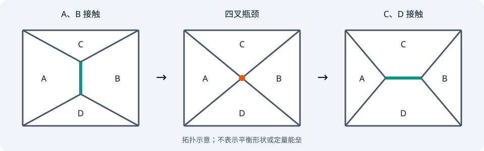

先把理论名称放下，只看一层几乎没有空隙的细胞：某些条件下邻居关系能不断改变，另一些条件下却长时间保持。覆盖密度相近，运动程度仍然不同。

如果目标是预测每个细胞下一秒的速度，就要处理主动驱动、黏滞阻力和许多细胞内过程。我们能否先提出一个较小的问题：**在相同填充条件下，从当前邻居关系换到另一种关系，是否必须经过昂贵的形变？** 这个问题仍与流动有关，却有机会先绕开完整的动力学。

## 1. 先把“动不动”拆成驱动与可达性

先选观测量。只测均方位移会混合驱动力和阻力：细胞不动，可能是没有驱动，也可能是有驱动却被挡住。邻居交换更接近结构松弛，但交换率本身仍受活动强度影响。

因此我们暂时把目标改为重排的最小代价，并保留剪切响应作为交叉检验。改变目标以后，主动过程可以先留在问题外面；代价低是否真的意味着流动快，需要之后再测。我们缩小了要解释的事，而没有提前宣称解释了所有流动。

## 2. 实际试算：只保持面积，能否解释刚性？

最简单的力学模型，只惩罚细胞偏离典型面积：$E_A=\sum_iK_A(A_i-A_0)^2$。如果初态各细胞面积恰好为 $A_0$，对整个铺砌施加面积保持的均匀剪切，每个多边形面积仍不变，沿这条形变 $E_A(\gamma)=0$，所以剪切模量也是 0。

这不是一个完全不能移动的组织，而是任何这样的剪切都不花代价。它能表达保持填满，却不能表达同密度下既有刚性状态、又有柔软状态。直接把面积约束设得更硬也无济于事，因为这条路径根本没有改变面积。失败明确指出：缺的是形状变化的代价，单独增加密度参数解决不了。

接下来不必立即猜完整能量。先观察一次换邻居究竟改变哪些几何量。

在二维多边形铺砌中，一条公共边连接两个三叉顶点。这条边逐渐缩短，两个顶点合并，短暂形成四叉连接；随后一条大致垂直的新边长出来。原来接触的两个细胞失去接触，另外两个细胞成为邻居。这就是 T1 邻居交换。

连续形变能够压缩、拉长组织；大量 T1 事件则让细胞越过彼此，改变组织的参考结构。对于不分裂、不死亡的融合单层，T1 因而是研究结构松弛的自然事件。这里关心的自由度是多边形顶点的位置和接触拓扑，而非单纯的细胞中心间距。

如果只测一个细胞是否被拉长，无法知道它是否容易完成邻居交换。反过来，能看到重排，也还不知道是能垒降低，还是主动驱动增强。因此需要一个能沿着事件路径计算的量：完成这次 T1 要经过多高的能量。

## 3. 沿一次事件选择形状变量，才提出能量

从图像可记录面积 $A_i$ 与周长 $P_i$：面积约束限制压缩，公共边和皮层的改变则影响周长。于是提出一个可检验的候选能量，而非唯一正确的微观模型

$$
E=\sum_i\left[K_A(A_i-A_0)^2+K_P(P_i-P_0)^2\right].
$$

面积项将偏离典型面积的代价装进 $K_A$；周长项描述皮层收缩与接触黏附等作用的竞争。它保留了细胞改变形状时的力学代价，同时不要求逐个模拟皮层分子。

例如将周长相关项先写成 $K_P P_i^2+\Lambda P_i$，配方后就是 $K_P(P_i-P_0)^2$ 加常数，其中 $P_0=-\Lambda/(2K_P)$。这说明偏好周长不是任意增加的几何标签：它可概括线性界面作用和二次皮层代价之间的平衡。具体边共享的因子已吸收入有效系数。

以 $A_0$ 为面积单位、$K_AA_0^2$ 为能量单位，定义

$$
a_i=\frac{A_i}{A_0},\qquad p_i=\frac{P_i}{\sqrt{A_0}},\qquad
p_0=\frac{P_0}{\sqrt{A_0}},\qquad \kappa=\frac{K_P}{K_AA_0}.
$$

则无量纲能量为 $\varepsilon=\sum_i[(a_i-1)^2+\kappa(p_i-p_0)^2]$。保持总面积和细胞数不变，仍可改变 $p_0$：密度不动，但细胞愿意付出能量去达到的形状改变了。

这里还要区分 $p_0$ 与 $p_i$。前者是模型的偏好参数，后者才是图像上测到的形状指数。一个细胞受到邻居约束，实际周长未必达到偏好值。将两者直接等同，会丢掉几何受挫这一环。

一旦把状态写成顶点坐标、把形变代价写成这些坐标的函数，问题就具有受约束极小化的结构。需要的工具由“固定某段接触、让其余形状松弛”这个任务产生，并不是先决定使用顶点模型再寻找生物例子。

## 4. 两个构型之间是否有便宜的路？

选取将被交换的边，以边长 $\ell$ 作反应坐标。每固定一个 $\ell$，允许其他顶点在给定边界和拓扑下松弛，得到受约束的能量 $E_{\rm path}(\ell)$。到达 $\ell=0$ 后改变拓扑，再让新边增长。路径上的能垒定义为

$$
\Delta E=\max_{\rm path} E_{\rm path}-E_{\rm initial}.
$$

低 $p_0$ 时，缩边迫使一些细胞离开偏好形状，能量爬升；跨过四叉瓶颈后，另一组形状又能释放部分代价。提高 $p_0$，相同拓扑变化所需的形状可能逐渐变得相容，路径上的峰降低。这就是“偏好形状控制重排”在能量景观中的含义。

为什么不能只对每个构型独立做一次无约束最小化？因为那通常只告诉我们谷底在哪里，不会告诉我们两个谷底之间要爬多高。为什么不能只研究一个孤立细胞？因为一次 T1 同时改变四个细胞与周围组织的约束。研究问题要求一条多细胞的有限形变路径。

数值得到的能垒还依赖所选路径与松弛方式。固定一条边扫描得到的是该协议下的代价，并不自动等于所有可能重排路径中的最小能垒。对同一组织取多条边，才能看到无序造成的能垒分布。

对于固定面积 $A$ 的简单 $n$ 边形，正 $n$ 边形具有最小周长。设其边长为 $s$，由

$$
A=\frac{ns^2}{4\tan(\pi/n)},\qquad P=ns
$$

消去 $s$，得到几何下界

$$
\frac{P}{\sqrt A}\ge p_{\min}(n)=\sqrt{4n\tan(\pi/n)}.
$$

六边形给出 $p_{\min}(6)\simeq3.722$，五边形给出 $p_{\min}(5)\simeq3.812$。同样面积下，少一条边，最紧凑的形状也需要更大的周长。

为什么这里会出现五边形？在一个四个六边形参与的理想 T1 中，失去公共边的两个细胞各少一条边；在交换的瓶颈构型，它们具有五边形的几何限制。即使六边形可以同时接近面积和周长偏好，这两个细胞也未必能做到。

在严格固定 $A_i=A_0$、$p_0<p_{\min}(5)$ 的理想瓶颈中，两个五边形至少具有周长能量

$$
E_{\rm pent}\ge 2K_PA_0[p_{\min}(5)-p_0]^2.
$$

这个不等式解释了**为什么几何会强迫一个非零代价**。不过它约束的是瓶颈状态的能量；只有当初态是可实现的零能量状态时，才能直接把它当作能垒的下界。实际组织的初态可能已受挫，其他细胞也会变形；允许面积变化还可能以面积代价换取较低周长代价。

提高 $p_0$ 后，五边形的周长下界不再必然与目标冲突，T1 路径便有机会变得很便宜。注意“没有这个几何障碍”还不等于“所有相邻细胞都能同时达到目标”。完整组织的相容性是集体问题，不能只由单个正多边形证明。

在这个几何估计中，五边形给出了一个值得扫描的参数尺度。它是否也控制无序组织，仍需对多组构型计算重排路径；不能由一个规则多边形直接宣布整个组织的临界点。

## 5. 再检查局部曲率，而不把它等同整条路径

T1 是有限幅度的拓扑事件；剪切模量问的是一个稳定构型附近对微小整体剪切的恢复能力。两者可以共同反映刚性变化，但需要分别计算。

设固定拓扑下的顶点坐标为 $q$。把面积与周长偏差统记为 $f_\alpha(q)$，能量写为 $E=\sum_\alpha k_\alpha f_\alpha^2$。其 Hessian 为

$$
H=2C^{\mathsf T}KC+
2\sum_\alpha k_\alpha f_\alpha\nabla\nabla f_\alpha,
\qquad C_{\alpha a}=\frac{\partial f_\alpha}{\partial q_a}.
$$

第一项表示移动顶点时改变约束的代价；第二项来自没有消除的面积或周长残差，可理解为预应力相关贡献。在所有目标都可同时达到的理想构型中，$f_\alpha=0$，若某个运动方向满足 $Cu=0$，它就没有二次恢复代价。目标不相容时，残余应力则可能为这些方向提供刚性。

这个展开说明，刚性变化不仅是一个模量数字减小，也可以表现为低曲率方向增多、集体形变更容易。仅数面积和周长约束的数量还不够：几何相容性、约束独立性和预应力都会进入 $H$。

进一步，施加小剪切 $\gamma$，令 $u$ 是顶点相对均匀剪切后的额外松弛，在无初始剪切应力的稳定构型附近，局部能量可写成

$$
E=E_0+\frac12 A_{\rm tot}G_{\rm aff}\gamma^2
+\gamma\,\Xi^{\mathsf T}u+\frac12u^{\mathsf T}Hu.
$$

在稳定分支上、去除平移等零模后最小化，得到 $u_*=-H^+\Xi\gamma$，因此

$$
\boxed{G=G_{\rm aff}-\frac{1}{A_{\rm tot}}\Xi^{\mathsf T}H^+\Xi}.
$$

$H^+$ 是相应受约束子空间上的伪逆。内部松弛会降低均匀形变估计的刚性；软的集体方向若与剪切耦合，就能提供更强松弛。这是从能量景观到可测弹性的桥梁。若形变中跳到另一能谷或触发 T1，便超出这条局部展开，需要另行记录事件。

局部曲率与有限幅度路径是两种不同的计算。它们若随同一个形状参数一起变化，会增强几何解释；若只有一者变化，就应检查选取的事件、边界与状态是否遗漏了集体重排。

## 6. 什么算已经解释，什么仍需要动力学？

最直接的数值实验，是固定细胞数、盒面积、$K_A,K_P$ 和面积偏好，扫描 $p_0$。为每个参数生成多组无序初态，检查残余力后，再分别测三件事：受约束 T1 能垒的分布，小剪切后充分松弛的能量曲率，去掉平移模式后的 Hessian 低特征值。还应比较有序六边形与无序铺砌，避免将单细胞有序几何阈值与无序集体响应混为一谈。

实验中可配对观察细胞形状、邻居交换率和力学响应。但从实际形状指数 $p_i$ 反演模型 $p_0$ 需要额外假设；如果细胞活动增强，即使能垒相同，重排也可能更频繁。被动几何模型给出了形状改变足以降低某些阻碍的机制，真实的松弛时间还需要驱动、耗散和事件统计。

这个结果改变了一个常见直觉：融合组织里的黏附、皮层收缩与流动性的关系，不能完全照搬稀疏黏性颗粒。它们改变细胞可达到的形状，而形状又改变重排路径的代价。密度固定时，仍然有一组可以控制力学的自由度。

这次简化何时算够用？若在固定活动和密度条件下，形状模型能够同时预测重排代价的变化与小形变响应，就可以先用它研究这组观测；若问题是重排发生的绝对速率，还必须给出驱动和耗散。几何路径降低障碍是一种充分机制，看到细胞移动则不足以反推障碍究竟如何改变。

## 论文究竟多做了什么？

[Bi、Lopez、Schwarz 与 Manning (2015)](https://www.nature.com/articles/nphys3471)在无序融合顶点模型中计算 T1 能垒、振动谱与剪切响应，识别出密度之外由目标形状控制的刚性变化。[原文的四细胞计算与讨论](https://arxiv.org/html/1409.0593v4)还将约 3.81 的参数尺度同五边形几何联系起来。

论文比我们的面积保持剪切反例多做了集体构型、统计分布和参数扫描；这些证据才支持从局部几何走向组织刚性的判断。本篇先排除面积单独控制、再选择路径变量的顺序，是教学重构。Hessian 和内部松弛展开也是理解力学的一般工具，不是作者发现过程的记录。新的数值扫描仍是待执行方案。

[← 随机生长和分裂下，细胞大小为何稳定？](/notes/solvable_biology/cell_size/) · [专题目录](/notes/solvable_biology/) · [细胞怎样从带噪声的信号推断位置？ →](/notes/solvable_biology/positional_information/)
