Ea、Ep 内移时，局部收缩要克服周围细胞的阻碍；背侧插入时，接触沿特定方向更新；身体伸长时，表皮承受肌肉拉动，又保留部分形变。拥挤、主动产力和材料更新贯穿这些过程，但各自的作用随阶段而变。

软物质理论把其中一些关系写得很清楚。边界与界面作用选择细胞排列，持续活动推动重排，黏附和摩擦影响传力，骨架重塑改变卸载后的形状。在线虫中，这些机制还受到细胞谱系、极性和分裂时序的约束；它们决定谁在何时、沿哪个方向移动。

从颗粒堆积到顶点和主动向列模型，可以逐步讨论几何、刚性与拓扑，再与线虫的四细胞排列、内移、手性流、背侧插入和伸长对应。固流性质则需要结合应力松弛、蠕变和屈服来判断，单靠细胞移动或形状改变还不够。

## 1. 线虫中的直接研究 {#celegans-studies}

先看线虫已有的结果：受限排列与界面作用、内移中的产力和传力、手性流及定向插入、伸长中的材料重塑。细胞质微流变单独说明，因为它测量的尺度与组织重排不同。

### 1.1 四细胞排列怎样同时受卵壳和界面张力控制 {#81-四细胞排列怎样同时受卵壳和界面张力控制}

早期排列是最适合检验颗粒模型的线虫问题之一。细胞数量少，分裂时间、大小和方向可以逐一指定，卵壳形状也能测量。Fickentscher 等用受限软球模型重现早期细胞轨迹，说明几何排斥和边界已经能解释相当一部分有序运动。[Fickentscher 等，2013](https://doi.org/10.1016/j.bpj.2013.09.005) 接下来的问题是：这些条件能否解释胚胎对几何扰动的适应，以及不同细胞接触程度的差异？

Yamamoto 与 Kimura 改变线虫卵壳的长宽比，并比较只有排斥的模型与加入吸引的模型。在去壳胚胎中，AB 的两个子细胞和 EMS 结合较紧，EMS 与 P2 则较松。作者用稳定中心距与两细胞半径之和的比值 $\alpha_{ij}=d_{ij}^{*}/(R_i+R_j)$ 描述这一差异，并把不同接触对的 $\alpha_{ij}$ 放入非均一吸引模型。这里的“非对称”指不同细胞对具有不同相互作用，不是 $i$ 对 $j$ 与 $j$ 对 $i$ 的作用力不相等。加入这些差异后，模型能在更宽的卵壳形状范围内保留 diamond 排列，也能出现只有排斥时遗漏的 T 形排列。[Yamamoto 与 Kimura，2017](https://doi.org/10.1242/dev.154609)

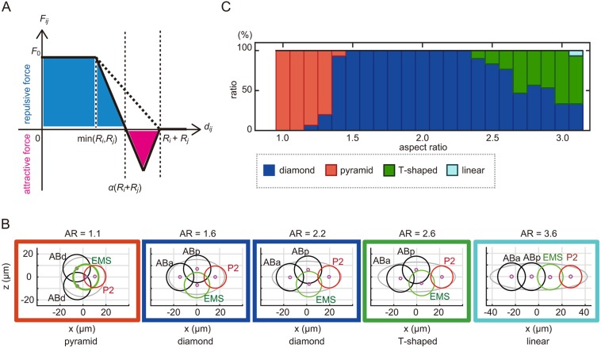

*图 1｜壳形变化与四细胞排列稳定性。引自 [Yamamoto 与 Kimura（2017），Fig. 5](https://pmc.ncbi.nlm.nih.gov/articles/PMC5769634/#DEV154609F5)，CC BY 3.0。A 为模型中的距离与相互作用力；B 改变卵壳长宽比后的排列；C 为不同排列出现的比例。模型对 EMS–P2 与其他细胞对采用不同的稳定距离参数。*

这个结果给“受限堆积”增加了一层含义。卵壳可以把很多排列排除在外，细胞间作用则决定剩下的排列中哪些更稳定。谱系差异因此能通过力学参数进入空间结构。一个模型若只在正常卵壳里得到正确形状，还不能说明它抓住了维持排列的机制；改变壳形以后是否仍然正确，是更有区分力的检验。

不过，$\alpha_{ij}$ 是有效几何参数。中心距离变短，可能来自黏附增强，也可能来自自由表面皮层张力升高，使细胞更愿意扩大相互接触的区域。要区分这两种机制，需要从中心粒子转向界面描述。一个可用于比较的表面能是

$$
E=\sum_i\gamma_{i0}A_{i0}
+\sum_{i\lt j}\gamma_{ij}A_{ij}
+\sum_i\frac{K_V}{2V_i^0}(V_i-V_i^0)^2.
$$

$A_{i0}$ 是细胞朝向外部介质的面积，$A_{ij}$ 是两细胞的接触面积，$\gamma_{i0}$ 和 $\gamma_{ij}$ 是相应的有效界面张力。最后一项限制体积变化，$K_V$ 具有压力单位；卵壳作为外部几何约束另行加入。对称、无外部压迫的两细胞接触中，若每一侧自由表面的张力为 $\gamma_0$，并把单侧表面与接触平面的夹角定义为 $\theta$，局部力平衡给出 $\gamma_{12}=2\gamma_0\cos\theta$。同一个接触角可以对应不同的绝对张力，因此角度主要提供张力比。

这一层区分已有直接的线虫实验支撑。Yamamoto 等结合 AFM、活体成像和张力反演，研究了两细胞与四细胞阶段。他们把 ABa、ABp、EMS 的紧密结合与自由表面张力增加联系起来，把 P2 初期相对外凸与较高的接触界面张力联系起来；还发现 cadherin 对接触张力既有直接贡献，也会通过调节 actomyosin 间接起作用。[Yamamoto 等，2026](https://doi.org/10.1016/j.devcel.2026.04.013)

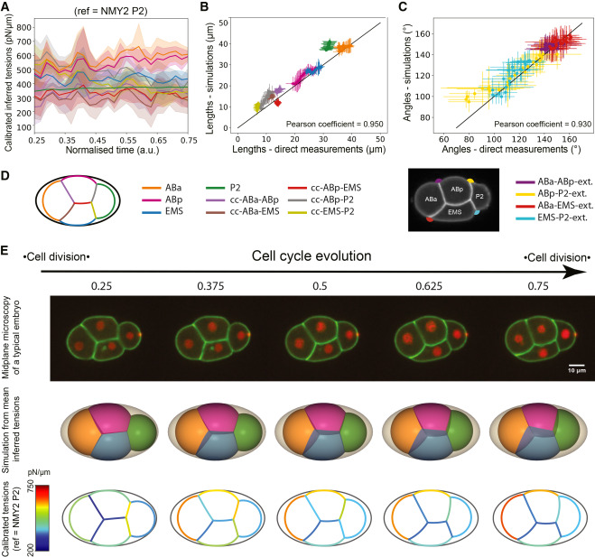

*图 2｜从界面张力回到卵壳内的形状。引自 [Yamamoto 等（2026），Fig. 5](https://doi.org/10.1016/j.devcel.2026.04.013)，CC BY 4.0。A 为校准后的张力时序，B、C 比较预测与实测的接触角和界面长度，E 对照显微影像、三维模型与张力分布。图中的张力具有独立实验校准，区别于只给出相对大小的形状反演。*

由此可以看出几类模型之间的关系。球模型用距离势概括细胞接触的结果；表面模型把自由表面和接触界面分开；相场模型再允许轮廓和接触区连续改变。增加自由度的价值，在于能够回答“哪一个界面的性质改变了”。若研究目标只是排列是否稳定，球模型可能已经够用；若要解释 HMR-1 或 myosin 扰动为何改变某一对细胞的接触，就需要把这些界面分别保留下来。

### 1.2 原肠胚内移怎样结合堆积能垒与力传递 {#82-原肠胚内移怎样结合堆积能垒与力传递}

Ea、Ep 内移可以沿两条模型路线理解。一条研究细胞数增加、尺寸减小和壳内拥挤怎样改变内外排列的机械代价；另一条研究顶端 actomyosin 怎样通过连接牵动细胞边界。前者解释什么样的移动在几何上有利，后者解释细胞怎样实际获得这种移动。Miao 等的受限堆积预印本展示了仅含各向同性相互作用时出现内移的可能性；Roh-Johnson 等和 Slabodnick 等的实验则表明，皮层已经发生收缩与细胞边界真正开始收缩之间，存在力学耦合的问题。[Miao 等，2021，预印本](https://arxiv.org/abs/2105.05795)；[Roh-Johnson 等，2012](https://doi.org/10.1126/science.1217869)；[Slabodnick 等，2023](https://doi.org/10.1371/journal.pgen.1010319)

Thiels 等的三维定量成像与力学建模预印本，把 Ea、Ep 的皮层流、顶端接触、邻近分裂和胚胎尺度运动放到一起讨论，为这种多细胞视角提供了新的线索。[Thiels 等，2026，预印本](https://doi.org/10.64898/2026.03.30.715391) 另一个有用的对照来自原始生殖细胞：它们可以通过 E-cadherin 介导的连接，随内胚层细胞一起进入内部。[Chihara 与 Nance，2012](https://doi.org/10.1242/dev.079863) 一个细胞发生持续位移，并不要求它本身具有主动粒子模型里的推进项；活动也可以发生在它的邻居身上，再通过接触传递。

在线虫中比较这些解释，需要同时追踪皮层流速、连接边界速度、顶端面积和邻居位移。若皮层仍在流、边界却脱耦，首先指向传力问题；若局部收缩近似保留，改变分裂时序后内移路径和邻居运动显著改变，则更能说明几何与集体松弛的贡献。

### 1.3 手性皮层流怎样把局部活动变成细胞转动 {#83-手性皮层流怎样把局部活动变成细胞转动}

早期线虫还有一种主动过程，很难用“每个细胞获得一个随机推进力”来表达：分裂细胞的两半可以出现方向相反的皮层旋转流。Pimpale 等比较不同谱系，发现这类 counter-rotating flow 与 AB 谱系的分裂轴偏转有关，并通过调节 Rho 通路和 myosin 活动检验二者的关系。[Pimpale 等，2020](https://doi.org/10.7554/eLife.54930)

<figure class="celegans-video celegans-stage-video" id="worm-chiral-cortex" style="--stage-video-width: 34rem;">
<video controls loop preload="metadata" playsinline width="270" height="178" aria-label="线虫AB细胞分裂时两半皮层的反向旋转流">
<source src="https://cdn.ncbi.nlm.nih.gov/pmc/blobs/5b36/7394549/35a054ebf3fe/elife-54930-video2-pmcvs_normal.mp4" type="video/mp4">
浏览器无法播放时，可通过下方原始影片链接观看。
</video>
<figcaption><strong>AB 细胞分裂时的皮层流</strong>｜Pimpale 等（2020），Video 2，CC BY 4.0。NMY-2::GFP 标记 myosin；留意分裂沟两侧的流动方向。这里追踪的是细胞表面的物质流，不是两个子细胞中心绕圈运动。<a href="https://elifesciences.org/articles/54930#video2" target="_blank" rel="noopener">原始影片与说明</a>。</figcaption>
</figure>

这类活动首先产生的是表面切向流和力矩。细胞中心完全不动时，皮层仍然可以持续运动。一个局部薄层近似可以把沿细胞长轴 $x$ 变化的环向流 $v_\theta$ 写成

$$
\eta_s\partial_x^2v_\theta-\Gamma v_\theta
+\partial_x\tau_a(x)=0,
\qquad
\ell_\Gamma=\sqrt{\eta_s/\Gamma}.
$$

$\eta_s$ 是表面黏度，$\Gamma$ 是皮层对环境的摩擦，$\tau_a$ 表示具有方向性的主动切向应力分量；这里采用使该分量以 $+\partial_x\tau_a$ 进入力平衡的符号约定。主动应力的空间变化驱动流动，黏性把相邻区域耦合起来，摩擦使流动在长度 $\ell_\Gamma$ 上受到屏蔽。真实细胞是曲面，完整理论还要处理曲率、收缩流和活性力矩；这个一维式子只保留它们之间的基本竞争。

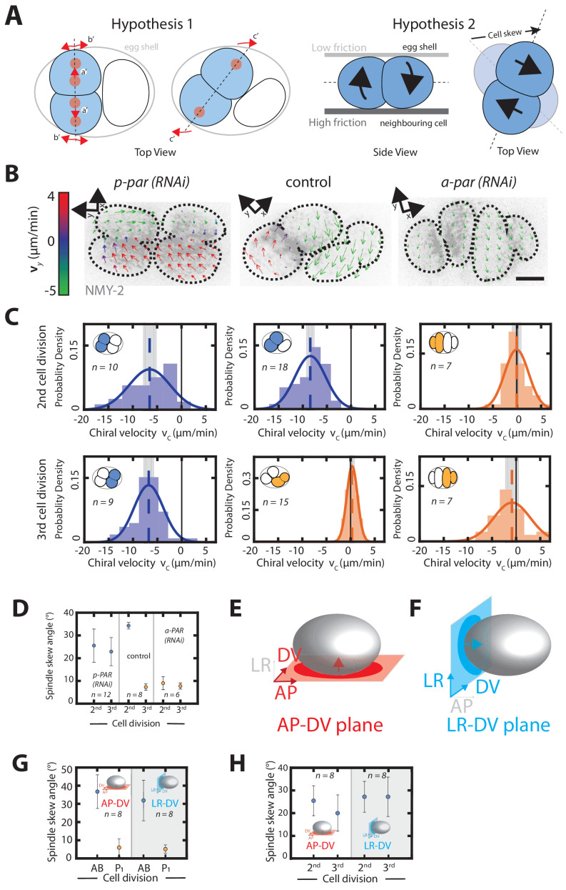

*图 3｜主动流与受限几何怎样共同改变排列。引自 [Pimpale 等（2020），Fig. 3](https://pmc.ncbi.nlm.nih.gov/articles/PMC7394549/#fig3)，CC BY 4.0。A 比较几何限制与非均匀摩擦传动的解释；B、C 为皮层流及谱系相关差异；其余面板比较偏转方向和不同扰动条件。*

皮层怎样带动整个细胞偏转，可以从总力矩平衡看得更清楚。为简化，只考虑细胞绕固定中心的一条轴 $\mathbf e$ 转动。设相对细胞本体的皮层流为 $\mathbf u_c(\mathbf s)$，本体角速度为 $\Omega$，环境暂时静止，摩擦作用于皮层相对环境的总速度。忽略其他外力矩时，

$$
\Omega=
-\frac{\displaystyle
\int_A\Gamma(\mathbf s)
[\mathbf r\times\mathbf u_c(\mathbf s)]\cdot\mathbf e\,dA}
{\displaystyle
\int_A\Gamma(\mathbf s)|\mathbf e\times\mathbf r|^2\,dA}.
$$

分子是皮层主动流通过摩擦传出的力矩，分母是本体转动的摩擦阻力。在理想对称的反向旋转流中，两半的力矩可能抵消；邻细胞接触和外部包被提供不同摩擦时，抵消就可能被打破。于是，相同的皮层流在不同接触几何中可以导致不同偏转。这也是为什么把摩擦一律当作“越小越容易运动”会失效：摩擦既耗散能量，也提供把表面流转成整体运动的传动条件。

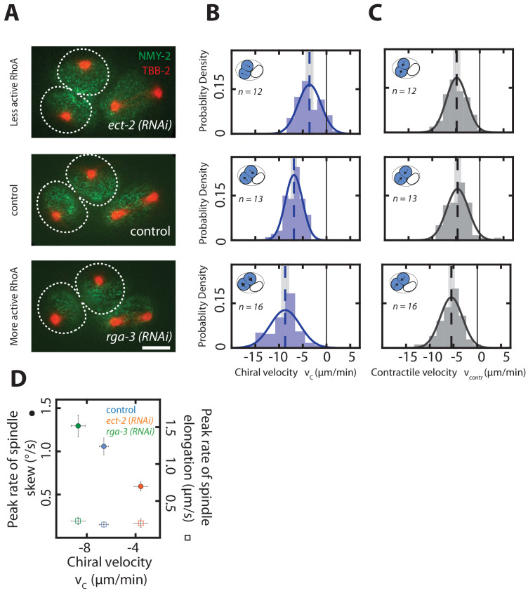

*图 4｜把主动流的强弱与偏转速率分开测量。引自 [Pimpale 等（2020），Fig. 4](https://pmc.ncbi.nlm.nih.gov/articles/PMC7394549/#fig4)，CC BY 4.0。A–C 比较 Rho 调控条件下的手性流和朝向分裂沟的收缩流，D 比较皮层流、轴偏转及纺锤体伸长。不同运动分量的测量帮助区分“收缩整体变强”与“旋转分量改变”。*

黏附还可能在皮层流中被重新分配。Khor 等在两细胞胚胎中观察到 HMR-1 的定向流与手性分布，并发现这种接触图案可影响 AB 收缩环的非对称闭合。[Khor 等，2025](https://doi.org/10.1016/j.cub.2025.09.052) 若把这类机制纳入模型，界面就需要一个随时间变化的黏附变量 $c$，例如采用

$$
\partial_t c+\nabla_s\cdot(c\mathbf u_c)
=D_s\Delta_sc+k_{\rm on}c_{\rm pool}-k_{\rm off}c.
$$

这个候选方程把皮层流的搬运、表面扩散和分子交换分开，并不是该论文的拟合模型。它带来的关键变化是：界面性质开始具有历史。先前的皮层流可以改变后来的黏附分布，黏附又改变局部摩擦或界面张力，再反过来影响流动和分裂。固定的两体距离势很难保存这条反馈；带界面组分的相场或可变形表面模型则可以逐项加入。

这些结果使线虫中的 active matter 问题比“主动速度多大”更具体：需要问清活动发生在细胞中心还是皮层，产生的是净力还是力矩，哪一部分环境提供摩擦，以及黏附图案是否会被流动改写。手性也不能与第二部分的向列缺陷混为一谈；一个描述左右不对称的动力学，一个描述方向场绕一圈后的结构。

### 1.4 背侧插入怎样区分定向迁移与组织流动性 {#84-背侧插入怎样区分定向迁移与组织流动性}

背侧插入具有很强的方向和身份信息。两侧细胞形成朝内侧的突起，并逐步取得交替排列。Rac、CDC-42 和 TIAM-1 的研究分别约束突起产生和方向控制。[Walck-Shannon 等，2015](https://doi.org/10.1242/dev.127597)；[Walck-Shannon 等，2016](https://doi.org/10.1371/journal.pgen.1006415)；[Zhu 等，2024](https://doi.org/10.1242/jcs.261509) 对这种过程，随机转向的主动粒子可以作为运动基线，但模型还需要知道细胞应朝哪一侧前进。

*图 5｜背侧插入的突起、形状与定向。引自 [Walck-Shannon 等（2016），Fig. 2](https://doi.org/10.1371/journal.pgen.1006415.g002)，CC BY 4.0。A 比较细胞轮廓，B 比较尖端方向，C 比较长宽比；这些量分别约束形变与极性，不能由同一个“活动强度”代替。*

这里还有一个容易在顶点模型里丢失的过程：细胞可以先在基底侧伸出突起，再发生顶端接触更新。若用单层多边形把整个细胞压成一个轮廓，模型中的 T1 时间可能对应后一个事件，驱动却来自前一个事件。因此，应分别记录基底前缘开始前进的时间、顶端旧接触缩短的时间，以及新接触能够持续承载的时间。它们之间的延迟能约束顶底耦合、细胞形变与连接成熟。

由此可以区分两种常被合在一起的解释。一种是组织的重排阻力降低，同样的定向驱动更容易完成插入；另一种是组织阻力近似保留，细胞的方向控制或牵引能力改变。两者都能影响插入速度。前者还应改变对小幅外力或局部释放的响应，后者则可以首先改变突起方向、运动持续性或皮层与边界的速度差。

接触消失也必须按事件分类。线虫表皮会通过 EFF-1 介导的融合形成合胞体，因此在较长的发育时间窗里，细胞节点本身并不守恒。[Mohler 等，2002](<https://doi.org/10.1016/S1534-5807(02)00129-6>)

| 观察到的变化 | 空间或拓扑含义 | 对模型的处理 |
| --- | --- | --- |
| 顶端旧接触消失，基底接触仍在 | 某一层的邻接改变，三维细胞未必分离 | 分层接触图或三维界面 |
| 四个细胞完成旧邻居与新邻居交换 | 可与 T1 过程比较 | 记录方向、持续时间与逆转 |
| 两个细胞之间的膜消失，细胞质连通 | 细胞融合，两个节点合为一个 | 更新节点及原有界面 |
| 一个母细胞产生两个子细胞 | 分裂引入新节点和新接触 | 按谱系建立对应 |

若把后三种事件全部统计成邻居保持率下降，就很容易得到“组织越来越流动”的结论，却不知道细胞究竟通过哪种方式改变结构。在线虫中，谱系、膜标记与融合信息可以帮助把这些事件分开。

### 1.5 腹侧包裹怎样从自由边界推进变成连接承载 {#85-腹侧包裹怎样从自由边界推进变成连接承载}

腹侧包裹中的活动发生在一片尚有开口的表皮前缘。Leading cells 先在中线相遇，后方 pocket 随后封闭；前缘下方的神经母细胞还提供一个会变形的接触环境。经典研究区分了 actin 依赖的推进和后续封闭，cadherin 相关实验进一步说明，初次相遇与稳定封口之间还存在连接建立的过程。[Williams-Masson 等，1997](https://doi.org/10.1242/dev.124.15.2889)；[Raich 等，1999](<https://doi.org/10.1016/S0960-9822(00)80015-9>)

*图 6｜从自由前缘到封闭表面的动态过程。引自 [Bernadskaya 等（2012），Fig. 2](https://doi.org/10.1371/journal.pgen.1002863.g002)，CC BY 4.0。A 为 actin 报告系统显示的前缘行为和局部放大，B 比较相关事件的时间间隔。前缘位置、突起分布与事件时间可以分别约束推进和封口模型。*

拓扑的改变也与 T1 不同：先前暴露于开口的两段自由边界，转成相互连接的界面，边界条件随之改变。将整个过程称为组织流化，会漏掉封口之后建立承载路径这一步。腹侧包裹因而需要同时讨论迁移、曲率、底层组织运动和连接成熟，单独增加主动粒子的速度很难代替这些机制。

### 1.6 伸长中的 actin 取向怎样进入主动固体模型 {#86-伸长中的-actin-取向怎样进入主动固体模型}

到了早期伸长，主要问题开始从“细胞怎样更换邻居”转向“不同区域怎样分担形变”。侧表皮的收缩、背腹表皮的 actin 排列，以及连接和外部结构的传力共同作用。Vuong-Brender 等通过方向相关的激光切割分析了应力与材料各向异性，Fang 等则把主动收缩和纤维取向变化放入连续体模型。[Vuong-Brender 等，2017](https://doi.org/10.7554/eLife.23866)；[Fang 等，2021](https://doi.org/10.1126/sciadv.abg3264)

向列张量在这里仍然有用，但需要明确它代表哪一种方向。由细胞长轴计算的 $\mathsf Q_{\rm cell}$，由 actin 纤维计算的 $\mathsf Q_{\rm actin}$，以及由瞬时速度计算的取向，可以给出不同结果。细胞整体沿身体轴变长，并不要求其中每根承载纤维也沿同一方向排列。比较它们是否耦合，可以用局部方向差的 $\langle\cos2(\theta_{\rm cell}-\theta_{\rm actin})\rangle$；接近 1 表示平行，接近 −1 表示垂直，接近 0 表示该平均下没有明显偏好。

### 1.7 肌肉周期拉动怎样转成持续伸长 {#87-肌肉周期拉动怎样转成持续伸长}

后期伸长更接近一个被周期驱动的复合材料问题。肌肉缩短时向表皮传递负载，表皮与连接既要承受短时形变，又要在多次循环之后改变较长期的形状。若每个细胞都只获得持续随机推力，模型会漏掉驱动的节律、肌肉位置以及表皮的加载与卸载路径。

这种区分与线虫实验直接相关。Lardennois 等研究的 actin 黏塑性锁定涉及组织如何保留肌肉引起的形变，相关通路受损时可出现伸长后回缩。Fang 等把 actin 切断与重新束化的速率竞争写进连续体模型；Yang 等进一步研究了周期机械输入、表皮连接更新和伸长之间的关系。[Lardennois 等，2019](https://doi.org/10.1038/s41586-019-1509-4)；[Fang 等，2021](https://doi.org/10.1126/sciadv.abg3264)；[Yang 等，2025](https://doi.org/10.1016/j.devcel.2025.06.012)

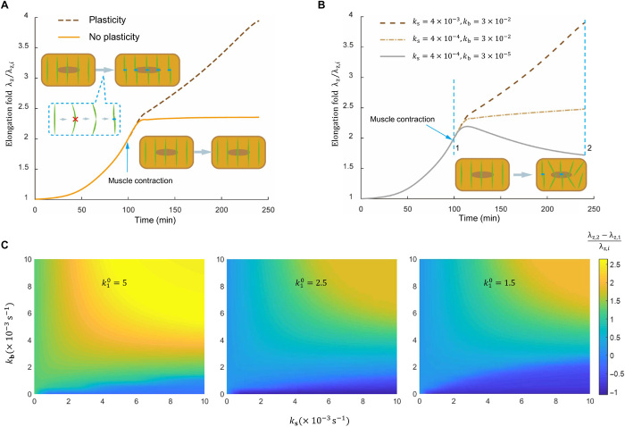

*图 7｜材料更新也可能破坏承载。引自 [Fang 等（2021），Fig. 4](https://pmc.ncbi.nlm.nih.gov/articles/PMC8245039/#F4)，CC BY-NC 4.0。A 为有无 actin 塑性的模型比较，B、C 改变切断与重新束化速率。过快拆解而来不及重建，与适度更新产生的持续伸长，具有不同后果；图中曲线为模型输出。*

### 1.8 怎样从线虫轨迹得到有效相互作用和力网络 {#88-怎样从线虫轨迹得到有效相互作用和力网络}

前面的模型往往从势能出发预测轨迹，也可以反过来由轨迹约束相互作用。Koyama 等利用细胞核追踪，在有效中心力与过阻尼动力学的假设下反演细胞间作用，并将方法用于线虫胚胎。他们获得了含排斥区和吸引区的有效距离势，比较不同阶段及归一化后的曲线，再用这些作用进行形状模拟。[Koyama 等，2023](https://doi.org/10.1371/journal.pcbi.1011306)

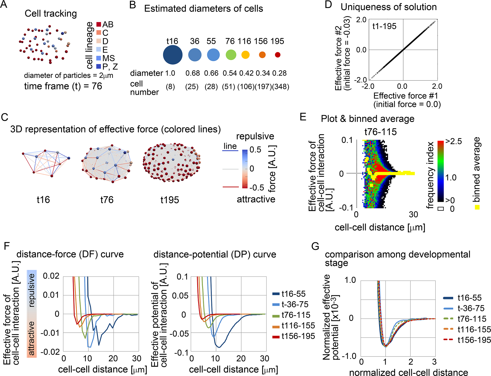

*图 8｜轨迹如何约束粗粒化模型。引自 [Koyama 等（2023），Fig. 4](https://doi.org/10.1371/journal.pcbi.1011306.g004)，CC BY 4.0。A、B 为谱系轨迹及估计尺寸，C 为推断的有效力网络，D 检查给定方法中不同初值的结果，E–G 为距离—力、距离—势及归一化比较。力采用任意单位，不能直接与 AFM 校准的张力相加。*

### 1.9 线虫细胞质的微流变为何不能直接代表组织物态 {#97-线虫细胞质的微流变为何不能直接代表组织物态}

线虫中已经可以测量发育过程中的细胞质力学。Koizumi 等的预印本使用微米级磁性液滴做主动微流变，同时用 40 nm 荧光微珠追踪局部运动。作者观察到早期发育中细胞质蠕变柔量逐渐降低，抑制胞质分裂后这一趋势仍存在，因而不能完全归因于细胞越分越小。[Koizumi 等，2026，预印本](https://doi.org/10.64898/2026.05.19.726147)

*图 9｜线虫中对材料响应的直接测量。引自 [Koizumi 等（2026），Fig. 3](https://pmc.ncbi.nlm.nih.gov/articles/PMC13228458/#F3)，预印本，CC BY-NC-ND 4.0。A 为随加载时间变化的柔量，B 比较 10 s 时的柔量，C 为拟合的时间指数，D 为卸载恢复比例。原图完整保留。*

这里的磁滴在细胞内部运动，主要探测局部细胞质对受控力的响应；Mongera 等的微滴位于细胞群之间，探测周围组织的重排与承载。相似的磁性探针，因所在位置不同，测到的是不同层次的材料。

这一差别可以用一组并不矛盾的变化说明：细胞内部变得更难形变，细胞之间的连接却更快交换，组织仍可能更快释放剪切应力；反过来，细胞质仍较黏性，持久连接和方向性骨架也可以让多细胞网络在发育时间尺度内承载。细胞质、皮层、连接与整个细胞群需要分别定义响应。柔量下降说明给定条件下更难被推动，并不等于已经观察到细胞质或组织的固化相变。

## 2. 可供借鉴的其他理论 {#transferable-theories}

颗粒、顶点与 Voronoi、主动向列、力网络以及其他胚胎的固流研究，为这些现象提供可比较的物理机制。由这些理论出发构造的线虫候选算例集中放在后段，避免与直接研究混读。

### 2.1 从胚胎堆积到软物质问题 {#1-从胚胎堆积到软物质问题}

#### 2.1.1 拥挤 刚性与运动停滞怎样区分 {#11-拥挤-刚性与运动停滞怎样区分}

颗粒体系通常先用体积分数描述拥挤程度。若颗粒体积为 $V_i$、容器体积为 $V_{\rm box}$，写成 $\phi=\sum_iV_i/V_{\rm box}$。在无摩擦软球模型里，压缩使更多颗粒接触，并可能建立能抵抗剪切的网络。Jamming 研究关心这种机械稳定性怎样出现；玻璃态研究还关心结构松弛为什么越来越慢。两者相关，却不由同一个观测定义。[O’Hern 等，2003](https://doi.org/10.1103/PhysRevE.68.011306)

细胞组织的空间占据方式更复杂。细胞可以变形、黏附、分裂或融合，表皮还可能在几乎没有空隙的条件下持续更换邻居。这时填充率几乎不变，重排速率和剪切响应仍会显著改变。若把球模型中发生数值重叠的球体积直接相加，得到的 $\phi$ 还可能超过 1；它与三维分割得到的真实细胞体积分数并不是同一测量。

观察时间也影响“停住”的判断。一个细胞在半分钟内只作小幅摆动，在十分钟内却可能完成一次邻居交换。因此，描述组织状态时，至少需要给出观察时间、是否存在持续驱动，以及关心的是位移、接触更新还是受力响应。

#### 2.1.2 卵壳不仅限制体积 还选择接触排列 {#12-卵壳不仅限制体积-还选择接触排列}

对早期胚胎，容器的形状本身就能改变接触拓扑。四个相互黏附的近球形细胞，在自由空间中与在狭长壳内，可能采用不同排列。Giammona 与 Campàs 系统比较了分裂、细胞相互作用和外部包裹对四细胞堆积的影响，说明边界能够显著缩小可实现的排列范围。[Giammona 与 Campàs，2021](https://doi.org/10.1371/journal.pcbi.1007994)

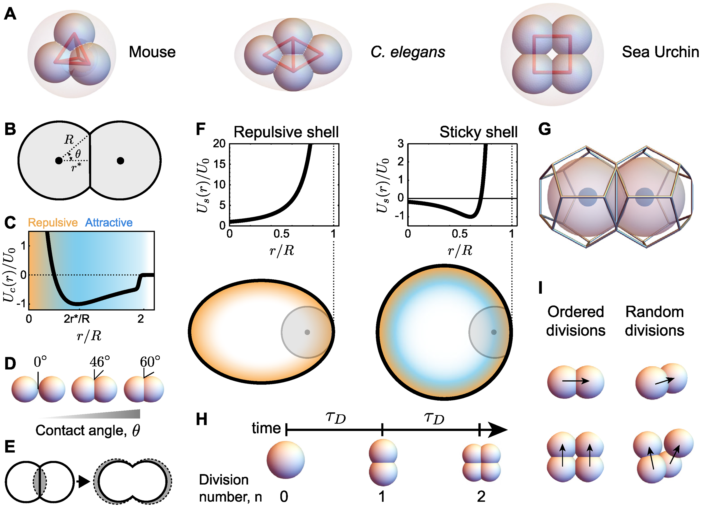

*图 10｜早期胚胎的受限堆积。引自 [Giammona 与 Campàs（2021），Fig. 1](https://journals.plos.org/ploscompbiol/article?id=10.1371/journal.pcbi.1007994#pcbi-1007994-g001)，CC BY 4.0。A 比较不同物种的四细胞排列，B–F 定义细胞接触、作用势和包裹边界，G 为三维 Voronoi 构造，H、I 描述分裂时间与方向。图中的几何理想化服务于早期排列问题。*

分裂还在不断改变问题本身。细胞数增加、尺寸减小、接触网络更新，即使总体积变化不大，原先稳定的排列也可能失去稳定性。可以用 $\tau_{\rm div}/\tau_{\rm mech}$ 比较两次分裂之间的时间与机械松弛时间：比值较大时，细胞有机会在下一次分裂前调整；比值较小时，新分裂会作用在尚未松弛的组织上。不同顺序因此可能把胚胎带到不同的暂时排列。

[第一篇](/notes/celegans/embryonic_morphogenesis/gastrulation/)中的球模型和相场模型，正是这条路线的不同分辨率。球模型便于扫描大小、分裂与壳形，相场更容易比较完整轮廓和接触面积。二者共同保留了一个问题：当前排列是稳定形态，还是分裂与主动运动不断推动下的过渡状态？

#### 2.1.3 从位置到形状 再到取向 {#13-从位置到形状-再到取向}

| 模型 | 基本自由度 | 最适合回答的问题 | 主要省略 |
| --- | --- | --- | --- |
| 被动软球或软盘 | 中心位置与有效大小 | 拥挤、接触、笼困和边界选择 | 细胞轮廓及内部骨架 |
| 主动粒子 | 位置、推进方向与持续时间 | 自驱动怎样克服或增强运动限制 | 真实细胞形状和连接装配 |
| 顶点模型 | 顶点位置、面积、周长和邻接 | 满铺组织的刚性与 T1 重排 | 单层模型中的顶底差别 |
| 主动 Voronoi 模型 | 细胞中心、极性及其诱导分区 | 运动持续性与集体松弛 | 独立顶点自由度及非 Voronoi 轮廓 |
| 三维顶点或相场 | 体积、界面、接触与形状 | 内移、顶底邻居不同、壳内堆积 | 需要较多三维参数和数据 |
| 主动向列液晶 | 粗粒化取向、密度、流速和应力 | 有序区域、缺陷和长波流动 | 单个细胞的邻接网络 |

线虫的 AB 细胞还提示了表中未单列的一种分辨率：以细胞曲面上的流动和力矩为自由度的主动皮层模型。它能够在细胞中心几乎不移动时描述显著的表面活动，[手性皮层流怎样把局部活动变成细胞转动](#83-手性皮层流怎样把局部活动变成细胞转动)中已有直接的线虫结果。

模型中的“主动”也有不同来源。细胞迁移可以近似为推进力，皮层收缩更适合写成主动应力，分裂则改变细胞数量、几何和局部受力。它们对体系所做的事不同，不能都由一个随机推力代表。

### 2.2 被动软颗粒的刚性从哪里来 {#2-被动软颗粒的刚性从哪里来}

#### 2.2.1 接触力来自重叠能量 {#21-接触力来自重叠能量}

先用无摩擦软盘建立一个机械基线。令两颗粒中心距为 $r_{ij}$、接触距离为 $d_{ij}=R_i+R_j$，重叠长度为 $\delta_{ij}=d_{ij}-r_{ij}$。一个简单的排斥能量和运动方程是

$$
U=\frac{k}{2}\sum_{i\lt j}\langle\delta_{ij}\rangle_+^2,
\qquad
\zeta\dot{\mathbf r}_i=-\nabla_iU,
\qquad
\langle x\rangle_+=\max(x,0).
$$

$k$ 是接触刚度，$\zeta$ 是运动阻力。仅有排斥时，未接触的颗粒之间没有力；压缩后，接触数和预压力会一起改变。细胞黏附可以通过吸引项加入，但随之需要区分能承受拉力的黏附连接和只能承受压缩的接触。

在给定接触网络内，小位移引起的能量变化由 Hessian 矩阵 $\mathsf H$ 控制：

$$
\Delta U=\frac12\,\delta\mathbf r^{\mathsf T}\mathsf H\delta\mathbf r,
\qquad
\mathsf H_{\alpha\beta}
=\frac{\partial^2U}{\partial r_\alpha\partial r_\beta}.
$$

若某一集体位移方向对应很小的特征值，沿它运动就只需较少能量。这些软模态可能由很多颗粒一起移动构成。一个细胞被四周邻居包围，并不意味着它只能单独挤开所有邻居；组织可能存在一条集体让位的低代价路径。

#### 2.2.2 接触数怎样约束运动 {#22-接触数怎样约束运动}

将接触近似成中心力弹簧，兼容矩阵 $\mathsf C$ 把颗粒位移映射为各弹簧的一阶长度变化。$\ker\mathsf C$ 中的位移不改变弹簧长度；$\ker\mathsf C^{\mathsf T}$ 中的张力分布则能在没有外力时彼此平衡，称为自应力态。秩与零空间的关系给出

$$
N_0-N_{\rm ss}=dN-N_b.
$$

$N_0$ 包含刚体平移、自由边界下的刚体转动和内部零模态；$N_{\rm ss}$ 是自应力态数，$N_b$ 是弹簧数。这个等式是线性代数关系。把它转成“接触足够就刚”的经验判断，还需要接触约束彼此独立、边界处理正确，并检查预应力。

例如，二维四节点正方形只有四条边时，除去三种刚体运动，还存在一个内部软模态。加一条对角弹簧后，内部软模态消失；再加另一条对角弹簧，多出的约束可以形成自应力态。图 11 给出这一算例。有限形变下，第一种结构的边仍可能被拉长，所以“一阶零模态”不等于任意大幅剪切都没有代价。

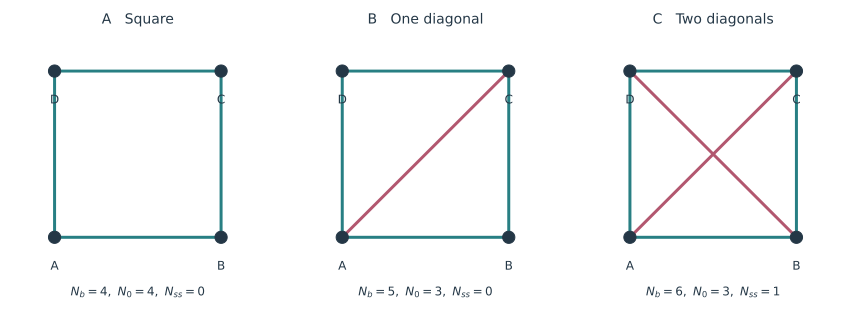

*图 11｜接触网络怎样增加约束。三个网络采用相同节点位置和单位中心力弹簧；数字由兼容矩阵的数值秩计算，$N_0$ 包括二维的三种刚体运动。交叉对角线不在交点额外设置节点。此图是无预应力弹簧网络算例，不能直接按细胞邻居数替换。*

#### 2.2.3 为什么同样的网络也可能有不同刚度 {#23-为什么同样的网络也可能有不同刚度}

对无预应力弹簧，$\mathsf H=\mathsf C^{\mathsf T}\mathsf K\mathsf C$，其中 $\mathsf K$ 收集弹簧刚度。已有拉力或压力时，还会出现与几何和预应力有关的项。压缩可以使某些横向运动失稳，拉伸则可能使原本松软的结构绷紧。因此，接触图相同，并不能保证 Hessian 的谱相同。

对细胞组织还要更进一步：一条界面可能具有线张力、面积约束和方向性骨架，顶点也不是只有沿中心连线的力。无摩擦球在大体系极限下常见的等静接触计数 $z\simeq2d$，依赖相应的接触与自由度假设。把二维细胞有约六个邻居直接解释为颗粒意义的过约束，会混淆两种网络。

这里需要分别保留接触结构、各连接的材料关系，以及当前受力。第一项决定哪些位置互相作用，后两项决定这种作用能抵抗多大的形变。在线虫中，P2 与其他细胞的接触界面、侧表皮与背腹表皮的骨架都具有差异；把所有连接设成相同弹簧，会抹去可能决定变形方向的部分。第一部分的四细胞排列与早期伸长分别展示了这两种情况。

### 2.3 主动驱动怎样改变笼困与重排 {#3-主动驱动怎样改变笼困与重排}

#### 2.3.1 主动软粒子的最小动力学 {#31-主动软粒子的最小动力学}

Henkes、Fily 与 Marchetti 研究高密度自推进软颗粒，比较密度与活动改变后的运动状态。颗粒的持续推进向拥挤网络输入功，既可促成局部逃逸，也可激发集体软模态。[Henkes 等，2011](https://doi.org/10.1103/PhysRevE.84.040301)

一个常用的二维主动 Brownian 粒子模型是

$$
\dot{\mathbf r}_i=-\mu\nabla_iU+v_0\mathbf p_i
+\sqrt{2D_t}\,\boldsymbol\xi_i,
\qquad
\mathbf p_i=(\cos\theta_i,\sin\theta_i),
\qquad
\dot\theta_i=\sqrt{2D_r}\,\eta_i.
$$

这里规定 $\boldsymbol\xi_i,\eta_i$ 为独立单位白噪声。$v_0$ 给出无负载推进速度，$D_r$ 控制方向改变；二维中方向相关时间为 $\tau_p=1/D_r$，自由持续运动的距离尺度为 $\ell_p=v_0\tau_p$。与接触松弛时间 $\tau_m=1/(\mu k)$ 比较，还得到 $D_r\tau_m$；$v_0\tau_m/a$ 则衡量一个接触松弛时间内，推进能跨过多少个粒径单位。

相同的 $v_0$ 不意味着相同的扰动。方向很快改变时，力难以沿同一条重排路径持续加载；方向保持很久时，体系可以逐渐压紧前方邻居，也可能沿某个软模态集体移动。是否更容易流动，取决于几何路径和负载，而不只取决于单粒子速度。

#### 2.3.2 自由扩散与笼中运动的解析比较 {#32-自由扩散与笼中运动的解析比较}

对没有相互作用的二维模型，方向相关为 $\langle\mathbf p(t)\cdot\mathbf p(0)\rangle=e^{-D_rt}$。对速度相关积分两次，可得均方位移

$$
\left\langle|\Delta\mathbf r(t)|^2\right\rangle
=4D_tt+\frac{2v_0^2}{D_r^2}
\left(D_rt-1+e^{-D_rt}\right).
$$

忽略 $D_t$，短时近似 $v_0^2t^2$，长时则为 $4D_at$，其中 $D_a=v_0^2/(2D_r)$。这是自由运动的参考，尚未包含笼困或邻居交换。

再把周围邻居简化成固定的各向同性谐势，令 $\dot{\mathbf r}=-\kappa\mathbf r+v_0\mathbf p$，$\kappa=\mu k_c$ 为回复速率，并暂时令 $D_t=0$。稳态矩方程满足

$$
0=-2\kappa\langle r^2\rangle
+2v_0\langle\mathbf r\cdot\mathbf p\rangle,
\qquad
0=-(\kappa+D_r)\langle\mathbf r\cdot\mathbf p\rangle+v_0,
$$

因此

$$
\langle r^2\rangle
=\frac{v_0^2}{\kappa(\kappa+D_r)}.
$$

快转向极限下，位移方差近似 $v_0^2/(\kappa D_r)$，与把主动扰动近似成白噪声的结果一致。慢转向极限下，方差趋于 $(v_0/\kappa)^2$：粒子主要被推到推进力与回复力平衡的位置。若继续套用白噪声近似，反而会错误地预言方差随 $\tau_p$ 无限增长。

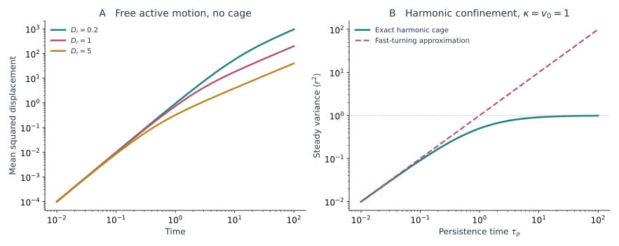

*图 12｜持续性怎样改变运动。A 为自由二维主动粒子的解析均方位移，取 $v_0=1,D_t=0$，改变 $D_r$。B 比较谐势中精确的稳态位移方差与快转向近似，取 $\kappa=v_0=1$。谐势永远没有开口，因此这里的位移饱和不是从模拟中测得的解笼阈值。*

#### 2.3.3 从单一笼子到集体软模态 {#33-从单一笼子到集体软模态}

在一个稳定排列附近，把位移展开到 Hessian 特征模态 $\mathbf e_\nu$ 上。若 $\mathsf H\mathbf e_\nu=\lambda_\nu\mathbf e_\nu$，忽略接触更新时，模态幅度 $a_\nu$ 满足

$$
\dot a_\nu=-\mu\lambda_\nu a_\nu
+v_0\sum_i\mathbf e_{\nu i}\cdot\mathbf p_i.
$$

每个模态有不同的松弛速率 $\mu\lambda_\nu$。低频软模态更容易积累位移，但推进是否能有效激发它，还要看各细胞方向在模态上的投影。两个体系即使具有相同的平均活动，也可以因为推进方向的相关性不同，产生截然不同的集体响应。

一旦某次运动改变接触或跨越能垒，原来的 Hessian 就需要重新计算。线性模态能解释笼内摆动和初始释放，不能直接代替长期重排。也正因为如此，位移相关长度增加与组织最终流动之间，还隔着接触更新这一步。

#### 2.3.4 主动温度 MIPS 与解堵分别解释什么 {#34-主动温度-mips-与解堵分别解释什么}

$D_a$ 有时被换写成有效温度尺度，但这个等效主要针对某些长时、快转向的观测。它不能同时保留持续加载、沿边界积聚和大范围集体运动。用同一个“主动温度”拟合自由扩散和有限笼困，可能得到彼此不相容的参数。

MIPS，即运动诱导相分离，则讨论另一件事：粒子在密处走得更慢，因而进一步积聚，最终形成稠密区与稀疏区。Tailleur 与 Cates、Fily 与 Marchetti 的工作分别从运动统计和自推进粒子模型发展了这一思路。[Tailleur 与 Cates，2008](https://doi.org/10.1103/PhysRevLett.100.218103)；[Fily 与 Marchetti，2012](https://doi.org/10.1103/PhysRevLett.108.235702)

对缓慢变化密度、快速方向松弛的一种局部近似，密度扰动的有效扩散系数含有 $v(\rho)[v(\rho)+\rho v'(\rho)]/(2D_r)$。该项变负时，均匀密度可能失稳。这个条件讨论密度差的增长，不直接给出稠密区有没有剪切模量。MIPS 的稠密区可以继续流动，满铺组织也能在没有稀疏区的情况下改变重排速率。

对线虫，需要先认清模型里的活动代表什么。表皮定向突起可与推进方向联系；皮层收缩更适合写成应力；全胚胎还受卵壳和内部组织约束。若没有稠密／稀疏共存及相应输运证据，仅凭某一群细胞变密，还不足以把它解释成 MIPS。

### 2.4 填满空间的细胞怎样改变刚性 {#4-填满空间的细胞怎样改变刚性}

#### 2.4.1 面积与周长之间的几何不相容 {#41-面积与周长之间的几何不相容}

对满铺的二维细胞网络，可以使用面积—周长能量

$$
E=\sum_i\left[
\frac{K_A}{2}(A_i-A_0)^2+
\frac{K_P}{2}(P_i-P_0)^2
\right],
\qquad
p_0=\frac{P_0}{\sqrt{A_0}}.
$$

$p_0$ 是偏好形状指数；实际测得的 $q_i=P_i/\sqrt{A_i}$ 则是当前形状，两者不能直接互换。取长度单位 $\sqrt{A_0}$、能量单位 $K_AA_0^2$ 后，模型还含有刚度比 $K_P/(K_AA_0)$。这样，改变细胞绝对大小与改变形状偏好就被分开了。

面积和周长并非两个可以独立满足的愿望。固定面积下，规则 $n$ 边形的形状指数为

$$
q_n=\sqrt{4n\tan(\pi/n)}.
$$

正六边形约为 3.72，正五边形约为 3.81。它们提供几何参照，但无序组织中还存在不同边数、相邻细胞的相容条件和残余应力。不能仅从一个规则五边形的数值，推导整片无序组织的刚性阈值。

Bi 等在特定二维无序顶点模型中发现，刚性可以在密度不变时随偏好形状改变；常被引用的临界参数约为 $p_0\simeq3.81$。该结果属于给定能量、拓扑与松弛规则的模型，不是所有组织都适用的几何常数。[Bi 等，2015](https://doi.org/10.1038/nphys3471)

#### 2.4.2 主动 Voronoi 模型怎样把运动加进来 {#42-主动-voronoi-模型怎样把运动加进来}

Self-propelled Voronoi，简称 SPV，用细胞中心生成满铺区域，再根据各区域的面积和周长计算能量。中心按 $\dot{\mathbf r}_i=-\mu\nabla_iE+v_0\mathbf p_i$ 运动，方向可以具有有限持续时间。它把细胞的多体形状作用与主动运动放在同一个模型中。Bi 等比较了推进速度、持续性与形状偏好怎样共同影响动力学松弛。[Bi 等，2016](https://doi.org/10.1103/PhysRevX.6.021011)

*图 13｜运动与满铺几何共同进入模型。引自 [Bi 等（2016），Fig. 1](https://doi.org/10.1103/PhysRevX.6.021011)，CC BY 3.0。A 为均方位移，B 为结构松弛，C 为有效扩散随目标形状参数的变化，D 为细胞分区和速度。比较这些结果时，应同时保留推进速度、方向持续性和目标形状参数，不能把相图上的一条边界单独当成实验组织的普适阈值。*

图 13B 用自中间散射函数测量位移是否逐渐失去与起点的关联。在各向同性、取实部的记号下，可写 $F_s(\mathbf k,t)=N^{-1}\sum_i\langle\cos[\mathbf k\cdot(\mathbf r_i(t)-\mathbf r_i(0))]\rangle$，并在细胞尺度附近选定波数。细胞长期局限在起点附近时，相关较难衰减；位移持续增长时，相关逐渐丢失。它与均方位移共同描述动力学，仍需结合机械响应来判断刚性。

SPV 的相互作用不是一对中心之间的固定弹簧。移动一个中心，会改变周围多个 Voronoi 区域的面积和周长，因此 $\nabla_iE$ 含有多体几何作用。接触更新也随分区改变而发生，不需要把每次 T1 都当成一个完全独立的外加事件。

它的优势是自由度较少，便于较大规模动力学计算；限制则来自分区本身。真实细胞轮廓若明显偏离 Voronoi 几何，或者顶端和基底已经采用不同邻居，中心坐标就不足以表示这些差别。计算简便与物理假设应一起评估。

Bi 等的 SPV 研究还提出了一个比“活动越大越容易流动”更具体的机制：方向持续性决定细胞主要通过局部事件逃离邻居，还是通过整片组织的软形变共同移动。原论文先用均方位移、结构松弛和细胞形状比较动力学状态，再检验能垒模型能否解释所得到的边界。[Bi 等，2016](https://doi.org/10.1103/PhysRevX.6.021011)

方向快速改变时，持续推进可近似为较短相关时间的随机作用。局部能垒与有效噪声相结合，能够较好描述其动力学停滞。方向保持较久时，同一个推动方向来得及作用于组织的集体软模态，细胞位移开始成片关联；这时，把所有重排视为互不相关的局部跳跃就会漏掉主要运动路径。

在某个参考排列附近线性化，将位移投到 Hessian 的模态上，有

$$
\dot a_\nu=-\mu\lambda_\nu a_\nu+v_0b_\nu(t).
$$

$\lambda_\nu$ 表示该模态的恢复刚度，$b_\nu$ 是推进方向在其上的投影。若驱动方向保持的时间足够长，模态可近似跟随 $a_\nu\simeq v_0b_\nu/(\mu\lambda_\nu)$；恢复较弱的模式因而产生较大位移。这不需要细胞主动“寻找软方向”，几何耦合与持续驱动本身就能产生选择。

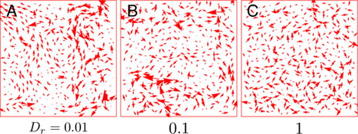

*图 14｜相同推进强度下，运动路径随方向持续性改变。引自 [Bi 等（2016），Fig. 4](https://pmc.ncbi.nlm.nih.gov/articles/PMC5619672/#F4)，PMC 作者稿原图，CC BY 3.0。不同 $D_r$ 下的瞬时位移显示集体运动由强到弱；这些是模型中的速度图，不是线虫细胞追踪数据。*

在线虫中，这种机制比较对应一个具体问题：同样数量的邻居交换，是由彼此独立的突起引起，还是沿一条受力链成串发生？要区分它们，应比较去除全身平移、旋转和整体形变后的剩余运动，测其空间相关和事件顺序。直接对原始位移算相关，会把胚胎整体转动或受限弯曲也算作细胞协调。

这条动力学解释仍依赖给定的 Voronoi 自由度与观察时间；它不能自动证明零活动时的静态刚性边界。下一节中 Sussman 与 Merkel 对零有效温度极限的分析，正好说明为什么需要把这两层判断分开。

#### 2.4.3 顶点和 Voronoi 的刚性结论为何不能直接互换 {#43-顶点和-voronoi-的刚性结论为何不能直接互换}

在一般顶点模型中，顶点可以独立移动；在 Voronoi 模型中，顶点位置由中心位置共同决定。即使采用相同的面积—周长能量，允许的变形空间也不同。

Sussman 与 Merkel 对二维 Voronoi 模型的零有效温度极限进行了检验，发现它没有通常设想的同类无堵塞转变；约束与自由度之间的边际关系是重要原因。[Sussman 与 Merkel，2018](https://doi.org/10.1039/c7sm02127e) 这使一个常用比较变得更清楚：有限活动下的运动极慢、零活动能量最低态的机械刚性，以及特定顶点模型中的形状阈值，是需要分别检验的量。

实际使用模型时，可以先固定活动并计算剪切响应，再改变活动看结构松弛，同时记录拓扑事件。本部分后段用固流转变的不同判据展开这一区别。这样才能知道组织是机械上变软了，还是仍然具有瞬时刚性、却更频繁地跨过重排能垒。

#### 2.4.4 三维堆积怎样增加新的形状和拓扑变量 {#44-三维堆积怎样增加新的形状和拓扑变量}

对三维体组织，一个对应的能量使用体积 $V_i$ 与表面积 $S_i$：

$$
E_{3D}=\sum_i\left[
\frac{K_V}{2}(V_i-V_0)^2+
\frac{K_S}{2}(S_i-S_0)^2
\right],
\qquad
s_0=\frac{S_0}{V_0^{2/3}}.
$$

Merkel 与 Manning 研究了三维满铺模型中由偏好表面积控制的刚性变化。[Merkel 与 Manning，2018](https://doi.org/10.1088/1367-2630/aaaa13) 这里的 $s_0$ 与二维 $p_0$ 具有相似的建模角色，但数值、约束数和可实现形状都不同。三维的接触是一个面，面内还能有边和顶点；单纯记录邻居数量会丢掉大量几何信息。

弯曲表皮又处在二维薄层与三维体组织之间。同一个细胞在顶端和基底可能有不同邻居，改变接触的位置可以发生在厚度方向内部。Gómez-Gálvez 等提出的 scutoid 描述了这类顶底接触不同的细胞形状，并以模型和其他物种组织检验了这种三维堆积。[Gómez-Gálvez 等，2018](https://doi.org/10.1038/s41467-018-05376-1)

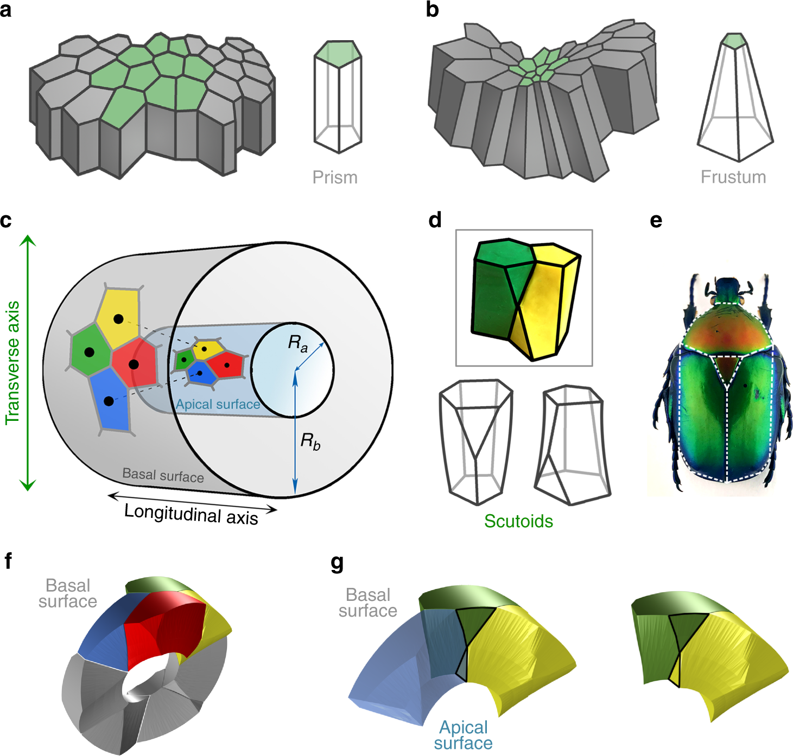

*图 15｜厚度方向也能发生邻居交换。引自 [Gómez-Gálvez 等（2018），Fig. 1](https://www.nature.com/articles/s41467-018-05376-1#Fig1)，CC BY 4.0。图中比较棱柱、截锥与具有顶底邻接变化的三维细胞形状。它提供了分析曲面组织的几何框架，不能据此认定线虫表皮已经逐细胞证实采用同样结构。*

对线虫背侧插入，这个思路尤其有用：前缘可以先在基底外侧穿过，顶端接触随后才改变。若把不同深度的影像压成一张投影，厚度方向的变化就可能被误标成一次平面 T1，甚至错过真正的接触顺序。

### 2.5 邻接网络的拓扑怎样参与组织重排 {#5-邻接网络的拓扑怎样参与组织重排}

#### 2.5.1 T1 改变的是哪几条接触 {#51-t1-改变的是哪几条接触}

在二维满铺网络里，一次标准 T1 先让旧界面缩短，再让原来不相邻的另一对细胞建立新界面。若旧邻居为 A、B，新邻居为 C、D，那么 A、B 各少一个邻居，C、D 各多一个邻居。四个细胞的位置和形状会连续变化，接触图则在事件中发生离散更新。

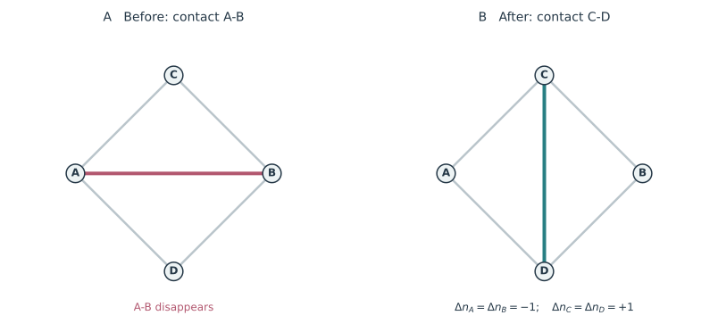

*图 16｜T1 的接触图表示。节点代表细胞，连线代表细胞间接触；A–B 消失，C–D 形成，外侧接触保留。图中的线是接触图的边，并非细胞膜。所列 $\Delta n$ 只计算这次局部事件对各细胞总邻居数的贡献。*

对每个二维细胞定义边数偏差 $q_i^{\rm tile}=6-n_i$，本次 T1 给 A、B 各增加 1，给 C、D 各减少 1，总和不变。它在网络中重新分配局部边数，未必改变组织整体的拓扑类型。

T1 还是一种释放剪切的方式。先施加小剪切、暂时固定邻接，组织会储存弹性能；若允许合适的 T1，细胞可以通过换邻居放松一部分应力。因而需要区分固定拓扑的短时模量与长时间允许重排的响应。频繁 T1 可以支持流动，但发生方向相互抵消或事件随后逆转时，净组织应变仍可能很小。

#### 2.5.2 欧拉关系为什么使平均边数接近六 {#52-欧拉关系为什么使平均边数接近六}

在没有边界、由三细胞顶点组成的二维闭合细胞铺砌中，顶点、边和细胞数满足

$$
V-E+F=\chi,\qquad
3V=2E,\qquad
\sum_i n_i=2E.
$$

消去 $V,E$，得到

$$
\sum_i(6-n_i)=6\chi.
$$

$\chi$ 是所铺曲面的欧拉示性数。周期平面等价于环面时 $\chi=0$，平均边数为六；球面上 $\chi=2$，总边数偏差为 12。只含五、六边形的球面铺砌因此需要十二个五边形。这是几何与拓扑约束，不要求体系已经达到某一种力学平衡。

这也解释了为什么平均六邻居不能单独判断刚性。关系式对大量不同材料、活动和能垒都成立。它约束可出现的网络统计，却没有给出边张力、细胞模量或重排时间。

线虫的一个局部表皮视野通常有边界；腹侧闭合前还有开口，细胞融合以后也可能不再保留每颗细胞的独立边界。此时必须加上相应边界、非三叉顶点和融合事件的修正。三维内部细胞的接触网络更不能直接套用二维平均六邻居关系。

#### 2.5.3 重排率还需要能垒与驱动 {#53-重排率还需要能垒与驱动}

拓扑规定了可以怎样换邻居，力学决定实际走哪条路径。对一个候选重排坐标 $q$，可以固定它并让其余自由度松弛，得到有效能量 $E_{\rm eff}(q)$。能垒高度 $\Delta E$ 与加载方向、周围细胞和边界有关；同样的 T1 图形，可以具有很不同的 $\Delta E$。

若随机驱动近似短时相关、并能用某个能量尺度 $T_a$ 表示，跃迁率有时可以近似写成 $k_{\rm T1}\sim k_0e^{-\Delta E/T_a}$。这是一种活化近似。对持续主动推力，逃逸更接近沿某个方向加载，力在能垒路径上能否维持、加载后网络是否重组，都很重要。

前面的谐势算例只描述一个局部低谷，没有另一侧状态，也没有真实逃逸。要预测 T1 率，需要显式加入重排路径，或者在多细胞模拟中识别事件。仅凭笼内位移方差增大，尚不能算出组织已经流化。

#### 2.5.4 三维邻接图需要记录接触出现在哪一层 {#54-三维邻接图需要记录接触出现在哪一层}

三维组织中，接触面积可能连续减小到零，一条边或一个顶点周围也可能出现多细胞交换。用“相邻／不相邻”可以压缩这些变化，但会丢掉界面大小和位置。一个刚刚出现的极小接触，与跨越细胞高度的大界面，对传力和信号交换的作用可能不同。

对表皮，可以分别记录顶端、基底和三维完整接触图，并给每条边附上面积或界面高度。这样，一次运动就有可能呈现为“基底图先更新，顶端图后更新”，而非强行归并成同时发生的平面 T1。[第二篇](/notes/celegans/embryonic_morphogenesis/epithelial_morphogenesis/)中的双层和三维模型正适合检验这种延迟。

细胞分裂、融合、内移和移出视野还会改变节点或观测范围。计算拓扑更新率时，应把它们与单纯的邻居交换分别标记，否则一个跟踪错误也可能被算法统计成大量重排。

### 2.6 取向场与主动向列液晶 {#6-取向场与主动向列液晶}

#### 2.6.1 从细胞长轴或纤维方向得到 Q 张量 {#61-从细胞长轴或纤维方向得到-q-张量}

若细胞或纤维呈现局部排列，可以在小区域内定义方向 $\mathbf n=(\cos\theta,\sin\theta)$。向列描述将 $\mathbf n$ 与 $-\mathbf n$ 视为同一根轴，不要求细胞沿该轴向同一侧运动。二维的一个常用约定是

$$
\mathsf Q=S\left(\mathbf n\mathbf n-\frac{\mathsf I}{2}\right),
\qquad
Q_{xx}=\frac S2\cos2\theta,\quad
Q_{xy}=\frac S2\sin2\theta.
$$

$S$ 表示局部排列程度，$2\theta$ 保证转过 $\pi$ 后仍得到相同张量。实际图像可以先由细胞轮廓、actin 或 myosin 纹理估计方向，再在指定空间范围平均。不同标记不一定指向同一个物理结构：细胞长轴与 actin 方向可以不同，推进方向也可以偏离二者。

这一步决定了后面的缺陷含义。若图上追踪的是细胞长轴，那么缺陷属于形状取向场；若追踪的是纤维，缺陷属于骨架取向。它们可能耦合，但应在同一位置、同一时刻比较，而不能仅因图案相似就视为同一个对象。

#### 2.6.2 活性怎样通过应力进入流动 {#62-活性怎样通过应力进入流动}

对与周围环境有摩擦的二维薄层，一个简化力平衡是

$$
\Gamma\mathbf v
=-\nabla p+\eta\nabla^2\mathbf v
+\nabla\cdot\boldsymbol\sigma^{\rm el}
-\zeta_a\nabla\cdot\mathsf Q,
\qquad
\boldsymbol\sigma^{\rm act}=-\zeta_a\mathsf Q.
$$

这里使用 $\zeta_a>0$ 表示 extensile 活动、$\zeta_a<0$ 表示 contractile 活动的约定。$\Gamma$ 是环境摩擦，$\eta$ 是二维有效黏性，$p$ 与密度或不可压缩约束有关。主动应力不均匀时，$\nabla\cdot\mathsf Q$ 就把取向结构转成局部产力分布；流动又能搬运和旋转取向。

取向本身还需满足动力学，例如

$$
(\partial_t+\mathbf v\cdot\nabla)\mathsf Q
-\mathcal S(\nabla\mathbf v,\mathsf Q)
=\Gamma_Q\mathsf H_Q,
\qquad
\mathsf H_Q=-\left[\frac{\delta F_Q}{\delta\mathsf Q}\right]_{\rm ST}.
$$

$\mathcal S$ 概括流动引起的旋转与排列，ST 表示对称无迹部分。一种常用的二维闭合选择是

$$
F_Q=\int\left[
\frac{A_Q}{2}\operatorname{Tr}\mathsf Q^2+
\frac{C_Q}{4}(\operatorname{Tr}\mathsf Q^2)^2+
\frac{K_Q}{2}|\nabla\mathsf Q|^2
\right]\,\mathrm dA,\qquad C_Q>0.
$$

前两项规定局部是否偏好取向有序，梯度项抵抗取向急变。取 $A_Q<0$ 时可出现非零有序幅度；核心附近则允许幅度下降。还需给定流动排列函数 $\mathcal S$ 和边界条件，模型才真正闭合。若讨论密度积聚，还要加入细胞数守恒或分裂、挤出的源项，并规定压力怎样随密度变化，不能只用主动体力直接替代全部速度。

按相同二维单位比较，梯度应力与主动应力给出尺度 $\ell_a\sim\sqrt{K_Q/|\zeta_a|}$，黏性与环境摩擦给出 $\ell_\Gamma=\sqrt{\eta/\Gamma}$。前者衡量活动与取向弹性的竞争，后者衡量流动传播的摩擦屏蔽。它们是尺度估计，不是任意细胞层里都能直接套用的缺陷间距公式；边界、排列程度和材料模型会改变具体预测。

#### 2.6.3 正负半整数缺陷怎样定义 {#63-正负半整数缺陷怎样定义}

沿一条围绕缺陷的闭合路径连续追踪方向角，定义绕数

$$
s=\frac1{2\pi}\oint\mathrm d\theta.
$$

因为向列方向只需相差 $\pi$ 就回到同一根轴，最小非零绕数可以是 $\pm1/2$。图 17 中的方向场分别取 $\theta=\pm\varphi/2$，其中 $\varphi$ 是绕中心的极角。绕中心走一圈，方向分别累计转过 $+\pi$ 或 $-\pi$。缺陷核心处通常需要降低 $S$，否则方向无法连续定义。

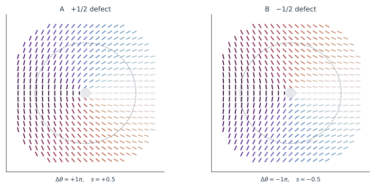

*图 17｜两种半整数缺陷。短线表示无头尾的局部取向，颜色帮助识别方向；采用 $\theta=s\varphi$、$S(r)=\tanh(r/a)$ 的示范场。图中没有计算细胞运动，也没有将线虫影像拟合成这些缺陷。*

在单常数 Frank 近似 $F_\theta=(K_\theta/2)\int|\nabla\theta|^2\,\mathrm dA$ 下，这个孤立缺陷在半径 $a$ 到 $R$ 间的取向能为

$$
E_{\rm defect}=\pi K_\theta s^2\ln\frac Ra+E_{\rm core}.
$$

$s^2$ 使较大绕数的缺陷通常有分裂成较小绕数的趋势，但相互作用、边界、外部取向和核心代价还会影响具体结构。主动系统还持续输入能量，缺陷可随流动产生、运动和成对消失，不能仅靠静态能量最小化描述整个过程。

#### 2.6.4 闭合曲面的总绕数与细胞边数是两种约束 {#64-闭合曲面的总绕数与细胞边数是两种约束}

对封闭、可定向曲面上的切向向列场，总缺陷绕数满足 $\sum_as_a=\chi$。球面上总和为 2，四个 $+1/2$ 就是一种可能的组合。Keber 等在包裹主动微管—马达体系的囊泡上研究了这种拓扑和缺陷动力学。[Keber 等，2014](https://doi.org/10.1126/science.1254784)

这里的 2 与第五节球面铺砌中的 12，来自不同对象和不同电荷定义。前者描述方向沿闭合路径怎样旋转，后者描述细胞多边形边数偏差。不能把一个五边形细胞直接等同于一个 $+1/2$ 向列缺陷。

局部视野有边界时，总绕数还受到边界方向的限制。线虫身体虽然整体包裹成曲面，实验中的表皮标记、融合区域和取向可定义范围仍需逐一检查。二维投影中的缺陷也可能来自三维方向转出成像平面，因此最好在身体局部切平面上计算取向。

#### 2.6.5 缺陷附近的流动并不只由正负号决定 {#65-缺陷附近的流动并不只由正负号决定}

<figure class="celegans-video celegans-stage-video" id="active-defect-motion" style="--stage-video-width: 34rem;">
<video controls loop preload="metadata" playsinline width="560" height="560" aria-label="取向缺陷图案中培养细胞的集体运动" aria-describedby="active-defect-motion-caption">
<source src="https://media.springernature.com/original/springer-static/esm/art%3A10.1038%2Fs41467-025-57783-w/MediaObjects/41467_2025_57783_MOESM4_ESM.mp4" type="video/mp4">
浏览器暂不支持内嵌播放，请打开下方原始视频。
</video>
<figcaption id="active-defect-motion-caption"><strong>动态影像｜取向图案中的集体运动</strong> 
培养神经前体细胞在诱导取向图案中的动态，适合结合图 18 观察细胞运动与核心积聚。此处展示的是其他细胞体系；影片中的空间尺度与时间沿用原始标注。 
来源：Zhao 等（2025），Supplementary Video 2，Nature Communications，CC BY-NC-ND 4.0。<a href="https://www.nature.com/articles/s41467-025-57783-w">原始页面与说明</a>。</figcaption>
</figure>

Saw 等在培养上皮中发现缺陷与细胞挤出、局部应力的联系；Kawaguchi 等在神经前体细胞层中研究了缺陷附近的积聚与流动。[Saw 等，2017](https://doi.org/10.1038/nature21718)；[Kawaguchi 等，2017](https://doi.org/10.1038/nature22321) 这些结果说明，缺陷可以组织机械活动，但不同细胞层的黏附、摩擦、活性与密度响应都可能不同。

一个能直接算出的比较是 $+1$ 缺陷族：$\theta=\varphi+\theta_0$。$\theta_0=0$ 为径向 aster，$\theta_0=\pi/2$ 为环向 target，中间对应 spiral。忽略核心并取 $S$ 均匀，将该方向场代入线性主动应力，得到径向主动体力

$$
f_r^{\rm act}=-\frac{\zeta_aS}{r}\cos2\theta_0.
$$

因此在这套约定下，extensile 模型对 aster 和 target 给出相反的径向主动体力。总速度还要与压力、摩擦和弹性共同求解，但这个符号差已经是一项明确预测。

Zhao 等通过微图案在神经前体细胞层中诱导 aster、spiral 和 target，观察到这些 $+1$ 结构均可向核心积聚，并用包含非线性主动作用的理论分析了线性模型遗漏的部分。[Zhao 等，2025](https://doi.org/10.1038/s41467-025-57783-w)

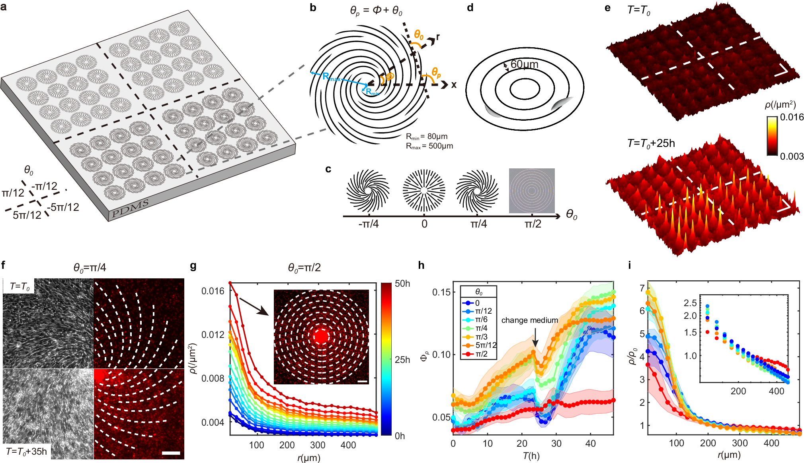

*图 18｜用不同缺陷检验同一个主动理论。引自 [Zhao 等（2025），Fig. 1](https://www.nature.com/articles/s41467-025-57783-w#Fig1)，CC BY-NC-ND 4.0。图中给出图案、细胞排列、密度和积聚过程。这是培养神经前体细胞的实验，展示了线性主动应力模型需要面对的检验。*

对线虫而言，更有价值的问题是：哪一种取向能稳定定义，缺陷是否在多帧中存在，其附近是否有可重复的速度和应变模式。若这些关系成立，再去比较线性主动应力、非线性作用或基底摩擦。仅有一个像彗星的图案，还不能确定组织是哪一种主动材料。

### 2.7 力网络与持续同调 {#7-力网络与持续同调}

#### 2.7.1 接触网络与力网络有不同的边权 {#71-接触网络与力网络有不同的边权}

接触图只说明谁接触谁。力网络还要给边附上拉力、压力或其他机械量；同一接触网络可以由少数强连接承担大部分负载，也可以更均匀地分摊。

在细胞组织中，这些边权通常难以直接取得。接触面积、cadherin 强度、切割回弹速度与力有关，却分别受到界面几何、分子状态、刚度和阻力影响。[第五篇](/notes/celegans/embryonic_morphogenesis/geometry_and_inference/)的参数辨识问题在这里同样存在。若用荧光作为边权，得到的是分子分布网络；若用力学反演，得到的是依赖假设的推断力网络，二者都应保留原定义。

Kramar 等将持续同调用于受压颗粒中的力网络，比较不同力阈值下的连通和环路。[Kramar 等，2013](https://doi.org/10.1103/PhysRevE.87.042207) 它提供了一种压缩复杂网络的方法，但不会自动把未知的细胞力变成已知数据。

#### 2.7.2 图上的环路并不等于组织里的空洞 {#72-图上的环路并不等于组织里的空洞}

给定一个只含点和边的图，连通分量数为 $\beta_0$，独立环路数为 $\beta_1$。它们满足

$$
\beta_1=E-V+\beta_0.
$$

一个三角形接触图有三个节点、三条边、一个连通分量，所以 $\beta_1=1$。若进一步把三角形内部作为一个二维面填进去，同一个环就不再构成一维空洞。计算对象从“图”变成“带面的复形”以后，拓扑量会改变。

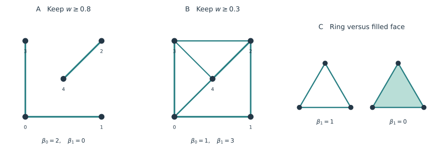

*图 19｜拓扑统计依赖所构造的对象。A、B 在相同节点上改变保留边的权重阈值，并计算图的 $\beta_0,\beta_1$；C 比较三角环与填入二维面后的复形。边权为示范数值，不代表实测细胞力。*

这在细胞数据中很实际。三个细胞相互接触，不一定在中间围出一块真实空腔；核位置形成的几何环，也不等于膜界面存在环形空隙。若关心胚胎内部空腔，应直接从三维组织或界面构造相应空间对象；若关心强力连接之间的循环结构，则接触图的环路可能正是需要的量。

#### 2.7.3 持续同调为什么比单一阈值多保留一些信息 {#73-持续同调为什么比单一阈值多保留一些信息}

假设边权为 $w_{ij}$，先保留很强的边，再逐步降低阈值 $h$，纳入所有 $w_{ij}\ge h$ 的边，得到一系列嵌套网络。连通分量和环路会在不同阈值出现、合并或改变。持续同调追踪这些结构随阈值的存在范围，而不只挑一个阈值看图。在纯图的加边过程中，已有的独立环不会被新边填平；讨论环的消亡，需要进一步规定何时加入二维面。[Edelsbrunner 等，2002](https://doi.org/10.1007/s00454-002-2885-2)

若构造二维面或更高维单形，还需要规定它们何时进入。例如 clique 复形会在一个三角形的三条边都进入后填入该三角面；其他空间构造采用不同规则。论文之间若没有使用同一构造，持久图就不能只按名称直接比较。

结构在较宽阈值范围存在，说明它对这类阈值变化较稳定，不意味着它一定承担较多力或决定刚性。一条环可以由很软的连接组成；一个几乎无环的网络，也可能通过固定边界承载。持续同调适合描述网络组织，机械响应仍需结合力平衡和材料关系计算。

在生长或分裂的胚胎中，节点数也随时间变化。比较不同时期的持久统计时，需要同时考虑细胞数、边数、界面检测阈值和空间分辨率。否则，更多环路可能只是节点更多，而非组织出现了一种新的承载方式。

### 2.8 固流转变 屈服与其他胚胎的材料证据 {#solid-fluid-transition}

#### 2.8.1 固态和流态究竟在区分什么 {#91-固态和流态究竟在区分什么}

细胞在动，组织仍然可能像固体一样承载；细胞暂时不动，组织也可能只是驱动太弱，或还没等到重排。Solid-like 与 fluid-like 首先描述组织对变形的响应。前者在一定时间和负载范围内保留剪切形变的记忆，后者可以通过持续重排逐渐释放这部分应力。讨论 solid–fluid transition，必须同时说明施加了什么扰动、观察了多久，以及测量哪一层组织。

前文涉及的几类变化，可以放在同一张表里比较。

| 所讨论的变化 | 主要改变的量 | 固态或流态怎样判断 |
| --- | --- | --- |
| 静态刚性转变 | 给定结构附近的小形变剪切模量 | 微小剪切是否产生有限回复应力 |
| 玻璃化与动力学解堵 | 笼困、结构松弛时间与活动驱动 | 去掉整体流动后，细胞是否能在观察时间内更新排列 |
| 屈服与塑性流动 | 外加应力相对重排阈值的大小 | 小负载能撑住，较大负载下能否持续流动 |
| 黏弹性时间尺度交叉 | 松弛时间与实验时间的比值 | 同一材料在短时偏弹性、长时偏黏性 |
| 发育中的材料更新 | 骨架、连接和参考形状随时间变化 | 同一扰动在不同发育阶段是否产生不同响应 |

这些机制可以同时存在。Ea、Ep 内移附近的细胞可能短时共同承载，随后通过局部接触变化释放应力；伸长表皮可以每次都被肌肉拉动，却在较长时间中逐渐改变参考形状。要判断其中有没有固—流转变，需要把材料响应与主动驱动分开测量。

#### 2.8.2 用应力松弛 蠕变和频率响应判断材料 {#92-用应力松弛-蠕变和频率响应判断材料}

最直接的理想实验，是给组织一个很小、很快的剪切形变 $\gamma_0$，随后保持形变，记录额外应力怎样变化。定义松弛模量 $G(t)=\delta\sigma(t)/\gamma_0$。在有自发收缩的胚胎中，$\delta\sigma$ 是受扰动与同阶段对照之间的差，背景中的主动应力不包含在这个比值里。

若材料先承载，再通过内部重排释放全部应力，一个最小模型是 Maxwell 关系：

$$
\dot\sigma+\frac{\sigma}{\tau_R}=G_0\dot\gamma,
\qquad
G(t)=G_0e^{-t/\tau_R},
\qquad
\eta_{\rm eff}=G_0\tau_R.
$$

$G_0$ 控制刚加载时多硬，$\tau_R$ 控制剪切记忆保留多久。两者能分别变化：组织可以初始刚度近似不变，却因重排更频繁而更快松弛；也可以初始变软，但松弛时间仍很长。Maxwell 材料在任何有限 $\tau_R$ 下，足够长时间后都会释放剪切应力；$\tau_R$ 很大的流体，在短影片中也可以看起来很像固体。

若有一部分承载结构在所讨论的线性模型中始终保留，可以加入平衡弹性项：

$$
G(t)=G_\infty+G_r e^{-t/\tau_R},
\qquad G_0=G_\infty+G_r.
$$

$G_\infty>0$ 对应长期仍保留的回复应力。这里假定材料参数在测量期间近似不变；若肌肉活动、细胞融合或骨架结构正在明显改变，曲线还会混入发育本身的变化。测量需要选择较短而可比较的时间窗，或显式建立随时间变化的模型。

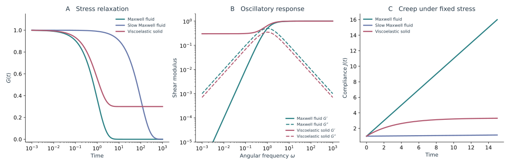

*图 20｜不同松弛时间下的固态响应。A 比较普通 Maxwell 流体、松弛很慢的 Maxwell 流体与黏弹性固体；B 比较普通 Maxwell 流体与黏弹性固体的储能和损耗模量；C 为恒定小应力下的蠕变。三者均取 $G_0=1$；两种流体的 $\tau_R$ 分别为 1、100；固体取 $G_\infty=0.3,G_r=0.7,\tau_R=1$。均为解析模型，未拟合胚胎数据。*

若反复施加小幅振荡剪切，弹性储能与黏性耗散可以分别用 $G'(\omega)$ 和 $G''(\omega)$ 描述。对上面的模型，

$$
G'(\omega)=G_\infty+
G_r\frac{(\omega\tau_R)^2}{1+(\omega\tau_R)^2},
\qquad
G''(\omega)=G_r\frac{\omega\tau_R}{1+(\omega\tau_R)^2}.
$$

在 Maxwell 情况下，频率高时组织来不及松弛，$G'$ 较大；频率低时，$G''$ 占优势。改变频率即可经过 $G'=G''$，材料本身的参数可以完全不变。因此，一个储能与损耗模量的交点，首先给出响应时间尺度，不能单独证明发育中发生了相变。若 $G_\infty>0$，低频储能模量则会保留平台。

另一种实验保持小应力 $\sigma_0$ 不变，测量应变是否持续增加，定义蠕变柔量 $J(t)=\gamma(t)/\sigma_0$。Maxwell 模型给出 $J(t)=1/G_0+t/\eta_{\rm eff}$；黏弹性固体的柔量则可以趋于有限平台。注意，柔量是“同样的力能拉开多少”，模量是“同样的形变需要多少力”，在随时间变化的材料中，二者通常不能逐时刻简单取倒数。

对线虫，更有意义的是把 $\tau_R$ 与形态变化的时间 $T_{\rm morph}$ 比较，即 Deborah 数 $De=\tau_R/T_{\rm morph}$。$De\gg1$ 时，这次形态变化主要面对一个来不及松弛的网络；$De\ll1$ 时，网络能在过程中不断释放应力。这个比值回答材料在某次发育运动中怎样工作，并不要求整只胚胎始终属于同一种物态。

#### 2.8.3 刚性丧失与活动驱动的解笼怎样区分 {#93-刚性丧失与活动驱动的解笼怎样区分}

在顶点模型中，改变目标形状或界面参数，可以改变细胞形变的几何相容性和残余应力，使小形变刚性及 T1 能垒发生变化。在主动粒子或 SPV 模型中，保持相互作用近似不变，增强活动或改变持续时间，也可能让体系更容易越过已有能垒。前一种改变了能量地形，后一种改变了体系怎样探索地形。[Bi 等，2015](https://doi.org/10.1038/nphys3471)；[Bi 等，2016](https://doi.org/10.1103/PhysRevX.6.021011)

*图 21｜固—流动力学边界包含多个控制量。引自 [Bi 等（2016），Fig. 3](https://pmc.ncbi.nlm.nih.gov/articles/PMC5619672/#F3)，CC BY 3.0。A、B 为推进速度、目标形状与转向率的不同参数切片，C 为该文组织出的三维示意。图中边界应连同该文的动力学判据阅读；小活动极限还需结合 Sussman 与 Merkel 对二维 Voronoi 静态刚性的后续检验。*

区别这两条路线，需要至少测量两类时间。一个是小扰动应力的松弛时间 $\tau_R$，另一个是细胞排列失去记忆的结构松弛时间 $\tau_\alpha$。例如，用去除整体运动后的轨迹计算前文的 $F_s(k,t)$，约定 $F_s(k,\tau_\alpha)=e^{-1}$。$\tau_\alpha$ 依赖所选长度尺度和轨迹处理，$\tau_R$ 依赖受力方向和加载条件；两者可以相关，却没有必须相等的理由。

在线虫中，还应把活动分量拆开。增加 Ea、Ep 的皮层收缩，可以增强内移方向的驱动；改善 clutch，可以使相同产力更有效地传到边界；邻细胞发生分裂，又会改变局部堆积和约束。这三种干预都可能加快某次重排，但它们对短时模量、结构松弛和邻接变化的影响不同。若只看内移速度，难以判断改变的是驱动、传力还是材料状态。

满铺表皮也不需要先出现大量空隙才流动。细胞可以在保持组织连续的同时换邻居。但一个方向明确、完成后便停止的背侧插入序列，只能直接说明组织完成了这些重排；是否具有持续释放小剪切应力的能力，还要测量或计算相应响应。对三维早期胚胎，则需要同时保留体积、界面和卵壳，二维的单一形状阈值无法承担这项判断。[Sussman 与 Merkel，2018](https://doi.org/10.1039/c7sm02127e)

#### 2.8.4 屈服之后流动与固—流转变有什么关系 {#94-屈服之后流动与固流转变有什么关系}

一块小应力下能够承载的材料，在较大应力下仍可发生持续塑性流动。常用的稳态流动曲线写成 Herschel–Bulkley 形式：

$$
\sigma_{\rm ss}(\dot\gamma)
=\sigma_y+K\dot\gamma^{\,n},
\qquad \dot\gamma>0.
$$

$\sigma_y$ 是按该加载、等待和外推方法得到的动态屈服应力。若它有限，持续流动需要克服一定负载；若它为零，低速率下应力可以趋于零。有限时间内“还没动”也可能来自极慢蠕变，因此每一个低速率点都必须有足够时间接近所定义的稳态。

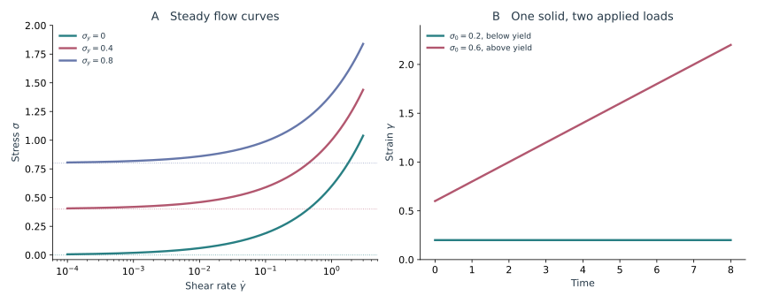

*图 22｜有限应力下的流动与静态刚性。A 为 $K=0.6,n=0.5$、不同 $\sigma_y$ 的经验流动曲线。B 为弹簧与 Bingham 元件串联的算例：$G=1,\eta_p=1,\sigma_y=0.4$，在恒定应力 $0.2$ 和 $0.6$ 下，$\gamma(t)=\sigma_0/G+\langle\sigma_0-\sigma_y\rangle_+t/\eta_p$。同一材料在阈值以下保留有限形变，在阈值以上持续流动。*

更深的一点是，小应变刚性和长时流动曲线甚至可能给出不同的“边界”。Fielding 等把细胞周长、组织取向与 T1 塑性分别写入连续本构模型，并与受剪切的顶点模型比较。该模型允许零剪切下较软的状态在有限形变后变硬，再通过重排进入流动；其动态屈服应力消失的位置，也不必与初始线性模量消失的位置重合。[Fielding 等，2023](https://doi.org/10.1103/PhysRevE.108.L042602)

其关键是把刚度与松弛能力交给不同的内部变量。沿用论文结构、把取向张量改记为 $\mathsf M$，有偏应力 $\mathsf\Sigma^{\rm dev}=C(p-p_0)\mathsf M^{\rm dev}$；取向方程中的塑性松弛项为 $-a\mathsf M$，而 fluidity 变量 $a$ 满足

$$
D_ta=\dot\gamma
\left[-a+
\frac{\beta\dot\gamma}{1+\tau_0\dot\gamma/2}\right].
$$

这里 $D_t$ 为随流动的物质导数，$\dot\gamma$ 是非负的应变率大小，$p$ 是无量纲平均周长，$p_0$ 为其目标值，$C,\beta,\tau_0$ 为模型系数。$a$ 控制重排带来的松弛，$p-p_0$ 控制有效刚度。两者随加载历史改变，因此固定参数的 Maxwell 模型只能近似其中一段响应。原模型中的 $a$ 由应变驱动，不含细胞自发迁移、分裂或死亡造成的重排；用于胚胎时，这些额外来源需要另行处理。

这对肌肉驱动的线虫尤其有用。肌肉振幅增大以后，表皮可以先表现出方向性骨架被拉紧的硬化，再在较大负载下发生更新或损伤。它不一定沿“活动增加，所以越来越流动”的单一路线变化。小幅测试得到的模量、较大抽动后的残余形变和多周期后的连接状态，应分别比较。

一个与发育过程直接相连的反例来自 Tah 等的果蝇闭合模型。Amnioserosa 在闭合中越来越窄，细胞的实际形状指数升高，却保持稳定邻接。作者让参考周长随闭合更新，同时保留细胞间的异质性，得到持续非零的剪切模量，并用切割检验模型预测的非单调张力变化。[Tah 等，2025](https://doi.org/10.1073/pnas.2322732121)

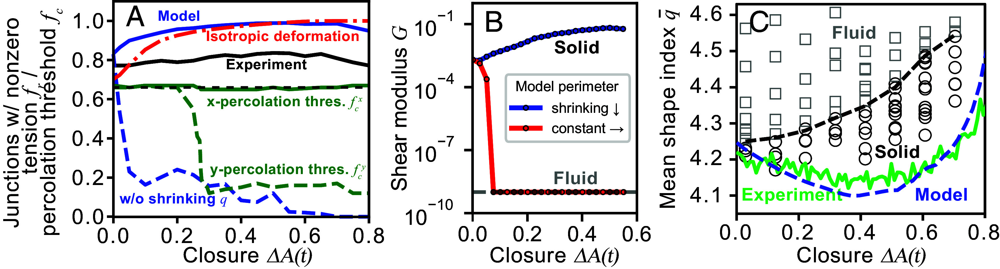

*图 23｜发育中的形状与材料参数会一起变化。引自 [Tah 等（2025），Fig. 3](https://pmc.ncbi.nlm.nih.gov/articles/PMC11725931/#fig03)，CC BY-NC-ND 4.0，完整原图未修改。固定与更新参考周长的模型经历不同的刚性变化。该图在第二篇中用于讨论闭合机制，此处强调实际形状指数不能替代参考状态与机械响应。*

它给线虫的启发不是把同一参数轨迹照搬过来，而是把发育中的材料更新放进状态描述。表皮一边伸长，一边交换连接分子和重塑 actin；即使测得相同长宽比，两只胚胎的预应力、参考形状和承载网络也可能不同。一个固定参数的静态相图，只描述其中某一时刻的材料假设。

另一条路线是第二篇讨论的[主动连接反馈](/notes/celegans/embryonic_morphogenesis/epithelial_morphogenesis/#active-junction-models)：应力可以促进马达驻留，再触发有方向的重排。这样的重排属于受驱动的材料更新，不要求组织先在零应力下失去所有刚性。对背侧插入和肌肉驱动，分别测小幅响应、事件方向与卸载后的残余形变，才能区分“软了”“越过能垒了”和“参考结构变了”。

#### 2.8.5 其他胚胎怎样建立固—流转变的证据 {#95-其他胚胎怎样建立固流转变的证据}

Mongera 等在斑马鱼体轴伸长中，将细胞运动与磁性微滴的直接力学测量结合，比较尾端中胚层祖细胞区和较前方的体节前中胚层。他们观察到沿体轴变化的屈服响应，并将尾端容易重排的区域与前方提供机械支撑的区域联系起来。[Mongera 等，2018](https://doi.org/10.1038/s41586-018-0479-2)

*图 24｜胚胎组织中的受控施力与材料响应。引自 [Mongera 等（2018），Fig. 2](https://www.nature.com/articles/s41586-018-0479-2/figures/2)，原图未修改，原出版方权利保留。a–c 为微滴加载、卸载及残余形变，d–f 比较不同体轴区域，g–j 加入 N-cadherin 扰动。这里测量的是斑马鱼细胞群对细胞外微滴形变的响应。*

Petridou 等对斑马鱼胚盘采用另一条路线：由接触网络识别刚性簇，再与直接测得的组织流变比较。他们检验了连接度变化与刚性渗流之间的关系，并通过黏附等扰动改变网络。[Petridou 等，2021](https://doi.org/10.1016/j.cell.2021.02.017) 这与单纯记录“细胞有几个邻居”不同：一个仍然连通的网络，可以由能彼此转动的刚性块组成，整体仍有柔软运动；连通并不保证刚性贯穿。

这两类工作提供了不同的证据组合：一类把屈服、应力波动与细胞重排联系起来；另一类把网络约束与宏观响应联系起来。应用到线虫时，需要重新处理少量细胞、谱系相关的非随机接触、卵壳和方向性骨架。它们提供的是可检验的机制与方法，不能把其中的前后区域直接对应成线虫身体里的两个物态区。

#### 2.8.6 在线虫各阶段应该怎样提出固—流问题 {#96-在线虫各阶段应该怎样提出固流问题}

**原肠胚形成。** Ea、Ep 内移时，局部细胞发生明显形变和接触更新。一个有区分力的问题是：邻近组织的小剪切记忆是否比内移前更快消失，且这种改变是否扩展到多个细胞？若只有主动收缩增强，去除共同形变后邻居结构仍较稳定，更接近有方向的驱动；若结构松弛加快、局部回复减弱，并且在保持近似驱动的干预下仍存在，则更支持局部材料状态改变。集体软模态和 clutch 分别约束几何阻力与传力，不能仅凭一条内移轨迹代替流变判断。

**背侧插入与腹侧包裹。** 定向 T1 可以承担有组织的应变，而随机且可持续发生的重排更容易释放一般方向的剪切应力。两者可以具有相近的事件数，却有不同的材料后果。应记录每次事件的方向、逆转概率和释放的局部应变，并区分前缘新接触、厚度方向的邻接变化与真正的平面交换。腹侧封口还会新增承载连接，前缘容易移动与封口后稳定承载可以同时出现。

**早期伸长。** actin 的排列与侧表皮、背腹表皮的差异，使材料响应依赖方向。轴向形变较容易发生，不代表周向也容易流动；固定邻接下的细胞拉长，也可以让形状指数增加。这里应比较方向相关的小幅响应和松弛，而不只给胚胎一个标量“流动性”。激光切割提供初始受力与恢复动力学的约束，结合材料模型后才能分开应力变化与刚度变化。[Vuong-Brender 等，2017](https://doi.org/10.7554/eLife.23866)

**肌肉参与后的伸长。** 同一表皮在单次抽动中可以承载，在多个周期之间通过骨架或连接更新改变参考形状。这种短时较固、长时可塑的组织，正适合用黏弹塑性描述。判断是否进一步出现持续流化，需要看活动停止后是否仍有结构松弛、小扰动响应是否改变，以及更新后能否继续承载。伸长后回缩首先说明形变保持或传力出了问题，不能仅由最终长度判定固—流边界。[Lardennois 等，2019](https://doi.org/10.1038/s41586-019-1509-4)；[Yang 等，2025](https://doi.org/10.1016/j.devcel.2025.06.012)

这些阶段提出的是不同的局部材料问题。就这里讨论的线虫证据而言，直接得到支持的是特定运动中的收缩、传力、各向异性与重塑；把它们进一步连成某条固—流相边界，需要同一时间窗里的运动学和受力响应共同约束。

#### 2.8.7 怎样区分有限时间交叉与真正的转变 {#98-怎样区分有限时间交叉与真正的转变}

如果随着某个控制参数连续变化，$\tau_R$ 从小于影片时长变成大于影片时长，材料就会从“看得到松弛”变成“看不到松弛”。延长影片以后，原来偏固的区域仍可能继续松弛。这是一种有实际发育意义的时间尺度交叉，但与出现有限长期剪切模量，或跨越刚性渗流临界点，不是同一结论。

更强的转变证据应当同时追踪控制参数与响应：小扰动模量或屈服响应如何改变，结构松弛是否显著变慢，相关长度或刚性簇是否随之变化，以及改变观察时间、样本范围和扰动幅度后，这条边界是否仍能由同一套模型解释。有限胚胎不要求把所有理想极限都直接做出来，但结果应当说明自己约束了哪一种极限。

对正在发育的线虫，尤其需要区分两类图。将不同发育阶段依次标在“活动—黏附—刚性”空间里，得到的是发育轨迹；在相近阶段独立改变活动、界面性质或负载，再比较响应，才更有利于建立控制参数图谱。若三个量都随发育一起变，只用时间作横轴，容易把共同变化误认成单一参数驱动的转变。

一个适合线虫的表述，应保留具体对象和条件：某一片表皮在某个方向、某个时长与负载下能否松弛，哪一种连接更新使它更容易重塑，哪一部分骨架仍能承载。这样既能使用 solid–fluid transition 的理论，也能把它与可测量的线虫机制接起来。

### 2.9 面向线虫的候选计算与检验 {#面向线虫的候选计算与检验}

#### 2.9.1 堆积能垒与 clutch 的耦合算例 {#堆积能垒与-clutch-的耦合算例}

可以先把向内位移压缩成一个坐标 $q$，把其余细胞位置记为 $\mathbf y$。在给定壳形和细胞体积时，让邻居充分松弛，得到 $U_{\rm pack}^{\rm eff}(q)=\min_{\mathbf y}U_{\rm pack}(q,\mathbf y)$。这条曲线既可能有阻碍内移的能垒，也可能在分裂之后改变形状。用一个双势阱示范这种竞争：

$$
\frac{U(q)}{E_0}
=\frac14(x^2-1)^2-fx,
\qquad x=\frac qa,
\qquad f=\frac{F_{\rm drive}a}{E_0}.
$$

两个谷分别代表较外侧和较内侧的状态，$a$ 是位移尺度，$E_0$ 是能量尺度；正向力使内侧状态更有利。这个算例中，稳定点满足 $x^3-x-f=0$。当 $f=2/(3\sqrt3)$ 时，外侧势阱与中间能垒相遇，外侧状态失稳。这个数来自选定的多项式，不是线虫的实测阈值。它说明的是：改变堆积几何可以降低 $E_0$，增强驱动可以增加 $F_{\rm drive}$，两条路径都可能使内移更容易，却对应不同机制。

驱动力本身还取决于皮层与边界的耦合。设 $v_c$ 为皮层向内流动速度、$v_j=\dot q$ 为连接边界速度，以线性摩擦 $\xi_c(v_c-v_j)$ 表示二者传递的力。再用 $F_m$ 表示有效马达驱动，$\zeta_c,\zeta_j$ 表示皮层和边界的阻力，得到一个最小模型：

$$
F_m=\zeta_c v_c+\xi_c(v_c-v_j),
\qquad
\zeta_jv_j=\xi_c(v_c-v_j)
-\partial_qU_{\rm pack}^{\rm eff}.
$$

消去 $v_c$ 后，

$$
\left(\zeta_j+\frac{\xi_c\zeta_c}{\zeta_c+\xi_c}\right)\dot q
=\frac{\xi_c}{\zeta_c+\xi_c}F_m
-\partial_qU_{\rm pack}^{\rm eff}.
$$

这里能传给边界的驱动比例是 $\xi_c/(\zeta_c+\xi_c)$。耦合很弱时，皮层可以明显流动，边界却几乎不跟随；耦合增强后，同样的马达活动可以产生更多边界运动，同时也增加传动时的阻力。这解释了为什么“边界收缩开始得更晚”不能只用 myosin 开始产力的时间来解释。这个摩擦模型是对 clutch 的粗粒化表达，真实连接还会装配、断裂并随负载改变寿命。

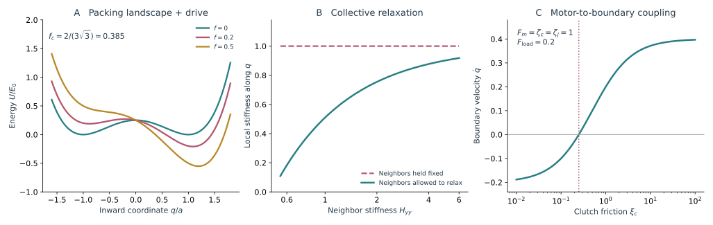

*图 25｜三种不同的内移控制量。A 为上述双势阱在不同驱动力下的形状；B 取 $H_{qq}=1,H_{qy}=0.7$，比较固定邻居与允许邻居松弛后的局部有效刚度；C 为线性 clutch 算例，取 $\zeta_c=\zeta_j=F_m=1$、恒定反向负载 $0.2$，改变 $\xi_c$。负速度表示该简化模型中边界向外回复。曲线用于比较机制，未拟合胚胎数据。*

邻居是否让位也可以定量表达。在某一稳定排列附近，把能量写成 $q$ 与 $\mathbf y$ 的二次型；固定 $q$，允许邻居松弛，得到

$$
H_{\rm eff}
=H_{qq}
-\mathsf H_{q y}\mathsf H_{yy}^{-1}\mathsf H_{y q}.
$$

这里先固定整体刚体运动，并假定邻居子块 $\mathsf H_{yy}$ 正定。第二项表示邻居调整所释放的能量。因此，邻居能够响应时，沿 $q$ 的小形变刚度不会高于把邻居全部固定时的刚度。若存在一个与内移耦合较强的集体软模态，细胞就可能借助很多邻居的小幅移动完成内移。这个小形变结果不能直接给出整条内移路径的能垒，但它说明“周围挤得紧”仍不足以决定内移难度。

#### 2.9.2 方向偏置的主动粒子模型 {#方向偏置的主动粒子模型}

一种候选扩展，是为每个细胞设置与身体方向和左右身份相关的目标角 $\theta_i^{\rm cue}$：

$$
\dot\theta_i
=-\frac1{\tau_{\rm align}}
\sin(\theta_i-\theta_i^{\rm cue})
+\sqrt{2D_r}\,\eta_i.
$$

小偏角时，这成为回复到目标方向的随机过程，稳态角度方差约为 $D_r\tau_{\rm align}$。$v_0$ 控制推进能力，$D_r\tau_{\rm align}$ 控制定向误差，T1 或三维接触更新的能垒控制能否穿过邻居。这三个量可以独立变化：突起强而方向不稳的细胞，可能来回活动；方向正确但传力不足的细胞，则可能一直朝内，却迟迟无法插入。

#### 2.9.3 移动边界与新连接成熟 {#移动边界与新连接成熟}

在软物质语言中，这是一类移动边界问题。先把局部开口近似成半径 $R$ 的圆，用 $\Gamma_\ell$ 表示单位边长的运动阻力、$\lambda$ 表示边缘线张力、$f_{\rm prot}$ 表示单位边长的向内推进力，忽略其他负载时，

$$
-\Gamma_\ell\dot R
=f_{\rm prot}+\frac{\lambda}{R}.
$$

两种驱动给出不同的几何依赖。恒定推进力对应近似恒定的径向闭合速度；线张力的作用随曲率 $1/R$ 增大，在这个圆形近似中会使后期更快闭合。分别只保留一项，得到

$$
R(t)=R_0-\frac{f_{\rm prot}}{\Gamma_\ell}t,
\qquad
R^2(t)=R_0^2-\frac{2\lambda}{\Gamma_\ell}t.
$$

这是比较机制的基线。真实线虫前缘具有离散的细胞身份，leading-cell 的相遇还会改变剩余开口的形状，圆形近似不能贯穿整个过程。更直接的比较，是在同一阶段测量局部法向速度与曲率：若驱动和阻力近似均匀，线张力主要贡献曲率相关部分，迁移推进主要贡献偏置；若两者都随位置变化，就需要 actin 与突起成像共同约束。只拟合总开口面积，往往可以让多种驱动得到相似曲线。

两侧相遇之后，问题又变成新连接能否承载。设连接成熟度 $c_j$ 在接触后按 $\dot c_j=(c_\infty-c_j)/\tau_j$ 增长，简化地令其可承受负载与 $c_j$ 成正比。即使前缘已经到达中线，若外部拉力早于连接成熟，仍可能再分开；若成熟足够快，相同的迁移过程就能形成稳定封口。这个候选变量把“到达得慢”和“到了却连不住”分开，分别对应推进阻力与连接更新。

#### 2.9.4 主动固体与固定邻接下的形状变化 {#主动固体与固定邻接下的形状变化}

对纤维取向分布，定义结构张量 $\mathsf A=\langle\mathbf n\mathbf n\rangle=\mathsf I_s/2+\mathsf Q_{\rm actin}$。在小应变示范中，可以让它同时进入弹性能与主动应力：

$$
W=\frac12\boldsymbol\epsilon:\mathsf C(\mathsf A):
\boldsymbol\epsilon,
\qquad
\boldsymbol\sigma^{\rm act}
=-\zeta_a\mathsf Q_{\rm actin}.
$$

$\mathsf C(\mathsf A)$ 表示纤维怎样使某些方向更难被拉伸，$\zeta_a$ 表示主动产力。前者可以在没有主动活动时继续承载，后者则需要持续消耗能量。只保留向列主动应力的流体模型会漏掉前一项；只保留方向性弹性的被动模型又无法说明局部收缩。因此，线虫伸长更适合先从有方向骨架的主动固体或黏弹性壳出发，再判断哪些区域需要引入流动与塑性。

身体曲率也使方向比较更讲究。圆柱表面不同位置的周向单位矢量，在三维空间里指向不同方向，但对组织而言都属于“沿身体一圈”。若直接对三维矢量作全局平均，一个沿周向排列得很好的网络也可能被平均成低有序度。应先建立局部轴向与周向基，再比较邻域中的方向；跨越曲面计算绕数时，需要扣除局部基底自身的转动。身体两端的低有序区域，也不能仅凭二维投影就判定为某种缺陷核心。

同样，细胞形状指标的变化未必代表重排能垒改变。把一个规则六边形做面积保持的仿射拉伸 $\mathsf F={\rm diag}(\lambda,\lambda^{-1})$，邻居一个也不换，$q=P/\sqrt A$ 仍会升高。图 26A 给出这个纯几何例子。因此，把伸长表皮中测得的 $q$ 直接与各向同性顶点模型的 $p_0^*$ 比较，可能只是把已经发生的方向性形变误当作材料参数。实际轮廓指标 $q$、模型目标周长 $p_0$ 和方向性材料刚度，需要分别估计。

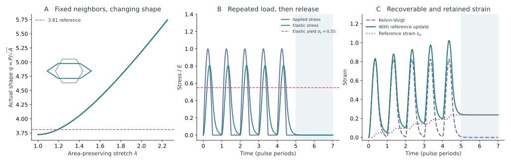

*图 26｜周期形变与参考状态更新。A 对规则六边形施加面积保持的仿射拉伸，虚线仅标出常被讨论的 3.81；B 为五个正向应力脉冲及卸载，同时画出弹性应力与屈服水平；C 比较 Kelvin–Voigt 响应和加入屈服更新后的总应变与参考应变。取无量纲 $E=1,\eta=0.12,\sigma_y=0.55,\eta_p=1$，时间以脉冲周期为单位；A 不含 T1，B、C 不含细胞邻接变化。*

取向缺陷可以作为进一步的问题，但首先需要在同一个 actin 或细胞形状场中稳定识别它，再比较缺陷附近的应变和受力。在线虫中，谱系规定的区域、肌肉附着点、曲率和材料差异都可能产生应力集中；这些机制即使没有可定义的半整数缺陷，也可以成立。缺陷理论的价值，在于提供额外的空间预测，例如某类取向畸变是否总伴随特定流动，而不是给所有局部不均匀性换一个拓扑名称。

#### 2.9.5 周期负载与黏塑性参考状态 {#周期负载与黏塑性参考状态}

可以先用一个标量应变模型区分这些响应。设 $\sigma(t)$ 为等效拉伸负载，$\epsilon$ 为总应变，$\epsilon_p$ 为组织更新后的参考应变：

$$
\eta\dot\epsilon+\sigma_e=\sigma(t),
\qquad
\sigma_e=E(\epsilon-\epsilon_p),
\qquad
\dot\epsilon_p=
\frac{\langle\sigma_e-\sigma_y\rangle_+}{\eta_p}.
$$

当 $\eta_p\to\infty$ 时，参考应变不变，模型退化为 Kelvin–Voigt 材料；重复脉冲可以产生滞后与耗散，但在充分卸载后仍返回原状态。有限 $\eta_p$ 则允许弹性应力 $\sigma_e$ 超过阈值后逐步更新参考应变，卸载后保留伸长。用弹性应力驱动更新，可以使塑性耗散 $\sigma_e\dot\epsilon_p$ 保持非负；黏性部分的耗散为 $\eta\dot\epsilon^2$。这个单向屈服模型示范了参考状态怎样更新，线虫中的具体更新律还要由加载与恢复实验约束。对可逆拉压的材料，应使用带应力符号的屈服律，单纯对称的零均值加载也不会自动产生定向增长。

#### 2.9.6 周期材料响应与实验比较 {#周期材料响应与实验比较}

这里至少有两个独立的时间比。$\omega\tau_{\rm ve}$ 比较肌肉频率与黏弹性松弛，其中 $\tau_{\rm ve}=\eta/E$；$\tau_{\rm remodel}/T_{\rm muscle}$ 比较结构更新时间与肌肉周期。前者影响每次抽动的幅度和相位，后者影响多个周期之间能否保留新结构。还要比较峰值负载与屈服尺度 $\sigma_y$。提高频率、提高振幅和提高重塑速率，因此不应被当作同一个“活动增强”来扫描。

实验上，可以分别看周期内的峰值伸长、下一次抽动前的长度，以及停止肌肉活动后较长时间的残余长度。第一项主要反映瞬时受力与材料响应，第二项混合恢复和更新，第三项更接近参考状态是否已经改变。应力—应变回线中的面积代表循环耗散；仅仅看到回线，并不足以断定发生了塑性，因为黏弹性也会耗散。分子周转同样需要与这些机械量配合：HMR-1 的 FRAP 恢复说明分子交换，连接能否保持几何形状还取决于交换发生的位置和负载。

在这个尺度上，“组织解堵”只概括了允许结构更新的一面。持续伸长还要求网络在更新之后继续承载，并把改变保存在合适方向上。拆解得更快可以增加流动，却也可能削弱传力，导致停止伸长或回缩。这是把软物质重排理论用于线虫时需要补上的材料问题。

#### 2.9.7 有效力反演的动力学选择 {#有效力反演的动力学选择}

这一路线可以写成一个有待选择的动力学模型：

$$
\zeta_i(\mathbf v_i-\mathbf v_{\rm env})
+\sum_j\xi_{ij}(\mathbf v_i-\mathbf v_j)
=\sum_j f_{ij}(r_{ij})\hat{\mathbf r}_{ij}
+\mathbf F_i^{\rm act}
+\mathbf F_i^{\rm shell}.
$$

左边分别是对环境的阻力和细胞间的相对运动阻力，右边是有效相互作用、主动项与卵壳作用；$\hat{\mathbf r}_{ij}$ 在这里定义为从 $j$ 指向 $i$。这条式子把几类力学来源分别列出。若只保留中心力，未显式建模的活动、壳压力和摩擦可能部分进入推断的 $f_{ij}$。因此，有效势描述的是某一时间窗、分辨率和动力学假设下的集体结果。

由此推断出的距离势，也不能直接放进平衡统计公式 $g(r)\propto\exp[-U(r)/(k_BT)]$，把轨迹解释成热平衡采样。线虫的细胞身份、分裂时序、主动活动和边界都在随时间变化。与其追求一个适用于全胚胎的“温度”，更有信息的是比较：相同细胞对在不同阶段的作用是否变化；模型能否预测未用于拟合的接触更新；改变壳形或某条传力通路以后，哪些参数仍然有效。

持续同调可以在这样的网络上描述强连接如何组织，但需要保留边权的物理意义。界面张力 $\gamma_{ij}$ 的单位是力每长度，接触面上的合力还涉及面积、方向和曲率；cadherin 荧光则是分子信号。三者不能混成同一种“强边”。对早期胚胎，可以先在同一批细胞、同一阶段比较校准后的界面参数；对伸长表皮，则需要随融合和连接重塑更新图的节点定义。最后再问某条连接受损时，负载是否转移到网络中的另一条路径。这个力学响应，比环路数量单独增加更能判断网络是否具有承载冗余。

### 2.10 怎样比较这些模型与线虫实验 {#10-怎样比较这些模型与线虫实验}

#### 2.10.1 从现象到参数再到可区分的结果 {#101-从现象到参数再到可区分的结果}

| 线虫问题 | 在模型中改变的量 | 还应同时观察什么 | 能够区分的解释 |
| --- | --- | --- | --- |
| 壳形改变后四细胞排列仍稳定 | 边界长宽比与细胞对的相互作用 | 接触角、界面面积、去壳后形状 | 几何排斥与非均一界面作用 |
| 皮层已收缩但 Ea、Ep 边界迟迟不动 | 马达力、clutch 耦合、堆积负载 | 皮层与边界的速度差、邻居响应 | 产力不足、传力不足或外部阻碍 |
| 分裂轴发生谱系相关偏转 | 手性流、接触摩擦与界面黏附 | 表面流、轴偏转、纺锤体伸长 | 主动力矩传动与受限几何调整 |
| 背侧细胞活动明显但插入失败 | 推进幅度、定向误差与重排能垒 | 基底前缘、顶端接触、局部力学响应 | 极性缺陷与组织重排阻力改变 |
| 伸长时细胞形状指标升高 | 仿射应变、目标形状与纤维方向 | 邻接是否改变、切割与卸载响应 | 形状被拉长与材料刚性变化 |
| 肌肉抽动增多但持续伸长减少 | 频率、负载、重塑及重建速率 | 峰值长度、周期末长度、停动后恢复 | 驱动传递不足与材料更新失配 |

同一种运动学结果常有多种力学来源，组合观测可以缩小解释范围。例如，细胞中心的位移无法区分自身推进与被邻居带动；皮层流与连接边界的相对速度可以进一步判断传力；加上切割或卸载后的响应，才更容易把驱动力变化与材料变化分开。

#### 2.10.2 怎样从影片中分开整体运动与重排 {#102-怎样从影片中分开整体运动与重排}

最先需要去掉的是身体整体平移、旋转和宏观伸长。若直接用实验室坐标中的均方位移，胚胎翻转就可能被统计成扩散增强。可以先对局部组织拟合共同的仿射变形，再计算不能被该变形解释的运动。

一个常用的局部量是

$$
D_{\min,i}^2=
\min_{\mathsf F_i}\frac1{N_i}
\sum_{j\in\mathcal N_i}
\left|
\mathbf r_{ij}(t+\Delta t)
-\mathsf F_i\mathbf r_{ij}(t)
\right|^2.
$$

$\mathbf r_{ij}$ 是相对位置，$\mathsf F_i$ 描述这片组织共同经历的局部变形。较大的 $D_{\min}^2$ 表示局部运动难以用共同的线性规则解释，但也可能包含分割误差、三维运动或分裂，仍需与真实接触事件对照。这一类非仿射分析源于无序材料塑性研究。[Falk 与 Langer，1998](https://doi.org/10.1103/PhysRevE.57.7192)

还可以记录邻居保持率：

$$
Q_n(\Delta t)=\frac1N\sum_i
\frac{|\mathcal N_i(t)\cap\mathcal N_i(t+\Delta t)|}
{|\mathcal N_i(t)|}.
$$

这里假定起点邻居数非零，细胞身份在时间窗内保持可比较，并将分裂、融合和移出视野另外处理。$Q_n$ 很高而位移明显，可能只是整个网络共同形变；$Q_n$ 下降则说明接触在更新。若配合 T1 的方向、逆转概率和局部应变，就能区分随机交换与有方向的组织重排。

同名细胞轨迹、顶底接触、取向、局部应变和短时力学响应，可以分别约束活动、几何、拓扑与材料。这些信息在一条全长曲线中往往无法分开。

#### 2.10.3 适合线虫的模型应保留哪些异质性 {#103-适合线虫的模型应保留哪些异质性}

线虫的细胞并不是可任意互换的粒子。早期模型至少需要保留细胞大小、分裂时间与方向；研究原肠胚时，还需要区分内胚层、生殖细胞和邻居的主动角色；研究表皮时，则要保留侧表皮与背腹表皮的材料差异，以及肌肉输入的位置。把这些差异逐项加入后，模型参数才有机会对应到谱系和实验干预。

保留细胞差异时，仍应让同一种机制共用参数，只对已有观测支持的细胞类型或界面作区分。正常壳形约束出的界面参数能否预测变形卵壳中的排列，一个频率范围内测得的材料响应能否预测改变肌肉周期后的伸长，都可以检验参数是否具有跨条件的解释能力。

在线虫中，边界、细胞身份和更新时间共同决定组织怎样运动与承载。颗粒模型抓住排列与拥挤，顶点和相场模型保留接触更新，主动皮层模型描述产力与流动，连续体则连接局部作用与全身变形。比较它们时，可以沿同一次运动追踪这些变量之间的关系。

## 参考文献 {#references}

1. Corey S. O’Hern, Leonardo E. Silbert, Andrea J. Liu, Sidney R. Nagel (2003). [Jamming at zero temperature and zero applied stress: The epitome of disorder](https://doi.org/10.1103/PhysRevE.68.011306). *Physical Review E*.

2. James Giammona, Otger Campàs (2021). [Physical constraints on early blastomere packings](https://doi.org/10.1371/journal.pcbi.1007994). *PLOS Computational Biology*.

3. Silke Henkes, Yaouen Fily, M. Cristina Marchetti (2011). [Active jamming: Self-propelled soft particles at high density](https://doi.org/10.1103/PhysRevE.84.040301). *Physical Review E*.

4. J. Tailleur, M. E. Cates (2008). [Statistical Mechanics of Interacting Run-and-Tumble Bacteria](https://doi.org/10.1103/PhysRevLett.100.218103). *Physical Review Letters*.

5. Yaouen Fily, M. Cristina Marchetti (2012). [Athermal Phase Separation of Self-Propelled Particles with No Alignment](https://doi.org/10.1103/PhysRevLett.108.235702). *Physical Review Letters*.

6. Dapeng Bi, J. H. Lopez, J. M. Schwarz, M. Lisa Manning (2015). [A density-independent rigidity transition in biological tissues](https://doi.org/10.1038/nphys3471). *Nature Physics*.

7. Dapeng Bi, Xingbo Yang, M. Cristina Marchetti, M. Lisa Manning (2016). [Motility-Driven Glass and Jamming Transitions in Biological Tissues](https://doi.org/10.1103/PhysRevX.6.021011). *Physical Review X*.

8. Daniel M. Sussman, Matthias Merkel (2018). [No unjamming transition in a Voronoi model of biological tissue](https://doi.org/10.1039/c7sm02127e). *Soft Matter*.

9. Matthias Merkel, M Lisa Manning (2018). [A geometrically controlled rigidity transition in a model for confluent 3D tissues](https://doi.org/10.1088/1367-2630/aaaa13). *New Journal of Physics*.

10. Pedro Gómez-Gálvez, Pablo Vicente-Munuera, Antonio Tagua, Cristina Forja, Ana M. Castro, Marta Letrán, Andrea Valencia-Expósito, Clara Grima, Marina Bermúdez-Gallardo, Óscar Serrano-Pérez-Higueras, Florencia Cavodeassi, Sol Sotillos, María D. Martín-Bermudo, Alberto Márquez, Javier Buceta, Luis M. Escudero (2018). [Scutoids are a geometrical solution to three-dimensional packing of epithelia](https://doi.org/10.1038/s41467-018-05376-1). *Nature Communications*.

11. Felix C. Keber, Etienne Loiseau, Tim Sanchez, Stephen J. DeCamp, Luca Giomi, Mark J. Bowick, M. Cristina Marchetti, Zvonimir Dogic, Andreas R. Bausch (2014). [Topology and dynamics of active nematic vesicles](https://doi.org/10.1126/science.1254784). *Science*.

12. Thuan Beng Saw, Amin Doostmohammadi, Vincent Nier, Leyla Kocgozlu, Sumesh Thampi, Yusuke Toyama, Philippe Marcq, Chwee Teck Lim, Julia M. Yeomans, Benoit Ladoux (2017). [Topological defects in epithelia govern cell death and extrusion](https://doi.org/10.1038/nature21718). *Nature*.

13. Kyogo Kawaguchi, Ryoichiro Kageyama, Masaki Sano (2017). [Topological defects control collective dynamics in neural progenitor cell cultures](https://doi.org/10.1038/nature22321). *Nature*.

14. Zihui Zhao, He Li, Yisong Yao, Yongfeng Zhao, Francesca Serra, Kyogo Kawaguchi, Hepeng Zhang, Masaki Sano (2025). [Integer topological defects offer a methodology to quantify and classify active cell monolayers](https://doi.org/10.1038/s41467-025-57783-w). *Nature Communications*.

15. M. Kramar, A. Goullet, L. Kondic, K. Mischaikow (2013). [Persistence of force networks in compressed granular media](https://doi.org/10.1103/PhysRevE.87.042207). *Physical Review E*.

16. Herbert Edelsbrunner, David Letscher, Afra Zomorodian (2002). [Topological Persistence and Simplification](https://doi.org/10.1007/s00454-002-2885-2). *Discrete & Computational Geometry*.

17. Michael L. Falk, James S. Langer (1998). [Dynamics of viscoplastic deformation in amorphous solids](https://doi.org/10.1103/PhysRevE.57.7192). *Physical Review E*.

18. Fickentscher R, Struntz P, Weiss M (2013). [Mechanical Cues in the Early Embryogenesis of Caenorhabditis elegans](https://doi.org/10.1016/j.bpj.2013.09.005). *Biophys J*.

19. Kazunori Yamamoto, Akatsuki Kimura (2017). [An asymmetric attraction model for the diversity and robustness of cell arrangement in nematodes](https://doi.org/10.1242/dev.154609). *Development*.

20. Kazunori Yamamoto, Sacha Ichbiah, Matthieu Perez, Joana Borrego-Pinto, Fabrice Delbary, Nathan W. Goehring, Paul Northrop, Hervé Turlier, Guillaume Charras (2026). [Spatiotemporal mapping of the contractile and adhesive forces sculpting early C. elegans embryos](https://doi.org/10.1016/j.devcel.2026.04.013). *Developmental Cell*.

21. Roh-Johnson M, Shemer G, Higgins CD, McClellan JH, Werts AD, Tulu US, Gao L, Betzig E, Kiehart DP, Goldstein B (2012). [Triggering a cell shape change by exploiting preexisting actomyosin contractions](https://doi.org/10.1126/science.1217869). *Science*.

22. Slabodnick MM, Tintori SC, Prakash M, Zhang P, Higgins CD, Chen AH, Cupp TD, Wong T, Bowie E, Jug F, Goldstein B (2023). [Zyxin contributes to coupling between cell junctions and contractile actomyosin networks during apical constriction](https://doi.org/10.1371/journal.pgen.1010319). *PLoS Genet*.

23. Wim Thiels, Michiel Vanslambrouck, Casper Van Bavel, Keyu Xiao, Jef Vangheel, Bart Smeets, Rob Jelier (2026). [Integrated quantitative imaging and biomechanical modeling of early gastrulation in C. elegans](https://doi.org/10.64898/2026.03.30.715391). *bioRxiv preprint*.

24. Chihara D, Nance J (2012). [An E-cadherin-mediated hitchhiking mechanism for C. elegans germ cell internalization during gastrulation](https://doi.org/10.1242/dev.079863). *Development*.

25. Lokesh G. Pimpale, Teije C. Middelkoop, Alexander Mietke, Stephan W. Grill (2020). [Cell lineage-dependent chiral actomyosin flows drive cellular rearrangements in early Caenorhabditis elegans development](https://doi.org/10.7554/eLife.54930). *eLife*.

26. Mi Jing Khor, Yuxuan Rain Xiong, Gaganpreet Sangha, Kenji Sugioka (2025). [Cadherin flow translates cortical chirality into left-right asymmetric cell division dynamics in Caenorhabditis elegans embryos](https://doi.org/10.1016/j.cub.2025.09.052). *Current Biology*.

27. Walck-Shannon E, Reiner D, Hardin J (2015). [Polarized Rac-dependent protrusions drive epithelial intercalation in the embryonic epidermis of C. elegans](https://doi.org/10.1242/dev.127597). *Development*.

28. Walck-Shannon E, Lucas B, Chin-Sang I, Reiner D, Kumfer K, Cochran H, Bothfeld W, Hardin J (2016). [CDC-42 Orients Cell Migration during Epithelial Intercalation in the Caenorhabditis elegans Epidermis](https://doi.org/10.1371/journal.pgen.1006415). *PLoS Genet*.

29. Zhu Y, Tesone Z, Tan M, Hardin J (2024). [TIAM-1 regulates polarized protrusions during dorsal intercalation in the Caenorhabditis elegans embryo through both its GEF and N-terminal domains](https://doi.org/10.1242/jcs.261509). *J Cell Sci*.

30. Vuong-Brender TT, Ben Amar M, Pontabry J, Labouesse M (2017). [The interplay of stiffness and force anisotropies drives embryo elongation](https://doi.org/10.7554/eLife.23866). *eLife*.

31. Fang C, Wei X, Shao X, Lin Y (2021). [Force-mediated cellular anisotropy and plasticity dictate the elongation dynamics of embryos](https://doi.org/10.1126/sciadv.abg3264). *Sci Adv*.

32. Lardennois A, Pásti G, Ferraro T, Llense F, Mahou P, Pontabry J, Rodriguez D, Kim S, Ono S, Beaurepaire E, Gally C, Labouesse M (2019). [An actin-based viscoplastic lock ensures progressive body-axis elongation](https://doi.org/10.1038/s41586-019-1509-4). *Nature*.

33. Yang X, Ferraro T, Molnar K, Pontabry J, Malanda SR, Maghelli N, Royer L, Grill SW, Myers G, Grigolon S, Labouesse M (2025). [Repeated extrinsic and anisotropic mechanical inputs promote C. elegans polarized adherens junction elongation](https://doi.org/10.1016/j.devcel.2025.06.012). *Dev Cell*.

34. Hiroshi Koyama, Hisashi Okumura, Atsushi M. Ito, Kazuyuki Nakamura, Tetsuhisa Otani, Kagayaki Kato, Toshihiko Fujimori (2023). [Effective mechanical potential of cell–cell interaction explains three-dimensional morphologies during early embryogenesis](https://doi.org/10.1371/journal.pcbi.1011306). *PLOS Computational Biology*.

35. Miao J, Guan G, Tang C (2021; v2 2022). [Spontaneous mechanical and energetic state transitions during Caenorhabditis elegans gastrulation](https://doi.org/10.48550/arXiv.2105.05795). *arXiv preprint*.

36. William A. Mohler, Gidi Shemer, Jacob J. del Campo, Clari Valansi, Eugene Opoku-Serebuoh, Victoria Scranton, Nirit Assaf, John G. White, Benjamin Podbilewicz (2002). [The type I membrane protein EFF-1 is essential for developmental cell fusion](<https://doi.org/10.1016/S1534-5807(02)00129-6>). *Developmental Cell*.

37. Williams-Masson EM, Malik AN, Hardin J (1997). [An actin-mediated two-step mechanism is required for ventral enclosure of the C. elegans hypodermis](<https://doi.org/10.1242/dev.124.15.2889>). *Development*.

38. Raich WB, Agbunag C, Hardin J (1999). [Rapid epithelial-sheet sealing in the Caenorhabditis elegans embryo requires cadherin-dependent filopodial priming](<https://doi.org/10.1016/S0960-9822(00)80015-9>). *Curr Biol*.

39. Bernadskaya YY, Wallace A, Nguyen J, Mohler WA, Soto MC (2012). [UNC-40/DCC, SAX-3/Robo, and VAB-1/Eph polarize F-actin during embryonic morphogenesis by regulating the WAVE/SCAR actin nucleation complex](<https://doi.org/10.1371/journal.pgen.1002863>). *PLoS Genet*.

40. Alessandro Mongera, Payam Rowghanian, Hannah J. Gustafson, Elijah Shelton, David A. Kealhofer, Emmet K. Carn, Friedhelm Serwane, Adam A. Lucio, James Giammona, Otger Campàs (2018). [A fluid-to-solid jamming transition underlies vertebrate body axis elongation](https://doi.org/10.1038/s41586-018-0479-2). *Nature*.

41. Nicoletta I. Petridou, Bernat Corominas-Murtra, Carl-Philipp Heisenberg, Edouard Hannezo (2021). [Rigidity percolation uncovers a structural basis for embryonic tissue phase transitions](https://doi.org/10.1016/j.cell.2021.02.017). *Cell*.

42. Suzanne M. Fielding, James O. Cochran, Junxiang Huang, Dapeng Bi, M. Cristina Marchetti (2023). [Constitutive model for the rheology of biological tissue](https://doi.org/10.1103/PhysRevE.108.L042602). *Physical Review E*.

43. Saaya Koizumi, Ayama Tokuyasu, Akinori W. M. Miyamoto, Takayuki Torisawa, Hirokazu Tanimoto, Akatsuki Kimura (2026). [Developmentally programmed changes in cytoplasmic mechanics revealed by active microrheology in C. elegans embryos](https://doi.org/10.64898/2026.05.19.726147). *bioRxiv preprint*.

44. Tah I, Haertter D, Crawford JM, Kiehart DP, Schmidt CF, Liu AJ (2025). [A minimal vertex model explains how the amnioserosa avoids fluidization during Drosophila dorsal closure](https://doi.org/10.1073/pnas.2322732121). *PNAS*.

← [05 三维体形与模型辨识](/notes/celegans/embryonic_morphogenesis/geometry_and_inference/) · [系列总览](/notes/celegans/embryonic_morphogenesis/) · [07 亚细胞骨架与流动](/notes/celegans/embryonic_morphogenesis/subcellular_cortex_and_flows/) →
