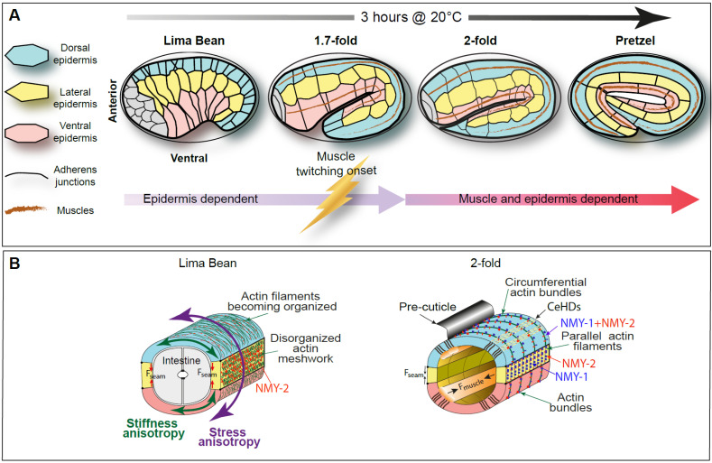
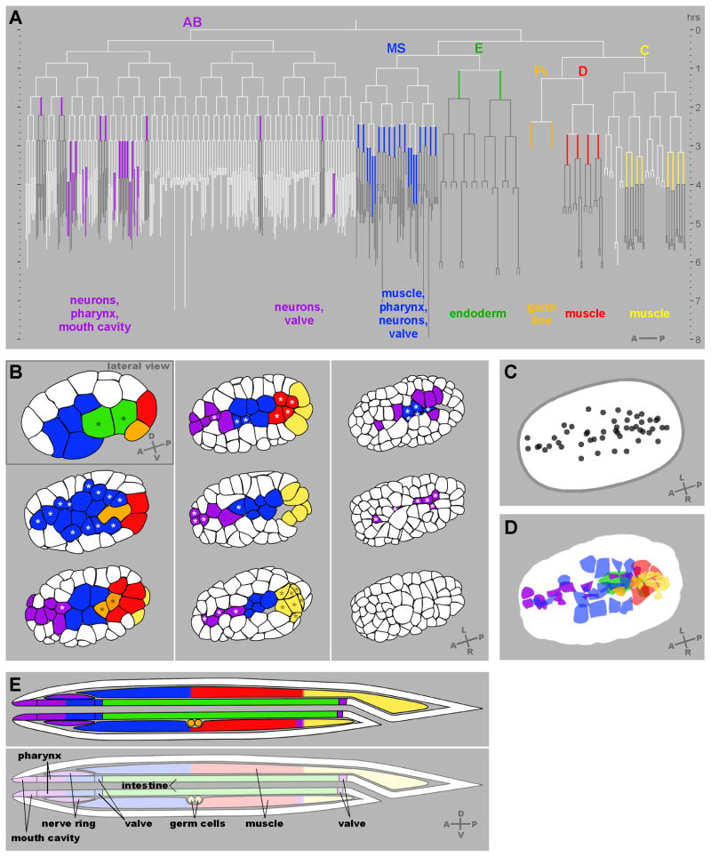

秀丽隐杆线虫（*Caenorhabditis elegans*）的胚胎从一个卵细胞变成细长的身体，经历了几种很不同的运动：细胞从表面进入内部，表皮细胞彼此穿插并包住胚胎，随后整个身体变长、变细，在卵壳内弯曲和卷起。

这些运动可以追溯到具体细胞。线虫的胚胎谱系高度可重复，同名细胞在不同胚胎中通常具有相近的来源和任务。我们因而能够比较，同一类细胞在野生型与扰动条件下何时收缩、怎样接触邻居、最终移动到了哪里。

## 1 五篇笔记

| Note | 实验与模型 |
| --- | --- |
| [01 细胞内移与力传递](/notes/celegans/embryonic_morphogenesis/gastrulation/) | 从 Ea/Ep 成像与 zyxin 实验出发，讨论细胞球模型、内移双稳态、molecular clutch 和邻居带动的内移。 |
| [02 表皮重排与腹侧闭合](/notes/celegans/embryonic_morphogenesis/epithelial_morphogenesis/) | 连接突起形成、CDC-42 定向、rosette 和新生连接，讨论极性波前、顶点模型与闭合前沿的驱动和阻力。 |
| [03 早期伸长与各向异性力学](/notes/celegans/embryonic_morphogenesis/early_elongation/) | 结合方向性切割、分子张力传感和 ECM 实验，推导周向收缩、有限变形、纤维强化与层间传力模型。 |
| [04 肌肉驱动与形态记忆](/notes/celegans/embryonic_morphogenesis/late_elongation/) | 从先伸长后回缩的表型出发，讨论黏弹性、定向塑性、纤维切断与束化、肌肉协调和 FRAP 的几何修正。 |
| [05 三维体形与模型辨识](/notes/celegans/embryonic_morphogenesis/geometry_and_inference/) | 从弧长、弯曲和扭转走向主动杆与接触模型，并用参数简并解释哪些实验能区分相似的形态轨迹。 |

## 2 从细胞谱系到身体形态

谱系给出了细胞的身份，活体成像给出了运动过程，力学实验则帮助解释运动为何发生。几种信息合在一起，才能追踪局部骨架活动如何经过细胞连接和细胞外基质，最终改变整个身体的形状。

一个反复出现的现象是，产生收缩的结构已经活动，组织却未必立刻变形；组织已经变形，获得的形状也未必能够保持。Ea/Ep 的皮层流动、表皮新连接的建立和肌肉驱动的后期伸长，分别提供了研究这些环节的实验。

### 2.1 同一个胚胎中的几类形态发生

Gastrulation、dorsal intercalation、ventral enclosure 和 elongation 分别对应不同层次的几何变化。Gastrulation 改变细胞与胚胎表面的关系；intercalation 改变组织内部的相对排列；enclosure 改变表皮覆盖的连通性；elongation 则显著改变整个身体的长度、周向尺寸和曲率。

Ea/Ep 内移时，胚胎的外部长宽比变化很小，内部组织的布局却已经开始建立。伸长阶段的情况几乎相反：细胞大规模增殖不再是长度增加的主要来源，已有细胞的协调形变却能明显改变全身轮廓。研究两者时，合适的几何变量也不同。

*图 1｜伸长过程中的形态与组织力。引自 [Labouesse 等（2026），Fig. 3](https://pmc.ncbi.nlm.nih.gov/articles/PMC13072950/#cells-15-00645-f003)。A：从 lima bean 到后期卷曲形态，以及表皮主导和肌肉参与阶段的重叠；B：截面中的表皮 actin、非肌肉 myosin 和附着结构。肌肉约在 1.7-fold 开始抽动，超过约 2-fold 的持续伸长对肌肉活动的依赖更加明显。*

Dorsal 和 ventral epidermis 分别是背、腹侧表皮，seam cells 沿身体左右两侧排列。Seam 是这一类侧表皮细胞的名称，与腹侧闭合形成的缝不同。文献里的 hypodermis 通常也指这层表皮。

背侧插入与腹侧包裹在时间上重叠，肌肉也在身体尚未伸长完时开始活动。Early 和 late elongation 的区分，主要反映表皮内源活动与肌肉输入的相对作用随阶段变化。[Labouesse 等，2026](https://doi.org/10.3390/cells15070645)

### 2.2 谱系提供细胞身份 位置仍由运动建立

受精卵 P0 第一次不对称分裂产生 AB 与 P1，后续建立 MS、E、C、D、P4 等主要创始谱系。谱系名称保留细胞的分裂历史：Ea 和 Ep 分别是 E 的前、后子细胞；名称中的 a/p、l/r、d/v 通常指相应分裂方向。E 谱系形成肠道，P4 建立生殖系，其他创始谱系则对多种组织作出不同贡献。

这种谱系的高度可重复性，使实验者能够在细胞运动之前辨认它，追踪它何时失去表面暴露，并在扰动后判断运动、命运和分裂是否发生了解耦。它也避免了只依据一个瞬间的位置来猜测细胞身份。[Sulston 等，1983](https://wormatlas.cropsci.illinois.edu/SulstonembCellLin_1983/SulstonembCellLin1983.html)

*图 2｜内移细胞的谱系与空间分布。引自 [Harrell 与 Goldstein（2011），Fig. 2](https://pmc.ncbi.nlm.nih.gov/articles/PMC3022094/#F2)。A 将 66 个内移细胞放回胚胎谱系；B 为膜标记影像重建的多个发育阶段；C、D 标记内移前细胞顶面的位置与范围；E 显示各谱系对内部组织的贡献。B 的第一幅为侧视，其余主要为腹侧视图，颜色表示谱系而非统一的组织力学性质。*

66 个细胞并非一起内移。不同谱系的细胞在不同时间、不同位置失去表面接触，周围细胞再覆盖这些位置。它们可以使用相近的 actomyosin 元件，但启动这些元件的命运和极性调控有所不同。

比较这些运动时，谱系、命运和轨迹各自提供一类信息：细胞从哪里分裂而来，正在形成什么组织，以及怎样到达最终位置。对同名细胞的跨胚胎匹配，使三类信息能够被放到同一时间序列中。

### 2.3 时间和空间坐标的共同约定

经典胚胎谱系常以 <strong>20 °C 下第一次卵裂为零点</strong>，孵化约在其后 800 min。以受精为零点、以某次细胞分裂为零点、以表皮闭合为零点的研究，不能直接按照图上的分钟数叠加。温度、照明、安装和成像条件也会改变实际发育速度。[Sulston 等，1983](https://wormatlas.cropsci.illinois.edu/SulstonembCellLin_1983/SulstonembCellLin1983.html)

对于跨胚胎比较，更稳定的办法是同时保留原始采集时间和发育锚点，例如 Ea/Ep 的出生与内移、表皮终末分裂、首次稳定腹侧接触、首次肌肉抽动及 fold-stage。只把每条曲线归一化到 0–1，会掩盖某个阶段单独延迟的现象。

A/P 表示前后，D/V 表示背腹，L/R 表示左右。胚胎会在卵壳内转动，因此坐标应当跟随身体，而不是固定在图像上。到了卷曲阶段，还要分别记录三维弧长、投影弧长和头尾直线距离。

## 3 从产生运动到保持形态

每个阶段都涉及主动活动、传力和结构更新，但它们改变的几何不同。下表按实际运动与已定位的实验机制作比较。

| 过程 | 主要几何变化 | 已有实验定位的关键环节 | 尚需连接的尺度 |
| --- | --- | --- | --- |
| Ea/Ep 内移 | 暴露顶面减小，细胞进入内部 | 皮层收缩与连接耦合；ZYX-1 对相对滑移的调节 | 谱系表达怎样改变具体的分子承载与网络组织 |
| 背侧插入 | 两列细胞相互穿插，邻接关系更新 | 基底外侧突起；Rac/RhoG 依赖的形成与 CDC-42 相关定向 | 不同高度的细胞接触如何共同形成三维重排 |
| 腹侧裂隙及表皮闭合 | 内移位置封口，表皮形成连续覆盖 | 神经母细胞 rosette；前缘推进与新连接稳定 | 下方组织的几何和力怎样影响上方表皮迁移 |
| 早期伸长 | 长度增加，周向尺寸减小 | Seam 主动应力与背腹表皮方向性刚度 | 内部组织、顶端 ECM 与表皮如何分担负载 |
| 后期伸长 | 周期变形叠加持续体轴增长 | 肌肉输入、actin 重塑与连接分子周转 | 周期输入怎样在不同承载路径中留下方向性记忆 |

Ea/Ep 的皮层先流动、边界后跟随，将传力耦合定位为一个可调环节。后期胚胎先伸长、再回缩的表型，则显示骨架更新如何影响已获得的形状。比较运动过程，往往比只比较最终长短更容易找到机制差异。

这些环节分别位于 Ea/Ep 顶端接触、表皮平面连接和肌肉—表皮附着中。模型可以借用相近的变量，但变量对应的分子、方向和更新时间，需要回到各自的实验中确定。

## 4 显微影像与动态资源

静态论文图保留了实验条件与定量比较，影片则补充运动顺序、暂时接触、回缩和周期变形。下面按过程列出正文涉及的主要动态资源。

| 过程 | 资源 | 适合比较的动态变化 |
| --- | --- | --- |
| 连续发育与孵化 | [WormAtlas：Embryo Introduction](https://wormatlas.cropsci.illinois.edu/embryo/introduction/mainframe.htm) | 外轮廓、首次运动、卵壳内卷曲与离壳；页面的图例给出分期和素材来源 |
| 多轮细胞内移 | [Harrell 与 Goldstein（2011），补充影片](https://pmc.ncbi.nlm.nih.gov/articles/PMC3022094/#SD1) | 不同谱系细胞进入内部的顺序与位置，结合细胞谱系与内移位置 |
| 背侧插入 | [Hardin Lab：WormBook Movie Gallery，Movies 1–4](https://worms.biology.wisc.edu/galleries/wormbook/) | DIC、连接或 actin 标记下的相互穿插；Movie 4 使用 eff-1 背景抑制融合 |
| 腹侧包裹 | [同一图像与影片库，Movies 5–8](https://worms.biology.wisc.edu/galleries/wormbook/) | Leading cells 相遇、posterior pocket 封闭与连接缺陷；Movie 8 为 hmr-1(RNAi) |
| 表皮皮层切割 | [Vuong-Brender 等（2017），Video 1](https://doi.org/10.7554/eLife.23866.007) | 切口的建立与开口释放；早期伸长篇已嵌入原始影片 |
| 肌肉驱动与形变保持 | [Lardennois 等（2019），Supplementary Information](https://www.nature.com/articles/s41586-019-1509-4#Sec13) | 正常伸长与先伸长后回缩的区别，结合不同肌肉和骨架干预 |
| 周期输入与连接重塑 | [Yang 等（2025），补充素材](https://pmc.ncbi.nlm.nih.gov/articles/PMC12549353/#app2) | 肌肉活动、身体旋转和表皮连接形变的时间关系 |
| 谱系与三维位置 | [WormGUIDES 4D Developmental Atlas](https://wormguides.org/wormguides-atlas/) | 通过细胞名称和三维位置在不同影像之间定位同一细胞 |

论文图片保留原始面板，可以点击查看原尺寸。各图的温度、视角、时间零点、尺度和遗传背景沿用原图定义，具体条件见相邻图注。完整出处见[素材记录](media_sources.json)与[文献记录](literature_sources.json)，各篇末尾另列本篇引用的论文。
