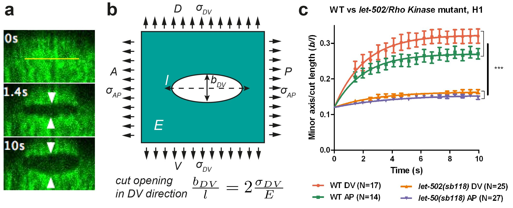
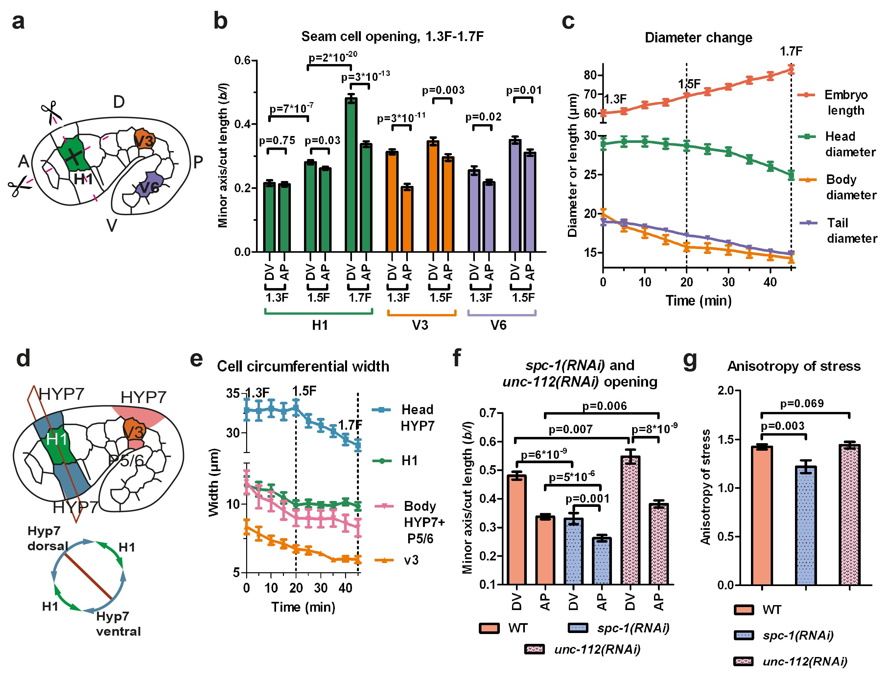
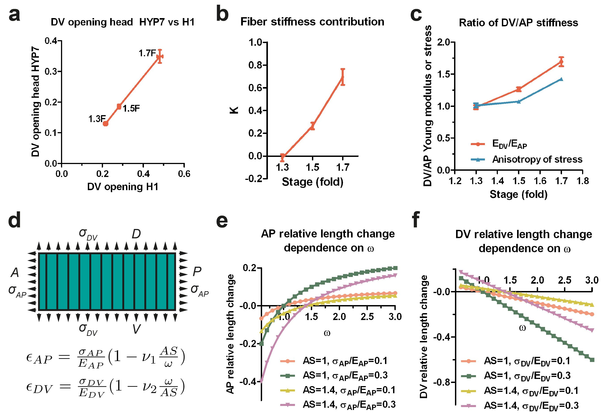
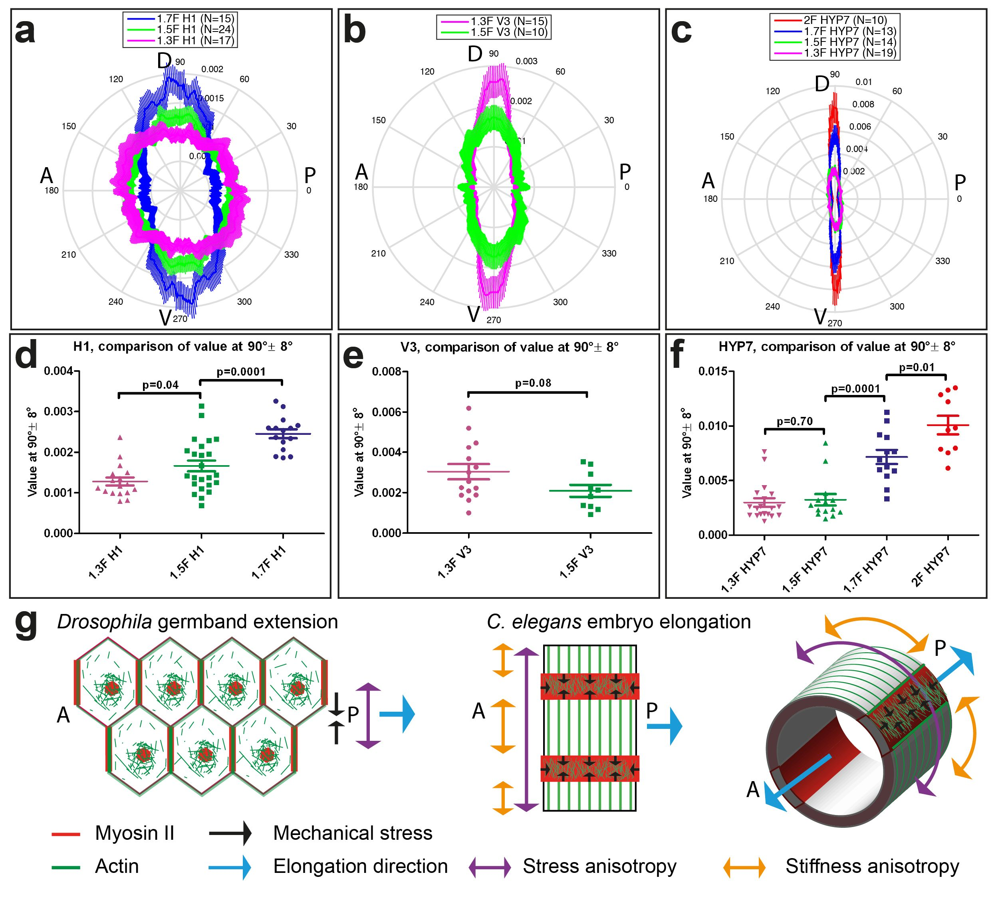
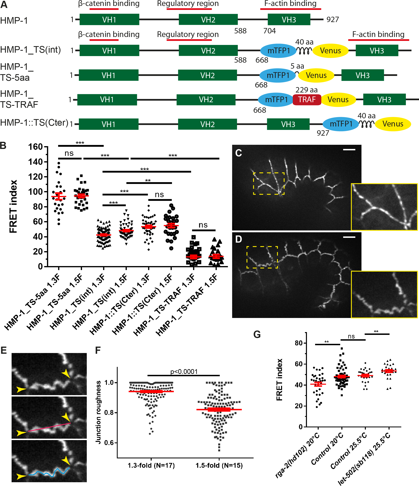
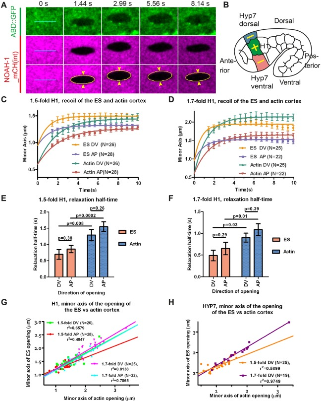
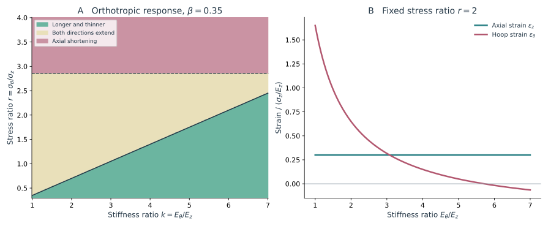
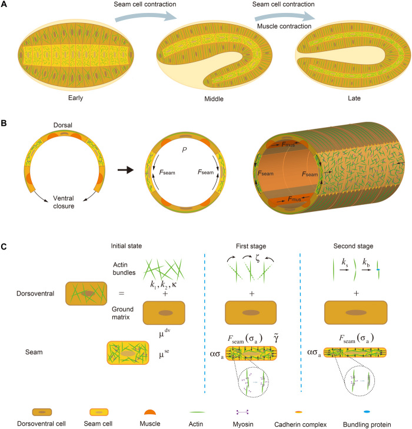
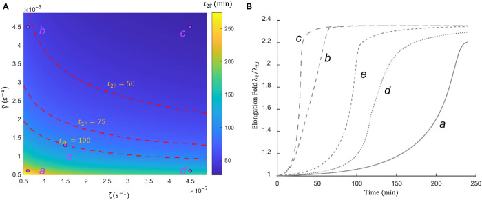

表皮完成包裹后，胚胎开始明显变细、变长。这个变化乍看很像把一团软材料从两端拉开，但主要驱动最初来自包住身体的表皮：侧面的 seam cells 具有收缩活动，背腹表皮则逐渐形成沿周向排列的 actin 束。为什么环绕身体的纤维会参与前后轴伸长，是这一阶段最需要解释的问题。

显微图能够显示纤维排列，却不能直接告诉我们它们承担多大负载。下面沿着激光切割、分子张力传感和基质扰动的实验，逐步讨论主动收缩怎样经由不同方向的材料响应，变成整个身体的形变。

## 1 Early elongation 主动应力与各向异性材料

<figure class="celegans-video celegans-stage-video" id="stage-motion-early-elongation">
<video controls loop preload="metadata" playsinline width="390" height="217" aria-label="从短粗胚胎到细长身体" aria-describedby="stage-motion-early-elongation-caption" poster="https://app.box.com/representation/file_version_2376582787103/thumb_1024.jpg?shared_name=72fh2l6x9ss84qxuss6qx1n3pnlfdtw3">
<source src="https://uwmadison.box.com/index.php?rm=box_download_shared_file&amp;shared_name=72fh2l6x9ss84qxuss6qx1n3pnlfdtw3&amp;file_id=f_2149903324703" type="video/mp4">
浏览器暂不支持内嵌播放，请打开下方原始视频。
</video>
<figcaption id="stage-motion-early-elongation-caption"><strong>动态影像｜从短粗胚胎到细长身体</strong> 
野生型胚胎的侧面 DIC 影像，前端在左，原始采样间隔为 60 s。前半段适合观察身体变细、轴向变长；影片还延续到后期，出现弯曲后，应沿身体轮廓追踪长度。 
来源：Hardin Lab，WormBook Movie 9；影像 E. Cox，Pettitt 等（2003）。<a href="https://worms.biology.wisc.edu/galleries/wormbook/">原始页面与说明</a> · <a href="https://uwmadison.box.com/s/72fh2l6x9ss84qxuss6qx1n3pnlfdtw3">原片</a>。</figcaption>
</figure>

### 1.1 伸长阶段的组织分工

表皮闭合后，胚胎经历从豆形、comma、1.5-fold 到 2-fold 的早期伸长。与前面的插入和包裹相比，这时最显著的变化来自已有细胞的协调形变：身体沿前后轴变长，同时周向尺寸缩小。细胞分裂与体积增长不是这一长度增加的主要来源。

表皮内部存在不同的细胞骨架组织。Seam cells 中非肌肉 myosin 与较短、较少规则排列的 actin 网络更突出；背腹表皮则逐渐形成沿周向排列的 actin bundles。这一差异使主动收缩和方向性承载可以在不同细胞群中形成分工。[Priess 与 Hirsh，1986](https://doi.org/10.1016/0012-1606(86)90358-1)；[Vuong-Brender 等，2017](https://doi.org/10.7554/eLife.23866)

*图 1｜表皮骨架的区域差异。引自 [Vuong-Brender 等（2017），Fig. 1](https://doi.org/10.7554/eLife.23866.003)。A 概括形态分期与肌肉参与；B–D 比较 1.3F、1.5F、1.7F 的 actin 组织，放大图分别对应背腹表皮和 seam 区域；F、G 显示 NMY-2 与 NMY-1，连接以 DLG-1::RFP 标记。主显微图比例尺为 10 µm。*

Actin 束的排列、锚定和周转分别影响方向性承载、跨细胞传力以及结构维持时间。显微图中的同一组纤维，因而可以参与多个力学环节。

这里的组织分工并不意味着两群细胞各自完成一半伸长。Seam 与背腹表皮在周向上彼此相接，某个 seam cell 变窄，就会改变邻近表皮的受力和边界位置；背腹表皮越难沿某个方向拉长，也越会改变 seam 收缩所遇到的阻力。图 1 的空间差异需要放回这个连在一起的表皮中理解，单独研究一块自由收缩的细胞皮层，不能给出同样的全身形变。

还要分清纤维的排列与马达的分布。沿周向看到明亮的 actin 束，说明该方向上存在较集中的骨架结构；只有再结合 myosin 活动、切割响应和遗传扰动，才能判断这组结构主要在主动缩短，还是在抵抗邻近组织施加的拉伸。两种作用可以共存，其相对贡献也可以随阶段改变。

LET-502/ROCK、MEL-11/myosin phosphatase、MRCK-1 与 PAK-1 等调控因子，把 myosin 活性与不同阶段、不同细胞群的形态联系起来。[Gally 等，2009](https://doi.org/10.1242/dev.039412) 但基因作用不能简单翻译成一个“收缩强度”参数：同一干预还可能改变连接、纤维取向和力传递，因此需要直接的机械测量。

### 1.2 总体积约束与局部材料形变

把伸直后的身体近似为长度 $L$、半径 $R$ 的圆柱，忽略两端并近似保持总体积，有

$$
V\simeq\pi R^2L,
\qquad
2\frac{\dot R}{R}+\frac{\dot L}{L}\simeq0.
$$

若长度比为 $\lambda=L/L_0$，则

$$
\frac{R}{R_0}\simeq\lambda^{-1/2},
\qquad
\varepsilon_{\rm AP}+2\varepsilon_\theta\simeq0
$$

其中后一个式子使用对数应变。长度增大四倍时，模型半径约降为一半。它使周向收缩与轴向伸长的关系变得明确，但没有决定哪一个方向首先产生主动活动。

这个约束还表明，体积保持不能和表面积保持混用。圆柱侧面积 $S\simeq2\pi RL$，因此

$$
\frac{S}{S_0}\simeq\lambda^{1/2}.
$$

长度增加时，表皮覆盖面积仍可增加。膜储备、细胞展平和厚度变化可共同满足这一几何要求，骨架则在变形中持续更新。

真实胚胎头、躯干和尾部的直径不同，局部变化也不均匀。圆柱近似提供的是整体关系；要解释某个细胞的应变，需要同时考虑其位置、周围组织与局部曲率。

实验中的 fold 分期也需要与应变分开。它是描述发育形态的方便标记，卷曲后的头尾直线距离却不能直接用于计算身体伸长比。若要比较模型中的 $L/L_0$，最好使用沿身体中心线测得的弧长，并明确同一胚胎的起始参考时刻。局部细胞的伸长比还需要追踪它自己的边界，不能用全身长度比代替。

对数应变适合把连续几个阶段相加。例如先伸长到原来的两倍，再从这个状态伸长两倍，总伸长比是四倍，而两段对数应变相加恰好是 $\ln2+\ln2=\ln4$。普通工程应变在每段都重新取参考长度时，不能这样相加。这个区别在短时间小变化中不大，在整个胚胎伸长过程中就会影响参考构型的更新。

### 1.3 薄壳力平衡为何会产生方向差别

对于承受内部压差 $P$、半径 $R$、厚度 $h$ 的封闭薄壁圆柱，轴向与周向的被动承载应力在理想条件下满足

$$
\sigma_\theta\simeq\frac{PR}{h},
\qquad
\sigma_{\rm AP}\simeq\frac{PR}{2h}.
$$

这里的 $\sigma$ 是单位截面积上的力，即三维应力，常用单位为 Pa。若把厚度为 $h$ 的表皮压缩成一张曲面，其面内张力为 $T=h\sigma$，单位变成 N/m；细胞连接边界的线张力又是另一种降维后的量。比较不同模型或测量时，先确认它们保留了几何中的哪些维度，就能避免把数值相近但单位不同的“张力”混在一起。

可以沿长度方向把圆柱想象成两个半圆筒。取长度为 $\ell$ 的一段，压力对其中半个圆筒的合力是 $2PR\ell$，两条切边的壁张力合力是 $2\sigma_\theta h\ell$，平衡后得到周向关系。再看封闭端盖：压力合力是 $P\pi R^2$，周围一圈壁所承担的轴向力是 $2\pi Rh\sigma_{\rm AP}$，于是轴向应力只有周向的一半。两倍差异来自几何，推导时还没有给材料指定各向异性。

这里的 $P$ 是内外压差。若内部组织也近似不可压缩，模型中的压力还需要与体积约束、边界和其他应力一起求解，不能把它当成一个可以独立任意增加、又不改变其他条件的外部旋钮。真实内部组织也不是没有结构的流体，薄壳计算因此主要帮助判断受力尺度。

内部组织会承载并重排，真实胚胎比空心薄壳复杂。薄壳关系适合给出应力尺度和方向比较；实际形变还要通过材料关系和主动活动求出。

用更一般的形式，可以把弹性响应与主动参考应变分开：

$$
\boldsymbol\sigma
=\mathsf C:\bigl(\boldsymbol\varepsilon-\boldsymbol\varepsilon^{\rm a}\bigr).
$$

$\mathsf C$ 表示材料的方向性响应，$\boldsymbol\varepsilon^{\rm a}$ 汇总主动收缩或参考构型改变。力平衡决定哪些应力分布可行，材料关系决定这些应力怎样对应形变，而活性决定系统偏离原参考状态的方式。三者共同给出形态演化。

细胞长宽比是受力与材料共同作用的结果。相同形变可以由较大驱动力和较高刚度产生，也可以由较小驱动力和较软材料产生。

### 1.4 激光切割将承载状态变成可观察的释放响应

局部切断 actin cortex 后，原来由这一区域传递的力被释放，边界回缩并形成开口。切口方向、开口方向、达到的尺寸及释放过程的时间尺度，为区分应力与材料性质提供约束。

*图 2｜从激光切口到力学参数组合。引自 [Vuong-Brender 等（2017），Fig. 2](https://doi.org/10.7554/eLife.23866.004)。A 为 HYP7 背侧表皮在 1.7F 时、沿前后方向长 5 µm 的切割；B 为双轴应力下的弹性平面开口；C 比较 H1 细胞中野生型与 let-502 条件下的归一化开口。A 为 HYP7，C 为 H1。*

在无限大、均匀、各向同性弹性平面等近似下，切口的开口宽度 $b$ 与切口长度 $\ell$ 可以给出类似

$$
\frac b\ell\simeq2\frac{\sigma_\perp}{E}
$$

的关系，其中 $\sigma_\perp$ 是垂直切口方向的预应力，$E$ 是相应有效弹性模量。因而最终开口首先报告的是应力与刚度的组合，而不是无条件的绝对张力读数。

若将释放过程概括为一个有效黏弹自由度，可写

$$
\eta_{\rm eff}\dot u+K_{\rm eff}u=F_{\rm eff},
\qquad
u(t)=u_\infty\bigl(1-e^{-t/\tau}\bigr),
\quad
\tau=\frac{\eta_{\rm eff}}{K_{\rm eff}}.
$$

这里位移 $u$ 的刚度 $K_{\rm eff}$ 与力 $F_{\rm eff}$ 已经吸收了局部几何；因此响应幅值与响应时间分别约束 $F/K$ 和 $\eta/K$。单一位移曲线不能同时恢复三个独立的绝对量。

例如，预负载和刚度一起增加两倍，最终开口就可以保持不变；若黏性也增加两倍，整条释放曲线都保持不变。切口很大既可能是负载较高，也可能是材料较软。初始回缩速度在这个简化方程中等于 $F_{\rm eff}/\eta_{\rm eff}$，同样是两个量的比值。因此，“开口更大”与“张力更高”之间始终隔着材料假设。

切割方向也容易读反：沿前后轴切开皮层，首先释放的是跨越这条切口的周向负载，开口主要沿周向展开。将两方向切口互换，才有机会比较两个承载方向。分析还需避开已明显出现伤口修复的后段，因为新聚集的骨架会改变被测系统，而不再只是释放切割前的负载。

<figure class="celegans-video">
<video controls preload="none" playsinline width="616" height="480" aria-label="表皮actin皮层激光切割后的响应" poster="https://iiif.elifesciences.org/lax/23866%2Felife-23866-media1.jpg/full/full/0/default.jpg">
<source src="https://static-movie-usa.glencoesoftware.com/mp4/10.7554/672/626a302e3b0f99d57a9b3a50c24ae0475f59fc50/elife-23866-media1.mp4" type="video/mp4">
请通过原始视频链接观看。
</video>
<figcaption>显微视频｜Vuong-Brender 等（2017），Video 1。ABD::mCHERRY 标记 actin，黄线标记切口；0 s 为切割后的第一张图。由原期刊媒体服务提供，© 作者，CC BY 4.0。<a href="https://doi.org/10.7554/eLife.23866.007">原始视频与图例</a>。</figcaption>
</figure>

2017 年研究主要利用开口形状和切割方向来比较材料响应，避开了当时难以充分分辨的最早回缩速度。较强激光损伤还会激活修复和钙反应，分析时间窗因此会影响所测响应的含义。

### 1.5 Seam cells 的应力各向异性具有空间差异

头部、躯干和尾部的 seam cells 并不处于相同的几何环境。Vuong-Brender 等在 H1、V3、V6 等细胞中比较不同方向切口，并同时记录局部身体直径与细胞周向宽度，发现应力各向异性的演化与胚胎形态存在空间联系。

*图 3｜应力分布与形态变化的局部对应。引自 [Vuong-Brender 等（2017），Fig. 3](https://doi.org/10.7554/eLife.23866.011)。A 标记 H1、V3、V6 的切割位置和方向；B 为开口比较；C 为身体长度及头、躯干、尾部直径；D、E 关联细胞周向宽度；F、G 比较 spectrin 或肌肉相关条件下的响应。图中分别保留了头、躯干和尾部的局部测量。*

在材料近似各向同性的 seam cortex 中，两个方向的开口比值可以帮助估计应力比值。其适用性依赖同一局部材料的方向响应近似相同，以及切口几何可以相互比较。离开这些条件，开口各向异性同时包含应力与材料的各向异性。

图 3 同时保留了局部身体直径、细胞周向宽度与开口响应。比较 1.3F、1.5F、1.7F 时，应先在同名细胞和相近位置之间比较，再讨论变化能否推广到全身。头部与躯干的曲率、半径和邻居布局都不同，把所有切口混在一起取平均，可能抹掉本来需要解释的空间差异。全身长度相近的两个胚胎，也可能分别通过头部和躯干的不同变形达到这个长度。

### 1.6 背腹表皮的纤维强化改变了材料方向性

背腹表皮中周向 actin 束的逐渐排列，意味着其皮层不能简单看成与 seam cells 相同的均匀各向同性材料。纤维沿某个方向承载，会使沿纤维方向拉伸与垂直方向变形的代价不同。

若用周向单位向量 $\mathbf a$ 描述主要纤维方向，可以写出纤维强化材料的基本结构

$$
W=W_{\rm matrix}(\mathbf C)+W_{\rm fiber}(I_4),
\qquad
I_4=\mathbf a\cdot\mathbf C\mathbf a,
\quad
\mathbf C=\mathbf F^{\mathsf T}\mathbf F.
$$

基质部分描述背景材料，纤维部分描述沿特定取向的伸展。模型的具体函数形式会决定纤维在压缩和拉伸时怎样参与承载；actin 的弯曲、松弛、主动缩短和周转，还会使实际响应偏离一组永久存在的被动直纤维。

把纤维视为沿轴向拉伸的细绳，可以理解其中的非对称性：拉紧后，它能承担较大的拉力；两端靠近时，它可能先弯曲或松弛，压缩刚度远小于拉伸刚度。因而有些纤维材料模型只在 $I_4>1$ 时增加强化能。是否采用这个规则，会影响周向缩短时纤维还承担多少负载。显微图中看到纤维仍然存在，并不意味着它在拉伸与压缩中贡献相同的刚度。

*图 4｜刚度各向异性进入伸长机制。引自 [Vuong-Brender 等（2017），Fig. 7](https://doi.org/10.7554/eLife.23866.016)。A 关联 HYP7 与 H1 的开口响应；B、C 给出纤维强化相关参数及方向性刚度随阶段的变化；D–F 将这些性质放进材料关系，比较轴向和周向形变。刚度比由切割数据与模型共同估计。*

这项工作的重要结论是，<strong>驱动力的各向异性与材料的各向异性发生在相互耦合、但并不相同的细胞群中</strong>。Seam cells 的主动收缩为周向形变提供动力，背腹表皮的方向性骨架则改变这份负载如何转化为组织形变。

方向性强化改变的是组织的响应方向。各方向刚度同比增加，通常主要减小形变；周向纤维选择性增强，则会重新分配周向和轴向应变。

### 1.7 从纤维排列到方向性承载

Actin 图像给出纤维取向，切割和材料模型给出方向性响应。交联、密度、长度和连接状态还会改变纤维承载，因此需要把结构成像与机械响应对应起来。

*图 5｜Actin 组织与力学区域分工的对应。引自 [Vuong-Brender 等（2017），Fig. 8](https://doi.org/10.7554/eLife.23866.017)。A–C 分别量化 H1、V3、HYP7 的纤维角度分布；D–F 比较周向附近的信号；G 将线虫机制与果蝇 germband 的连接重塑作对照。几何上都能伸长的组织，不必依靠同一种局部收缩布局。*

对于二维纤维取向，常用 nematic 指标

$$
Q=\left|\langle e^{2i\phi}\rangle\right|
$$

描述排列程度。这里使用 $2\phi$，是因为一根没有区分两端的纤维沿 $\phi$ 与 $\phi+\pi$ 指向同一条轴。它与描述突起方向的 polar 指标不同：细胞前缘有推进方向，纤维轴向本身未必带有可见的头尾。

当骨架排列与组织应变彼此反馈时，还会出现一个动力学问题：纤维是先定向后决定形变，还是在形变过程中继续被重排？静态的各向异性材料只能回答给定结构怎样承载，而要解释取向如何建立，需要纤维周转和活性反馈的演化规律。

## 2 力传递网络 连接与细胞外基质

### 2.1 一个组织中的多条承载路径

从 seam cells 产生的收缩要影响背腹表皮，需要跨越细胞连接；从肌肉产生的收缩要影响身体外形，还需要通过细胞外基质和表皮附着装置。它们对应不同的力传递拓扑：细胞—细胞连接主要在表皮平面中耦合细胞，半桥粒样结构与中间丝则把表皮厚度两侧的负载联系起来。

细胞间连接与半桥粒样附着承担不同方向的负载，也有不同的周转和失效方式。研究耦合时，具体是哪一层、哪一个界面发生滑移，比笼统的黏附强弱更有信息。

HMR-1/HMP-2/HMP-1 复合体是这一网络的重要组成，但线虫表皮还包含 DLG-1/AJM-1、VAB-9、ZOO-1、AFD-1 等相关模块。不同复合体的位置与相互作用并不完全重叠，这使局部力分配具有多条可调节路径。

### 2.2 HMP-1 分子张力与整体皮层张力不是同一个量

Vuong-Brender 等在 HMP-1 内部引入 FRET tension sensor，把分子构型变化与形态发生中的承载联系起来。传感器位于 β-catenin 结合区与 actin-binding 区域之间，并配有不同连接长度及末端放置等控制构建。[Vuong-Brender 等，2018](https://doi.org/10.1371/journal.pone.0193279)

*图 6｜HMP-1 上的分子承载。引自 [Vuong-Brender 等（2018），Fig. 2](https://doi.org/10.1371/journal.pone.0193279.g002)。A 为传感器与控制构建；B 比较 FRET index；C–F 将连接形状与阶段联系起来；G 通过增加或降低 myosin 活性的遗传条件验证张力敏感性。FRET index 的变化不能未经标定直接换算成每条连接承担的绝对力。*

在简单的 Förster 关系中，能量转移效率与供体—受体距离 $r$ 满足

$$
E_{\rm FRET}=\frac{1}{1+(r/R_0)^6}.
$$

拉伸传感器通常使供体与受体相距更远，从而降低 FRET，但蛋白取向、标记、局部背景和数据处理也会影响实际的 FRET index。末端放置、连接长度改变以及 myosin 扰动等控制，帮助排除部分非力学解释。它们支持特定构建下的相对承载比较；要把某个读数标成 pN，还需要传感器的力学标定。

研究中，1.3F 到 1.5F 之间 HMP-1 传感器所报告的张力可以下降，而身体仍在伸长。两项结果并不矛盾：组织形变由整个网络承担，落在某一类分子上的平均力，还受承载分子数、并行连接和局部几何影响。

在最简单的并联承载图像中，总力约为参与承载的分子数 $N$ 乘以单分子平均力 $\langle f\rangle$。若更多 HMP-1 被招募到有效传力路径上，每个分子分到的力可以下降，总力却不必下降。传感器荧光还可能包括当时没有承担同等负载的分子，因此实际信号不能直接当成这幅简单图像中的 $\langle f\rangle$。分子数量、空间分布和力敏感读数放在一起，才能检验这种负载重新分配的解释。

皮层切割、分子张力传感和连接形态观察到了不同尺度的负载。比较它们的变化方向，有助于判断力是否转移到更多分子或其他并行承载路径上。

### 2.3 HMP-1 对连接完整性与力平衡的作用

2018 年的研究也修正了对 HMP-1 的过度简化理解。在某些 hmp-1 条件下，HMR-1 与 actin bundles 可以一起从原连接位置被拉走，说明“actin 与 cadherin 完全断开”不足以概括表型。HMP-1 对局部连接完整性与力平衡的维持，可能比一幅单线锚定示意所表达的更广。

在所测早期阶段，HMP-1 张力与 HMR-1 周转没有简单相关性。后期肌肉带来的周期输入具有不同的时序和位置，仍可能改变连接周转。

这也提出了一个可延伸的问题：连接响应更依赖平均负载、负载峰值，还是反复加载的频率？把张力传感与分子交换同时放进周期影像，可以帮助分开这些影响。

### 2.4 Apical ECM 的承载与应力分配

线虫胚胎周围有卵壳，表皮顶端还有 embryonic sheath / apical ECM，肌肉与表皮之间则具有基底侧细胞外基质，后续又形成角质层。这些结构的空间位置、来源和力学任务不同，不能合并成一个没有具体位置的“外壳刚度”。

NOAH-1、NOAH-2 等顶端 ECM 蛋白的研究显示，胚胎 sheath 对伸长、组织完整性和肌肉连接都有作用。其缺失可使胚胎先停止正常伸长，之后才出现局部鼓出和破裂；因此形态发生失败不能全部归因于已经破裂后的后果。[Vuong-Brender、Suman 与 Labouesse，2017](https://doi.org/10.1242/dev.150383)

*图 7｜顶端 ECM 对身体形态的约束。引自 [Vuong-Brender、Suman 与 Labouesse（2017），Fig. 1](https://pmc.ncbi.nlm.nih.gov/articles/PMC5769628/#DEV150383F1)。A、A′ 定位 sheath 与表皮、肌肉的关系；B、C 比较相关蛋白结构；D 给出 noah-1 条件下的局部鼓出与破裂；E 比较伸长曲线。终点破裂与更早的伸长异常需要在时间上分开。*

顶端 ECM 的另一项关键证据来自与 actin cortex 的同步切割。若两层对释放负载有相近或相关响应，就支持它们在相关尺度上共同承载，而不是只在空间上贴近。

*图 8｜皮层与外侧 sheath 的共同承载。引自 [Vuong-Brender、Suman 与 Labouesse（2017），Fig. 7](https://pmc.ncbi.nlm.nih.gov/articles/PMC5769628/#DEV150383F7)。A 同时显示 sheath 和 actin 的切口；C–F 比较开口动力学与释放时间；G、H 比较两层的最终开口。切割位置包括 H1 与其背腹 HYP7 邻居，因此能够关联材料层与细胞区域。*

Sheath 与皮层共同承载，将材料问题扩展到了细胞外。两层的刚度与界面耦合共同决定局部负载能向多远传播，以及损伤后如何重新分配。

伸长异常与结构破坏的时间顺序，进一步限定了因果解释。如果先看到伸长速率下降，随后才出现局部鼓出或破裂，破裂就不是伸长受阻的最初原因。类似地，两层在图像上重叠只说明位置接近；切割后开口和释放过程之间的联系，则进一步检验它们是否在传递同一部分负载。把破坏前的轨迹和破坏后的响应放在一起，才能判断 ECM 对形态的作用发生在哪一步。

## 3 方向性刚度怎样改变形变方向

### 3.1 一个可以直接算出的例子

压力和收缩给出了应力，材料关系才决定组织往哪个方向变形。为看清这一步，考虑一个平面应力、小应变的正交各向异性材料。以 $z$ 表示前后轴、$\theta$ 表示周向，写成

$$
\begin{pmatrix}\varepsilon_z\\\varepsilon_\theta\end{pmatrix}
=\begin{pmatrix}E_z^{-1}&-c\\-c&E_\theta^{-1}\end{pmatrix}
\begin{pmatrix}\sigma_z\\\sigma_\theta\end{pmatrix}.
$$

$E_z$ 与 $E_\theta$ 是两个方向的拉伸模量，$c>0$ 表示一个方向被拉长时，另一个方向倾向于缩短的横向耦合。矩阵的两个非对角元相同，保证它可以来自同一套弹性能。稳定材料还要求 $c^2<1/(E_zE_\theta)$，因此这些参数不能完全随意选择。

令应力比 $r=\sigma_\theta/\sigma_z$、刚度比 $k=E_\theta/E_z$，并定义 $\beta=cE_z$。除去共同尺度 $\sigma_z/E_z$ 后，两个应变是

$$
\frac{\varepsilon_z}{\sigma_z/E_z}=1-\beta r,
\qquad
\frac{\varepsilon_\theta}{\sigma_z/E_z}=\frac r k-\beta.
$$

身体变长且周向变细，对应 $\varepsilon_z>0$、$\varepsilon_\theta<0$。在这个例子中，需要 $r<1/\beta$ 且 $k>r/\beta$。周向刚度足够高时，周向拉伸受到抑制，来自轴向拉伸的横向收缩可以占优势。于是，承受正周向张力的区域仍然可能沿周向变短。

取图 9 的 $\beta=0.35$、$r=2$，归一化轴向应变为 $0.30$。当 $k=2$ 时，周向应变为 $0.65$，两个方向都拉长；把 $k$ 提高到 $6$，周向应变变为约 $-0.017$，这时才出现轴向变长、周向变短。外加应力的方向比没有改变，变化来自材料对周向拉伸的抵抗增加。

这个例子也说明横向耦合不能省略。若令 $c=0$，两个方向各自只对本方向正应力产生正应变，提高周向刚度只能让周向伸长接近零，不会让它变成负值。图中的符号变化依赖方向间的耦合，并且参数仍须满足材料稳定性；它不是仅靠一句“周向更硬”就能保证的结果。

*图 9｜应力方向与形变方向之间隔着材料关系。左图取 $\beta=0.35$，在满足稳定性条件的参数范围内标出轴向伸长、周向缩短的区域；右图固定 $r=2$，比较提高周向刚度后的两方向应变。应变均除以 $\sigma_z/E_z$。这是线性正交材料的算例，图中边界取决于横向耦合，不是线虫通用的材料阈值。*

上式的作用是把“各向异性”拆开：提高 $r$ 是改变负载分配，提高 $k$ 是改变方向性承载，改变 $\beta$ 则是改变两方向的耦合。它们可以让细胞长宽比以相似方式变化，却对应不同的机械干预。Vuong-Brender 等的实验正是利用区域、方向和阶段不同的切割，来约束这些可能性，而没有仅凭最终形状反推一个收缩力。

### 3.2 有限变形中的参考构型与纤维能量

胚胎长度可以增加数倍，小应变近似只适合局部的短时间增量。计算整个伸长过程时，更自然的变量是伸长比 $\lambda_i$。对于近似不可压缩的材料，三个主方向满足

$$
\lambda_r\lambda_\theta\lambda_z=1.
$$

这与前面总体积保持的圆柱关系不同：它约束一个材料小块的径向厚度、周向长度与轴向长度。表皮厚度也可以变化，不能在局部计算中直接把 $\lambda_r$ 省略。

最简单的不可压缩 neo-Hookean 材料取

$$
W_m=\frac\mu2(I_1-3),
\qquad
I_1=\lambda_r^2+\lambda_\theta^2+\lambda_z^2.
$$

$\mu$ 给出背景剪切刚度。压力作为不可压缩约束的乘子进入应力，而不是预先被设成材料常数。纤维再通过方向不变量 $I_4=\mathbf a\cdot\mathbf C\mathbf a$ 进入能量。如果纤维与周向夹角为 $\phi$，在无剪切的主轴形变下，

$$
I_4=\lambda_\theta^2\cos^2\phi+\lambda_z^2\sin^2\phi.
$$

$I_4$ 是沿纤维方向的伸长比平方。纤维接近周向时主要限制周向拉伸；转向轴向后，抵抗的方向也随之改变。同样数量的 actin，因为排列不同，就能给组织带来不同的响应。

Ciarletta 等在 2009 年建立了结合主动活动、方向性骨架和连续体平衡的伸长模型。后来的工作加入新的切割约束、顶端 ECM 和动态 actin 重塑，逐渐把单个材料关系发展成多层、随时间演化的描述。[Ciarletta 等，2009](https://doi.org/10.1098/rsta.2009.0088)

## 4 从已有方向性到不断建立的方向性

Fang 等的模型同时保留 seam 区域的主动收缩和背腹表皮的纤维材料。Seam 用近似各向同性的背景描述，背腹表皮再加入纤维强化；两类区域共同满足周向长度、总体积与力平衡。[Fang 等，2021](https://doi.org/10.1126/sciadv.abg3264)

*图 10｜Fang 等模型中的结构与变量。引自 [Fang 等（2021），Fig. 1](https://pmc.ncbi.nlm.nih.gov/articles/PMC8245039/#F1)。A 区分两个伸长阶段；B 为薄壁圆柱和受力；C 同时画出 seam 主动应力、背腹纤维取向和后期 severing–rebundling。内压、圆柱与纤维分区是计算采用的理想化。*

这项工作的一个关键变量是纤维方向的分散程度 $\kappa$。在所用材料形式中，它通过组合 $I_f=\kappa I_1+(1-3\kappa)I_4$ 进入纤维能量：$\kappa=0$ 对应充分排列的纤维，$\kappa=1/3$ 对应三维方向分布各向同性的极限。它与直接由二维图像算出的 nematic order $Q$ 有联系，但两者定义不同，数值也不能直接互换。

纤维取向随时间按降低系统能量的方向更新，概括为 $\dot\kappa=-\zeta\,\partial E/\partial\kappa$，并限制在模型允许的取值区间。$\zeta$ 控制重排快慢；seam 主动力还以另一速率逐步建立。这样，模型里就有两只可以不同步的“钟”：收缩何时增强，材料何时具有足够的方向性。

*图 11｜驱动力与材料形成的时间配合。引自 [Fang 等（2021），Fig. 3](https://pmc.ncbi.nlm.nih.gov/articles/PMC8245039/#F3)。A 为达到 twofold 的时间随两种速率变化的热图；B 比较图中选定参数下的伸长轨迹。不同轨迹使用共同的其他参数，是模型预测而非多组新增实验。*

如果收缩已经增强，而纤维还没有建立相应承载，负载的分配就不同于两者同步增加时的情况。反过来，方向性骨架已经形成而驱动力仍很弱，也不会立即获得快速伸长。该模型据此预测两个速率都会改变伸长时间；可以通过同时追踪 myosin 活性、纤维排列和局部应变来检验其对应关系。

这里仍有一个建模选择值得保留：$\kappa$ 沿能量下降方向更新，是对重塑动力学的有效假设。Actin 由 ATP 驱动，还受到交联蛋白、聚合与解聚调控，未必始终沿被动能量最快下降的路径排列。它是否足够好，取决于能否同时解释取向的时间变化与机械扰动后的响应。

图 11 中达到 twofold 的时间，是整条轨迹压缩成的一个数。两组参数即使给出相同到达时间，也可能在前半段分别表现为“先收缩、后排列”和“先排列、后收缩”。若只测到达时间，这两条发育过程就会被当成同一种结果。模型已有两个独立速率，实验也最好分别保留 myosin 或收缩活动的变化，以及纤维方向分布的变化，再比较它们如何共同决定局部应变。

## 5 主动应力 主动参考形变与预应力

主动收缩在模型中有两种常见写法。第一种把主动应力加到被动应力上；第二种改变材料偏好的参考长度，让当前形状相对于这个参考状态产生弹性应力。小变形时，两者可以给出相同结果：

$$
\sigma=E\varepsilon+\sigma_a
=E(\varepsilon-\varepsilon_a),
\qquad
\varepsilon_a=-\frac{\sigma_a}{E}.
$$

这个等价要求同一个线性模量与相应的主动变量。进入有限变形后，主动应力如何随形变改变、主动参考状态是否与纤维一起转动，都会使两种写法产生不同预测。

Ben Amar 等在 2018 年特别讨论了主动与被动应力、几何和预应力怎样共同决定伸长及切割开口。一个马达倾向于缩短的网络，可以在实际约束下承受拉伸负载，因此切断后向外打开；“具有收缩活动”与“当前承受压应力”并不等价。[Ben Amar 等，2018](https://doi.org/10.1103/PhysRevLett.121.268102)

一个直观例子是，被人拉住两端的收缩橡皮带。它试图变短，却一直被拉长；切断后两端会远离切口。判断切割结果，依据的是切割前实际存储和传递的负载。生物组织更复杂，但这个例子能说明为什么激光开口与马达收缩并不矛盾。

## 6 表皮与顶端 ECM 的传力距离

把相互耦合的表皮和 sheath 看成两条可拉伸的带，沿同一坐标 $s$ 的位移分别为 $u_e$、$u_s$。若两层的纵向拉伸刚度为 $K_e$、$K_s$，界面以系数 $k$ 抵抗相对滑移，单位长度能量可写成

$$
E=\frac12\int\left[K_e(u'_e)^2+K_s(u'_s)^2+k(u_e-u_s)^2\right]\,\mathrm ds.
$$

平衡条件给出 $K_eu_e''=k(u_e-u_s)$、$K_su_s''=-k(u_e-u_s)$。相减后，相对位移 $\delta=u_e-u_s$ 满足

$$
\delta''=\frac{\delta}{\ell_t^2},
\qquad
\ell_t=\sqrt{\frac{K_eK_s}{k(K_e+K_s)}}.
$$

$\ell_t$ 是一个传力长度：局部不匹配产生的滑移会在这个量级的距离上衰减。界面耦合越强，调整集中在越短的范围内；耦合较弱时，局部变形可以在更长范围中由两层相对滑动来协调。一个局部损伤影响多远，就能提供与整体拉伸不同的信息。

在足够长的组织中，远离扰动位置且保持有限的解具有 $\delta\propto e^{-s/\ell_t}$ 的形式。界面把一层上的拉力逐渐转移给另一层，所以层内张力沿位置变化，而不是在整条带上立即相同。有限胚胎中的另一端、其他细胞连接和组织曲率会改变具体解，但仍可以问相对位移随距离衰减得有多快。

单测 $\ell_t$ 还不能分别求出两个层内刚度与界面耦合。它约束的是公式中的组合。若再测两层各自的位移幅度、共同位移和释放时间，就能增加独立信息。这也解释了为何同时标记 sheath 与 cortex，比只在一个通道里测切口宽度更有帮助。

这是连接两层释放实验的一种简化思路。它预测，比较两层切割后的位移空间分布，比仅比较切口最终大小更能区分层内刚度与层间耦合。实际 sheath 还具有曲率、方向性和周转，届时 $K$、$k$ 可以依方向和时间变化，但“负载经过多远才传给另一层”仍是一个可以测量的问题。

## 7 参考文献

1. Priess JR, Hirsh DI (1986). [Caenorhabditis elegans morphogenesis: the role of the cytoskeleton in elongation of the embryo](https://doi.org/10.1016/0012-1606(86)90358-1). *Dev Biol*.

2. Gally C, Wissler F, Zahreddine H, Quintin S, Landmann F, Labouesse M (2009). [Myosin II regulation during C. elegans embryonic elongation: LET-502/ROCK, MRCK-1 and PAK-1, three kinases with different roles](https://doi.org/10.1242/dev.039412). *Development*.

3. Vuong-Brender TT, Ben Amar M, Pontabry J, Labouesse M (2017). [The interplay of stiffness and force anisotropies drives embryo elongation](https://doi.org/10.7554/eLife.23866). *eLife*.

4. Vuong-Brender TTK, Boutillon A, Rodriguez D, Lavilley V, Labouesse M (2018). [HMP-1/α-catenin promotes junctional mechanical integrity during morphogenesis](https://doi.org/10.1371/journal.pone.0193279). *PLoS One*.

5. Vuong-Brender TTK, Suman SK, Labouesse M (2017). [The apical ECM preserves embryonic integrity and distributes mechanical stress during morphogenesis](https://doi.org/10.1242/dev.150383). *Development*.

6. Fang C, Wei X, Shao X, Lin Y (2021). [Force-mediated cellular anisotropy and plasticity dictate the elongation dynamics of embryos](https://doi.org/10.1126/sciadv.abg3264). *Sci Adv*.

7. Ciarletta P, Ben Amar M, Labouesse M (2009). [Continuum model of epithelial morphogenesis during Caenorhabditis elegans embryonic elongation](https://doi.org/10.1098/rsta.2009.0088). *Philos Trans A Math Phys Eng Sci*.

8. Ben Amar M, Qiuyang-Qu P, Vuong-Brender TTK, Labouesse M (2018). [Assessing the Contribution of Active and Passive Stresses in C. elegans Elongation](https://doi.org/10.1103/PhysRevLett.121.268102). *Phys Rev Lett*.

← [02 表皮重排与腹侧闭合](/notes/celegans/embryonic_morphogenesis/epithelial_morphogenesis/) · [系列总览](/notes/celegans/embryonic_morphogenesis/) · [04 肌肉驱动与形态记忆](/notes/celegans/embryonic_morphogenesis/late_elongation/) →
