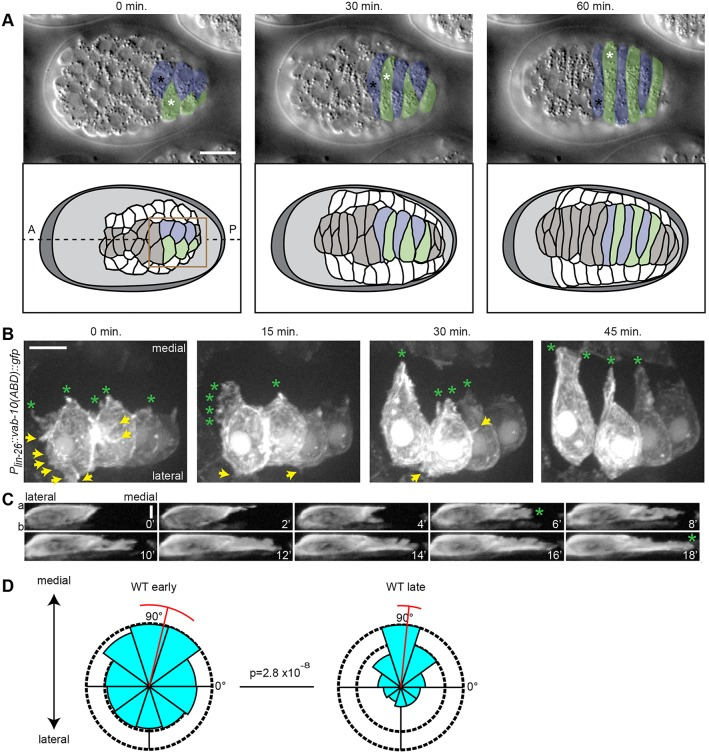
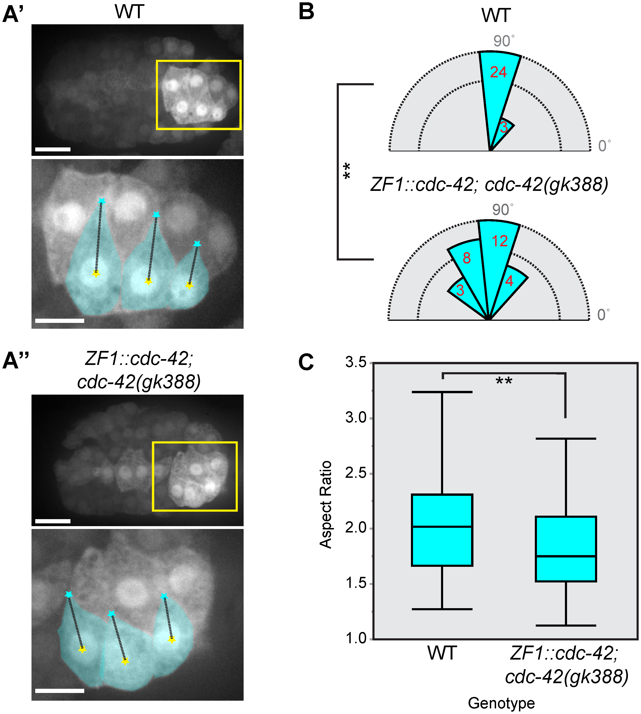
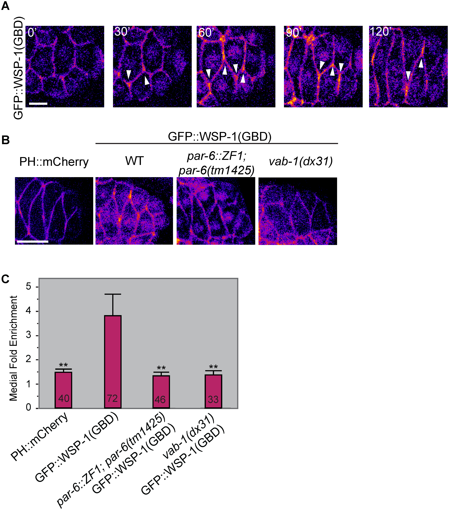
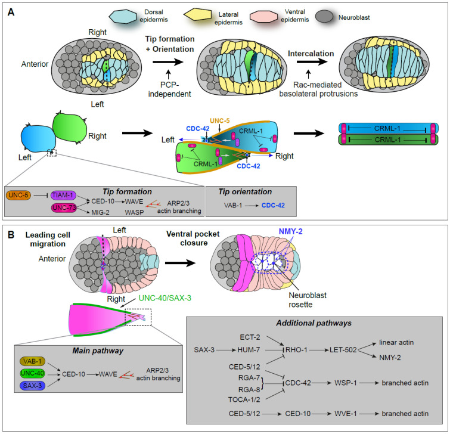
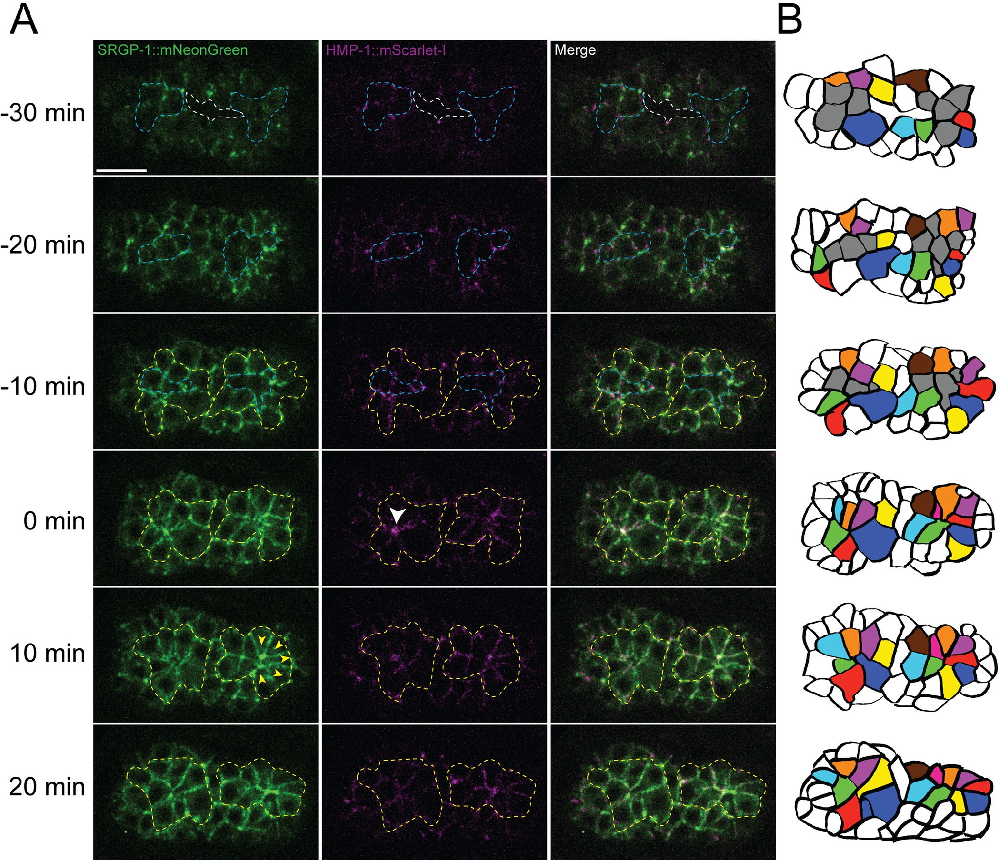
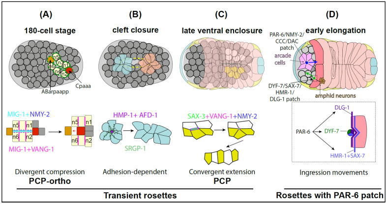
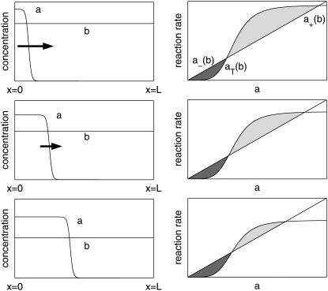
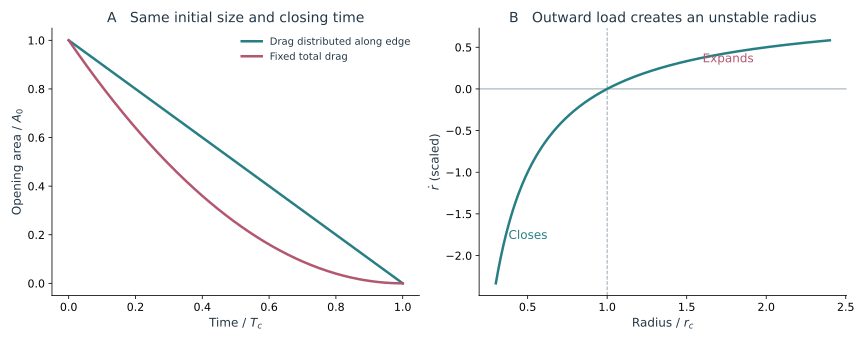

在背侧，表皮细胞向左右两列之间伸出前缘，彼此穿插；到了腹侧，它们又沿内部组织表面推进，与对侧细胞相遇，逐渐把胚胎包起来。前者改变谁与谁相邻，后者在原本没有表皮覆盖的区域建立一层连续组织。两段影像都很像细胞在爬行，最终要完成的空间变化却不同。

观察这些运动时，顶端连接之外的结构尤其重要：真正向前伸出的前缘位于哪里，它接触什么细胞，细胞主体又在何时跟上。背侧插入中，基底外侧突起格外突出；腹侧闭合时，突起还要在遇到对侧细胞后转为稳定连接。极性、牵引和黏附分别作用在这个连续过程的不同位置。

## 1 Dorsal intercalation 从突起极化到组织重排

<figure class="celegans-video celegans-stage-video" id="stage-motion-dorsal-intercalation">
<video controls loop preload="metadata" playsinline width="482" height="282" aria-label="背侧表皮从两列到交错排列" aria-describedby="stage-motion-dorsal-intercalation-caption" poster="https://app.box.com/representation/file_version_2376581905945/thumb_1024.jpg?shared_name=haqk54pdl7e9ut5qo26n7f9mem02yzsj">
<source src="https://uwmadison.box.com/index.php?rm=box_download_shared_file&amp;shared_name=haqk54pdl7e9ut5qo26n7f9mem02yzsj&amp;file_id=f_2149902455545" type="video/mp4">
浏览器暂不支持内嵌播放，请打开下方原始视频。
</video>
<figcaption id="stage-motion-dorsal-intercalation-caption"><strong>动态影像｜背侧表皮从两列到交错排列</strong> 
野生型胚胎的背侧 DIC 影像，前端在左，原始采样间隔为 30 s。细胞先形成楔形，随后左右交错，逐渐排成横跨中线的一列。可以先追踪尖端，再比较细胞主体何时跟上。 
来源：Hardin Lab，WormBook Movie 2；影像 E. Williams-Masson。<a href="https://worms.biology.wisc.edu/galleries/wormbook/">原始页面与说明</a> · <a href="https://uwmadison.box.com/s/haqk54pdl7e9ut5qo26n7f9mem02yzsj">原片</a>。</figcaption>
</figure>

### 1.1 两列细胞如何形成跨中线的一列

背侧表皮在终末分裂后最初排成左右两列。随着细胞向内侧形成楔形并相互穿插，原来的两列逐渐转化为跨越背侧中线的一列。细胞主体与细胞核的移动、前缘突起和原有接触的重塑并不完全同步，因此只追踪细胞核会丢失一部分关键的形态信息。

*图 1｜背侧插入中的基底外侧突起。引自 [Walck-Shannon 等（2015），Fig. 1](https://pmc.ncbi.nlm.nih.gov/articles/PMC4631769/#DEV127597F1)。A 为背侧 DIC 和对应示意，前端在左；B 的嵌合 F-actin 标记突出单侧细胞的动态突起；C 为沿顶底方向的重切片；D 比较早晚阶段突起的角度分布。A 比例尺为 10 µm，B、C 为 5 µm。*

与一些依靠顶端连接定向缩短的上皮插入不同，线虫背侧表皮突出表现为 <strong>basolateral protrusion</strong>：突起位于顶端连接以下的基底外侧区域。它们可以沿细胞侧面出现，但在有效插入过程中逐渐集中于内侧前缘。

读图 1 时，可以把一个背侧细胞想成上部仍与邻居相接、下部却已经朝内侧探出的三维物体。前缘最先进入对面细胞之间，细胞随后变得更长，细胞核和原来的顶端轮廓再逐渐移动。所谓细胞“越过中线”，因此并不是所有部位在同一时刻跨过一条线。

嵌合标记使这件事更容易看清。若每个细胞都同样明亮，互相重叠的突起很难分辨来源；只标记其中一侧的一组细胞，就能沿着荧光轮廓看到它们往哪里伸。重切片再确定突起相对于顶端连接的高度。平面投影、选择性标记和侧向视图各补一部分，合起来才支持基底外侧突起驱动的解释。

### 1.2 Rac RhoG 与分支 actin 控制突起形成

2015 年的研究通过组织特异的遗传操纵和 actin 成像，将 CED-10/Rac、MIG-2/RhoG 与突起活动联系起来。两者具有部分冗余，并分别通过 WAVE、WASP 相关路径促进 actin 组装。上游 UNC-73/Trio 提供 GEF 活性，CRML-1/CARMIL 则参与限制突起活动的空间范围。[Walck-Shannon 等，2015](https://doi.org/10.1242/dev.127597)

Rac、RhoG 和 CDC-42 都属于调节细胞骨架的小 GTPase，可以在较活跃的 GTP 结合态和较不活跃的 GDP 结合态之间切换。GEF 促进核苷酸交换，使它们更容易进入活跃态；WAVE 和 WASP 相关路径则把这种活性连接到分支 actin 的组装。突起出现在哪里，因而取决于活化在哪里发生、能持续多久，以及新生 actin 能否组织成有效前缘。

“部分冗余”的含义可以从扰动方式理解：一条路径受损后，另一条仍可能保留相当的突起活动；两条一起受损时，剩余能力才明显下降。这样的结果适合画成相互补充的调控路径。它并不要求两种蛋白在细胞内具有完全相同的定位，也不要求每个时刻提供相同大小的贡献。

限制突起的分子同样重要。若 actin 可以在所有边缘持续聚合，细胞会同时向多个方向试探，有限的材料和机械接触被分散。有效插入需要在内侧稳定前缘，同时让无效方向的突起回缩。于是，“抑制一部分活动”也可能改善整体迁移，这与单纯比较全细胞 actin 总量的直觉不同。

突起对推进的贡献取决于方向、寿命和牵引。大量短暂而方向分散的突起可以相互抵消；较少但朝向一致、能够稳定接触的突起，反而可能产生更大的净位移。

把突起方向写为角度 $\phi$，一个常用的方向一致性指标是

$$
P=\left|\frac{1}{N}\sum_{k=1}^{N}e^{i\phi_k}\right|.
$$

$P$ 接近 1 表示突起方向集中。再加上突起长度、寿命和牵引的时间变化，才可以把极性与实际位移联系起来。

这个指标可以用两个极端例子理解。若所有突起朝内侧，角度向量相加后保留相同方向，$P$ 较大；若一半向内、一半向外，平均向量会抵消。后一种情况仍可能有很多很长的突起，只是没有一致的推进方向。

不过，所有突起一致朝外时，$P$ 同样可以很大。它只描述方向是否集中，是否朝向中线还要看平均角度。因此，集中程度和平均方向最好一同报告，分别回答前缘是否一致、方向是否正确。

计算时必须保留方向的生物学定义。在身体图像中统一用向右作零度，会把左右两侧正常朝向中线的细胞当成彼此反向。更合适的是对每个细胞规定自己的内侧方向，再比较突起相对这个方向的角度。这样测到的集中程度，才与插入任务相对应。

### 1.3 CDC-42 区分了形成前缘与定向前缘

CDC-42 的研究进一步显示，“有一个尖端”和“尖端朝向正确”可以被遗传上部分分离。干预 CDC-42 后，有些细胞的内侧边缘长时间较钝，另一些细胞仍有突起，却可能与同侧邻居一起越过，而没有完成正常的左右交替插入。

*图 2｜细胞伸长与尖端定向的分离。引自 [Walck-Shannon 等（2016），Fig. 2](https://doi.org/10.1371/journal.pgen.1006415.g002)。A 比较野生型与晚期母源 CDC-42 丧失条件下的细胞轮廓；B 将尖端相对质心的方向进行角度统计；C 比较细胞长宽比。不同几何指标说明，插入缺陷不只是整体移动速度降低。*

为减小更早的分裂、极性和 gastrulation 缺陷，研究者在较晚阶段去除母源 CDC-42 功能，或在表皮中表达干扰构建。这样的时空控制，让插入表型更接近所研究阶段的直接作用。

图 2 中细胞长宽比与尖端角度被分别统计，正是因为两者回答不同问题。细胞可以已经拉长，但尖端偏向错误的邻居；也可以总体形状还不够细长，却保留朝向中线的局部突起。把这些变化合成一个“迁移受损”的分数，便看不到 CDC-42 对形状形成和方向选择的不同贡献。

活性探针又往前走了一步。总 CDC-42 荧光显示分子在哪里，WSP-1 GBD 相关报告则更接近显示哪里存在可被其识别的活性状态。尖端信号富集使上游受体与局部极性之间有了空间联系。不过，探针强度仍要结合背景、表达和几何比较，不能把尖端更亮直接换算成一个已知的活化分子数。

*图 3｜活性 CDC-42 的空间分布。引自 [Walck-Shannon 等（2016），Fig. 4](https://doi.org/10.1371/journal.pgen.1006415.g004)。以 WSP-1 的 G-protein-binding domain 构建的报告系统显示内侧尖端的活性富集；不同遗传背景下的内侧/外侧信号比较，把 VAB-1/Eph 与该空间极化联系起来。报告信号反映局部活性相关状态，并非总 CDC-42 蛋白量。*

PAR-3、PAR-6 和 VAB-1 与 CDC-42 的关系，将顶底极性、受体信号和前缘方向联系起来。背侧表皮与腹侧神经索的重排又表现出不同的 PCP 依赖，说明两类组织对极性模块的使用有所不同。

TIAM-1 的研究发现，GEF 催化功能与 N 端结构域都能调节突起。这提示前缘的形成还依赖蛋白的空间组织和相互作用，单独测总 GTPase 活性未必能完整描述它。[Zhu 等，2024](https://doi.org/10.1242/jcs.261509)

### 1.4 邻接变化与连续体形变之间还有一个尺度转换

一次邻接更新对组织应变贡献多少，取决于同时发生的细胞伸长、旋转、弯曲和顶底形变。将接触图与局部几何放在同一区域、同一时间段中分析，才能建立这层联系。

令细胞身份构成顶点集，稳定接触构成边集，得到

$$
G(t)=\bigl(\mathcal V(t),\mathcal E(t)\bigr),
\qquad
\Delta N_E=\left|\mathcal E(t+\Delta t)\triangle\mathcal E(t)\right|.
$$

其中对称差统计新增与消失的边。对于插入，还可以单独记录前缘是否跨过中线、细胞主体是否完成跨越，以及其顶端接触是否已经更新。它们对应同一事件的不同阶段。

接触图的优点是跨越细胞形状细节，只保留稳定邻居；它的代价也在这里：一个邻居接触从很短变成长边，只要始终存在，在图中仍是同一条边。反过来，短暂碰触是否算作新邻居，会受分割质量和持续时间阈值影响。报告重排次数时，因而也应说明怎样判定稳定接触。

细胞排列的方向同样需要保留。相同数量的邻居交换，若随机发生，对组织形状的平均贡献可能很小；若沿特定方向反复发生，则可能积累为组织伸长。网络告诉我们接触是否更新，几何和方向则告诉我们更新怎样改变了整个细胞群。

局部几何则可由对应点拟合

$$
\mathbf x_i(t+\Delta t)\simeq\mathbf F\mathbf x_i(t)+\mathbf b.
$$

$\mathbf b$ 表示这小群细胞整体移动了多远，$\mathbf F$ 表示相对排列怎样改变。若区域只是平移，$\mathbf F$ 接近单位矩阵；若整体旋转，则需要从 $\mathbf F$ 中分离旋转后再计算应变。对短时间、小变形增量，可以用其相对单位矩阵的对称部分近似应变。

剩下无法由共同平移、旋转和拉伸解释的位移，称为非仿射运动。例如，一小群细胞整体缓慢伸长，其中某个细胞又突然从邻居下面插入，后者就会留下较大的局部残差。这种分解将平滑的组织形变与离散细胞事件放到同一组轨迹里，适合追问一次插入究竟贡献了多少整体伸长。

## 2 Ventral morphogenesis 裂隙 表皮与多组织闭合

<figure class="celegans-video celegans-stage-video" id="stage-motion-ventral-enclosure">
<video controls loop preload="metadata" playsinline width="474" height="318" aria-label="腹侧表皮向中线推进并封闭开口" aria-describedby="stage-motion-ventral-enclosure-caption" poster="https://app.box.com/representation/file_version_2376584649555/thumb_1024.jpg?shared_name=gkwn64id9h6k4161ymkb42y0hkst5ny0">
<source src="https://uwmadison.box.com/index.php?rm=box_download_shared_file&amp;shared_name=gkwn64id9h6k4161ymkb42y0hkst5ny0&amp;file_id=f_2149905153555" type="video/mp4">
浏览器暂不支持内嵌播放，请打开下方原始视频。
</video>
<figcaption id="stage-motion-ventral-enclosure-caption"><strong>动态影像｜腹侧表皮向中线推进并封闭开口</strong> 
野生型胚胎的腹侧 DIC 影像，前端在左，原始采样间隔为 2 min。先看两侧前缘如何接近，再看初次接触以后，后方剩余开口怎样继续封闭。 
来源：Hardin Lab，WormBook Movie 5；影像 Mathias Koeppen。<a href="https://worms.biology.wisc.edu/galleries/wormbook/">原始页面与说明</a> · <a href="https://uwmadison.box.com/s/gkwn64id9h6k4161ymkb42y0hkst5ny0">原片</a>。</figcaption>
</figure>

### 2.1 从背侧重排转向腹侧覆盖

腹侧包裹让表皮从两侧扩展，最终覆盖内部组织。与背侧插入相比，它需要组织起朝向开口的推进，并在相遇后建立新连接。

*图 4｜两类表皮运动的空间组织。引自 [Labouesse 等（2026），Fig. 1](https://pmc.ncbi.nlm.nih.gov/articles/PMC13072950/#cells-15-00645-f001)。A 将背侧插入的细胞排列、突起方向和调控路径联系起来；B 展示腹侧 leading cells、posterior pocket cells 与下方神经母细胞的位置关系。不同视角及旋转后的局部示意用于区分顶端连接与基底外侧突起。*

腹侧表皮的两对 leading cells 率先向中线伸出突起并建立新接触，随后 posterior pocket 区域进一步收缩。头部覆盖也有独特的局部运动。把整个腹侧表皮看作一条均匀前沿，会掩盖这些细胞群的任务差别。

前缘在这里有明确的细胞身份。Leading cells 先连接，使原本较大的腹侧缺口被重新分成不同区域；后方 pocket 的封闭随后在新的边界条件下继续进行。最早接触的位置，因而不只是闭合过程中的一个时间点，它还改变了剩余开口的几何。

神经母细胞构成了表皮前缘下方的细胞表面。这个表面有自己的形状和运动，可能给表皮提供接触，也可能因为先前的排列异常形成障碍。若只在表皮通道里看最后的缺口，很容易把迁移环境改变造成的延迟也归给表皮本身。双组织成像能够把前缘何时受阻与下方细胞何时改变排列对应起来。

原始细胞学和遗传学研究将 actin 依赖的推进、leading-cell 接触以及后方封闭联系起来。后续工作又将 cadherin–catenin、Rho-family GTPases 和神经母细胞的贡献加入这幅图景。[Williams-Masson 等，1997](https://doi.org/10.1242/dev.124.15.2889)；[Raich 等，1999](https://doi.org/10.1016/S0960-9822(00)80015-9)

### 2.2 引导受体与 WAVE 如何组织推进的 actin

UNC-40/DCC、SAX-3/Robo、VAB-1/Eph 最初容易让人联想到轴突引导，但它们也参与胚胎表皮形态发生。Bernadskaya 等将这些受体与 CED-10/Rac、WAVE/SCAR 和局部 F-actin 的空间组织联系起来，说明同一类信号模块可以作用于不同的迁移环境。

*图 5｜引导信号改变 actin 的位置和运动过程。引自 [Bernadskaya 等（2012），Fig. 2](https://doi.org/10.1371/journal.pgen.1002863.g002)。A 为 ABD::GFP 标记的多阶段活体影像，leading cells 被框出放大；B 比较若干 actin 相关事件之间的时间间隔。该组影片在 23 °C、2 min 间隔下采集，图中的事件时间不能直接混用为 20 °C 的统一发育时钟。*

受体丧失可以改变 actin 富集、突起形成与回缩，以及这些事件之间的时间间隔。UNC-40、SAX-3 和 VAB-1 对 CED-10 活化、膜募集和内体分布的影响也有所不同。[Bernadskaya 等，2012](https://doi.org/10.1371/journal.pgen.1002863)

相近的闭合表型可以来自不同通路环节。结合细胞定位、actin 分布与事件时序，才有机会把这些调控放到前沿推进和新接触形成的过程中。

### 2.3 相遇和形成可承载的新连接是两步

Leading cells 的突起在中线附近相遇后，cadherin–catenin 复合体迅速募集并稳定接触。这里的 filopodial priming 强调，突起中的 actin 组织与快速连接组装，为细胞层的封闭提供条件。[Raich 等，1999](https://worms.zoology.wisc.edu/raich/raich.html)

HMR-1、HMP-2 和 HMP-1 分别承担 cadherin、β-catenin 和 α-catenin 相关功能，但整个承载界面还包含其他 actin-binding、膜塑形和连接稳定因子。膜接近、连接荧光出现和连接能够承受后续牵拉，是相互关联但不同的状态。

Enclosure 的终点缺口可以来自前缘无法接近、相遇后没有稳定连接，或连接在后续收缩时失效。相同的开口面积，可能对应不同的失败过程。

相遇可以先是很小的突起接触。若这个接触稳定下来，新的界面逐渐扩展，附近 actin 和连接蛋白再重新组织。细胞从沿着邻居表面向前推进，转为与对侧细胞共同承受负载，运动规则也随之改变。Filopodial priming 所强调的，就是突起在接触发生前已经带入了有利于快速组装连接的结构。

在 hmr-1 干预影像中，细胞曾经接近、随后又退回，比一张留下缺口的终点图更有解释力。它说明至少一部分推进过程已经发生，失败出现在建立或保持新接触的阶段。若进一步比较退回开始时连接和 actin 的变化，还能区分新连接从未形成，还是形成后在负载增加时破坏。

新生腹侧连接随后还要承受伸长造成的牵拉。随着长度、方向和分子组成继续变化，它逐渐加入整个表皮的承载网络。封闭因而不是连接组装的终点，而是新界面开始承受发育负载的时刻。

### 2.4 Ventral cleft closure 与表皮 enclosure 的区别

<figure class="celegans-video celegans-stage-video" id="stage-motion-ventral-cleft">
<video controls loop preload="metadata" playsinline width="634" height="466" aria-label="原肠胚末期的腹侧裂隙封闭" aria-describedby="stage-motion-ventral-cleft-caption" poster="https://app.box.com/representation/file_version_2376583917336/thumb_1024.jpg?shared_name=9frk4u9zvgnq9j5rjkdluzm6zoejwhhk">
<source src="https://uwmadison.box.com/index.php?rm=box_download_shared_file&amp;shared_name=9frk4u9zvgnq9j5rjkdluzm6zoejwhhk&amp;file_id=f_2149904320536" type="video/mp4">
浏览器暂不支持内嵌播放，请打开下方原始视频。
</video>
<figcaption id="stage-motion-ventral-cleft-caption"><strong>动态影像｜原肠胚末期的腹侧裂隙封闭</strong> 
腹侧 DIC 影像，前端在左，原始采样间隔为 60 s。腹外侧神经母细胞向中线靠近，裂隙由后向前消失；这是表皮包裹之前的事件。 
来源：Hardin Lab，WormBook Movie 1；影像 H. N. Cinar 与 D. Patel。<a href="https://worms.biology.wisc.edu/galleries/wormbook/">原始页面与说明</a> · <a href="https://uwmadison.box.com/s/9frk4u9zvgnq9j5rjkdluzm6zoejwhhk">原片</a>。</figcaption>
</figure>

Ventral cleft 是 gastrulation 末期的腹侧裂隙，其封闭主要涉及神经母细胞的运动与接触重组；ventral enclosure 则是更晚的表皮包裹。Serre 等所讨论的 20 °C 发育序列中，裂隙消失约早于表皮包裹运动一小时。二者前后关联，但不能因为都发生在腹侧就当作同一个事件。

*图 6｜裂隙封闭中的 rosette。引自 [Serre 等（2023），Fig. 2](https://doi.org/10.1371/journal.pgen.1010507.g002)。A 同时观察 SRGP-1 与 HMP-1 的分布；B 以细胞轮廓重建显示哪些细胞内移、哪些细胞聚集到 rosette 顶点。时间零点是前方 rosette 的形成，而非受精。图中的拓扑更新与表面封闭发生在神经母细胞环境中。*

SRGP-1/srGAP、AFD-1/afadin 与 HMP-1/α-catenin 的遗传关系提示，新生连接的空间募集与后续稳定可以通过部分并行的路径实现。HMP-1 某些构象相关突变能够抑制 srgp-1 缺陷，使“连接蛋白是否存在”进一步转化为“连接蛋白处于怎样的功能状态”。[Serre 等，2023](https://doi.org/10.1371/journal.pgen.1010507)

早期裂隙闭合异常会改变后续表皮面对的神经母细胞排列和表面几何。观察到 enclosure 失败时，因此值得追溯表皮开始迁移以前的基底状态。

### 2.5 Rosette 是一种可复用的拓扑过程

Rosette 是多个细胞围绕共同顶点排列的构型。它可以封闭缺口、改变细胞相对位置、参与神经索排列，也可以参与头部结构的建立；不同组织中，顶点形成后的去向并不相同。

*图 7｜不同 rosette 的组织功能。引自 [Labouesse 等（2026），Fig. 2](https://pmc.ncbi.nlm.nih.gov/articles/PMC13072950/#cells-15-00645-f002)。A 为迁移中的连续 rosette；B 为腹侧裂隙封闭；C 为与腹侧神经索排列相关的 rosette；D 涉及 arcade cells、头部神经细胞及表皮的协同。相似的局部接触构型可以服务于不同的三维形态目标。*

有些 rosette 解析为新的邻接关系，有些则留下较持久的共同顶点。顶端边缩短、细胞内移和新接触形成各发生在哪个高度，决定了模型需要保留的自由度。

可以把 rosette 的形成与解析分开看。若若干边依次缩短，多个细胞会暂时聚到共同位置；之后若沿另一方向长出新边，原来的邻居关系就会改变，组织也可能沿新的方向展开。若共同顶点持续存在，或细胞在此处进入内部，结果又不同。单张“花瓣状”图片因此只能描述构型，时间序列才显示它正在完成哪种任务。

对腹侧裂隙尤其如此：一个细胞离开表面后，周围细胞靠拢并补上位置，与一群始终留在表面的细胞交换邻居，在投影中都可能经过 rosette。结合细胞谱系和深度追踪，才能判断顶点是平面重排的中间态，还是三维封口的结果。

腹侧神经索的 convergent extension 和顺序 rosette 重排，将 PCP、SAX-3/Robo 等因素与神经细胞的最终排列联系起来。[Shah 等，2017](https://doi.org/10.1016/j.devcel.2017.03.024)；[Xu 等，2023](https://doi.org/10.1242/dev.201493) 它们与背侧表皮的突起驱动插入形成了一个有用对照：相近的组织几何结果，可以由不同的局部重排机制实现。

### 2.6 闭合前沿的动力学如何约束机制

对于定义在固定参考曲面上的开口区域，若边界在曲面内以向内法向速度 $v_n$ 移动，面积变化满足

$$
\frac{\mathrm dA_o}{\mathrm dt}=-\oint_{\partial\Omega}v_n\,\mathrm ds.
$$

这首先是一个运动学关系。若参考表面本身还在伸缩，还需加入面积元变化。只有在明确几何近似后，开口面积曲线才可以与具体驱动机制比较。

## 3 突起极性的模型

### 3.1 局部活化怎样形成一个稳定前缘

Rac 和 CDC-42 的图像把前缘显示为一块局部活性较高的区域。一个自然的问题是：局部信号为什么没有马上扩散成整圈同样高的活性？正反馈可以放大局部差异，但还需要某种限制，避免所有位置一起被激活。

Mori、Jilkine 与 Edelstein-Keshet 提出的 wave-pinning 模型给出了一种解释。它研究可相互转换的两种形式：扩散较慢的活性、膜相关组分 $a$，以及扩散较快的非活性储库 $b$。在一维近似下，

$$
\partial_ta=D_a\partial_x^2a+f(a,b),
\qquad
\partial_tb=D_b\partial_x^2b-f(a,b),
\qquad D_b\gg D_a.
$$

两个反应项符号相反，表示一次活化消耗一个非活性分子；关闭时则反向补回。采用无通量边界后，总量 $\int(a+b)\,\mathrm dx$ 守恒。膜与细胞质在这个简化中被折算到相同的一维坐标和有效浓度单位。

一个常见的反应函数是

$$
f(a,b)=\left(k_0+\frac{k_1a^2}{K^2+a^2}\right)b-k_2a.
$$

$k_0$ 给出基础活化，饱和项表示已有活性促进进一步活化，$k_2a$ 表示失活。合适参数下，同一 $b$ 可以对应低、高两个稳定活性状态。一端受到足够强的刺激后，高活性区域向前扩展。

把 $b$ 暂时固定，考察局部活性 $a$ 随时间的变化，就能理解双稳态来自哪里。活性很低时，正反馈较弱；一次足够大的扰动将它推过中间的不稳定值后，反馈增强，局部便进入较高活性的状态。很小的扰动则可能自行消失，所以系统对刺激的响应不必与刺激幅度成正比。

空间扩散把相邻位置连起来。高活性区边缘的分子向附近扩散，使邻近区域也有机会越过阈值，前沿便向前传播。如果非活性分子来自无限储库，活化可能一路扩展。有限总量改变了结局：扩展持续消耗共享储库 $b$，剩余储库越来越少，前沿也越来越慢，直到在细胞中间停下：一侧维持高活性，另一侧保持低活性。这就是 wave-pinning，意思是传播中的活性波前被固定在某个位置。[Mori 等，2008](https://doi.org/10.1529/biophysj.107.120824)

*图 8｜局部正反馈与总量约束怎样共同形成极性。引自 [Mori 等（2008），Fig. 3](https://pmc.ncbi.nlm.nih.gov/articles/PMC2292363/#fig3)。左列显示活性与非活性形式的空间分布；右列显示反应项的比较。波前推进时共享储库降低，右侧阴影面积差逐渐减小，到两块面积相等时波前停止。这是一般细胞极性模型的理论结果。*

若快速扩散使 $b$ 在空间上近似均匀，波前停下的条件可写为

$$
\int_{a_-}^{a_+}f(a,b_*)\,\mathrm da=0.
$$

$a_-$ 与 $a_+$ 是此时的低、高活性稳定值。积分可以理解为高活性区域继续向前推进的净驱动；它降到零时，两个区域相互平衡。高活性区域的大小随后由分子总量决定。取细胞长度为 $\ell$、高活性区长度为 $x_f$，有近似关系

$$
M\simeq a_+x_f+a_-(\ell-x_f)+b_*\ell.
$$

总量增加时，高活性区可占更大比例。这与单纯规定“内侧活性高”有明显差别：前者解释区域怎样产生并稳定，后者把区域的位置和大小当作输入。

前沿停下以后，局部活性并没有冻结。分子仍在活化、失活和扩散，只是这些通量在统计上达到了平衡。稳定的前缘因此可以由不断更新的分子维持，正如一条位置稳定的连接也可以持续交换蛋白。对于发育中的极性，这种动态稳定比永久固定一块分子更容易适应细胞形状变化。

模型也区分了“选择哪一侧”和“维持多大区域”。方向偏置可以来自局部受体信号或已有接触；区域大小还受总量和反应速率控制。改变受体定位与改变总蛋白量，因而可能产生方向错误和前缘范围异常两种不同表型。要检验这种联系，需要在相同细胞几何和发育阶段中比较，而不能只看一幅活性热图。

对于线虫背侧表皮，这是一种可供检验的极性机制，而非已有实验确立的 CDC-42 方程。它提示的观测是，局部活化是否伴随其他位置或胞质储库的减少，撤去引导信号后前缘能否持续，以及增加总蛋白量会不会扩大前缘。VAB-1、PAR 系统和 GEF 的空间分布则可以作为外部偏置，影响哪一侧率先跨过活化阈值。

### 3.2 突起方向怎样进入细胞运动

化学极性给出偏好的前方，实际位移还取决于突起的机械作用。若第 $k$ 个突起沿 $\mathbf p_k$ 施加有效牵引 $f_k$，一个简单的细胞尺度平衡是

$$
\zeta_i\dot{\mathbf r}_i
=\sum_kf_k\mathbf p_k-\nabla_iU_{\rm contact}.
$$

第一项汇总突起牵引，第二项表示邻居接触和形变带来的阻力。如果相反方向的突起相互抵消，actin 活动可以很强而净位移很小。若突起方向一致，牵引又能被接触传递，同样的总活动就会产生明显迁移。

还可以把单个突起的贡献写成它存活期间的冲量近似 $\int f_k(t)\mathbf p_k(t)\,\mathrm dt$。这样，方向、强度和寿命就进入同一表达。实验上分别改变 Rac 与 CDC-42 后，比较这几个量，能够判断缺陷来自突起生成减少，还是已有突起的方向与稳定性改变。

## 4 从细胞边界到邻接重排

### 4.1 一个顶点模型能保留哪些运动

若研究重点是顶端连接，可以把表皮表示成共边的多边形。常见的能量形式为

$$
E=\sum_i\frac{K_A}{2}(A_i-A_{0i})^2
+\sum_i\frac{K_P}{2}(P_i-P_{0i})^2
+\sum_{\langle ij\rangle}\Lambda_{ij}\ell_{ij}.
$$

面积项限制细胞被压扁或撑大的程度，周长项概括皮层与形状偏好，边项允许某条连接具有额外线张力。顶点位置沿能量梯度松弛；若加入有方向的突起或皮层活动，则另加主动受力。面积和周长是当前形状，带下标 0 的量是模型偏好，两者可以因为周围细胞的挤压而不同。更完整的推导见[顶点模型基础](/notes/vertex_model/foundations/)。

一条边缩短至很小时，算法允许旧接触消失、新接触形成，即 T1 重排。它能描述 rosette 某些顶端界面的缩短与解析。但线虫背侧插入中，前缘位于基底外侧，可能先从邻居下面穿过，再更新顶端连接。对此至少需要区分顶端和基底的几何，或明确加入具有方向和高度的突起作用。

T1 规则本身只决定接触怎样更新。为什么原来的边会缩短，仍由力学和主动活动决定：它可能承受较高收缩张力，也可能被邻近细胞的定向牵引挤短。若直接在程序里强制指定某条边消失，当然可以画出正确重排，但尚未解释驱动来自哪里。

同样，面积和周长能量描述细胞对变形的偏好，不会自行选择胚胎的中线。模型要产生定向插入，还需要已有几何、外部约束或极性活动提供方向。背侧突起的影像恰好提供了这类约束：主动作用应放在基底外侧，方向应当随实际前缘变化，而不宜任意分配给所有顶端边。

如果只想描述闭合后的顶端应变，二维模型可能足够；如果要解释突起怎样选择穿插路径，顶底方向上的细胞形状就成为重要变量。模型中保留哪些维度，取决于所解释的运动发生在哪里。

## 5 闭合速度由驱动与阻力共同决定

### 5.1 同一条收缩边界可以给出不同的面积曲线

设开口近似为半径 $r$ 的圆，边界具有线张力 $\gamma$。边界总能量为 $E=2\pi\gamma r$，缩小半径会减少边界长度。若每单位边界长度上的运动阻力系数为 $\zeta_\ell$，总阻力随周长增加，径向平衡为

$$
2\pi r\zeta_\ell\dot r=-\frac{\mathrm dE}{\mathrm dr},
\qquad
\dot r=-\frac{\gamma}{\zeta_\ell r}.
$$

由此得到 $A(t)=A(0)-2\pi\gamma t/\zeta_\ell$，即前面讨论的线性面积缩小。半径越小，曲率越大，每单位长度承受的向内力越大，边界因而越快。

若运动阻力主要集中在少数位置，总阻力系数近似为固定的 $\zeta_0$，则 $\zeta_0\dot r=-2\pi\gamma$，半径反而以恒速减小，面积呈二次下降。同样的线张力驱动，仅仅改变负载分布，就会得到不同曲线。根据面积曲线推断机制时，阻力模型与驱动力模型同样重要。

图 9A 将两种曲线的初始面积和闭合时间设为相同，便于只比较形状。中途某个时刻，两条曲线的面积可以明显不同，但这不意味着其中一个系统有更多马达。若实验只采少数帧，再把时间原点稍作平移，两类曲线甚至可能在有限区间里看起来很接近。

局部信息有助于拆开这种相似性。在恒定线张力和单位长度阻力近似下，曲率较大的位置预期具有较快的向内速度；主动爬行、局部黏附或基底运动也会改变这一关系。记录整条前沿的形状和速度，比只存总面积多保留了空间上的检验机会。

### 5.2 开口为什么可能停在某个大小

周围组织也可能把开口向外拉。用 $p>0$ 表示每单位面积偏向保持开口的有效能量收益，可写

$$
E(r)=2\pi\gamma r-\pi pr^2,
\qquad
\dot r=-\frac{1}{\zeta_\ell}\left(\frac\gamma r-p\right).
$$

这里 $p$ 是平面开口的有效参数，单位是力除以长度。半径 $r_c=\gamma/p$ 是不稳定分界：小于它的开口继续闭合，大于它的开口继续扩张。它本身不会给出稳定残留开口。若实验观察到长时间稳定的缺口，就需要额外的弹性约束、张力变化、连接停止更新或其他稳定机制。

*图 9｜闭合动力学的两个算例。A 使用相同的初始半径与闭合时长，比较局部分布阻力下的线性面积和固定总阻力下的二次面积。B 取 $\gamma=p=\zeta_\ell=1$，显示临界半径两侧的径向速度。图中圆形边界与恒定参数用于解析比较，真实腹侧前沿的细胞离散性和基底运动另需建模。*

腹侧 leading cells 的主动迁移还可以贡献一个向内推进项 $f_m$，使速度近似变为 $\dot r=-(\gamma/r+f_m-p)/\zeta_\ell$。迁移与收缩可以在同一时间起作用；区分它们的一种办法，是比较局部速度对曲率的依赖，以及在细胞特异干预后这种关系如何变化。前沿两侧不对称、头尾闭合不同步等现象，也比单一总面积包含更多机制信息。

## 6 参考文献

1. Walck-Shannon E, Reiner D, Hardin J (2015). [Polarized Rac-dependent protrusions drive epithelial intercalation in the embryonic epidermis of C. elegans](https://doi.org/10.1242/dev.127597). *Development*.

2. Walck-Shannon E, Lucas B, Chin-Sang I, Reiner D, Kumfer K, Cochran H, Bothfeld W, Hardin J (2016). [CDC-42 Orients Cell Migration during Epithelial Intercalation in the Caenorhabditis elegans Epidermis](https://doi.org/10.1371/journal.pgen.1006415). *PLoS Genet*.

3. Zhu Y, Tesone Z, Tan M, Hardin J (2024). [TIAM-1 regulates polarized protrusions during dorsal intercalation in the Caenorhabditis elegans embryo through both its GEF and N-terminal domains](https://doi.org/10.1242/jcs.261509). *J Cell Sci*.

4. Williams-Masson EM, Malik AN, Hardin J (1997). [An actin-mediated two-step mechanism is required for ventral enclosure of the C. elegans hypodermis](https://doi.org/10.1242/dev.124.15.2889). *Development*.

5. Raich WB, Agbunag C, Hardin J (1999). [Rapid epithelial-sheet sealing in the Caenorhabditis elegans embryo requires cadherin-dependent filopodial priming](https://doi.org/10.1016/S0960-9822(00)80015-9). *Curr Biol*.

6. Bernadskaya YY, Wallace A, Nguyen J, Mohler WA, Soto MC (2012). [UNC-40/DCC, SAX-3/Robo, and VAB-1/Eph polarize F-actin during embryonic morphogenesis by regulating the WAVE/SCAR actin nucleation complex](https://doi.org/10.1371/journal.pgen.1002863). *PLoS Genet*.

7. Serre JM, Slabodnick MM, Goldstein B, Hardin J (2023). [SRGP-1/srGAP and AFD-1/afadin stabilize HMP-1/⍺-catenin at rosettes to seal internalization sites following gastrulation in C. elegans](https://doi.org/10.1371/journal.pgen.1010507). *PLoS Genet*.

8. Shah PK, Tanner MR, Kovacevic I, Rankin A, Marshall TE, Noblett N, Tran NN, Roenspies T, Hung J, Chen Z, Slatculescu C, Perkins TJ, Bao Z, Colavita A (2017). [PCP and SAX-3/Robo Pathways Cooperate to Regulate Convergent Extension-Based Nerve Cord Assembly in C. elegans](https://doi.org/10.1016/j.devcel.2017.03.024). *Dev Cell*.

9. Xu Y, Cheng Y, Chen AT, Bao Z (2023). [A compound PCP scheme underlies sequential rosettes-based cell intercalation](https://doi.org/10.1242/dev.201493). *Development*.

10. Mori Y, Jilkine A, Edelstein-Keshet L (2008). [Wave-pinning and cell polarity from a bistable reaction-diffusion system](https://doi.org/10.1529/biophysj.107.120824). *Biophys J*.

← [01 细胞内移与力传递](/notes/celegans/embryonic_morphogenesis/gastrulation/) · [系列总览](/notes/celegans/embryonic_morphogenesis/) · [03 早期伸长与各向异性力学](/notes/celegans/embryonic_morphogenesis/early_elongation/) →
