背侧表皮的两列细胞相互穿插，表皮又从两侧向腹侧推进、相遇并接合。两类运动在时间上重叠：前者改变细胞的邻居，后者逐步形成能够承载的连续表面。

在线虫中，突起、极性、连接和下方神经母细胞的作用已有较细致的实验描述。把这些行为连成完整模拟的工作仍少于果蝇胚带重排与背侧闭合。爪蟾和果蝇中的理论因此提供了有用参照：突起与收缩如何协作，旧接触如何让位给新接触，组织又如何在运动中保持完整。

## 1. 线虫研究：背侧插入与前缘极性 {#1-背侧插入与前缘极性}

线虫中的直接证据首先来自活体成像、遗传干预和消融，限定了突起、顶底时序、新连接与下方组织的作用。已有连续体理论还讨论了闭合留下的预应力及其对后续伸长的影响。

<figure class="celegans-video celegans-stage-video" id="stage-motion-dorsal-intercalation">
<video controls loop preload="metadata" playsinline width="482" height="282" aria-label="背侧表皮从两列到交错排列" aria-describedby="stage-motion-dorsal-intercalation-caption" poster="https://app.box.com/representation/file_version_2376581905945/thumb_1024.jpg?shared_name=haqk54pdl7e9ut5qo26n7f9mem02yzsj">
<source src="https://uwmadison.box.com/index.php?rm=box_download_shared_file&amp;shared_name=haqk54pdl7e9ut5qo26n7f9mem02yzsj&amp;file_id=f_2149902455545" type="video/mp4">
浏览器暂不支持内嵌播放，请打开下方原始视频。
</video>
<figcaption id="stage-motion-dorsal-intercalation-caption"><strong>动态影像｜背侧表皮从两列到交错排列</strong> 
野生型胚胎的背侧 DIC 影像，前端在左，原始采样间隔为 30 s。细胞先形成楔形，随后左右交错，逐渐排成横跨中线的一列。可以先追踪尖端，再比较细胞主体何时跟上。 
来源：Hardin Lab，WormBook Movie 2；影像 E. Williams-Masson。<a href="https://worms.biology.wisc.edu/galleries/wormbook/">原始页面与说明</a> · <a href="https://uwmadison.box.com/s/haqk54pdl7e9ut5qo26n7f9mem02yzsj">原片</a>。</figcaption>
</figure>

### 1.1 两列细胞如何形成跨中线的一列 {#11-两列细胞如何形成跨中线的一列}

背侧表皮在终末分裂后最初排成左右两列。随着细胞向内侧形成楔形并相互穿插，原来的两列逐渐转化为跨越背侧中线的一列。细胞主体与细胞核的移动、前缘突起和原有接触的重塑并不完全同步，因此只追踪细胞核会丢失一部分关键的形态信息。

左右细胞的前缘逐渐插入对面细胞之间，接触关系随之改变。部分表皮细胞随后还会融合，追踪后期运动时需要同时记录这些边界的消失。

*图 1｜背侧插入中的基底外侧突起。引自 [Walck-Shannon 等（2015），Fig. 1](https://pmc.ncbi.nlm.nih.gov/articles/PMC4631769/#DEV127597F1)。A 为背侧 DIC 和对应示意，前端在左；B 的嵌合 F-actin 标记突出单侧细胞的动态突起；C 为沿顶底方向的重切片；D 比较早晚阶段突起的角度分布。A 比例尺为 10 µm，B、C 为 5 µm。*

与一些依靠顶端连接定向缩短的上皮插入不同，线虫背侧表皮突出表现为 <strong>basolateral protrusion</strong>：突起位于顶端连接以下的基底外侧区域。它们可以沿细胞侧面出现，但在有效插入过程中逐渐集中于内侧前缘。

读图 1 时，可以把一个背侧细胞想成上部仍与邻居相接、下部却已经朝内侧探出的三维物体。前缘最先进入对面细胞之间，细胞随后变得更长，细胞核和原来的顶端轮廓再逐渐移动。所谓细胞“越过中线”，因此并不是所有部位在同一时刻跨过一条线。

嵌合标记使这件事更容易看清。若每个细胞都同样明亮，互相重叠的突起很难分辨来源；只标记其中一侧的一组细胞，就能沿着荧光轮廓看到它们往哪里伸。重切片再确定突起相对于顶端连接的高度。平面投影、选择性标记和侧向视图各补一部分，合起来才支持基底外侧突起驱动的解释。

### 1.2 Rac RhoG 与分支 actin 控制突起形成 {#12-rac-rhog-与分支-actin-控制突起形成}

2015 年的研究通过组织特异的遗传操纵和 actin 成像，将 CED-10/Rac、MIG-2/RhoG 与突起活动联系起来。两者具有部分冗余，并分别通过 WAVE、WASP 相关路径促进 actin 组装。上游 UNC-73/Trio 提供 GEF 活性，CRML-1/CARMIL 则参与限制突起活动的空间范围。[Walck-Shannon 等，2015](https://doi.org/10.1242/dev.127597)

这些分子的活性在细胞内并不均匀：前缘附近的局部激活，可以使 actin 优先在这一侧组装。这种空间差别构成了细胞极性的一部分。

实验常分别改变突起的数量和方向。若干预后整个细胞几乎不再伸出突起，说明生成前缘的能力受损；若突起仍很多，却在错误方向持续伸展，则更接近方向选择出了问题。后面 Rac 与 CDC-42 的比较，就是沿着这两种现象展开的。

限制突起的分子同样重要。若 actin 可以在所有边缘持续聚合，细胞会同时向多个方向试探，有限的材料和机械接触被分散。有效插入需要在内侧稳定前缘，同时让无效方向的突起回缩。于是，“抑制一部分活动”也可能改善整体迁移，这与单纯比较全细胞 actin 总量的直觉不同。

突起对推进的贡献取决于方向、寿命和牵引。大量短暂而方向分散的突起可以相互抵消；较少但朝向一致、能够稳定接触的突起，反而可能产生更大的净位移。

### 1.3 CDC-42 区分了形成前缘与定向前缘 {#13-cdc-42-区分了形成前缘与定向前缘}

CDC-42 的研究进一步显示，“有一个尖端”和“尖端朝向正确”可以被遗传上部分分离。干预 CDC-42 后，有些细胞的内侧边缘长时间较钝，另一些细胞仍有突起，却可能与同侧邻居一起越过，而没有完成正常的左右交替插入。

*图 2｜细胞伸长与尖端定向的分离。引自 [Walck-Shannon 等（2016），Fig. 2](https://doi.org/10.1371/journal.pgen.1006415.g002)。A 比较野生型与晚期母源 CDC-42 丧失条件下的细胞轮廓；B 将尖端相对质心的方向进行角度统计；C 比较细胞长宽比。不同几何指标说明，插入缺陷不只是整体移动速度降低。*

为减小更早的分裂、极性和 gastrulation 缺陷，研究者在较晚阶段去除母源 CDC-42 功能，或在表皮中表达干扰构建。这样的时空控制，让插入表型更接近所研究阶段的直接作用。

图 2 中细胞长宽比与尖端角度被分别统计，正是因为两者回答不同问题。细胞可以已经拉长，但尖端偏向错误的邻居；也可以总体形状还不够细长，却保留朝向中线的局部突起。把这些变化合成一个“迁移受损”的分数，便看不到 CDC-42 对形状形成和方向选择的不同贡献。

*图 3｜活性 CDC-42 的空间分布。引自 [Walck-Shannon 等（2016），Fig. 4](https://doi.org/10.1371/journal.pgen.1006415.g004)。以 WSP-1 的 G-protein-binding domain 构建的报告系统显示内侧尖端的活性富集；不同遗传背景下的内侧/外侧信号比较，把 VAB-1/Eph 与该空间极化联系起来。报告信号反映局部活性相关状态，并非总 CDC-42 蛋白量。*

PAR-3、PAR-6 和 VAB-1 与 CDC-42 的关系，将顶底极性、受体信号和前缘方向联系起来。背侧表皮与腹侧神经索的重排又表现出不同的 PCP 依赖，说明两类组织对极性模块的使用有所不同。

TIAM-1 的研究发现，GEF 催化功能与 N 端结构域都能调节突起。这提示前缘的形成还依赖蛋白的空间组织和相互作用，单独测总 GTPase 活性未必能完整描述它。[Zhu 等，2024](https://doi.org/10.1242/jcs.261509)

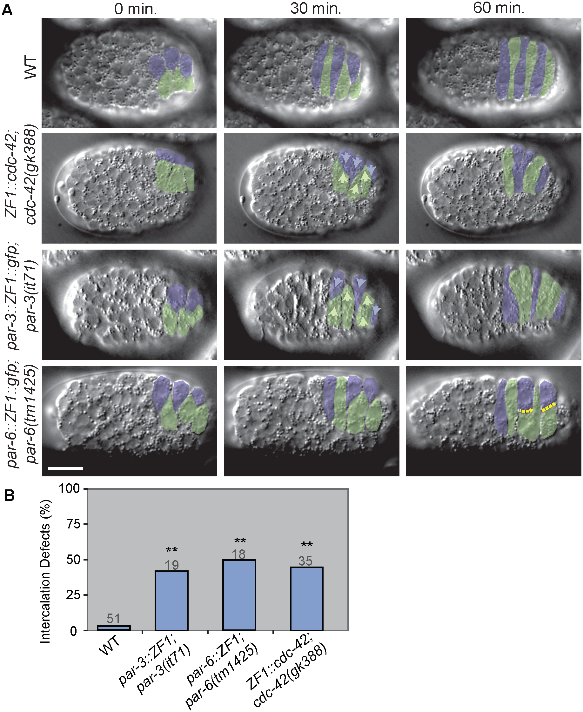

*图 4｜CDC-42 与 PAR 扰动后的插入表型。引自 [Walck-Shannon 等（2016），Fig. 3](https://doi.org/10.1371/journal.pgen.1006415.g003)，CC BY 4.0。DIC 序列及左右细胞的着色显示正常插入、内侧延迟与同侧共同迁移；下方比较各条件的表型分布。相似的最终失败，可以来自不同的前缘形状和运动顺序。*

## 2. 线虫研究：腹侧包裹与裂隙封口 {#2-腹侧包裹与裂隙封口}

<figure class="celegans-video celegans-stage-video" id="stage-motion-ventral-enclosure">
<video controls loop preload="metadata" playsinline width="474" height="318" aria-label="腹侧表皮向中线推进并封闭开口" aria-describedby="stage-motion-ventral-enclosure-caption" poster="https://app.box.com/representation/file_version_2376584649555/thumb_1024.jpg?shared_name=gkwn64id9h6k4161ymkb42y0hkst5ny0">
<source src="https://uwmadison.box.com/index.php?rm=box_download_shared_file&amp;shared_name=gkwn64id9h6k4161ymkb42y0hkst5ny0&amp;file_id=f_2149905153555" type="video/mp4">
浏览器暂不支持内嵌播放，请打开下方原始视频。
</video>
<figcaption id="stage-motion-ventral-enclosure-caption"><strong>动态影像｜腹侧表皮向中线推进并封闭开口</strong> 
野生型胚胎的腹侧 DIC 影像，前端在左，原始采样间隔为 2 min。先看两侧前缘如何接近，再看初次接触以后，后方剩余开口怎样继续封闭。 
来源：Hardin Lab，WormBook Movie 5；影像 Mathias Koeppen。<a href="https://worms.biology.wisc.edu/galleries/wormbook/">原始页面与说明</a> · <a href="https://uwmadison.box.com/s/gkwn64id9h6k4161ymkb42y0hkst5ny0">原片</a>。</figcaption>
</figure>

### 2.1 从背侧重排转向腹侧覆盖 {#21-从背侧重排转向腹侧覆盖}

腹侧包裹让表皮从两侧扩展，最终覆盖内部组织。与背侧插入相比，它需要组织起朝向开口的推进，并在相遇后建立新连接。

*图 5｜两类表皮运动的空间组织。引自 [Labouesse 等（2026），Fig. 1](https://pmc.ncbi.nlm.nih.gov/articles/PMC13072950/#cells-15-00645-f001)。A 将背侧插入的细胞排列、突起方向和调控路径联系起来；B 展示腹侧 leading cells、posterior pocket cells 与下方神经母细胞的位置关系。不同视角及旋转后的局部示意用于区分顶端连接与基底外侧突起。*

腹侧表皮的两对 leading cells 率先向中线伸出突起并建立新接触，随后 posterior pocket 区域进一步收缩。头部覆盖也有独特的局部运动。把整个腹侧表皮看作一条均匀前沿，会掩盖这些细胞群的任务差别。

Leading cells 率先建立接触，把原来的腹侧缺口分成不同区域；后方 pocket 随后在新的边界条件下封闭。最早接触的位置会改变剩余开口的形状和受力。

神经母细胞构成了表皮前缘下方的细胞表面。这个表面有自己的形状和运动，可能给表皮提供接触，也可能因为先前的排列异常形成障碍。若只在表皮通道里看最后的缺口，很容易把迁移环境改变造成的延迟也归给表皮本身。双组织成像能够把前缘何时受阻与下方细胞何时改变排列对应起来。

原始细胞学和遗传学研究将 actin 依赖的推进、leading-cell 接触以及后方封闭联系起来。后续工作又将 cadherin–catenin、Rho-family GTPases 和神经母细胞的贡献加入这幅图景。[Williams-Masson 等，1997](https://doi.org/10.1242/dev.124.15.2889)；[Raich 等，1999](https://doi.org/10.1016/S0960-9822(00)80015-9)

### 2.2 引导受体与 WAVE 如何组织推进的 actin {#22-引导受体与-wave-如何组织推进的-actin}

UNC-40/DCC、SAX-3/Robo、VAB-1/Eph 最初容易让人联想到轴突引导，但它们也参与胚胎表皮形态发生。Bernadskaya 等将这些受体与 CED-10/Rac、WAVE/SCAR 和局部 F-actin 的空间组织联系起来，说明同一类信号模块可以作用于不同的迁移环境。

*图 6｜引导信号改变 actin 的位置和运动过程。引自 [Bernadskaya 等（2012），Fig. 2](https://doi.org/10.1371/journal.pgen.1002863.g002)。A 为 ABD::GFP 标记的多阶段活体影像，leading cells 被框出放大；B 比较若干 actin 相关事件之间的时间间隔。该组影片在 23 °C、2 min 间隔下采集，图中的事件时间不能直接混用为 20 °C 的统一发育时钟。*

受体丧失可以改变 actin 富集、突起形成与回缩，以及这些事件之间的时间间隔。UNC-40、SAX-3 和 VAB-1 对 CED-10 活化、膜募集和内体分布的影响也有所不同。[Bernadskaya 等，2012](https://doi.org/10.1371/journal.pgen.1002863)

这些受体受损后，胚胎都可能闭合不好，但 actin 改变的位置和时间并不相同。记录突起何时出现、何时退回，以及两侧何时相遇，比只比较最后留下多大的缺口，更容易分清问题发生在哪一步。

### 2.3 相遇和形成可承载的新连接是两步 {#23-相遇和形成可承载的新连接是两步}

Leading cells 的突起在中线附近相遇后，cadherin–catenin 复合体迅速募集并稳定接触。这里的 filopodial priming 强调，突起中的 actin 组织与快速连接组装，为细胞层的封闭提供条件。[Raich 等，1999](https://worms.zoology.wisc.edu/raich/raich.html)

HMR-1、HMP-2 和 HMP-1 分别承担 cadherin、β-catenin 和 α-catenin 相关功能，但整个承载界面还包含其他 actin-binding、膜塑形和连接稳定因子。膜接近、连接荧光出现和连接能够承受后续牵拉，是相互关联但不同的状态。

Enclosure 的终点缺口可以来自前缘无法接近、相遇后没有稳定连接，或连接在后续收缩时失效。相同的开口面积，可能对应不同的失败过程。

相遇可以先是很小的突起接触。若这个接触稳定下来，新的界面逐渐扩展，附近 actin 和连接蛋白再重新组织。细胞从沿着邻居表面向前推进，转为与对侧细胞共同承受负载，运动规则也随之改变。Filopodial priming 所强调的，就是突起在接触发生前已经带入了有利于快速组装连接的结构。

在 hmr-1 干预影像中，细胞曾经接近，随后又退回。推进已经发生，缺陷更接近新接触的建立或保持。连接与 actin 的同步记录还可分辨：新连接是否从未形成，还是形成后被逐渐增加的负载破坏。

新生腹侧连接随后还要承受伸长造成的牵拉。随着长度、方向和分子组成继续变化，它逐渐加入整个表皮的承载网络。封闭因而不是连接组装的终点，而是新界面开始承受发育负载的时刻。

### 2.4 Ventral cleft closure 与表皮 enclosure 的区别 {#24-ventral-cleft-closure-与表皮-enclosure-的区别}

<figure class="celegans-video celegans-stage-video" id="stage-motion-ventral-cleft">
<video controls loop preload="metadata" playsinline width="634" height="466" aria-label="原肠胚末期的腹侧裂隙封闭" aria-describedby="stage-motion-ventral-cleft-caption" poster="https://app.box.com/representation/file_version_2376583917336/thumb_1024.jpg?shared_name=9frk4u9zvgnq9j5rjkdluzm6zoejwhhk">
<source src="https://uwmadison.box.com/index.php?rm=box_download_shared_file&amp;shared_name=9frk4u9zvgnq9j5rjkdluzm6zoejwhhk&amp;file_id=f_2149904320536" type="video/mp4">
浏览器暂不支持内嵌播放，请打开下方原始视频。
</video>
<figcaption id="stage-motion-ventral-cleft-caption"><strong>动态影像｜原肠胚末期的腹侧裂隙封闭</strong> 
腹侧 DIC 影像，前端在左，原始采样间隔为 60 s。腹外侧神经母细胞向中线靠近，裂隙由后向前消失；这是表皮包裹之前的事件。 
来源：Hardin Lab，WormBook Movie 1；影像 H. N. Cinar 与 D. Patel。<a href="https://worms.biology.wisc.edu/galleries/wormbook/">原始页面与说明</a> · <a href="https://uwmadison.box.com/s/9frk4u9zvgnq9j5rjkdluzm6zoejwhhk">原片</a>。</figcaption>
</figure>

Ventral cleft 是 gastrulation 末期的腹侧裂隙，其封闭主要涉及神经母细胞的运动与接触重组；ventral enclosure 则是更晚的表皮包裹。Serre 等所讨论的 20 °C 发育序列中，裂隙消失约早于表皮包裹运动一小时。二者前后关联，但不能因为都发生在腹侧就当作同一个事件。

*图 7｜裂隙封闭中的 rosette。引自 [Serre 等（2023），Fig. 2](https://doi.org/10.1371/journal.pgen.1010507.g002)。A 同时观察 SRGP-1 与 HMP-1 的分布；B 以细胞轮廓重建显示哪些细胞内移、哪些细胞聚集到 rosette 顶点。时间零点是前方 rosette 的形成，而非受精。图中的拓扑更新与表面封闭发生在神经母细胞环境中。*

SRGP-1/srGAP、AFD-1/afadin 和 HMP-1/α-catenin 都参与这一位置的连接组装或稳定。有些改变 HMP-1 构象的突变，能够减轻 srgp-1 缺陷。构象是蛋白分子当时的空间形状，形状改变可以影响它与其他分子结合。因此，连接上有多少 HMP-1 还不是全部问题，它以什么状态参与连接也会影响结果。[Serre 等，2023](https://doi.org/10.1371/journal.pgen.1010507)

早期裂隙闭合异常会改变后续表皮面对的神经母细胞排列和表面几何。观察到 enclosure 失败时，因此值得追溯表皮开始迁移以前的基底状态。

### 2.5 Rosette 是一种可复用的拓扑过程 {#25-rosette-是一种可复用的拓扑过程}

Rosette 是多个细胞围绕共同顶点排列的构型。它可以封闭缺口、改变细胞相对位置、参与神经索排列，也可以参与头部结构的建立；不同组织中，顶点形成后的去向并不相同。

*图 8｜不同 rosette 的组织功能。引自 [Labouesse 等（2026），Fig. 2](https://pmc.ncbi.nlm.nih.gov/articles/PMC13072950/#cells-15-00645-f002)。A 为迁移中的连续 rosette；B 为腹侧裂隙封闭；C 为与腹侧神经索排列相关的 rosette；D 涉及 arcade cells、头部神经细胞及表皮的协同。相似的局部接触构型可以服务于不同的三维形态目标。*

有些 rosette 解析为新的邻接关系，有些则留下较持久的共同顶点。顶端边缩短、细胞内移和新接触形成各发生在哪个高度，决定了模型需要保留的自由度。

可以把 rosette 的形成与解析分开看。若若干边依次缩短，多个细胞会暂时聚到共同位置；之后若沿另一方向长出新边，原来的邻居关系就会改变，组织也可能沿新的方向展开。若共同顶点持续存在，或细胞在此处进入内部，结果又不同。单张“花瓣状”图片因此只能描述构型，时间序列才显示它正在完成哪种任务。

对腹侧裂隙尤其如此：一个细胞离开表面后，周围细胞靠拢并补上位置，与一群始终留在表面的细胞交换邻居，在投影中都可能经过 rosette。结合细胞谱系和深度追踪，才能判断顶点是平面重排的中间态，还是三维封口的结果。

腹侧神经索的 convergent extension 和顺序 rosette 重排，将 PCP、SAX-3/Robo 等因素与神经细胞的最终排列联系起来。[Shah 等，2017](https://doi.org/10.1016/j.devcel.2017.03.024)；[Xu 等，2023](https://doi.org/10.1242/dev.201493) 它们与背侧表皮的突起驱动插入形成了一个有用对照：相近的组织几何结果，可以由不同的局部重排机制实现。

### 2.6 闭合前沿的动力学如何约束机制 {#26-闭合前沿的动力学如何约束机制}

对于定义在固定参考曲面上的开口区域，若边界在曲面内以向内法向速度 $v_n$ 移动，面积变化满足

$$
\frac{\mathrm dA_o}{\mathrm dt}=-\oint_{\partial\Omega}v_n\,\mathrm ds.
$$

这条式子只是在把边界运动换成面积变化，还没有说明谁在用力。$\oint$ 表示沿整个开口边缘加一圈，$v_n$ 是每一小段边缘向内推进的速度，$\mathrm ds$ 是这小段的长度。推进较快、又占据较长边缘的区域，对面积缩小的贡献就较大。负号表示向内推进会让面积减少。若开口所在的表面本身也在伸展，还要再计算这部分表面面积的变化。

## 3. 线虫研究：神经母细胞与表皮的作用及闭合后的预应力 {#神经母细胞与表皮的作用及闭合后的预应力}

在线虫腹侧，表皮是在一个同样会运动和改变接触的细胞表面上推进。Wernike 等观察到，表皮自由边缘形成 myosin 焦点及环状排列，下方神经母细胞中也有 myosin 与黏附相关蛋白积累；神经母细胞形态和 myosin 功能受损，会影响上方表皮的闭合及 myosin 分布。[Wernike 等，2016](https://doi.org/10.1016/j.ydbio.2016.02.023)

这些结果要求模型同时容纳两类细胞的活动，却尚未唯一确定它们怎样耦合。神经母细胞可以通过自身形变改变表皮前缘的接触位置与负载，也可能通过信号影响表皮活动。仅将下方组织设成静止、均匀的摩擦底板，会预先删掉前一种路径；只加一个随时间变化的表皮收缩系数，又可能把两种路径混在一起。

线虫中的一个重要理论方向，还涉及闭合留下的预应力。Ben Amar 等在后续伸长的连续体模型中，将包裹与之后的主动变形分为不同构型，讨论已有应力怎样影响切割响应与进一步伸长。[Ben Amar 等，2018](https://doi.org/10.1103/PhysRevLett.121.268102) 这已经将 enclosure 与后续全身力学联系起来；但把闭合后的状态作为起点，并不等于解释了 leading cells 如何迁移、相遇和封口。这两类模型应在闭合时的形状、接触和应力上衔接。

## 4. 线虫研究：三维形态与细胞接触 {#61-三维形态与细胞接触}

线虫的优势在于能够反复辨认相同细胞，模型因而不必只拟合平均长宽比。Guan 等建立的细胞谱系与形态图谱，给出了较晚胚胎阶段的细胞形状和接触，并直接重建背侧插入中的三维轮廓。这些重建是测量资料，可以约束模型的初态、体积、侧面接触和形变路径；它们本身并不是力学模拟。[Guan 等，2025](https://doi.org/10.1038/s41467-025-58878-0)

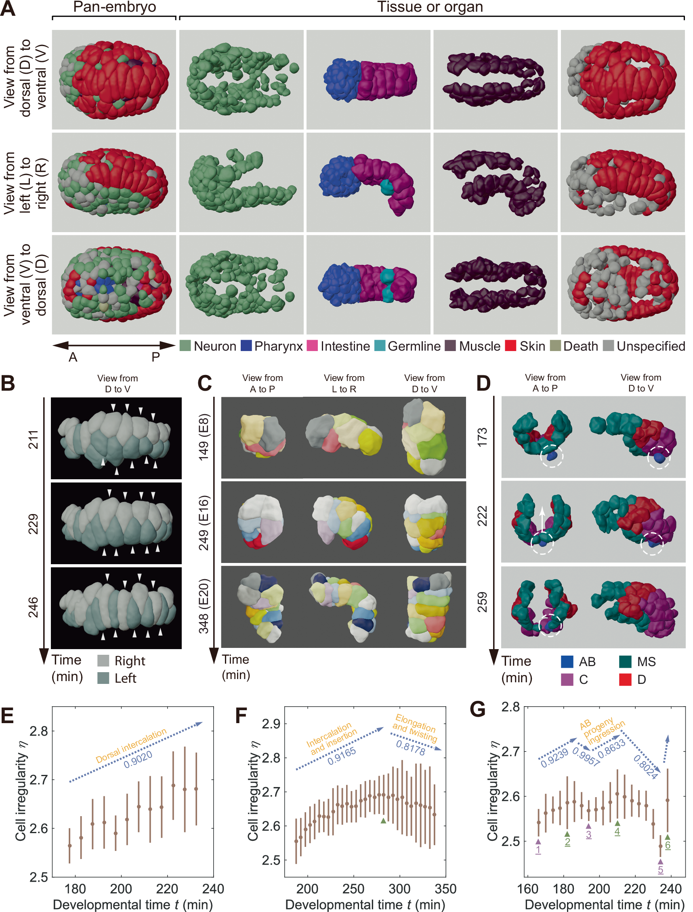

*图 9｜线虫背侧插入的三维细胞重建。引自 [Guan 等（2025），Fig. 3](https://www.nature.com/articles/s41467-025-58878-0#Fig3)，CC BY-NC-ND 4.0，未修改。B、E 对应背侧插入的形状与不规则程度；其余面板比较肠道和肌肉。颜色区分细胞，时间采用原论文的四细胞阶段参考。*

用这种资料检验模型，要先明确比较的是同一高度、同一组细胞和同一发育阶段。基底接触已更新而顶端未更新时，细胞完整表面的接触图与顶端切片会得出不同答案。只匹配核轨迹，也可能漏掉模型用错误的突起方向或侧面接触完成了相似位移。

组织整体变长以后，还要区分细胞形状变化和邻居交换分别贡献多少。两者可以相互抵消：局部重排推动组织伸长，细胞却被外部负载压短。记录有方向的接触更新，再与同一区域的形变比较，比统计总 T1 数更有意义。

## 5. 理论借鉴：局部活性区怎样形成 {#14-局部活性区怎样形成}

爪蟾与果蝇中的模型更详细地求解了爬行、连接重排和多组织闭合。先保留它们各自的实验与预测，再讨论怎样用于线虫；双层相场和接触成熟等候选算例随相应机制讨论，保持与已发表线虫模型的区分。

Rac 和 CDC-42 的图像把前缘显示为一块局部活性较高的区域。一个自然的问题是：局部信号为什么没有马上扩散成整圈同样高的活性？正反馈可以放大局部差异，但还需要某种限制，避免所有位置一起被激活。

Mori、Jilkine 与 Edelstein-Keshet 提出的 wave-pinning 模型给出了一种解释。它研究可相互转换的两种形式：扩散较慢的活性、膜相关组分 $a$，以及扩散较快的非活性储库 $b$。在一维近似下，

$$
\partial_ta=D_a\partial_x^2a+f(a,b),
\qquad
\partial_tb=D_b\partial_x^2b-f(a,b),
\qquad D_b\gg D_a.
$$

$a(x,t)$ 与 $b(x,t)$ 分别是活性和非活性组分的有效浓度，$D_a$、$D_b$ 是扩散系数。反应项 $f(a,b)$ 在两式中符号相反：活化消耗 $b$ 并增加 $a$，失活则反向转换。在无通量边界下，两类分子的总量守恒。

膜与细胞质原本具有不同维度。上述一维近似将它们折算成同一坐标上的有效浓度，保留局部活化与共享储库的竞争。

一个常见的反应函数是

$$
f(a,b)=\left(k_0+\frac{k_1a^2}{K^2+a^2}\right)b-k_2a.
$$

$k_0$ 给出基础活化，饱和项表示已有活性促进进一步活化，$k_2a$ 表示失活。合适参数下，同一 $b$ 可以对应低、高两个稳定活性状态。一端受到足够强的刺激后，高活性区域向前扩展。

把 $b$ 暂时固定，考察局部活性 $a$ 随时间的变化，就能理解双稳态来自哪里。活性很低时，正反馈较弱；一次足够大的扰动将它推过中间的不稳定值后，反馈增强，局部便进入较高活性的状态。很小的扰动则可能自行消失，所以系统对刺激的响应不必与刺激幅度成正比。

空间扩散把相邻位置连起来。高活性区边缘的分子向附近扩散，使邻近区域也有机会越过阈值，前沿便向前传播。如果非活性分子来自无限储库，活化可能一路扩展。有限总量改变了结局：扩展持续消耗共享储库 $b$，剩余储库越来越少，前沿也越来越慢，直到在细胞中间停下：一侧维持高活性，另一侧保持低活性。这就是 wave-pinning，意思是传播中的活性波前被固定在某个位置。[Mori 等，2008](https://doi.org/10.1529/biophysj.107.120824)

*图 10｜Wave-pinning 中的活性区与共享储库。引自 [Mori 等（2008），Fig. 3](https://pmc.ncbi.nlm.nih.gov/articles/PMC2292363/#fig3)。左列显示活性与非活性形式的空间分布；右列显示反应项的比较。波前推进时共享储库降低，右侧阴影面积差逐渐减小，到两块面积相等时波前停止。这是一般细胞极性模型的理论结果。*

若快速扩散使 $b$ 在空间上近似均匀，波前停下的条件可写为

$$
\int_{a_-}^{a_+}f(a,b_*)\,\mathrm da=0.
$$

$a_-$ 与 $a_+$ 是此时的低、高活性稳定值。积分可以理解为高活性区域继续向前推进的净驱动；它降到零时，两个区域相互平衡。高活性区域的大小随后由分子总量决定。取细胞长度为 $\ell$、高活性区长度为 $x_f$，有近似关系

$$
M\simeq a_+x_f+a_-(\ell-x_f)+b_*\ell.
$$

三项依次是高活性区、低活性区和共享储库中的分子数。在这个近似中，增加总量 $M$ 会扩大高活性区；前缘的位置由方向偏置选择，占据多大范围则还受分子总量与反应速率控制。

前沿停下以后，局部活性并没有冻结。分子仍在活化、失活和扩散，只是这些通量在统计上达到了平衡。稳定的前缘因此可以由不断更新的分子维持，正如一条位置稳定的连接也可以持续交换蛋白。对于发育中的极性，这种动态稳定比永久固定一块分子更容易适应细胞形状变化。

局部受体信号或已有接触可以偏置激活方向，改变总蛋白量则可能扩大前缘范围。这两类扰动预期分别影响朝向与宽度，适合在相同几何和发育阶段比较。

对于线虫背侧表皮，这是一种可供检验的极性机制，而非已有实验确立的 CDC-42 方程。它提示的观测是，局部活化是否伴随其他位置或胞质储库的减少，撤去引导信号后前缘能否持续，以及增加总蛋白量会不会扩大前缘。VAB-1、PAR 系统和 GEF 的空间分布则可以作为外部偏置，影响哪一侧率先跨过活化阈值。

一维 wave-pinning 模型解释了高活性区怎样停住，线虫实验还要求解释它停在哪一面、产生哪一种突起，以及邻近连接会不会限制这个区域。Rac、CDC-42 与 PAR 的扰动会影响内侧前缘的尖锐程度、细胞拉长和共同迁移，模型需要分别保留这些读出。

如果保留细胞表面 $\Gamma$ 与内部体积 $\Omega$，一种更接近实验几何的候选模型是

$$
\partial_t a=D_s\Delta_\Gamma a+R(a,b|_\Gamma;\mathbf s),
\qquad
\partial_t b=D_b\nabla^2b,
\qquad
-D_b\partial_n b|_\Gamma=R.
$$

$a$ 是膜上的活性面密度，$b$ 是细胞质中的非活性体密度，$R$ 是两者在膜边界上的转换通量；$\mathbf s$ 指表面位置。$\Delta_\Gamma$ 只沿细胞表面扩散，$\partial_n$ 沿细胞质朝外的法向求导。边界上流出的非活性组分进入膜上的活性池，因此在固定细胞形状下，

$$
M_{\rm tot}=\int_\Gamma a\,dS+\int_\Omega b\,dV
$$

保持不变。它与一维模型的差别不只是把线画成曲面：膜面积与细胞体积现在分别决定活性区容量和储库大小，转换系数也要按面密度和体密度重新定义。

当胞质扩散足够快，$b$ 近似空间均匀，可以由总量关系求出。这时，某一侧活性区扩大，会通过共享储库影响其他位置。VAB-1、PAR 或 GEF 的空间分布可作为 $R$ 中的局部活化偏置。模型于是能够比较三种改变：偏置方向错了，活性区仍然集中却朝错侧；总量或正反馈改变，前缘宽度和持续时间变化；抑制不足，则可在外围保留多个无效突起。TIAM-1 的 GEF 与 N 端结构域对主要内侧突起和异位细突起的不同作用，使这种区分有明确的实验对象。[Zhu 等，2024](https://doi.org/10.1242/jcs.261509)

从活性到形状还需要一道机械关系。例如可令局部向外推进速度随活性饱和增长，$v_{\rm prot}(\mathbf s)=v_{\max}a/(K_a+a)$，再与膜张力、邻居排斥和连接约束求解。单独改变活性场，不会自动给出正确的楔形轮廓。实验可分别比较活性峰位置、内侧前缘宽度、异位突起寿命和细胞主体位移，避免把所有变化都压进一个推进速度参数。

线虫中的极性影像已约束活性的位置及其形态后果；储库交换、刺激阈值和撤去信号后的保持，则可进一步检验 wave-pinning 是否参与其中。

## 6. 理论借鉴：突起怎样与连接共同完成一次重排 {#crawling-contraction}

### 6.1 突起驱动与外部约束 {#31-突起驱动与外部约束}

背侧插入最直接的物理问题是：一个基底外侧突起怎样拉动仍与邻居相接的细胞，并最终改变整排细胞的次序？只给细胞一个朝中线的速度，就跳过了这个问题。模型需要保留突起抓住哪里、力怎样传回细胞主体，以及邻居能否让开。

Brodland 在 2006 年用细胞尺度有限元模型研究过这条机械路径。模型把细胞内部的变形阻力与界面作用分开，再加入能够形成、附着和收缩的定向 lamellipodia。计算得到的不只是细胞质心朝某方向移动，而是突起作用引起邻居交换，邻居交换再累积成组织收窄和伸长。这里模拟的是一般的收敛延伸，实验比较采用两栖动物组织。[Brodland，2006](https://doi.org/10.1387/ijdb.052040gb)

这项研究有一个容易被忽略的结果：同样的突起活动，在外侧没有明显约束时，可以有效改变组织长宽比，细胞却未必保持很长；当周围组织抵抗横向收窄，细胞才更明显地被拉长。因此，细胞长宽比同时包含主动活动和外部负载的信息。不能只凭细胞变尖、变长，就断定它的牵引更强。

在线虫中，Walck-Shannon 等看到的楔形前缘、内侧尖端、随后跟进的核和主体，正好要求沿这条路径追踪。早期激光消融研究还表明，去除部分邻近细胞来源，并不必然阻止剩余背侧细胞插入。这为模型提供了另一种约束：它不能把某一特定外部组织的持续牵拉写成插入的唯一来源。[Williams-Masson 等，1998](https://doi.org/10.1006/dbio.1998.9048)

将突起驱动与消融结果放在一起，可以比较外部负载怎样影响插入：尖端前进时主体是否仍被拉住，减轻邻近约束以后，插入速度与细胞长宽比是否一起改变。

### 6.2 独立皮层与爬行收缩协作 {#32-独立皮层与爬行收缩协作}

更贴近这个问题的是 Weng、Huebner 与 Wallingford 在爪蟾脊索中发展的模型。研究先用嵌合 actin 标记区分同一接触附近的两类活动：两侧细胞的突起爬行，以及另外两颗细胞之间的界面收缩；再把这些活动与短时间内的插入步进对应。两种活动可以分别出现，同时出现时，位移和有效推进通常更大。[Weng 等，2022](https://doi.org/10.1016/j.celrep.2022.110666)

经典共边顶点模型将两细胞之间的接触表示成同一条边，边两侧不能各自移动。Weng 等将每颗细胞表示成有 90 个边界节点的多边形，使接触两侧各保留自己的皮层，再用有限寿命的黏附簇连接它们。这样，一侧可以局部前伸、缩短或相对滑动，另一侧通过黏附受到力，而不必在程序里永远共用同一组边界点。

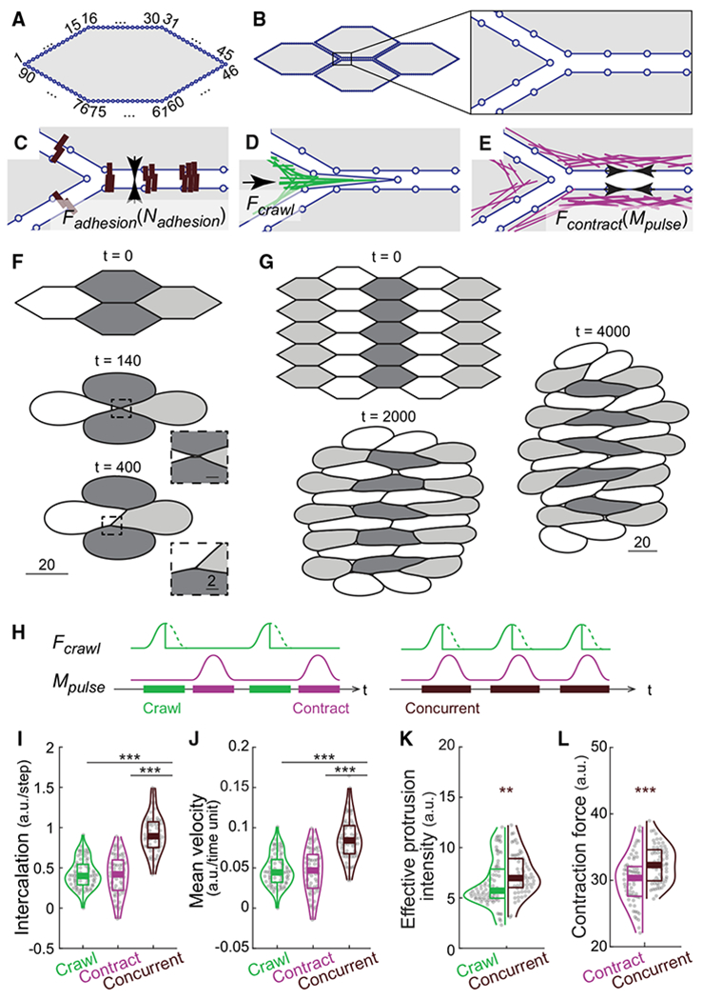

*图 11｜独立皮层模型的爬行、收缩与黏附。引自 [Weng 等（2022），Fig. 5](https://pmc.ncbi.nlm.nih.gov/articles/PMC9119128/#F5)，PMC 作者稿原图，CC BY-NC-ND 4.0，未修改。A–E 为边界节点和三类作用；F、G 是四细胞与 27 细胞的模拟；H–L 将同时活动与单独活动的步进比较。图中的生物体系是爪蟾脊索。*

按作用来源整理，这类模型的节点动力学可以写成

$$
\zeta\dot{\mathbf r}_{i\alpha}
=\mathbf F^{\rm shape}_{i\alpha}
+\mathbf F^{\rm cortex}_{i\alpha}
+\mathbf F^{\rm crawl}_{i\alpha}
+\mathbf F^{\rm adhesion}_{i\alpha}.
$$

$i$ 标记细胞，$\alpha$ 标记它的边界节点。这是对模型作用的归纳写法：形状项抵抗过度压缩和变形；皮层项包含 actomyosin 产生的收缩；爬行项作用在局部突起区域；黏附项把一颗细胞的活动传给邻居。原模型还让收缩力随负载和缩短速度变化，而非给所有节点一个固定大小的力。

黏附也有自己的动力学。相邻两侧并非一接触就永久锁定：黏附簇可以形成、受力、脱开和重新连接。用一般的簇模型表示，其结构是

$$
\dot N=k_{\rm on}(N_{\rm tot}-N)-k_{\rm off}(F/N)N.
$$

$N$ 是当前承载的连接数，$F/N$ 是均匀分担负载近似下每个连接承受的力。Weng 等采用具有 catch–slip 特征的黏附描述：在某些受力范围内连接较稳定，负载过高又容易断开。它使“抓住邻居”与“允许相对滑动”能够同时发生。若将接触直接设成不可分离的共边，这部分力与运动之间的关系就被预先固定了。

模型中，同时爬行和收缩能够通过共同负载放大彼此的机械效果。这里需要留意模拟量与荧光量的差别：作者用突起长度的时间积分表示有效突起活动，用计算得到的收缩力与皮层 actin 活动比较；计算没有逐根模拟 actin 聚合。因而，空间模型支持的是两种活动经由黏附发生机械协同，图中的模拟读出不能直接当作测得的 actin 分子数。

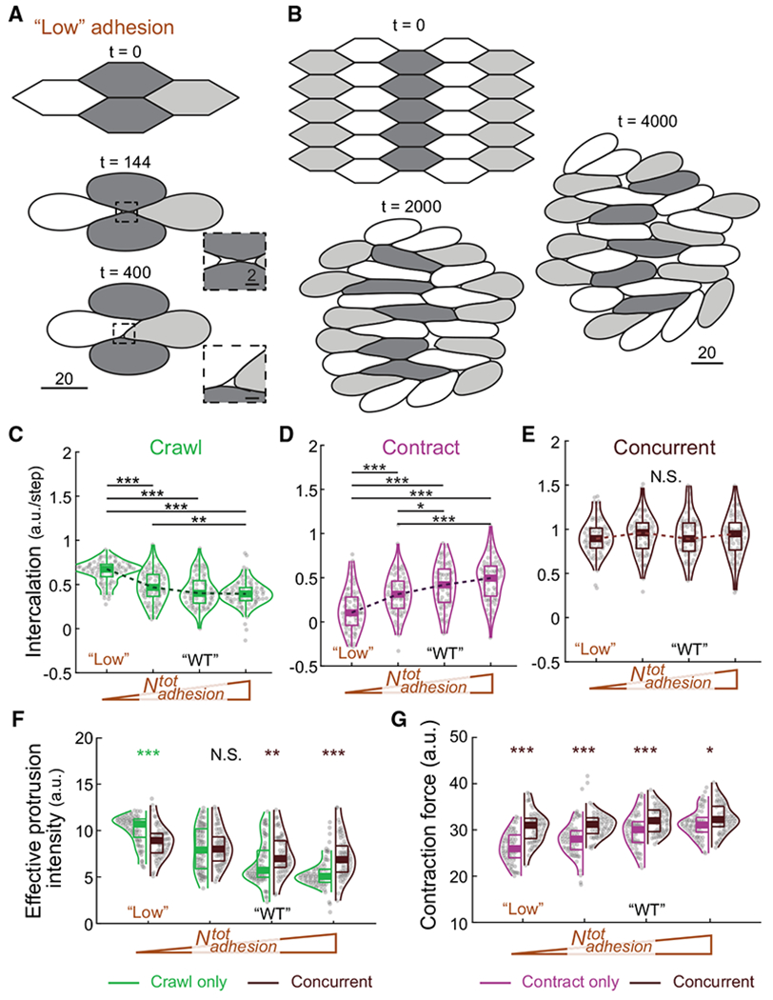

*图 12｜低黏附下的局部重排与组织伸长。引自 [Weng 等（2022），Fig. 6](https://pmc.ncbi.nlm.nih.gov/articles/PMC9119128/#F6)，PMC 作者稿原图，CC BY-NC-ND 4.0。A、B 为低黏附条件下四细胞与 27 细胞计算：前者仍可完成交换，后者出现较大空隙，整体收敛延伸减弱。C–G 比较黏附对不同活动模式的影响。*

降低黏附后，四细胞仍可完成交换，27 细胞群却出现空隙、整体伸长减弱。局部活动仍在发生，只是更多运动被细胞间分离和松散排列消耗，邻居交换次数因而不再直接对应组织伸长。

模型还接受了遗传扰动的检验。Arvcf catenin 缺失后，爬行单独发生和收缩单独发生时的步进并未同样受损，明显缺陷集中在两种活动同时发生的步进。调整黏附和活动相关参数，模型重现了这种选择性缺陷以及组织伸长不足。这个解释将一个“组织变短”的终点表型，拆成了两种运动未能正常协作的具体过程。

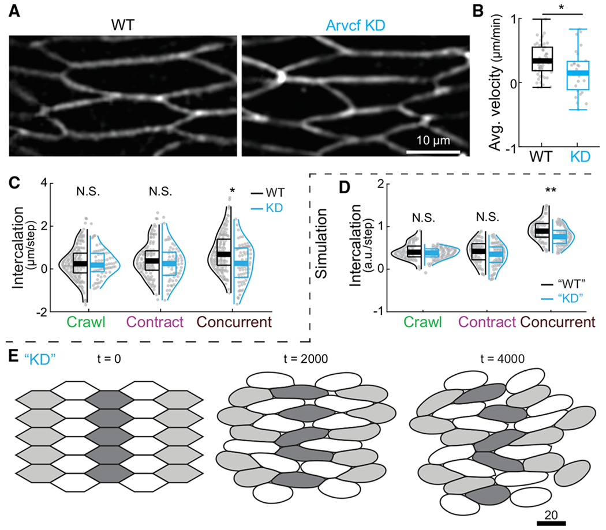

*图 13｜Arvcf 扰动的实验与模拟。引自 [Weng 等（2022），Fig. 7](https://pmc.ncbi.nlm.nih.gov/articles/PMC9119128/#F7)，PMC 作者稿原图，CC BY-NC-ND 4.0。A–C 是 Arvcf 缺失后的实验；D、E 为相应模型条件。细胞仍可拉长，但两种活动同时出现时的插入效率下降。*

### 6.3 线虫背侧插入的三维耦合 {#33-线虫背侧插入的三维耦合}

爪蟾脊索的双极突起与线虫朝中线的前缘具有不同布局。在线虫中，模型还要处理顶底极性、顶端连接建立和后续融合。不过，独立皮层与动态黏附仍能描述一个共同环节：突起先改变局部接触，再通过邻居带动细胞主体。

对于 CDC-42 与 PAR 扰动后的细胞，可以分别比较三个层次。第一是前缘是否朝向内侧，这是极性选择；第二是尖端伸出以后能否带动主体，这是机械耦合；第三是左右细胞能否交替通过，这是多个细胞之间的协调。一个模型若只调小推进力，通常只能让全部运动变慢，很难同时解释尖端变钝和同侧两细胞共同迁移。

同一接触在不同高度可以处于不同阶段：基底突起已进入邻居之间，顶端旧连接仍可能保留。单个平面 T1 会强制两者同时更新，二维独立皮层模型也没有保留高度。多层或三维模型则可以直接预测基底接触、顶端接触与细胞核移动之间的时差。

基底先行的时序，可以先用同一细胞的两个耦合轮廓来近似。

早期 DIC 和细胞学研究已提出，基底外侧突起逐渐拓宽并推动插入，并通过骨架干预和局部消融检验其驱动与约束。[Williams-Masson 等，1998](https://doi.org/10.1006/dbio.1998.9048)

可以先把同一细胞的顶端与基底分别表示为平滑轮廓场 $\phi_a,\phi_b$。场在细胞内接近 1，外部接近 0，$\phi=1/2$ 给出轮廓。一个局部二维双层候选模型是

$$
\begin{aligned}
E={}&\sum_{\ell=a,b}\left\{
\int\left[
\frac{\Gamma\epsilon}{2}|\nabla\phi_\ell|^2
+\frac{\Gamma}{\epsilon}\phi_\ell^2(1-\phi_\ell)^2
+\lambda_{\rm rep}\phi_\ell^2\sum_j\psi_j^2
\right]dA
+\frac{K_A}{2A_0}(A_\ell-A_0)^2
\right\}\\
&+\frac{k_{ab}}2\int(\phi_a-\phi_b)^2\,dA,
\qquad A_\ell=\int\phi_\ell^2\,dA.
\end{aligned}
$$

前两项使细胞保留有限宽度的界面，面积项抵抗投影面积改变，$\psi_j$ 表示附近细胞的轮廓，排斥项限制重叠。最后一项让同一细胞的顶底投影相互牵制；$k_{ab}$ 越大，错位的能量代价越高。在这个算例中，邻居固定，只保留它们造成的局部狭窄通道，暂不模拟它们自己的活动与黏附。

令基底层受到定向主动输运，顶端层只通过力学耦合响应：

$$
\partial_t\phi_\ell+\mathbf v_\ell^{\rm act}\cdot\nabla\phi_\ell
=-M_\ell\frac{\delta E}{\delta\phi_\ell},
\qquad
\mathbf v_a^{\rm act}=0,\quad
\mathbf v_b^{\rm act}=v_0\mathbf e_{\rm in}.
$$

右侧使界面、排斥与面积约束逐渐松弛；左侧基底活动持续把轮廓向内推进。它没有预先指定细胞必须经过哪些圆形或楔形状态，接触障碍会使轮廓自行改变。图 14 使用同样的活动和障碍，只改变顶底耦合。

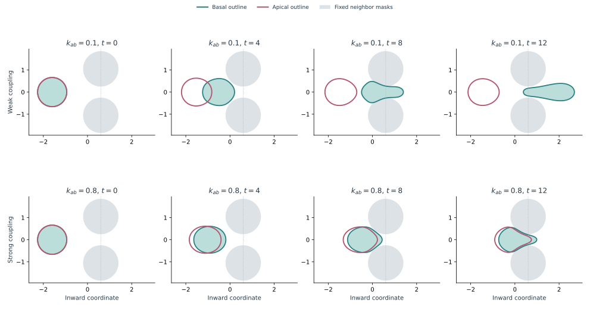

*图 14｜顶底耦合强度与插入时差。绿色为基底轮廓，紫红色为顶端轮廓，灰色为固定邻居。两行只改变 $k_{ab}=0.1,0.8$；横向依次为无量纲 $t=0,4,8,12$。取 $\Gamma=0.08,\epsilon=0.14,K_A=12,\lambda_{\rm rep}=2,M_a=M_b=1,v_0=0.3$；网格间距 0.05、时间步长 0.01。各层面积在该计算中的相对偏差小于 3%。*

弱耦合时，基底轮廓可以明显向前，顶端仍留在后方；强耦合时，两层更接近，但基底推进也要承担带动顶端的负载。因而，“顶端移动慢”可以同时出现在基底推进不足和顶底脱耦两种条件下，基底影像才能进一步区分。图中较大错位也提示了双层近似的边界：真实细胞的侧壁、厚度与体积会限制可实现的形状，不能把两片投影之间的距离直接当作完整三维细胞长度。

与实验对照时，至少应在同名细胞中记录基底尖端、顶端中心、细胞核和接触边界。用 $\Delta t_{ba}=t_{\rm apical}-t_{\rm basal}$ 表示两个明确事件之间的延迟，还可测量投影错位 $\Delta\mathbf c=\mathbf c_b-\mathbf c_a$、尖端宽度及接触面积。细胞核不是任意一层的中心，它还会受胞质和骨架约束；若没有显式模拟核，便应把核位置作为额外观测，而不将它等同于模型的顶端或基底质心。

更完整的三维顶点或多相场模型要加入细胞侧面、体积和真实接触表面。双层算例的作用，是先把层间耦合这项机制分开，让“前缘先行、主体跟随”的实验时序成为模型约束，而不只拟合最终的多边形排列。

## 7. 理论借鉴：邻居交换与主动连接 {#active-junction-models}

### 7.1 旧边收缩与新边生长 {#41-旧边收缩与新边生长}

对成熟连接占主导的上皮，常用的起点仍是顶点模型：

$$
E=\sum_i\frac{K_A}{2}(A_i-A_{0i})^2
+\sum_i\frac{K_P}{2}(P_i-P_{0i})^2
+\sum_e\Lambda_e\ell_e,
\qquad
\zeta\dot{\mathbf r}_\alpha=-\nabla_\alpha E.
$$

[Farhadifar 等（2007）](https://doi.org/10.1016/j.cub.2007.11.049)的经典形式用面积与周长项描述细胞对形变的抵抗，$\Lambda_e$ 为特定边加入额外作用。持续重排还取决于这些作用如何随细胞身份、边长与时间改变，以及旧边消失后新边能否继续生长。

Tetley 等在果蝇胚带中，结合 myosin 分布、激光切割和细胞追踪，逐步比较了四种顶点模型。给特定细胞条带之间的界面一个更高但恒定的张力，不能产生所需的持续重排；加入边缩短与 myosin 富集的正反馈以后，边可以收缩，细胞却容易卡在四细胞相接的构型。仅有“让旧边收缩”的机制，还不足以完成组织伸长。[Tetley 等，2016](https://doi.org/10.7554/eLife.12094)

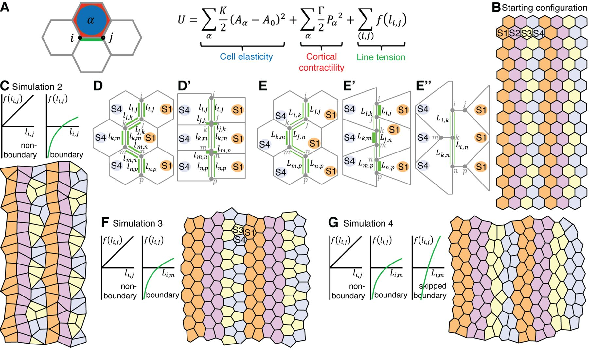

*图 15｜四种顶点模型的重排结果。引自 [Tetley 等（2016），Fig. 7](https://elifesciences.org/articles/12094#fig7)，CC BY 4.0。C、D：局部反馈仍会卡住；E、F：允许同一条带边界两侧的顶点分别滑动后，组织能够伸长，但细胞身份排序出现问题；G：进一步加入身份关系依赖的作用后，排列改善。*

作者接着把收缩反馈作用在同一细胞沿条带边界的连续接触总长度上，允许边界两侧的顶点分别滑动。这样局部停滞得到解除，但某些身份的细胞又会聚在一起，破坏原来的次序。最后再让“跳过正常相邻身份”的接触更具收缩性，模型才更好地维持条带排列。这一步属于作者提出的机制，所需较大张力比也未被实验完全确定。

四种模型依次暴露了不同的停滞环节：旧边没有收缩，四细胞顶点未能解析，或交换完成后排列失序。若程序在短边消失时直接插入一条固定长度的新边，后两个问题的一部分就由拓扑规则代替了力学过程。

Collinet 等的果蝇实验进一步表明，新连接生长受到局部 medial myosin 活动和远处组织牵拉的共同影响。局部收缩促成一次邻居交换，并不保证新边沿正确方向增长；外部牵拉还参与确定伸长方向。[Collinet 等，2015](https://doi.org/10.1038/ncb3226)

<figure class="celegans-video" id="epithelial-published-vertex-simulation">
<video controls loop preload="metadata" playsinline width="500" height="400" aria-label="已发表果蝇顶点模型的条带重排模拟">
<source src="https://static-movie-usa.glencoesoftware.com/mp4/10.7554/119/2afd92d2b201d28e34225b00378a697faa1afcc2/elife-12094-media5.mp4" type="video/mp4">
浏览器暂不支持内嵌播放，请打开下方原始视频。
</video>
<figcaption><strong>模型动画｜细胞身份与界面作用共同组织重排</strong> 
Tetley 等（2016）Video 5，展示 Fig. 7G 的 simulation 4。颜色区分模型中的细胞身份；观察边界怎样移动，以及细胞交换邻居后是否仍维持条带次序。动画为果蝇研究中的计算结果。 
<a href="https://elifesciences.org/articles/12094#video5">原文与视频说明</a> · <a href="https://doi.org/10.7554/eLife.12094.030">原始视频</a> · CC BY 4.0。</figcaption>
</figure>

线虫的左右交替插入与果蝇条带保持不是同一个图样，但都要求局部推进服从组织层面的排列。线虫中的同侧共同迁移，因而不能只用较多或较少的 T1 来描述，还需要保留细胞身份和新接触的次序。这里可借用的是模型判别方法，具体的 Toll 条带机制不能直接搬到背侧表皮。

沿一次邻居交换的路径计算细胞轮廓，可以看到这些阻碍怎样产生。图 16 取固定的正方形外框，内部有 A、B、C、D 四个细胞。$q>0$ 时，A、B 共享长度为 $q$ 的竖边；边缩至零时形成共同顶点；$q<0$ 时，C、D 之间长出长度为 $|q|$ 的横边。

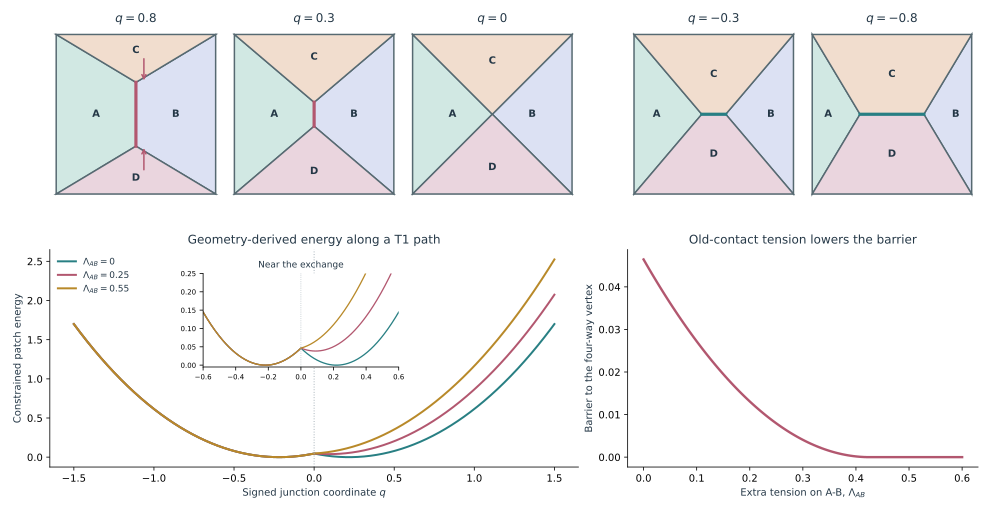

*图 16｜四细胞 T1 路径的轮廓与能量。上排显示指定 $q$ 下的四细胞轮廓；下排从这些轮廓的面积、周长与旧边长度直接计算能量和到达共同顶点的能垒。取外框 $[-1,1]^2$、各细胞 $A_0=1,P_0=3.8,K_A=1,K_P=0.5$，只改变旧界面 A–B 的额外张力 $\Lambda_{AB}$。这是局部对称路径算例，未拟合线虫图像。*

每一个 $q$ 都对应一组多边形，所以可以逐个计算 $A_i(q)$、$P_i(q)$，再代入[旧边收缩与新边生长](#41-旧边收缩与新边生长)的能量：

$$
E_{\rm path}(q)
=\sum_{i=1}^4\left[
\frac{K_A}{2}(A_i(q)-A_0)^2
+\frac{K_P}{2}(P_i(q)-P_0)^2
\right]
+\Lambda_{AB}\langle q\rangle_+.
$$

$\langle q\rangle_+=\max(q,0)$ 保证额外张力只作用于仍存在的旧界面。路径上的广义力为 $F_q=-dE_{\rm path}/dq$。若原有排列位于局部低谷，即使另一种邻接的能量更低，被动过阻尼运动也不会自行跨过中间能垒。提高旧边张力，会增加保留旧接触的代价，使旧边更容易缩短；新边形成以后，这一额外项随旧接触一起消失。

这里的能垒来自四个多边形共同改变面积和周长。固定外框限制了邻居让位，因此它属于这片局部组织和这组边界条件。实际建模时，应把更外侧的细胞加入，并在给定 $q$ 时让其他顶点松弛，得到 $E_{\rm eff}(q)=\min_{\{\mathbf x_v\}:q}E$。邻居能否变形、基底能否滑动，都会改变这条曲线。

对实验而言，细胞边界序列可以提供旧边长、新边长、相邻面积和边方向。模型还要预测哪个界面先缩短、是否短暂逆转，以及新边沿什么方向长出。只把最终邻接图做对，可能只是 T1 算法允许了正确结果。若声称旧边主动收缩驱动重排，还应找到对应的局部收缩活动或释放响应；若动力来自基底突起，就不宜用一条人为增大的顶端线张力替代全部过程。

### 7.2 张力反馈与主动重排 {#42-张力反馈与主动重排}

Sknepnek 等提出的模型进一步让 myosin 的驻留时间由连接张力调节。单条连接由可松弛的弹性元件、主动马达和周围组织的弹性阻力组成。用原文的单连接变量表示：

$$
\zeta\dot\ell=-T+T_{\rm ext},
\qquad
\tau_v\dot\ell_0=\ell-\ell_0,
\qquad
\tau_m\dot m=1-mF(T),
$$
$$
T=k(\ell-\ell_0)+B(\ell-a)+\beta(m-m_0),
\qquad
F(T)=\alpha+\exp[-k_0(T-T^*)].
$$

$\ell$ 是实际长度，$\ell_0$ 是能够松弛的参考长度；$B(\ell-a)$ 表示周围材料阻止该边继续改变的作用。$m$ 是归一化的结合 myosin，$F(T)$ 控制其脱离。张力升高时脱离变慢，更多 myosin 保留；更多马达又能产生更大收缩力，形成正反馈。[Sknepnek 等，2023](https://doi.org/10.7554/eLife.79862)

因此，一条边受到拉力以后，可以先积累 myosin，再主动缩短。外部拉力在这里同时是负载和信号。连接能否缩到零，还取决于参考长度能否及时更新，以及周围弹性阻力是否过大。没有松弛，收缩产生的弹性反作用会越来越强；只有松弛而缺乏足够主动作用，也不会自动发生定向 T1。

单连接模型还给出了这条反馈的阈值估计。恒定负载下，若连接达到受力平衡，myosin 的稳态结合量为

$$
m_{\rm eq}=\frac{1}{\alpha+\exp[k_0(T^*-T_{\rm ext})]}.
$$

当 $m_{\rm eq}>m_0$ 时，原文得到主动强度阈值的下界 $\beta_c\ge T_{\rm ext}/(m_{\rm eq}-m_0)$。分母表示外力使多少额外马达留下，分子则是收缩需要克服的负载。低负载可能不足以留下足够马达；较高负载虽然促进驻留，也提高了收缩要克服的力。再加入周围材料的阻力以后，不能只根据 myosin 多了多少来判断一条边能否完成重排。

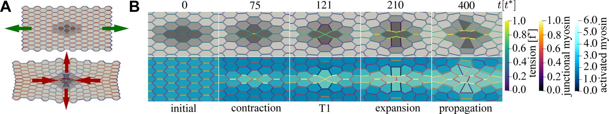

*图 17｜外部应力诱发的主动重排。引自 [Sknepnek 等（2023），Fig. 2](https://elifesciences.org/articles/79862#fig2)，CC BY 4.0。绿色箭头为施加的横向拉力；时间序列分别显示连接张力、细胞类型与 myosin。局部主动收缩导致的收敛延伸方向，与纯被动拉伸的预期不同。*

把该机制放进细胞网络以后，每条连接还要与同一细胞的其他连接竞争有限的 myosin 储库。模型随之可以产生张力链和成串的定向重排。它预测有效重排出现在一定的活动与外部负载范围内；提高活动或拉力，并不总能增加所需方向的组织伸长。

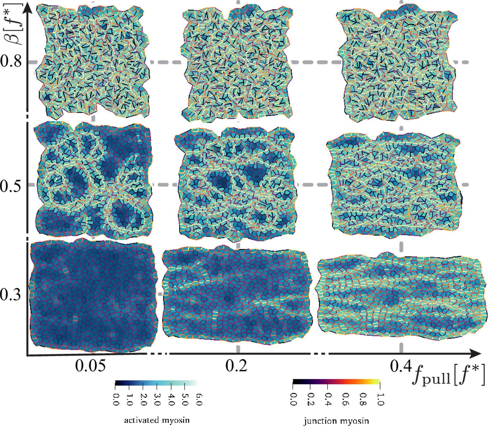

*图 18｜主动连接模型中的组织变形。引自 [Sknepnek 等（2023），Fig. 6](https://elifesciences.org/articles/79862#fig6)，CC BY 4.0。横纵参数改变外部牵拉和 myosin 活动，网格中每幅为计算得到的细胞网络；定向收敛延伸集中在其中一部分范围。原研究与鸡胚原肠形成的组织流作定性比较。*

这个模型提供了一种有区分力的观测：如果连接只是被外部组织拉动，长度变化与外力方向应符合被动响应；如果应力先改变 myosin 动力学，再触发主动重排，就可能出现延迟和相反的形变方向。在线虫背侧表皮、神经母细胞和裂隙封口中，是否存在这样的反馈，需要同时记录释放响应、myosin 周转和接触变化。现有 NMY-2 富集影像本身尚不能确定这套张力依赖动力学。

### 7.3 Rosette 的形成 稳定与解析 {#43-rosette-的形成-稳定与解析}

线虫内的 rosette 研究提供了很好的直接比较对象。Xu 等追踪 Cpaaa 及邻近细胞，发现连续 rosette 能使细胞跨过多组邻居；MIG-1、VANG-1 与 LAT-1 的作用及定位，又把特定边的收缩和 rosette 解析分开。[Xu 等，2023](https://doi.org/10.1242/dev.201493)

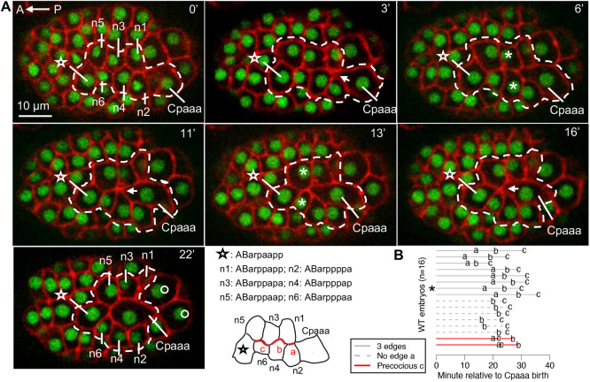

*图 19｜连续重排具有具体的边顺序。引自 [Xu 等（2023），Fig. 2](https://pmc.ncbi.nlm.nih.gov/articles/PMC10263146/#DEV201493F2)，CC BY 4.0。A 为 Cpaaa 连续 rosette 的成像序列；B 比较 16 只胚胎中不同边的收缩时间。该过程涉及较早的表皮前体迁移，与后续成熟背侧表皮插入需要按细胞身份和时期区分。*

这项工作中的 PCP-ortho 是依据定位与遗传实验提出的空间调控机制，没有求解完整细胞受力动力学。但它给数值模型提供了比“最后到达正确位置”更严格的目标：哪些边先缩短，哪些 rosette 会停留，新邻居从哪个方向进入。

腹侧裂隙封口的 Serre 等研究则约束另一部分。SRGP-1 与 AFD-1 参与 HMP-1 在共同顶点的稳定；共同顶点能否维持，影响新表面能否封住。

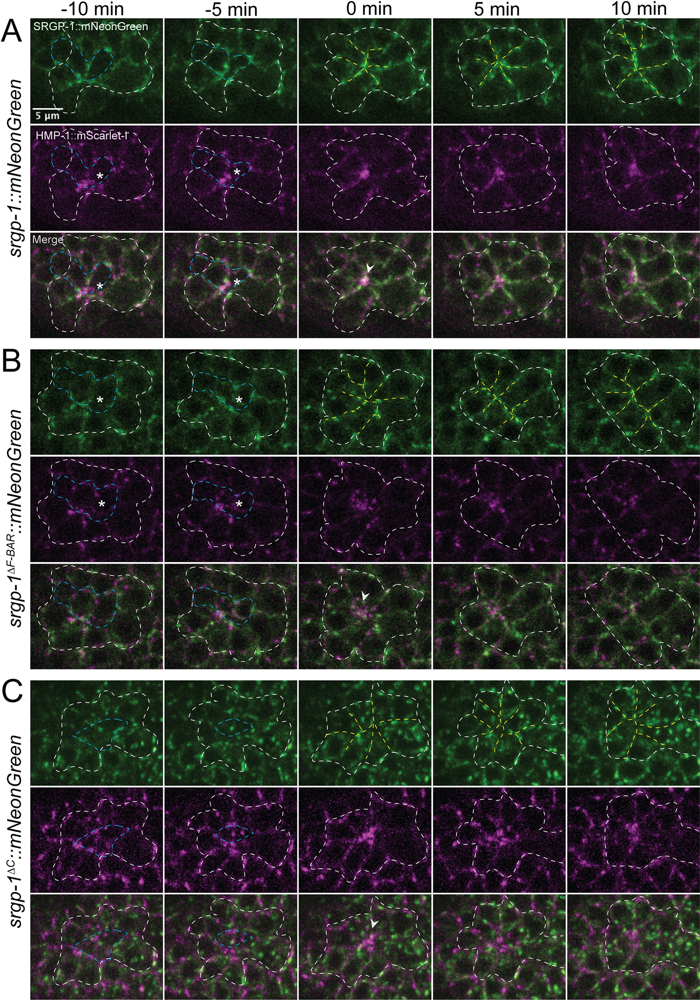

*图 20｜Rosette 附近的轮廓与连接蛋白分布。引自 [Serre 等（2023），Fig. 3](https://doi.org/10.1371/journal.pgen.1010507.g003)，CC BY 4.0。序列比较不同 SRGP-1 条件下的 HMP-1 分布和 anterior rosette 形态；虚线与箭头标出内移细胞、周围细胞和共同顶点。这是原肠胚末期的神经母细胞裂隙封口。*

将这类表型全归入“张力不够”会丢掉连接失稳这条解释。一个高阶顶点可以因收缩不足而未形成，也可以已经形成却因承载连接不足而散开，还可以长期稳定但无法向正确方向解析。

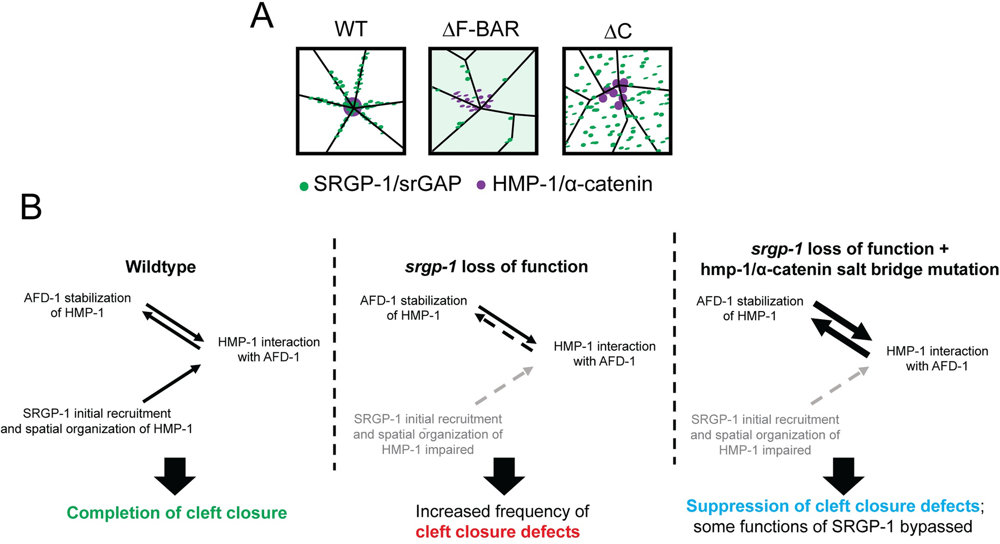

*图 21｜论文提出的连接稳定机制。引自 [Serre 等（2023），Fig. 7](https://doi.org/10.1371/journal.pgen.1010507.g007)，CC BY 4.0。该图概括不同条件下的空间分布及可能相互作用，其中部分分子作用仍是作者提出的机制解释；它不是经过参数拟合的顶点动力学模拟。*

因此，rosette 数目不是单一的运动能力指标。较多 rosette 可以表示正在高效重排，也可以表示解析受阻。理论应比较它们的寿命、进入与离开时的接触顺序，以及对应的组织位移。背侧插入、腹侧神经索排列与原肠胚末期的裂隙封口，各自使用这套几何过程，却不必使用相同的驱动力和连接调控。

## 8. 理论借鉴：闭合需要整个组织网络共同运动 {#closure-tissue-models}

### 8.1 前沿受力与组织切割 {#51-前沿受力与组织切割}

腹侧包裹同时包含局部爬行、边缘收缩和下方组织运动。开口面积减小这一件事，无法分别给出它们的贡献。果蝇背侧闭合的理论发展提供了一条更完整的研究路线：沿实际前缘建立受力平衡，用组织切割改变其中一个力，再检验同一模型能否解释扰动后的形状和速度。

在果蝇中，两侧表皮之间的开口由 amnioserosa 覆盖。它能够主动收缩，与前缘 actomyosin cable 一起拉动表皮；两端的 zipping 又持续改变剩余开口的几何。Hutson 等将这些作用写进力平衡，并结合激光显微手术估计不同力的相对贡献。[Hutson 等，2003](https://doi.org/10.1126/science.1079552)

若 $h$ 是前缘对称点距中线的距离，取增大 $h$ 为向外，原研究所用的局部平衡为

$$
b\dot h=\sigma_{\rm LE}-\sigma_{\rm AS}-T\kappa.
$$

$\sigma_{\rm LE}$ 是侧方表皮抵抗闭合的作用，$\sigma_{\rm AS}$ 是 amnioserosa 向内的拉力，$T\kappa$ 是弯曲 cable 的向内分量；$b$ 表示有效阻力。这里的几项都是作用在前缘单位长度上的力，不能把组织应力直接与整条 cable 的总力相加。

这条平衡也说明了为什么切割有用。若在很短时间内去掉 amnioserosa 的机械贡献，而其他力、曲率和阻力尚未来得及明显改变，就有 $b(\dot h_{\rm after}-\dot h_{\rm before})\simeq\sigma_{\rm AS}$。前缘会立即减少向内运动，或者向外回缩。瞬时速度变化因此约束被去掉的力与阻力之比；稍后的恢复和补偿则需要模型中的材料响应与主动调节解释。把两段时间分开，才能避免用后来的反馈反推切割前的原始张力。

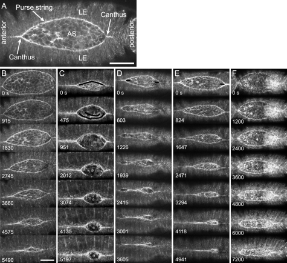

*图 22｜闭合过程中的组织切割实验。引自 [Layton 等（2009），Fig. 1](https://pmc.ncbi.nlm.nih.gov/articles/PMC2839815/#f1)，© HFSP Publishing，原图未修改。B–F 为正常、干扰 amnioserosa、干扰两端或单端 zipping，以及 integrin 突变的成像。B–F 在原论文中根据 Hutson 等（2003）图像调整方向；此处完整沿用 Layton 原图。*

Layton 等随后去掉前缘必须始终为圆弧的限制，计算整条边界及其张力随时间的变化。模型中的产力单元同时具有弹性、主动收缩和耗散，并用具有负载依赖的力–速度关系描述。正常胚胎的前沿高度、弧长和两端距离，一同参与约束参数；部分扰动也进入了参数选择。[Layton 等，2009](https://doi.org/10.2976/1.3266062)

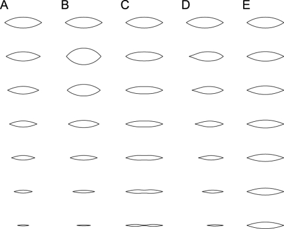

*图 23｜正常与扰动条件下的模拟前沿。引自 [Layton 等（2009），Fig. 3](https://pmc.ncbi.nlm.nih.gov/articles/PMC2839815/#f3)，© HFSP Publishing。每列是一种条件下的模拟前沿，时间由上向下；条件分别对应正常、去除 amnioserosa 力、干扰双端或单端 zipping、myospheroid 突变。*

去掉 amnioserosa 的贡献后，纯弹性和纯主动收缩模型都偏离实际前沿，两者结合才改善吻合。组织由此表现出储存弹性形变、同时继续产力的性质。对于部分未参与参数优化的端点切割实验，还需提高其他位置的活动，才能重现持续闭合；切割后的恢复因此可能包含负载重分配与主动调节。

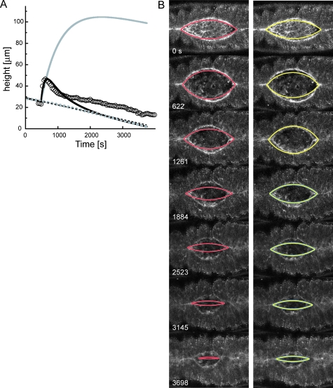

*图 24｜切割后的材料模型比较与影像叠加。引自 [Layton 等（2009），Fig. 9](https://pmc.ncbi.nlm.nih.gov/articles/PMC2839815/#f9)，© HFSP Publishing。A 比较不同材料假设与切割后的观测；B 将计算前沿直接叠加在显微影像上。原图分辨率沿用 PMC 提供的文件，细节及参数见原文。*

线虫没有一个可直接等同于果蝇 amnioserosa 的单层组织。可以借用的是实验与模型的配合方式：分别改变表皮边缘、下方神经母细胞和新生中线连接，再比较前沿何处首先改变、是否出现回弹，以及剩余区域怎样补偿。两对 leading cells 的首次接触还会改变剩余 pocket 的边界条件，需要在模型中作为真实的接触事件处理。

圆形开口可用于分开观察线张力与阻力的作用。它省去了 leading cells 的身份和前沿不对称，仅保留半径这一个几何变量。

设开口近似为半径 $r$ 的圆，边界具有线张力 $\gamma$。边界总能量为 $E=2\pi\gamma r$，缩小半径会减少边界长度。若每单位边界长度上的运动阻力系数为 $\zeta_\ell$，总阻力随周长增加，径向平衡为

$$
2\pi r\zeta_\ell\dot r=-\frac{\mathrm dE}{\mathrm dr},
\qquad
\dot r=-\frac{\gamma}{\zeta_\ell r}.
$$

由此得到 $A(t)=A(0)-2\pi\gamma t/\zeta_\ell$，即前面讨论的线性面积缩小。半径越小，曲率越大，每单位长度承受的向内力越大，边界因而越快。

若运动阻力主要集中在少数位置，总阻力系数近似为固定的 $\zeta_0$，则 $\zeta_0\dot r=-2\pi\gamma$，半径反而以恒速减小，面积呈二次下降。同样的线张力驱动，仅仅改变负载分布，就会得到不同曲线。根据面积曲线推断机制时，阻力模型与驱动力模型同样重要。

图 25A 将两种曲线的初始面积和闭合时间设为相同，便于只比较形状。中途某个时刻，两条曲线的面积可以明显不同，但这不意味着其中一个系统有更多马达。若实验只采少数帧，再把时间原点稍作平移，两类曲线甚至可能在有限区间里看起来很接近。

局部信息有助于拆开这种相似性。在恒定线张力和单位长度阻力近似下，曲率较大的位置预期具有较快的向内速度；主动爬行、局部黏附或基底运动也会改变这一关系。记录整条前沿的形状和速度，比只存总面积多保留了空间上的检验机会。

周围组织也可能把开口向外拉。用 $p>0$ 表示每单位面积偏向保持开口的有效能量收益，可写

$$
E(r)=2\pi\gamma r-\pi pr^2,
\qquad
\dot r=-\frac{1}{\zeta_\ell}\left(\frac\gamma r-p\right).
$$

$p$ 概括周围组织把开口拉开的作用，单位是力除以长度。半径 $r_c=\gamma/p$ 处，向内和向外作用暂时平衡；但半径稍微小一点，向内作用就占优，开口继续缩小，稍微大一点则继续扩张。因此它叫不稳定分界，不能让开口可靠地停住。若实验中缺口能长时间停在固定大小，就说明这个恒定参数模型还少了一种能把偏差拉回来的作用，例如周围组织的弹性。

*图 25｜闭合动力学的两个算例。A 使用相同的初始半径与闭合时长，比较局部分布阻力下的线性面积和固定总阻力下的二次面积。B 取 $\gamma=p=\zeta_\ell=1$，显示临界半径两侧的径向速度。图中圆形边界与恒定参数用于解析比较，真实腹侧前沿的细胞离散性和基底运动另需建模。*

腹侧 leading cells 的主动迁移还可以贡献一个向内推进项 $f_m$，使速度近似变为 $\dot r=-(\gamma/r+f_m-p)/\zeta_\ell$。迁移与收缩可以在同一时间起作用；区分它们的一种办法，是比较局部速度对曲率的依赖，以及在细胞特异干预后这种关系如何变化。前沿两侧不对称、头尾闭合不同步等现象，也比单一总面积包含更多机制信息。

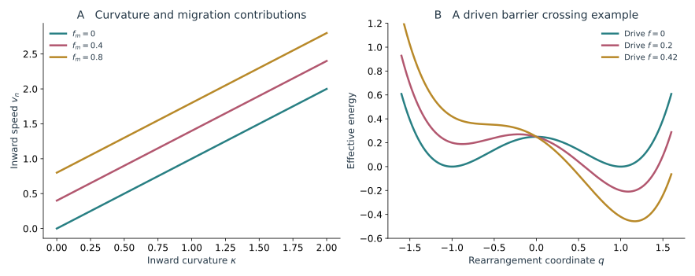

*图 26｜前沿推进与邻接重排的两种计算。A 取无量纲 $\zeta_\ell=\gamma=1$、$f_{\rm out}=0$，比较不同 $f_m$ 下的速度与曲率。B 使用示范能量 $E(q)=(q^2-1)^2/4-fq$，展示驱动倾斜两个排列间的能垒；它并非由某个线虫顶点网络拟合而来。*

双阱曲线仅描述给定路径上的驱动偏置；Tetley 和 Sknepnek 的模型则从细胞网络出发，同时求解形态、连接与活动。

### 8.2 面积脉冲与持续封口 {#52-面积脉冲与持续封口}

组织可以反复收缩和放松，却没有多少净位移。Wang、Feng 与 Pismen 针对果蝇背侧闭合，构建了一个显式包含 81 颗细胞的模型：细胞边界通过节点相连，每颗细胞内部还有从中心向边界辐射的 spokes，代表 medial actomyosin 对边界的作用。[Wang 等，2012](https://doi.org/10.1016/j.bpj.2012.09.036)

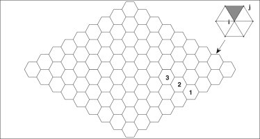

*图 27｜连接与细胞内收缩网络模型。引自 [Wang 等（2012），Fig. 1](https://pmc.ncbi.nlm.nih.gov/articles/PMC3514517/#fig1)，© Biophysical Society。内插图为单个细胞的边与 spokes，外图显示它们组成的组织。*

一根模型元件的张力由弹性和结合 myosin 共同给出：

$$
f_{ij}=\mu(\ell_{ij}-\ell^0_{ij})+\beta m_{ij},
\qquad
\eta\dot{\mathbf x}_i=\sum_j f_{ij}\hat{\mathbf e}_{ij}.
$$

模型进一步求解 myosin 的结合与脱离，并让细胞内的调控变量 $s_k$ 随活动消耗：

$$
\dot m_{kj}=k_+s_kh_{kj}-k_-m_{kj},
\qquad
k_-=k_1\exp[-k_2f_{kj}],
\qquad
\dot s_k=q-k_0\sum_jm_{kj}.
$$

$h_{kj}$ 是由元件周围面积决定的几何分配因子。张力延长马达驻留，而调控变量的补充与消耗又引入延迟，细胞之间通过共同边界耦合。这套闭合反馈能产生细胞面积脉冲及邻居之间的相位关系。$s_k$ 是现象学调控量，作者没有将它认定为某一种已测定的信号分子。

为了区分净闭合怎样发生，研究比较了内部 ratchet 与外部 ratchet。前者在每次收缩后缩短细胞内部和边缘元件的参考长度，使下次舒张也回不到原来的大小；后者由外围 cable 的更新限制组织回弹。在所考察的参数范围内，内部更新对缓慢阶段的面积减小贡献更大。快速阶段则通过进一步缩短参考长度，使持续收缩取代明显的面积脉冲。

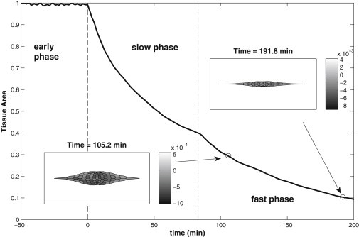

*图 28｜网络活动、参考状态更新与闭合轨迹。引自 [Wang 等（2012），Fig. 8](https://pmc.ncbi.nlm.nih.gov/articles/PMC3514517/#fig8)，© Biophysical Society。主图为组织总面积，插图为不同时间的细胞网络与面积变化率；快速阶段的参考长度更新由模型规则给定。*

这项工作区分了“产生脉冲”和“保留形变”两件事，也保留了一条边界：参考长度更新是对内部结构重塑的有效描述，没有独立推导出其分子机制。在线虫腹侧闭合中，是否需要类似的更新，应看一次回缩后新接触能否保留、连接是否继续增长、局部 actin 是否重新组织。仅看到 actomyosin 亮度起伏，还不足以说明发生了 ratchet。

### 8.3 闭合中的材料更新与固流性质 {#closure-solid-fluid}

闭合不仅涉及产力，也涉及材料怎样在大幅变形中保持完整。Tah 等研究果蝇 amnioserosa 时遇到一个看似矛盾的结果：随着组织收窄，细胞越来越细长，形状指数 $q=P/\sqrt A$ 升高，但在所观测的闭合过程中，除细胞内移以外，几乎没有邻居交换。组织能变形，却没有按照简单的形状阈值判断变成容易重排的流体。[Tah 等，2025](https://doi.org/10.1073/pnas.2322732121)

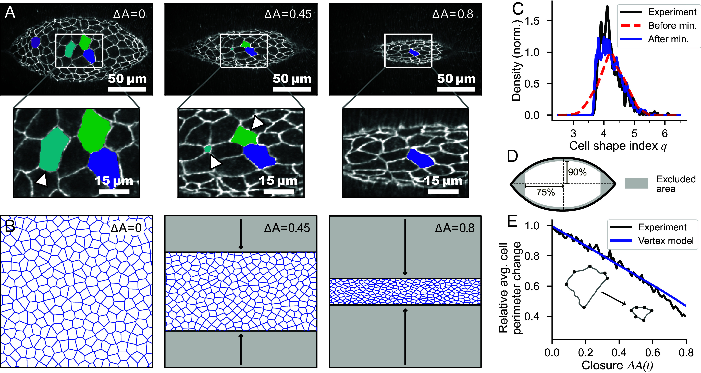

*图 29｜闭合组织的细胞形状与顶点模型。引自 [Tah 等（2025），Fig. 1](https://pmc.ncbi.nlm.nih.gov/articles/PMC11725931/#fig01)，CC BY-NC-ND 4.0，原图未修改。A、B 为实验与模型的空间形变；C 比较起始形状指数分布；E 比较实际周长下降与模型参考周长的更新。论文于 2024 年末在线发表，卷期为 2025 年。*

模型仍采用面积与周长能量，但不再把每颗细胞的参考周长 $P_{0i}$ 固定。组织收窄过程中，参考周长随闭合进展降低，不同细胞的参考周长也有一定分布。形状参数因此包含两种不同信息：影像测得的 $q_i=P_i/\sqrt{A_i}$，以及决定材料偏好的 $p_{0i}=P_{0i}/\sqrt{A_0}$。

模型还让共同的参考面积随剩余组织面积和细胞数更新。令 $s=\Delta A$ 表示已经减少的面积比例，原文的选择为

$$
A_0(s)=\frac{A_{\rm init}(1-s)}{N(s)}.
$$

$N(s)$ 会随细胞内移而减少。与此同时，参考周长的均值线性降低，分布的相对宽度保持不变。因此，模型比较的是各向异性形变、细胞离开表面和材料参考状态更新共同作用的结果，不能仅靠改变一个固定的形状阈值来复述。

拉长一颗仍有张力、仍抵抗重排的细胞，同样可以使 $q_i$ 很大。实际细胞变长，并不意味着其偏好的无应力形状也同样变长。随着膜和连接材料更新，$P_{0i}$ 的下降又能维持承载网络，使组织在持续收窄时仍有非零剪切模量。

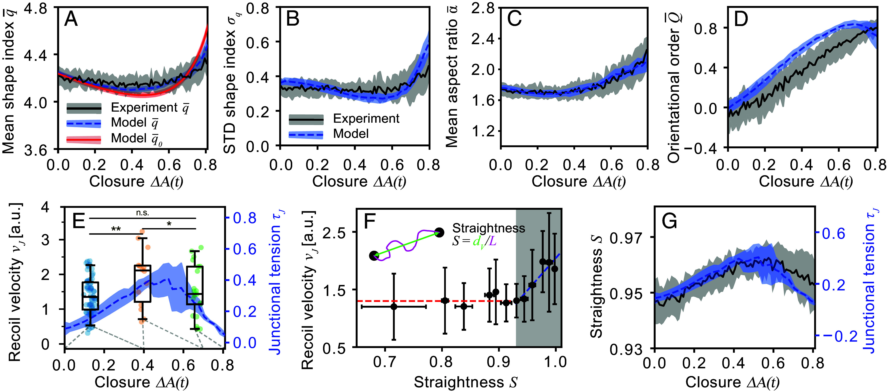

*图 30｜激光切割与闭合模型比较。引自 [Tah 等（2025），Fig. 2](https://pmc.ncbi.nlm.nih.gov/articles/PMC11725931/#fig02)，CC BY-NC-ND 4.0。A–D 比较形状指数、分布、长宽比和取向；E、G 比较模型张力变化与切割初始回缩、连接直度。回缩测量支持张力的非单调变化，绝对张力仍涉及耗散的标定。*

这个模型的关键预测是连接张力随闭合先升高、再降低，而非随着细胞越来越细长一直单调变化。作者在不同阶段进行激光切割，观察到相应的回缩变化。它把细胞形状、材料更新和机械响应连在一起，提供了超出“模拟也能收缩”的检验。

*图 31｜相似形状下的不同刚性状态。引自 [Tah 等（2025），Fig. 3](https://pmc.ncbi.nlm.nih.gov/articles/PMC11725931/#fig03)，CC BY-NC-ND 4.0。B 中固定参考周长的模型剪切模量降至零，允许参考周长缩短则保留刚性；C 比较组织在形状与闭合进展平面中的轨迹。*

该研究将闭合形变作为准静态输入，主要解释在这种形变下组织为何保持承载和稳定邻接，并未同时预测全部闭合驱动力或速度。它与前面求解实际前缘运动的模型回答不同问题，两者可以互补。

对线虫，这一点尤其适合用于区分不同区域。背侧插入需要有方向的邻接变化；leading cells 相遇以后，新中线连接则需要稳定承载。要求整个表皮在所有位置同时“变流体”，未必有利于封口。更具体的问题是：哪些区域在重排，哪些连接在成熟，细胞形状变化来自主动变形、外部拉伸还是参考状态更新。第六篇的[固流转变讨论](/notes/celegans/embryonic_morphogenesis/active_matter_packing_topology/#solid-fluid-transition)可与这里的实际发育模型对照。

### 8.4 表皮与神经母细胞的耦合 {#54-表皮与神经母细胞的耦合}

一种适合区分它们的力学表达，是把表皮与神经母细胞分别作为可变形网络，并让界面作用满足作用力与反作用力：

$$
\mathbf F_{e\leftarrow n}
=k_c\mathbf d+\xi_c(\mathbf v_n-\mathbf v_e),
\qquad
\mathbf F_{n\leftarrow e}=-\mathbf F_{e\leftarrow n}.
$$

这里 $\mathbf d$ 取下方承载位置相对表皮位置、并扣除参考间距后的位移，$k_c$ 和 $\xi_c$ 分别表示界面储能和相对滑动阻力。这是一种待检验的耦合形式，并非 Wernike 等已经拟合出的线虫方程。它的用途是明确区分：下方组织主动移动、界面传力减弱、表皮自身产力改变，会在两层速度差与释放响应上留下不同特征。

要保留 leading cells 的相遇位置和局部开裂，可以在腹侧局部展开面上，以前后轴坐标 $s$ 描述两侧前缘 $y=\pm w(s,t)$。当地缺口宽度为 $2w$，整个函数 $w(s,t)$ 给出前缘形状及新连接的范围。以下简化模型用于比较接触成熟与组织回拉，未拟合线虫前沿。

在小斜率、左右对称的近似下，一条简化演化方程为

$$
\zeta_w\partial_tw
=T\partial_s^2w-f_{\rm prot}(s,t)+f_{\rm out}(s,t)
-F_{\rm adh}c_j(s,t)e^{-w/\ell_a},
\qquad w\ge0.
$$

$T\partial_s^2w$ 把沿前后轴相邻位置的前缘耦合起来，降低过于尖锐的弯折；它会让突出的部分回退，也会带动落后的部分。$f_{\rm prot}$ 是局部向中线推进的作用，$f_{\rm out}$ 概括组织回拉。黏附项只在两侧靠近时显著，$c_j$ 是承载连接的成熟度，$\ell_a$ 为相互作用的距离尺度。$w\ge0$ 限制两侧在这个二维展开图中不能互相穿越，达到零后是否保持封闭仍由净力和黏附决定。

给 $c_j$ 一条与初次接触相联系的动力学：

$$
\partial_tc_j
=k_{\rm on}\,\mathcal I(w\lt\delta)(1-c_j)-k_{\rm off}c_j.
$$

$\mathcal I$ 在缺口小于接触尺度 $\delta$ 时为 1，其余为 0。两侧已经分离时，模型停止募集新连接，原有连接仍可逐渐解离。因此，前缘轨迹与连接成熟开始相互影响：更久的接触允许更多成熟，成熟又帮助维持接触。

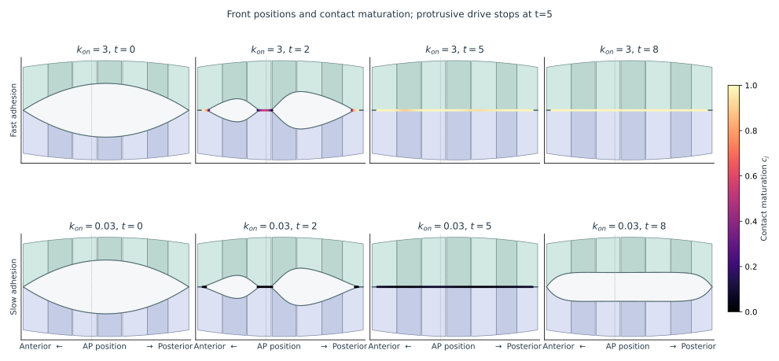

*图 32｜连接成熟速率与接触后的稳定性。两行使用相同前缘初态与推进分布，仅改变 $k_{\rm on}=3,0.03$；列为无量纲 $t=0,2,5,8$。推进在 $t=5$ 撤去，颜色标出仍靠近的界面上 $c_j$ 的大小。取 $\zeta_w=1,T=0.025,f_{\rm out}=0.12,F_{\rm adh}=0.32,\ell_a=0.06,\delta=0.035,k_{\rm off}=0.05$。前缘及黏附由方程演化；两侧细胞分区用于标明空间位置，未求解完整细胞网络。*

图 32 中，局部较强的推进先让中间一处相遇，留下前后不同的剩余开口。快速成熟条件下，新界面可以在推进撤去后继续承载；慢速成熟条件也曾经相遇，但回拉使其重新打开。只看第一次缺口面积降到很小的时刻，会把两者判为相近的成功闭合；接触后的形态序列才显示它们的区别。

这个算例没有把黏附变化直接归给某个基因。Raich 等在表皮腹侧闭合中观察到的 cadherin–catenin 募集，为首次接触时的连接装配提供了约束；Serre 等研究的则是更早的神经母细胞裂隙封口，提示新连接的稳定还需要单独考虑。两项研究对应不同阶段，不能据此给两者指定相同的黏附参数。这里的 $k_{\rm on},k_{\rm off},F_{\rm adh}$ 分别概括装配、解离和承载的不同过程。荧光增长可以约束分子募集的时序，却不能单独给出界面能承受的力。要进一步区分它们，可比较首次相遇时间、HMR-1/HMP-1 富集、再分离的延迟和开裂位置，并记录缺口下方神经母细胞是否同时移动。

前缘相对实验室的速度，也不是表皮相对基底的迁移速度。若神经母细胞表面沿切向以 $\mathbf u_{\rm sub}$ 移动，局部摩擦应取决于 $\mathbf v-\mathbf u_{\rm sub}$。相同的表皮位移，既可能来自更强牵引，也可能来自所接触表面正在同向运动。把基底视为静止玻璃板，会将这部分运动误拟合进表皮的推进力。

早期 ventral cleft closure 会改变后续前缘面对的几何和支撑条件，基底异常因而可能在更晚表现为包裹缺陷。双组织成像可以分别建立表皮和神经母细胞的位移场，再比较两者的相对运动与受阻位置。

连接一旦承载，负载分配还会影响解离。设共有 $N$ 个潜在承载连接，其中比例 $n$ 已结合，总拉力 $F$ 在已结合连接间近似均分，则每条已结合连接承受 $F/(Nn)$。把 Bell 型受力解离关系与这种均分负载近似结合，可得到一种候选动力学。[Bell，1978](https://doi.org/10.1126/science.347575)

其形式为

$$
\dot n=k_{\rm on}(1-n)
-k_{\rm off}^{0}
\exp\left(\frac{F}{Nnf_d}\right)n.
$$

这条式子适用于已经形成有限承载连接、且负载能近似均分的阶段；$f_d$ 是使解离明显加快的单连接力尺度。它是受力增加后更容易解离的 slip-bond 简化，不把所有细胞连接都假定成同一种分子键。其反馈很明确：少量连接断开后，剩余连接分摊更大负载，继而更快断开。这样可以出现接触初期看起来正常、加载后却突然破裂的过程。第一篇的[力传递模型](/notes/celegans/embryonic_morphogenesis/gastrulation/)进一步讨论了这种承载能力限制。

与恒定解离率相比，负载相关模型预测再裂开的概率依赖外部拉动与初始成熟程度，而不只依赖接触已经持续多久。可以在相近接触阶段比较不同负载、不同连接募集程度的响应；如果提高初始连接数量主要延缓加载后的破裂，而不改变相遇以前的前缘速度，就更符合承载稳定性改变。真实连接还可能在一定受力范围内变得更稳定，或通过骨架加固和主动反馈维持承载，是否需要这些机制，应由加载后的动力学决定。

## 9. 理论借鉴：扰动的顺序与模型辨识 {#62-扰动的顺序与模型辨识}

下表汇总各条研究路线实际增加的理解，以及它们与线虫的对应关系。跨体系的模型提供力学机制与可检验预测；相应分子和参数是否适用于线虫，要由线虫中的干预确定。

| 已发表研究 | 模型保留的关键机制 | 得到的机制判断 | 在线虫中优先比较 |
| --- | --- | --- | --- |
| Brodland 2006，两栖组织相关模型 | 突起、细胞形变与外部约束 | 组织伸长与细胞拉长可以有不同的负载依赖 | 尖端推进、主体变形及邻近约束改变 |
| Weng 2022，爪蟾 | 独立皮层、爬行、收缩和动态黏附 | 局部插入成功不保证组织有效伸长；两种活动需要正常耦合 | 基底突起能否带动主体、接触滑移、活动同时出现的步进 |
| Tetley 2016，果蝇 | 细胞身份、边反馈与边界滑动 | 边收缩、四细胞解析和保持排列需要分别解释 | 左右交替与同侧共同迁移 |
| Sknepnek 2023，与鸡胚作定性比较 | 张力依赖的马达驻留、有限储库及松弛 | 外部应力可触发主动重排，存在有效活动与负载范围 | 应力变化以后 myosin、边长和新接触的先后 |
| Hutson 2003 与 Layton 2009，果蝇 | 实际前缘、多组织产力、zipping 与材料响应 | 正常闭合和切割后补偿共同约束力的来源 | 表皮与神经母细胞分别受扰动后的空间响应 |
| Wang 2012，果蝇 | 细胞内部网络、马达动力学与参考长度更新 | 面积脉冲和净闭合需要分别解释 | 回缩以后连接和形变是否保留 |
| Tah 2025，果蝇 | 参考周长更新、异质性与各向异性形变 | 细胞拉长与形状指数升高不必导致流化 | 稳定中线与重排区域的邻接寿命、承载和更新 |

对背侧插入，一个有用的测试顺序是先比较尖端方向，再比较顶底时差，最后比较左右次序。改变方向控制，首先应影响哪一面成为前缘；改变传力和黏附，可能保留正确前缘却使主体跟进不足；改变邻居间协调，则可能保留运动速度而破坏交替排列。它们不能全部被一个“有效迁移速度”替代。

对腹侧闭合，至少应把推进、首次相遇和稳定封口分开。爬行不足主要推迟相遇；连接成熟不足可让相遇时间接近正常，却在承载后分开；下方组织异常则可能首先改变某一段前沿的负载和位置。若模型能预测这些局部失败发生在哪里、先于哪一种可见变化，就比仅拟合最终开口面积更接近实际机制。

现有线虫实验已给出细胞身份、活动位置和扰动时序等约束。将突起、动态黏附和下方组织运动接入同一个三维模型，便有机会同时预测正常排列与局部失败，而不只匹配最终缺口。

## 参考文献 {#references}

1. Walck-Shannon E, Reiner D, Hardin J (2015). [Polarized Rac-dependent protrusions drive epithelial intercalation in the embryonic epidermis of C. elegans](https://doi.org/10.1242/dev.127597). *Development*.

2. Walck-Shannon E, Lucas B, Chin-Sang I, Reiner D, Kumfer K, Cochran H, Bothfeld W, Hardin J (2016). [CDC-42 Orients Cell Migration during Epithelial Intercalation in the Caenorhabditis elegans Epidermis](https://doi.org/10.1371/journal.pgen.1006415). *PLoS Genet*.

3. Zhu Y, Tesone Z, Tan M, Hardin J (2024). [TIAM-1 regulates polarized protrusions during dorsal intercalation in the Caenorhabditis elegans embryo through both its GEF and N-terminal domains](https://doi.org/10.1242/jcs.261509). *J Cell Sci*.

4. Williams-Masson EM, Malik AN, Hardin J (1997). [An actin-mediated two-step mechanism is required for ventral enclosure of the C. elegans hypodermis](https://doi.org/10.1242/dev.124.15.2889). *Development*.

5. Raich WB, Agbunag C, Hardin J (1999). [Rapid epithelial-sheet sealing in the Caenorhabditis elegans embryo requires cadherin-dependent filopodial priming](https://doi.org/10.1016/S0960-9822(00)80015-9). *Curr Biol*.

6. Bernadskaya YY, Wallace A, Nguyen J, Mohler WA, Soto MC (2012). [UNC-40/DCC, SAX-3/Robo, and VAB-1/Eph polarize F-actin during embryonic morphogenesis by regulating the WAVE/SCAR actin nucleation complex](https://doi.org/10.1371/journal.pgen.1002863). *PLoS Genet*.

7. Serre JM, Slabodnick MM, Goldstein B, Hardin J (2023). [SRGP-1/srGAP and AFD-1/afadin stabilize HMP-1/⍺-catenin at rosettes to seal internalization sites following gastrulation in C. elegans](https://doi.org/10.1371/journal.pgen.1010507). *PLoS Genet*.

8. Shah PK, Tanner MR, Kovacevic I, Rankin A, Marshall TE, Noblett N, Tran NN, Roenspies T, Hung J, Chen Z, Slatculescu C, Perkins TJ, Bao Z, Colavita A (2017). [PCP and SAX-3/Robo Pathways Cooperate to Regulate Convergent Extension-Based Nerve Cord Assembly in C. elegans](https://doi.org/10.1016/j.devcel.2017.03.024). *Dev Cell*.

9. Xu Y, Cheng Y, Chen AT, Bao Z (2023). [A compound PCP scheme underlies sequential rosettes-based cell intercalation](https://doi.org/10.1242/dev.201493). *Development*.

10. Mori Y, Jilkine A, Edelstein-Keshet L (2008). [Wave-pinning and cell polarity from a bistable reaction-diffusion system](https://doi.org/10.1529/biophysj.107.120824). *Biophys J*.

11. Reza Farhadifar, Jens-Christian Röper, Benoit Aigouy, Suzanne Eaton, Frank Jülicher (2007). [The Influence of Cell Mechanics, Cell-Cell Interactions, and Proliferation on Epithelial Packing](https://doi.org/10.1016/j.cub.2007.11.049). *Current Biology*.

12. Yoichiro Mori, Alexandra Jilkine, Leah Edelstein-Keshet (2011). [Asymptotic and Bifurcation Analysis of Wave-Pinning in a Reaction-Diffusion Model for Cell Polarization](https://doi.org/10.1137/10079118X). *SIAM Journal on Applied Mathematics*.

13. Williams-Masson EM, Heid PJ, Lavin CA, Hardin J (1998). [The cellular mechanism of epithelial rearrangement during morphogenesis of the Caenorhabditis elegans dorsal hypodermis](https://doi.org/10.1006/dbio.1998.9048). *Developmental Biology*.

14. Bell GI (1978). [Models for the specific adhesion of cells to cells](https://doi.org/10.1126/science.347575). *Science*.

15. Brodland GW (2006). [Do lamellipodia have the mechanical capacity to drive convergent extension?](https://doi.org/10.1387/ijdb.052040gb). *International Journal of Developmental Biology*.

16. Weng S, Huebner RJ, Wallingford JB (2022). [Convergent extension requires adhesion-dependent biomechanical integration of cell crawling and junction contraction](https://doi.org/10.1016/j.celrep.2022.110666). *Cell Reports*.

17. Tetley RJ, Blanchard GB, Fletcher AG, Adams RJ, Sanson B (2016). [Unipolar distributions of junctional Myosin II identify cell stripe boundaries that drive cell intercalation throughout Drosophila axis extension](https://doi.org/10.7554/eLife.12094). *eLife*.

18. Sknepnek R, Djafer-Cherif I, Chuai M, Weijer C, Henkes S (2023). [Generating active T1 transitions through mechanochemical feedback](https://doi.org/10.7554/eLife.79862). *eLife*.

19. Collinet C, Rauzi M, Lenne PF, Lecuit T (2015). [Local and tissue-scale forces drive oriented junction growth during tissue extension](https://doi.org/10.1038/ncb3226). *Nature Cell Biology*.

20. Hutson MS, Tokutake Y, Chang MS, Bloor JW, Venakides S, Kiehart DP, Edwards GS (2003). [Forces for morphogenesis investigated with laser microsurgery and quantitative modeling](https://doi.org/10.1126/science.1079552). *Science*.

21. Layton AT, Toyama Y, Yang GQ, Edwards GS, Kiehart DP, Venakides S (2009). [Drosophila morphogenesis: tissue force laws and the modeling of dorsal closure](https://doi.org/10.2976/1.3266062). *HFSP Journal*.

22. Wang Q, Feng JJ, Pismen LM (2012). [A cell-level biomechanical model of Drosophila dorsal closure](https://doi.org/10.1016/j.bpj.2012.09.036). *Biophysical Journal*.

23. Tah I, Haertter D, Crawford JM, Kiehart DP, Schmidt CF, Liu AJ (2025). [A minimal vertex model explains how the amnioserosa avoids fluidization during Drosophila dorsal closure](https://doi.org/10.1073/pnas.2322732121). *PNAS*.

24. Wernike D, Chen Y, Mastronardi K, Makil N, Piekny A (2016). [Mechanical forces drive neuroblast morphogenesis and are required for epidermal closure](https://doi.org/10.1016/j.ydbio.2016.02.023). *Developmental Biology*.

25. Guan G, Li Z, Ma Y, Ye P, Cao J, Wong MK, Ho VWS, Chan LY, Yan H, Tang C, Zhao Z (2025). [Cell lineage-resolved embryonic morphological map reveals signaling associated with cell fate and size asymmetry](https://doi.org/10.1038/s41467-025-58878-0). *Nature Communications*.

26. Ben Amar M, Qiuyang-Qu P, Vuong-Brender TTK, Labouesse M (2018). [Assessing the Contribution of Active and Passive Stresses in C. elegans Elongation](https://doi.org/10.1103/PhysRevLett.121.268102). *Physical Review Letters*.

← [01 细胞内移与力传递](/notes/celegans/embryonic_morphogenesis/gastrulation/) · [系列总览](/notes/celegans/embryonic_morphogenesis/) · [03 早期伸长与各向异性力学](/notes/celegans/embryonic_morphogenesis/early_elongation/) →
