Ea、Ep 内移时，外露顶面逐渐缩小，周围细胞靠拢并覆盖原来的位置。参与收缩的 actin–myosin 网络却往往更早就开始向内运动，过一段时间，细胞边界才明显跟上。这段延迟使内移研究从“收缩力有多大”进一步转向网络与边界怎样传力。

内移还受到整个细胞群的影响。细胞分裂、邻居让位和卵壳约束不断改变 Ea、Ep 周围的负载。局部骨架与连接实验揭示了力怎样产生和传递，多细胞模型则解释这些力在怎样的空间中起作用。

## 1. 线虫研究：细胞内移与力传递 {#1-gastrulation-细胞从表面进入内部}

从内移实验到多细胞模型，线虫研究已经分别约束了产力、连接耦合与周围几何。早期排列、Ea/Ep 内移和合子皮层脉冲属于不同阶段，下面分别讨论。

<figure class="celegans-video celegans-stage-video" id="stage-motion-gastrulation">
<video controls loop preload="metadata" playsinline width="756" height="720" aria-label="Ea/Ep 顶面缩小与细胞内移" aria-describedby="stage-motion-gastrulation-caption">
<source src="https://nigms.nih.gov/sites/nigms/files/image-and-video-gallery/Four_timepoints_in_gastrulation.mp4" type="video/mp4">
浏览器暂不支持内嵌播放，请打开下方原始视频。
</video>
<figcaption id="stage-motion-gastrulation-caption"><strong>动态影像｜Ea/Ep 顶面缩小与细胞内移</strong> 
绿色为 myosin，红色为细胞膜，蓝色伪彩标出内移细胞。留意顶面轮廓怎样缩小、邻居怎样覆盖原来的位置；蓝色标注用于定位细胞，不是另一种分子信号。 
来源：Bob Goldstein，UNC Chapel Hill；NIGMS 影片 3334，相关研究 Roh-Johnson 等（2012）。<a href="https://nigms.nih.gov/image-gallery/3334">原始页面与说明</a>。</figcaption>
</figure>

### 1.1 Ea 和 Ep 的内移及其三维几何 {#11-ea-和-ep-的内移及其三维几何}

约在 26–28 细胞阶段，两个内胚层前体 Ea、Ep 开始从腹侧表面进入内部。它们暴露在胚胎外侧的顶面逐渐缩小，周围细胞重新覆盖这一位置；细胞本体则留在内侧，继续建立肠道谱系。随后还有生殖系、肌肉、咽和部分神经系统前体细胞内移。[Harrell 与 Goldstein，2011](https://doi.org/10.1016/j.ydbio.2010.09.012)

Ea 和 Ep 是 E 分裂产生的前、后子细胞，随后形成肠道。

这里的“顶面”指 Ea/Ep 朝向胚胎外侧、仍然外露的表面，基底侧则朝向内部。后面测量顶面面积，关注的就是这片外露区域怎样消失。

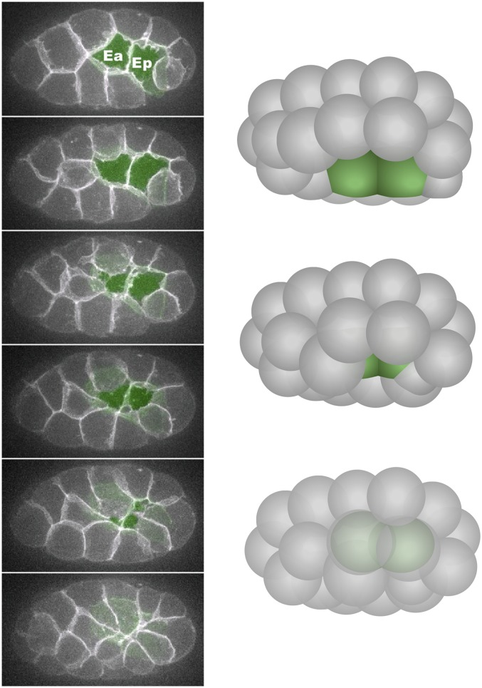

*图 1｜Ea/Ep 从表面进入内部。引自 [Goldstein 与 Nance（2020），Fig. 3](https://pmc.ncbi.nlm.nih.gov/articles/PMC7017025/#fig3)，其中显微序列改编自 Roh-Johnson 等（2012）。左侧是腹侧多层投影，内胚层细胞以绿色伪彩标记；右侧给出对应的腹侧偏侧面三维示意。这里最直接的变化是绿色暴露顶面的减少，而非整个胚胎轮廓的大幅收缩。*

Ea/Ep 的一大部分体积可以已经位于内侧，顶面却仍保留一个很小的外露区域。相反，一个细胞离开焦平面，也可能只是胚胎转动造成的。多层膜成像可以同时追踪细胞体积的位置和它与表面的接触。

在图 1 的腹侧投影中，绿色区域代表仍能从外部看到的顶面。顺着时间序列看，它先变窄，再消失；侧面的示意则补上投影里看不到的深度。细胞在整个过程中仍有体积，消失的是它与胚胎外表面的交界。周围细胞也并非一块静止背景：它们靠近、展平并建立新的接触，原来的开口才逐步被覆盖。

把一帧楔形细胞直接解释为主动内移，容易漏掉这些邻居运动。相似形状也可能由外部挤压产生。更有说服力的是，在同一胚胎中追踪顶面、细胞主体和周围接触，再看改变收缩或黏附后，哪个变化首先受到影响。这样才能把细胞自身形变与细胞群共同完成的覆盖过程接起来。

在几何上，可把暴露顶面写为曲面区域 $S_{\rm ap}(t)$，定义

$$
A_{\rm ap}(t)=\int_{S_{\rm ap}(t)}\mathrm dS,
\qquad
\dot\varepsilon_A=\frac{\mathrm d}{\mathrm dt}\ln A_{\rm ap}.
$$

$A_{\rm ap}$ 就是这片外露表面的面积。积分号表示把曲面上一小块一小块的面积加起来；$t$ 是时间，变量上面的点表示它随时间变化的快慢。$\dot\varepsilon_A$ 是相对面积变化率，面积缩小时它为负。若只关心收缩有多快，也可以取它的负值，但比较不同图时要留意符号约定。

面积变小和细胞完全进入内部仍是两件事。一个细胞可以只剩很小的外露顶面，却仍与胚胎外表面相接。还要结合三维位置、内移深度，以及邻居最后盖住它的时刻，才能判断内移进行到了哪一步。

使用对数面积，是为了比较相对变化。一个大顶面和一个小顶面，在相同时间内都缩小十分之一时，面积变化的绝对值不同，但它们的相对收缩率相同。若把曲线换成等效半径 $r_{\rm eq}=\sqrt{A_{\rm ap}/\pi}$，则相对面积变化是相对半径变化的两倍。等效半径便于与径向网络运动比较，却没有要求真实顶面一定是圆形。

实际顶面会倾斜和弯曲。表面接近成像平面时，投影面积才近似等于真实面积；Ea/Ep 向内折入后，倾斜也会使投影变小。多层重建可以分开这部分姿态变化与真实收缩。

### 1.2 哪些细胞收缩 收缩发生在哪里 {#12-哪些细胞收缩-收缩发生在哪里}

Ea/Ep 的肠道命运通过基因活动影响分裂时间、蛋白分布和收缩位置。研究命运与形态的关系，需要追踪这些调控怎样落实为实际运动。

早期细胞根据接触关系建立顶底差别：暴露的无接触表面与邻细胞接触面具有不同的 PAR、CDC-42 及骨架调控状态。对于 Ea/Ep，非肌肉 myosin II 在顶端富集和激活，MRCK-1 等调控因子的局部募集使收缩活动具有细胞类型和细胞表面的选择性。[Goldstein 与 Nance，2020](https://doi.org/10.1534/genetics.119.300240)

PAR 指一组与细胞极性有关的蛋白，CDC-42 也参与调节不同位置的骨架活动。这里先关注它们带来的空间差别：同一个细胞面向外部和接触邻居的两部分，蛋白分布和活动状态不一样。MRCK-1 等调控蛋白再影响 myosin 的活动，使收缩集中在指定位置。

Actin 与 myosin 组成的网络统称 actomyosin。紧贴细胞膜内侧的薄层是细胞皮层 cortex，能承载并产生收缩；它与覆盖整个胚胎的表皮属于不同尺度的结构。

纤维还会通过交联蛋白彼此连接，并通过其他蛋白与细胞接触处相连。它们是否连成一张网、网的边缘是否拉得住，都会影响马达活动的结果。马达让一小块网络向内流动，与整个细胞顶面跟着缩小，不能直接当成同一个现象。

细胞极性首先解决的是这些活动部署在哪里。若所有细胞表面具有相同的收缩倾向，细胞更容易整体变圆；若活动集中在暴露顶面，细胞才可能保持基底侧体积，同时缩小外露一端。命运调控随后决定哪些细胞在这个阶段采用这种布局。对内移来说，位置和时序与收缩装置的总量一样关键。

Ea/Ep 的顶底极性区分暴露面与细胞接触面；受精卵最初的前后极性则参与建立首次不对称分裂和命运差异。两者都涉及 PAR 元件，但作用的空间、时间和下游任务不同。

Harrell 与 Goldstein 对不同谱系的比较显示，内移细胞共享 actomyosin 依赖，却具有不同的极性和命运调控。影响 Ea/Ep 的某些 PAR 扰动，对 MS、D 等后续内移细胞的影响并不相同。

同样是进入内部，不同谱系可能在不同时间、用不同调控方式调动这套骨架。因此，判断一个命运基因怎样影响运动，要看它先改变了收缩的位置、活动时间，还是网络与边界的连接。

### 1.3 已经收缩的皮层为何尚未改变细胞边界 {#13-已经收缩的皮层为何尚未改变细胞边界}

Roh-Johnson 等观察到，Ea/Ep 顶端网络的持续向心运动早于快速顶面收缩。由此看来，启动形变还涉及已有收缩怎样传到边界。[Roh-Johnson 等，2012](https://doi.org/10.1126/science.1217869)

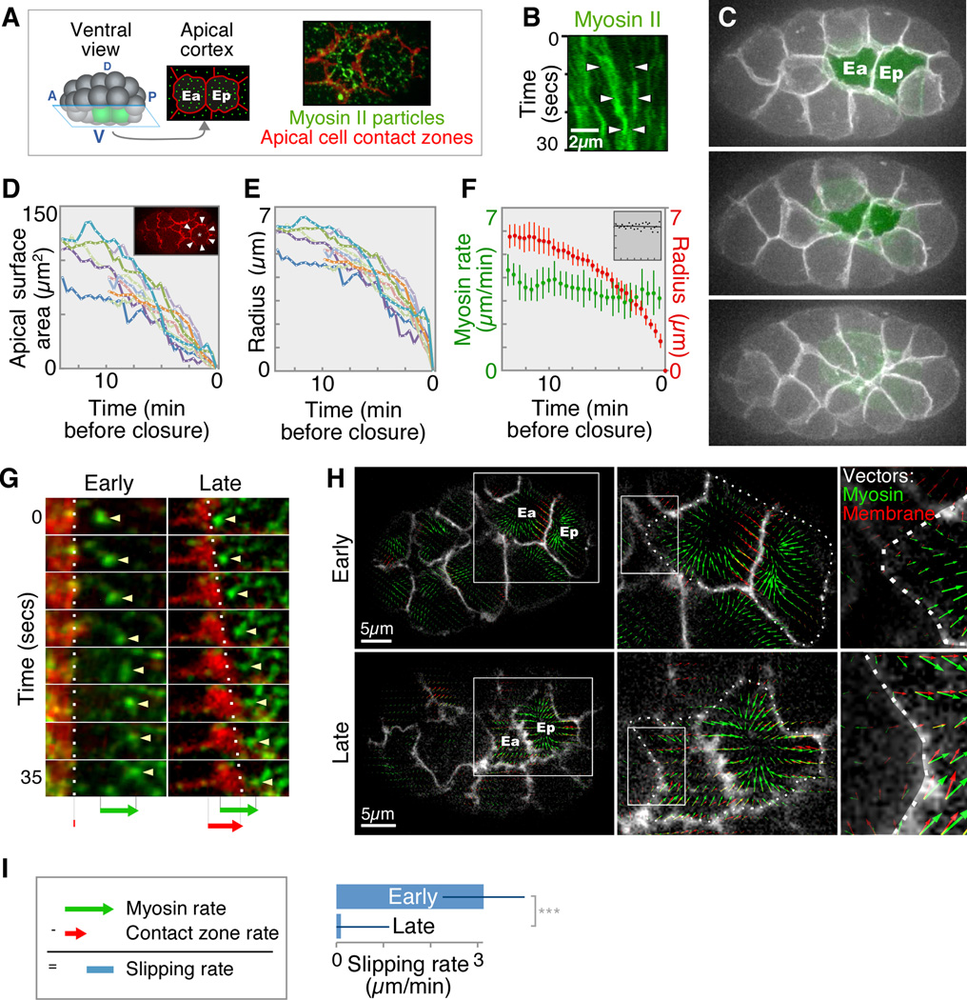

*图 2｜网络活动与边界运动的分离。引自 [Roh-Johnson 等（2012），Fig. 1](https://pmc.ncbi.nlm.nih.gov/articles/PMC3298882/#F1)。B 显示 NMY-2 聚集，C–F 将顶面面积、等效半径与 myosin 颗粒运动放在同一时间关系中；G–I 比较早晚阶段的边界与颗粒运动，并定量其相对滑移。快速收缩开始前，颗粒已经向内运动，而边界跟随的程度较小。*

图 2 中 myosin 亮点向顶面内部汇聚，而外侧轮廓的推进在早期较慢。若只比较两帧 myosin 分布，很容易把汇聚直接叫作细胞收缩；加入膜边界后，才发现网络正在相对边界移动。晚期边界更明显地跟随，说明运动之间的关系随发育改变了。

这项实验把通常混在一起的两个速度分开了：皮层网络相对细胞内部的运动速度，以及与邻居接触的边界运动速度。若前者为 $v_c$、后者为 $v_j$，可用相同的局部向心方向投影，定义

$$
v_{\rm slip}=v_c-v_j.
$$

$v_{\rm slip}$ 较大时，网络明显向内移动，边界却较少跟随；它下降时，两者的运动更同步。这个运动学指标把问题定位到了网络与边界之间：收缩活动在多大程度上转化成了顶面缩小？

例如，设某个局部区域的网络速度保持相近，而边界速度由接近零变为接近网络速度，滑移就会下降。这里发生的主要变化是传动程度。若网络和边界一起变慢，滑移也可能减小，但细胞未必更有效地收缩。因此，图中的三个速度必须一起看，单独把滑移变小当成“收缩增强”会混淆两种情况。

测量时还要先消除整个胚胎的平移和转动，再把运动投影到同一个向心方向。对形状不规则的顶面，直接使用图像的水平速度没有明确生物含义。Slabodnick 等沿局部向心向量比较 myosin 光流和膜边界运动，使来自不同位置的测量能够对应到相同的几何问题。[Slabodnick 等，2023](https://doi.org/10.1371/journal.pgen.1010319)

这项分析大致分两步。膜通道给出细胞边界，研究者或图像程序先沿着亮线画出轮廓，再比较相邻帧中轮廓移动了多少；myosin 通道中的亮点和纹理则提供网络运动的信息。所谓光流 optical flow，是根据图像纹理在相邻帧中的变化估计运动方向和速度。它并不是显微镜直接测出了一股液体流，也不意味着追踪到了每一个 myosin 分子。

最后比较的两个速度，必须来自同一片区域、同一段时间，并沿同一个方向计算。这样才能问：网络向中心移动一段距离时，边界跟进了多少。把两幅不同胚胎、不同时间的 myosin 图和膜图放在一起，看起来再相似，也不能完成这个比较。

原研究还结合局部切割，讨论快速顶面缩小前后的张力变化。提出的 molecular clutch 图像类似一个逐渐接合的离合：收缩活动早已存在，随后与边界的机械联系增强，更多运动传到细胞接触处。分子连接数、寿命和 actin 组织都可能参与这一变化。

### 1.4 Cadherin–catenin 复合体并没有随皮层一起流走 {#14-cadherincatenin-复合体并没有随皮层一起流走}

若边界没有跟随网络运动，可能的原因包括 cadherin 复合体从膜上脱离，复合体内部解耦，或复合体与 actin 之间的连接尚不充分。不同解释指向不同的分子位置，只有同时观察膜、连接蛋白和 myosin 才能定位。

Slabodnick 等通过双颜色成像发现，在早期向心收缩中，HMR-1/E-cadherin、HMP-2/β-catenin 与 HMP-1/α-catenin 仍主要跟随接触边界；myosin 颗粒则可以相对它们向内运动。这将调控位置进一步指向完整连接复合体与骨架之间的耦合。[Slabodnick 等，2023](https://doi.org/10.1371/journal.pgen.1010319)

*图 3｜连接复合体与收缩皮层的相对运动。引自 [Slabodnick 等（2023），Fig. 1](https://doi.org/10.1371/journal.pgen.1010319.g001)。A 比较 HMR-1/HMP-2 与 HMP-1/NMY-2 的定位；B 的线扫描和时间序列显示 catenin 留在顶端接触边界，而 myosin 向内移动。A 比例尺为 5 µm，B 插图为 1 µm，kymograph 相邻帧间隔 3 s。*

HMR-1 是跨膜 cadherin，参与邻细胞之间的黏附；胞内一侧的 HMP-2 与 HMP-1 将这一接触与骨架相关结构联系起来。如果黏附复合体已经解体，预期会看到其组成或位置发生明显分离。图 3 中几种连接标记主要留在边界，而 myosin 向内移动，因此解释的重点转向了复合体与动态骨架之间的联系。

图 3 的线扫描，是沿图上一条选定的线，依次记录不同位置的荧光强度；峰出现在哪里，就帮助判断标记主要聚在哪里。时空图 kymograph 则把同一条线在不同时刻的信号依次排起来：位置不变的结构会留下近似直的轨迹，持续移动的结构会留下倾斜轨迹。把两种颜色放在同一位置和时间坐标里，就能看到它们是否真的一起移动。

这个定位也改变了如何理解“连接正常”。显微镜下，一条连接可以连续、明亮，细胞之间也没有裂开，却仍没有有效跟随局部皮层流。维持接触和传递某一方向的动态负载，是同一结构的两种任务，所需的连接寿命和骨架组织未必相同。

若暂时把很多分子连接合并成一个传力关系，可以写成

$$
F_{\rm link}=\xi_{\rm link}(v_c-v_j),
\qquad
\zeta_jv_j=F_{\rm link}-F_{\rm load}.
$$

第一式说，网络比边界移动得快时，两者之间的连接会传递力；$\xi_{\rm link}$ 越大，同样的相对速度对应的传力越强。第二式把传来的力减去外部负载，再与边界运动受到的阻力相平衡。$\zeta_j$ 越大，推动边界以同样速度移动所需的力越大；$F_{\rm load}$ 则概括邻居和周围形状带来的其他负载。

这些系数合并了许多分子的作用，不是某一根连接蛋白单独的常数。这样写的目的，是让“收缩网络本身变弱”和“网络还在动，却拉不动边界”在模型里成为两种不同的改变。

Myosin 强度、网络流速和边界速度分别报告蛋白分布、骨架运动与细胞形变。同步测量它们，比单独使用 myosin 荧光更能判断内移在哪一步启动或受阻。

### 1.5 Zyxin 将谱系表达差异连接到力传递 {#15-zyxin-将谱系表达差异连接到力传递}

Slabodnick 等比较多种内移与非内移细胞的转录本，寻找内移前富集的候选因子。不同谱系共享同一种运动，提供了从表达差异寻找骨架调控分子的切入点。

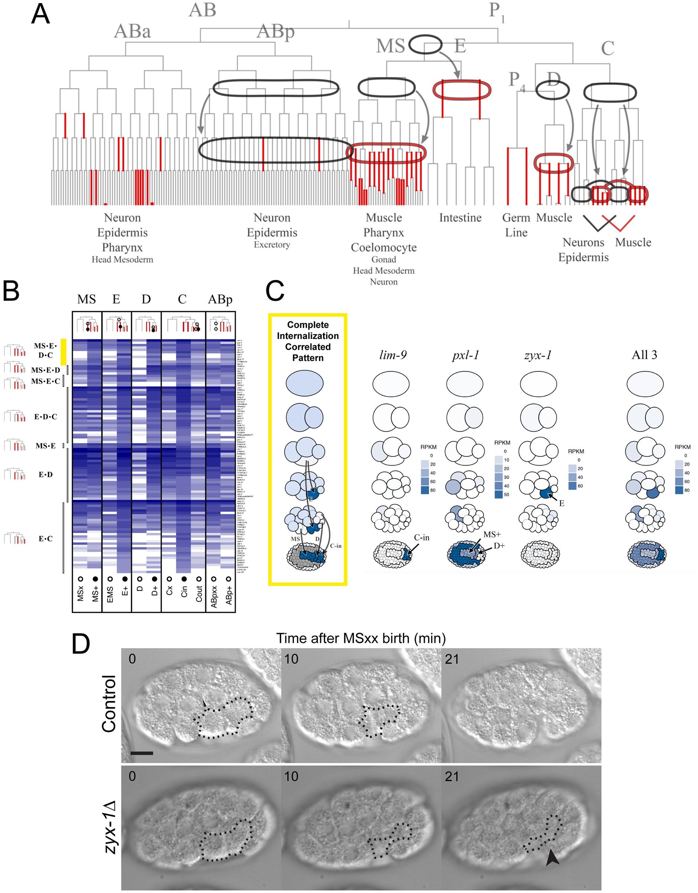

*图 4｜内移行为与基因表达的联系。引自 [Slabodnick 等（2023），Fig. 4](https://doi.org/10.1371/journal.pgen.1010319.g004)。A 标记用于比较的内移和非内移谱系；B 展示内移相关基因的表达；C 比较 LIM-domain 基因在不同细胞中的富集；D 给出 zyx-1 缺失时 Ea/Ep 表面暴露的异常。转录相关性与运动缺陷提供了互补线索，但仍需要直接的动力学测量来定位机制。*

研究者进一步检查了 AFD-1/afadin 和 ZYX-1/zyxin。它们都是候选的骨架或连接调控蛋白。去掉 zyx-1 后，myosin 仍能向内移动，却没有像正常胚胎那样，随着时间推进让边界越来越充分地跟上。缺陷因此更接近传力过程，而不是收缩网络完全停止工作。

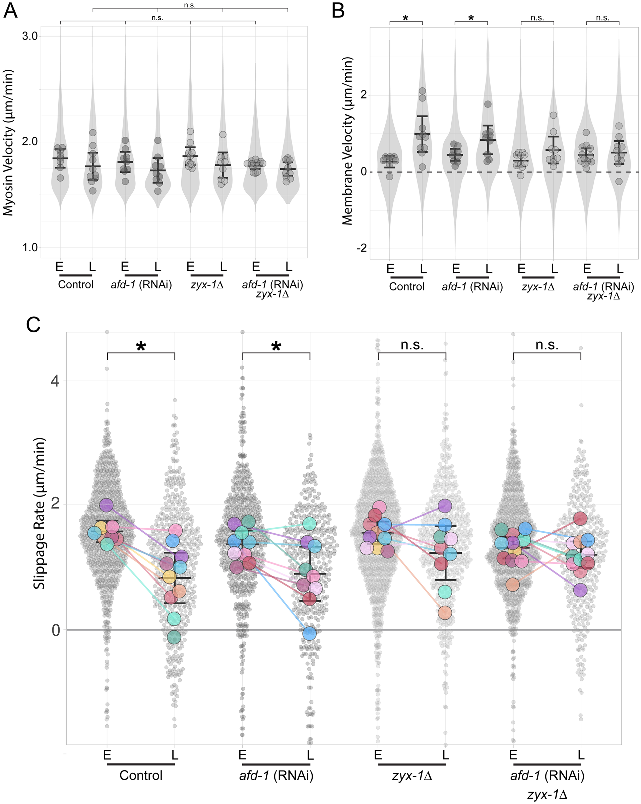

*图 5｜Zyxin 对有效耦合的贡献。引自 [Slabodnick 等（2023），Fig. 6](https://doi.org/10.1371/journal.pgen.1010319.g006)。A 比较 myosin 向心速度；B 比较膜边界向心运动；C 比较早晚阶段的相对滑移。每个胚胎或重复的均值以较大点显示，局部测量为较小点。与网络速度相比，边界跟随和滑移的变化更能定位 zyx-1 的作用。*

ZYX-1 因而可能直接或间接增强网络与连接的耦合。

为什么还要做速度测量？因为前面的筛选只能找到“可能有关”的分子。某个基因在内移细胞中表达较高，可能只是细胞身份的标记；去掉它以后内移变慢，也可能是分裂时间或邻居先出了问题。网络仍在向内动、边界却较少跟随，这组同时测量的结果，才把解释进一步缩小到网络与边界怎样传递运动。

AFD-1 扰动也影响 gastrulation，却没有像 zyx-1 缺失那样消除正常的早晚滑移差异。两种干预最后都可能留下外露细胞，动力学上却指向不同来源。同样是“没有按时进入内部”，一类缺陷发生在网络与边界的传动过程中，另一类还要从接触稳定、负载或其他细胞行为中寻找解释。

ZYX-1 如何改善耦合仍待细化。可能的过程包括 actin 修复、局部纤维稳定和连接因子的协同；局部损伤后的网络恢复与传力恢复，能够帮助区分这些解释。

### 1.6 生殖细胞的内移展示另一种动力来源 {#16-生殖细胞的内移展示另一种动力来源}

原始生殖细胞（PGCs）采用了另一种内移方式。Chihara 与 Nance 发现，它们通过 HMR-1/E-cadherin 依赖的接触，随内胚层的运动进入内部，称为 hitchhiking。[Chihara 与 Nance，2012](https://doi.org/10.1242/dev.079863)

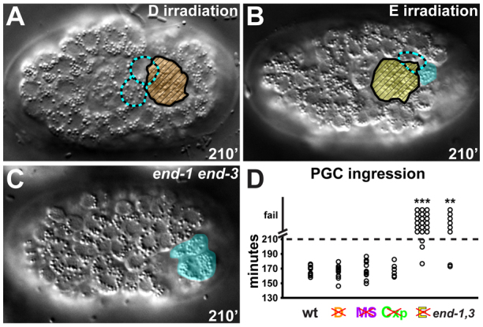

*图 6｜PGC 内移依赖其相互作用环境。引自 [Chihara 与 Nance（2012），Fig. 2](https://pmc.ncbi.nlm.nih.gov/articles/PMC3383229/#F2)。A–C 比较 D 或 E 细胞激光处理以及内胚层命运受损条件；PGCs 为青色，E 为黄色，D 为橙色。D 汇总不同干预下的内移比例。不同谱系处理的效果不相同，支持内胚层对 PGC 内移的特定贡献。*

对 E 细胞的干预比对 D 细胞的干预更明显地影响 PGC 内移，支持内胚层是其特定运动伙伴。PGCs 保持黏附，内胚层向背侧运动，两者共同构成了邻居带动内移的机制。

消融邻近的另一谱系，在这里相当于检验是否只要损伤胚胎就会妨碍内移。如果不同位置的干预效果不同，结合接触关系，便更支持特定细胞伙伴的作用。HMR-1 依赖进一步说明，空间相邻还不够，双方必须保持能够传递运动的接触。

“搭便车”也不等于生殖细胞完全没有主动调控。它仍需形成和维持合适的黏附，并在邻居重排时保留接触。这个过程只是将主要位移的动力来源放到了相互作用伙伴上。若把所有进入内部的细胞都指定为相同的自主收缩单元，就会遗漏这种组织间的分工。

Gastrulation 中，不同细胞分别提供动力、黏附和让位空间，周围细胞还会封闭内移留下的缺口。相似的内移轨迹，可以由不同的主动与被动贡献形成。

## 2. 线虫研究：细胞球模型与内移能量地形 {#worm-spheres-and-energy-landscape}

### 2.1 从细胞球模型开始 {#21-从细胞球模型开始}

内移也可以从一个更早的几何问题看起：卵壳的空间有限，细胞不断分裂，新生细胞该排在哪里？Fickentscher、Struntz 与 Weiss 将早期胚胎中的细胞近似成可相互排斥的球，把卵壳近似成椭球边界，结合实测分裂时序和方向计算细胞位置。模型较好地描述了原肠胚形成前、至约 12 细胞期的排列与轨迹。[Fickentscher 等，2013](https://doi.org/10.1016/j.bpj.2013.09.005)

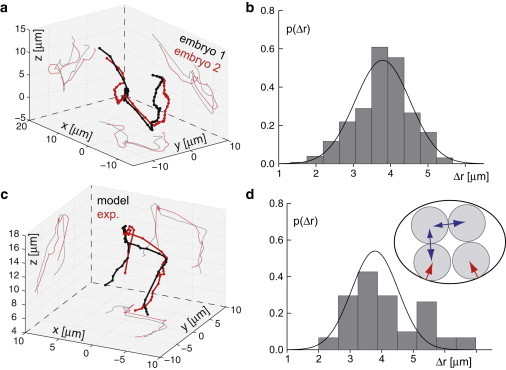

*图 7｜早期排列的力学基线。引自 [Fickentscher 等（2013），Fig. 3](https://pmc.ncbi.nlm.nih.gov/articles/PMC3797578/#fig3)。A、B 比较不同胚胎的细胞轨迹与差异分布；C、D 比较实验与模型；D 插图给出球形细胞和椭球卵壳。模型使用细胞分裂信息，图中的一致性描述的是给定这些条件后的空间排列。*

把这类模型写成一般形式，令第 $i$ 个细胞的中心为 $\mathbf r_i$、半径为 $R_i$，两细胞表面间距为 $d_{ij}=|\mathbf r_i-\mathbf r_j|-R_i-R_j$。一个排斥与黏附模型可写成

$$
U=\sum_{i\lt j}U_{ij}(d_{ij})+\sum_iU_{\rm shell}(\mathbf r_i),
\qquad
\zeta_i\dot{\mathbf r}_i=-\nabla_iU.
$$

$d_{ij}<0$ 表示两个理想化球体发生重叠，此时排斥能上升；接触附近可以加入一个浅势阱表示黏附。卵壳项在细胞接近边界时提供向内作用。右边的梯度决定受力方向，左边的阻力使细胞缓慢靠近较低能量的排列。细胞尺度上惯性通常可以忽略，受力改变后不需要先经历长时间加速。

式中的求和号 $\sum$ 表示把各对细胞的相互作用加起来；$i\lt j$ 只是为了让同一对细胞不被算两遍。$U$ 是模型给一组排列赋予的能量，$-\nabla_iU$ 表示：把第 $i$ 个细胞向哪个方向挪一点，能量会下降，以及下降得多快。阻力系数 $\zeta_i$ 再把这个受力换成移动速度。

可以把一次计算想成反复执行“算受力，再挪一点”的过程：先给定每个球的位置，算出邻居和卵壳对它的作用，让它沿受力方向移动一小步，然后重新计算。最终排列如果比较稳定，微小移动就会受到把它推回去的力。

用球表示细胞，是把每个细胞的复杂轮廓暂时省去，只保留中心和大小。两个球重叠得越多，模型就给它们越大的排斥力，用来近似真实细胞被挤压后抵抗变形的效果。这种简化适合研究整群细胞怎样排位置，但球上没有独立的顶面，也没有 actin 纤维，不能直接解释顶端收缩的细节。

在细胞数和边界固定、又没有主动输入的时间段，这个运动方程会使势能持续下降：将受力方程乘以速度并求和，可得 $\dot U=-\sum_i\zeta_i|\dot{\mathbf r}_i|^2$。耗散使系统靠近某个稳定排列。分裂则会改变球的数量、半径和相互作用网络，势能函数随之更新，接下来的松弛又从新的状态开始。

若母细胞与两个子细胞近似等体积，等大的子细胞半径约为母细胞的 $2^{-1/3}$。但两个较小球并不是一个大球的几何替身：它们增加了接触，也改变了剩余空间的形状。随着分裂推进，原先适合所有细胞贴近卵壳的排列，可能逐渐变得拥挤。

### 2.2 内移的能量地形怎样随分裂改变 {#22-内移的能量地形怎样随分裂改变}

Miao、Guan 与 Tang 的研究把内移放回持续分裂的整个细胞群中。模型沿用有吸引、排斥和卵壳约束的细胞颗粒表示，但问题从“能不能排出相似位置”转为“外层排列何时失去稳定，为什么某些细胞更容易进去”。分裂顺序、体积和卵壳几何提供输入，指定细胞的顶端 actomyosin 网络则没有被显式模拟。[Miao 等，2021，arXiv v2 预印本](https://arxiv.org/abs/2105.05795)

在这套参数下，细胞数较少时，留在外层的排列稳定；进一步分裂后，外层与内层排列可以同时稳定；细胞更多时，保留全部细胞在外层变得不稳定。作者通过在不同阶段对特定细胞施加向内驱动、随后撤去，观察系统是否返回原排列，并比较两种状态的能量。双稳态区间出现在模型的约 15–44 细胞阶段。这个范围取决于几何和相互作用参数，不能解释成所有胚胎在同一细胞数都会经历的普适阈值。

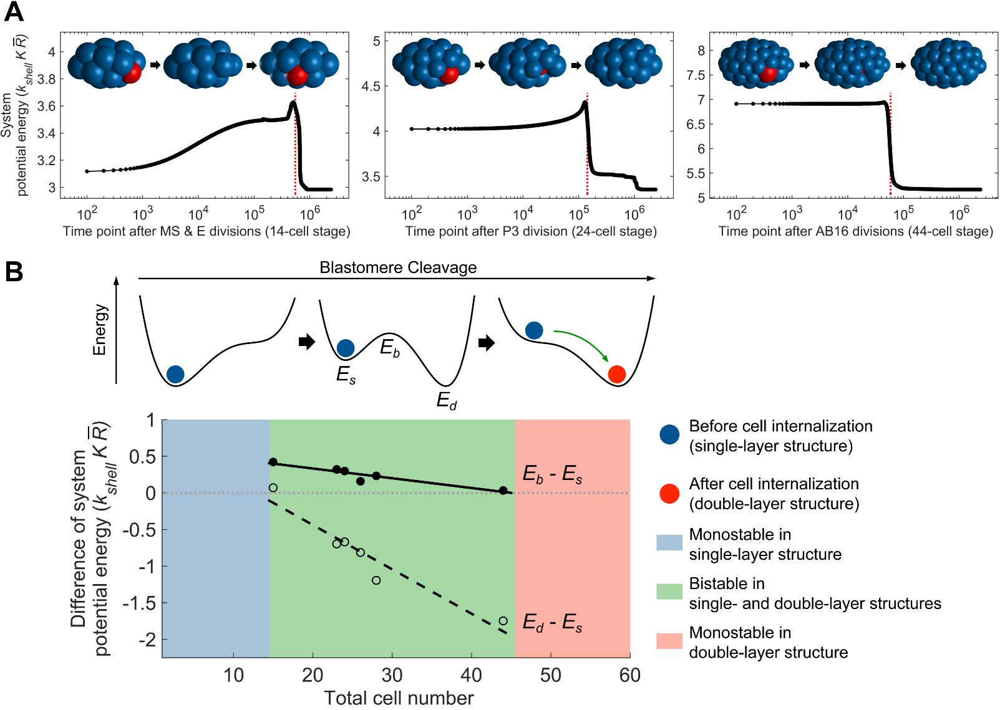

*图 8｜分裂过程中的排列稳定性与能量。引自 [Miao 等，arXiv v2，Fig. 5](https://arxiv.org/pdf/2105.05795v2)，预印本，原作者权利保留。A 中在不同阶段施加、再撤去局部向内驱动，比较细胞是否回到表面；B 示意两种排列及其间障碍，C 比较作者计算路径上的状态能量与能垒。模拟时间和能量采用原文单位，不是直接测得的 Ea/Ep 收缩力。*

这个计算区分了三个经常被混在一起的问题。内层状态能量更低，表示进去以后更容易维持；表面状态仍然稳定，表示小扰动不足以让它离开；两个状态之间还有障碍，则表示需要额外活动或足够大的波动来启动转换。因而，“内移在力学上有利”与“此时一定发生内移”是不同判断。

形成这种变化的机制也可以沿细胞接触理解。分裂使细胞数增加、单个细胞变小，外层细胞受到越来越强的侧向挤压。某个细胞向内偏移后，接触力的合成方向随几何改变；进入内部又给外层邻居留下调整空间，降低整体接触代价。这解释了为什么模型即使没有给每颗细胞规定复杂的定向活动，也能出现层数变化。

这种状态转换可以沿一个内移坐标 $q$ 来分析：将目标细胞固定在给定深度，让其余细胞松弛，再计算整个细胞群的能量，便得到 $U_{\rm eff}(q)$。表面与内部的稳定排列对应两个低谷，中间的高处是沿这条路径的能垒。它由选定的坐标与松弛条件定义，未必等于完整三维系统中的最低跨越能垒。

内侧低谷更低时，表面排列仍可能被能垒困住。局部收缩既可能提供跨越所需的功，也可能通过改变接触而降低能垒；这把周围几何与细胞的主动调控接到了同一个力学问题上。

主动收缩可以改变这个能量地形。最简单地，若收缩沿内移坐标提供有效力 $F_a$，可写

$$
U_{\rm eff}^{\rm active}(q)=U_{\rm eff}(q)-F_aq.
$$

$-F_aq$ 使能量曲线向内侧倾斜，降低向内跨越的难度。这个一维表达只概括了沿指定路径的做功；真实的 actomyosin 同时改变顶面、邻接与三维细胞形状，未必能用一个恒定 $F_a$ 表示。

模型进一步改变细胞大小与卵壳局部曲率。较大的细胞、处在较平缓边界附近的细胞更容易内移，这为 Ea/Ep 的较长细胞周期和较大体积提供了一种机械解释。不过，模型中的相互作用被简化为统一、各向同性的形式；它不能由此取代对 Ea/Ep 命运、MRCK-1、顶端收缩和连接耦合的研究。

加入运动噪声后，模型仍容易出现内移，但最先进入内部的细胞身份和事件发生时的细胞数变得不稳定。对 E 谱系施加局部向内活动，可以提高身份与时序的重复性。在几何已经允许内移的阶段，主动调控由此承担了选择细胞、稳定路径的作用。

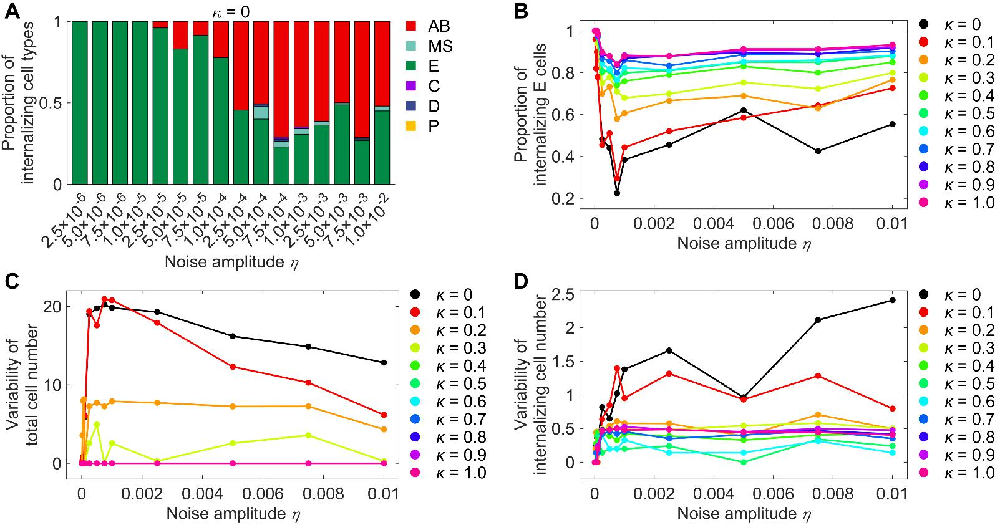

*图 9｜噪声与主动驱动对内移选择性的影响。引自 [Miao 等，arXiv v2，Fig. 8](https://arxiv.org/pdf/2105.05795v2)，预印本，原作者权利保留。不同噪声和局部驱动条件下，比较先内移的谱系及事件的变异。驱动是模型输入，图中并未直接计算某个基因怎样产生该力。*

接触势能会随排列松弛降低，但分裂、黏附更新和骨架重塑持续改变系统的几何与参数。这条机械稳定性路线因此随发育演变。

几何与主动活动可以联合检验：在顶端收缩和连接状态相近时，改变细胞大小或卵壳几何，比较内移的选择性、延迟与失败方式。这样可以分辨受限排列对局部收缩提出了怎样的负载要求。

## 3. 线虫研究：相场模型与胚胎重排 {#worm-phase-field-rearrangement}

### 3.1 相场模型怎样让界面自己移动 {#25-相场模型怎样让界面自己移动}

相场方法不显式追踪每个表面顶点，而给第 $i$ 个细胞一个连续场 $\phi_i(\mathbf x,t)$：细胞内部接近 1，外部接近 0，中间是一层窄过渡带。Kuang 等将相场与实测分裂信息结合，重建了线虫早期细胞形状和接触；后续 MorphoSim 工作进一步改善了计算规模与效率。这两项工作主要研究早期胚胎的排列与细胞形状。[Kuang 等，2022](https://doi.org/10.1371/journal.pcbi.1009755)；[Kuang 等，2023](https://doi.org/10.1038/s41540-023-00265-w)

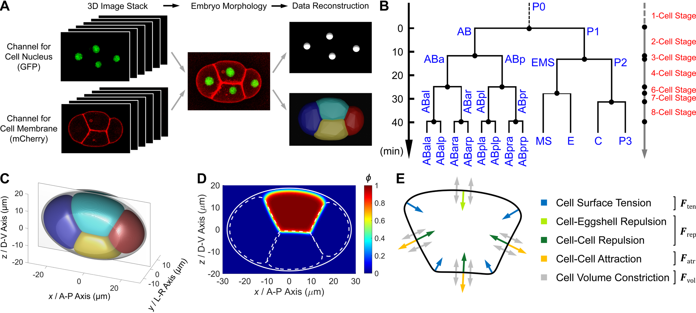

*图 10｜早期胚胎的成像与相场表示。引自 [Kuang 等（2022），Fig. 1](https://journals.plos.org/ploscompbiol/article?id=10.1371/journal.pcbi.1009755#pcbi-1009755-g001)，CC BY 4.0。A、B 给出成像与分裂信息，C、D 展示卵壳、细胞场及截面；早期阶段用于建立和检验模型。*

Kuang 等的三维相场计算使用实测分裂方向、体积分配和接触吸引，同时比较质心、细胞轮廓与接触图。部分早期排列只在有限时间内保持；若延长某一阶段，细胞群会继续松弛，进入另一种接触拓扑。[Kuang 等，2022](https://doi.org/10.1371/journal.pcbi.1009755)

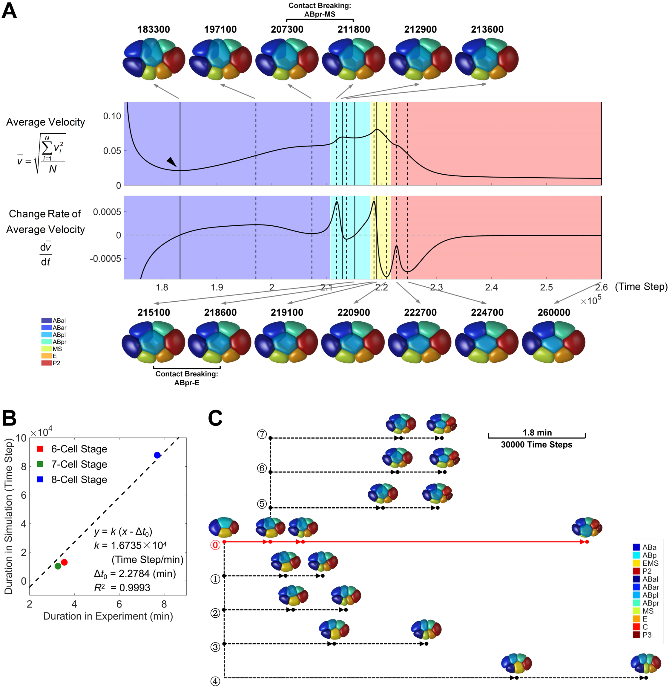

*图 11｜分裂时序与接触拓扑。引自 [Kuang 等（2022），Fig. 4](https://journals.plos.org/ploscompbiol/article?id=10.1371/journal.pcbi.1009755#pcbi-1009755-g004)，CC BY 4.0。A 显示七细胞阶段在长时间松弛中经历不同接触关系；B 标定实验与模拟时标，C 比较不同分裂时刻的演化路径。*

这里存在分裂与松弛的时间竞争：细胞群尚未走到另一种排列，下一次分裂就已经改变了几何和受力。延长细胞周期因而能检验一种排列究竟是平衡态，还是被发育时序保留下来的暂态。

颗粒模型便于扫描细胞数、噪声和壳形，寻找层数转换的规律；相场模型则能比较形状与接触面积，分辨质心接近而邻居关系错误的排列。相场能量通常包含界面、体积、接触和卵壳几类作用：

$$
\begin{aligned}
E_\phi={}&\sum_i\Gamma_i\int
\left[\frac{\epsilon}{2}|\nabla\phi_i|^2+
\frac{\phi_i^2(1-\phi_i)^2}{\epsilon}\right]\,\mathrm dV\\
&+\sum_i\frac{K_V}{2}\left(\int\phi_i\,\mathrm dV-V_i^0\right)^2
+E_{\rm contact}+E_{\rm shell},\\
\partial_t\phi_i={}&-M_i\frac{\delta E_\phi}{\delta\phi_i}.
\end{aligned}
$$

梯度项和双阱项共同形成具有有限厚度的界面；$\epsilon$ 控制过渡层宽度，$\Gamma_i$ 控制表面代价的尺度。体积项约束 $\int\phi_i\,\mathrm dV$，接触项再加入排斥与黏附。这里的梯度下降并不严格守恒体积，有限的 $K_V$ 允许小偏差；若需要严格守恒，就要加入相应约束。

相场能自动处理界面的接近与分离，模拟轮廓也可直接与三维分割比较。要模拟 Ea/Ep 内移，还需在这些几何与被动作用之外，指定顶端活动、黏附和皮层动力学。

相场的界面厚度 $\epsilon$ 还引入了数值尺度。保持细胞尺寸不变、逐步缩小 $\epsilon$ 并加密网格，可以检查内移时间和接触角是否趋于稳定，分开数值界面与生物参数的影响。

### 3.2 局部收缩怎样带来全胚胎重排 {#26-局部收缩怎样带来全胚胎重排}

Thiels 等在 2026 年的一项预印本中，将三维分割与力学模拟结合，直接研究 Ea/Ep 在完整胚胎中的内移。其分析把顶端收缩、接触环处的摩擦传力、同期细胞分裂，以及全胚胎细胞运动放在一起；模拟提示，邻近细胞的分裂和分裂方向会影响内移。作者还提出，局部产力可通过内部压力变化伴随更广泛的组织流动。这是一项尚待同行评议的整合研究。[Thiels 等，2026，v1](https://doi.org/10.64898/2026.03.30.715391)

Ea/Ep 内移排开的体积，需要由邻居位移和全胚胎形变来容纳。分裂时序会改变让位路径，因此即使局部收缩相同，轨迹仍可能不同。完整胚胎模型由此把固定背景改成了会分裂、会产力的周围细胞群。

## 4. 线虫研究：皮层中的 RhoA 脉冲 {#线虫皮层中的-rhoa-脉冲模型}

Staddon 等针对线虫胚胎皮层的脉冲建立了生化与力学耦合模型。以 $r$ 表示活性 RhoA、$m$ 表示 actomyosin，反应项为

$$
R_r=S+a\frac{r}{r_a+r}-g\frac{mr}{r_g+r},
\qquad
R_m=S_m+k_ar^2-k_dm.
$$

$S,S_m$ 是基础输入，$a$ 控制正反馈，$g$ 控制 actomyosin 对 RhoA 的抑制，$k_a,k_d$ 控制骨架组装和消失。RhoA 先升高、骨架随后增加，后者再压低 RhoA，形成延迟负反馈。机械部分使用局部应变 $u$，并让收缩改变两种组分的浓度：

$$
\eta_L\dot u+Eu=-\sigma_a\frac{m}{m_0+m},
\qquad
\dot r=R_r-\frac{r\dot u}{1+u},
\qquad
\dot m=R_m-\frac{m\dot u}{1+u}.
$$

收缩时 $\dot u<0$，后两式的几何项提高局部浓度，从而把力学反馈回反应动力学。这个项可以直接由组分数量 $N=c(1+u)$ 的收支展开得到：反应之外，区域缩短也会提高浓度。因此，荧光浓度增加可以同时来自组装和几何压缩，模型必须同时计算二者。公式沿用原研究的局部应变约定，要求 $1+u>0$。[Staddon 等，2022，Eqs. 1–5](https://journals.plos.org/ploscompbiol/article?id=10.1371/journal.pcbi.1009981)

求解时先找 $(\dot r,\dot m,\dot u)=0$ 的固定点，再考察三变量扰动的增长率。所有特征值实部为负时，小扰动会衰减；含复数的模态可表现为衰减振荡。固定点失稳后是否出现稳定极限环，还要看非线性动力学，不能仅凭一次轨迹绕行就判断。

图 12 的相图正用于区分一次刺激后的可兴奋响应、持续脉冲和较稳定的收缩状态。它补上了恒定摩擦模型无法回答的问题：脉冲可以由调控网络自身产生，而不是每次都由外部人为指定。要把这套机制用于 Ea/Ep，还需检验相应调控、机械反馈和参数范围。

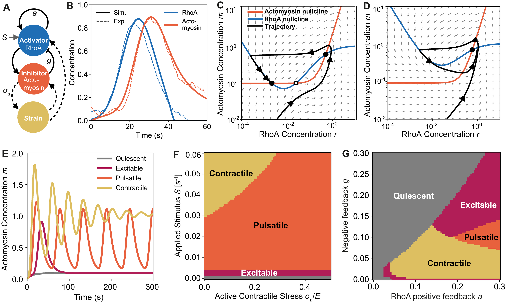

*图 12｜生化反馈和机械反馈的组合。引自 [Staddon 等（2022），Fig. 1](https://journals.plos.org/ploscompbiol/article?id=10.1371/journal.pcbi.1009981#pcbi-1009981-g001)，CC BY 4.0。A 为反馈结构，B 比较一次脉冲的观测与拟合，C、D 为相平面，E–G 展示参数变化后的动态状态。该图讨论皮层动力学，不是 Ea/Ep 内移完成时间的相图。*

## 5. 理论借鉴：三维表面与细胞形状 {#三维表面与细胞形状}

神经元的 motor–clutch 和一般表面、主动凝胶理论，能补充连接寿命与收缩结构的动力学。这里的有效方程与算例用于比较机制，具体参数仍需由相应线虫阶段约束。

### 5.1 从细胞中心到完整轮廓 {#23-从细胞中心到完整轮廓}

球模型保留了位置和大小，却把顶面、侧面以及接触面积都压缩进一条距离关系。若要问“顶面缩小后，细胞为何向内移动”，细胞本身的形状就不能省掉。常用的另一条路线，是把细胞看成近似保持体积、表面具有张力的三维物体。一个简化能量是

$$
E=\sum_i\frac{K_V}{2}(V_i-V_i^0)^2
+\sum_i\gamma_i^{\rm ap}A_i^{\rm ap}
+\sum_{\langle ij\rangle}\gamma_{ij}A_{ij}
+E_{\rm shell}.
$$

第一项限制体积，第二项区分外露顶面，第三项计算细胞间界面，最后一项限制卵壳穿透。$\gamma_{ij}$ 是界面的有效张力，包含两侧皮层收缩和黏附的共同贡献。增强黏附通常降低接触界面的代价，但从一个拟合出的 $\gamma_{ij}$，还不能分别确定黏附强度和皮层张力。

提高 $\gamma^{\rm ap}$ 后，系统倾向于减少顶面面积；体积不能同时消失，于是细胞需要增高、扩大其他界面，或者推动邻居让出空间。哪条路径更容易，取决于邻居刚度、接触几何和内部空间。这个模型因此把“顶端收缩”和“内移”分成两个相连的问题：前者改变哪片表面受力，后者是整个三维细胞群共同松弛的结果。

最简圆柱近似中，$V=Ah$，因此固定体积下 $\mathrm d\ln h=-\mathrm d\ln A$。但真实内移细胞更接近上下截面不同的形状，不能把这个关系直接当成 Ea/Ep 的定量定律。它只说明，顶面面积减小必须伴随其他几何变化。实验若同时给出顶面、基底面、细胞高度和质心深度，就能判断模型是否只是把细胞拉高，而没有真正把它送入内部。

### 5.2 三维顶点模型和 active bubble 怎样表示表面 {#24-三维顶点模型和-active-bubble-怎样表示表面}

三维顶点或表面网格模型，把上述细胞界面拆成多边形或三角形，求每个顶点的受力，再更新网格。一个常用的过阻尼形式是 $\zeta_\alpha\dot{\mathbf x}_\alpha=-\partial E/\partial\mathbf x_\alpha$。相比球模型，它能记录顶面收缩、接触角和细胞侧面变形；代价是需要维护三维网格，并处理界面消失、新接触形成和网格质量。

Active bubble 则把细胞理解为内部近似流体、外面具有主动皮层的可变形物体。局部法向平衡的被动基线是 Young–Laplace 关系 $\Delta p=2\gamma H$，其中 $H$ 是平均曲率，球面上 $H=1/R$。张力均匀时，曲率和内外压差相互限制；张力不均匀时，还会出现沿表面的牵引和流动。它适合讨论“压力、表面张力和接触共同决定细胞形状”，但若皮层具有明显的方向性骨架或较长弹性记忆，就需要扩展材料关系。

三维顶点模型是一种几何表示，active bubble 更接近一种物理描述。二者可以结合，不能把它们当成互不相容的两个机制。反过来，同一种表面张力假设也可以通过不同算法实现。比较文献时，应分别看清作者怎样表示细胞、怎样规定受力，以及怎样更新连接。

## 6. 理论借鉴：Molecular clutch 与边界传力 {#3-molecular-clutch-与边界传力}

Motor–clutch 的经典数值工作还解释了有效摩擦模型省掉的动力学。Chan 与 Odde 显式记录随机结合、受力和断开的连接，使 actin 逆向流、基底形变与连接承载互相耦合。在其参数与基底范围内，较硬底物出现较快滑移和较低牵引；较软底物可出现缓慢加载后集体失效的循环，作者在鸡胚前脑神经元的 filopodia 中检验了这些预测。[Chan 与 Odde，2008](https://doi.org/10.1126/science.1163595)

加载速度与连接寿命的竞争，使牵引对底物刚度的依赖可以出现不同分支。Ea/Ep 的连接对象是会运动、会变形的邻细胞，网络与连接蛋白之间还存在滑移。神经元模型提供了可比较的动力学，但其底物参数与连接规则仍需在线虫中重新约束。将许多随机连接平均后，可先得到下面的有效力–速度关系。

### 6.1 为什么连接增强会同时改变两个速度 {#31-为什么连接增强会同时改变两个速度}

前面的成像已经给出了两个速度：皮层网络的向心速度 $v_c$ 和边界的向心速度 $v_j$。先考虑一小段边界，忽略其短时弹性恢复，把周围组织的阻力写成 $\zeta v_j$。网络通过有效耦合系数 $\xi$ 拉动边界：

$$
F=\xi(v_c-v_j),
\qquad
\zeta v_j=F.
$$

若网络速度被固定为 $v_0$，解就是 $v_j=v_0\xi/(\xi+\zeta)$。耦合很弱时，网络大部分运动成为相对滑移；耦合很强时，边界能更充分地跟随。这一步已经说明，同样快的皮层流可以对应很不同的顶面缩小速度。

例如 $\xi=\zeta$ 时，边界速度是网络速度的一半；$\xi=9\zeta$ 时，边界能达到网络速度的九成。在这个例子里没有增加网络的给定速度，只是加强了它与边界之间的传力。这就是 molecular clutch 这个比喻要表达的意思：离合接合程度改变以后，已经存在的运动能有不同程度传到负载上。具体是哪类分子连接、是否遵守这条线性关系，还要根据相应实验判断。

不过，马达遇到负载后也会变慢。用线性的力—速度关系近似这一效应：

$$
v_c=v_0\left(1-\frac{F}{F_s}\right).
$$

$v_0$ 是无负载速度，$F_s$ 是使这一段网络停止向内运动的有效停滞力。联立时，先把网络速度写为 $v_c=F/\xi+F/\zeta$：其中一部分运动成为滑移，另一部分成为边界位移。再令它等于马达的力—速度表达，就得到 $v_0=F(\xi^{-1}+\zeta^{-1}+v_0/F_s)$。再解出力、边界速度和滑移速度：

$$
F=\frac{v_0}{\xi^{-1}+\zeta^{-1}+v_0/F_s},
\qquad
v_j=\frac F\zeta,
\qquad
v_{\rm slip}=\frac F\xi.
$$

现在，耦合增强会让边界变快，也会因为负载增加使网络本身变慢。若只记录网络速度，可能把后一种变化误读为收缩装置功能减弱。同步记录两种速度，就能判断较慢的网络是否实际上带动了更快的边界。

两个极限使这个解更容易理解。$\xi$ 很小时，网络几乎拉不动边界，$F$ 近似与 $\xi$ 成正比；增大连接会明显改善传力。$\xi$ 很大时，相对滑移已经很小，继续增加连接的收益便逐渐饱和，速度转而受马达和周围阻力限制。图 13A 中边界曲线的上升和平台，正来自这两个区间。

这个短时模型把邻居近似成阻尼。如果邻居还像弹簧一样被逐渐拉伸，负载就会随边界位移增加。此时即便耦合保持稳定，边界也可能先快后慢。因此，发育中的面积曲线同时包含连接建立、负载累积和网络活动变化；模型的作用是给这些变化各留出一个能被实验区分的位置。

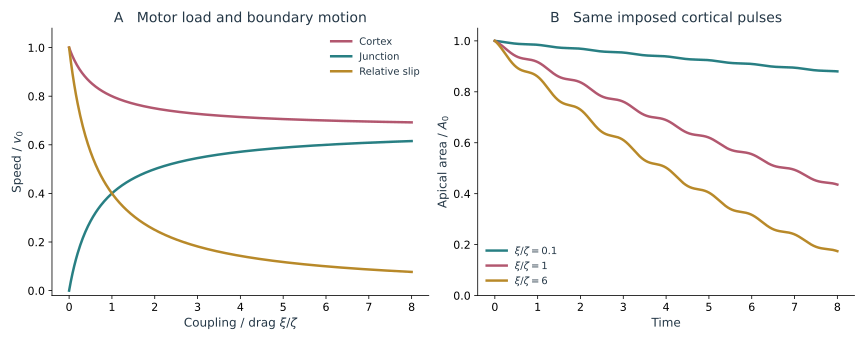

*图 13｜收缩活动怎样转化为边界运动。A 为上述力—速度模型的解析解，取 $\zeta v_0/F_s=0.5$；横轴为耦合与外部阻力之比。B 在相同的网络脉冲速度下比较不同耦合造成的顶面面积变化，取圆形顶面、$\dot r=-\xi v_c/(\xi+\zeta)$，时间和半径均已无量纲化。两组曲线对应固定负载关系与外加速度两种不同近似。*

### 6.2 从连接数到发育时间 {#32-从连接数到发育时间}

有效耦合随时间增强，可以来自更多承载连接形成。令 $n$ 为处于有效连接状态的比例，取

$$
\dot n=k_{\rm on}(1-n)-k_{\rm off}n,
\qquad
\xi=\xi_{\max}n.
$$

当两个速率近似恒定时，$n$ 以时间常数 $(k_{\rm on}+k_{\rm off})^{-1}$ 靠近平衡值 $n_*=k_{\rm on}/(k_{\rm on}+k_{\rm off})$。收缩装置可以始终存在，但顶面要等到足够连接建立后才明显缩小。这给“皮层先流动，边界后跟随”提供了一个很直接的动力学解释。

平衡比例由两个速率的比值决定，接近平衡的快慢则由它们的和决定。若结合与解离同时加快相同倍数，最后的有效连接比例可以不变，建立或恢复的速度却会变快。只比较晚期连接强度，会看不到这类差异；急性扰动后的恢复过程则能把它显示出来。

在最简单的恒定速率模型中，连接是平滑建立的。若顶面在实验中突然开始快速缩小，可能还涉及负载依赖、合作装配或其他阈值过程。它们值得加入模型的原因，应当是观察到了这个平滑模型解释不了的时间变化，而不是因为更复杂的方程本身更接近真实。

$n$ 在这里是许多分子过程的合并变量，包括连接装配、actin 修复和骨架重新组织。ZYX-1 的实验结果支持有效耦合参与调控，尚不能在 $k_{\rm on}$、$k_{\rm off}$ 或 $\xi_{\max}$ 中唯一指定它改变哪一个。若在急性扰动后同时测连接恢复时间与滑移恢复时间，就能进一步约束这些可能性。

模型还预测：改变邻居的阻力 $\zeta$，即使 Ea/Ep 内部的马达与连接都没有变，边界速度也会改变。细胞内移的快慢因而同时反映本细胞的活动与它所处的力学环境。

### 6.3 连接有弹性和寿命后会发生什么 {#33-连接有弹性和寿命后会发生什么}

前面的 $\xi$ 把连接近似成瞬时摩擦，承载力只取决于当前滑移速度。真实连接还会先被拉伸，再断开和重建。若短时间内有 $Nn$ 条连接保持承载、每条刚度为 $k_b$，总连接刚度为 $K_c=Nnk_b$，可写

$$
\dot F=K_c(v_c-v_j),\qquad
\zeta\dot x+K_ex=F,\qquad
v_j=\dot x,\qquad
v_c=v_0(1-F/F_s).
$$

这里的 $x$ 是边界向内位移，$K_e$ 是邻居的弹性负载。网络与边界速度不同，会逐渐拉伸连接，因此力不会在速度改变的同一瞬间完成调整。连接比例固定时，这是一个可直接积分的加载模型；若 $n$ 随时间变，上式还不足以描述新旧连接各自的伸长，需要记录连接年龄或伸长分布。

这类 motor–clutch 模型在细胞与基底黏附中已有系统研究，能出现加载、断裂和重新承载等动力学。把它用于 Ea/Ep 时，连接的另一端变成细胞连接和邻近组织，参数与边界条件需要重新确定。[Chan 与 Odde，2008](https://doi.org/10.1126/science.1163595)

一个重要后果是，连接数量增加不一定使传力一直增强。以均匀分担固定总拉力的示范模型为例，每条连接承受 $f=F/(Nn)$。若采用随拉力加快解离的 slip-bond 规则 $k_{\rm off}=k_0e^{f/f_d}$，令 $\theta=k_0t$、$\alpha=F/(Nf_d)$、$r=k_{\rm on}/k_0$，便得到

$$
\frac{\mathrm dn}{\mathrm d\theta}
=r(1-n)-n e^{\alpha/n},
\qquad
\alpha=n\ln\frac{r(1-n)}n.
$$

第二式是稳态关系。少量连接断开后，其余连接分到更大负载，解离又加快，可能形成失效反馈。$\alpha(n)$ 的最大值给出这套固定负载、均匀分担近似的承载上限；超过它后，正的稳态连接比例消失。模型本身也在 $n\to0$ 附近失去连续平均的意义，此时应采用有限连接数的随机模型。

这与前面恒定 $\xi$ 模型的饱和平台不同：后者预测传力渐渐达到上限，这里还允许突然丧失承载。若实验看到面积收缩突然中断、边界回弹，而皮层仍在流动，就有理由检查连接失效。若卸载后能逐步恢复，则恢复时间又约束重新结合速率。不过，是否存在 slip bond、catch bond 或其他修复过程，必须由对应连接的实验决定；不能仅凭一次回弹就指定分子解离形式。

## 7. 理论借鉴：收缩结构与主动凝胶 {#收缩结构与主动凝胶}

### 7.1 边缘拉索与顶面网络是不同的受力结构 {#41-边缘拉索与顶面网络是不同的受力结构}

顶端收缩本身也有不同的结构模型。Purse-string 模型把收缩集中在顶面边缘，像一圈收缩拉索；medioapical 模型把产力网络放在顶面内部，再通过连接把力传到边缘。内部网络还可以具有径向极性、近似肌节排列或混合极性。它们都可能减少顶面面积，却对蛋白定位、网络流速和切割响应提出不同要求。

对圆形顶面作一个几何比较：若边缘线能为 $E_{\rm ring}=2\pi\Lambda r$，向内广义力大小为 $2\pi\Lambda$；若顶面具有均匀面张力、能量为 $E_{\rm sheet}=\pi Tr^2$，对应大小为 $2\pi Tr$。$\Lambda$ 的单位是力，$T$ 的单位是力除以长度。即使都近似保持恒定，两种驱动随半径变化的方式也不同。这里把张力当成给定参数，未包含马达加载和骨架更新，实际面积曲线还要与阻力一起求解。

因此，不能从面积缩小就确定网络一定在边缘，也不能从中心较亮就确定存在径向肌节。需要同时比较空间定位、actin 极性、流速场，以及边缘和内部切割的差别。Ea/Ep 的混合极性网络使“把果蝇中心收缩结构原样移植过来”尤其需要谨慎。

### 7.2 流动与组分运输怎样形成力学反馈 {#42-流动与组分运输怎样形成力学反馈}

Clutch 模型把 $v_c$ 当作输入，主动皮层模型则继续追问：为什么这片网络会流动，为什么会出现局部收缩或脉冲？这是不同层次的问题，可以与连接模型耦合，而不是彼此替代。

先取一维、黏性、短时线性近似。令 $\rho$ 表示产生收缩应力的有效组分，$v$ 是皮层速度，$\xi_c$ 是皮层相对周围结构的摩擦，$\eta_c$ 是皮层黏性。采用拉应力为正的约定，可写

$$
\xi_cv=\partial_x\sigma,\qquad
\sigma=\eta_c\partial_xv+\chi\rho,\qquad
\partial_t\rho+\partial_x(\rho v)
=D\partial_x^2\rho+\frac{\rho_0-\rho}{\tau}.
$$

$\chi\rho$ 是主动收缩应力。局部组分较多，张力梯度就能吸引周围网络流入；流入又提高局部浓度。扩散和周转抵消这种聚集。Staddon、Munro 与 Banerjee 将主动凝胶力学与 RhoA 的可兴奋调控耦合，研究线虫胚胎皮层中的脉冲和图样；其模型包含更完整的化学反馈与黏弹性。这里保留最少变量，只分析流动造成的反馈。[Staddon 等，2022](https://doi.org/10.1371/journal.pcbi.1009981)

在均匀态 $\rho=\rho_0,v=0$ 附近，代入小扰动 $\delta\rho\propto e^{st+ikx}$。力平衡先给出 $v=ik\chi\delta\rho/(\xi_c+\eta_ck^2)$，再代回浓度方程，得到增长率

$$
s(k)=\frac{\rho_0\chi k^2}{\xi_c+\eta_ck^2}
-Dk^2-\frac1\tau.
$$

$s(k)>0$ 表示相应波长的微小不均匀会被放大。第一项来自收缩流聚集，后两项来自扩散和更新。长波受到周转抑制，短波受到扩散抑制，某些参数下中间波长最容易增长。由 $\ell=\sqrt{\eta_c/\xi_c}$ 可以读出黏性传力与摩擦之间的空间尺度。

这条色散关系能回答“网络是否会自发聚集”，却不能单独产生稳定重复的脉冲。要让一次收缩终止并在之后重新开始，还需要延迟负反馈、组分耗尽或其他恢复过程。把一次明暗波动、持续聚集和周期振荡分别检验，比给所有动态都加上“主动凝胶”标签更具体。

Ea/Ep 的骨架结构也约束模型。Zhang 等发现，收缩顶面的 actin 并不呈简单的径向极性排列，myosin 也并非只集中在中心。因此，不能把果蝇腹沟中的中心收缩结构直接搬来。混合极性的网络仍可产生有效收缩应力，但从分子排列到 $\chi\rho$ 的关系需要独立判断。[Zhang 等，2023](https://doi.org/10.1083/jcb.202302102)

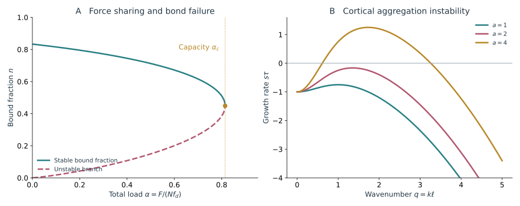

*图 14｜连接失效与皮层聚集的阈值。A 为固定总负载下的连接稳态，取 $r=5$，实线和虚线分别表示稳定与不稳定分支。B 为主动皮层的增长率，采用 $q=k\ell$、$s\tau=a q^2/(1+q^2)-dq^2-1$，取 $d=0.25$，改变 $a=\rho_0\chi\tau/\eta_c$。前者是连接失效，后者是网络聚集；两图均为上文简化模型的计算，未拟合 Ea/Ep 数据。*

## 8. 理论借鉴：怎样比较这些内移模型 {#5-怎样比较这些内移模型}

| 模型路线 | 主要变量与问题 | 关键实验约束 | 当前使用范围 |
| --- | --- | --- | --- |
| 细胞球与拥挤 | 中心、大小、相互作用；何时出现内部空间和稳定排列 | 分裂方向、细胞大小、质心轨迹、卵壳几何 | 已有线虫排列及 gastrulation 理论工作 |
| 三维表面张力与 active bubble | 细胞轮廓、界面张力和压力；顶端收缩怎样改变整颗细胞 | 接触角、顶底面积、体积、三维内移深度 | 一般力学框架；具体模型需核对主动作用与适用阶段 |
| 三维顶点或表面网格 | 界面顶点及拓扑；形变怎样带来接触更新 | 三维分割、界面消失次序、邻居响应 | 可作为三维内移的计算表示，需明确重排规则 |
| 相场 | 连续细胞场；形状、接触和分裂如何共同演化 | 完整轮廓、接触面积、界面厚度收敛 | 已有线虫早期胚胎工作，不能自动外推为 Ea/Ep 机制 |
| 完整胚胎整合模型 | 局部收缩、分裂和压力如何共同产生全局运动 | 三维细胞群轨迹、分裂时序与邻居位移 | 已有 2026 年预印本，结果仍需进一步检验 |
| 有效摩擦与 motor–clutch | 皮层速度、边界速度、连接状态；已有收缩怎样传到边界 | 双通道速度、急性卸载、回弹和恢复 | Ea/Ep 有直接耦合证据；具体连接动力学仍需检验 |
| 边缘拉索与顶面网络 | 收缩应力的位置和骨架极性；同样缩面积是否来自同样结构 | 边缘与内部定位、actin 极性、局部切割 | Ea/Ep 已有网络结构实验，需按其混合极性解释 |
| 主动凝胶与化学反馈 | 活性组分、流速、应力；收缩图样和脉冲怎样产生 | 浓度与速度的空间关系、脉冲相位、切割传播长度 | 已有线虫皮层理论；Ea/Ep 的调控与结构需要另行约束 |

这些路线常常需要组合。球模型可以先给出 Ea/Ep 周围的负载环境，三维表面模型计算顶面收缩后的形状，主动皮层计算网络流，clutch 再决定流动有多少传给边界。一套完整模型必须让这些变量互相影响：边界移动会改变皮层负载，负载又会改变马达速度和连接寿命。

比较模型时，最有区分力的往往是它们预测不同的那一段过程。例如，位置曲线相近但顶底面积不同，说明细胞形状表示还不够；皮层速度相近而边界速度不同，更指向传力；活动图样先改变、边界随后响应，则需要检查皮层调控。只有最后的内移时间相同，还不足以说明两种模型解释了同一机制。

## 参考文献 {#references}

1. Goldstein B, Nance J (2020). [Caenorhabditis elegans Gastrulation: A Model for Understanding How Cells Polarize, Change Shape, and Journey Toward the Center of an Embryo](https://doi.org/10.1534/genetics.119.300240). *Genetics*.

2. Harrell JR, Goldstein B (2011). [Internalization of multiple cells during C. elegans gastrulation depends on common cytoskeletal mechanisms but different cell polarity and cell fate regulators](https://doi.org/10.1016/j.ydbio.2010.09.012). *Dev Biol*.

3. Roh-Johnson M, Shemer G, Higgins CD, McClellan JH, Werts AD, Tulu US, Gao L, Betzig E, Kiehart DP, Goldstein B (2012). [Triggering a cell shape change by exploiting preexisting actomyosin contractions](https://doi.org/10.1126/science.1217869). *Science*.

4. Slabodnick MM, Tintori SC, Prakash M, Zhang P, Higgins CD, Chen AH, Cupp TD, Wong T, Bowie E, Jug F, Goldstein B (2023). [Zyxin contributes to coupling between cell junctions and contractile actomyosin networks during apical constriction](https://doi.org/10.1371/journal.pgen.1010319). *PLoS Genet*.

5. Chihara D, Nance J (2012). [An E-cadherin-mediated hitchhiking mechanism for C. elegans germ cell internalization during gastrulation](https://doi.org/10.1242/dev.079863). *Development*.

6. Fickentscher R, Struntz P, Weiss M (2013). [Mechanical Cues in the Early Embryogenesis of Caenorhabditis elegans](https://doi.org/10.1016/j.bpj.2013.09.005). *Biophys J*.

7. Miao J, Guan G, Tang C (2021; v2 2022). [Spontaneous mechanical and energetic state transitions during Caenorhabditis elegans gastrulation](https://doi.org/10.48550/arXiv.2105.05795). *arXiv preprint*.

8. Xiangyu Kuang, Guoye Guan, Ming-Kin Wong, Lu-Yan Chan, Zhongying Zhao, Chao Tang, Lei Zhang (2022). [Computable early Caenorhabditis elegans embryo with a phase field model](https://doi.org/10.1371/journal.pcbi.1009755). *PLOS Computational Biology*.

9. Xiangyu Kuang, Guoye Guan, Chao Tang, Lei Zhang (2023). [MorphoSim: an efficient and scalable phase-field framework for accurately simulating multicellular morphologies](https://doi.org/10.1038/s41540-023-00265-w). *npj Systems Biology and Applications*.

10. Pu Zhang, Taylor N. Medwig-Kinney, Bob Goldstein (2023). [Architecture of the cortical actomyosin network driving apical constriction in C. elegans](https://doi.org/10.1083/jcb.202302102). *Journal of Cell Biology*.

11. Michael F. Staddon, Edwin M. Munro, Shiladitya Banerjee (2022). [Pulsatile contractions and pattern formation in excitable actomyosin cortex](https://doi.org/10.1371/journal.pcbi.1009981). *PLOS Computational Biology*.

12. Clarence E. Chan, David J. Odde (2008). [Traction Dynamics of Filopodia on Compliant Substrates](https://doi.org/10.1126/science.1163595). *Science*.

13. Wim Thiels, Michiel Vanslambrouck, Casper Van Bavel, Keyu Xiao, Jef Vangheel, Bart Smeets, Rob Jelier (2026). [Integrated quantitative imaging and biomechanical modeling of early gastrulation in C. elegans](https://doi.org/10.64898/2026.03.30.715391). *bioRxiv preprint*.

[系列总览](/notes/celegans/embryonic_morphogenesis/) · [02 表皮重排与腹侧闭合](/notes/celegans/embryonic_morphogenesis/epithelial_morphogenesis/) →
