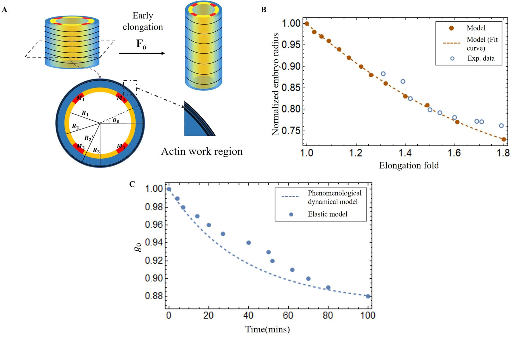
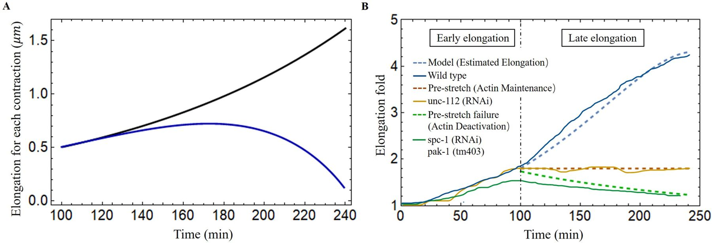
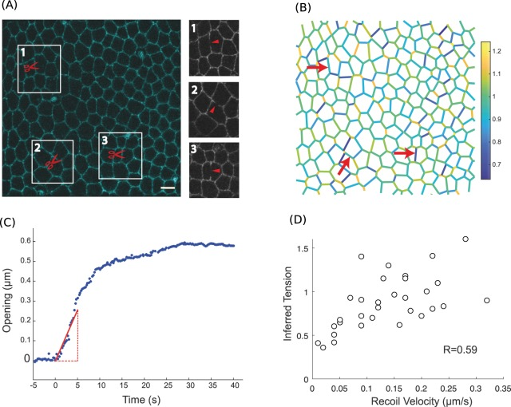
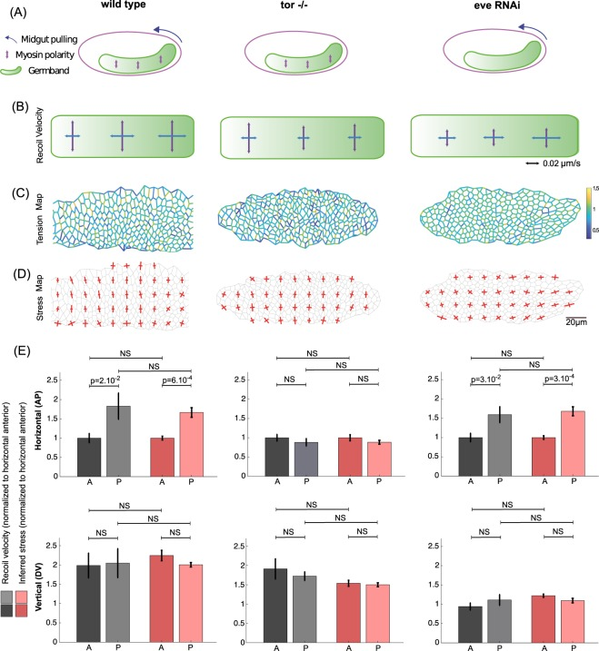
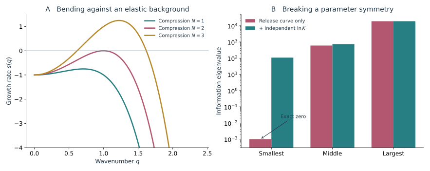

胚胎在卵壳内伸长时，弯曲会让头尾距离减小，整体翻转又使同一块表皮不断改变朝向。二维画面中的长度和亮度变化，因而混合了组织形变与身体姿态的变化。

沿身体中心线追踪位置，再记录各截面的背腹和左右方向，可以把这两类变化分开。三维模型由此连接肌肉活动、表皮材料和卵壳接触，预测伸长、弯曲与扭转。反过来，要从这些运动估计力和材料参数，还要确定哪些观测提供了独立约束。

## 1. 线虫中的直接研究 {#celegans-studies}

直接针对线虫的三维研究，将内部组织、表皮纤维与肌肉放入同一截面，求解伸长、弯曲和扭转。主动应变与主动应力两条路线，以及能量转换的闭合假设，分别在原论文的范围内讨论。

### 1.1 三维体形 运动与卵壳约束 {#1-三维体形-运动与卵壳约束}

<figure class="celegans-video celegans-stage-video" id="stage-motion-three-dimensional-motion" style="--stage-video-width: 20rem;">
<video controls loop preload="metadata" playsinline width="212" height="338" aria-label="卵壳内的三维弯曲与旋转" aria-describedby="stage-motion-three-dimensional-motion-caption">
<source src="https://ars.els-cdn.com/content/image/1-s2.0-S1534580725003673-mmc3.mp4" type="video/mp4">
浏览器暂不支持内嵌播放，请打开下方原始视频。
</video>
<figcaption id="stage-motion-three-dimensional-motion-caption"><strong>动态影像｜卵壳内的三维弯曲与旋转</strong> 
DLG-1::RFP 显示表皮连接，影片追踪胚胎在卵壳内的旋转。留意同一身体区域怎样进入和离开视野：二维投影中的缩短，可能来自弯曲和转动，不能直接当作材料回缩。 
来源：Yang 等（2025），Video S1，Developmental Cell，CC BY-NC 4.0。<a href="https://pmc.ncbi.nlm.nih.gov/articles/PMC12549353/#mmc3">原始页面与说明</a>。</figcaption>
</figure>

#### 1.1.1 用身体中心线追踪卷曲中的伸长 {#11-用身体中心线追踪卷曲中的伸长}

超过早期伸长后，身体在卵壳内弯曲并卷成较复杂的形态。二维图像中的长轴或外接框不再等于身体长度；身体仍在变长时，头尾端点甚至可以彼此接近。

中心线可以理解为沿身体中央从头走到尾的一条路径。实验中通常先从三维影像辨认身体轮廓，再在轮廓内部重建这条线；如果某段身体在投影中与另一段重叠，还要借助深度和标记，辨认哪段接着哪段。沿线一小段一小段加起来，得到弧长；直接把头和尾连起来，得到端点直线距离。

令中心线为 $\mathbf r(q,t)$，$q\in[0,1]$ 为曲线参数，则

$$
L(t)=\int_0^1|\partial_q\mathbf r|\,\mathrm dq,
\qquad
D(t)=|\mathbf r(1,t)-\mathbf r(0,t)|.
$$

$L$ 是弧长，$D$ 是端点直线距离。三维弧长通常也大于相应二维投影的弧长。只有在投影近似保持在一个平面中，且前后端和重叠位置可辨认时，二维追踪才足以近似全长。

$\mathbf r(q,t)$ 给出中心线在三维空间中的位置，$q$ 沿曲线编号。第一式累加沿线各小段的长度，第二式只取头尾距离；两者在卷曲身体上可以差很多。

以弧长固定的圆弧为例，接近直线时 $D/L$ 接近 1，弯成半圆后降为 $2/\pi\simeq0.64$。实际弧长没有缩短，端点距离却已经减少约三分之一。若身体还在向成像平面外弯曲，二维投影的轮廓长度也会继续缩短。这就是为什么后期伸长曲线通常需要依靠三维追踪或可靠的身体展开，不能只测外接框。

曲线参数 $q$ 只负责给曲线上的点编号，不一定代表同一个组织小块。假如每一帧都把中心线重新均匀分成一百段，第五十个点可以在前后两帧对应不同的细胞。要计算局部材料应变，就应额外追踪同名细胞或稳定标记，并相对于参考身体坐标 $s_0$ 测量局部伸长 $\lambda=|\partial_{s_0}\mathbf r|$。曲线匹配得很平滑，并不能自动保证完成了材料追踪。

曲率 $\kappa$ 描述一小段身体弯得有多急。直线的曲率为零，半径为 $R$ 的圆弧曲率为 $1/R$，所以圆弧越小、转弯越急，曲率越大。它与整条身体总共转了多少角度不同，也与身体材料实际伸长多少不同。对一般三维曲线，可以由位置的一阶、二阶导数计算：

$$
\kappa=\frac{|\partial_q\mathbf r\times\partial_q^2\mathbf r|}{|\partial_q\mathbf r|^3}
$$

曲率对轮廓噪声较敏感，平滑尺度会直接影响曲率峰。对于更复杂的扭转，还要区分中心线扭率、截面的旋转以及材料纤维相对截面的取向，它们并不总是相同的几何量。

曲率含有位置的二阶导数，轮廓上的很小锯齿会被显著放大。平滑不足会制造许多不存在的弯曲峰，平滑过度又会抹掉局部肌肉收缩引起的弯曲。跨阶段比较时，最好以相近的物理长度规定平滑范围，并检查结论在合理范围内是否稳定；若始终使用固定数量的像素，身体尺寸或成像分辨率改变后，实际比较的尺度也变了。

身体在空间中整体翻滚时，截面相对实验室的朝向发生变化，但相邻截面之间未必增加扭转。相反，中心线几乎不动时，肌肉区域和表皮纤维仍可能绕切线逐渐旋转。区分这两种运动，要沿身体辨认材料方向；仅从中心线轮廓计算一个扭率，无法替代肌肉或表皮标记的三维位置。

*图 1｜从圆柱到可弯曲的三维身体。引自 [Dai 与 Ben Amar（2024），Fig. 3](https://pmc.ncbi.nlm.nih.gov/articles/PMC11189629/#fig3)。A 使用中心线和各截面描述参考与变形构型；B 将外侧表皮纤维和四个肌肉区域放到同一模型中。图中的层结构属于模型理想化，需按原文参数和几何定义理解。*

Dai 与 Ben Amar 把早期伸长、肌肉驱动的弯曲和扭转放在同一个三维模型中计算。模型不再只预测全长和直径，还预测身体怎样弯、怎样转。关于这些运动如何帮助长期伸长的解释，则要继续与骨架和连接重塑的实验比较。[Dai 与 Ben Amar，2024](https://doi.org/10.7554/eLife.90505)

图 1 把不同组织放在截面的具体位置，而不是只给身体一个平均刚度。这样，肌肉收缩既能贡献轴向合力，也能因为偏离截面中心而产生弯矩；表皮纤维的方向则影响这些负载怎样分配。同一套局部材料假设因此可以同时产生长度、曲率和旋转三个层面的预测。它比只计算全长更受约束，因为一种参数改变即使改善了长度曲线，也可能让弯曲方向或扭转幅度偏离观测。

#### 1.1.2 运动开始并不等于形态发生结束 {#13-运动开始并不等于形态发生结束}

最初的抽动标志肌肉开始提供可见机械输入。局部收缩、身体弯曲、转动与较协调的运动随后逐步建立，并在发育过程中继续作用于表皮。

到了孵化前，咽、肌肉和运动系统已具备越来越完整的功能，身体最终通过卵壳局部开启离壳。孵化影像可以显示鼻端接触、局部卵壳变形与离壳后的运动，但不能仅从“挣动后离壳”确定全部弱化机制。[WormAtlas，Embryo Introduction](https://wormatlas.cropsci.illinois.edu/embryo/introduction/mainframe.htm)

运动能力在身体塑形过程中逐渐建立，肌肉的反复作用也参与了最终体形的形成。

### 1.2 从圆柱材料到可弯曲的身体 {#2-从圆柱材料到可弯曲的身体}

Dai 与 Ben Amar 的三维模型沿用了早期伸长中主动作用、预应变与材料分区的思路，但把它们放进有内部组织、表皮、外周纤维和四条肌肉区域的截面中。不同区域的材料参数与主动方向分开给定，再计算它们共同组成的身体怎样伸长、弯曲和扭转。[Dai 与 Ben Amar，2024，正式版](https://doi.org/10.7554/eLife.90505.3)

这里重要的不是把一条杆画得更细，而是从局部材料作用求全身响应。四条肌肉位于截面不同方位，相同的总活动若分布不同，产生的合力与弯矩就不同；纤维有倾角时，还会改变剪切与转矩。参考构型、当前构型和各组织希望发生的主动变形必须分别记录，才能保持各区之间的几何相容。

其主动应变路线可用 $\mathbf F_e^{(k)}=\mathbf F[\mathbf G^{(k)}]^{-1}$ 概括：$\mathbf F$ 是实际总变形，$\mathbf G^{(k)}$ 表示第 $k$ 类组织的主动偏好，剩下的 $\mathbf F_e^{(k)}$ 决定被动弹性代价。某一肌肉区域希望缩短，但周围组织不允许它自由缩短时，就会积累负载并使整体弯曲。主动输入与实际形变因此不必相同。

论文先用早期阶段的直径资料约束初始伸长与预应变，再以该状态进入肌肉活动阶段。这一步不能省掉：相同肌肉输入作用在已经拉伸的表皮和接近无负载的表皮上，不会产生相同的能量与曲率。模型中的早期状态是后续计算的机械初态，并非可随意替换的时间零点。

*图 2｜早期伸长与预应变的参数约束。引自 [Dai 与 Ben Amar（2024），Fig. 5](https://elifesciences.org/articles/90505#fig5)，CC BY 4.0。A 为模型截面分层；B 比较早期归一化半径；C 从已有资料估计预应变相关参数。肌肉位置及模量分区属于理想化，曲线匹配不是各区域力学参数的独立测定。*

这类模型能够比较全长模型做不到的改变。例如保留相同平均肌肉活动，只交换哪一侧先收缩，就会改变弯曲方向；改变外层纤维相对周向的角度，会改变扭转贡献。对于一条长度曲线，两个参数组合可能难以区分，到了曲率、截面转角和三维构型上，它们未必还能同时吻合。

Wang 与 Ben Amar 在 2024 年的另一项研究采用主动应力路线，针对有伸长、弯曲和扭转的非均匀圆柱，分析 actomyosin 与肌肉需要贡献怎样的应力和力矩。[Wang 与 Ben Amar，2024](https://doi.org/10.1016/j.ijnonlinmec.2024.104833) 它与主动应变路线的区别，涉及马达作用是作为当前构型中的应力，还是作为材料偏好变化进入方程。给定体形下能求出所需负载，并不等于已确定胚胎怎样动态选择该体形；要比较两种描述，需要在多个负载和构型下使用一致的材料假设。

长波近似下，中心线和截面方向可以概括三维材料的整体响应。杆的弯曲、扭转系数需从截面结构导出或独立测量，才能与具体胚胎的材料对应。

### 1.3 组织布局与主动预应变 {#组织布局与主动预应变}

这个杆能量便于分辨不同变形的代价。要把它与具体的细胞层联系起来，则需对截面内材料的应力做积分，求出 $K$、$B$ 和 $C$。Dai 与 Ben Amar 采用的正是从有限变形材料和主动预应变出发、再计算弯曲与扭转响应的思路，而不是只给中心线施加任意弯曲。[Dai 与 Ben Amar，2024](https://doi.org/10.7554/eLife.90505)

*图 3｜组织方向进入三维体形模型。引自 [Dai 与 Ben Amar（2024），Fig. 6](https://pmc.ncbi.nlm.nih.gov/articles/PMC11189629/#fig6)。A–C 比较左右肌肉组的活化与弯曲；D–F 把 actin 从环向到倾斜方向的变化与扭矩联系起来。A 的黄色区域用于标出肌肉位置，不代表一个真实存在的均匀组织层。*

图 3 中不同肌肉组的活化方式之所以重要，是因为合力与弯矩并非同一件事。对称位置的两组肌肉若产生相近的轴向力，弯矩可以互相抵消，身体仍有轴向负载；若一侧更强，抵消不完全，就会向一侧弯曲。肌肉离截面中心越远，同样的力通常具有越大的力臂。因而用一个只随时间变化的平均肌肉应力，不能保留左右活动差异造成的体形。

表皮纤维的倾角又提供了另一种方向耦合。沿圆周排列与斜向排列的纤维，在轴向伸长和截面旋转时经历的拉伸不同，因而会贡献不同的扭转响应。图中的三维形状是给定组织布局和活性条件后得到的模型结果；要确认胚胎使用了相应机制，还应比较实际纤维角度、肌肉相位以及身体转角的对应关系。

有限变形中常写 $\mathbf F=\mathbf F_e\mathbf F_a$。$\mathbf F_a$ 表示主动改变后的局部参考构型，$\mathbf F_e$ 表示为了与邻近材料连接、满足边界条件而额外发生的弹性变形。被动应力由 $\mathbf F_e$ 计算。

假设左侧肌肉想缩短，而右侧暂时没有同样变化。两侧若能独立运动，各自达到偏好长度即可；但它们属于同一个身体，必须共享连续的截面。这种不相容会产生内部应力和弯曲。主动变化的方向、所在半径和相邻层刚度，共同决定它产生多少弯矩。

因此，相同大小的肌肉收缩，放在截面中心附近与外侧会产生不同弯曲；四个区域同步收缩与左右交替收缩，也会产生不同的体形。三维模型的价值就在于保留这些位置与相位关系。

$\mathbf F$ 是描述实际局部变形的矩阵，$\mathbf F_a$ 记录主动偏好的改变，$\mathbf F_e$ 记录在这种偏好之上还被拉伸或挤压了多少。把它们相乘，是一种区分主动偏好与弹性形变的数学写法，并不是说真实胚胎先独立变形一次，再由邻居执行第二次变形。

例如一段肌肉本想缩短 10%，却被邻近组织拉住，只能缩短 2%。它仍有收缩活动，而且相对于自己的新偏好状态受到拉伸负载。实际缩短较少，并不能单独证明肌肉活动弱；还可能是它面对的组织更难拉动。

### 1.4 周期弯曲的能量怎样进入伸长 {#4-周期弯曲的能量怎样进入伸长}

Dai 与 Ben Amar 计算肌肉激活时弯曲、扭转和收缩的储能，并指定其中一部分用于后续长度增加。能量分配规则构成模型的一项闭合假设。

*图 4｜能量转换假设与伸长轨迹。引自 [Dai 与 Ben Amar（2024），Fig. 8](https://elifesciences.org/articles/90505#fig8)，CC BY 4.0。A 比较全部与部分能量进入伸长的假设；B 比较野生型、撤去活动与预应变失效条件的轨迹。能量分配规则参与曲线解释，不能把图中的所有量都视作独立测量。*

全部可用能量都进入伸长时，模型后期的长度增加过大。作者因此采用随发育下降的有效转换比例，使单次增量在后段减小，并改善总体轨迹的一致性。这一比例表达了未显式处理的耗散和结构重组，并不是独立测得的代谢效率。模型据此给出一种可行的机械解释，仍需局部 actin 与连接更新的资料约束能量究竟通过哪条路径保留下来。

局部塑性模型规定参考状态怎样随负载更新，能分析承载受损后的回缩；全身能量模型保留弯扭与组织方位，可检验这些更新是否满足整体做功约束。若能量转换比例和塑性速率都任意调节，长度曲线很难约束两者。较有用的顺序是先由局部重塑估计参考状态更新，再预测三维运动与机械功。

## 2. 可供借鉴的其他理论 {#transferable-theories}

Cosserat 杆、受限屈曲和接触理论可概括三维材料的长波响应；其他上皮中的力反演与参数辨识研究，则提供独立检验的方法。以下解析算例与这些可借鉴的方法一起讨论。

### 2.1 弧长与投影及主动弯曲 {#弧长与投影及主动弯曲}

*图 5｜三类几何量的区分。A 比较弧长与端点距离；B 比较两种开口运动规律产生的面积曲线；C 给出圆柱体积近似保持时的半径与侧面积关系。曲线由相应解析关系计算，用于联系本文的几何定义。*

#### 2.1.1 弯曲形态可能同时来自主动驱动与空间限制 {#12-弯曲形态可能同时来自主动驱动与空间限制}

想象把一根越来越长的软条放在大小基本不变的盒子里。它可能因为没有足够直线空间而弯起来，即使我们没有主动扳它。胚胎还有另一种作用：一侧肌肉收缩，会主动让身体倾向于向那侧弯。因此，卵壳限制和肌肉活动都能产生弯曲，不能仅凭一张卷曲照片判定是哪一种作用更强。

在细长体近似下，一个常见的弯曲能结构是

$$
E_b=\frac12\int B(s)\bigl[\kappa(s)-\kappa_0(s)\bigr]^2\,\mathrm ds.
$$

$B$ 是弯曲刚度，越大表示越难让这段材料偏离它本来偏好的弯曲形状。$\kappa_0$ 是偏好曲率；一段没有主动弯曲偏好的直材料可取 $\kappa_0=0$，一侧肌肉收缩则可以改变这个偏好。实际曲率 $\kappa$ 与它的差越大，平方项对应的能量代价越大。积分再把身体各段的代价加起来。卵壳则限制哪些形状能放得下，并在接触处施加反力。

仅用最终卷曲轮廓拟合 $B$ 或 $\kappa_0$ 往往不唯一。能够增加约束的观测包括同一身体区域随肌肉相位的曲率变化、与卵壳的接触位置，以及解除或改变驱动后的恢复行为。

弯曲能对曲率求导给出弯矩，形式为 $M=B(\kappa-\kappa_0)$。因此一条弯曲的身体可能是在外力作用下偏离自身的直线参考形状，也可能已经具有接近当前曲率的主动偏好。前者在释放外部约束后倾向于伸直，后者在主动状态保留时仍倾向于弯曲。观测到同一个 $\kappa$，并不能确定两种状态中的哪一种。

还可以设想一段没有受到外弯矩、局部达到 $\kappa=\kappa_0$ 的理想材料。此时无论 $B$ 多大，它都取同一个偏好形状。静态形状完全不含刚度尺度的信息；只有外加扰动或恢复动力学，才开始显露抵抗变形的程度。这个简单例子说明，形状很精细并不意味着力学参数也同样确定。

### 2.2 杆模型的几何与受力 {#杆模型的几何与受力}

#### 2.2.1 中心线之外还需要截面方向 {#21-中心线之外还需要截面方向}

中心线相同的两条身体，仍可能有不同朝向。例如一条直的胚胎在原地翻身，中心线几乎没变，原来朝上的背侧却转到了下方。若在身体表面沿前后轴画一条标记线，翻身时就能看到它转动。这条标记所提供的方向信息，正是模型需要补到中心线上的内容。

模型还需要在垂直于中心线的截面上，标记肌肉和表皮所在的方向。

一条曲线可以描述身体在哪里，却不能完整描述身体朝向哪里。设沿身体的每个截面带有三个单位方向：$\mathbf d_3$ 沿身体切线，$\mathbf d_1$、$\mathbf d_2$ 指向截面中的两个固定组织方向。肌肉区域和表皮纤维附着在这些材料方向上，身体转动时会随之转动。

截面方向沿身体的变化可写为

$$
\partial_{s_0}\mathbf d_i=\boldsymbol\Omega\times\mathbf d_i.
$$

$s_0$ 是参考身体上的弧长坐标。$\Omega_1$、$\Omega_2$ 表示截面如何弯转，$\Omega_3$ 表示它绕切线如何扭转。身体接近直线时，这些量仍然可以定义；而单靠中心线的 Frenet 扭率，在曲率接近零的地方会变得不稳定。

这条导数关系可以理解为：沿参考身体走过一小段 $\mathrm ds_0$，截面的三个方向发生一小次转动，转轴和转角由 $\boldsymbol\Omega\,\mathrm ds_0$ 给出。两个垂直切线的转动分量使身体弯曲，沿切线的分量使截面绕身体轴旋转。它描述的是相邻材料截面之间的变化，所以不会把整条胚胎一起转动误认为局部扭转。

若身体已经显著伸长，按当前弧长和按参考弧长计算的“每单位长度转角”也不同。这里选用 $s_0$，是为了始终对同一段参考材料计量；与图像数据比较时，应做相应坐标换算。否则一段材料只是变长，单位当前长度的转角就可能下降，被误读成扭转松弛。

一个局部小应变、允许大转动的杆模型，可以使用

$$
E=\frac12\int_0^{L_0}\left[
K(e-e_a)^2+B_1(\Omega_1-\Omega_{1a})^2
+B_2(\Omega_2-\Omega_{2a})^2+C(\Omega_3-\Omega_{3a})^2
\right]\,\mathrm ds_0.
$$

$e$ 是轴向伸长应变，$K$ 是拉伸刚度，$B_1$、$B_2$ 是两个弯曲方向的刚度，$C$ 是扭转刚度。带 $a$ 的量表示主动活动改变后的偏好状态。例如，同一侧肌肉更短，会使身体偏好向这一侧弯曲；若截面的左右对称性被纤维取向或不同肌肉活动打破，也可以产生扭转。

这个较长的能量式，其实只把三类代价加在一起：轴向拉伸、向两个方向弯曲、绕身体轴扭转。每一项都是“实际变化减去偏好变化”的平方，再乘上相应刚度。某一项刚度较大，表示偏离相应偏好状态更费力；它本身并不表示这个方向上的主动活动更强。

模型中的“杆”也不要求身体像木棍一样硬。杆近似只是利用身体长而细的特点，把复杂截面内的受力合并到几个整体系数里。能不能这样合并，要看截面形变是否已经影响到所研究的运动；如果局部压扁和接触非常明显，就可能需要更详细的截面描述。

一把软尺可以弯过很大角度，每一小段的长度却几乎不变。因此，“身体转动很大”和“材料被拉长很多”是不同的情况。上面的杆能量允许截面大幅转动，但轴向拉伸仍用小变化近似；它适合一段短时响应。若要计算从早期到四倍长度的全过程，还要更新参考状态或换用适合大伸长的材料关系。

#### 2.2.2 截面合力与力矩平衡 {#23-截面合力与力矩平衡}

前面的杆能量规定了拉伸、弯曲和扭转的代价，还需要力和力矩平衡才能求出身体形状。以参考坐标 $s_0$ 为变量，令 $\mathbf n$ 为截面合力、$\mathbf m$ 为截面合力矩，$\mathbf f$ 和 $\boldsymbol\ell$ 分别为每单位参考长度的外力与外力矩。在惯性可忽略的近似下，

$$
\partial_{s_0}\mathbf n+\mathbf f=0,
\qquad
\partial_{s_0}\mathbf m+
(\partial_{s_0}\mathbf r)\times\mathbf n+
\boldsymbol\ell=0.
$$

第二式中的叉积来自相邻截面的合力具有力臂。再与 $N=K(e-e_a)$、$m_i=B_i(\Omega_i-\Omega_{ia})$ 等材料关系以及截面运动学联立，才能计算肌肉主动偏好、接触和阻力共同作用下的体形。这类能表示截面方向的杆模型通常归入 Cosserat 杆；不允许剪切的细杆极限进一步限制切线与截面法向一致。

它还揭示了平均肌肉活动会丢掉什么。截面轴向应力的积分给出 $N=\int_A\sigma_{zz}\,\mathrm dA$，以横向位置加权的积分则给出弯矩。例如相同总收缩力，左右对称分布可以几乎不弯，一侧集中却产生明显弯矩。若再有斜向纤维或非对称剪切，扭矩也会变化。四条肌肉区域的活动不宜总压缩成一个标量。

在动态计算中，$\mathbf f$ 可以包含各向异性的黏性阻力、卵壳反力和自接触。身体各段的受力通过平衡方程耦合，所以一处收缩可以改变远处曲率。把每段曲率都独立拟合成肌肉信号的线性倍数，会漏掉这种全身约束。

### 2.3 卵壳约束怎样改变弯曲 {#3-卵壳约束怎样改变弯曲}

#### 2.3.1 先区分长度增加与端点靠近 {#31-先区分长度增加与端点靠近}

身体弯曲时，头尾直线距离会减少，即使身体弧长完全没有改变。例如一段固定长度的圆弧，随着张开的圆心角增加，弦长就会减小。显微影像中头尾靠近，因而可以同时出现在持续伸长、停止伸长或回缩的胚胎中。

*图 6｜身体长度、弯曲和约束的关系。A 比较不同圆心角的等长圆弧，每条弧长均归一为 1；B 给出弦长与弧长之比 $D/L=2\sin(\theta/2)/\theta$。C 为铰支细杆在接近 Euler 失稳时的标准化幅度关系，使用局部能量 $E(a)=(1-f)a^2/2+a^4/4$、$f=F/F_c$；它示意失稳分支，并非卵壳内完整接触计算。*

#### 2.3.2 一条正在变长的身体为什么会弯曲 {#32-一条正在变长的身体为什么会弯曲}

轴向压缩足够大时，直杆会失稳并弯曲。两端位置受限、但允许转动的铰支杆，给出了一个便于解析的例子，可用于估计长度、弯曲刚度与压缩力之间的尺度关系。

考虑一根长度为 $\ell$、弯曲刚度为 $B$、两端铰支的细杆。若轴向压缩力为 $F$，给它一个很小的侧向形变 $y=A\sin(\pi x/\ell)$。弯曲增加的能量与压缩力释放的能量分别是

$$
E_b=\frac{BA^2\pi^4}{4\ell^3},
\qquad
\Delta E_F=-\frac{FA^2\pi^2}{4\ell}.
$$

弯曲项为正，表示材料弯起来需要储存弹性能；压缩力对应的项为负，表示端点靠近时，压缩负载能使系统能量降低。比较两项，便可找到微小弯曲不再增加总能量的临界力

$$
F_c=\frac{\pi^2B}{\ell^2}.
$$

超过临界力后，笔直形态对小扰动不再稳定。这个结果解释了一个一般趋势：身体越长，轴向受限后越容易弯；刚度越高，越能抵抗弯曲。真实胚胎并非两端铰支的均匀杆，卵壳也会提供分布接触，因此上式适合作为尺度估计。

临界力中的 $\ell^{-2}$ 来自两种能量对波长的不同依赖。长波弯曲的曲率较小，弯曲代价随长度下降得更快，所以较长的杆用较小压缩力就能放大侧向扰动。边界若从铰支改成固支，或身体在中途多处接触卵壳，允许的弯曲形状会改变，临界值的系数也随之改变。

Euler 失稳本身是弹性几何效应，并不要求 actin 已改变参考长度。解除压缩后，理想杆仍可恢复直线；它不能单独解释周期结束后的永久伸长。主动肌肉还可以在低于这个压缩阈值时就让身体弯曲，所以看见弯曲也不是已经达到 Euler 临界力的证据。将失稳、主动弯矩和塑性更新分别保留，才能讨论它们在同一胚胎中的先后关系。

对线虫而言，身体长度增加而卵壳空间固定，会提高接触与弯曲的重要性；肌肉又在主动改变偏好曲率。被动受限弯曲和主动肌肉弯曲可以同时存在。若弯曲紧随某组肌肉的钙活动、并随相位反转，支持主动输入；若在持续增长后于特定接触位置出现，空间约束的贡献就更突出。

接触还会改变身体转动的阻力。三维模型因此需要同时处理自接触、卵壳接触与周围介质的耗散。只匹配某一帧卷曲形状，通常无法确定这几项贡献。

接触力首先阻止身体穿过卵壳，这种法向反力可以改变受力方向和曲率。若卵壳近似固定、接触又没有法向穿透，反力可以很大，却不一定做很多法向机械功，因为接触点在该方向几乎没有位移。沿壳滑动的摩擦和周围介质的黏性阻力则会耗散能量。把“接触更强”全部写成一个阻尼参数，会混淆几何约束与能量损失。

这也影响对旋转的解释。转动可能改变接触位置，从而让身体暂时找到更容易伸长的构型；它也可能增加滑动耗散。哪一种效应占优取决于体形、接触和驱动，而不是转得越多就必然伸长越快。三维轨迹提供了检验这些关系的机会，因为接触位置和转动方向都能够随时间追踪。

#### 2.3.3 接触反力与弯曲模态 {#33-接触反力与弯曲模态}

刚性卵壳接触是单侧约束：身体可以离开卵壳，不能穿进去。用 $g$ 表示表面间隙、$\lambda_n$ 表示向内的法向接触力大小，理想无黏附接触满足

$$
g\ge0,\qquad \lambda_n\ge0,\qquad g\lambda_n=0.
$$

有间隙时反力为零；发生接触时，反力由平衡决定。数值计算常用罚函数近似，但要检查把罚刚度提高后，穿透误差是否减小、预测是否趋于稳定。罚刚度是计算参数，不应直接解释成卵壳的真实材料模量。

另一种常见近似是把周围组织视作连续弹性背景，给侧向位移 $y$ 加上回复力 $-k_fy$。它是双侧、线性的背景作用，与只在接触时出现的壳反力不同。它仍能提供一个有用的模态比较。取压缩力 $N>0$、弯曲刚度 $B$ 和单位长度横向阻力 $\xi_\perp$，小挠度动力学为

$$
\xi_\perp\partial_ty=-B\partial_x^4y-N\partial_x^2y-k_fy,
\qquad
s(q)=\frac{Nq^2-Bq^4-k_f}{\xi_\perp}.
$$

对无边界的连续波数，最容易增长的模态满足 $q_*^2=N/(2B)$；出现正增长率还要求 $N>2\sqrt{Bk_f}$。有限长度和端部条件只允许一组离散波数，因此实际先出现的模态未必恰好等于连续最优值。

弯曲模型于是增加了长度曲线没有的预测：不仅要解释何时弯，还要解释先出现多长的波、在哪些位置受限，以及改变周围支撑后波形怎样变化。真实卵壳内的大弯曲、接触转换和自接触超出了小挠度式的范围；完整模拟需要回到三维杆或连续体接触问题。

### 2.4 机械能收支与形态记忆 {#机械能收支与形态记忆}

肌肉在身体不同位置做功，能量可以暂存于弯曲、扭转和拉伸，也会通过黏性与摩擦耗散。持续伸长还涉及网络参考状态的更新。

用 $E$ 表示机械自由能，$P_{\rm active}$ 表示主动输入功率，$\mathcal D$ 表示耗散功率，能量收支为

$$
\dot E=P_{\rm active}-\mathcal D.
$$

一次活动结束后，外观可能接近原状，纤维参考长度、取向或连接状态却已改变。下一周期从这个新状态开始，形变便可能逐渐积累。

应力—应变图中的加载与卸载路径若不重合，就形成滞回圈；稳定循环中，圈内面积对应耗散的机械能。黏弹性材料即使每周期都回到相同长度，也可以产生滞回，因此耗散与永久伸长需要分别计算。

弹性储能可在回弹时释放，耗散部分无法直接用于下一步形变。参考状态的改变则会留下新的形状与承载关系。肌肉摆动的幅度由此不能直接换算成长期伸长；转换比例还取决于哪些结构在受力后发生了更新。

Dai 与 Ben Amar 的模型处理全身做功和三维形变，[Lardennois 等（2019）](https://doi.org/10.1038/s41586-019-1509-4)则用局部 actin 实验研究形变的保留。将两者衔接，需要在同一收缩周期中比较弯曲、负载与骨架更新时间。

### 2.5 怎样区分能拟合同一条曲线的模型 {#5-怎样区分能拟合同一条曲线的模型}

Ishihara 与 Sugimura 的 Bayesian force inference 从细胞边界的力平衡出发，联合估计连接张力与细胞压力。这条路线直接利用分割几何，而不预先指定完整的面积—周长本构参数。[Ishihara 与 Sugimura，2012](https://doi.org/10.1016/j.jtbi.2012.08.017)

给定分割出的几何后，这类问题的结构可写为

$$
\mathbf A(\mathbf r)\mathbf x\simeq0,
\qquad
\mathbf x=(T_1,\ldots,T_E,p_1,\ldots,p_C)^{\mathsf T}.
$$

矩阵由边的方向、长度与顶点位置构成，未知量是边张力和细胞压力。力平衡通常不足以唯一确定它们；压力整体加常数、力整体乘同一尺度，以及噪声造成的近简并，都需要处理。Bayesian 方法加入对张力分布的先验约束，使求解在分割噪声下更稳定。它提供受假设约束的相对力图，先验本身不是额外测到的一组力。

Kong 等将这种反演与激光切割直接比较。在果蝇背板上，他们逐条比较反演张力与切割初始回缩；在较大组织尺度，还比较鹌鹑胚胎和果蝇胚带中的应力方向与空间分布。[Kong 等，2019](https://doi.org/10.1038/s41598-019-50690-3)

*图 7｜连接张力反演与激光切割。引自 [Kong 等（2019），Fig. 1](https://pmc.ncbi.nlm.nih.gov/articles/PMC6787039/#Fig1)，CC BY 4.0。A、B 为切割位置和反演力图；C、D 比较回缩与反演张力。31 次切割来自 10 只蛹，单边比较存在明显散布，不能将反演视为逐条连接的精确张力仪。*

在果蝇胚带中，局部 myosin 极性与远处后肠内陷提供不同方向的力。分别改变两者后，切割与反演呈现相应的空间应力变化。这比正常状态下的张力分布增加了一层检验；大尺度平均也比单边估计更稳健。

*图 8｜局部与远处扰动后的应力分布。引自 [Kong 等（2019），Fig. 4](https://pmc.ncbi.nlm.nih.gov/articles/PMC6787039/#Fig4)，CC BY 4.0。A 区分局部极性收缩与远处牵拉；B 为切割响应；C、D 为反演连接张力和组织应力；E 比较方向性结果。体系为果蝇胚带。*

将这种方法接到线虫，需要先检查其几何和准静态近似。弯曲表皮的投影不能直接当作平面，活跃的基底突起、内移与肌肉输入也会提供二维顶点平衡没有保留的作用。可以先在已知局部曲面与运动较慢的时间窗内验证，再与同位置的切割比较；完整三维推断则需保留面张力、压力和外部牵引。形状数据更丰富，并不会自动让力的绝对尺度变得可识别。

#### 2.5.1 释放曲线中的参数简并 {#51-释放曲线中的参数简并}

模型中的力、刚度、黏性和纤维更新速率，都可能影响同一条曲线。参数辨识考察这些量能否被现有数据分别确定；多个参数组合若给出相同预测，拟合残差再小也无法将它们区分。

局部切割后的 Kelvin–Voigt 释放曲线为

$$
u(t)=\frac FK\left(1-e^{-Kt/\eta}\right).
$$

曲线只含两个参数组合 $F/K$ 和 $\eta/K$。把三个量同时乘以任意正数 $c$，即 $(F,K,\eta)\mapsto(cF,cK,c\eta)$，整条曲线完全不变。再高的采样频率和再小的图像噪声，也不能仅从这条位移曲线恢复被隐藏的共同尺度。

这里 $u(t)$ 是切口张开的位移，$F$ 是让它张开的等效力，$K$ 是等效刚度，$\eta$ 是等效黏性。先看最终幅度 $F/K$：若力和刚度都增加两倍，它不变；再看时间常数 $\eta/K$：若黏性也一起增加两倍，它仍不变。所以“更强的力拉着更硬、更黏的组织”和“较弱的力拉着较软、较不黏的组织”，可以给出完全相同的位移过程。

*图 9｜共同尺度不同的相同释放曲线。A 比较 $(F,K,\eta)=(1,1,2)$、$(2,2,4)$、$(4,4,8)$，三条解析曲线完全重叠；B 显示三组参数的不同绝对值。独立测得其中一个尺度后，另外两个才能由幅值和时间常数求出。*

这种无论测得多精确都分不开的情况，称为结构上的不可识别性。数据只能确定比例，缺少一个能告诉我们绝对值有多大的独立测量。另一些情况则是模型本来允许分开参数，但噪声较大或只拍到一小段过程，导致估计不准。后一种问题可以通过改善测量缓解，前一种则要改变测什么。

图 9 的共同倍乘是方程的精确对称性。增加采样点可改善幅值和时间常数的精度，却无法恢复缺失的共同尺度；优化软件可能从不同初值返回同样吻合的绝对参数。

实际精度不足则有不同表现。例如记录只覆盖释放最初的一小段，指数响应近似直线，连幅值与时间常数也难以分别估计。延长记录有助于这一问题，因为后半段的平台提供了新的曲线形状信息。它仍然不会打破共同倍乘的对称性。先判断数据缺的是后续时间，还是一种独立物理量，再决定下一项测量更有效。

#### 2.5.2 新增哪一种测量才有帮助 {#52-新增哪一种测量才有帮助}

若独立测得刚度 $K$，就可由幅值求 $F$、由时间常数求 $\eta$。若改为增加另一个方向的切割，通常首先帮助约束应力或刚度的方向比；是否能够恢复绝对值，还取决于两方向共享了哪些已知材料参数。新增一条曲线，并不自动新增一个独立的力标尺。

可以逐个轻微改变模型参数，看看预测曲线会怎样移动。若提高力和降低刚度产生的变化几乎相同，数据就很难分辨究竟改了哪个量。这种“改一点参数会让观测变化多少”的关系，叫敏感度。写成符号是 $J_{m\alpha}=\partial y_m/\partial p_\alpha$，其中 $y_m$ 是第 $m$ 项观测，$p_\alpha$ 是第 $\alpha$ 个参数。把不同观测排成行、不同参数排成列，就得到一张敏感度表；两列近似成比例，正是两种参数变化容易被混淆的表现。

例如，增加全长影像的帧数，未必能分开 seam 收缩增强与背腹表皮纤维排列加快；同时测纤维角度就更有帮助。对后期模型，记录 actin 承载比例与重塑事件，能够约束 $x_*$ 与 $J_*$，而只记录终点长度很难区分切断和再束化。对三维模型，左右肌肉相位与截面转角能帮助区分主动弯矩和卵壳接触。

细胞形状、局部材料响应和身体体形为同一个模型提供不同约束。若同一组参数同时解释这些变化，机制解释就比仅拟合长度更有依据。某项观测持续无法解释时，再检查模型缺少的是接触、结构更新还是另一种主动输入。

设观测误差近似高斯、协方差为 $\Sigma$，局部信息矩阵为 $\mathcal I=J^{\mathsf T}\Sigma^{-1}J$，其中 $J$ 记录预测对参数的敏感度。很小的特征值对应一组难以分辨的参数变化：这些参数一起改变时，数据几乎不变。

对释放模型，改用无量纲对数参数 $\boldsymbol\theta=(\ln(F/F_0),\ln(K/K_0),\ln(\eta/\eta_0))$。共同倍乘对应方向 $(1,1,1)$，因此对任何采样时刻都有

$$
J\begin{pmatrix}1\\1\\1\end{pmatrix}=0.
$$

这是一条精确零方向。新增独立刚度测量会对 $\ln K$ 产生单独响应，才可能打破它；增加同一释放曲线的帧数只能改善另外两个方向的精度。图 10B 比较了这两种数据组合的信息特征值。

数值优化还需要检查模型内部的非线性。可以固定某个参数，重新优化其余参数，观察最小残差随固定值怎样变化，即参数剖面。若很宽范围内残差几乎相同，最优点附近给出的一个很小标准误就值得怀疑。参数剖面也能显示两个不同局部解，而一次梯度优化可能只找到其中一个。[Raue 等，2009](https://doi.org/10.1093/bioinformatics/btp358)

| 需要区分的机制 | 优先增加的观测 | 仍需避免的混淆 |
| --- | --- | --- |
| 力与材料共同尺度 | 独立力标尺或刚度测量 | 第二条相似位移曲线仍可能只有比值 |
| 主动弯矩与受限屈曲 | 肌肉相位、接触位置和模态变化 | 单帧曲率可由两者共同产生 |
| 纤维方向与肌肉左右差异 | 三维取向、分区活动与截面转角 | 平均活性会丢掉弯矩信息 |
| 黏弹性与结构更新 | 周期内恢复及周期末内部状态 | 耗散圈并不等于参考长度增加 |
| 局部力学与全身传力 | 局部扰动后的空间响应 | 远处变化可能来自几何约束 |

三维连续体保留截面结构，杆模型保留全身弯扭，小挠度模型便于求阈值与波长。选择取决于观测能约束到哪一层：纤维分布、主动应变、界面滑移与接触各增加一组未知量，也各需要相应数据。

*图 10｜空间模态与参数信息。A 取 $B=k_f=\xi_\perp=1$，比较不同压缩力下的增长率，连续波数的失稳阈值为 $N=2$。B 在 $(F,K,\eta)=(1,1,2)$ 附近计算对数参数敏感度，比较仅有释放曲线与额外独立测量 $\ln K$ 的信息矩阵；统一采用示范误差尺度。它展示局部结构信息，不是某组胚胎参数的置信区间。*

#### 2.5.3 用扰动后的轨迹检验同一组参数 {#53-用扰动后的轨迹检验同一组参数}

对于这组研究，一种具体做法是先用正常胚胎的局部切割、纤维取向和全长轨迹约束材料与驱动，再预测改变某项结构后会发生什么。例如在纤维重排模型中，减慢排列不仅应延迟整体伸长，还应改变同名细胞中取向和局部应变的先后关系；在两层传力模型中，减弱界面耦合应同时改变相对位移幅度和传播距离。一个模型若只预测“胚胎变短”，给出的限制仍然很弱。

检验时不宜为每个条件重新自由调节全部参数。若把收缩强度、黏性、纤维刚度和重塑速率全部重拟合，几乎总能找到一条相近的长度曲线，却无法知道最初提出的机制是否成立。更有信息的比较，是只按干预所针对的过程改变相应参数，保留其他已约束的量，检查模型能否同时预测时间、位置和方向上的变化。

周期输入提供了另一种区分。固定应力幅度下，瞬时阈值塑性的平均伸长率不显式依赖频率；加入纤维恢复或连接更新以后，则可能出现频率依赖。同时记录收缩幅度、局部重塑和净伸长，可检验这种响应差别。

### 2.6 高度可重复的形态如何容纳局部波动 {#6-高度可重复的形态如何容纳局部波动}

不同线虫胚胎通常有相近的细胞来源和最终体形，但把影片逐帧放大看，局部运动并不完全相同。某次突起可以晚一点，某次肌肉抽动可以弱一点，身体最后仍可能长得相近。要解释这种稳定性，便要问：每一步其实已经足够精确，还是组织能在后续过程中补偿这些偏差？

平均曲线容易把这些差异抹平。更有用的是保留每只胚胎的记录，比较同一次局部变化前后，附近细胞怎样响应。例如一侧推进稍晚时，对侧是否也减慢；某个收缩周期没有留下净伸长后，后面的周期是否增加贡献。这样才能判断细胞之间是否有纠偏，而不是只看到最后的长度差别较小。

线虫的谱系坐标让同名细胞能够跨胚胎匹配。把细胞身份、局部分子状态、接触与应变一起追踪，就有机会判断波动在哪里产生，又在哪里被邻居补偿。

跨胚胎对齐也可能掩盖本来关心的延迟。若把每只胚胎的伸长起点和终点都强行拉到同一时间轴，收缩与纤维排列之间的真实时差可能被压小。按形态阶段比较和按实际经过时间比较，各自保留不同信息；讨论反馈时，最好同时保留发育阶段、绝对时间和局部事件顺序。

邻居之间出现负相关，也还不足以证明主动补偿。一个区域变窄时，几何约束本身就可能迫使另一处变宽；所有细胞还可能共同受到肌肉或边界的输入。若急性减弱某一区域后，邻居才出现有时延的活动增强，并且这一增强有助于恢复形态，才更接近直接的反馈证据。高度稳定的谱系使这类局部比较更容易进行，但组织怎样纠偏，仍需靠扰动后的动态过程来判断。

已知同名细胞通常怎样运动以后，就可以更具体地问：当它这次晚了一点、少收缩了一点，邻居是否改变了活动，后面的形态又是否回到常见范围。稳定的细胞谱系让这种跨胚胎比较成为可能，局部扰动后的连续记录则有助于判断补偿怎样发生。

## 参考文献 {#references}

1. Dai A, Ben Amar M (2024). [Cyclic muscle contractions reinforce the actomyosin motors and mediate the full elongation of C. elegans embryo](https://doi.org/10.7554/eLife.90505). *eLife*.

2. Lardennois A, Pásti G, Ferraro T, et al. (2019). [An actin-based viscoplastic lock ensures progressive body-axis elongation](https://doi.org/10.1038/s41586-019-1509-4). *Nature*.

3. Yang X, Ferraro T, Molnar K, et al. (2025). [Repeated extrinsic and anisotropic mechanical inputs promote C. elegans polarized adherens junction elongation](https://doi.org/10.1016/j.devcel.2025.06.012). *Dev Cell*.

4. A Raue, C Kreutz, T Maiwald, J Bachmann, M Schilling, U Klingmüller, J Timmer (2009). [Structural and practical identifiability analysis of partially observed dynamical models by exploiting the profile likelihood](https://doi.org/10.1093/bioinformatics/btp358). *Bioinformatics*.

5. Wang T, Ben Amar M (2024). [Physical forces drive C. elegans embryonic deformation](https://doi.org/10.1016/j.ijnonlinmec.2024.104833). *International Journal of Non-Linear Mechanics*.

6. Kong W, Loison O, Chavadimane Shivakumar P, Chan EHY, Saadaoui M, Collinet C, Lenne PF, Clément R (2019). [Experimental validation of force inference in epithelia from cell to tissue scale](https://doi.org/10.1038/s41598-019-50690-3). *Scientific Reports*.

7. Ishihara S, Sugimura K (2012). [Bayesian inference of force dynamics during morphogenesis](https://doi.org/10.1016/j.jtbi.2012.08.017). *Journal of Theoretical Biology*.

← [04 肌肉驱动与形态记忆](/notes/celegans/embryonic_morphogenesis/late_elongation/) · [系列总览](/notes/celegans/embryonic_morphogenesis/) · [06 Active matter 软物质堆积与拓扑](/notes/celegans/embryonic_morphogenesis/active_matter_packing_topology/) →
