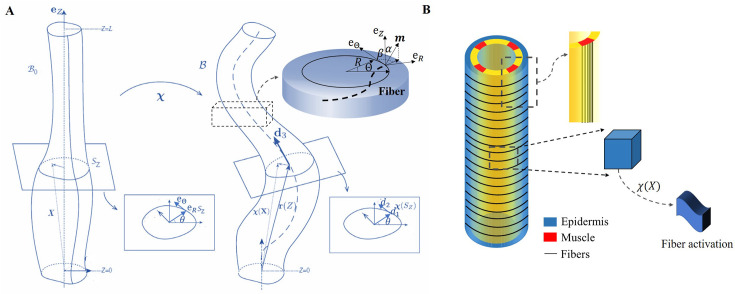
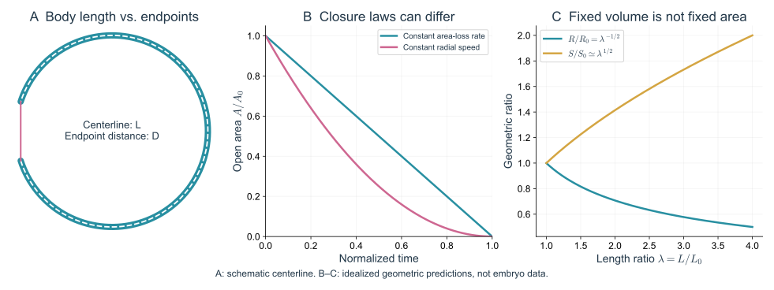
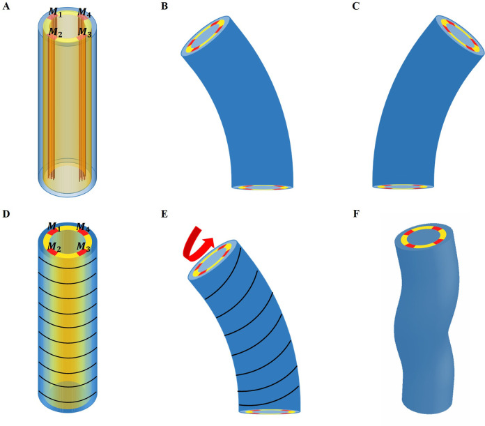
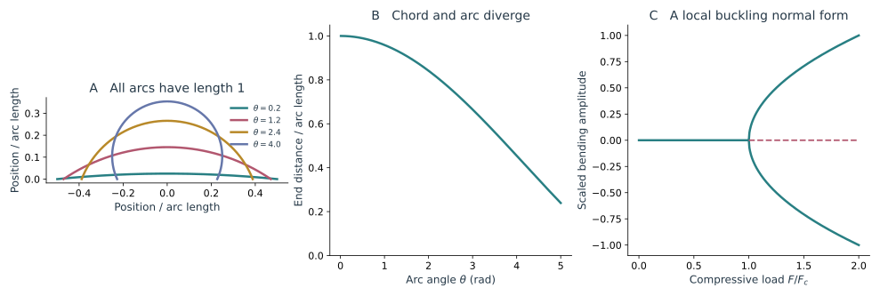
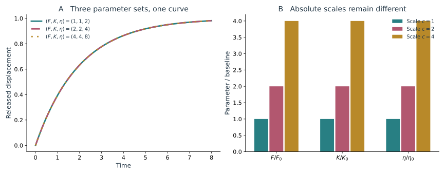

胚胎进入卷曲阶段后，头尾之间的距离可能越来越短，身体却仍在伸长。肌肉还会使它弯曲、转动，同一条连接也随之离开原来的成像平面。此时若继续用画面里的长轴代表身体长度，就会把空间运动混进材料形变。

三维模型首先要解决怎样描述这个身体，然后才是怎样计算它。中心线记录身体经过哪里，截面方向记录肌肉和表皮朝向哪里；把这些几何量同主动收缩、材料性质和卵壳接触联系起来以后，还需要检查，模型中的哪些参数确实能由实验分开。

## 1 三维体形 运动与卵壳约束

<figure class="celegans-video celegans-stage-video" id="stage-motion-three-dimensional-motion" style="--stage-video-width: 20rem;">
<video controls loop preload="metadata" playsinline width="212" height="338" aria-label="卵壳内的三维弯曲与旋转" aria-describedby="stage-motion-three-dimensional-motion-caption">
<source src="https://ars.els-cdn.com/content/image/1-s2.0-S1534580725003673-mmc3.mp4" type="video/mp4">
浏览器暂不支持内嵌播放，请打开下方原始视频。
</video>
<figcaption id="stage-motion-three-dimensional-motion-caption"><strong>动态影像｜卵壳内的三维弯曲与旋转</strong> 
DLG-1::RFP 显示表皮连接，影片追踪胚胎在卵壳内的旋转。留意同一身体区域怎样进入和离开视野：二维投影中的缩短，可能来自弯曲和转动，不能直接当作材料回缩。 
来源：Yang 等（2025），Video S1，Developmental Cell，CC BY-NC 4.0。<a href="https://pmc.ncbi.nlm.nih.gov/articles/PMC12549353/#mmc3">原始页面与说明</a>。</figcaption>
</figure>

### 1.1 用身体中心线追踪卷曲中的伸长

超过早期伸长后，身体在卵壳内弯曲并卷成较复杂的形态。二维图像中的长轴或外接框不再等于身体长度；身体仍在变长时，头尾端点甚至可以彼此接近。

令中心线为 $\mathbf r(q,t)$，$q\in[0,1]$ 为曲线参数，则

$$
L(t)=\int_0^1|\partial_q\mathbf r|\,\mathrm dq,
\qquad
D(t)=|\mathbf r(1,t)-\mathbf r(0,t)|.
$$

$L$ 是弧长，$D$ 是端点直线距离。三维弧长通常也大于相应二维投影的弧长。只有在投影近似保持在一个平面中，且前后端和重叠位置可辨认时，二维追踪才足以近似全长。

以弧长固定的圆弧为例，接近直线时 $D/L$ 接近 1，弯成半圆后降为 $2/\pi\simeq0.64$。实际弧长没有缩短，端点距离却已经减少约三分之一。若身体还在向成像平面外弯曲，二维投影的轮廓长度也会继续缩短。这就是为什么后期伸长曲线通常需要依靠三维追踪或可靠的身体展开，不能只测外接框。

曲线参数 $q$ 只负责给曲线上的点编号，不一定代表同一个组织小块。假如每一帧都把中心线重新均匀分成一百段，第五十个点可以在前后两帧对应不同的细胞。要计算局部材料应变，就应额外追踪同名细胞或稳定标记，并相对于参考身体坐标 $s_0$ 测量局部伸长 $\lambda=|\partial_{s_0}\mathbf r|$。曲线匹配得很平滑，并不能自动保证完成了材料追踪。

局部曲率可由

$$
\kappa=\frac{|\partial_q\mathbf r\times\partial_q^2\mathbf r|}{|\partial_q\mathbf r|^3}
$$

得到。它对轮廓噪声较敏感，平滑尺度会直接影响曲率峰。对于更复杂的扭转，还要区分中心线扭率、截面的旋转以及材料纤维相对截面的取向，它们并不总是相同的几何量。

曲率含有位置的二阶导数，轮廓上的很小锯齿会被显著放大。平滑不足会制造许多不存在的弯曲峰，平滑过度又会抹掉局部肌肉收缩引起的弯曲。跨阶段比较时，最好以相近的物理长度规定平滑范围，并检查结论在合理范围内是否稳定；若始终使用固定数量的像素，身体尺寸或成像分辨率改变后，实际比较的尺度也变了。

身体在空间中整体翻滚时，截面相对实验室的朝向发生变化，但相邻截面之间未必增加扭转。相反，中心线几乎不动时，肌肉区域和表皮纤维仍可能绕切线逐渐旋转。区分这两种运动，要沿身体辨认材料方向；仅从中心线轮廓计算一个扭率，无法替代肌肉或表皮标记的三维位置。

*图 1｜从圆柱到可弯曲的三维身体。引自 [Dai 与 Ben Amar（2024），Fig. 3](https://pmc.ncbi.nlm.nih.gov/articles/PMC11189629/#fig3)。A 使用中心线和各截面描述参考与变形构型；B 将外侧表皮纤维和四个肌肉区域放到同一模型中。图中的层结构属于模型理想化，需按原文参数和几何定义理解。*

Dai 与 Ben Amar 的工作尝试将早期伸长、肌肉驱动弯曲与扭转放入一个三维力学框架。其价值在于把过去主要依赖直径和全长的描述，扩展到中心线与截面自由度；其中关于肌肉工作如何影响长期伸长的机制，仍需与实际骨架和连接重塑证据共同约束。[Dai 与 Ben Amar，2024](https://doi.org/10.7554/eLife.90505)

图 1 把不同组织放在截面的具体位置，而不是只给身体一个平均刚度。这样，肌肉收缩既能贡献轴向合力，也能因为偏离截面中心而产生弯矩；表皮纤维的方向则影响这些负载怎样分配。同一套局部材料假设因此可以同时产生长度、曲率和旋转三个层面的预测。它比只计算全长更受约束，因为一种参数改变即使改善了长度曲线，也可能让弯曲方向或扭转幅度偏离观测。

### 1.2 弯曲形态可能同时来自主动驱动与空间限制

一条持续增加弧长的身体被限制在卵壳内，即使没有指定复杂的主动弯曲程序，也会遇到接触、挤压和弯曲代价。肌肉活动同时又会主动改变局部曲率。真实体形是内部驱动与外部约束的共同结果。

在细长体近似下，一个常见的弯曲能结构是

$$
E_b=\frac12\int B(s)\bigl[\kappa(s)-\kappa_0(s)\bigr]^2\,\mathrm ds.
$$

$B$ 是弯曲刚度，$\kappa_0$ 表示局部偏好的曲率或主动参考状态。卵壳接触再通过约束或接触力进入问题。这个形式清楚地区分了两种来源：身体被边界迫使弯曲，和组织主动改变其偏好形状。

仅用最终卷曲轮廓拟合 $B$ 或 $\kappa_0$ 往往不唯一。能够增加约束的观测包括同一身体区域随肌肉相位的曲率变化、与卵壳的接触位置，以及解除或改变驱动后的恢复行为。

弯曲能对曲率求导给出弯矩，形式为 $M=B(\kappa-\kappa_0)$。因此一条弯曲的身体可能是在外力作用下偏离自身的直线参考形状，也可能已经具有接近当前曲率的主动偏好。前者在释放外部约束后倾向于伸直，后者在主动状态保留时仍倾向于弯曲。观测到同一个 $\kappa$，并不能确定两种状态中的哪一种。

还可以设想一段没有受到外弯矩、局部达到 $\kappa=\kappa_0$ 的理想材料。此时无论 $B$ 多大，它都取同一个偏好形状。静态形状完全不含刚度尺度的信息；只有外加扰动或恢复动力学，才开始显露抵抗变形的程度。这个简单例子说明，形状很精细并不意味着力学参数也同样确定。

### 1.3 运动开始并不等于形态发生结束

最初的抽动标志肌肉开始提供可见机械输入。局部收缩、身体弯曲、转动与较协调的运动随后逐步建立，并在发育过程中继续作用于表皮。

*图 2｜三类几何量的区分。A 比较弧长与端点距离；B 比较两种开口运动规律产生的面积曲线；C 给出圆柱体积近似保持时的半径与侧面积关系。曲线由相应解析关系计算，用于联系本文的几何定义。*

到了孵化前，咽、肌肉和运动系统已具备越来越完整的功能，身体最终通过卵壳局部开启离壳。孵化影像可以显示鼻端接触、局部卵壳变形与离壳后的运动，但不能仅从“挣动后离壳”确定全部弱化机制。[WormAtlas，Embryo Introduction](https://wormatlas.cropsci.illinois.edu/embryo/introduction/mainframe.htm)

运动能力在身体塑形过程中逐渐建立，肌肉的反复作用也参与了最终体形的形成。

## 2 从圆柱材料到可弯曲的身体

### 2.1 中心线之外还需要截面方向

一条曲线可以描述身体在哪里，却不能完整描述身体朝向哪里。设沿身体的每个截面带有三个单位方向：$\mathbf d_3$ 沿身体切线，$\mathbf d_1$、$\mathbf d_2$ 指向截面中的两个固定组织方向。肌肉区域和表皮纤维附着在这些材料方向上，身体转动时会随之转动。

截面方向沿身体的变化可写为

$$
\partial_{s_0}\mathbf d_i=\boldsymbol\Omega\times\mathbf d_i.
$$

$s_0$ 是参考身体上的弧长坐标。$\Omega_1$、$\Omega_2$ 表示截面如何弯转，$\Omega_3$ 表示它绕切线如何扭转。身体接近直线时，这些量仍然可以定义；而单靠中心线的 Frenet 扭率，在曲率接近零的地方会变得不稳定。

这条导数关系可以理解为：沿参考身体走过一小段 $\mathrm ds_0$，截面的三个方向发生一小次转动，转轴和转角由 $\boldsymbol\Omega\,\mathrm ds_0$ 给出。两个垂直切线的转动分量使身体弯曲，沿切线的分量使截面绕身体轴旋转。它描述的是相邻材料截面之间的变化，所以不会把整条胚胎一起转动误认为局部扭转。

若身体已经显著伸长，按当前弧长和按参考弧长计算的“每单位长度转角”也不同。这里选用 $s_0$，是为了始终对同一段参考材料计量；与图像数据比较时，应做相应坐标换算。否则一段材料只是变长，单位当前长度的转角就可能下降，被误读成扭转松弛。

一个局部小应变、允许大转动的杆模型，可以使用

$$
E=\frac12\int_0^{L_0}\left[
K(e-e_a)^2+B_1(\Omega_1-\Omega_{1a})^2
+B_2(\Omega_2-\Omega_{2a})^2+C(\Omega_3-\Omega_{3a})^2
\right]\,\mathrm ds_0.
$$

$e$ 是轴向伸长应变，$K$ 是拉伸刚度，$B_1$、$B_2$ 是两个弯曲方向的刚度，$C$ 是扭转刚度。带 $a$ 的量表示主动活动改变后的偏好状态。例如，同一侧肌肉更短，会使身体偏好向这一侧弯曲；若截面的左右对称性被纤维取向或不同肌肉活动打破，也可以产生扭转。

这个杆能量便于分辨不同变形的代价。要把它与具体的细胞层联系起来，则需对截面内材料的应力做积分，求出 $K$、$B$ 和 $C$。Dai 与 Ben Amar 采用的正是从有限变形材料和主动预应变出发、再计算弯曲与扭转响应的思路，而不是只给中心线施加任意弯曲。[Dai 与 Ben Amar，2024](https://doi.org/10.7554/eLife.90505)

*图 3｜组织方向进入三维体形模型。引自 [Dai 与 Ben Amar（2024），Fig. 6](https://pmc.ncbi.nlm.nih.gov/articles/PMC11189629/#fig6)。A–C 比较左右肌肉组的活化与弯曲；D–F 把 actin 从环向到倾斜方向的变化与扭矩联系起来。A 的黄色区域用于标出肌肉位置，不代表一个真实存在的均匀组织层。*

图 3 中不同肌肉组的活化方式之所以重要，是因为合力与弯矩并非同一件事。对称位置的两组肌肉若产生相近的轴向力，弯矩可以互相抵消，身体仍有轴向负载；若一侧更强，抵消不完全，就会向一侧弯曲。肌肉离截面中心越远，同样的力通常具有越大的力臂。因而用一个只随时间变化的平均肌肉应力，不能保留左右活动差异造成的体形。

表皮纤维的倾角又提供了另一种方向耦合。沿圆周排列与斜向排列的纤维，在轴向伸长和截面旋转时经历的拉伸不同，因而会贡献不同的扭转响应。图中的三维形状是给定组织布局和活性条件后得到的模型结果；要确认胚胎使用了相应机制，还应比较实际纤维角度、肌肉相位以及身体转角的对应关系。

### 2.2 主动预应变怎样产生应力

有限变形中常写 $\mathbf F=\mathbf F_e\mathbf F_a$。$\mathbf F_a$ 表示主动改变后的局部参考构型，$\mathbf F_e$ 表示为了与邻近材料连接、满足边界条件而额外发生的弹性变形。被动应力由 $\mathbf F_e$ 计算。

假设左侧肌肉想缩短，而右侧暂时没有同样变化。两侧若能独立运动，各自达到偏好长度即可；但它们属于同一个身体，必须共享连续的截面。这种不相容会产生内部应力和弯曲。主动变化的方向、所在半径和相邻层刚度，共同决定它产生多少弯矩。

因此，相同大小的肌肉收缩，放在截面中心附近与外侧会产生不同弯曲；四个区域同步收缩与左右交替收缩，也会产生不同的体形。三维模型的价值就在于保留这些位置与相位关系。

乘法分解中的顺序也有明确含义：先用 $\mathbf F_a$ 表示组织在不受邻居限制时偏好的主动改变，再用 $\mathbf F_e$ 把这些彼此不完全相容的局部状态接成一个连续身体。实际观察到的 $\mathbf F$ 可以小于、等于甚至在某个方向上反向于主动偏好。想缩短的肌肉若被邻近组织拉住，就会存储弹性应力，而不一定达到它自己的自由缩短量。

前面的杆能量允许截面大幅转动，但轴向应变项仍采用局部二次近似。它适合说明一段身体的短时机械响应；若直接计算从早期到四倍长度的全过程，则需更新参考状态或使用有限伸长的能量。大转动和大材料应变是两种不同的近似问题，允许前者并不自动解决后者。

## 3 卵壳约束怎样改变弯曲

### 3.1 先区分长度增加与端点靠近

身体弯曲时，头尾直线距离会减少，即使身体弧长完全没有改变。例如一段固定长度的圆弧，随着张开的圆心角增加，弦长就会减小。显微影像中头尾靠近，因而可以同时出现在持续伸长、停止伸长或回缩的胚胎中。

*图 4｜身体长度、弯曲和约束的关系。A 比较不同圆心角的等长圆弧，每条弧长均归一为 1；B 给出弦长与弧长之比 $D/L=2\sin(\theta/2)/\theta$。C 为铰支细杆在接近 Euler 失稳时的标准化幅度关系，使用局部能量 $E(a)=(1-f)a^2/2+a^4/4$、$f=F/F_c$；它示意失稳分支，并非卵壳内完整接触计算。*

### 3.2 一条正在变长的身体为什么会弯曲

考虑一根长度为 $\ell$、弯曲刚度为 $B$、两端铰支的细杆。若轴向压缩力为 $F$，给它一个很小的侧向形变 $y=A\sin(\pi x/\ell)$。弯曲增加的能量与压缩力释放的能量分别是

$$
E_b=\frac{BA^2\pi^4}{4\ell^3},
\qquad
\Delta E_F=-\frac{FA^2\pi^2}{4\ell}.
$$

前者惩罚弯曲，后者奖励端点靠近。两项相抵时得到临界力

$$
F_c=\frac{\pi^2B}{\ell^2}.
$$

超过临界力后，笔直形态对小扰动不再稳定。这个结果解释了一个一般趋势：身体越长，轴向受限后越容易弯；刚度越高，越能抵抗弯曲。真实胚胎并非两端铰支的均匀杆，卵壳也会提供分布接触，因此上式适合作为尺度估计。

临界力中的 $\ell^{-2}$ 来自两种能量对波长的不同依赖。长波弯曲的曲率较小，弯曲代价随长度下降得更快，所以较长的杆用较小压缩力就能放大侧向扰动。边界若从铰支改成固支，或身体在中途多处接触卵壳，允许的弯曲形状会改变，临界值的系数也随之改变。

Euler 失稳本身是弹性几何效应，并不要求 actin 已改变参考长度。解除压缩后，理想杆仍可恢复直线；它不能单独解释周期结束后的永久伸长。主动肌肉还可以在低于这个压缩阈值时就让身体弯曲，所以看见弯曲也不是已经达到 Euler 临界力的证据。将失稳、主动弯矩和塑性更新分别保留，才能讨论它们在同一胚胎中的先后关系。

对线虫而言，身体长度增加而卵壳空间固定，会提高接触与弯曲的重要性；肌肉又在主动改变偏好曲率。被动受限弯曲和主动肌肉弯曲可以同时存在。若弯曲紧随某组肌肉的钙活动、并随相位反转，支持主动输入；若在持续增长后于特定接触位置出现，空间约束的贡献就更突出。

接触还会改变身体转动的阻力。三维模型因此需要同时处理自接触、卵壳接触与周围介质的耗散。只匹配某一帧卷曲形状，通常无法确定这几项贡献。

接触力首先阻止身体穿过卵壳，这种法向反力可以改变受力方向和曲率。若卵壳近似固定、接触又没有法向穿透，反力可以很大，却不一定做很多法向机械功，因为接触点在该方向几乎没有位移。沿壳滑动的摩擦和周围介质的黏性阻力则会耗散能量。把“接触更强”全部写成一个阻尼参数，会混淆几何约束与能量损失。

这也影响对旋转的解释。转动可能改变接触位置，从而让身体暂时找到更容易伸长的构型；它也可能增加滑动耗散。哪一种效应占优取决于体形、接触和驱动，而不是转得越多就必然伸长越快。三维轨迹提供了检验这些关系的机会，因为接触位置和转动方向都能够随时间追踪。

## 4 周期弯曲的能量怎样进入伸长

Dai 与 Ben Amar 尝试将肌肉诱导的弯曲、扭转、旋转和伸长放入同一能量框架，讨论储存的机械能与耗散怎样参与逐步伸长。这给局部 actin 重塑模型补充了一个身体尺度的问题：每个周期在整条身体上做了多少功，功主要存在哪里，又通过什么结构变化被保留？

若用 $E$ 表示储存的自由能、$P_{\rm active}$ 表示马达和肌肉提供的功率、$\mathcal D$ 表示耗散，基本收支为

$$
\dot E=P_{\rm active}-\mathcal D.
$$

一次弯曲结束后，外观可以接近原状，但连接、纤维参考长度或材料方向可能已经改变。这样的周期没有回到完全相同的内部状态，后续伸长才有了累积的可能。反过来，出现明显的应力—应变滞回圈，只能说明存在耗散；即使没有净伸长，黏弹性材料也可以产生滞回。

可以把一个周期内的机械能去向分开理解。弹性储能在回弹时能够释放，黏性损失则进入耗散；若网络参考状态发生变化，周期末保存的形状和后续承载关系也随之改变。肌肉活动造成很大的身体摆动，并不保证其中有很大比例留给了长期伸长。要说“弯曲能转化为伸长”，至少需要说明这种转化通过哪种内部变量发生，而不能只比较周期开始与结束的外观。

Dai 与 Ben Amar 的身体尺度框架提出了整体做功和三维变形之间的联系，[Lardennois 等（2019）](https://doi.org/10.1038/s41586-019-1509-4)的实验则为 actin 网络如何保留形变提供局部依据。两者可以相互补充，但身体模型中的能量转换假设，并不等于每个收缩周期中的具体分子过程已经被直接测到。将曲率、负载与网络更新放在同一时间序列中，才有望检验这条跨尺度联系。

局部塑性与身体能量并不是互斥的解释。前者描述哪些分子结构更新，后者描述这些更新与整体做功是否相容。将两者连起来，需要同时观测肌肉相位、局部参考形状变化、曲率和旋转，而不仅是一条平滑的全长曲线。

## 5 怎样区分能拟合同一条曲线的模型

### 5.1 一个精确的参数简并

局部切割后的 Kelvin–Voigt 释放曲线为

$$
u(t)=\frac FK\left(1-e^{-Kt/\eta}\right).
$$

曲线只含两个参数组合 $F/K$ 和 $\eta/K$。把三个量同时乘以任意正数 $c$，即 $(F,K,\eta)\mapsto(cF,cK,c\eta)$，整条曲线完全不变。再高的采样频率和再小的图像噪声，也不能仅从这条位移曲线恢复被隐藏的共同尺度。

*图 5｜拟合精确也可能存在参数简并。A 比较 $(F,K,\eta)=(1,1,2)$、$(2,2,4)$、$(4,4,8)$，三条解析曲线完全重叠；B 显示三组参数的不同绝对值。独立测得其中一个尺度后，另外两个才能由幅值和时间常数求出。*

这叫作结构上的不可识别性：不是样本还不够多，而是模型和观测本来就把若干参数压成同一个组合。相对地，结构上可区分的参数也可能因为噪声太大、时间窗太短而难以估计，那是实际精度不足。两类问题需要不同的解决办法。

图 5 中三条曲线重合到任何测量精度下都无法分开，因为共同倍乘是方程的精确对称性。多拍一百个时间点，能够更好地估计幅值和时间常数，却无法凭空产生第三个尺度。若只改变拟合初值，软件可能返回三组不同的绝对参数，每一组残差都很小；这时误差很小描述的是曲线拟合，并不表示每个参数都被确定。

实际精度不足则有不同表现。例如记录只覆盖释放最初的一小段，指数响应近似直线，连幅值与时间常数也难以分别估计。延长记录有助于这一问题，因为后半段的平台提供了新的曲线形状信息。它仍然不会打破共同倍乘的对称性。先判断数据缺的是后续时间，还是一种独立物理量，再决定下一项测量更有效。

### 5.2 新增哪一种测量才有帮助

若独立测得刚度 $K$，就可由幅值求 $F$、由时间常数求 $\eta$。若改为增加另一个方向的切割，通常首先帮助约束应力或刚度的方向比；是否能够恢复绝对值，还取决于两方向共享了哪些已知材料参数。新增一条曲线，并不自动新增一个独立的力标尺。

更一般地，设观测 $y_m$ 依赖参数 $p_\alpha$，局部敏感度为 $J_{m\alpha}=\partial y_m/\partial p_\alpha$。如果两列几乎成比例，改变两种参数会产生近似相同的数据变化，它们就难以分开。实验设计应寻找让这两列产生差别的条件。

例如，增加全长影像的帧数，未必能分开 seam 收缩增强与背腹表皮纤维排列加快；同时测纤维角度就更有帮助。对后期模型，记录 actin 承载比例与重塑事件，能够约束 $x_*$ 与 $J_*$，而只记录终点长度很难区分切断和再束化。对三维模型，左右肌肉相位与截面转角能帮助区分主动弯矩和卵壳接触。

细胞形状、局部材料响应和身体体形为同一个模型提供不同约束。若同一组参数同时解释这些变化，机制解释就比仅拟合长度更有依据。某项观测持续无法解释时，再检查模型缺少的是接触、结构更新还是另一种主动输入。

### 5.3 用扰动后的轨迹检验同一组参数

对于这组研究，一种具体做法是先用正常胚胎的局部切割、纤维取向和全长轨迹约束材料与驱动，再预测改变某项结构后会发生什么。例如在纤维重排模型中，减慢排列不仅应延迟整体伸长，还应改变同名细胞中取向和局部应变的先后关系；在两层传力模型中，减弱界面耦合应同时改变相对位移幅度和传播距离。一个模型若只预测“胚胎变短”，给出的限制仍然很弱。

检验时不宜为每个条件重新自由调节全部参数。若把收缩强度、黏性、纤维刚度和重塑速率全部重拟合，几乎总能找到一条相近的长度曲线，却无法知道最初提出的机制是否成立。更有信息的比较，是只按干预所针对的过程改变相应参数，保留其他已约束的量，检查模型能否同时预测时间、位置和方向上的变化。

周期输入还提供了独特的检验。若模型只含瞬时阈值塑性，在固定应力幅度下，它的平均伸长率不显式依赖频率；若加入需要恢复的纤维或连接状态，就可能出现频率相关响应。实验中同时控制或记录收缩幅度，再比较频率改变后的局部重塑与净伸长，便可以区分这两类机制。这里真正增加信息的是响应规律发生了变化，而不只是增加了一条相似的长度曲线。

## 6 高度可重复的形态如何容纳局部波动

线虫胚胎具有相当稳定的细胞身份与总体体形，但局部突起、myosin 流动、连接交换和肌肉收缩都存在明显波动。一个有吸引力的问题是：稳定的发育结果究竟依赖高度精确的每一步轨迹，还是依赖能够纠正局部偏差的组织反馈？

两种情形在平均图像中可能相近，在胚胎之间的协变结构上却不同。例如，某一局部收缩较弱时，邻居是否增加变形？一侧前沿暂时延迟时，对侧是否改变推进？肌肉某一周期没有留下净伸长后，下一周期是否补偿？这些关系可以把“发育稳定”从终点方差转化为动态反馈问题。

线虫的谱系坐标让同名细胞能够跨胚胎匹配。把细胞身份、局部分子状态、接触与应变一起追踪，就有机会判断波动在哪里产生，又在哪里被邻居补偿。

跨胚胎对齐也可能掩盖本来关心的延迟。若把每只胚胎的伸长起点和终点都强行拉到同一时间轴，收缩与纤维排列之间的真实时差可能被压小。按形态阶段比较和按实际经过时间比较，各自保留不同信息；讨论反馈时，最好同时保留发育阶段、绝对时间和局部事件顺序。

邻居之间出现负相关，也还不足以证明主动补偿。一个区域变窄时，几何约束本身就可能迫使另一处变宽；所有细胞还可能共同受到肌肉或边界的输入。若急性减弱某一区域后，邻居才出现有时延的活动增强，并且这一增强有助于恢复形态，才更接近直接的反馈证据。高度稳定的谱系使这类局部比较更容易进行，但组织怎样纠偏，仍需靠扰动后的动态过程来判断。

对这类反馈的研究，将稳定的谱系和体形变成了可比较的基准：已知同一个细胞通常怎样运动以后，就可以定量追踪它偏离轨迹时，负载与结构变化如何传给邻居，又是否让后续发育回到原来的范围。

## 7 参考文献

1. Dai A, Ben Amar M (2024). [Cyclic muscle contractions reinforce the actomyosin motors and mediate the full elongation of C. elegans embryo](https://doi.org/10.7554/eLife.90505). *eLife*.

2. Lardennois A, Pásti G, Ferraro T, et al. (2019). [An actin-based viscoplastic lock ensures progressive body-axis elongation](https://doi.org/10.1038/s41586-019-1509-4). *Nature*.

3. Yang X, Ferraro T, Molnar K, et al. (2025). [Repeated extrinsic and anisotropic mechanical inputs promote C. elegans polarized adherens junction elongation](https://doi.org/10.1016/j.devcel.2025.06.012). *Dev Cell*.

← [04 肌肉驱动与形态记忆](/notes/celegans/embryonic_morphogenesis/late_elongation/) · [系列总览](/notes/celegans/embryonic_morphogenesis/)
