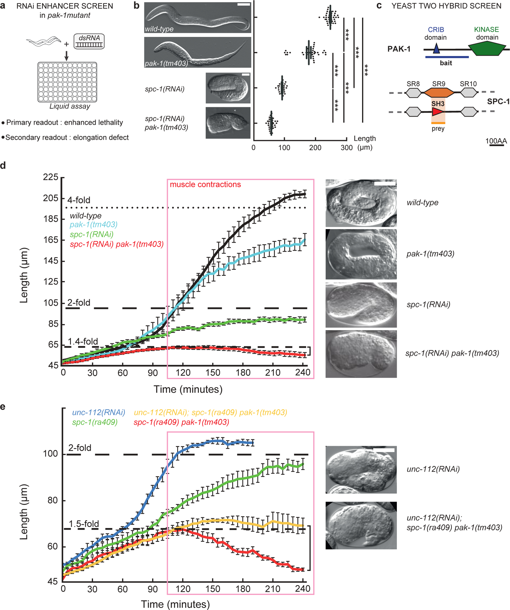
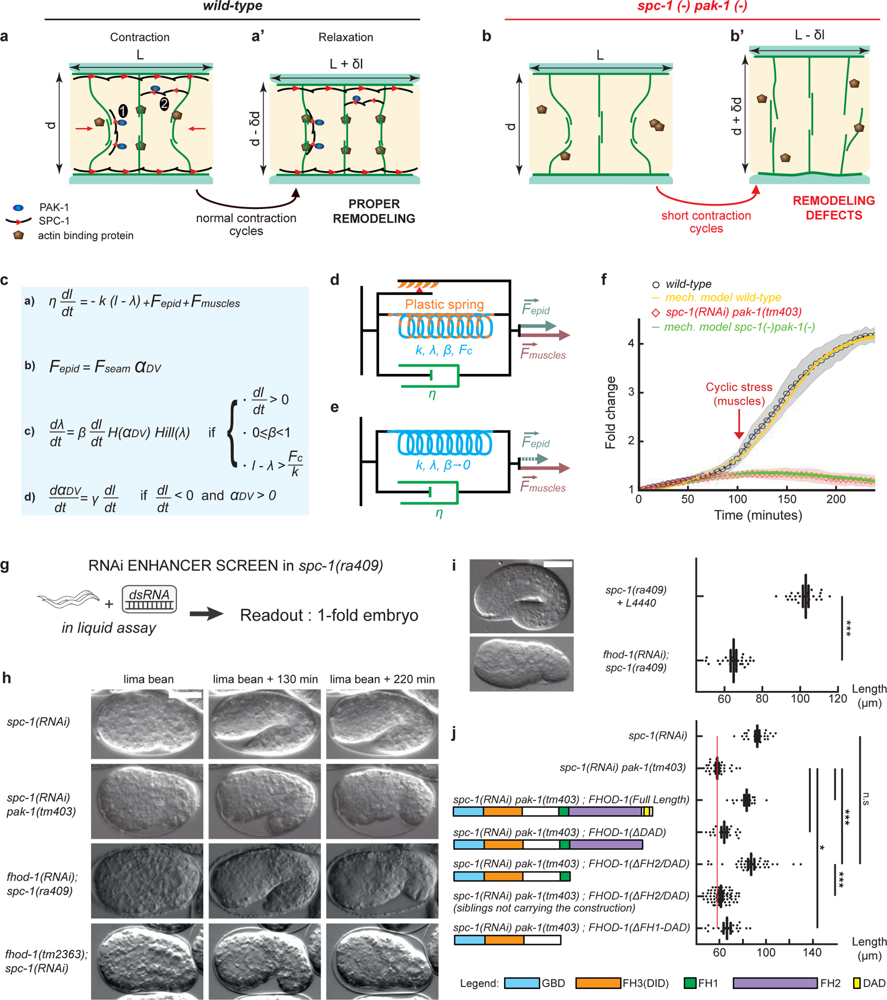
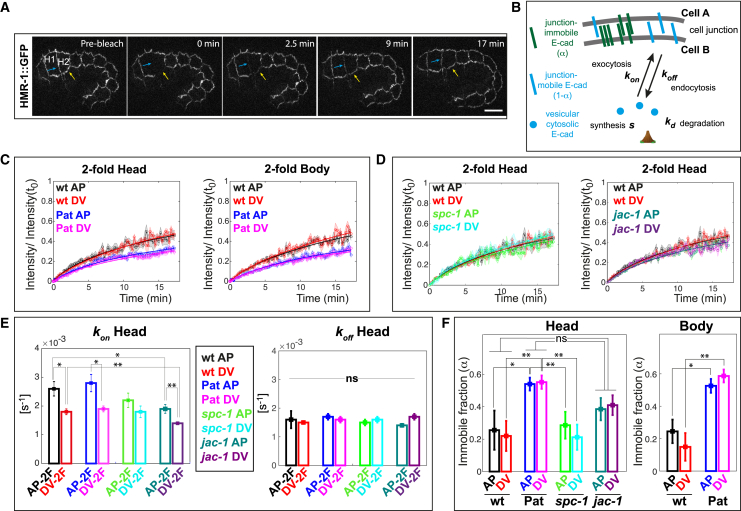
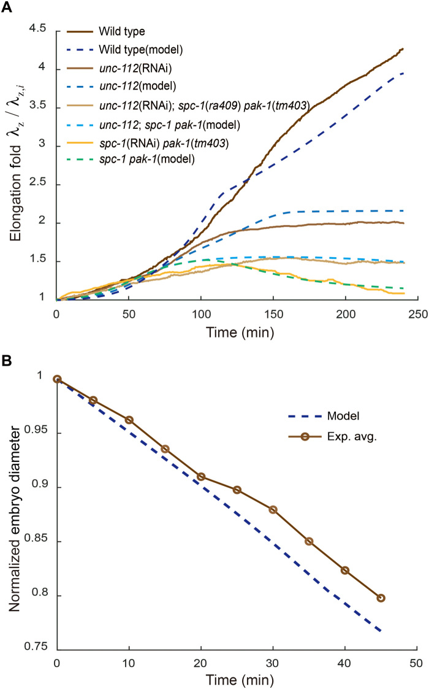
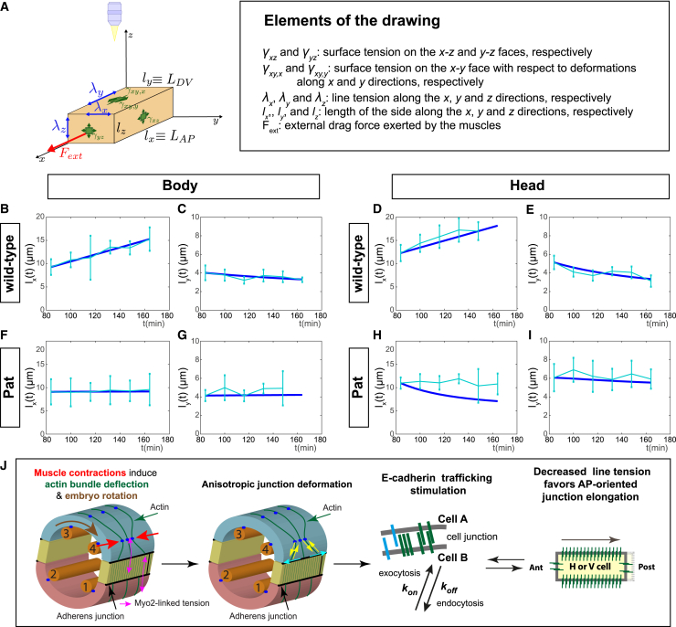
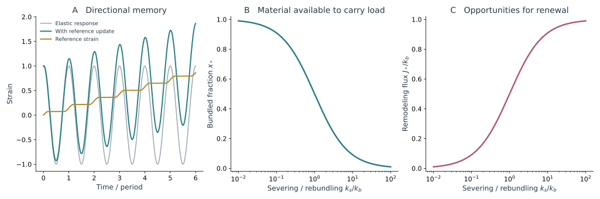
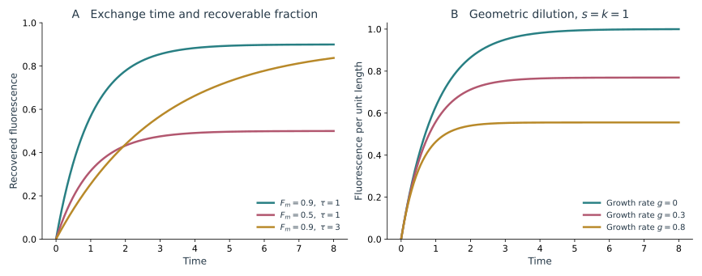
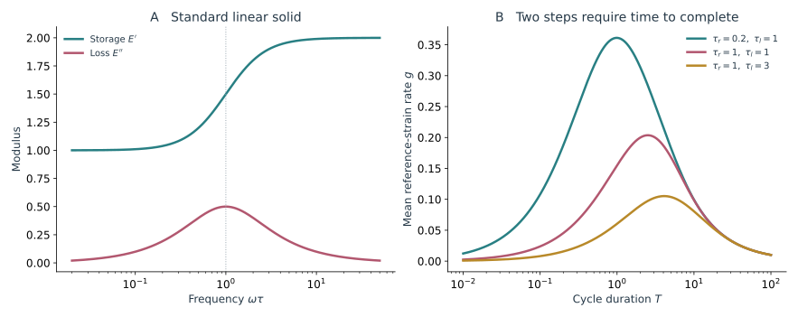

肌肉开始活动以后，胚胎在卵壳里反复弯曲、转动。表皮连接随之被拉直、回缩或起皱，身体的平均长度却逐渐增加。每轮活动中的大部分变形可以恢复，另一部分则通过骨架与连接的重塑保留下来。

后期伸长的模型围绕这部分保留展开：组织卸载后倾向恢复到哪个长度，这个长度怎样更新，更新后的网络又能否继续承载。Actin 的切断与重新束化、连接蛋白的交换，以及肌肉到表皮的传力，分别影响这一过程的不同环节。

## 1. 线虫研究：反复收缩怎样留下更多长度 {#1-late-elongation-反复收缩怎样留下更多长度}

线虫后期伸长的理论与实验联系较紧：黏塑性锁定、actin 切断与重新束化、连接周转耦合三维力平衡，分别处理形变保持中的不同结构。

<figure class="celegans-video celegans-stage-video" id="stage-motion-late-elongation" style="--stage-video-width: 20rem;">
<video controls loop preload="metadata" playsinline width="200" height="276" aria-label="肌肉抽动中的表皮变形与继续伸长" aria-describedby="stage-motion-late-elongation-caption">
<source src="https://ars.els-cdn.com/content/image/1-s2.0-S1534580725003673-mmc6.mp4" type="video/mp4">
浏览器暂不支持内嵌播放，请打开下方原始视频。
</video>
<figcaption id="stage-motion-late-elongation-caption"><strong>动态影像｜肌肉抽动中的表皮变形与继续伸长</strong> 
光片成像中的 DLG-1::RFP 标记表皮连接。观察肌肉抽动时连接的反复伸展与回缩，再比较较长时间内细胞群长度的变化；单次脉动和长期伸长叠加在同一段影像中。 
来源：Yang 等（2025），Video S4，Developmental Cell，CC BY-NC 4.0。<a href="https://pmc.ncbi.nlm.nih.gov/articles/PMC12549353/#mmc6">原始页面与说明</a>。</figcaption>
</figure>

### 1.1 肌肉与表皮通过什么结构相连 {#11-肌肉与表皮通过什么结构相连}

早期伸长主要依赖表皮自己的收缩活动。肌肉开始抽动以后，表皮还会受到内部肌肉的牵拉。体壁肌肉沿身体前后轴排列成四个区域，处在表皮内侧；不同区域收缩的时间不完全一样，因此身体会弯向不同方向，并在卵壳里转动。

肌肉的力并不是直接作用在卵壳上。肌肉与表皮内侧之间有细胞外基质 ECM，表皮自身又有内侧和外侧的附着结构，两侧通过中间丝网络联系起来。中间丝是一类能够承担机械负载的细胞骨架。论文把这套附着装置称为半桥粒样连接，在线虫中常缩写为 CeHD。[Zhang 等，2011](https://doi.org/10.1038/nature09765)

它与 adherens junction，即相邻表皮细胞之间的黏着连接，处在不同位置。CeHD 主要联系表皮厚度两侧的结构，细胞间黏着连接则把左右相邻的细胞连起来。可以先按这两个方向理解图 1：力既要从肌肉传入表皮，也要在表皮细胞之间继续分配。

*图 1｜肌肉活动进入表皮的多条路径。引自 [Labouesse 等（2026），Fig. 5](https://pmc.ncbi.nlm.nih.gov/articles/PMC13072950/#cells-15-00645-f005)。A 为跨越表皮厚度的 CeHD–中间丝连接；B 将交替肌肉活动与附着增强、actin 重塑、连接延长及极性变化联系起来；C 涉及肌肉与肠道的协调。各通路的原始实验与参考文献见综述相应章节。*

GIT-1、PIX-1、PAK-1 等分子参与连接加强和骨架调整。它们使“受力”和“结构变化”联系起来：肌肉的牵拉可以影响附着结构，附着结构改变后，下一次牵拉又会以不同方式传到表皮。因此，发育中的组织并不是一块性质固定、只被反复拉扯的材料。

肌肉活动、跨组织传力和表皮重塑可以分别受损。将肌肉钙信号、附着结构与表皮应变同时记录，能够判断伸长在哪一环节受阻。

可以把这条路径理解为一组相连的承载结构：肌肉产生收缩，附着和 ECM 将力传到表皮，表皮再通过骨架和连接承受局部牵拉。肌肉仍有钙活动时，若其中某个界面无法传力，表皮也可能收不到原有的机械输入。反过来，表皮不再正常变形，也不能单凭这一结果判定肌肉本身没有活动。图 1 中跨越表皮厚度的 CeHD–中间丝通路，正好说明为什么肌肉与表皮平面内的连接需要分别观察。

因此，肌肉附着受损的 unc-112 条件不能在所有问题中都被概括为一个“肌肉强度等于零”的参数。它改变了主动组织与被动承载组织之间的关系。模型若用这一条件检验某条传力路径，应同时说明设为零的是肌肉主动输入，还是输入能够传到表皮的那一部分。

### 1.2 周期形变与长期形变的分离 {#12-周期形变与长期形变的分离}

肌肉抽动带来秒级到几十秒级的变化，整个胚胎的持续伸长则要看更长时间。若材料的偏好形状一直不变，而且只作线性弹性响应，相同的加载和卸载就会反复得到相同形变，不会仅因次数增加而一直留下新长度。

一次收缩结束后，骨架或连接若已经重新组织，下一次收缩就可能从新的参考状态开始。要判断是否存在这种保持形变的过程，单看一只最终偏短的胚胎还不够，因为它可能从未正常伸长，也可能先伸长、后来又回缩。

Lardennois 等观察到的先伸长后回缩表型，把这两种情形在时间上分开了。已经获得的长度后来丢失，说明胚胎曾有能力产生相当程度的形变，却不能继续维持；驱动力与形变保持机制因此可以进一步分别研究。[Lardennois 等，2019](https://doi.org/10.1038/s41586-019-1509-4)

### 1.3 PAK-1 与 SPC-1 缺失揭示了保持形变的必要性 {#13-pak-1-与-spc-1-缺失揭示了保持形变的必要性}

研究通过 pak-1 背景下的筛选识别出 α-spectrin SPC-1。联合缺失时，胚胎可以先伸长，再出现肌肉依赖的回缩；进一步改变肌肉连接或收缩条件，又会改变回缩行为。回缩的发生因而与 actin 网络能否承受肌肉负载直接相关。

“在 pak-1 背景下筛选”是说，先使用 pak-1 已经受到影响的胚胎，再寻找哪些额外改变会让缺陷加重或发生变化。这样比较两个基因一起受影响和各自单独受影响的结果，可以发现它们在发育中是否有相互补偿或相互依赖的作用。SPC-1 是 α-spectrin，一种与细胞膜下骨架稳定有关的蛋白。

*图 2｜正常与回缩胚胎的长度轨迹。引自 [Lardennois 等（2019），公开作者稿 Fig. 2](https://pmc.ncbi.nlm.nih.gov/articles/PMC8086821/#F2)。D 为野生型及不同遗传条件下的长度时间曲线，联合缺失出现明显的后期下降；E 将肌肉受损条件加入比较。该公开稿图号与期刊版编排不同，图中的条件与误差定义沿用作者稿图例。*

图 2 显示，正常肌肉驱动作用在不稳定的表皮网络上，可能引起回缩。抑制肌肉后回缩减弱，支持肌肉负载参与了结构丧失。

长度曲线的峰值之前与之后应分别比较。峰值较低可能来自早期驱动力不足、伸长过慢，或较早发生失稳；峰值之后的下降则直接显示已获得的长度没有保住。若抑制肌肉只让下降消失，却没有恢复野生型的继续增长，它减少的是破坏性负载，不能据此称作形态发生被完全挽救。这个区分对遗传互作很重要：一个条件可以抑制某项表型，同时仍然缺少正常发育所需的过程。

### 1.4 骨架重新组织后怎样保住形变 {#14-骨架重新组织后怎样保住形变}

Lardennois 等提出，表皮 actin 在肌肉作用下发生缩短、切断和重新束化，随后由 PAK-1、SPC-1 及相关因子帮助稳定。这让网络经过一次受力后，不必完全恢复到原来的排列，已经得到的形变也能有一部分保留下来。作者用 actin-based viscoplastic lock 概括这种机制。

Severing 指 actin 纤维被切断，rebundling 指纤维重新组织成束。重新束化不一定是把每根纤维原来的断点原样接回，而是让改变后的纤维重新组成能承受力的网络。若它们以新的长度和排列重新稳定，组织就可能不再完全回到受力之前的形状。

Viscoplastic 可以译为黏塑性：形变具有与时间有关的过程，又有一部分在卸力后保留下来；lock 强调后者能够被维持。“锁住”是对这种效果的概括，具体实现仍来自骨架和连接的变化。

*图 3｜从网络重塑到长度累积。引自 [Lardennois 等（2019），公开作者稿 Fig. 4](https://pmc.ncbi.nlm.nih.gov/articles/PMC8086821/#F4)。A、B 为正常和失调网络的机制图；C–F 将力、黏性与变化的参考长度写入模型并比较长度曲线；G–J 为 FHOD-1 相关遗传与构建实验。作者稿中的方程排版应结合期刊更正后的版本阅读。*

参考长度指材料在指定内部状态下、不受外部拉伸时偏好的长度。想象一段长度为 10 的材料，被拉到 12；若完全卸力后仍回到 10，这次变化主要可以恢复。若结构已经重组，卸力后会停在 11，就说明参考长度改变了。实际胚胎还受到其他组织的力，不能直接这样随意卸载，但这个例子能说明模型为什么要同时记录当前长度与参考长度。

在连续介质语言中，可以分开总应变、可恢复部分和参考形变部分：

$$
\varepsilon=\varepsilon_e+\varepsilon_p,
\qquad
\sigma=E\varepsilon_e.
$$

$\varepsilon_p$ 记录在观察时间内不能立即恢复的结构变化。Actin 重新连接、纤维长度或方向改变、交联更新，都可以改变这一参考状态。

若采用随时间变化的参考长度 $L_r(t)$，则

$$
\varepsilon_e=\ln\frac{L}{L_r},
\qquad
\varepsilon_p=\ln\frac{L_r}{L_{r,0}}.
$$

肌肉驱动改变当前长度 $L$，网络重塑改变参考长度 $L_r$。即使当前负载回到原值，只要 $L_r$ 已经增加，身体也可以保留更大的长度。

参考长度并不是显微图中直接可见的另一条长度。图像测到的是组织在当前负载下的 $L$；即使某一时刻肌肉钙信号较低，其他肌肉、表皮和 ECM 仍可能施加负载。要估计 $L_r$，通常需要释放实验或一套包含力平衡的模型。不能把长度曲线经过平滑后的部分直接认作无载参考长度。

这里采用对数应变，两部分相加后得到 $\varepsilon=\ln(L/L_{r,0})$，与参考长度的逐步更新一致。在较小的单次形变内，也可以用线性应变近似；若跨越数倍伸长，则需要保持参考定义一致，或改用有限变形中的乘法分解。否则同一个“塑性应变”会因计算起点不同而得到不同数值。

原研究用 Kelvin–Voigt 模型描述可恢复形变，再让参考长度在特定受力阶段更新。部分方程曾有排版更正，复现时应采用[更正后的版本](https://doi.org/10.1038/s41586-019-1562-z)。

文献也会用 developmental ratchet，即发育中的棘轮效应，概括这种反复运动后仍能保留一部分形变的现象。棘轮的比喻强调一个方向上的累积，但组织怎样做到不完全退回，仍要靠具体的 actin 和连接实验解释。

还有一个容易混淆的方向问题：沿身体轴向排列的肌肉收缩，并不等于肌肉一直把整个身体向前后拉长。它先使局部组织受到周期牵拉和弯曲，随后表皮网络在受力中重排。若周向纤维以更短的参考长度重新连接，整个身体在体积和力平衡的约束下，可以获得更长的轴向形状。局部肌肉缩短与长期身体伸长之间，必须经过组织几何和网络重塑这几步，不能直接在两种长度变化之间画等号。

### 1.5 切断与束化的竞争可以改变形变方向 {#15-切断与束化的竞争可以改变形变方向}

Fang 等把主动应力、纤维取向和肌肉诱导的 actin 塑性放进同一个连续体模型，比较改变重塑速率后出现的进一步伸长、停止和回缩。[Fang 等，2021](https://doi.org/10.1126/sciadv.abg3264)

*图 4｜重塑速率之间的竞争。引自 [Fang 等（2021），Fig. 4](https://pmc.ncbi.nlm.nih.gov/articles/PMC8245039/#F4)。A 比较有无肌肉相关 actin 塑性的模型轨迹；B 改变切断和重新束化速率；C 显示参数空间中的长度增加或回缩区域。这些曲线和热图是模型输出，图中肌肉在 100 min 开启是模型的时间设定。*

如果纤维被切断后能及时以新的状态重新束化，网络可以保留足够的方向性和承载能力，同时改变参考长度。若切断过快、重新组装来不及，材料可能失去原有的纤维强化和主动承载，后续负载就不再产生同样的形变。

这个模型把“actin 周转更快是否有利于形态发生”转化成一个相对速率问题。过于稳定的网络可能阻碍持续重塑，过于不稳定的网络又可能无法保留已经获得的结构。组织所需的是在承载与更新之间维持合适的动态状态。

不同参数组合可能产生相近的全长曲线。局部直径、纤维角度和网络更新速度提供了额外约束；如何选择这些观测，在[三维体形与模型辨识](/notes/celegans/embryonic_morphogenesis/geometry_and_inference/)中继续讨论。

### 1.6 肌肉周期输入也会重塑细胞连接 {#16-肌肉周期输入也会重塑细胞连接}

Yang 等用光片等成像方式追踪肌肉交替活动、胚胎旋转和侧表皮连接，观察到持续伸长叠加在反复的局部变形之上。[Yang 等，2025](https://doi.org/10.1016/j.devcel.2025.06.012)

光片成像用一薄层照明，逐层记录胚胎，有利于较快获得三维影像。这里的 DLG-1::RFP 是把位于表皮细胞接触处的 DLG-1 标上红色荧光，用亮线追踪连接的形状。它显示的是连接的位置，并不直接显示肌肉的收缩力。因此研究还需要把肌肉活动与同一时段的连接变化对应起来。

相位说的是一次重复运动进行到了哪一步，例如正在收缩、已经达到最大弯曲，还是开始恢复。两个部位的信号即使频率相近，也可能一个总是先动，另一个稍后跟上；这段先后差就是相位差。

*图 5｜周期输入与持续伸长的同一时间序列。引自 [Yang 等（2025），Fig. 2](https://pmc.ncbi.nlm.nih.gov/articles/PMC12549353/#fig2)。A 为 DLG-1::RFP 标记的光片影像；B 比较侧表皮前后轴总长度的快速变化、运行平均与另一方向连接的变化；C、D 汇总周期及相关伸长率；E、F 对比野生型和肌肉受损条件下的局部细胞响应。*

全长曲线平滑时，相邻细胞的连接仍可以周期性变直、起皱和重新展开。保留这些快变化，才能比较肌肉输入与连接响应的相位。

图 5 同时保留快速长度变化和运行平均，正是为了避免只留下平滑增长曲线。同一条连接的峰值可能随着收缩相位往返，较慢的平均长度却逐渐增加。若把一段影像平均成一个数，这两项变化就会混在一起；若只看单次峰值，又容易把可恢复伸展当成长久伸长。

旋转还会改变连接在观察平面中的投影。追踪时应尽量在三维中沿同一条连接测量，并按同一块身体区域定义前后轴。若把胚胎当时在画面中的水平轴作为身体轴，身体转动本身就会造成假性长度脉动。只有先处理这一几何变化，才适合进一步比较连接伸缩与肌肉活动的相位差。

在小形变、相位定义一致的局部区间内，可以将某个长度或应变信号写为慢变均值与快速分量之和：

$$
\varepsilon(t)=\bar\varepsilon(t)+\widetilde\varepsilon(t).
$$

$\bar\varepsilon$ 的增长描述长期形态变化，$\widetilde\varepsilon$ 则包含周期负载与可恢复形变。二者的分离依赖分析时间窗；如果窗口接近整个发育过程，就可能把真正的阶段转变误当成缓慢背景。

### 1.7 肌肉活动与 HMR-1 周转 {#17-肌肉活动与-hmr-1-周转}

连接的位置看起来稳定，并不说明其中每个蛋白都一直留在原处。Yang 等进一步用 FRAP 研究 HMR-1/E-cadherin 的交换。FRAP 全称是荧光漂白后恢复：先让一段连接上原有的 GFP 信号变暗，再拍摄未漂白分子怎样补进来，观察亮度恢复的速度和程度。

如果只漂白连接中间很小一段，附近未漂白分子沿连接移动，也能很快把它补亮。研究者选择漂白整条连接，是为了减小这类侧向移动的贡献，让恢复更多反映连接与细胞内其他分子之间的交换。随后比较肌肉开始活动前后，以及 WT 与 unc-112(RNAi) 胚胎之间的差异。

*图 6｜肌肉活动与连接分子交换。引自 [Yang 等（2025），Fig. 5](https://pmc.ncbi.nlm.nih.gov/articles/PMC12549353/#fig5)。A 为 HMR-1::GFP FRAP 序列；B 为交换过程模型；C、D 比较野生型、肌肉受损和其他遗传条件；E、F 为动力学拟合得到的速率与 immobile fraction。荧光恢复曲线与分子运输参数之间的联系依赖图中所用动力学模型。*

在肌肉功能缺失条件下，后期连接上的 HMR-1 不动组分增加。为区分“没有肌肉活动”与“没有继续伸长”的影响，研究还使用能够抽动但伸长受阻的 spc-1 条件作比较。这种对照支持肌肉活动本身对连接周转的贡献，而不只是把全部差异归因于发育进程变慢。

FRAP 中的漂白只是让原有荧光标记变暗，并没有把这些蛋白从连接上删除。漂白后的 HMR-1 仍可参与黏附和承载；随后恢复的荧光来自未漂白分子的进入及原有分子的交换。因此，恢复很慢不等于连接上没有蛋白运动，也不等于那条连接必然更硬。它说明在给定观察窗内，可见标记重新进入被测区域的过程较慢，需要再用交换模型解释。

同样，“不动组分”是相对于实验持续时间而言的。一个十几分钟才交换的分子，在较短记录中可能被计入不动部分，记录足够久后却能看到恢复。比较野生型与突变体时，漂白程度、观察窗口、背景扣除及连接运动的校正应一致，才能将平台差异解释为可交换比例的变化。

若以 $C$ 表示连接上的可交换组分，$R$ 表示细胞内储库，最基本的交换关系具有

$$
\dot C=k_{\rm on}R-k_{\rm off}C
$$

的结构。真实分析还需要加入不同方向的连接、不可交换比例、储库的合成与降解，以及连接本身长度变化。若漂白后连接正在伸长，单一恢复半时间不再自动等于一个固定分子的结合寿命。

Junction fluidization 在这项工作中主要指连接分子的交换与重塑增强，使连接能够在牵拉中持续调整。交换更活跃并不自动等于组织尺度的黏度降低；二者之间还隔着分子交换如何改变负载路径这一步，可通过同步的应力与形变测量进一步联系。

早期 HMP-1 平均负载与周转的关系，以及后期肌肉周期输入对交换的影响，发生在不同阶段和承载路径上。将刺激位置与时间尺度放回实验，就能看到两项结果可以如何衔接。

## 2. 线虫研究：从周期变形到不可逆的结构锁定 {#published-lock-model}

Lardennois 等的理论从一个实验矛盾出发：肌肉活动已经能让身体弯曲、局部细胞变形，为什么某些胚胎仍无法继续伸长，甚至会把已经获得的长度丢掉？如果只把肌肉看作额外的平均拉力，就很难解释这种先伸长后回缩的轨迹。

作者先将胚胎表示为 Kelvin–Voigt 材料，让表皮贡献持续作用，肌肉贡献正负往返的周期作用。只增加平均为零的周期项，不能稳定产生不断增加的长度；材料会在卸载时恢复。于是模型加入随加载更新的弹簧参考长度，允许一部分形变在肌肉放松后保留。这一步把“活动更强”与“结构能否保存形变”分开。[Lardennois 等，2019](https://doi.org/10.1038/s41586-019-1509-4)

参考长度表示卸载后组织倾向恢复到的长度；它一旦更新，相同负载所产生的弹性偏离也会改变。原研究用 actin 折弯、缩短及 SPC-1、PAK-1、FHOD-1 的遗传关系，为这种有效记忆寻找结构依据。每次抽动中的具体更新路径仍未被逐一测定。

回缩还涉及承载结构的损伤。原模型把有效表皮作用写成 seam 主动作用与背腹 actin 承载因子的组合；spc-1 pak-1 条件下，后者随损伤下降。马达可以继续活动，但网络已无法维持原来的负载，身体便出现净回缩。

这些结果把结构更新与损伤放进了同一条长度轨迹。滑移、切断后重新成束和连接周转，都可能参与参考状态变化，需要按位置与时序进一步区分。Fang 后续显式引入 actin 承载和重塑事件，Yang 则从细胞连接交换建立了另一条描述。

## 3. 线虫研究：Actin 切断与重新束化的两个后果 {#3-actin-切断与重新束化的两个后果}

Fang 等将 Lardennois 等提出的网络重塑进一步写成两状态动力学。设完整、成束纤维比例为 $x=N_b/N$，切断速率为 $k_s$，重新束化速率为 $k_b$。

这里暂时把网络分成完整成束和等待重新束化两类，所以两类比例是 $x$ 和 $1-x$。重新束化从后一类中补回完整纤维，贡献 $k_b(1-x)$；切断从完整类中移走纤维，贡献 $k_sx$。两项相减，就是完整成束比例增加或减少的速度：

$$
\dot x=k_b(1-x)-k_sx.
$$

稳态和松弛时间分别为

$$
x_*=\frac{k_b}{k_s+k_b},
\qquad
\tau_x=\frac1{k_s+k_b}.
$$

$x_*$ 决定有多少纤维仍可有效承载。若纤维强化刚度与完整成束数近似成正比，增强切断会降低刚度。与此同时，重新束化的事件又是缩短周向参考长度的机会。

稳态时，切断与重新束化的速率相等，纤维仍持续更新。单位时间的重新束化通量为

$$
J_*=k_b(1-x_*)=\frac{k_sk_b}{k_s+k_b}.
$$

在 Fang 等的原模型中，重塑不仅改变瞬时刚度，还直接改变周向塑性伸长比。沿用其方向约定，有

$$
\dot\lambda_p=-\epsilon k_b(1-x).
$$

$\epsilon$ 是每次有效重新束化对应的缩短量。负号表示周向参考长度缩短；与身体的共同几何、体积及力平衡联立后，才转化为轴向伸长。这里更新的是参考状态，不是直接规定轴向速度。

增加 $k_s$ 会提高重塑通量，却降低承载比例。两种效应方向不同：更新可以保留新的参考形状，结构过度丧失又可能使组织失去维持形状的能力。因此，同一种“周转增加”可以带来进一步伸长，也可以带来回缩，结果取决于重新束化是否跟得上。

这给出了一个可检验的区别：改变切断和改变重新束化，即使使平均更新速度接近，也可能产生不同的承载比例和回缩倾向。以稳态为例，保持 $k_b$ 不变，让 $k_s$ 从 $0.1k_b$ 增加到 $k_b$，再增加到 $10k_b$，完整成束比例依次约为 $0.91$、$0.50$、$0.09$，而重塑通量依次约为 $0.09k_b$、$0.50k_b$、$0.91k_b$。最后一种条件下，单位时间发生的更新很多，但任何时刻能承载的完整纤维很少。仅凭“actin 更新很活跃”，无法判断网络能否维持形态。

肌肉刚开始作用时，$x$ 按时间尺度 $\tau_x$ 接近稳态。若切断与重新束化分别集中在不同收缩相位，网络还会在周期内变化；恒定平均速率近似省去了这部分先后关系。

在 Fang 等模型中，束化事件缩短周向的参考构型，而实际轴向长度还要通过材料关系、体积与力平衡求出。它不是简单地规定“一次切断就增加固定身体长度”。论文 Fig. 4 的参数图因此比较的是完整力学系统的伸长或回缩；上面的 $x_*$ 与 $J_*$ 则把其中两个竞争趋势单独拆了出来。[Fang 等，2021](https://doi.org/10.1126/sciadv.abg3264)

该模型把肌肉的反复作用进一步平均成有效的切断驱动，便于研究较慢的伸长轨迹。若要解释每个收缩周期中的 actin 弯曲和恢复，就需要让 $k_s$ 随瞬时负载、肌肉相位或纤维弯曲而变化。平均模型与逐周期模型回答的是不同时间尺度上的问题。

*图 7｜Actin 重塑模型中的伸长与回缩。引自 [Fang 等（2021），Fig. 5](https://pmc.ncbi.nlm.nih.gov/articles/PMC8245039/#F5)，CC BY 4.0。A 比较多条件的长度轨迹，B 比较直径；参数依照原论文的不同条件设置。该图也在早期伸长一篇中用于检验初始材料与取向假设，此处关注后期分支及网络损伤。*

## 4. 线虫研究：连接交换怎样进入实际的伸长模型 {#published-junction-model}

Yang 等的工作将分子交换与形变进一步接到了一起。实验发现肌肉活动会反复改变表皮连接的形状与受力，HMR-1/E-cadherin 的周转也随阶段和肌肉条件改变。关键问题是：这些交换只是伴随现象，还是会改变连接的力学作用，从而影响轴向伸长？[Yang 等，2025](https://doi.org/10.1016/j.devcel.2025.06.012)

模型将一个侧表皮细胞近似成长方体，分别记录前后轴、背腹轴和厚度方向的长度 $l_x,l_y,l_z$。细胞被视为不可压缩的三维主动黏性材料；膜面张力、连接线张力与肌肉传入的平均作用共同决定形变。这里已经同时保留三方向，连接伸长、细胞变窄与厚度改变需要满足同一体积约束。

以轴向分量为例，原文的本构与外部负载平衡为

$$
\sigma_{xx}
=2\eta\frac{\dot l_x}{l_x}-\Delta P
+\frac{2\gamma_0}{l_z}+\frac{2\gamma_0}{l_y}
+\frac{4\lambda_x}{l_yl_z}
=\frac{f}{l_yl_z},
\qquad
\frac{\dot l_x}{l_x}+\frac{\dot l_y}{l_y}+\frac{\dot l_z}{l_z}=0.
$$

第一项是黏性应力，压力 $\Delta P$ 保证体积约束；$\gamma_0$ 与 $\lambda_x$ 分别代表面与线的作用，$f$ 是肌肉沿轴向传入的平均力。其他方向有对应平衡，背腹方向还加入 actomyosin 的作用各向异性。它因此不是“测到连接变长，就给连接一个伸长速度”的运动学拟合。

连接上的 E-cadherin 浓度进一步进入线张力：在作者采用的线性关系中，E-cadherin 较多会降低该方向的有效线张力，使接触更容易展开。连接长度变化又会稀释单位长度的分子，募集与解离随后改变浓度。于是分子交换和几何形成反馈：受力改变长度，长度改变浓度与线张力，线张力再改变形变。

连接的交换时间、可动比例、分子输入与长度变化，共同决定进入力学方程的浓度。FRAP 约束了组分交换；整片表皮的流变性质还取决于这些组分如何参与承载。

*图 8｜连接周转模型与多方向形变数据。引自 [Yang 等（2025），Fig. 6](https://pmc.ncbi.nlm.nih.gov/articles/PMC12549353/#fig6)，CC BY-NC 4.0。A 为几何与参数；B–I 将头部、躯干和 unc-112 条件下两方向的模拟与实验比较；J 总结作者提出的反馈。连接交换率来自相应条件的测量，部分机械参数由正常形变拟合。*

E-cadherin 交换参数来自 FRAP 与荧光分析；正常胚胎的平均轴向速度参与肌肉输入的估计，其余面、线张力与黏性相关参数由正常形变约束。检验肌肉异常时，作者保留基线机械参数，撤去平均肌肉输入，并使用该条件下测得的交换动力学，再比较头部与躯干的 AP、DV 形变。正常轴向速度参与了定参，其他方向、位置与扰动条件则增加了模型约束。

模型采用平均作用，没有逐次模拟每一组肌肉的收缩和完整旋转。它对长期连接长度的解释，不等于已经解释了所有秒级相位关系。作者还将模型对 E-cadherin 内外运输的预测，与 JAC-1/p120-catenin 干预比较：交换受影响并不总导致伸长彻底停止，符合肌肉传力是主要驱动、连接运输调节其效果的解释。

Lardennois 的参考长度更新解释形变的保留，Fang 的模型将更新进一步分解为 actin 承载与重新成束，Yang 的模型则把实测连接周转接入三维力平衡。这些结构可以在同一胚胎中协同作用；局部 actin 状态、连接动力学和卸载响应，能进一步约束各自的贡献。

## 5. 线虫研究：从细胞自主机制走向组织间的力传递网络 {#5-从细胞自主机制走向组织间的力传递网络}

PGC hitchhiking 展示了一个细胞利用邻居运动进入内部；腹侧表皮在神经母细胞构成的环境上迁移；后期肌肉则通过 ECM、CeHD 和表皮骨架影响身体形态。它们都说明，研究某类细胞的运动，需要同时确定它正在与谁交换力。

因此，在表皮上看到缺陷，不一定说明最早的问题也出在表皮。肌肉、肠道或神经母细胞先发生改变，都可能再影响表皮。研究者可以只在某类细胞中改变或补回蛋白，也可以在指定时间做局部干预，再同时记录两个组织，追踪变化先从哪里开始。

2025 年 Llense 等对肌肉协调的研究进一步扩展了这条链。利用钙报告系统，他们识别出每个肌肉区域中具有 leader 功能的细胞；消融这些细胞可使收缩停止并延迟伸长。靶向筛选还把肌肉和肠道中的 innexins，以及肌肉 DEG/ENaC 通道，与正常肌肉活动联系起来。[Llense 等，2025](https://doi.org/10.1242/dev.204242)

钙报告系统使用对细胞内钙变化敏感的荧光标记，帮助追踪肌肉活动的时间。它给出的是与活动有关的信号，不是直接的拉力读数。研究者再结合收缩影像和细胞消融，判断哪些细胞对协调活动更重要。Innexins 是能参与形成细胞间通道的蛋白；把它们与肌肉活动联系起来，说明肌肉群的协调还依赖细胞之间的通信。

这项工作提出了一个新的层次：表皮接收到怎样的机械输入，还取决于肌肉群怎样协调。频率、相位、区域间同步和输入方向，都可能影响同样总收缩活动最终能留下多少伸长。肌肉不宜在所有模型中都被指定为一个完全外加、组织间协调不变的周期函数。

跨组织模型因而有两组不同的动态变量：负载传播决定一次收缩影响到哪些界面，驱动协调决定下一次收缩何时、何地发生。若表皮的机械状态反过来影响肌肉活动，两组变量还会通过反馈耦合。此时将肌肉指定为始终不变的正弦输入，就可能遗漏发育过程中输入本身的变化。

## 6. 理论借鉴：周期黏弹性与定向参考状态更新 {#周期黏弹性与定向参考状态更新}

通用黏弹性、阈值塑性、周期等待与反应扩散模型，可用于比较这些机制的时间尺度和测量结果。它们在这里作为解释与检验工具，不逐一对应某种已确定的线虫分子过程。

可恢复部分可先写成 Kelvin–Voigt 关系，弹性项抵抗已有形变，黏性项抵抗形变速率：

$$
\sigma(t)=E\varepsilon(t)+\eta\dot\varepsilon(t).
$$

$\sigma$ 是应力，$\varepsilon$ 是应变，$E$ 与 $\eta$ 分别为弹性模量和有效黏性。恒定应力下，应变逐渐接近弹性平衡；卸载后，只要参考状态未改变，足够长时间后就会恢复。

对给定应力 $\sigma=\sigma_0\cos\omega t$，略去启动瞬间的过渡，周期响应为

$$
\varepsilon(t)=\frac{\sigma_0/E}{\sqrt{1+(\omega\tau)^2}}
\cos(\omega t-\delta),
\qquad
\tau=\frac\eta E,
\quad
\delta=\arctan(\omega\tau).
$$

$\tau=\eta/E$ 决定响应时间。慢驱动下，应变接近弹性响应；快驱动下，黏性使幅度减小、相位落后。稳定周期中，同一相位的形变保持相同，卸载后再逐渐恢复。

若把弹簧和阻尼串联，得到 Maxwell 材料，持续的平均应力可以造成蠕变。但对线性、参数固定的 Maxwell 模型，零均值周期应力也不会在稳定周期中自动积累净应变。因此，解释肌肉周期输入的贡献时，要同时说明平均负载、材料更新和周期分量的作用。

这里固定的是输入应力。若实验控制肌肉缩短量或局部位移，材料改变后输入应力也会变化，幅度与频率的比较便不同。真实肌肉处于两者之间，解释表皮响应时要同时记录驱动本身的变化。

令 $\varepsilon_p$ 表示沿体轴保留的参考应变，取

$$
\sigma=E(\varepsilon-\varepsilon_p),
\qquad
\dot\varepsilon_p=\frac{[\sigma-\sigma_y]_+}{\eta_p}.
$$

$[x]_+=\max(x,0)$，$\sigma_y$ 是触发重塑的阈值。应力较小时，形变主要被弹性储存；超过阈值时，参考长度开始更新。负向半周期没有反向更新项，所以已经获得的长度可以保留。这种方向选择是模型的关键假设，代表需要由 actin 重塑与连接过程解释的整流作用。

对 $\sigma=A\cos\omega t$，当 $A>\sigma_y$ 时，每周期平均参考伸长率可以直接积分：

$$
\langle\dot\varepsilon_p\rangle
=\frac{A}{\pi\eta_p}
\left[\sqrt{1-a^2}-a\arccos a\right],
\qquad a=\frac{\sigma_y}{A}.
$$

低于阈值时平均值为零，超过阈值后才出现累积。这条瞬时更新规则没有额外等待时间，因此平均速率不显式依赖频率；每周期累积量等于这个速率乘以周期。若实验中平均速率随频率明显变化，就需要加入网络恢复或连接更新的时间尺度。若再加入完全对称的反向塑性规则，同一个零均值正弦输入的净累积又会抵消。由此可见，周期驱动提供了重复的做功机会，保留伸长还要求组织在两个半周期中采取不同的重塑方式。

*图 9｜周期驱动与形态记忆的最小算例。A 以零均值正弦应力比较弹性应变和加入单向阈值更新后的总应变，取 $E=1$、$A=1$、$\sigma_y=0.4$、$\eta_p=1$。B 为固定束化速率时稳态承载比例与切断速率的关系；C 为同一模型的稳态重塑通量。A 的单向更新规则与 B、C 的两状态动力学分别用于说明整流和速率竞争，未把它们拟合为某一基因的实验参数。*

## 7. 理论借鉴：荧光恢复与伸长稀释 {#荧光恢复与伸长稀释}

漂白后回来的荧光，取决于未漂白分子如何进入观察区域，也取决于漂白分子如何离开。先考虑连接形状固定、储库充分且有效交换率不随时间变化的情况。若可恢复荧光 $F$ 满足

$$
\dot F=s-kF,
\qquad F(0)=0,
$$

就有 $F(t)=(s/k)(1-e^{-kt})$。把漂白前荧光归一化为 1，并允许一部分分子在观察时间内不交换，常写成

$$
F(t)=F_m\bigl(1-e^{-t/\tau}\bigr).
$$

$F_m$ 是可恢复比例，$1-F_m$ 是相应的不动比例，$\tau$ 表示这套单指数近似下的恢复时间。相同恢复时间可以搭配不同平台；相同平台也可以搭配不同恢复速度。只报一个半恢复时间，会丢掉这两类差异。

当记录时间远短于 $\tau$，指数函数近似为 $F(t)\simeq(F_m/\tau)t$。这时数据主要确定初始斜率 $F_m/\tau$，较低的平台加较快的交换，或较高的平台加较慢的交换，都可能拟合得很好。平台还没有显现时，软件给出的不动比例可能对时间窗十分敏感。延长记录或加入独立约束，才有助于分开这两个量。

如果存在快、慢两类可交换分子，曲线还可能由多个指数叠加。较慢的一类在短记录中看起来就像不动组分。这并不要求每次都采用最复杂的拟合，但在把拟合参数对应到某类结合或解离过程之前，需要检查最简单模型是否已经遗漏了明显的时间尺度。

这个 $k$ 是有效交换率。若希望把它进一步解释为特定分子的解离率，需要确定储库、可用结合位点和运输过程怎样进入动力学。尤其在漂白区较小时，沿连接的侧向扩散也会参与恢复。Yang 等采用整条连接漂白，正是为了减小这一贡献。

假设某段连接长度为 $L(t)$，单位长度的荧光为 $c_f$，总荧光为 $N_f=Lc_f$。设单位长度的输入为 $s$，分子以速率 $k$ 离开，则

$$
\frac{\mathrm d}{\mathrm dt}(Lc_f)=Ls-kLc_f.
$$

展开后得到

$$
\dot c_f=s-\left(k+\frac{\dot L}{L}\right)c_f.
$$

多出来的 $\dot L/L$ 是几何稀释：同样数量的荧光被分摊到更长的连接上。若局部伸长率近似恒定为 $g$，恢复曲线的有效速率就是 $k+g$。只追踪平均强度、又不校正长度变化时，几何变化可以被误认为交换变快。

在这个算例中，伸长还把单位长度强度的平台从 $s/k$ 降为 $s/(k+g)$。于是，更快接近一个较低平台的曲线，可以完全由几何稀释产生，而不需要改变分子离开连接的速率 $k$。若改测整个被追踪连接的总荧光，长度因素又会以不同方式进入。图 10 的两组曲线因此对应两种数据解释问题：恢复速度与恢复比例是否分开，以及测量量在连接伸长时是否仍代表同一个物理量。

*图 10｜FRAP 的恢复比例、时间与几何稀释。A 比较不同可恢复比例和恢复时间；B 在相同分子交换率 $k=1$、单位长度输入 $s=1$ 下，比较固定连接与以恒定相对速率伸长的连接，其密度为 $c_f=(1-e^{-(1+g)t})/(1+g)$。曲线为解析解，说明信号归一化与几何变化对拟合的影响。*

Yang 等的分析还区分方向、储库和不动组分。总荧光与单位长度强度、恢复平台是否达到、记录能否分辨快慢交换，都会改变拟合参数的含义。

单指数交换把漂白区域视作一个充分混合的小室。若分子能沿连接移动，另一条路线是保留空间位置。对当前连接上的荧光密度 $c(s,t)$，一个一维守恒形式是

$$
\partial_tc+\partial_s(vc)
=D_\parallel\partial_s^2c+s_0-kc.
$$

$v$ 是连接材料的局部速度，左侧第二项同时包含运输和伸长稀释；右侧依次为侧向扩散、储库输入和离开连接。连接固定、参数恒定时，偏离稳态的第 $q$ 个空间模态按 $e^{-(k+D_\parallel q^2)t}$ 衰减。均匀交换贡献与波长无关，扩散贡献则随 $q^2$ 增加。

改变漂白区宽度可以分辨扩散与交换的贡献。扩散主导时，恢复时间随宽度平方增加；储库充分、局部交换主导时，宽度依赖较弱。整条连接漂白可减少来自邻近未漂白区域的恢复，端点输入、胞质储库和连接移动则仍可能影响曲线。

模型选择还影响“不动比例”的含义。慢扩散、慢解离和暂时不可进入的储库，都可能在有限时间窗内表现为恢复不足。只有结合空间恢复轮廓、漂白尺寸和足够长的记录，才更容易把这些可能性拆开。

## 8. 理论借鉴：材料性质取决于观察的时间尺度 {#6-材料性质取决于观察的时间尺度}

Actin cortex、细胞连接和 ECM 都在不断更新。一个结构在单次激光释放的时间内可以近似弹性承载，在数分钟的细胞运动中发生黏性松弛，在更长的发育过程中又通过周转改变参考形状。因此，给组织贴上“弹性”或“流体”标签之前，需要明确实际比较的过程。

若用 $\tau_r$ 表示相关结构的重塑时间、$T_d$ 表示驱动或观察时间，一个常用的时间尺度比较是

$$
\mathrm{De}=\frac{\tau_r}{T_d}.
$$

$\mathrm{De}\gg1$ 时，结构来不及更新，短时间响应更容易保留原有承载；$\mathrm{De}\ll1$ 时，结构可在驱动过程中充分重排。真实组织具有多个 $\tau_r$：交联交换、actin 周转、cadherin 交换和 ECM 更新并不必相同。因而它更接近一组随阶段变化的松弛谱，而不是只有一个时间常数的材料。

若驱动比结构更新快，负载更容易暂时储存在网络中；若更新足够快，材料可以在驱动期间重新安排。实验上改变周期、同时记录取向与交换，有助于检验这两种情况。

实际使用 $\mathrm{De}$ 时，应先指出分子与过程。例如拿 cadherin 的交换时间除以肌肉周期，问的是一次收缩中连接来不来得及更新；拿 actin 重新束化时间去比较，问的则是骨架能否在下一次收缩前恢复。两者的比值可以处于不同范围，同一表皮因而可能在某条承载路径上近似弹性，在另一条路径上持续重排。

改变频率的实验也需要同时记录每次收缩的幅度和相位。更频繁的活动可能改变单位时间做功、网络恢复程度和组织协调，不能把所有差异都归于一个无量纲数。若能在相近的输入幅度下比较不同周期，再分别测连接交换与 actin 更新，才更容易判断究竟是哪一种结构时间限制了伸长。

Viscoplastic lock、severing–rebundling 与连接交换涉及不同结构。将它们在同一位置的时间变化对应起来，能够判断其先后顺序和相互依赖。

前面用 Kelvin–Voigt 建立“纯周期响应不会自行留下新长度”的基线，但它不是所有可恢复材料的共同形式。Maxwell 模型把弹簧和阻尼串联，持续拉力会使应变不断增加；标准线性固体则把 Maxwell 支路与长期弹簧并联，既有短时刚度，又有长期仍能承载的部分。它们对一次短释放可以很接近，对很慢或很快的驱动却给出不同预测。

把输入写为小幅正弦应变，定义复模量 $E^*=E'+iE''$。$E'$ 对应与应变同相的储能部分，$E''$ 对应相差四分之一周期的耗散部分。标准线性固体的一个常用表达是

$$
E^*(\omega)=E_\infty+
E_1\frac{i\omega\tau}{1+i\omega\tau},
\qquad
E'=E_\infty+E_1\frac{(\omega\tau)^2}{1+(\omega\tau)^2},
\qquad
E''=E_1\frac{\omega\tau}{1+(\omega\tau)^2}.
$$

这里 $\tau=\eta_1/E_1$ 是 Maxwell 支路的松弛时间。很慢时，该支路有时间松弛，只剩 $E_\infty$ 承载；很快时，来不及流动的支路贡献额外刚度，模量趋于 $E_\infty+E_1$。耗散在 $\omega\tau=1$ 附近最大。Kelvin–Voigt 则有 $E'=E$、$E''=\omega\eta$，在其适用范围内耗散部分随频率增加。

因此，改变肌肉周期，同时测局部幅度和相位，可以区分一些在单次释放中难分开的材料。输入应力不易直接测量时，也可以用受控位移或独立的驱动估计，但需要明确所比较的是哪一种输入。对线性被动模型而言，即使耗散出现峰值，也不意味着净伸长率在那里最大；净伸长仍取决于参考状态怎样更新。

瞬时阈值塑性在固定应力幅度下没有内在频率选择，两状态平均动力学则给出承载比例和周转通量。还可以考虑第三条路线：显式记录一个收缩周期里事件发生的先后顺序。网络先被重塑，随后新排列要在下次强负载到来前稳定；若周期太短，某一步来不及完成，若周期很长，单位时间发生的有效事件又少。

可用一个顺序更新算例考察这两个时间的作用。每周期的重塑与稳定窗口分别为 $dT$ 和 $(1-d)T$，平均等待时间分别为 $\tau_r,\tau_l$。假设各步服从指数等待、每周期重新开始，并且两步都完成才保留参考应变 $\Delta\varepsilon_{\max}$，则

$$
\Delta\varepsilon_p(T)=\Delta\varepsilon_{\max}
\left(1-e^{-dT/\tau_r}\right)
\left(1-e^{-(1-d)T/\tau_l}\right),
\qquad
g(T)=\frac{\Delta\varepsilon_p(T)}T.
$$

这是用于比较的动力学假设，不是 Fang 或 Lardennois 模型的原方程。它明确规定了每周期重置和两个顺序时间窗，因此可以算出两个极限。$T$ 很小时，$g\simeq\Delta\varepsilon_{\max}d(1-d)T/(\tau_r\tau_l)$，快速驱动反而留下很少参考形变；$T$ 很大时，两步几乎都完成，但 $g\simeq\Delta\varepsilon_{\max}/T$，增长又受事件频率限制。中间因而出现有限的有效频率窗口。

如果结构可以跨多个周期继续恢复，或者失败事件会积累损伤，就不能每次重置，必须让状态连续演化。这样可以出现不同的最优周期、适应过程或回缩。可见“有一个更新时间”还不足以推出特定频率曲线，是否保留跨周期记忆同样重要。

实验上可以在相近收缩幅度下比较周期变化，再追踪 actin 重塑、连接交换和周期末参考形变。如果频率改变主要影响瞬时摆动，长期伸长不变，瞬时整流可能已足够；若局部事件的完成率和净伸长同时变化，显式恢复模型就更值得考虑。图 11B 展示的是第二种模型的可检验形状。

*图 11｜材料松弛谱与周期更新窗口。A 为标准线性固体，取 $E_\infty=E_1=\tau=1$。B 为周期更新模型，取 $d=0.5$、$\Delta\varepsilon_{\max}=1$，比较不同等待时间下的平均参考应变率。B 的峰值来自两步完成概率和每周期重置假设，不能从 A 的耗散峰值直接推出。*

| 建模路线 | 怎样产生或保留形变 | 主要区分量 |
| --- | --- | --- |
| 线性黏弹性与松弛谱 | 暂存与耗散；平均负载下可能蠕变 | 幅度、相位、释放与松弛 |
| 阈值黏塑性 | 超过阈值后更新参考状态 | 幅度阈值、加载方向与周期末残余 |
| 切断与重新束化 | 承载结构减少，同时产生重新稳定的机会 | 承载比例、事件通量与网络恢复 |
| 显式周期更新 | 重塑和稳定需要在相应时间窗完成 | 频率响应、事件顺序和跨周期记忆 |
| 连接反应扩散与运输 | 交换和侧向输运改变连接组分 | 漂白尺寸、空间恢复和材料运动 |
| 多组织协调模型 | 改变机械输入的位置、相位与传播 | 各肌肉区域相位及表皮局部响应 |

## 参考文献 {#references}

1. Zhang H, Landmann F, Zahreddine H, Rodriguez D, Koch M, Labouesse M (2011). [A tension-induced mechanotransduction pathway promotes epithelial morphogenesis](https://doi.org/10.1038/nature09765). *Nature*.

2. Lardennois A, Pásti G, Ferraro T, Llense F, Mahou P, Pontabry J, Rodriguez D, Kim S, Ono S, Beaurepaire E, Gally C, Labouesse M (2019). [An actin-based viscoplastic lock ensures progressive body-axis elongation](https://doi.org/10.1038/s41586-019-1509-4). *Nature*.

3. Lardennois A, Pásti G, Ferraro T, Llense F, Mahou P, Pontabry J, Rodriguez D, Kim S, Ono S, Beaurepaire E, Gally C, Labouesse M (2019). [Publisher Correction: An actin-based viscoplastic lock ensures progressive body-axis elongation](https://doi.org/10.1038/s41586-019-1562-z). *Nature*.

4. Fang C, Wei X, Shao X, Lin Y (2021). [Force-mediated cellular anisotropy and plasticity dictate the elongation dynamics of embryos](https://doi.org/10.1126/sciadv.abg3264). *Sci Adv*.

5. Yang X, Ferraro T, Molnar K, Pontabry J, Malanda SR, Maghelli N, Royer L, Grill SW, Myers G, Grigolon S, Labouesse M (2025). [Repeated extrinsic and anisotropic mechanical inputs promote C. elegans polarized adherens junction elongation](https://doi.org/10.1016/j.devcel.2025.06.012). *Dev Cell*.

6. Llense F, Ferraro T, Yang X, Song H, Labouesse M (2025). [Muscle and intestine innexins with muscle DEG/ENaC channels promote muscle coordination and embryo elongation in C. elegans](https://doi.org/10.1242/dev.204242). *Development*.

← [03 早期伸长与各向异性力学](/notes/celegans/embryonic_morphogenesis/early_elongation/) · [系列总览](/notes/celegans/embryonic_morphogenesis/) · [05 三维体形与模型辨识](/notes/celegans/embryonic_morphogenesis/geometry_and_inference/) →
