皮层里的 actin–myosin 可以持续流动，细胞边界却只缓慢移动；相近的轮廓还可能由不同的丝长、交联和周转状态维持。合子中的成像与扰动，已将分子反馈、产力、耗散和流动联系起来。到了多细胞胚胎，这些网络还要通过连接和细胞外基质共同承载，才能把局部活动变成内移、伸长与弯扭。

这里最需要接上的，是微观结构与组织参数之间的关系。马达数量怎样进入主动应力，丝的取向怎样进入刚度张量，结构交换何时改变机械松弛，又何时改变卸载后的参考形状，都不能仅凭荧光或流速推定。本篇在比较已发表线虫研究之后，给出从网络受力到表面张力、增量刚度和松弛时间的粗粒化思路。合子的参数只能提供待比较的物理量；伸长期表皮的数值、承载路径和时间尺度需要重新测量。

## 1. 线虫研究：合子皮层的网络 流动与极化 {#network-material}

线虫的合子皮层、分裂沟和全身伸长已有不同层次的定量研究。这里先连着看实测网络、流场、分子反馈及其对应模型，再讨论它们怎样参与具体的形态变化。

皮层是膜下方富含 actin、myosin 和结合蛋白的薄层。皮层流指这层材料相对于细胞形状的运动。影像中一群 NMY-2 斑点朝前移动，并不要求细胞中心同样朝前移动。胞质流发生在内部体积中，追踪对象往往是卵黄颗粒、示踪粒子或其他可见结构。细胞迁移则是细胞相对于邻居或胚胎的位移，需要以膜边界、细胞核或稳定身份来追踪。

三者可以耦合，也可以明显不同。一个近似不变形的受精卵可以同时出现表面向前、内部向后的流；内移细胞可以有快速皮层收缩，却因骨架与连接滑移而暂时不改变顶端面积。若把所有光流箭头都当成细胞移动，就会把这些力学关系混在一起。

<figure class="celegans-video" id="subcellular-cortex-movie">
<video controls loop preload="metadata" playsinline aria-label="线虫单细胞胚胎的actin与myosin皮层动态">
<source src="https://static-movie-usa.glencoesoftware.com/mp4/10.7554/670/799678248bca5712c1df75982fd90081006feb41/elife-17807-media1.mp4" type="video/mp4">
</video>
<figcaption><strong>动态影像｜轮廓 内部截面与表面骨架同时变化</strong> Reymann 等（2016），Video 1，CC BY 4.0。左侧是 Lifeact 标记的中间截面，中间为皮层 NMY-2，右侧为皮层 Lifeact。比较表面材料的重新分布与分裂沟出现的先后。<a href="https://elifesciences.org/articles/17807#video1" target="_blank" rel="noopener">原始影片与说明</a>。</figcaption>
</figure>

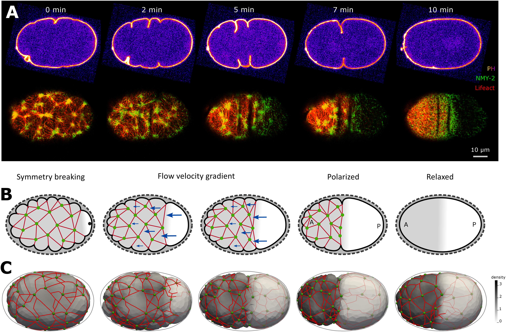

*图 1｜线虫合子皮层网络的成像与模型。引自 [Vanslambrouck 等（2026），Fig. 1](https://doi.org/10.1371/journal.pcbi.1014792.g001)，CC BY 4.0。A 为极化过程的成像；B 为机制示意；C 为含 actin 束与 myosin 结点的三维模型。模型中的束是粗粒化结构，并非逐个 myosin 分子的模拟。*

皮层把许多局部马达接成一片材料。丝长、交联和马达分布决定其传力范围，也决定局部收缩如何累积成整体运动。

Myosin II 可以连接 actin 并推动相对滑动。一个马达在局部施力，要对更远处产生影响，还需要 actin 丝、交联和其他连接把力传出去。若网络分成许多互不相连的小团，每个团都可能剧烈收缩，整个表面却没有连贯的长程运动。

在线虫合子中，PLST-1/plastin 提供了直接例子。Ding 等发现，失去 PLST-1 会影响新生 NMY-2 结构合并成较大收缩斑点，长程定向皮层流和极化也受到影响。这种表型不能仅用“myosin 数量少了”解释；网络怎样把局部活动接起来同样重要。[Ding 等，2017](https://doi.org/10.1083/jcb.201603070)

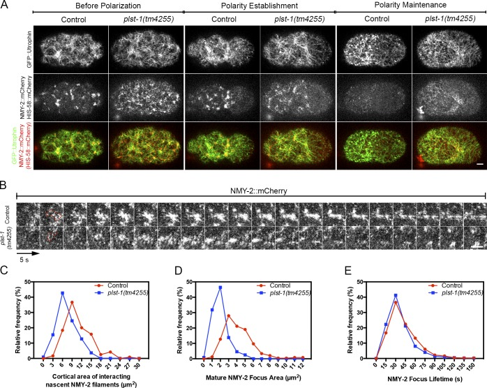

*图 2｜Plastin 与 myosin 斑点的合并。引自 [Ding 等（2017），Fig. 4](https://pmc.ncbi.nlm.nih.gov/articles/PMC5412556/#fig4)，CC BY-NC-SA 4.0。比较对照与 plst-1 条件下的皮层影像、NMY-2 时间序列和斑点特征。这里的斑点是许多分子的集体结构，不能把一个亮点当成一个马达。*

交联不足，丝之间容易滑开，活动不能有效传远；交联太持久，网络又可能难以让位，马达需要对抗更大阻力。因此，增加交联并不保证收缩速度一直增加。Ding 等的离散计算与线虫实验讨论了适量交联和马达活动的重要性；Patiño Descovich 等在胞质分裂研究中进一步比较了交联对重塑的促进与制动作用。[Ding 等，2017](https://doi.org/10.1083/jcb.201603070)；[Patiño Descovich 等，2018](https://doi.org/10.1091/mbc.E17-06-0392)

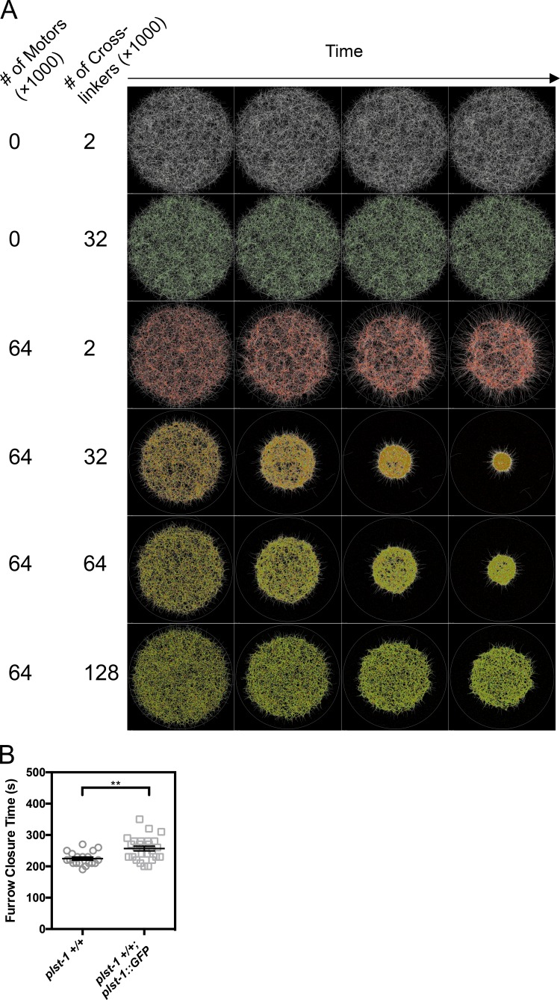

*图 3｜马达与交联对网络收缩的影响。引自 [Ding 等（2017），Fig. 7](https://pmc.ncbi.nlm.nih.gov/articles/PMC5412556/#fig7)，CC BY-NC-SA 4.0。A 比较不同交联和马达条件下的模拟形态；B 为相应实验比较。图中的网络收缩来自显式结构与相互作用，因而比单独改变一个细胞张力参数多保留了一层机制。*

Kadzik 等在线虫合子中测量 formin 相关装配与 actin 消失动力学，并比较不同程度 profilin、cofilin 干预后的网络与膜变化。这些测量可直接约束丝的更新过程，目前结果仍为预印本。[Kadzik 等，2026](https://doi.org/10.64898/2026.05.24.727551)

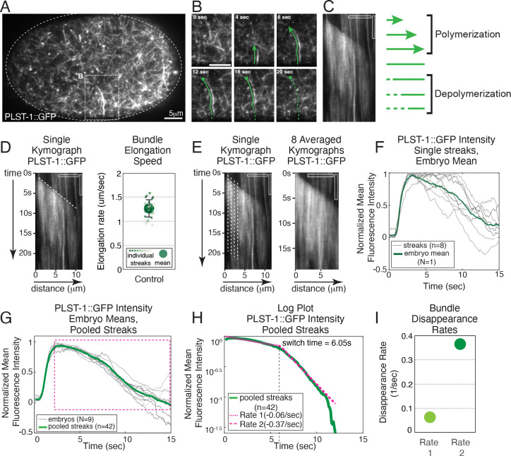

*图 4｜丝束的长度与寿命可以分别测量。引自 [Kadzik 等（2026），Fig. 3](https://pmc.ncbi.nlm.nih.gov/articles/PMC13232293/#F3)，预印本，CC BY-NC-ND 4.0，原图完整保留。PLST-1::GFP 序列与时空图显示束的出现、延长和消失；图中斜率与信号衰减分别约束不同动力学。*

Mayer 等对线虫合子做方向和位置可分辨的激光切割，发现极化时的张力具有各向异性。他们特别区分了 actomyosin 的主动收缩与皮层实际承受的总张力：主动收缩可以有明显空间差异，但沿流动方向，黏性变形所贡献的应力会与它共同组成总张力。[Mayer 等，2010](https://doi.org/10.1038/nature09376)

因此，“myosin 多的一侧拉得更强，所以总张力梯度直接驱动流”过于简单。激光切割释放的是切割前已有的机械张力；myosin 影像主要约束马达分布。把二者联系起来，需要本构关系和运动中的受力平衡。

Nishikawa 等利用共成像和流场分析，把随流动观察到的浓度变化与反应贡献分开；Michaux 等则用单分子出现、消失和轨迹变化，进一步拆解脉冲中的网络装配与形变。[Nishikawa 等，2017](https://doi.org/10.7554/eLife.19595)；[Michaux 等，2018](https://doi.org/10.1083/jcb.201806161)

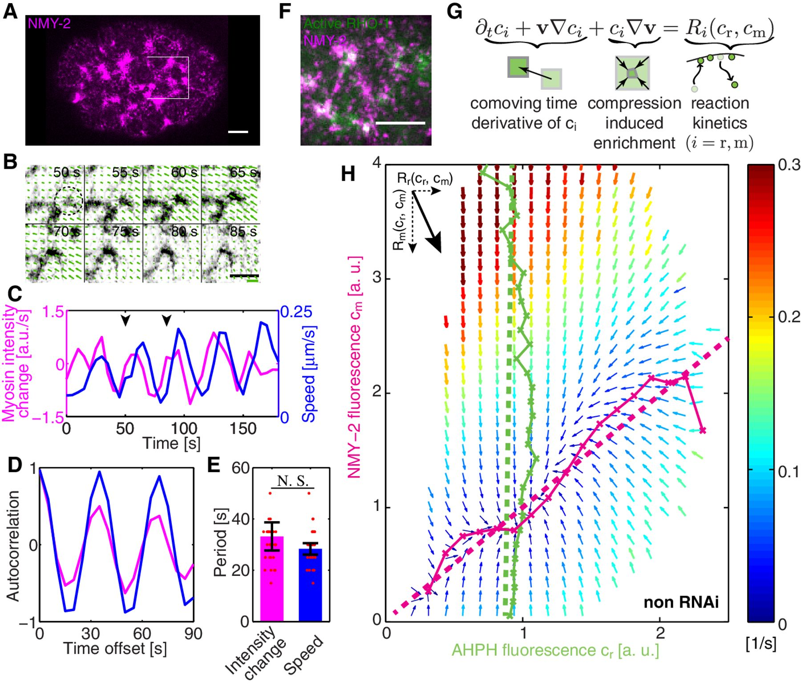

*图 5｜标记群的输运、扩散与消失。引自 [Nishikawa 等（2017），Fig. 1](https://elifesciences.org/articles/19595#fig1)，CC BY 4.0。图中包括皮层影像、PIV 流场、时间变化，以及扣除材料输运影响后估计局部动力学的 COMBI 分析。*

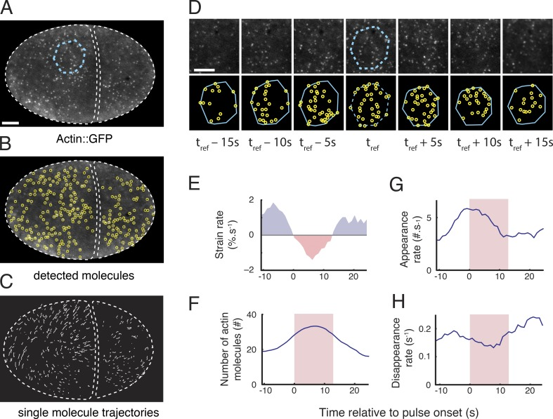

*图 6｜同一脉冲中的分子更新与机械形变。引自 [Michaux 等（2018），Fig. 2](https://pmc.ncbi.nlm.nih.gov/articles/PMC6279378/#fig2)，CC BY-NC-SA 4.0。A–D 为分子检测、轨迹与局部区域；E–H 将网络形变、分子数、出现与消失速率按脉冲时间对齐。*

同样的输运问题也决定皮层能否分开极性蛋白。被流带动的程度、在膜上的驻留与扩散共同决定分子最终积累在哪里，流场本身并不能独立规定分区。

PAR 蛋白可以在膜上扩散、与皮层发生不同程度的运动耦合，并与胞质交换。一个表面浓度 $p$ 的候选输运式为

$$
\partial_tp+\nabla_s\cdot(\beta p\mathbf v_s)
=D_p\nabla_s^2p+R_p(p,q,p_{\rm cyt}),
\qquad 0\le\beta\le1.
$$

$\beta$ 在这里概括对皮层平流的有效耦合，$q$ 可表示相互拮抗的另一类极性蛋白。Goehring 等用平流触发与反应扩散的耦合解释 PAR 极化；Illukkumbura 等进一步研究了哪些扩散、驻留和运动耦合条件允许不同 PAR 蛋白被选择性分开。[Goehring 等，2011](https://doi.org/10.1126/science.1208619)；[Illukkumbura 等，2023](https://doi.org/10.1083/jcb.202209111)

这里至少有两个竞争时间：在膜上停留多久，以及被流带过目标距离需要多久。若驻留时间很短，分子在移动足够远以前便离开；若扩散很快，已经建立的差异又容易被抹平。可以用

$$
\mathrm{Pe}=\frac{\beta UL}{D_p},
\qquad
\frac{\ell_{\rm adv}}L=
\frac{\beta U}{k_{\rm off}L}
$$

分别比较平流与扩散，以及单次驻留可被带动的距离与系统长度。即使 $\mathrm{Pe}$ 大，驻留距离很短也会限制分离。流动启动之后的反应反馈还可能维持极性，因此流停止并不必然意味着已经建立的分区立即消失。

分子分布又会改变局部活性与产力。于是，皮层不仅在搬运已有图案，还可能通过反馈生成新的脉冲和聚集。

<figure class="celegans-video" id="subcellular-rho-movie">
<video controls loop preload="metadata" playsinline aria-label="线虫皮层Rho活性与myosin脉冲">
<source src="https://static-movie-usa.glencoesoftware.com/mp4/10.7554/716/bf6e47269b7ece8c56c5f935e9a0546369beae89/elife-19595-media1.mp4" type="video/mp4">
</video>
<figcaption><strong>动态影像｜局部活动反复出现又消失</strong> Nishikawa 等（2017），Video 1，CC BY 4.0。绿色为 AHPH 报告的 RhoA 活性相关信号，紫红色为 NMY-2。关注斑点如何生成、汇聚和消退，而不只看两种颜色是否重合。<a href="https://elifesciences.org/articles/19595#video1" target="_blank" rel="noopener">原始影片与说明</a>。</figcaption>
</figure>

在早期线虫胚胎中，RHO-1/RhoA 的局部活化与 actomyosin 脉冲有关。Michaux 等支持一种快正反馈、慢负反馈的机制：Rho 活性上升促进局部活动，随后与 F-actin 有关的 RGA-3/4 募集增强抑制，使脉冲结束。减少 myosin 后仍可观察到 Rho 脉冲，说明脉冲起源不能全部归给 myosin 收缩把分子挤到一起。[Michaux 等，2018](https://doi.org/10.1083/jcb.201806161)

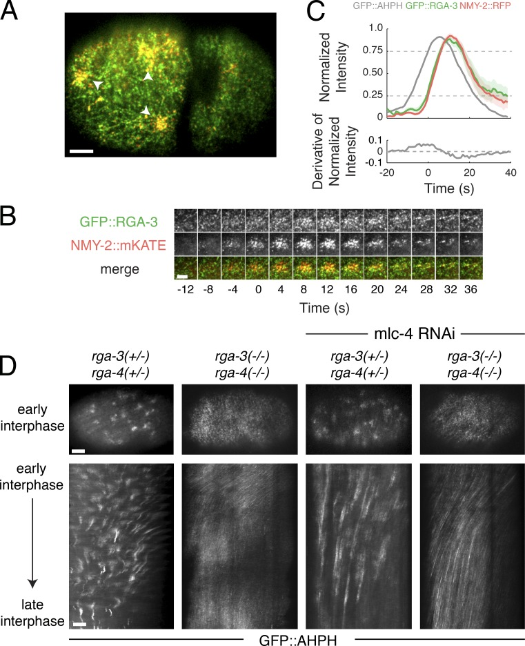

*图 7｜终止脉冲需要延迟抑制。引自 [Michaux 等（2018），Fig. 8](https://pmc.ncbi.nlm.nih.gov/articles/PMC6279378/#fig8)，CC BY-NC-SA 4.0。双色时间序列与不同干预条件约束 RGA-3/4 的募集和负反馈作用。分子共定位、时间差与功能扰动共同支持机制，单独一张共定位图则不够。*

“可激发”与“振荡”也需要区分。可激发系统在小扰动后回到原状，足够强的短暂刺激才会触发一次大响应；自发振荡系统无需每次外部刺激，就能反复绕过同一动力学周期。有限影片中的一串亮点，不一定足以判断局部系统属于哪一种。

Nishikawa 等进一步把 Rho 动力学与收缩流耦合。密度增加可以提高主动张力，吸引周围材料流入，再增强局部密度；扩散、周转和生化反馈则限制这种汇聚。模型由此比较局部节律与机械失稳对动态斑点的贡献。[Nishikawa 等，2017](https://doi.org/10.7554/eLife.19595)

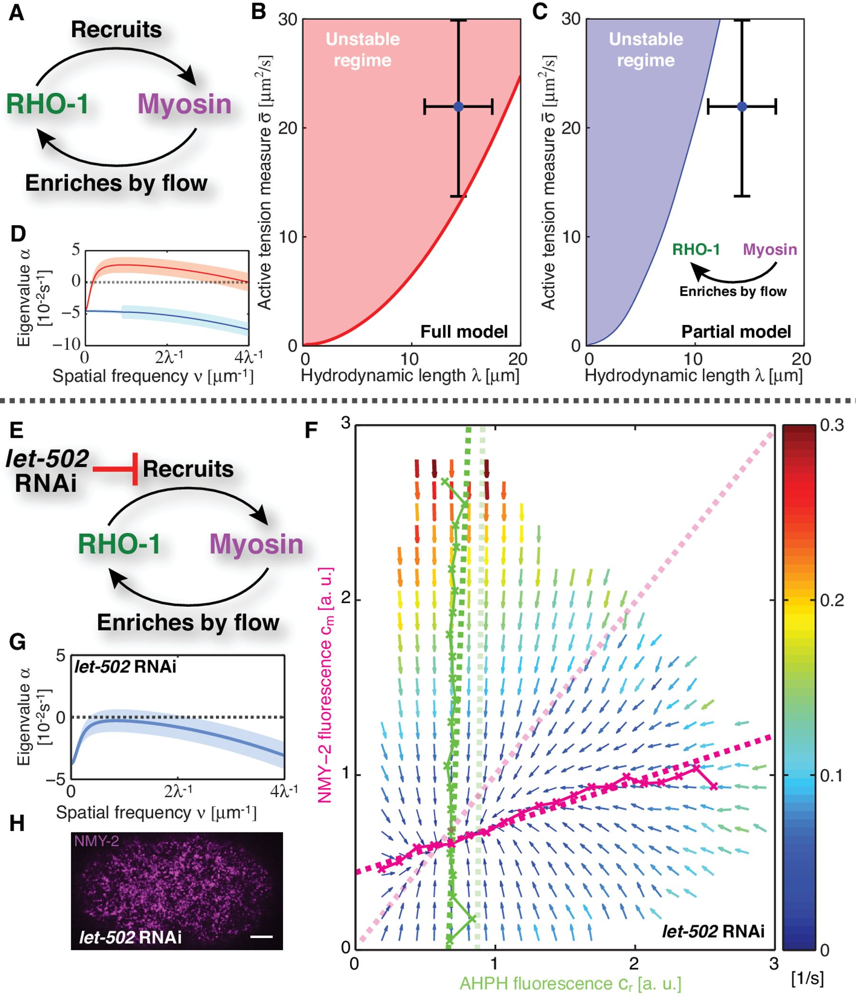

*图 8｜生化募集和机械汇聚可以在同一模型中比较。引自 [Nishikawa 等（2017），Fig. 2](https://elifesciences.org/articles/19595#fig2)，CC BY 4.0。图中比较反馈结构、稳定区域、增长率及干预后的数据；模型保留了 Rho–myosin 耦合，单组分近似的推导见后文的理论借鉴章节。*

线性失稳只说明微小差异会增长，不说明最后一定得到稳定、周期性的脉冲。若没有饱和、延迟抑制或结构更新，模型可能只是不断塌缩成少数高密度区域。Nishikawa 等讨论的 Rho 节律与收缩失稳之间的关系，正是为了解释皮层为何持续产生动态斑点，而没有简单坍缩。

两条路线可以共存。要判断哪一条先起作用，应看局部 Rho 活性、分子装配率和负散度谁先变化，并检验抑制 myosin 后哪些脉冲仍在。只比较两个强度峰的时间差，容易受到输运和荧光探针响应的影响。

密度反馈解释了材料聚在哪里，纤维取向则决定这些材料沿什么方向传力。流动本身也能整理取向，使生化活动与机械结构形成另一层反馈。

相同 actin 量可以形成近似无序的网，也可以形成沿周向排列的束。若研究分裂沟或伸长，需要把方向保留下来。对于不区分首尾的纤维方向 $\mathbf p$，可定义二维取向张量

$$
\mathsf Q=\left\langle\mathbf p\otimes\mathbf p-\frac12\mathsf I\right\rangle.
$$

这里的 $\mathbf p$ 是 actin 纤维的取向，与第六篇按细胞长轴定义的取向不是同一个场。Actin 本身具有极性，但在只测“沿哪条轴排列”、没有解析丝端方向的实验中，向列描述保留了可观测的信息。若要解释马达沿丝的定向运动或丝端选择，就需要再加入极性。

Reymann 等在合子假分裂沟和胞质分裂沟中同时测量皮层流、压缩与纤维取向，再用主动向列凝胶理论比较。结果支持皮层汇聚的机械压缩对环状排列的重要作用。[Reymann 等，2016](https://doi.org/10.7554/eLife.17807)

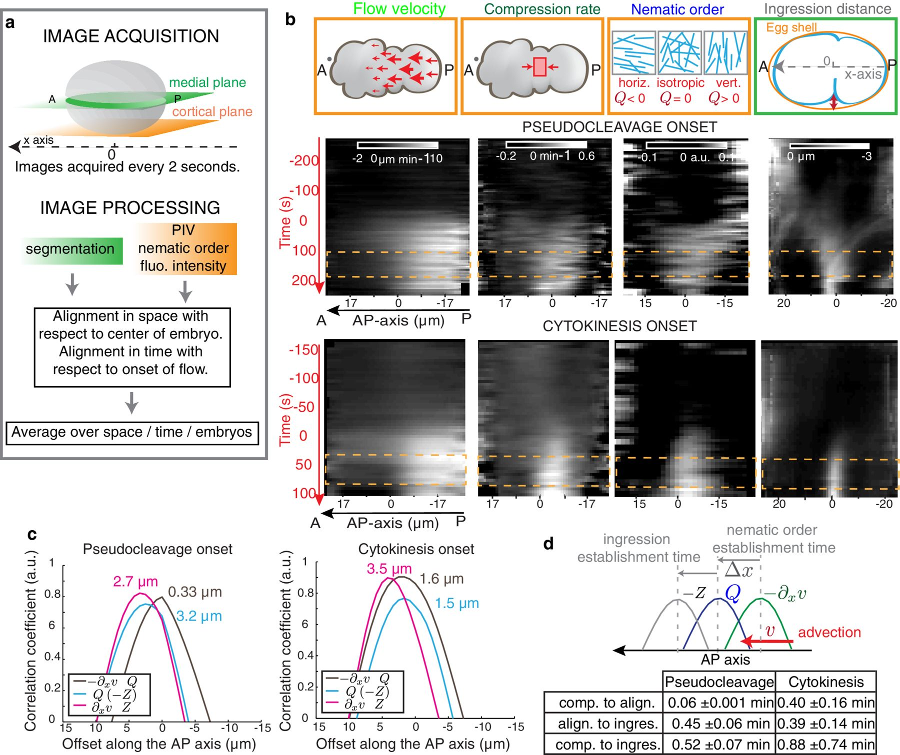

*图 9｜同一空间坐标下比较流动与结构。引自 [Reymann 等（2016），Fig. 2](https://elifesciences.org/articles/17807#fig2)，CC BY 4.0。影像处理、时空图与空间剖面将流速、压缩率、向列序和沟的内陷联系起来。*

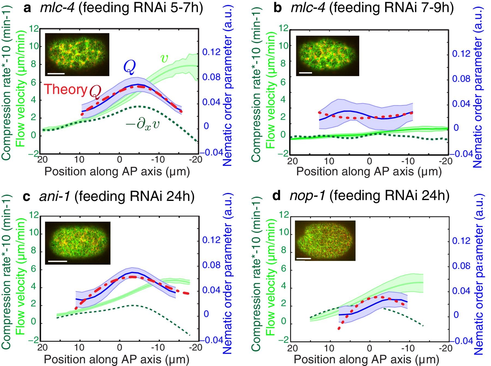

*图 10｜皮层干预后的流场与模型剖面。引自 [Reymann 等（2016），Fig. 4](https://elifesciences.org/articles/17807#fig4)，CC BY 4.0。不同 mlc-4 与 cyk-1 条件下，比较流动、压缩和向列序；实测流场与取向预测被放在相同位置，而不只比较一个全细胞均值。*

若排列主要由压缩驱动，减弱适当方向的汇聚应先改变速度梯度，再影响取向峰；若分子主动捕获是主导机制，则即使流动较弱，也可能维持明显排列。这里不能把某一次干预当成“只改变流”的理想实验：myosin 与 formin 同时影响产力、丝结构和周转，仍需要用实际测到的流场约束模型。

排列也会反过来改变应力。例如用拉伸为正的约定，可以写 $\boldsymbol{\sigma}_s^{\rm active}=\tau_{\rm iso}\mathsf I+\alpha\mathsf Q$。$\alpha$ 的符号与纤维方向上的主动作用有关。这样，流动改变排列，排列又改变不同方向的张力，形成机械反馈。只规定一个各向同性张力，便无法描述这类反馈。

取向决定沿哪条轴作用，手性则进一步区分相反的转动方向。各向同性收缩可以让一片材料缩小，却没有选择顺时针或逆时针的机制。Naganathan 等在线虫中观察到皮层反向旋转，并结合主动手性薄膜理论，讨论了 actomyosin 主动转矩与左右对称破缺的联系。[Naganathan 等，2014](https://doi.org/10.7554/eLife.04165)

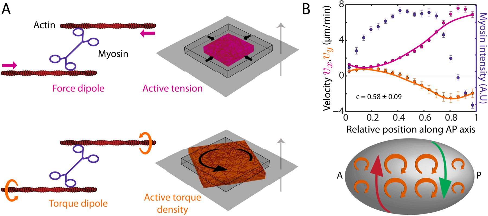

*图 11｜会收缩的材料还可以具有转动活动。引自 [Naganathan 等（2014），Fig. 2](https://elifesciences.org/articles/04165#fig2)，CC BY 4.0。力偶与转矩偶示意、流动剖面和细胞曲面上的流型被放在同一框架中。图中的分子示意说明可能的物理来源，并非对每个马达转动的直接测量。*

在只沿细胞长轴 $x$ 变化的局部近似中，令 $\tau_{\rm ch}(x)$ 表示按所选方向约定的有效手性应力分量，其中 $\Gamma$ 是对环境的有效摩擦，$\eta_s$ 是皮层有效黏性，环向速度满足

$$
(\Gamma-\eta_s\partial_x^2)v_\theta
=\partial_x\tau_{\rm ch}.
$$

它与后文讨论的收缩流屏蔽方程形似，却描述不同的应力分量。完整理论还需角动量与曲面几何；不能在普通对称黏性应力里随意加入一个旋转箭头就称作主动转矩模型。

皮层相对于细胞本体的流动，也不自动等于整个细胞转动。不同位置与邻居、包被的摩擦不同，可能使原本相互抵消的转矩产生净效应。Pimpale 等的谱系比较将反向旋转流与分裂时细胞重排联系起来；2025 年的 cadherin flow 研究又将连接分布的流动纳入这种跨尺度传递。[Pimpale 等，2020](https://doi.org/10.7554/eLife.54930)；[Khor 等，2025](https://doi.org/10.1016/j.cub.2025.09.052)

这不是从“分子有手性”一步跳到“整个胚胎会扭转”。中间还需要说明转动活动怎样组织成表面流，接触与摩擦怎样打破抵消，以及具体细胞怎样把偏转保留下来。

除了产生转动，网络取向还可能帮助极化区域在偏离正常位置时重新对准身体长轴。这样的作用要在不同初始条件下比较，单看标准条件的终点可能并不明显。

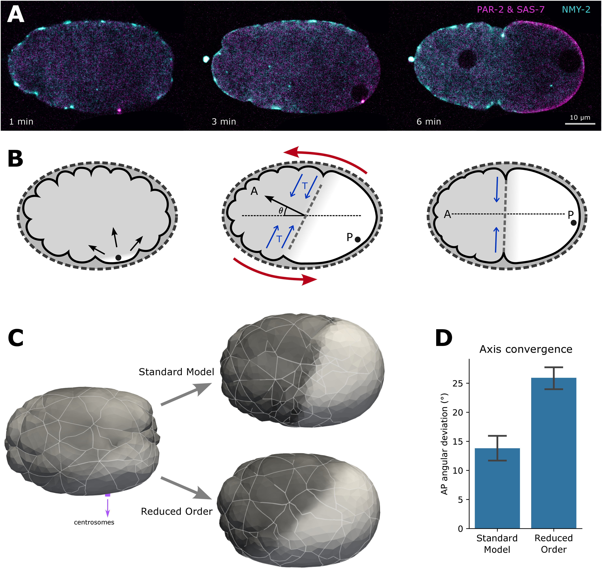

*图 12｜不同初始结构下的皮层重排。引自 [Vanslambrouck 等（2026），Fig. 4](https://doi.org/10.1371/journal.pcbi.1014792.g004)，CC BY 4.0。A 展示侧向启动后的极化轴收敛；B–D 比较机制和具有不同网络取向程度的模拟。*

Vanslambrouck 等的三维模型把 actin 束、myosin 结点与表面力学结合起来。在该模型中，正常从极点启动时，削弱束的向列排列仍可能发生极化；从侧面启动时，排列产生的各向异性张力却有助于极化轴向卵的长轴收敛。[Vanslambrouck 等，2026](https://doi.org/10.1371/journal.pcbi.1014792)

这个结果提示一种更具体的检验：某种结构不一定决定“有没有极化”，却可能决定偏离标准初始条件以后能否回到可靠方向。把所有胚胎按长轴对齐，再只比较平均终点，反而可能抹掉这类稳健性机制。

皮层上的力和运动可以沿两条路径传出：一条通过边界运动带动内部体积，另一条通过连接牵动细胞边界和邻居。这两条路径对应不同的速度场与阻力，也可以同时参与同一次形态变化。

Niwayama 等在单细胞胚胎中测量卵黄颗粒运动，并用三维流体计算检验皮层附近驱动是否足以解释内部流动。外围与内部相反方向的运动，可以由封闭体积内的流体力学联系起来，不必先假定整个胞质在每个位置都有同样的主动马达驱动。[Niwayama 等，2011](https://doi.org/10.1073/pnas.1101853108)

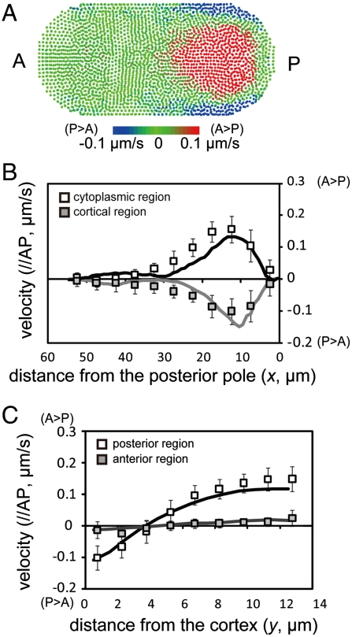

*图 13｜表面驱动与三维胞质回流。引自 [Niwayama 等（2011），Fig. 3](https://pmc.ncbi.nlm.nih.gov/articles/PMC3141991/#F3)，原作者与出版社权利保留。A 为三维 MPS 颗粒流体计算的赤道截面；B、C 将模型与卵黄颗粒 PIV 的轴向和横向剖面比较。红蓝表示不同流动方向，模型几何为两端带半球的圆柱。*

这项研究的检验对象是流场在空间上是否一致。作者以近表面运动约束驱动，求解内部流动，再比较中央返回流和不同截面的速度分布。模型中不需要在每个内部位置都单独加入能产生同向运动的马达；局部边界驱动可经压力与不可压缩条件组织出整个体积内的回流。它并未同时从分子机制预测外围速度。

这也限定了能从流场得到什么。在惯性忽略、黏度均匀且边界速度已给定的牛顿流体中，将黏度整体乘常数，只需相应缩放压力，就可以保留相同速度解。因此，流场形状吻合支持这一尺度上的流体耦合，却不能单独给出绝对胞质黏度。主动微流变、已知外力或其他材料测量，才提供独立力标尺。

对后续形态发生，将这种模型用于解释表面活动怎样牵动内部体积时，应同时检查内部分隔、细胞核与微管等结构。合子中的牛顿近似不是所有时期胞质的共同定律；它的价值在于清楚展示哪些内部运动可以由边界条件解释，哪些残差才需要新的主动来源或材料结构。

Actomyosin 驱动不是所有胞质流的唯一解释。Niwayama 等还比较了 nmy-2 受抑后的残余运动及微管扰动，说明不同时间窗里的胞质流需要区分来源。微管马达牵拉细胞器时，对胞质也施加反作用；这类力分布可以产生内部流，甚至影响原核和中心体的位置。

对模型而言，差别在于驱动力放在哪里：皮层驱动主要通过边界牵引进入，微管与细胞器相关驱动则可作为体积中的力密度进入。二者可能产生相似的局部箭头，但空间分布、对抑制的响应和与原核运动的先后关系不同。

颗粒本身也不一定是被动流速探针。若它与马达或骨架结合，轨迹包含主动运输；靠近大结构时，局部阻力与流动又不同。需要比较多个粒子、空间位置和扰动，才能把轨迹平均解释成体积流。

把胞质当作牛顿流体，是特定尺度和时间窗内的近似。短时局部加载可能看到弹性、亚扩散或较宽的松弛谱；足够长时间与更大尺度的回流，又可能被有效黏性描述。模型是否合适，要看所解释的频率、探针大小和位置。

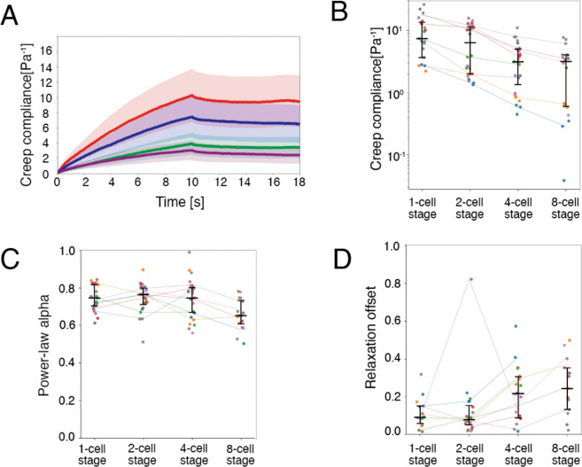

*图 14｜内部材料的响应可以直接测量。引自 [Koizumi 等（2026），Fig. 3](https://pmc.ncbi.nlm.nih.gov/articles/PMC13228458/#F3)，预印本，CC BY-NC-ND 4.0，原图完整保留。磁性液滴受力后的柔量、时间指数和卸载恢复，测量的是细胞质的局部机械响应。*

Koizumi 等的结果支持早期发育中胞质响应发生变化；把它进一步解释成某一种本构机制，还需要更多区分性测量。[Koizumi 等，2026，预印本](https://doi.org/10.64898/2026.05.19.726147) 更不能用一个细胞内部的柔量，直接代替多个细胞之间重排所决定的组织流动性。

Naganathan 等对 actin 结合蛋白与调控因子的筛选，展示了不同分子扰动怎样在流速、斑点结构、屏蔽长度和手性指标上形成不同或相似的结果。这种“不同微观机制得到相近宏观表现”的简并，是选择多尺度模型的重要原因。[Naganathan 等，2018](https://doi.org/10.7554/eLife.37677)

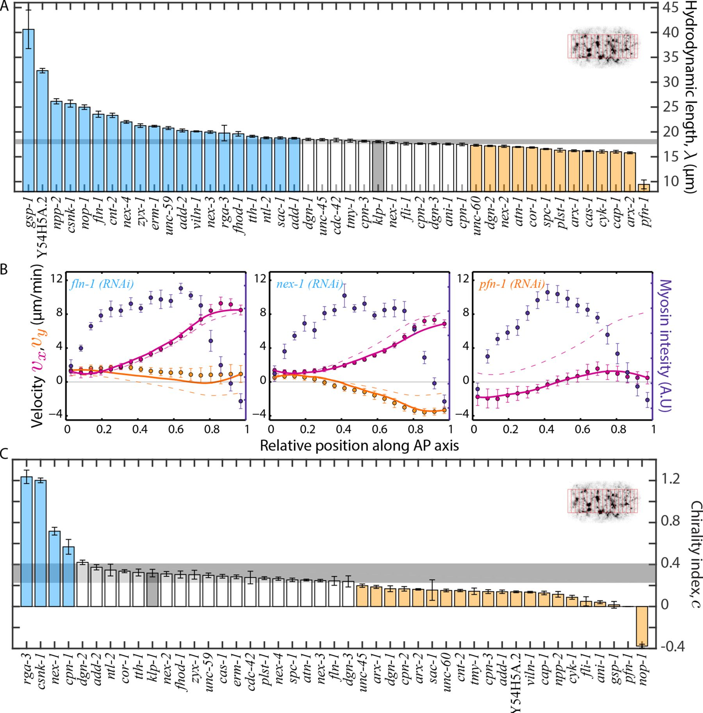

*图 15｜骨架扰动后的流场与有效物理参数。引自 [Naganathan 等（2018），Fig. 6](https://elifesciences.org/articles/37677#fig6)，CC BY 4.0。不同干预下的屏蔽长度、手性指标及代表性剖面，说明可将分子扰动映射到有效物理量，但这种映射通常不是一对一。*

取样频率也属于模型的一部分。若脉冲中的装配、收缩和抑制只相隔少数帧，时间平均会把因果顺序压平；若成像平面没有跟随曲面，所谓分子消失还可能是离开焦面。近表面成像、曲面展开、体积成像和单分子方法各有不同偏差，需要按所测对象选择。[Robin 等，2014](https://doi.org/10.1038/nmeth.2928)

## 2. 线虫研究：细胞内移与全身形态发生 {#networks-in-morphogenesis}

内部回流说明了胞质怎样回应表面活动；细胞边界能否随骨架移动，则取决于连接处的传递。两者需要在相同细胞中分别追踪。

在 Ea、Ep 顶端收缩中，骨架活动与边界运动可以不同步。Slabodnick 等的双颜色实验显示，早期向心运动的 myosin 与主要随接触边界运动的 cadherin–catenin 复合体之间存在相对运动。这把问题从“马达何时开始收缩”推进到“网络何时能够牵动连接”。[Slabodnick 等，2023](https://doi.org/10.1371/journal.pgen.1010319)

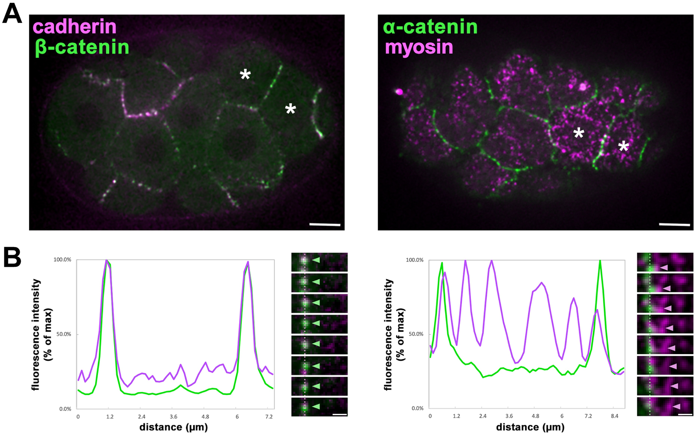

*图 16｜连接复合体与皮层的相对滑移。引自 [Slabodnick 等（2023），Fig. 1](https://doi.org/10.1371/journal.pgen.1010319.g001)，CC BY 4.0。双色影像、线扫描与时空图显示连接复合体和 NMY-2 的相对运动。*

在真实胚胎中，这种机械联系有多条路径：同一细胞内部的骨架，细胞间黏着连接，跨越表皮厚度的附着装置，以及外侧基质。它们可以串联，也可以并联。某条路径损伤后，另一条仍可能承载，但负载分配已经改变；最终伸长受阻未必来自首先产力的那一群细胞。

把这层机械联系放回 Ea、Ep 内移，便需要同时解释顶端边界缩小、邻居让位和细胞进入内部。皮层中的向心运动只完成其中一部分，后续结果还取决于接触和周围几何。

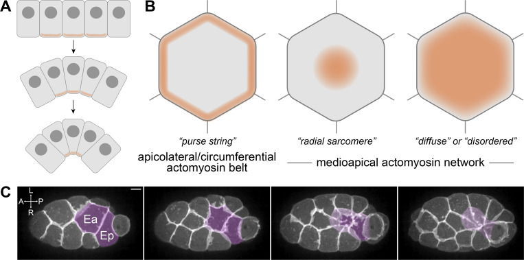

*图 17｜用相同的形态任务比较不同网络架构。引自 [Zhang、Medwig-Kinney 与 Goldstein（2023），Fig. 1](https://pmc.ncbi.nlm.nih.gov/articles/PMC10289891/#fig1)，CC BY-NC-SA 4.0。A、B 比较顶端收缩及可能的网络组织；C 为膜标记的 Ea、Ep 内移序列，细胞着色用于追踪其位置。图中的三类结构示意不表示它们都已在线虫中得到证实。*

Zhang 等进一步测量 NMY-2、MRCK-1 及 actin 两端相关蛋白的分布，发现线虫 Ea、Ep 的网络没有表现出果蝇腹侧沟中那种中央 myosin 富集、径向丝极性的组织方式。其顶端收缩可以由分散分布、混合极性的网络完成。[Zhang 等，2023](https://doi.org/10.1083/jcb.202302102) 因而，“顶面变小”不是某一种亚细胞排列的唯一输出；反过来，没有漂亮的放射状结构，也不说明细胞缺乏有组织的收缩。

这样，网络的平均收缩应力、连接传出的牵引和邻居的变形代价就进入同一个问题。前面的双色成像约束了牵引传递，却还不能单独决定细胞的完整内移轨迹。

Thiels 等的整合预印本将三维细胞分割、皮层蛋白分布、接触几何和全胚胎力学模拟放在一起，提供了从局部收缩走向完整胚胎的研究路线；其公开数据也分别保留了内移距离、细胞分裂、接触面积和模拟压力等量。[Thiels 等，2026，预印本](https://doi.org/10.64898/2026.03.30.715391)；[作者数据与模型说明](https://zenodo.org/records/19795530) 这一层模型需要解释局部网络周围的运动，单独拟合 Ea 或 Ep 的顶端面积还不够。

当形态任务转为插入或包裹，网络需要把活动放到伸出的前缘，并在相遇后建立新的承载路径。此时，局部推进、主体跟随与连接接通有各自的时序。

背侧插入与腹侧包裹中，actin 的另一种任务变得突出：在正确位置组装前缘，向尚未占据的空间伸出。这里既有分支 actin 相关的推进，也有后续主体移动和接触更新。把它全部写成各向同性的 myosin 收缩，会丢掉前缘为什么朝向特定邻居。

背侧细胞的基底外侧突起可以先进入邻居之间，细胞主体与顶端连接随后跟上。Walck-Shannon 等把极化 Rac 相关突起与这种插入联系起来。[Walck-Shannon 等，2015](https://doi.org/10.1242/dev.127597) 网络的方向性在这里不只是产生方向相关的材料刚度，还决定推进作用施加在哪一面。

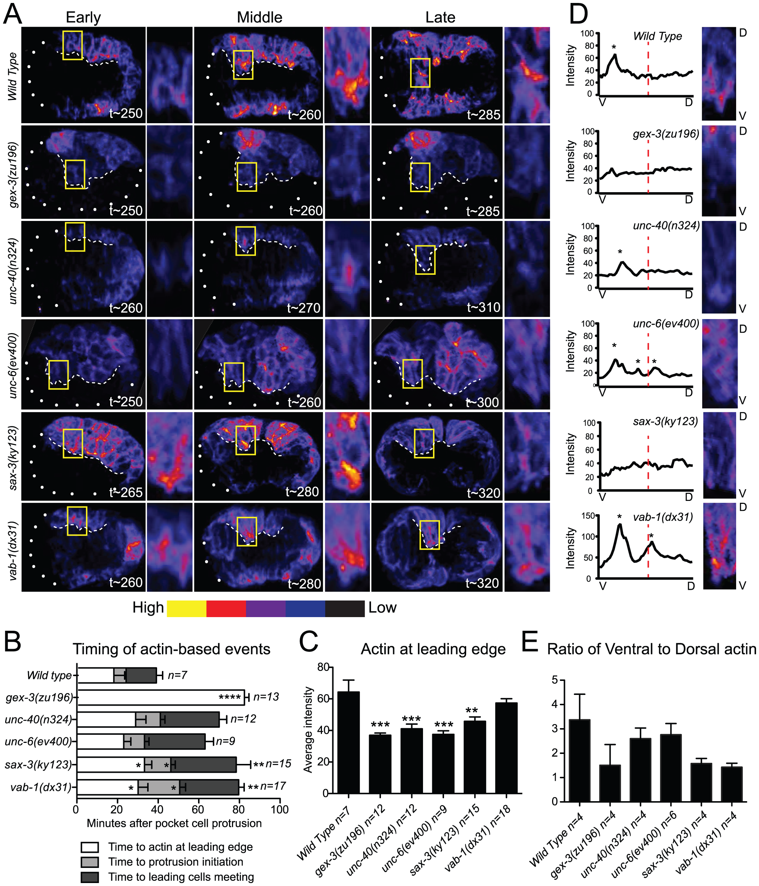

*图 18｜腹侧前沿与下方组织的 actomyosin。引自 [Bernadskaya 等（2012），Fig. 2](https://doi.org/10.1371/journal.pgen.1002863.g002)，CC BY 4.0。活体影像将 actin 分布、前导细胞和多个形态事件放在同一时间序列中；局部前缘的变化最终影响表皮能否覆盖和连接。*

腹侧包裹还多了一项任务：两边相遇以后，要从两个自由前缘建立承载的新界面。引导受体与 WAVE 相关的 actin 调控影响前缘的空间组织；cadherin 相关的初次接合则帮助把相遇转成快速封口。[Bernadskaya 等，2012](https://doi.org/10.1371/journal.pgen.1002863)；[Raich 等，1999](https://doi.org/10.1016/S0960-9822%2800%2980015-9)

从网络角度看，闭合改变了传力路径的连通性。相遇前，两侧在各自的基底和邻居上推进；相遇后，力可以跨过新界面传到对侧。原来的自由边界变成内部连接，其负载和分子周转条件都改变了。因此，形态发生中的“拓扑变化”还包括承载路径的重新接通，不能只统计细胞有没有换邻居。

这一过程需要同时追踪前缘位置、新连接长度、连接募集，以及对侧细胞何时开始共同变形。若推进正常而接触后裂开，问题更可能位于新界面的承载或持续更新；若基底突起先行但主体跟不上，应检查层间耦合与沿途阻力。第二篇的[双层穿插与封口模型](/notes/celegans/embryonic_morphogenesis/epithelial_morphogenesis/#basal-apical-model)分别保留了这两类失败，避免用同一个“actin 活性不足”概括。

表皮闭合以后，局部收缩开始共同约束一个封闭身体；肌肉随后加入，负载又要穿过多个组织和界面。身体变长、弯曲或保留形变，取决于这些作用的方向、位置与更新方式。

### 2.1 方向性网络与身体伸长 {#network-elongation}

胚胎被表皮围住以后，局部结构开始共同约束一个封闭身体。Seam cells 与背腹表皮具有不同的 actin–myosin 组织：前者较突出地参与主动收缩，后者具有沿周向排列的纤维束和方向相关的承载。这种区域分工使局部网络能够改变整颗胚胎的长宽比例。[Vuong-Brender 等，2017](https://doi.org/10.7554/eLife.23866)

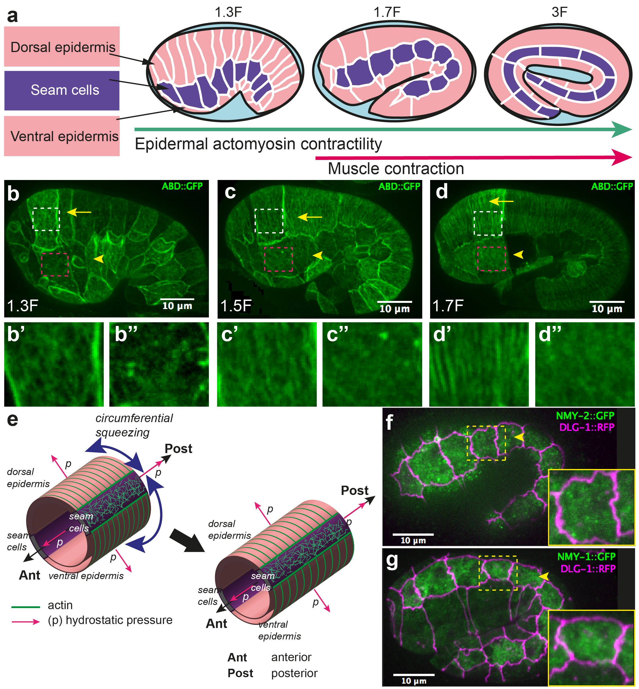

*图 19｜从整颗胚胎的分期看到细胞内网络。引自 [Vuong-Brender 等（2017），Fig. 1](https://doi.org/10.7554/eLife.23866.003)，CC BY 4.0。形态阶段、背腹表皮纤维束、seam 区域及非肌肉 myosin 分布共同给出伸长的空间分工。*

这里尤其不能把合子时期的图景直接搬过来。伸长期的主要证据并不是大范围的脉动皮层流；持续承载的方向性纤维和非均匀收缩同样能够驱动形态变化。网络是否“起作用”，不能以它有没有像合子中的亮斑一样移动来判断。Vuong-Brender 等通过方向相关的切割响应与连续体模型，区分了力的各向异性和材料刚度的各向异性。

### 2.2 跨组织传力与形态保持 {#network-memory}

肌肉参与以后，产力的位置与需要发生长期形变的位置并不相同。体壁肌肉在表皮内侧收缩，表皮和外侧结构承担由此产生的负载。其间有肌肉附着、基底侧 ECM、半桥粒样附着结构、中间丝，以及顶端侧的附着与基质。这套厚度方向的连接，与相邻表皮细胞间的黏着连接共同组成承载系统。

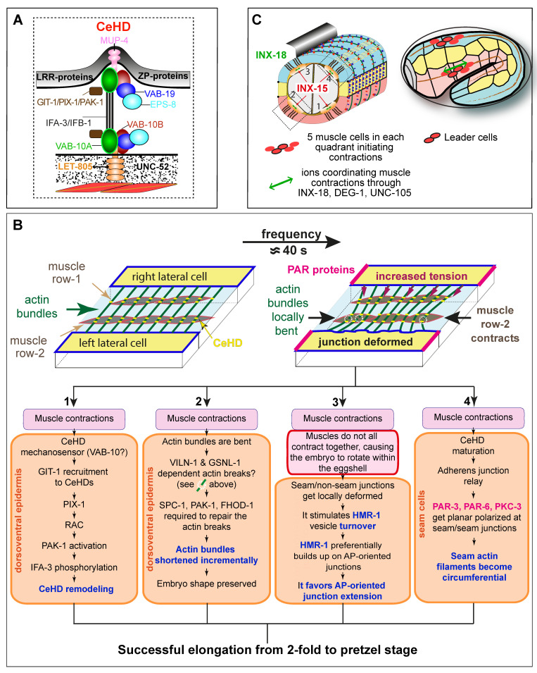

*图 20｜Actin–myosin 之外还有跨组织的网络。引自 [Labouesse 等（2026），Fig. 5](https://pmc.ncbi.nlm.nih.gov/articles/PMC13072950/#cells-15-00645-f005)，CC BY 4.0。A 示意肌肉与表皮厚度方向的附着；B 汇总机械输入、骨架与连接重塑；C 涉及肌肉和肠道的协调。它是多项研究的整合图，各箭头的证据强度需回到相应实验。*

把它看成串联路径很有帮助：某个界面很软或容易滑移，肌肉可以明显收缩，表皮收到的牵引却减小。若强制把整条链两端完全粘住，再只调 actin 模量，就可能用错误参数补偿了实际的界面缺陷。沿路径同时比较肌肉活动、附着结构和表皮应变，才有机会定位负载在哪里丢失或集中。

这种链条也会受力后加固。Zhang 等发现，肌肉张力与 GIT-1、PIX-1、Rac、PAK-1 相关机械信号通路联系起来，促进半桥粒样结构成熟，并涉及中间丝磷酸化。[Zhang 等，2011](https://doi.org/10.1038/nature09765) 因此，网络不只是把一次收缩传过去，还会改变下一次收缩面对的连接状态。

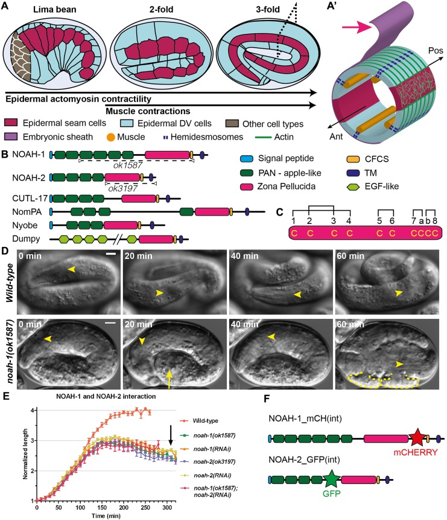

*图 21｜外侧结构决定负载能否稳定分配。引自 [Vuong-Brender、Suman 与 Labouesse（2017），Fig. 1](https://pmc.ncbi.nlm.nih.gov/articles/PMC5769628/#DEV150383F1)，CC BY 3.0。Sheath 的位置、相关蛋白及扰动后的伸长和局部鼓出表型，把细胞外结构与全身形态联系起来。*

顶端 ECM 的作用也不能全部归为“把胚胎包住”。它可以共同承载，限制局部鼓出，并影响负载怎样分配到其他区域。NOAH 相关研究中，较早的伸长异常与后来的鼓出、破裂需要区分；终点已经破裂的胚胎，不能直接用来反推最初是哪一种皮层力减弱。[Vuong-Brender 等，2017](https://doi.org/10.1242/dev.150383)

微管网络还提供了另一层联系。Quintin 等通过扰动非中心体微管及相关遗传组合，研究了其与 LET-502/ROCK、附着和连接重塑的关系，结果提示存在与已知 myosin 激活作用并行的路径。[Quintin 等，2016](https://doi.org/10.1242/dev.126615) 这不意味着所有骨架都贡献同一种收缩应力。微管还可能通过组织连接位置、运输和重塑，改变 actomyosin 作用到哪里。

负载能够传入表皮，还不等于身体会留下更多长度。一次收缩后的形状是否保留，要继续看骨架与连接在加载和卸载之间怎样更新。

肌肉的一次收缩可以让胚胎弯曲、压缩或局部拉伸，随后又回到附近形状。长期伸长需要某种结构在周期之间发生更新，否则同一组可恢复形变只会反复重演。

Lardennois 等将 spectrin、PAK-1、formin 相关网络与表皮 actin 结构和形态保持联系起来；在特定联合缺陷中，胚胎已经获得的长度会明显回缩。这支持区分“产生瞬时形变”和“稳定新的形状”。相关黏塑性模型的方程应结合期刊更正阅读。[Lardennois 等，2019](https://doi.org/10.1038/s41586-019-1509-4)；[期刊更正](https://doi.org/10.1038/s41586-019-1562-z)

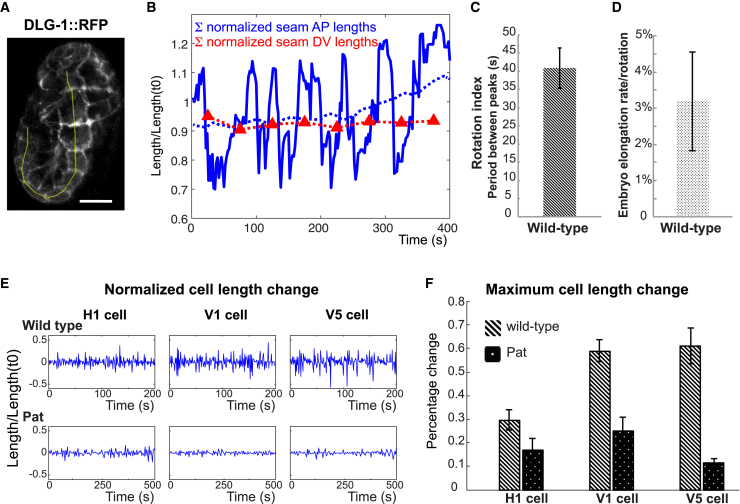

*图 22｜快速往返与缓慢累积发生在同一组织中。引自 [Yang 等（2025），Fig. 2](https://pmc.ncbi.nlm.nih.gov/articles/PMC12549353/#fig2)，CC BY-NC 4.0。连接标记的影像、短时脉动、运行平均和肌肉受损条件，将周期活动与长期伸长放到同一分析中。*

Yang 等还将肌肉输入与 AP 方向黏着连接的延长、E-cadherin 交换联系起来。其讨论强调，这一阶段的机制不能直接套成合子式顶端 actomyosin 流；外来负载与连接自身的重塑同样参与。[Yang 等，2025](https://doi.org/10.1016/j.devcel.2025.06.012)

实验中可以在一次收缩前、峰值和卸载后分别测量 actin 束、连接长度和全身长度。若峰值形变近似保留而周期末长度不再增加，首先要检查形态稳定和更新；若连峰值响应都明显减弱，则还需要检查肌肉输入与传力。这两类失败在平滑后的长度曲线上可能都表现为伸长变慢。

### 2.3 从伸长到弯曲和扭转 {#network-body-motion}

<figure class="celegans-video celegans-stage-video" id="subcellular-whole-embryo-motion" style="--stage-video-width: 22rem;">
<video controls loop preload="metadata" playsinline aria-label="卵壳内胚胎的整体弯曲和转动">
<source src="https://ars.els-cdn.com/content/image/1-s2.0-S1534580725003673-mmc3.mp4" type="video/mp4">
</video>
<figcaption><strong>动态影像｜局部网络共同作用于整条胚胎</strong> Yang 等（2025），Video S1，CC BY-NC 4.0。表皮连接标记显示胚胎在卵壳内的弯曲和转动。比较身体姿态的快速改变与沿身体本身的长度变化；投影中头尾接近，并不等于身体缩短。<a href="https://pmc.ncbi.nlm.nih.gov/articles/PMC12549353/#mmc3" target="_blank" rel="noopener">原始影片与说明</a>。</figcaption>
</figure>

把整条胚胎只看成一根会伸长的轴，还会丢掉肌肉带在截面上的位置。四条肌肉带处于不同方位：两侧活动不平衡可以产生弯矩，沿身体变化的活动又会改变曲率；表皮的周向或倾斜纤维、组织间连接和外部接触共同决定是否伴随扭转。

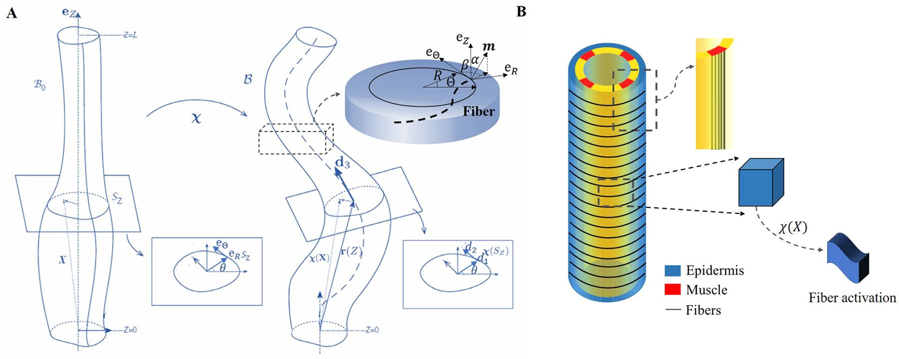

*图 23｜把亚细胞方向放到全身几何中。引自 [Dai 与 Ben Amar（2024），Fig. 3](https://elifesciences.org/articles/90505#fig3)，CC BY 4.0。模型分别保留参考与变形后的中心线、表皮层、周向骨架和纵向肌肉带；这些结构的方位决定其对不同整体变形的贡献。*

局部收缩不仅需要求和为总力，还需要按位置计算力矩。以一段身体的横截面 $A$ 为例，截面上的牵引可给出

$$
\mathbf N=\int_A\boldsymbol{\sigma}\mathbf n\,dA,
\qquad
\mathbf M=\int_A(\mathbf r-\mathbf r_c)
\times(\boldsymbol{\sigma}\mathbf n)\,dA.
$$

两个截面的总力可以相近，但力作用在截面两侧的分布不同，弯矩就不同。将薄层贡献加入截面积分时，还要用其实际厚度或表面力结果量保持单位一致。单个平均 myosin 强度无法同时确定 $\mathbf N$ 和 $\mathbf M$。

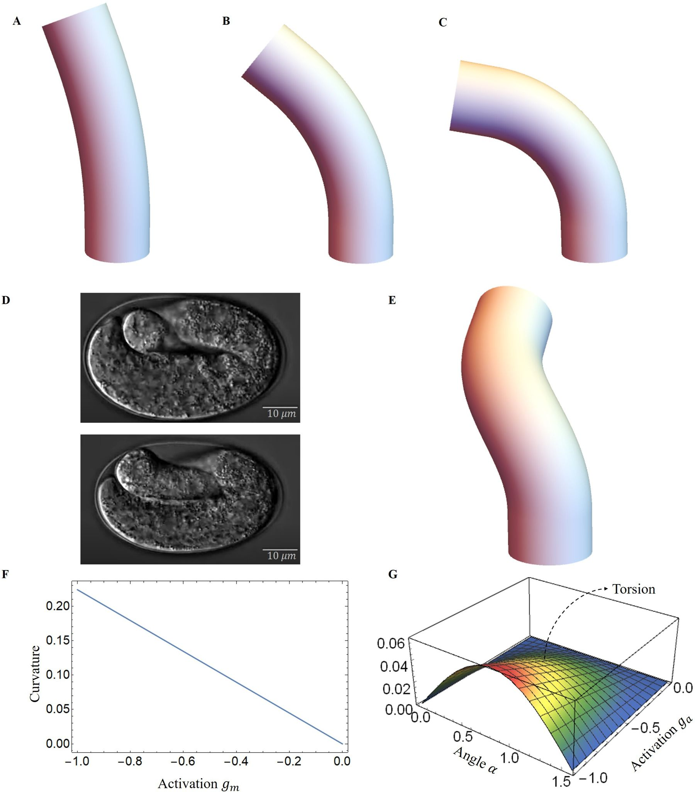

*图 24｜肌肉活动与三维身体构型。引自 [Dai 与 Ben Amar（2024），Fig. 7](https://elifesciences.org/articles/90505#fig7)，CC BY 4.0。A–C、E 为模型在不同肌肉与 actin 参数下的形态，D 为论文引用的 Hyman Lab 胚胎影像，F、G 为曲率与扭转预测。模拟形态与影像放在一起用于评估机制，不表示每个活动参数已被独立测量。*

Dai 与 Ben Amar 的模型将肌肉活动、皮层方向和身体中心线结合，比较伸长以及弯曲、扭转等形态。[Dai 与 Ben Amar，2024](https://doi.org/10.7554/eLife.90505) 这类模型保留了局部薄层描述缺少的几何：力作用在身体哪一侧，纤维相对于长轴偏了多少，局部转动是否沿身体积累。

这里还要区分三件事。合子或分裂细胞的手性皮层流，身体自身的扭转，以及胚胎在卵壳内整体翻转，属于不同层次的运动。后两者可以受肌肉与接触驱动，并不因方向一致就证明来自前者。应分别追踪皮层材料、截面方向和三维中心线。接触卵壳后，一段身体无法继续沿原方向移动，局部负载也会反馈到其他区域；外壳不是一个只在最后限制形状的背景。

这些整体运动也使不同阶段的网络任务更容易比较。相同的 actin–myosin 组分，会因连接位置、材料方向和负载来源不同而承担不同作用。

| 形态任务 | 网络首先需要完成的作用 | 必须一起观察的更大尺度变化 |
| --- | --- | --- |
| Ea/Ep 内移 | 分散收缩接到顶端边界 | 邻居让位、接触更新和内移路径 |
| 背侧插入 | 基底外侧前缘定向推进 | 主体跟随、顶底错位与新邻接 |
| 腹侧包裹 | 推进的两侧接成承载界面 | 开口分区、对侧协同和封口后稳定 |
| 早期伸长 | 主动区域与方向性承载区域共同约束身体 | 半径、前后轴长度和区域应变 |
| 后期伸长 | 外来负载经附着传入，并更新骨架与连接 | 单次形变、周期末长度和卸载恢复 |
| 弯曲与扭转 | 不同位置的产力形成不同合力与力矩 | 中心线曲率、截面转角和卵壳接触 |

不同阶段对网络的要求有所冲突。插入前缘需要快速组装，成熟连接需要持续承载；周向束限制局部拉伸，却帮助身体沿轴向增长；肌肉加载时要保持连通，周期之间又要重塑。发育中的网络因此既有空间分工，也要随受力阶段调整。

网络结构、连接传力、周围组织的响应与卸载后的形状，可以在同一时间序列中对应起来，追踪局部 actin–myosin 活动怎样累积成细胞位移或全身形变。

## 3. 理论借鉴：离散网络与连续材料理论 {#离散网络与连续材料理论}

离散 actomyosin 网络、连续材料、可激发系统和孔弹性提供了更一般的机制。McFadden 的网络模型与各项解析、空间算例可用于比较线虫研究尚未唯一确定的材料与传力解释。

一个离散网络可以把 actin 表示为可伸长、可弯曲的线段，交联则连接不同丝上的位置。其被动能量的一种形式为

$$
E_{\rm net}=
\sum_e\frac{k_e}{2}(\ell_e-\ell_e^0)^2+
\sum_e\frac{\kappa_e}{2}\int_e C^2\,ds+
\sum_c\frac{k_c}{2}|\mathbf x_c^{(1)}-\mathbf x_c^{(2)}|^2.
$$

第一项抵抗伸长，第二项抵抗弯曲，第三项表示交联的弹性约束。$C$ 是丝的曲率。马达作用作为主动力加入结点的过阻尼运动，

$$
\zeta_\alpha\dot{\mathbf x}_\alpha
=-\frac{\partial E_{\rm net}}{\partial\mathbf x_\alpha}
+\mathbf F_\alpha^{\rm motor}.
$$

这套写法还没有规定马达怎样走、何时脱落、交联怎样更新。若要预测单分子扰动，便需要这些动力学；若只解释微米尺度的束与斑点，可以使用等效收缩连接。两种模型的空间分辨率不同，参数也不能直接互换。

这里要区分**连通性**与**有效黏度**。一片网络可能已经连通，但因交联快速交换而容易流动；也可能只在局部形成很硬的束，束与束之间却缺少连接。仅测 actin 总量或单根束的粗细，通常不能判断整个皮层怎样承载。

网络传力还可能依赖拉伸与压缩的不对称：细丝受压可弯曲，受拉却能传递较大张力。离散模型若把所有连接都当成同样的线性弹簧，就会漏掉这一点。是否需要加入弯曲、束化和断裂，应看扰动后最先改变的是丝形态、斑点运动还是远程流动。

丝长决定一根丝有机会连接多远，寿命决定这条路径能保留多久。若一根丝以近似恒定速度 $v_{\rm pol}$ 生长，并在平均寿命 $\tau_f$ 后整体退出网络，最简单的长度估计为 $\bar\ell_f\sim v_{\rm pol}\tau_f$。真实丝还可能被切断、端部解聚或并入束，因此这不是用荧光寿命直接换算丝长的通用公式。

更细的描述可以保留丝的“年龄”分布 $n(a,t)$：

$$
\partial_tn+\partial_an=-h(a)n,\qquad n(0,t)=J_{\rm nuc}(t).
$$

$a$ 是自组装后的时间，$J_{\rm nuc}$ 是新丝进入率，$h(a)$ 是每单位时间退出的概率率。恒定 $h$ 给出指数生存分布；若刚组装的丝暂时不易解聚、随后快速退出，生存分布就不再由一个指数描述。Kadzik 等的预印本对初期较慢、随后较快的信号消失动力学的分析，为这种年龄依赖提供了可检验对象；探针消失、丝段退出和整根丝解聚仍需分开。[Kadzik 等，2026，预印本](https://doi.org/10.64898/2026.05.24.727551)

马达也不是恒定力源。一个局部、次失速负载范围内的简化关系是 $v_{\rm rel}=v_0(1-f/f_{\rm stall})$：负载接近失速力时，滑动变慢，马达却仍可能保持较大张力。若承载马达比例为 $m$，还可以写 $\dot m=k_{\rm on}^{m}(1-m)-k_{\rm off}^{m}(f)m$，允许结合和脱离随负载改变。这两式是粗粒化的马达模型，不能不经测量便指定为线虫 NMY-2 的准确负载曲线。

高负载或持久交联可以减慢运动，同时维持较大张力；承载路径断开后，局部运动反而可能加快。结构与释放响应能帮助判断流速变化来自哪一种情况。

新丝生长、旧丝解聚，交联与马达也不断交换。更新可缓解局部拥挤，使收缩继续进行，也可能拆掉承载路径；其效果取决于结构更新与负载建立的相对时间。

McFadden 等的离散网络模型将这种关系展开到了可计算的层次。模型中的 actin 丝有方向，拉伸比压缩更难，交联以丝之间相对滑动的有效摩擦处理；马达在局部交叠处施力，丝再按设定寿命被移除并补入。改变丝寿命时，作者维持网络平均密度，使“更新快慢”的作用能够与“丝总量变化”分开。[McFadden 等，2017](https://doi.org/10.1371/journal.pcbi.1005811)

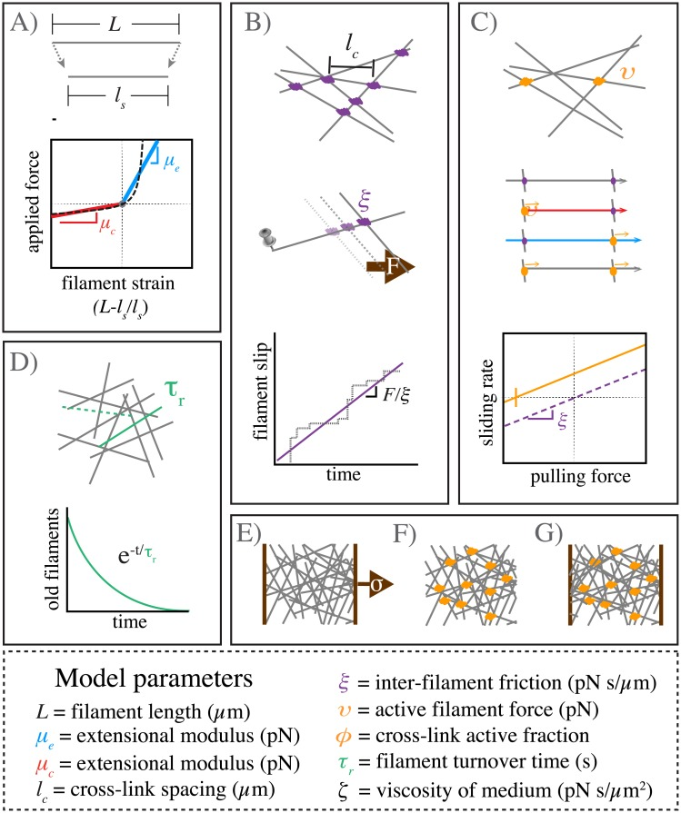

*图 25｜离散网络中的丝、交联与马达。引自 [McFadden 等（2017），Fig. 1](https://pmc.ncbi.nlm.nih.gov/articles/PMC5757993/#pcbi.1005811.g001)，CC BY 4.0。A–C 给出丝的非对称响应、交联与马达规则，其余面板说明边界和网络表示。它是粗粒化网络模型，并非逐根重建线虫皮层。*

作者分别施加外部负载来测有效耗散，并固定边界来测马达建立的主动应力。黏度与产力由独立计算得到，即使都受交联影响，也可以有不同的参数依赖。

没有丝周转时，网络可以先快速收缩，随后因结构重排而停滞；固定边界下的主动应力也未必长期维持。补入新丝使旧的受力结构不断被替换，允许持续产力与流动。周转过快又会在应力来得及建立之前拆掉丝，因此固定边界下的稳态应力随丝寿命可以先增后减。

但流速并不必然在同一处出现峰值，因为有效黏度也会变化。原模型中存在两个相关时间：被动应力松弛的时间与主动应力建立的时间。丝寿命短于两者时，稳态应力与有效黏度对丝寿命的依赖能够相互抵消，流速反而较不敏感；进入其他范围以后，这种抵消不再成立。

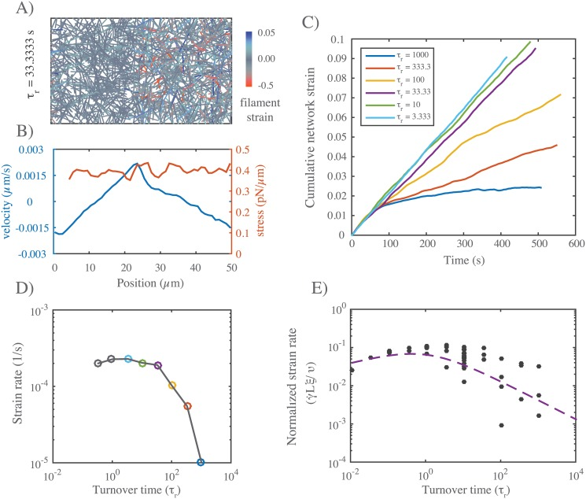

*图 26｜丝周转对主动应力与持续流动的影响。引自 [McFadden 等（2017），Fig. 9](https://pmc.ncbi.nlm.nih.gov/articles/PMC5757993/#pcbi.1005811.g009)，CC BY 4.0。A、B 为马达活动只出现在半侧网络时的形态与空间剖面；C–E 比较不同丝寿命的持续流动。图中的流动由丝与交联动力学求得。*

交联或周转因子受扰动后，主动应力、黏度和网络连通可能同时改变。流速近似不变，也可能是产力与耗散的变化相互抵消。结合结构寿命、释放响应和应力读出，才能区分这些情形。

当观察区域中包含足够多的丝与马达，可以不再逐根追踪，而把内部传力平均成应力。以面积为 $A$ 的皮层小块为例，成对内力的贡献可写成应力矩

$$
\boldsymbol{\sigma}_s^{\rm pair}
=\frac1A\sum_{\langle\alpha\beta\rangle}
\mathbf f_{\alpha\beta}\otimes\mathbf r_{\alpha\beta}.
$$

这里把 $\mathbf f_{\alpha\beta}$ 定义为与所选连线方向对应的传递力，拉伸为正；改变内力方向定义时，公式的整体符号也要一致。该式省略边界细节与弯矩，说明的是：平均应力取决于力的大小、传递距离和方向分布，而不只是马达数量。二维表面应力的单位是 N/m，与三维体应力的 Pa 不同。

用连续应力代替离散网络，需要观察尺度大于重要的网络结构、时间尺度也足以平均局部波动。若研究的正是单个斑点合并、局部断裂或孤立细束，这种平均可能过早。反过来，要解释整颗合子的极化轴，逐个计算所有分子也未必带来更多可辨识的信息。

用连续应力描述网络以后，局部活动与更大范围流动之间的关系便可以写成受力平衡。这个平均描述保留了材料的产力和阻力，也需要说明哪些结构细节已经被平均掉。

在局部平坦的皮层上，忽略惯性后可写

$$
\nabla_s\cdot\boldsymbol{\sigma}_s
-\Gamma(\mathbf v_s-\mathbf v_{\rm env})=0,
\qquad
\boldsymbol{\sigma}_s=
\boldsymbol{\sigma}_s^{\rm passive}+
\boldsymbol{\sigma}_s^{\rm active}.
$$

$\mathbf v_s$ 是皮层速度，$\mathbf v_{\rm env}$ 是与它摩擦耦合的环境速度，$\Gamma$ 是单位面积上的有效摩擦系数。被动部分可以包含黏性、弹性和压力；主动部分表示马达持续消耗化学能产生的应力。曲面上的完整方程还要区分切向受力、曲率引起的法向力以及膜和胞质的作用。

沿一个表面坐标 $x$，取环境静止、等效一维黏性系数为 $\eta_s$、主动拉应力为 $\tau_a(x)$，则

$$
\eta_s\partial_x^2v-\Gamma v+\partial_x\tau_a=0,
\qquad
\ell_\Gamma=\sqrt{\eta_s/\Gamma}.
$$

$\ell_\Gamma$ 是摩擦屏蔽长度。局部活动通过黏性把邻近材料一起带动，摩擦则让这种影响逐渐衰减。若 $\ell_\Gamma$ 远小于细胞长度，局部斑点可能只造成附近流动；与细胞长度可比时，局部收缩变化就能组织大范围运动。实际合子还受闭合曲面与形状约束，这里的一维关系只是局部化后的近似。

对波数为 $k$ 的分量，

$$
\widehat v(k)=
\frac{ik\,\widehat{\tau_a}(k)}
{\Gamma+\eta_sk^2}.
$$

这条式子把三件事分开了：主动应力怎样分布，材料怎样把应力传远，环境怎样消耗运动。空间均匀的主动应力本身不会在这片平坦、周期边界的模型中产生流；应力很强但完全均匀，和应力不强却有清楚梯度，可能给出很不一样的速度。

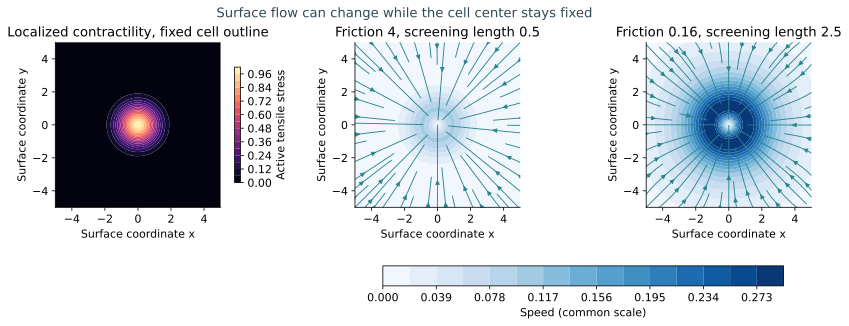

*图 27｜细胞轮廓固定时，内部的表面流仍可明显改变。左为高斯主动拉应力，右侧求解周期平面上的 $(\Gamma-\eta_s\nabla^2)\mathbf v_s=\nabla\tau_a$。取边长 12、128×128 网格、应力宽度 0.8、$\eta_s=1$；两组 $\Gamma=4,0.16$，对应 $\ell_\Gamma=0.5,2.5$。流线展示空间范围，背景表示各组流速分布；此算例未拟合胚胎，亦未包含表面取向和曲率。*

提高黏度与降低摩擦都会增大 $\ell_\Gamma$，但对速度幅度的影响不同。更高黏度可能让流动传得更远，同时降低局部速度；更低摩擦则同时减小耗散。仅说“流变得更连贯”，还不能判断是哪一个分子过程改变了材料。

皮层在很短时间内可以储存应力，长时间则通过交联交换、丝解聚和结构重排释放它。一个小变形线性 Maxwell 近似为

$$
\tau_R\partial_t\boldsymbol{\sigma}_s^{\rm ve}
+\boldsymbol{\sigma}_s^{\rm ve}
=2\eta_s\mathbf E_s,\qquad
\mathbf E_s=\tfrac12[
\nabla_s\mathbf v_s+(\nabla_s\mathbf v_s)^T].
$$

这里暂不写有限转动下的客观导数；主动应力另行加入。$\tau_R$ 表示被动机械记忆的有效松弛时间。当所观察运动持续得比 $\tau_R$ 长得多，黏性近似可能足够；切割刚发生时的快速释放，则需要保留弹性和松弛。

分子驻留时间不必等于 $\tau_R$。一条交联消失以后，其他连接可能继续承载；某类 actin 探针离开，也不代表整个网络立即失去应力。把 FRAP 时间直接代入 Maxwell 模型，等于额外假定这类分子周转控制了机械松弛，需要独立检验。

### 3.1 网络参数怎样进入细胞与组织的材料关系 {#network-coarse-graining}

从丝与马达到组织材料，至少要经过两步。先在一个比网孔大、又能保留区域差别的面积上平均网络受力，得到皮层的表面应力；再将表面受力、侧面连接与外部组织负载放入细胞尺度的平衡。把 actin 流速直接填成顶点模型的主动细胞速度，会跳过这两步。

例如，在面积 $A$ 内，每段中央拉伸连接只计一次，长度为 $\ell_e$，沿单位方向 $\mathbf p_e$ 承受正的拉力 $f_e$。它对对称表面拉应力的简化贡献为

$$
T_{\alpha\beta}^{\rm net}
=\frac1A\sum_e f_e\ell_e p_{e\alpha}p_{e\beta}.
$$

$T$ 的单位是力除以长度。若网络可近似为厚度 $h$ 的均匀薄层，体应力约为 $\sigma_{\alpha\beta}=T_{\alpha\beta}/h$；它与组织总截面上的应力还不是同一个平均。弯曲、边界、马达转矩与反对称应力不包含在这条中央力表达式中，讨论手性时需要另加相应贡献。

这个平均解释了为什么方向分布与张力必须一起测。相同的 actin 取向可以由不同的 $f_e$ 承载；同样的总张力也可以分布在方向不同的路径上。只有连接都近似仿射伸缩、已有应力项可正确处理时，单根连接的刚度与四阶方向平均才可给出简单的材料刚度估计。真实网络还会弯曲、滑移并作非仿射调整，应通过小幅虚拟或实际加载求增量响应。

| 组织尺度变量 | 网络层面需要保留的内容 | 怎样获得约束 |
| --- | --- | --- |
| 主动表面应力 $T^a$ | 马达负载、驻留与可用的连通路径 | 固定或已知边界下的反作用、释放响应；分子数量只能作辅助 |
| 增量刚度 $C_{\alpha\beta\gamma\delta}$ | 丝伸长与弯曲刚度、方向分布、交联、已有应力 | 围绕同一当前状态施加独立小变形，取应力增量对其导数 |
| 机械松弛时间与耗散 | 哪些更新事件真正释放承载路径，网络能否重新建立 | 应力松弛或频率响应，并与分子交换同时测量 |
| 参考状态 $q$ 或参考曲率 | 重连时记录了什么长度、方向与组织间不相容 | 等待可恢复应力释放以后，再测偏好形状与再次加载 |
| 细胞边界的有效牵引 | 皮层应力怎样到达黏着连接、ECM 与邻居 | 皮层和边界的相对运动、界面释放及两侧负载 |

若网络重排远快于细胞形变，并且在测量窗口内接近稳定分布，可以把某些内部量消去，得到近似固定的有效黏度或张力。若两种时间可比，同一个形状与当前马达活动可能对应不同的承载结构，此时就要继续记录取向、松弛应力或参考状态。[第二篇的机械初态算例](/notes/celegans/embryonic_morphogenesis/epithelial_morphogenesis/#mechanical-initial-state)展示了消去内部变量可能丢失的预测；一般松弛与流变判据见[第六篇](/notes/celegans/embryonic_morphogenesis/active_matter_packing_topology/#92-用应力松弛-蠕变和频率响应判断材料)。

合子皮层得到的 $T^a$、$C$ 与时间尺度，可以与伸长期表皮比较，但数值不能直接搬用。曲率、网络厚度、连接组成、外部摩擦和承载方向都已改变；在这些约束相近或被明确校正后，才能进一步比较材料关系是否共用。若组织中根本找不到清楚的尺度分离，保留有限区域网络或多个相连材料层，可能比指定一个全胚胎统一参数更可靠。

## 4. 理论借鉴：输运 激发与取向的简化模型 {#flow-and-organization}

网络开始流动以后，材料分布、分子反应和纤维方向会相互影响。最先需要分清的是：影像里一处变亮，究竟是材料被带到这里，还是此处的装配反应变强。

在固定平坦表面上，某类皮层组分的面密度 $c$ 可满足

$$
\partial_tc+\nabla_s\cdot(c\mathbf v_s)
=D_s\nabla_s^2c+S_{\rm on}-S_{\rm off}.
$$

把输运展开，沿材料运动的变化为

$$
\frac{Dc}{Dt}=
-c\,\nabla_s\cdot\mathbf v_s+
D_s\nabla_s^2c+S_{\rm on}-S_{\rm off}.
$$

右侧第一项是压缩造成的浓缩：材料汇聚时，单位面积中分子更多。最后两项则表示新分子装配和旧分子离开。即使完全没有新装配，汇聚也会使图像变亮；即使局部仍在扩张，足够强的装配同样能使亮度增加。

一条亮带向右移动，可以是同一批分子被输运，也可以是左边不断解离、右边不断装配的反应波。两个过程中，亮带的中心甚至可以有相同轨迹，但每个分子的经历不同。

*图 28｜时空信号与材料运动的比较。左侧使用高斯标记群的精确平流扩散解，$v=0.6,D=0.025,k_{\rm off}=0.25,\sigma_0=0.5$；右侧指定相同亮度图案，由各位置的局部募集与解离产生。青线示意分子的平均平流或局部驻留，省略扩散抖动。右侧是展示可辨识性问题的构造，未独立拟合反应网络。*

左侧的标记群满足 $\partial_tc+v\partial_xc=D\partial_x^2c-k_{\rm off}c$。若初始为以 $x_0$ 为中心的高斯分布，

$$
c(x,t)=
\frac{\sigma_0}{\sqrt{\sigma_0^2+2Dt}}\,
\exp\!\left[-\frac{(x-x_0-vt)^2}{2(\sigma_0^2+2Dt)}\right]
e^{-k_{\rm off}t}.
$$

其中心移动、宽度增加、总标记量下降，分别对应平流、扩散和解离。若另一个模型用局部反应制造完全相同的 $c(x,t)$，普通强度成像便不能区分它们。单分子追踪、光转换或同时测量物质流，可以增加关键约束。

这也限制了 PIV 的解释。PIV 追踪纹理的相似移动，适合图案在短时间内近似随材料运动的情形。若斑点不断出生和消失，或成像平面穿过弯曲表面，算出的“流速”还包含反应和投影影响。测量窗口与帧率需要相对于斑点寿命选择；提高空间分辨率本身不会解决时间上的混淆。

为了看清快慢反馈产生什么空间行为，可以用 FitzHugh–Nagumo 形式作局部正规形：

$$
\partial_tu=u-\frac{u^3}{3}-h+D_u\partial_x^2u+I(x,t),
\qquad
\partial_th=\epsilon(u+a-bh).
$$

$u$ 表示缩放后的快激发变量，$h$ 表示慢恢复变量，二者可以取负值，并非 Rho 或 GAP 的真实浓度。这个模型保留可激发性与恢复时间，没有复制 Michaux 等的分子反应式。$I$ 是局部短暂输入；扩散使受激区域影响邻近位置。

*图 29｜短暂刺激可以触发比刺激更持久的空间响应。无量纲参数 $a=0.7,b=0.8,\epsilon=0.08,D_u=0.6$，区间 $[-20,20]$ 两端无通量；在 $1\le t<2$ 施加中心位于 $x=-12$ 的局部输入。上排为激发与恢复场，下排为不同时间的空间剖面及固定位置的先后响应。此图是正规形算例，不是线虫脉冲波速或周期的测量。*

在休息状态附近，局部雅可比矩阵是

$$
\mathsf J=
\begin{pmatrix}
1-u_*^2&-1\\
\epsilon&-\epsilon b
\end{pmatrix}.
$$

图中参数的均匀休息态对小扰动稳定，有限输入仍能激发大响应。恢复变量尚未降下时，第二次同样的刺激可能难以再次触发，形成不应期。实验可以用脉冲后的再刺激、间隔分布和局部抑制因子的时间变化来检验这种行为；不能仅因模型能画出一条波，就认定实际皮层采用了相同反应函数。

另一条路线从材料输运出发。设密度更高的区域产生更大主动拉应力，附近材料被拉进来，又进一步提高密度。这种正反馈不必先有一个生化振荡器。最小模型可写为

$$
\partial_tc+\partial_x(cv)=D\partial_x^2c+k_{\rm on}-k_{\rm off}c,
\qquad
(\Gamma-\eta_s\partial_x^2)v=\partial_x\tau_a(c).
$$

在均匀态 $c_0=k_{\rm on}/k_{\rm off}$ 周围线性化，令 $\chi=\tau_a'(c_0)$，得到扰动增长率

$$
\lambda(k)=
\frac{c_0\chi k^2}{\Gamma+\eta_sk^2}
-Dk^2-k_{\rm off}.
$$

第一项来自收缩诱导的汇聚，后两项分别由扩散和周转抑制密度差。若某些波数上 $\lambda>0$，均匀态就会变得不稳定。这个推导明确了“myosin 多所以聚成斑点”中省略的过程：需要密度与主动应力的耦合、足够强的机械输运，以及未被扩散和更新压住的反馈。

流动还可以通过几何变形改变纤维取向。设局部材料沿 $x$ 方向压缩，而 $y$ 方向暂时不变，形变梯度为 $\mathsf F=\operatorname{diag}(e^{-\varepsilon},1)$。一根初始方向为 $\mathbf p_0$ 的物质线，仿射变形后的方向为

$$
\mathbf p=
\frac{\mathsf F\mathbf p_0}{|\mathsf F\mathbf p_0|}.
$$

它在 $x$ 上的分量被压短，因而更接近 $y$ 方向。对最初各向均匀的方向分布，取 $S_y=\langle p_y^2-p_x^2\rangle$，这个纯运动学算例给出

$$
S_y=\frac{1-e^{-\varepsilon}}{1+e^{-\varepsilon}}
=\tanh(\varepsilon/2).
$$

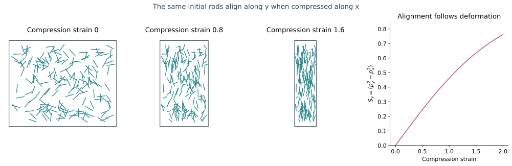

*图 30｜流动形变引起的纤维排列。前三幅为同一组初始线段在 $\varepsilon=0,0.8,1.6$ 下的仿射形变，末幅为均匀方向分布的解析平均。线段随材料变形，未包含丝的不可伸长约束、弯曲、周转和主动捕获；它解释方向变化的几何来源，不代替纤维网络力学。*

真实皮层会同时更新方向与材料。一个小取向偏差下的局部近似是

$$
\partial_t\mathsf Q
+\mathbf v_s\cdot\nabla_s\mathsf Q
-[\boldsymbol{\Omega}_s,\mathsf Q]
=\lambda\,\mathbf E_s^{\rm ST}
-\tau_Q^{-1}\mathsf Q+D_Q\nabla_s^2\mathsf Q.
$$

$\boldsymbol{\Omega}_s$ 表示局部转动，$\mathbf E_s^{\rm ST}$ 是应变率的对称无迹部分。流动使纤维转向与排列，周转和随机重排使取向松弛。该式只是接近各向同性状态的线性形式；高度排列时，还需要非线性项保证取向幅度合理。

因此，纤维看起来更整齐，可能来自压缩更强，也可能来自取向松弛更慢。若活动同时改变流场和丝寿命，只用终点的 $S$ 很难区分两者。压缩率、取向的建立时间和活动减弱后的消退时间应当一起比较。

## 5. 理论借鉴：胞质流与多尺度传力的候选模型 {#testing-network-mechanisms}

若在所比较尺度上，胞质近似不可压缩牛顿流体，低惯性极限给出

$$
-\nabla p+\eta_b\nabla^2\mathbf u+\mathbf f_b=0,
\qquad
\nabla\cdot\mathbf u=0.
$$

$\mathbf u$ 是体积流速，$\eta_b$ 是体黏度，$\mathbf f_b$ 包括内部主动驱动或其他体力。该方程需要边界条件：细胞表面不能任意穿流，切向运动则取决于皮层与胞质的耦合。若直接把皮层速度当作无滑移边界，就是作了强耦合假定；若允许滑移，需要另外规定牵引与相对速度的关系。

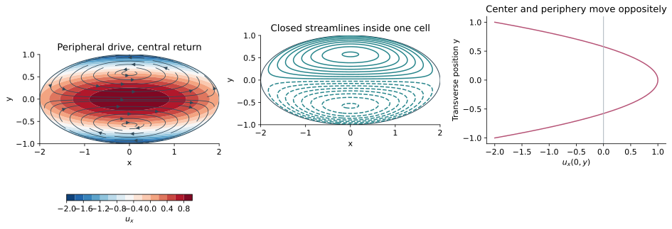

*图 31｜封闭体积使表面输运与内部返回流联系起来。二维椭圆算例取半轴 $a=2,b=1$，流函数 $\psi=Cy(1-x^2/a^2-y^2/b^2)$、$C=1$。左为轴向速度与流线，中为流函数等值线，右为中央截面速度。边界只有切向运动。它是 Stokes 方程的解析例子，不是 Niwayama 等使用的三维拟合模型。*

由 $\mathbf u=(\partial_y\psi,-\partial_x\psi)$ 得

$$
u_x=C\left(1-\frac{x^2}{a^2}-\frac{3y^2}{b^2}\right),
\qquad
u_y=\frac{2Cxy}{a^2}.
$$

这组速度在椭圆边界上的法向分量为零，中心的 $u_x$ 与外围相反；相应压力为 $p=-2\eta_bC(a^{-2}+3b^{-2})x$。在同一截面中看到“两个方向”，可以是一个整体流场的不同部分。实际胚胎中的核、微管和不均匀流变会改变具体剖面。

若认为胞质由可变形的骨架与穿行其中的流体组成，可以采用两相或孔弹性模型。设骨架位移为 $\mathbf w$、溶剂速度为 $\mathbf u_f$，相对运动产生 $\xi(\mathbf u_f-\partial_t\mathbf w)$ 的摩擦；骨架承受弹性应力，流体承受压力和黏性应力。在线性、均匀的近似下，孔隙压力传播的时间尺度约为

$$
\tau_p\sim\frac{\ell^2}{D_p^{\rm poro}},
\qquad
D_p^{\rm poro}\sim\frac{K}{\xi}.
$$

$K$ 是相应体积形变模量，$\xi$ 为两相间的体积摩擦系数。这个模型预测响应随探测长度改变，而单一 Maxwell 时间不必具有同样的 $\ell^2$ 依赖。要在线虫中选用它，应比较探针尺度、加载时间和结构约束；不能只因胞质含水就认定孔弹性主导。

一个最小摩擦耦合写成

$$
\mathbf t_{\rm cj}
=\xi_{\rm cj}(\mathbf v_c-\mathbf v_j),
$$

其中 $\mathbf v_c$ 是皮层速度，$\mathbf v_j$ 是连接速度，$\mathbf t_{\rm cj}$ 是相应线或面单位下传递的牵引。若连接承载能力有限，还需允许耦合随装配、解离和负载改变。较大的相对速度可以说明滑移明显，却不能单独确定传递力：$\xi_{\rm cj}$ 同样未知。

这种滑移意味着，细胞级模型中的有效张力可能同时包含马达产力、网络传力和连接耦合。即使模型拟合了面积变化，对某个分子做干预时，也不能默认只改变其中一项。更具体的动力学可结合第一篇的 [clutch 与内移模型](/notes/celegans/embryonic_morphogenesis/gastrulation/)比较。

同一片 actomyosin 网络，孤立时可以缩成一个小团，连到细胞边界以后可以缩小顶面，接入连续表皮以后又可能使整个身体变细。决定结果的除了局部活动，还有活动发生的位置、与周围结构的连接，以及周围材料是否能够让位。

可以先把组织中的微小位移记为 $\mathbf u$，由网络与连接组成的有效刚度矩阵记为 $\mathsf K$，主动作用写成 $\mathbf f_{\rm act}$。在给定边界条件并消除整体自由平移后，线性近似是

$$
\mathsf K\mathbf u=\mathbf f_{\rm act}.
$$

这里的结点可以是数值网格点，不一定对应一个细胞或一根 actin 丝。这个关系的意义在于，远处某点怎样移动，取决于整个连接体系。相同的局部作用放到不同的 $\mathsf K$ 中，得到的形变范围和方向都会不同。若组织发生大形变、断裂或邻居交换，还必须随形态更新刚度与连接。

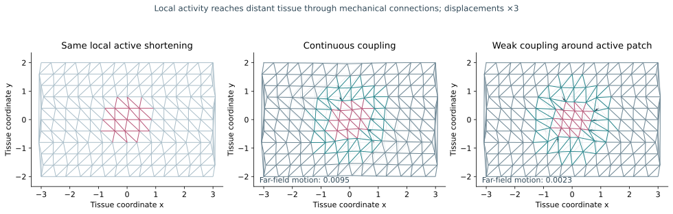

*图 32｜耦合强度与局部、远场响应。三角网格中心的优选边长均缩短 8%；中、右仅改变包围活动区的一圈连接刚度，分别取 1 和 0.03。弱耦合时中心更容易自己收缩，远场位移却减小。图中形变放大 3 倍；结点是组织位移的数值离散点，不是显微图中的丝或细胞。背景锚定系数 0.002、外边界锚定系数 0.5，求解线性弹簧平衡，未拟合胚胎。*

在这个网格算例中，完整耦合时远场平均位移约为 0.0095，弱耦合时约为 0.0023；中心的平均向内位移反而从约 0.022 增至 0.039。它说明局部皮层收缩很明显，与组织层面的传力有效，可以是相反的两种表现。测某个 actin 团缩了多少，还需要同时看它牵动了谁。

可以把内移坐标 $q$ 上的运动粗粒化为

$$
\zeta_q\dot q=
F_{\rm cortex\to boundary}
-\frac{\partial E_{\rm surroundings}}{\partial q}.
$$

第一项已经包含骨架到边界的传递，第二项包含邻居、接触和容积约束。它不是把细胞看成自由空间里自行前进的粒子。若网络活动近似保留而内移受阻，既要检查连接，也要检查邻居的分裂时序、接触面积和几何阻力。

一个均匀圆柱算例可以先说明封闭几何的转换。设前后轴伸长比为 $\lambda=L/L_0$，半径为 $R$；在体积近似不变时，

$$
\frac{R}{R_0}=\lambda^{-1/2},
\qquad
e_z=\ln\lambda=e,\quad
e_\theta=\ln(R/R_0)=-e/2.
$$

周向变短与轴向变长在这里是同一个允许形变的两个分量。但体积约束只告诉我们它们怎样关联，还没告诉我们系统是否愿意沿这条路径变形。为此取一个归一化的模式能量，

$$
\mathcal E(e)=
\frac12C_ze_z^2+\frac12C_\theta e_\theta^2+
\tau_ze_z+\tau_\theta e_\theta
=\frac12\left(C_z+\frac{C_\theta}{4}\right)e^2+
\left(\tau_z-\frac{\tau_\theta}{2}\right)e.
$$

$C_z,C_\theta$ 表示该简化模式中两个方向的被动抵抗；正的 $\tau_z,\tau_\theta$ 表示偏好缩短相应方向的主动广义作用。取 $\zeta_e\dot e=-d\mathcal E/de$，得到稳态

$$
e_\infty=
\frac{\tau_\theta/2-\tau_z}{C_z+C_\theta/4}.
$$

主动周向收缩促进 $e$ 增长，主动轴向收缩抵消它，轴向抵抗则限制可达到的伸长。这个算例中的系数已按模式归一化，不等于一张显微图上可直接读出的局部应力。

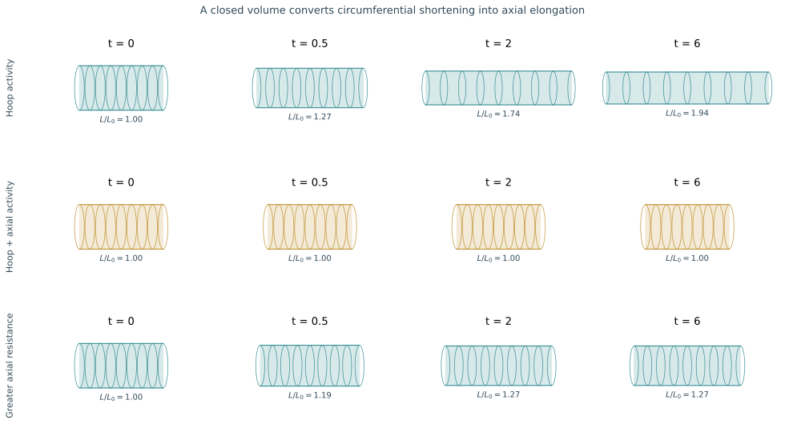

*图 33｜主动输入、初始负载与身体伸长。取 $C_\theta=2,\tau_\theta=1.2,\zeta_e=1$。上排 $C_z=0.4,\tau_z=0$；中排只加入 $\tau_z=0.6$；下排改为 $C_z=2,\tau_z=0$。由上述单模式方程演化，圆柱体积严格保持。环线仅表示周向方向，不表示模拟了真实丝束数量；未求解 seam 与背腹区域的异质性、端部形状或真实胚胎压力。*

图 33 解释的是整体几何与方向性作用之间的关系。真实线虫还需要解决 seam 与背腹表皮相连时的力分配：主动区域变窄时，邻近区域能否沿周向鼓出，取决于后者的纤维强化；若这条更容易的形变路径被限制，前后轴伸长才更突出。具体机制不能由“体积不变，所以一定变长”一句话代替。均匀模式也不能用来推断提高某种周向纤维刚度必然促进或抑制伸长，后者需要异质表皮的力学模型。

可以把一个整体伸长模式的应变拆成可恢复部分与更新后的参考部分：$e=e_{\rm el}+p$。取有效模量 $E$、广义阻力 $\zeta$，写

$$
\zeta\dot e=Q_{\rm eff}(t)-E(e-p),
\qquad
\dot p=M_p\langle E(e-p)-s_y\rangle_+.
$$

$Q_{\rm eff}$ 是作用于所选伸长模式的有效负载，不是把纵向肌肉直接当成轴向伸长的推杆；肌肉运动怎样经周向骨架和几何转成这个负载，仍需更细的模型。第二式用单向阈值规则表示参考状态更新，只用于拆开可恢复响应与形态保持，没有指定某个基因直接等于 $M_p$ 或阈值 $s_y$。

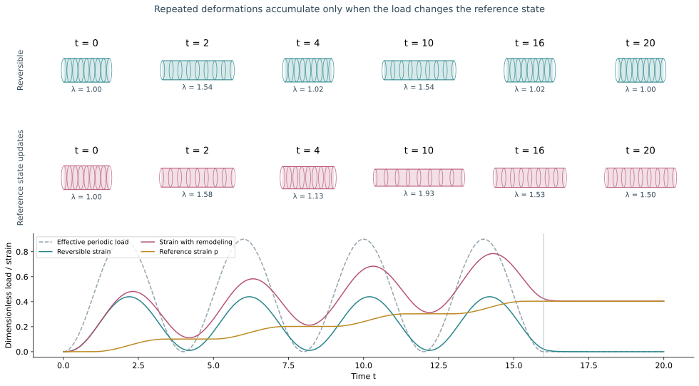

*图 34｜周期形变中的弹性响应与参考应变。两行施加相同 $Q_{\rm eff}=0.9\sin^2(\pi t/4)$，在 $t=16$ 停止输入；取 $E=2,\zeta=0.4,s_y=0.3$。上排 $M_p=0$，下排 $M_p=0.12$。圆柱形态由 $L/L_0=\exp(e)$ 与体积约束换算，未模拟肌肉带或真实 actin 切断。图中的方向性更新规则是简化假定。*

图 34 的下排在卸载后仍保留约 $e=0.404$ 的参考应变，对应长度比约 1.50；上排充分松弛后回到原长。这个结果由明确的更新规则产生，不能仅凭“耗散了能量”推出。普通黏性耗散可以把机械功变成热，却不自动决定组织保留哪一种形状。

从轮廓可以得到形变，结合局部流动、结构与释放实验，才有机会进一步估计力、阻力和更新时间。

顶点模型中的线张力，来自接触附近真实的骨架与界面作用。若从薄层应力往上积分，边界切面上的牵引由 $\boldsymbol{\sigma}\mathbf n$ 给出，再沿相应厚度或接触截面汇总成细胞尺度的有效力。不同皮层架构可能得到相似的等效张力；反过来，相同 myosin 量也可能因取向、周转与耦合不同，得到不同有效力。

因此，上下尺度之间应先匹配同一种机械量。表面应力、界面线张力、总牵引和荧光强度的单位与含义不同。把 NMY-2 强度直接填进顶点模型的 $\Lambda_{ij}$，实际上省略了马达活性、网络方向、接触几何和传力效率四类关系。

分层建模可以先由亚细胞实验估计主动应力方向、松弛时间与连接牵引，再用于细胞尺度计算。若某个分子扰动仍无法解释，就回头检查粗粒化时遗漏的结构或动力学，而非为每种表型重新指定全部张力。

| 测量组合 | 约束什么 | 仍需避免的混淆 |
| --- | --- | --- |
| 双颜色活性探针与 NMY-2 加局部流场 | 活化、募集和压缩的先后 | 亮度不是直接的受力读数 |
| 单分子轨迹 加分子出现和消失率 | 平流、扩散、装配与解离 | 光漂白和检测阈值影响驻留统计 |
| 纤维取向 加速度梯度和沟深 | 流动排列与结构到形变的联系 | 最大投影可能混入不同高度的纤维 |
| 激光切割 加切前流场与方向 | 预存张力、阻力和松弛 | 初始回缩速度通常约束力与阻力的比 |
| 膜或连接 加皮层材料的相对运动 | 产力与传力是否脱耦 | 滑移速度不能单独给出耦合系数 |
| 内部受控探针 加卸载恢复与尺寸比较 | 胞质本构和尺度依赖 | 细胞质响应不等于皮层或组织响应 |

沿这些尺度继续研究，可以提出更具体的问题：改变 actin 的退出速率后，先变化的是网络连通、流动范围，还是连接处的滑移？相同的皮层流放到不同邻居和包被条件下，是否仍产生相同分裂偏转？若细胞级轨迹近似不变，而这些中间量已经改变，就能进一步检验发育过程靠哪些反馈维持稳定。

## 参考文献 {#references}

1. Michiel Vanslambrouck, Jef Vangheel, Ella Linxia Müller, Bart Smeets, Pierre Gönczy, Rob Jelier (2026). [Nematic structures contribute to robust zygotic polarization in C. elegans](https://doi.org/10.1371/journal.pcbi.1014792). *PLOS Computational Biology*.

2. Wei Yung Ding, Hui Ting Ong, Yusuke Hara, Jantana Wongsantichon, Yusuke Toyama, Robert C. Robinson, François Nédélec, Ronen Zaidel-Bar (2017). [Plastin increases cortical connectivity to facilitate robust polarization and timely cytokinesis](https://doi.org/10.1083/jcb.201603070). *Journal of Cell Biology*.

3. Carlos Patino Descovich, Daniel B. Cortes, Sean Ryan, Jazmine Nash, Li Zhang, Paul S. Maddox, Francois Nedelec, Amy Shaub Maddox (2018). [Cross-linkers both drive and brake cytoskeletal remodeling and furrowing in cytokinesis](https://doi.org/10.1091/mbc.E17-06-0392). *Molecular Biology of the Cell*.

4. Mirjam Mayer, Martin Depken, Justin S. Bois, Frank Jülicher, Stephan W. Grill (2010). [Anisotropies in cortical tension reveal the physical basis of polarizing cortical flows](https://doi.org/10.1038/nature09376). *Nature*.

5. William M. McFadden, Patrick M. McCall, Margaret L. Gardel, Edwin M. Munro (2017). [Filament turnover tunes both force generation and dissipation to control long-range flows in a model actomyosin cortex](https://doi.org/10.1371/journal.pcbi.1005811). *PLoS Computational Biology*.

6. Rachel S. Kadzik, Ondrej Maxian, Isaiah Thomas, David R. Kovar, Edwin M. Munro (2026). [Rapid actin filament turnover maintains cortical connectivity while allowing for cell cortex deformation and flow](https://doi.org/10.64898/2026.05.24.727551). *bioRxiv preprint*.

7. Masatoshi Nishikawa, Sundar Ram Naganathan, Frank Jülicher, Stephan W Grill (2017). [Controlling contractile instabilities in the actomyosin cortex](https://doi.org/10.7554/eLife.19595). *eLife*.

8. Jonathan B. Michaux, François B. Robin, William M. McFadden, Edwin M. Munro (2018). [Excitable RhoA dynamics drive pulsed contractions in the early C. elegans embryo](https://doi.org/10.1083/jcb.201806161). *Journal of Cell Biology*.

9. Anne-Cecile Reymann, Fabio Staniscia, Anna Erzberger, Guillaume Salbreux, Stephan W Grill (2016). [Cortical flow aligns actin filaments to form a furrow](https://doi.org/10.7554/eLife.17807). *eLife*.

10. Sundar Ram Naganathan, Sebastian Fürthauer, Masatoshi Nishikawa, Frank Jülicher, Stephan W Grill (2014). [Active torque generation by the actomyosin cell cortex drives left–right symmetry breaking](https://doi.org/10.7554/eLife.04165). *eLife*.

11. Lokesh G. Pimpale, Teije C. Middelkoop, Alexander Mietke, Stephan W. Grill (2020). [Cell lineage-dependent chiral actomyosin flows drive cellular rearrangements in early Caenorhabditis elegans development](https://doi.org/10.7554/eLife.54930). *eLife*.

12. Mi Jing Khor, Yuxuan Rain Xiong, Gaganpreet Sangha, Kenji Sugioka (2025). [Cadherin flow translates cortical chirality into left-right asymmetric cell division dynamics in Caenorhabditis elegans embryos](https://doi.org/10.1016/j.cub.2025.09.052). *Current Biology*.

13. Slabodnick MM, Tintori SC, Prakash M, Zhang P, Higgins CD, Chen AH, Cupp TD, Wong T, Bowie E, Jug F, Goldstein B (2023). [Zyxin contributes to coupling between cell junctions and contractile actomyosin networks during apical constriction](https://doi.org/10.1371/journal.pgen.1010319). *PLoS Genet*.

14. Nathan W. Goehring, Philipp Khuc Trong, Justin S. Bois, Debanjan Chowdhury, Ernesto M. Nicola, Anthony A. Hyman, Stephan W. Grill (2011). [Polarization of PAR Proteins by Advective Triggering of a Pattern-Forming System](https://doi.org/10.1126/science.1208619). *Science*.

15. Rukshala Illukkumbura, Nisha Hirani, Joana Borrego-Pinto, Tom Bland, KangBo Ng, Lars Hubatsch, Jessica McQuade, Robert G. Endres, Nathan W. Goehring (2023). [Design principles for selective polarization of PAR proteins by cortical flows](https://doi.org/10.1083/jcb.202209111). *Journal of Cell Biology*.

16. Ritsuya Niwayama, Kyosuke Shinohara, Akatsuki Kimura (2011). [Hydrodynamic property of the cytoplasm is sufficient to mediate cytoplasmic streaming in the Caenorhabiditis elegans embryo](https://doi.org/10.1073/pnas.1101853108). *Proceedings of the National Academy of Sciences*.

17. Saaya Koizumi, Ayama Tokuyasu, Akinori W. M. Miyamoto, Takayuki Torisawa, Hirokazu Tanimoto, Akatsuki Kimura (2026). [Developmentally programmed changes in cytoplasmic mechanics revealed by active microrheology in C. elegans embryos](https://doi.org/10.64898/2026.05.19.726147). *bioRxiv preprint*.

18. Sundar Ram Naganathan, Sebastian Fürthauer, Josana Rodriguez, Bruno Thomas Fievet, Frank Jülicher, Julie Ahringer, Carlo Vittorio Cannistraci, Stephan W Grill (2018). [Morphogenetic degeneracies in the actomyosin cortex](https://doi.org/10.7554/eLife.37677). *eLife*.

19. François B Robin, William M McFadden, Baixue Yao, Edwin M Munro (2014). [Single-molecule analysis of cell surface dynamics in Caenorhabditis elegans embryos](https://doi.org/10.1038/nmeth.2928). *Nature Methods*.

20. Pu Zhang, Taylor N. Medwig-Kinney, Bob Goldstein (2023). [Architecture of the cortical actomyosin network driving apical constriction in C. elegans](https://doi.org/10.1083/jcb.202302102). *Journal of Cell Biology*.

21. Wim Thiels, Michiel Vanslambrouck, Casper Van Bavel, Keyu Xiao, Jef Vangheel, Bart Smeets, Rob Jelier (2026). [Integrated quantitative imaging and biomechanical modeling of early gastrulation in C. elegans](https://doi.org/10.64898/2026.03.30.715391). *bioRxiv preprint*.

22. Walck-Shannon E, Reiner D, Hardin J (2015). [Polarized Rac-dependent protrusions drive epithelial intercalation in the embryonic epidermis of C. elegans](https://doi.org/10.1242/dev.127597). *Development*.

23. Bernadskaya YY, Wallace A, Nguyen J, Mohler WA, Soto MC (2012). [UNC-40/DCC, SAX-3/Robo, and VAB-1/Eph polarize F-actin during embryonic morphogenesis by regulating the WAVE/SCAR actin nucleation complex](https://doi.org/10.1371/journal.pgen.1002863). *PLoS Genet*.

24. Raich WB, Agbunag C, Hardin J (1999). [Rapid epithelial-sheet sealing in the Caenorhabditis elegans embryo requires cadherin-dependent filopodial priming](https://doi.org/10.1016/S0960-9822(00)80015-9). *Curr Biol*.

25. Vuong-Brender TT, Ben Amar M, Pontabry J, Labouesse M (2017). [The interplay of stiffness and force anisotropies drives embryo elongation](https://doi.org/10.7554/eLife.23866). *eLife*.

26. Vuong-Brender TTK, Suman SK, Labouesse M (2017). [The apical ECM preserves embryonic integrity and distributes mechanical stress during morphogenesis](https://doi.org/10.1242/dev.150383). *Development*.

27. Zhang H, Landmann F, Zahreddine H, Rodriguez D, Koch M, Labouesse M (2011). [A tension-induced mechanotransduction pathway promotes epithelial morphogenesis](https://doi.org/10.1038/nature09765). *Nature*.

28. Sophie Quintin, Shaohe Wang, Julien Pontabry, Ambre Bender, François Robin, Vincent Hyenne, Frédéric Landmann, Christelle Gally, Karen Oegema, Michel Labouesse (2016). [Non-centrosomal epidermal microtubules act in parallel to LET-502/ROCK to promote C. elegans elongation](https://doi.org/10.1242/dev.126615). *Development*.

29. Lardennois A, Pásti G, Ferraro T, Llense F, Mahou P, Pontabry J, Rodriguez D, Kim S, Ono S, Beaurepaire E, Gally C, Labouesse M (2019). [An actin-based viscoplastic lock ensures progressive body-axis elongation](https://doi.org/10.1038/s41586-019-1509-4). *Nature*.

30. Lardennois A, Pásti G, Ferraro T, Llense F, Mahou P, Pontabry J, Rodriguez D, Kim S, Ono S, Beaurepaire E, Gally C, Labouesse M (2019). [Publisher Correction: An actin-based viscoplastic lock ensures progressive body-axis elongation](https://doi.org/10.1038/s41586-019-1562-z). *Nature*.

31. Yang X, Ferraro T, Molnar K, Pontabry J, Malanda SR, Maghelli N, Royer L, Grill SW, Myers G, Grigolon S, Labouesse M (2025). [Repeated extrinsic and anisotropic mechanical inputs promote C. elegans polarized adherens junction elongation](https://doi.org/10.1016/j.devcel.2025.06.012). *Dev Cell*.

32. Dai A, Ben Amar M (2024). [Cyclic muscle contractions reinforce the actomyosin motors and mediate the full elongation of C. elegans embryo](https://doi.org/10.7554/eLife.90505). *eLife*.

33. Labouesse M, Ferraro T, Llense F, Heier J, Tesone Z, Hardin J (2026). [Cellular Processes and Forces Shaping the Embryo: Lessons from C. elegans](https://doi.org/10.3390/cells15070645). *Cells*.

← [06 Active matter 软物质堆积与拓扑](/notes/celegans/embryonic_morphogenesis/active_matter_packing_topology/) · [系列总览](/notes/celegans/embryonic_morphogenesis/)
