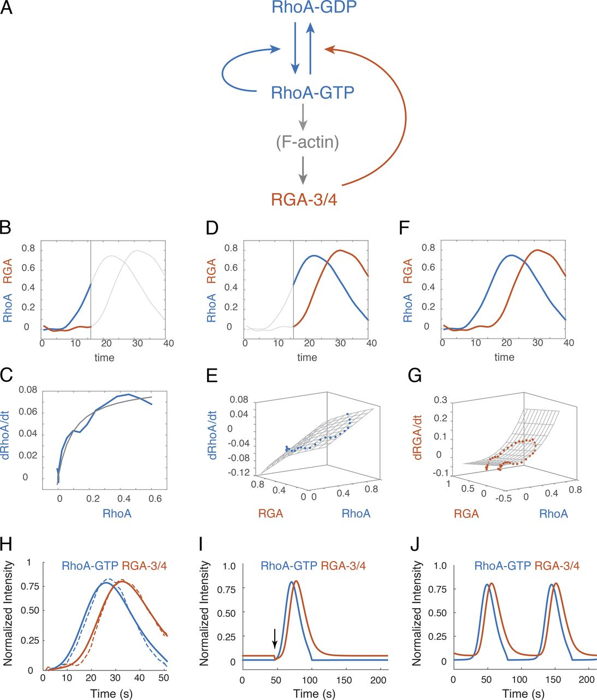
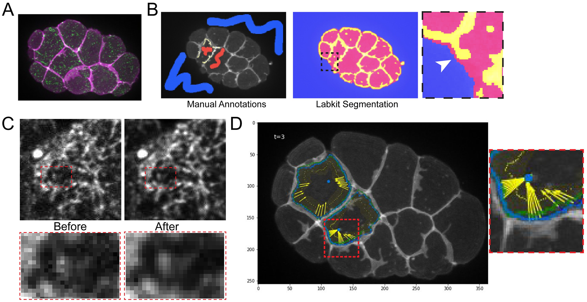

局部 myosin 很活跃，细胞边界却可能几乎不动；皮层流速相近的两个胚胎，也可能有不同的网络连通性和张力。Actomyosin 对形态的作用，要经过丝、交联、周转和连接共同组成的传力路径。马达提供活动，网络决定这些活动能在多远、多长的时间内共同作用，周围结构则决定它们最终改变什么形状。

线虫的优势在于，这些环节已有一批能够相互对照的定量研究：网络成像与离散模拟讨论产力和耗散，RhoA 与单分子实验约束脉冲动力学，流场与纤维取向检验主动凝胶理论，双色成像又能分开皮层收缩和边界跟随。它们并不是同一套模型从分子一路算到胚胎，而是分别解释了这条传递链上的不同环节。

## 1. 网络结构怎样决定产力与耗散 {#network-material}

### 1.1 交联把局部马达接成共同收缩的网络 {#connectivity-and-contractility}

Myosin II 使相连 actin 丝发生相对滑动，但局部滑动能否牵动更大区域，取决于丝之间怎样连接。若皮层分成许多互不相连的小团，每个团都可以收缩，整片表面却难以出现连贯的运动。因此，网络连通性不仅影响材料有多硬，也影响马达的作用能否传到邻近结构。

在线虫合子中，Ding 等对 PLST-1/plastin 的研究把这件事具体化了。Plastin 是 actin 交联蛋白。失去 PLST-1 后，新生 NMY-2 结构合并成较大收缩斑点的过程受损，长程定向流和极化也随之改变。这里首先变化的是局部结构怎样连接和合并，不能只用一个总 myosin 浓度概括。[Ding 等，2017](https://doi.org/10.1083/jcb.201603070)

*图 1｜Plastin 与 myosin 斑点的合并。引自 [Ding 等（2017），Fig. 4](https://pmc.ncbi.nlm.nih.gov/articles/PMC5412556/#fig4)，CC BY-NC-SA 4.0。比较对照与 plst-1 条件下的皮层影像、NMY-2 时间序列和斑点特征。这里的斑点是许多分子的集体结构，不能把一个亮点当成一个马达。*

这类实验尤其适合与离散网络模型比较。Ding 等在模型中分别改变交联与马达条件，直接观察网络怎样聚集、收缩和重排。模型中的活动必须经过实际连接传出，因此能够比较“局部已经有力，但没有接成整体”和“连得太紧，结构难以调整”这两种情况。

*图 2｜马达与交联对网络收缩的影响。引自 [Ding 等（2017），Fig. 7](https://pmc.ncbi.nlm.nih.gov/articles/PMC5412556/#fig7)，CC BY-NC-SA 4.0。A 比较不同交联和马达条件下的模拟形态；B 为相应实验比较。图中的网络收缩来自显式结构与相互作用，因而比单独改变一个细胞张力参数多保留了一层机制。*

交联既能帮助产力，也会抵抗相对滑动。交联过少，丝容易彼此滑开，局部活动传不远；交联过于持久，网络又难以重新安排，收缩受到阻碍。Patiño Descovich 等在胞质分裂中的实验与模拟进一步展示了交联的这两面：它既参与形成可收缩结构，也会制动重塑。[Patiño Descovich 等，2018](https://doi.org/10.1091/mbc.E17-06-0392) 因而，“更多交联”与“更快收缩”之间没有普遍的单调关系。

丝长和寿命则决定连接能够跨多远、保留多久。Kadzik 等的线虫预印本测量了 formin 相关装配及 actin 消失动力学，并比较 profilin、cofilin 干预后的网络与膜变化。丝束生长的速度、信号消失的过程和整片皮层的形变，被作为不同观测量保留。[Kadzik 等，2026，预印本](https://doi.org/10.64898/2026.05.24.727551)

*图 3｜丝束的长度与寿命可以分别测量。引自 [Kadzik 等（2026），Fig. 3](https://pmc.ncbi.nlm.nih.gov/articles/PMC13232293/#F3)，预印本，CC BY-NC-ND 4.0，原图完整保留。PLST-1::GFP 序列与时空图显示束的出现、延长和消失；图中斜率与信号衰减分别约束不同动力学。*

这些测量把“周转快慢”从一个笼统参数变成了可以检查的结构过程。不过，某个标记离开皮层、局部丝段被切断、整根丝退出网络，并不总是同一件事。网络的机械松弛还取决于剩余路径是否继续承载，因此分子驻留时间不能直接代替应力松弛时间。

### 1.2 周转同时改变应力建立和材料阻力 {#network-turnover}

McFadden 等的理论研究提供了一个适合与上述实验并读的模型。它研究一般的模型皮层，并非逐根重建线虫中的网络：actin 丝受拉比受压更难，交联使相邻丝的滑动受到摩擦，马达在局部交叠处施力，旧丝按设定寿命移除，再补入新丝。作者在改变丝寿命时保持平均密度，从而把更新速度与丝总量的影响分开。[McFadden 等，2017](https://doi.org/10.1371/journal.pcbi.1005811)

*图 4｜离散网络中的丝、交联与马达。引自 [McFadden 等（2017），Fig. 1](https://pmc.ncbi.nlm.nih.gov/articles/PMC5757993/#pcbi.1005811.g001)，CC BY 4.0。A–C 给出丝的非对称响应、交联与马达规则，其余面板说明边界和网络表示。它是粗粒化网络模型，并非逐根重建线虫皮层。*

拉压不对称是模型的重要结构。受压的细丝容易弯曲，受拉的路径却能保留较大张力；马达推动的局部滑动因此可以累积为净收缩。若把所有丝都写成受拉、受压完全对称的线性弹簧，就会丢掉这条产力机制。

原论文没有把流速直接当作应力读数，而是分别计算两种响应：外部加载下的有效阻力，以及边界固定时马达建立的主动应力。随后才将二者放回空间不均匀的网络，计算持续流动。这使模型能够讨论同一种微观改动为何同时改变“推得多强”和“动起来有多难”。

*图 5｜丝周转对主动应力与持续流动的影响。引自 [McFadden 等（2017），Fig. 9](https://pmc.ncbi.nlm.nih.gov/articles/PMC5757993/#pcbi.1005811.g009)，CC BY 4.0。A、B 为马达活动只出现在半侧网络时的形态与空间剖面；C–E 比较不同丝寿命的持续流动。图中的流动由丝与交联动力学求得。*

没有周转时，网络可以先收缩，随后因结构重新安排而停滞，固定边界下的主动应力也未必长期维持。补入新丝使产力路径不断更新，能够支持持续活动；更新过快，又会在应力尚未建立时拆掉路径。所以主动应力随丝寿命改变可以出现中间最优范围。

流速却不必在同一范围达到最大。原模型区分被动应力松弛时间和主动应力建立时间：当丝寿命短于二者时，应力与有效黏度对寿命的依赖可以相互抵消，流速反而变化不大。进入其他时间范围，这种抵消才会消失。对线虫交联或周转因子的实验，这提供了一项很实用的解释：流速近似保留，不能据此断定网络的产力和耗散都未改变。

这项理论对跨尺度理解的贡献，是由同一套网络规则得到应力、阻力和流动之间的联系。移到具体的线虫阶段时，比较对象应包括相应的丝结构和负载条件，而不只是最后的速度。

### 1.3 连续皮层怎样保留网络的力学作用 {#network-coarse-graining}

Mayer 等在线虫合子中用方向和位置可分辨的激光切割，测量极化时的皮层张力。他们区分了马达产生的主动作用与皮层实际承受的总张力：流动造成的黏性应力也进入总张力，两者不能从 myosin 亮度直接互换。[Mayer 等，2010](https://doi.org/10.1038/nature09376)

从网络到连续材料，首先平均的是传递的力。对面积为 $A$ 的皮层小块，若每段中央拉伸连接只计一次，长度为 $\ell_e$，方向为 $\mathbf p_e$，承受拉力 $f_e$，它对表面张力的简化贡献为

$$
T_{\alpha\beta}^{\rm net}
=\frac1A\sum_e f_e\ell_e p_{e\alpha}p_{e\beta}.
$$

这个式子说明平均时需要保留什么：力的大小、连接长度和方向分布。相同的 myosin 数量，若负载、驻留或可用路径不同，就不一定得到相同的 $T$；相同的 actin 取向，也不说明每条路径承担了相同拉力。这里 $T$ 的单位是 N/m，表示薄层的表面受力；若要换成三维体应力，还需要皮层厚度。刚度则是对小幅变形的增量响应，不能只从当前张力或纤维方向读出。

当尺度大于主要网孔与局部束结构，忽略惯性后的切向受力平衡可写为

$$
\nabla_s\cdot\boldsymbol T
-\Gamma(\mathbf v_s-\mathbf v_{\rm env})=0.
$$

$\boldsymbol T$ 同时包含被动与主动贡献，$\Gamma$ 表示皮层与环境的有效摩擦。在局部平坦、沿 $x$ 变化的黏性近似中，环境静止时有

$$
\eta_s\partial_x^2v-\Gamma v+\partial_x\tau_a=0,
\qquad
\ell_\Gamma=\sqrt{\eta_s/\Gamma}.
$$

主动张力的空间差异推动流动，皮层内部的黏性把相邻区域耦合，外部摩擦使影响逐渐衰减。屏蔽长度 $\ell_\Gamma$ 比较的是这两种阻力；它大，意味着局部活动可能影响更远区域，并不独立规定流速有多大。

Naganathan 等对 actin 结合蛋白和调控因子的筛选，把分子扰动同实测流场、斑点结构、屏蔽长度及手性指标联系起来。同样的外观变化可以来自不同有效参数，不同分子扰动也可以得到相近流型，这正是论文所讨论的力学简并。[Naganathan 等，2018](https://doi.org/10.7554/eLife.37677)

*图 6｜骨架扰动后的流场与有效物理参数。引自 [Naganathan 等（2018），Fig. 6](https://elifesciences.org/articles/37677#fig6)，CC BY 4.0。不同干预下的屏蔽长度、手性指标及代表性剖面，说明可将分子扰动映射到有效物理量，但这种映射通常不是一对一。*

*图 7｜屏蔽长度的空间作用，原理示意。周期平面上给定同一高斯主动拉应力，两组摩擦对应 $\ell_\Gamma=0.5,2.5$（无量纲）；流线显示影响范围，背景表示各组流速。该图只求解摩擦黏性平衡，未包含合子曲率与取向。*

这张原理图只把屏蔽的空间效果单独拿出来：相同活动分布在不同摩擦下影响不同范围。原论文的实验与拟合才负责约束线虫中的参数。提高黏度与减小摩擦都能增大 $\ell_\Gamma$，对速度幅度却未必有相同效果；仅凭流动更连贯，无法唯一定位某一种分子变化。

连续理论也有适用尺度。它适合比较跨越许多丝的流场和张力；若关注单个斑点合并、局部断裂或孤立细束，离散结构仍应保留。反过来，整颗合子的极化轴也不需要逐个模拟所有分子。模型的分辨率应与原论文实际解释的现象对应。

## 2. 皮层图案从哪里来 分子反应与主动汇聚 {#flow-and-organization}

### 2.1 一处变亮包含多少输运和局部反应 {#transport-versus-reaction}

<figure class="celegans-video" id="subcellular-rho-movie">
<video controls loop preload="metadata" playsinline aria-label="线虫皮层Rho活性与myosin脉冲">
<source src="https://static-movie-usa.glencoesoftware.com/mp4/10.7554/716/bf6e47269b7ece8c56c5f935e9a0546369beae89/elife-19595-media1.mp4" type="video/mp4">
</video>
<figcaption><strong>动态影像｜局部活动反复出现又消失</strong> Nishikawa 等（2017），Video 1，CC BY 4.0。绿色为 AHPH 报告的 RhoA 活性相关信号，紫红色为 NMY-2。关注斑点如何生成、汇聚和消退，而不只看两种颜色是否重合。<a href="https://elifesciences.org/articles/19595#video1" target="_blank" rel="noopener">原始影片与说明</a>。</figcaption>
</figure>

皮层斑点的生成、汇聚和消退，看起来是一段连续过程，却可能包含不同机制。一处 NMY-2 变亮，可以因为已有材料被带到这里，也可以因为局部募集增多或解离减少。仅有强度随时间的变化，不能分清这些贡献。

Nishikawa 等把共成像与流场分析结合为 COMBI，用测得的材料运动校正局部浓度变化，再估计 RhoA 和 myosin 的反应贡献。这一步使模型中的募集率不再直接等同于显微图中的变亮速度。[Nishikawa 等，2017](https://doi.org/10.7554/eLife.19595)

*图 8｜同时测量皮层流场与局部反应动力学。引自 [Nishikawa 等（2017），Fig. 1](https://elifesciences.org/articles/19595#fig1)，CC BY 4.0。图中包括皮层影像、PIV 流场、时间变化，以及扣除材料输运影响后估计局部动力学的 COMBI 分析。*

对固定平坦表面上的组分面密度 $c$，相应的连续性关系是

$$
\partial_tc+\nabla_s\cdot(c\mathbf v_s)
=D_s\nabla_s^2c+R(c,\ldots),
\qquad
\frac{Dc}{Dt}
=-c\nabla_s\cdot\mathbf v_s+D_s\nabla_s^2c+R.
$$

第一种写法按固定位置记账，第二种跟随材料记账。材料汇聚时，$\nabla_s\cdot\mathbf v_s<0$，即使没有净装配，也会使单位面积内的分子增多。$R$ 则包括局部进入和离开的净效果。在移动、形变的真实曲面上还需使用相应的表面守恒关系；这里保留的是 COMBI 所要区分的两类来源。

Michaux 等进一步用单分子追踪，沿着会移动、会变形的皮层小块统计分子的出现、消失与位移。其主要定量对象是两细胞期的 AB 细胞，因为合子皮层较深的局部内陷更容易混入焦面变化；作者又在合子中作了相应比较。观测表明，actomyosin 的局部积累可以早于可见收缩，脉冲中的密度变化主要受局部装配与解离调控。[Michaux 等，2018](https://doi.org/10.1083/jcb.201806161)

*图 9｜同一脉冲中的分子更新与机械形变。引自 [Michaux 等（2018），Fig. 2](https://pmc.ncbi.nlm.nih.gov/articles/PMC6279378/#fig2)，CC BY-NC-SA 4.0。A–D 为分子检测、轨迹与局部区域；E–H 将网络形变、分子数、出现与消失速率按脉冲时间对齐。*

*图 10｜相同强度图并不确定分子运动，原理插图。左侧标记群发生平流、扩散和解离；右侧用局部募集与解离产生相同亮度图案，青线比较分子的平均路径。它说明需要哪些额外观测，不承担脉冲机制的检验。*

这个小插图说明强度成像的辨识困难：一条移动亮带，既可以由分子被带走形成，也可以由不同位置先后募集与解离形成。两者的强度图可以相同，单分子的轨迹却不同。COMBI 和随材料追踪的单分子分析，正是给亮度图增加这些缺少的信息。

PIV 或光流追踪的是纹理的相似移动。斑点在短时间内近似随材料运动时，这与物质流比较接近；快速出生、消失和离开焦面则会影响解释。Robin 等发展的单分子方法，使运动、驻留和局部交换可以分别估计，也说明成像时间窗必须与所研究的周转过程相匹配。[Robin 等，2014](https://doi.org/10.1038/nmeth.2928)

### 2.2 RhoA 的快正反馈与延迟抑制怎样形成脉冲 {#rho-feedback-model}

Michaux 等根据反应时序与遗传干预建立了局部模型。其反应结构来自三组相连的观测：RhoA 活性先上升，随后 actomyosin 积累；显著减少 myosin 后，局部 RhoA 脉冲仍可存在；RGA-3/4 的延迟募集及其缺失表型，则指向终止脉冲的负反馈。F-actin 依赖的 RGA-3/4 募集把这条抑制路径接到网络装配上。

*图 11｜终止脉冲需要延迟抑制。引自 [Michaux 等（2018），Fig. 8](https://pmc.ncbi.nlm.nih.gov/articles/PMC6279378/#fig8)，CC BY-NC-SA 4.0。双色时间序列与不同干预条件约束 RGA-3/4 的募集和负反馈作用。分子共定位、时间差与功能扰动共同支持机制，单独一张共定位图则不够。*

令 $\rho$ 表示活性 RhoA，$r$ 表示皮层 RGA-3/4，原论文在一个局部位置使用的两变量模型为

$$
\begin{aligned}
\frac{d\rho}{dt}
&=k_\rho^0+k_\rho^{\rm fb}
\frac{\rho^n}{K_{\rm fb}+\rho^n}
-k_{\rm GAP}r\frac{\rho}{K_{\rm GAP}+\rho},\\
\frac{dr}{dt}
&=k_r^0+k_r^{\rm ass}\rho^m-k_r^{\rm diss}r.
\end{aligned}
$$

第一式的基础活化和饱和正反馈使 RhoA 快速上升，最后一项是 RGA 促进的失活。上升期数据支持作者取 $n=1$，$m$ 则控制 RGA 募集对 RhoA 的敏感程度。第二式把 RhoA 经 F-actin 招募 RGA 的过程合并成一个对 $\rho$ 敏感的募集项：在 RhoA 升到一定程度以前，抑制积累较慢；随后 RGA 增多，使 RhoA 降下来。作者没有把 F-actin 单独列为第三个变量，因为它与 RGA 的积累时序接近，这属于模型采用的有效近似。

*图 12｜实验约束的局部 RhoA 反馈模型。引自 [Michaux 等（2018），Fig. 10](https://rupress.org/view-large/figure/9710691/jcb_201806161_fig10.jpeg)，CC BY-NC-SA 4.0，完整原图。B–G分别约束自激活、抑制及RGA募集与解离，H比较测量和模拟时序，I、J为局部可激发与振荡动力学。*

图中最有价值的不是最后一条脉冲曲线，而是参数怎样受到实验约束。作者先用上升期 $d\rho/dt$ 与 $\rho$ 的关系估计自激活，再用终止期 RhoA 与 RGA 的共同变化估计抑制，最后用 RGA 的变化估计募集与解离。然后才比较整个脉冲的时序。这个过程检验的是一组反应关系能否同时解释不同阶段，而不只是挑参数画出一个峰。

用这些估计参数，模型可以产生局部可激发或振荡动力学。前者具有稳定低活性状态，一次足够的扰动触发单个脉冲，随后回到低活性；后者则会反复产生脉冲。基础反应率的改变可以使二者转换。其生物学含义是，局部皮层可以接近两种动力学的边界，而不需要每次脉冲都由同等强度的机械收缩启动。

这里的模型是局部 ODE，却保留了它要解释的反应自由度，并由相应数据约束。它没有预测沿皮层传播的波速、传播方向或波前形状；这些空间结果还需要扩散、输运和空间耦合。局部可激发性与传播波应分别讨论。

### 2.3 收缩汇聚怎样被生化节律调节 {#mechanochemical-patterning}

Nishikawa 等关注的另一层问题是：已经产生的活动怎样组织成空间斑点。局部密度增加提高主动张力，附近材料被拉入，再提高密度，这会形成收缩失稳。原论文用 COMBI 估计的反应动力学、myosin 依赖的主动张力和摩擦黏性受力平衡，共同描述 RhoA–myosin 图案。

*图 13｜生化募集和机械汇聚可以在同一模型中比较。引自 [Nishikawa 等（2017），Fig. 2](https://elifesciences.org/articles/19595#fig2)，CC BY 4.0。图中比较反馈结构、稳定区域、增长率及干预后的数据；模型保留了 Rho–myosin 耦合。*

只保留一个密度场时，这种反馈的线性近似很容易看清。设均匀态密度为 $c_0$，主动张力对密度的导数为 $\chi=\tau_a'(c_0)$，则在扩散和一阶周转下，波数 $k$ 的小扰动增长率具有

$$
s(k)=\frac{c_0\chi k^2}{\Gamma+\eta_sk^2}
-Dk^2-k_{\rm off}
$$

的形式。第一项代表机械汇聚放大密度差，扩散和周转使其减弱。它只是原论文双组分模型的一种解释性简化：可以说明为何活动足够强时均匀态不稳定，却不能独立给出真实脉冲的周期与终止过程。

原论文进一步用独立的 RhoA 节律调节机械失稳，并比较模型时空图与 profilin 扰动后的皮层图案。其主要结果是，生化节律能够限制机械聚集，避免材料只剩少数大而不规则移动的收缩区。这里的节律项采用现象学振荡器，并没有直接写入后来 Michaux 研究的 RGA-3/4 分子回路。[Nishikawa 等，2017，Fig. 4](https://elifesciences.org/articles/19595#fig4)

因此，两篇文献的机制可以分层理解：Michaux 解释局部活动怎样启动和终止，Nishikawa 解释活动怎样经材料运动改变空间分布，以及生化节律怎样约束这类反馈。二者的研究阶段、观测和模型近似并不完全相同，也不应把它们写成互相排斥的整体现象解释。启动、汇聚和消退，本来就可能由不同环节主导。

## 3. 流动怎样组织取向 极性与手性 {#flow-direction-and-polarity}

### 3.1 压缩如何把 actin 整理成环状排列 {#flow-induced-alignment}

<figure class="celegans-video" id="subcellular-cortex-movie">
<video controls loop preload="metadata" playsinline aria-label="线虫单细胞胚胎的actin与myosin皮层动态">
<source src="https://static-movie-usa.glencoesoftware.com/mp4/10.7554/670/799678248bca5712c1df75982fd90081006feb41/elife-17807-media1.mp4" type="video/mp4">
</video>
<figcaption><strong>动态影像｜轮廓 内部截面与表面骨架同时变化</strong> Reymann 等（2016），Video 1，CC BY 4.0。左侧是 Lifeact 标记的中间截面，中间为皮层 NMY-2，右侧为皮层 Lifeact。比较表面材料的重新分布与分裂沟出现的先后。<a href="https://elifesciences.org/articles/17807#video1" target="_blank" rel="noopener">原始影片与说明</a>。</figcaption>
</figure>

Reymann 等同时测量线虫合子的皮层速度、压缩率、actin 取向和沟深。假分裂沟与真正胞质分裂沟提供了一组有用比较：前者也能形成环状排列，却没有后者那样明显的赤道 myosin 富集。因而，局部马达捕获并不是唯一可能的排列机制。[Reymann 等，2016](https://doi.org/10.7554/eLife.17807)

*图 14｜同一空间坐标下比较流动与结构。引自 [Reymann 等（2016），Fig. 2](https://elifesciences.org/articles/17807#fig2)，CC BY 4.0。影像处理、时空图与空间剖面将流速、压缩率、向列序和沟的内陷联系起来。*

作者用取向张量记录丝沿哪条轴排列，而不解析每根丝的正负端。若 $x$ 为前后轴、$y$ 为周向，可用 $Q=Q_{yy}=-Q_{xx}$ 描述周向排列程度。在其一维稳态主动凝胶模型中，没有额外主动排列时，关系写成

$$
Q=-\tau v\partial_xQ
-\frac{\beta\tau}{2}\partial_xv
+\ell_Q^2\partial_x^2Q.
$$

这三个贡献依次表示取向被流带走、速度梯度诱导排列，以及相邻区域取向的空间耦合。$\tau$ 是取向松弛时间，$\beta$ 控制流动与取向的耦合，$\ell_Q$ 控制空间平滑范围。当沿前后轴汇聚时，$\partial_xv<0$，它会推动周向排列。取向峰不必与压缩峰完全重合，因为网络还在移动并保留一段时间的取向记忆。

这条方程确实进入了实验比较：作者由实测速度得到压缩率，再拟合取向剖面，而不是只比较全细胞平均的 actin 亮度。加入与局部 myosin 有关的主动排列项后，它可以增强胞质分裂中的排列，但在所研究条件下并非形成环状排列所必需。弱 RNAi 下的流动和取向变化，继续检验了这种对应。

*图 15｜皮层干预后的流场与模型剖面。引自 [Reymann 等（2016），Fig. 4](https://elifesciences.org/articles/17807#fig4)，CC BY 4.0。不同 mlc-4 与 cyk-1 条件下，比较流动、压缩和向列序；实测流场与取向预测被放在相同位置，而不只比较一个全细胞均值。*

*图 16｜仿射压缩改变方向分布，原理插图。同一组初始线段沿一轴压缩，方向逐渐偏向垂直轴；末图给出这一运动学关系的解析平均。它只说明几何来源，未求解真实丝的弹性和周转。*

小插图用仿射压缩解释方向改变的几何来源：线段随材料沿 $x$ 压缩后，相对更偏向 $y$。它没有丝弯曲、周转或主动捕获，这些过程在原论文的材料模型与参数中另行处理。判断真实皮层由什么机制排列，主要依据上方流场、取向剖面和扰动结果。

排列也不是论证的终点。Reymann 等把取向相关的主动应力接到表面形变理论，发现要解释实测内陷剖面，需要保留各向异性应力。于是其研究链条从流动压缩，经过纤维排列，继续接到了沟的形成。它比“压缩后线段更整齐”多解释了一步，也明确了哪一个结构变量进入了形态预测。[Reymann 等，2016，Fig. 3](https://elifesciences.org/articles/17807#fig3)

### 3.2 流动搬运极性蛋白 网络方向又影响极化轴 {#polarity-and-network-direction}

纤维方向与极性蛋白分区是两种不同的组织。前者改变网络怎样承载，后者还取决于分子在膜上的扩散、驻留、交换和相互抑制。Goehring 等将皮层平流与反应扩散结合，解释流动怎样触发 PAR 极化；Illukkumbura 等进一步比较了不同 PAR 蛋白为何被流选择性地分开。[Goehring 等，2011](https://doi.org/10.1126/science.1208619)；[Illukkumbura 等，2023](https://doi.org/10.1083/jcb.202209111)

这个区别可以从两个时间尺度理解：分子在膜上停留多久，被流带过目标距离又需要多久。若离开得太快，就来不及被搬远；若扩散太强，建立的浓度差又容易被抹平。局部反应反馈则可以在流动减弱后继续维持分区。因此，流场提供的是重新分配的条件，不独立规定最终的极性图案。

*图 17｜线虫合子皮层网络的成像与模型。引自 [Vanslambrouck 等（2026），Fig. 1](https://doi.org/10.1371/journal.pcbi.1014792.g001)，CC BY 4.0。A 为极化过程的成像；B 为机制示意；C 为含 actin 束与 myosin 结点的三维模型。模型中的束是粗粒化结构，并非逐个 myosin 分子的模拟。*

Vanslambrouck 等将束与 myosin 结点放在三维合子表面，研究网络取向怎样参与极化的稳健性。其模型保留表面几何和网络方向：在正常从极点启动的条件下，削弱向列排列仍可能发生极化；侧向启动时，排列造成的各向异性张力则有助于使极化轴向长轴收敛。[Vanslambrouck 等，2026](https://doi.org/10.1371/journal.pcbi.1014792)

*图 18｜不同初始结构下的皮层重排。引自 [Vanslambrouck 等（2026），Fig. 4](https://doi.org/10.1371/journal.pcbi.1014792.g004)，CC BY 4.0。A 展示侧向启动后的极化轴收敛；B–D 比较机制和具有不同网络取向程度的模拟。*

这使网络方向的作用落到了一个具体空间结果上。某种结构可能并不决定是否形成两个分区，却影响偏离正常初始位置以后能否重新对准。模型中的束与结点是粗粒化对象，其意义在于保留了单一各向同性张力没有表达的方向反馈。

### 3.3 主动转矩怎样经接触几何传到细胞转动 {#chiral-flow-and-cell-motion}

向列取向记录沿哪条轴排列，手性则区分相反的转动方向。Naganathan 等把线虫皮层的反向旋转流同主动手性薄膜理论联系起来：除收缩作用外，材料还可具有转矩偶，它的空间分布驱动沿表面的旋转流。[Naganathan 等，2014](https://doi.org/10.7554/eLife.04165)

*图 19｜会收缩的材料还可以具有转动活动。引自 [Naganathan 等（2014），Fig. 2](https://elifesciences.org/articles/04165#fig2)，CC BY 4.0。力偶与转矩偶示意、流动剖面和细胞曲面上的流型被放在同一框架中。图中的分子示意说明可能的物理来源，并非对每个马达转动的直接测量。*

局部一维近似中，若 $\tau_{\rm ch}$ 表示按所选方向定义的有效手性应力分量，环向流可写为 $(\Gamma-\eta_s\partial_x^2)v_\theta=\partial_x\tau_{\rm ch}$。它与收缩流的屏蔽关系形式相近，却对应不同的应力分量；完整理论还要保留曲面和转动受力，不能把旋转箭头直接当作普通各向同性收缩。

这类表面流怎样变成细胞偏转，还取决于接触。Pimpale 等按谱系比较反向旋转流与分裂轴偏转，讨论几何和非均匀摩擦的作用；Khor 等又将 HMR-1 的定向流、手性接触分布与非对称分裂动态联系起来。[Pimpale 等，2020](https://doi.org/10.7554/eLife.54930)；[Khor 等，2025](https://doi.org/10.1016/j.cub.2025.09.052)

传递链因此有几个层次：网络产生转动活动，表面出现流，接触与摩擦决定哪些力矩互相抵消，细胞本体才可能发生偏转。分裂细胞的手性皮层流、伸长期身体的扭转，以及胚胎在卵壳内翻转，需要分别追踪，不能只凭转动方向相似就归为同一机制。

## 4. 皮层活动怎样传到胞质与细胞边界 {#testing-network-mechanisms}

皮层材料移动以后，内部胞质和外侧连接面对不同的边界条件。前者通过黏性牵引与压力形成体积流，后者通过骨架—连接耦合得到牵引。两条路径都能把局部活动传远，却不能用同一个速度场描述。

### 4.1 皮层到胞质 三维回流与边界驱动 {#cortex-to-cytoplasm}

Niwayama 等在单细胞胚胎中测量卵黄颗粒运动，并用三维流体计算比较内部剖面。其问题很明确：近表面的运动，是否足以经流体力学产生中央相反方向的流？模型采用两端带半球的圆柱几何，以近表面流动约束驱动，再计算内部速度，而没有在每个内部位置都加入主动马达。[Niwayama 等，2011](https://doi.org/10.1073/pnas.1101853108)

*图 20｜表面驱动与三维胞质回流。引自 [Niwayama 等（2011），Fig. 3](https://pmc.ncbi.nlm.nih.gov/articles/PMC3141991/#F3)，原作者与出版社权利保留。A 为三维 MPS 颗粒流体计算的赤道截面；B、C 将模型与卵黄颗粒 PIV 的轴向和横向剖面比较。红蓝表示不同流动方向，模型几何为两端带半球的圆柱。*

在低惯性、不可压缩牛顿流体近似下，内部满足

$$
-\nabla p+\eta_b\nabla^2\mathbf u+\mathbf f_b=0,
\qquad \nabla\cdot\mathbf u=0.
$$

这里 $\mathbf u$ 是胞质速度，$\eta_b$ 是体黏度，$\mathbf f_b$ 表示内部体力。封闭边界阻止材料不断流出；外围沿一个方向运动时，压力与不可压缩条件会把不同位置的运动组织起来，产生内部返回流。因此，局部看到相反箭头，并不要求那里另有一套反向马达。

*图 21｜封闭体积中的返回流，原理插图。二维椭圆中的解析 Stokes 解满足边界无穿流，外围和中央的轴向速度相反；半轴比为2。上方论文图给出真实胚胎对应的三维计算与实验比较。*

椭圆解析图只解释这项边界原理。Niwayama 的主要检验则是原论文的三维速度场与 PIV 的轴向、横向剖面比较，所需近表面驱动来自观测，并非从 myosin 分子动力学直接算出。它建立了表面与内部之间的流体耦合，尚未完成从分子活动到整个流场的全链条预测。

边界条件也决定流场能告诉我们什么。若已指定边界速度，在均匀黏度的 Stokes 模型里，将黏度整体放大并同时缩放压力，可以得到相同速度解。所以流型吻合并不能单独给出绝对黏度。已知外力或主动微流变才提供独立力标尺。

*图 22｜内部材料的响应可以直接测量。引自 [Koizumi 等（2026），Fig. 3](https://pmc.ncbi.nlm.nih.gov/articles/PMC13228458/#F3)，预印本，CC BY-NC-ND 4.0，原图完整保留。磁性液滴受力后的柔量、时间指数和卸载恢复，测量的是细胞质的局部机械响应。*

Koizumi 等的预印本用磁性液滴加载和卸载恢复测量胚胎胞质，显示材料响应随早期发育改变。[Koizumi 等，2026，预印本](https://doi.org/10.64898/2026.05.19.726147) 这与三维回流研究约束不同：一个问边界驱动能否解释空间流型，一个直接问已知负载下材料怎样形变。探针大小、时间窗和位置不同时，二者可以看到不同的有效响应。

皮层也不是所有胞质运动的唯一来源。Niwayama 等比较了 myosin 受抑后的残余流动与微管扰动，说明体积内的微管、细胞器和马达也要按时间窗区分。模型语言中的差别很清楚：皮层驱动主要进入边界条件，内部马达反作用则进入 $\mathbf f_b$。若把胞质进一步当作骨架与溶剂组成的两相材料，还需要独立的尺度依赖证据；仅凭含水和含骨架，并不能确定孔弹性是此处的主导解释。

### 4.2 皮层到连接 收缩为什么不一定牵动边界 {#cortex-to-junctions}

在 Ea、Ep 顶端收缩中，Slabodnick 等直接比较向心运动的 myosin 与 cadherin–catenin 复合体。早期皮层已经移动，连接却未同步向内，说明产力与传力的启动可以分开。[Slabodnick 等，2023](https://doi.org/10.1371/journal.pgen.1010319)

*图 23｜连接复合体与皮层的相对滑移。引自 [Slabodnick 等（2023），Fig. 1](https://doi.org/10.1371/journal.pgen.1010319.g001)，CC BY 4.0。双色影像、线扫描与时空图显示连接复合体和 NMY-2 的相对运动。*

这将耦合问题定位到了完整黏附复合体与 actomyosin 之间。若只是细胞间 cadherin 接触整体散掉，和复合体仍在边界、骨架相对滑过，是两种不同的机械情况。双颜色影像让这一区别可见。

*图 24｜皮层和边界的运动怎样配对测量。引自 [Slabodnick 等（2023），Fig. 5](https://doi.org/10.1371/journal.pgen.1010319.g005)，CC BY 4.0，完整原图。膜分割与myosin光流给出相同位置和方向的速度，边界附近的区域用于估计滑移。*

原论文随后把膜分割与 myosin 光流结合，在靠近边界的区域比较二者向心运动。滑移率表示同一方向上皮层与边界运动的差，而不只是整个细胞中两种颜色的相关性。这样才能把网络活动保留、边界跟随不足的表型从平均强度中分开。

*图 25｜产力相关运动与边界跟随可以分开变化。引自 [Slabodnick 等（2023），Fig. 6](https://doi.org/10.1371/journal.pgen.1010319.g006)，CC BY 4.0，完整原图。A比较myosin向心速度，B比较边界运动，C比较各条件下早晚阶段的滑移。*

ZYX-1/zyxin 缺失时，myosin 向心速度没有表现出与边界运动相同的变化，而正常发育中边界跟随增强、滑移减小的过程受损。这支持 zyxin 对力学耦合的贡献，并不要求它是唯一连接蛋白。AFD-1 干预后仍可保留滑移随阶段减小的趋势，说明不同的内移缺陷未必都通过同一种耦合异常实现。

最小 clutch 描述把两侧速度差转为传递牵引，例如

$$
\mathbf t_{\rm cj}=\xi_{\rm cj}(\mathbf v_c-\mathbf v_j).
$$

$\mathbf v_c$ 与 $\mathbf v_j$ 分别是皮层和连接速度，$\xi_{\rm cj}$ 为相应单位下的有效耦合。它只是把“网络在动但边界没跟上”写成力学语言；真实的结合、解离及负载依赖另有动力学。实验直接给出的是速度差，单凭它还不能分别确定传递力与耦合系数。

*图 26｜局部收缩与远场传递，已有力学示意。中心优选边长均缩短8%，仅将外围一圈耦合刚度由1改为0.03；弱耦合时局部更易收缩，远场位移却减小。形变放大3倍，结点是连续组织位移的数值离散。*

这张已有网格示意把同一件事延伸到空间传递：相同局部收缩在弱耦合时更容易缩小自身，却牵动更少远处材料。它没有拟合 zyxin 实验，也不把数值网格点当成真实细胞；其作用是解释为什么局部运动增大与有效传力减小能够同时发生。实际分子证据仍来自上方相对运动及扰动结果。

两条传递路径在形态发生中会同时出现。皮层可通过胞质压力改变内部运动，也可通过连接牵动顶端边界和邻居；连接受损不必使胞质流消失，内部回流存在也不保证边界能收缩。把这些观测分开，才能定位活动在哪一层被转成形状变化。

## 5. 亚细胞网络怎样参与胚胎形态变化 {#networks-in-morphogenesis}

### 5.1 从分散收缩到内移 从前缘组装到封口 {#network-ingression-and-enclosure}

Ea、Ep 内移需要顶端缩小、邻居让位和细胞进入内部。前一节说明了骨架如何牵动边界，网络本身的组织则由 Zhang 等进一步测量。他们比较 NMY-2、MRCK-1 及 actin 两端相关蛋白，发现这里没有出现果蝇腹侧沟那样明显的中央 myosin 富集与径向丝极性；分散、混合极性的网络同样能够完成顶端收缩。[Zhang、Medwig-Kinney 与 Goldstein，2023](https://doi.org/10.1083/jcb.202302102)

*图 27｜用相同的形态任务比较不同网络架构。引自 [Zhang、Medwig-Kinney 与 Goldstein（2023），Fig. 1](https://pmc.ncbi.nlm.nih.gov/articles/PMC10289891/#fig1)，CC BY-NC-SA 4.0。A、B 比较顶端收缩及可能的网络组织；C 为膜标记的 Ea、Ep 内移序列，细胞着色用于追踪其位置。图中的三类结构用于比较可能的收缩架构。*

所以相同的顶面缩小不唯一对应一种网络架构。线虫中的问题不是寻找一张必须出现的放射状图案，而是分散产力怎样经网络和连接共同牵动整个顶端。细胞真正进入内部，还取决于周围接触、邻居运动及分裂时序。Thiels 等的整合成像与力学建模预印本，把这些量放到三维胚胎中讨论；其组织尺度比较见[01 细胞内移与力传递](/notes/celegans/embryonic_morphogenesis/gastrulation/)。[Thiels 等，2026，预印本](https://doi.org/10.64898/2026.03.30.715391)

背侧插入中，actin 的任务又不同。基底外侧突起先伸到邻居之间，主体和顶端接触随后改变；Rac 相关的极化调控决定推进作用放在哪一面。[Walck-Shannon 等，2015](https://doi.org/10.1242/dev.127597) 这里的方向性首先是前缘位置和突起方向，不能全部合并成某种更强的各向同性收缩。

*图 28｜腹侧前沿与下方组织的 actomyosin。引自 [Bernadskaya 等（2012），Fig. 2](https://doi.org/10.1371/journal.pgen.1002863.g002)，CC BY 4.0。活体影像将 actin 分布、前导细胞和多个形态事件放在同一时间序列中；局部前缘的变化最终影响表皮能否覆盖和连接。*

腹侧包裹则把前缘推进接到新界面形成。引导受体与 WAVE 相关调控组织 F-actin，使前导细胞向腹侧推进；两边接近后，cadherin 相关的初次接合参与快速封口。[Bernadskaya 等，2012](https://doi.org/10.1371/journal.pgen.1002863)；[Raich 等，1999](https://doi.org/10.1016/S0960-9822(00)80015-9) 相遇前，网络通过原有邻居和下方结构承受负载；相遇后，新连接使牵引可以跨中线传到对侧。网络改变的因此不仅是活动强度，还有传力路径的连通方式。

这些阶段把前面几条机制连到同一个形态任务：产力结构要在合适位置形成，接到能够被牵动的边界，再与周围材料的让位配合。推进、主体跟随与封口并不是同一个时间点，任一环节受损都可能在终点留下开口。[02 表皮重排与腹侧闭合](/notes/celegans/embryonic_morphogenesis/epithelial_morphogenesis/)进一步比较相应的细胞与组织模型。

### 5.2 方向性承载与跨组织的负载路径 {#network-elongation}

表皮围住身体以后，产力与承载有了明显的区域分工。Seam cells 较突出地参与主动收缩，背腹表皮则具有沿周向排列的 actin 束。Vuong-Brender 等通过方向相关的切割响应及连续体模型，区分主动作用的方向性与材料刚度的方向性，说明二者怎样共同产生身体长宽比例的改变。[Vuong-Brender 等，2017](https://doi.org/10.7554/eLife.23866)

*图 29｜从整颗胚胎的分期看到细胞内网络。引自 [Vuong-Brender 等（2017），Fig. 1](https://doi.org/10.7554/eLife.23866.003)，CC BY 4.0。形态阶段、背腹表皮纤维束、seam 区域及非肌肉 myosin 分布共同给出伸长的空间分工。*

这里不能照搬合子的流动图景。持续承载的束和非均匀收缩，不需要像合子亮斑那样大范围移动也能改变身体形态。方向性纤维限制某些局部伸展，活动区域又施加收缩；整片相连表皮通过力平衡共同选择形变。仅说体积不变所以身体会变长，省略了为什么没有沿其他更容易的方向变形。

肌肉开始活动后，产生负载的位置与需要长期变化的位置又分开了。肌肉、基底侧 ECM、表皮半桥粒样附着、中间丝与顶端附着组成厚度方向的联系；相邻表皮之间的黏着连接则提供另一组路径。

*图 30｜Actin–myosin 之外还有跨组织的网络。引自 [Labouesse 等（2026），Fig. 5](https://pmc.ncbi.nlm.nih.gov/articles/PMC13072950/#cells-15-00645-f005)，CC BY 4.0。A 示意肌肉与表皮厚度方向的附着；B 汇总机械输入、骨架与连接重塑；C 涉及肌肉和肠道的协调。它是多项研究的整合图，各箭头的证据强度需回到相应实验。*

这套结构不是静态绳索。Zhang 等发现，肌肉张力同 GIT-1、PIX-1、Rac、PAK-1 相关机械信号通路相联系，促进附着结构成熟并涉及中间丝磷酸化。[Zhang 等，2011](https://doi.org/10.1038/nature09765) 当前负载改变下一轮活动面对的连接状态，使传力与结构更新形成反馈。

*图 31｜外侧结构决定负载能否稳定分配。引自 [Vuong-Brender、Suman 与 Labouesse（2017），Fig. 1](https://pmc.ncbi.nlm.nih.gov/articles/PMC5769628/#DEV150383F1)，CC BY 3.0。Sheath 的位置、相关蛋白及扰动后的伸长和局部鼓出表型，把细胞外结构与全身形态联系起来。*

外侧 sheath/顶端 ECM 则共同承载并分配应力。NOAH 相关扰动后的伸长异常和局部鼓出说明，身体轮廓不能只由表皮的主动张力决定。[Vuong-Brender、Suman 与 Labouesse，2017](https://doi.org/10.1242/dev.150383) 非中心体微管还通过与 LET-502/ROCK 并行的作用参与伸长及连接组织，进一步说明不同骨架未必贡献同一种收缩应力。[Quintin 等，2016](https://doi.org/10.1242/dev.126615)

从传力角度看，某个串联界面变得容易滑动，肌肉仍可收缩，传入表皮的牵引却会改变；并联路径则可能继续承担部分负载。这些结构资料是解释整体表型所必需的中间层。只调一个 actin 模量拟合长度，容易把附着或基质变化也吸收到同一个参数里。

### 5.3 周期负载怎样伴随骨架与连接更新 {#network-memory}

<figure class="celegans-video celegans-stage-video" id="subcellular-whole-embryo-motion" style="--stage-video-width: 22rem;">
<video controls loop preload="metadata" playsinline aria-label="卵壳内胚胎的整体弯曲和转动">
<source src="https://ars.els-cdn.com/content/image/1-s2.0-S1534580725003673-mmc3.mp4" type="video/mp4">
</video>
<figcaption><strong>动态影像｜局部网络共同作用于整条胚胎</strong> Yang 等（2025），Video S1，CC BY-NC 4.0。表皮连接标记显示胚胎在卵壳内的弯曲和转动。比较身体姿态的快速改变与沿身体本身的长度变化；投影中头尾接近，并不等于身体缩短。<a href="https://pmc.ncbi.nlm.nih.gov/articles/PMC12549353/#mmc3" target="_blank" rel="noopener">原始影片与说明</a>。</figcaption>
</figure>

一次肌肉收缩可以产生弯曲、局部压缩或拉伸，随后大部分形变又恢复。Lardennois 等在 PAK-1 与 SPC-1 相关联合缺陷中观察到已获得身体长度的明显回缩，并将形态保持同 actin 切断和重新束化联系起来。其黏塑性模型中的参考长度记录重塑后的偏好状态。[Lardennois 等，2019](https://doi.org/10.1038/s41586-019-1509-4)；[期刊更正](https://doi.org/10.1038/s41586-019-1562-z)

*图 32｜骨架重塑与形态保持的原论文模型。引自 [Lardennois 等（2019），公开作者稿 Fig. 4](https://pmc.ncbi.nlm.nih.gov/articles/PMC8086821/#F4)，完整原图，原权利保留。机制示意、参考长度模型与遗传结果共同讨论网络更新；模型方程应结合期刊更正阅读。*

这项研究把瞬时受力和长期保形分开：重塑可以使部分受力后的结构稳定下来，但更新后的网络仍须承担后续负载。它不是“任何更软的网络都更容易伸长”。模型中的参考状态是对骨架重组的有效描述，不等同于某种荧光恢复时间。

Yang 等则从连接本身观察另一条更新路径。光片成像把快速的肌肉相关连接形变与缓慢的 AP 连接延长放在同一记录中，肌肉异常条件帮助区分输入变化与长期结果。[Yang 等，2025](https://doi.org/10.1016/j.devcel.2025.06.012)

*图 33｜快速往返与缓慢累积发生在同一组织中。引自 [Yang 等（2025），Fig. 2](https://pmc.ncbi.nlm.nih.gov/articles/PMC12549353/#fig2)，CC BY-NC 4.0。连接标记的影像、短时脉动、运行平均和肌肉受损条件，将周期活动与长期伸长放到同一分析中。*

*图 34｜机械输入与连接分子交换。引自 [Yang 等（2025），Fig. 5](https://pmc.ncbi.nlm.nih.gov/articles/PMC12549353/#fig5)，CC BY-NC 4.0，完整原图。A为HMR-1::GFP恢复影像，B为交换模型，其余面板比较条件、拟合速率和不动组分。*

FRAP 进一步显示，肌肉活动与连接上 E-cadherin 的可交换比例及动力学有关。作者比较野生型、肌肉受损和仍可抽动但伸长受阻的条件，使这种交换变化不只是发育快慢的伴随现象。其交换模型约束分子进入、离开及不动组分；三维细胞模型再将方向性负载、连接浓度与伸长相连。它没有把 FRAP 时间直接当成整片表皮的应力松弛时间。

两组结果讨论的记忆位置不同：一组在 actin 网络重组及参考长度，另一组在连接分子交换和连接形变。它们共同说明周期输入的效果取决于结构如何更新，却没有证明所有更新都能用同一个标量塑性变量代替。完整身体模型还要加入 seam 与背腹区域、肌肉方位和曲率；Dai 与 Ben Amar 的三维构型模型保留了其中的几何层次。[Dai 与 Ben Amar，2024](https://doi.org/10.7554/eLife.90505.3) [06 的伸长综述](/notes/celegans/embryonic_morphogenesis/active_matter_packing_topology/#主动固体与固定邻接下的形状变化)比较了这些组织模型的空间分辨率及其实际解释的形态结果。

| 研究环节 | 文献实际连接起来的观测与模型 | 由此得到的机制认识 |
| --- | --- | --- |
| 网络产力与耗散 | Ding 的连接与斑点；McFadden 的丝周转、应力和流动 | 活动能否传远取决于连通，流速同时受产力与阻力影响 |
| 局部脉冲与空间图案 | Michaux 的反应动力学；Nishikawa 的输运和机械反馈 | 活动的启动、汇聚和终止可以由不同环节主导 |
| 结构方向与形变 | Reymann 的流场、取向和沟形；三维极化网络模型 | 流动能组织网络，方向性网络又改变后续受力 |
| 活动向外传递 | Niwayama 的三维回流；Slabodnick 的皮层—连接相对运动 | 表面活动通过不同边界条件影响胞质和连接 |
| 发育中的形态保持 | 方向性表皮、跨组织附着、actin 与连接更新 | 网络要在改变结构的同时维持后续承载 |

这些文献使 actomyosin 的形态作用有了比“myosin 活性增强”更完整的描述：活动发生在哪里，由什么网络传递，面对什么负载，以及受力以后留下什么结构。局部收缩、长程流动、边界位移和身体伸长是这条链上不同的结果；把中间的结构与传力过程保留下来，才能理解它们何时同步，何时脱耦。

## 参考文献 {#references}

1. Michiel Vanslambrouck, Jef Vangheel, Ella Linxia Müller, Bart Smeets, Pierre Gönczy, Rob Jelier (2026). [Nematic structures contribute to robust zygotic polarization in C. elegans](https://doi.org/10.1371/journal.pcbi.1014792). *PLOS Computational Biology*.

2. Wei Yung Ding, Hui Ting Ong, Yusuke Hara, Jantana Wongsantichon, Yusuke Toyama, Robert C. Robinson, François Nédélec, Ronen Zaidel-Bar (2017). [Plastin increases cortical connectivity to facilitate robust polarization and timely cytokinesis](https://doi.org/10.1083/jcb.201603070). *Journal of Cell Biology*.

3. Carlos Patino Descovich, Daniel B. Cortes, Sean Ryan, Jazmine Nash, Li Zhang, Paul S. Maddox, Francois Nedelec, Amy Shaub Maddox (2018). [Cross-linkers both drive and brake cytoskeletal remodeling and furrowing in cytokinesis](https://doi.org/10.1091/mbc.E17-06-0392). *Molecular Biology of the Cell*.

4. Mirjam Mayer, Martin Depken, Justin S. Bois, Frank Jülicher, Stephan W. Grill (2010). [Anisotropies in cortical tension reveal the physical basis of polarizing cortical flows](https://doi.org/10.1038/nature09376). *Nature*.

5. William M. McFadden, Patrick M. McCall, Margaret L. Gardel, Edwin M. Munro (2017). [Filament turnover tunes both force generation and dissipation to control long-range flows in a model actomyosin cortex](https://doi.org/10.1371/journal.pcbi.1005811). *PLoS Computational Biology*.

6. Rachel S. Kadzik, Ondrej Maxian, Isaiah Thomas, David R. Kovar, Edwin M. Munro (2026). [Rapid actin filament turnover maintains cortical connectivity while allowing for cell cortex deformation and flow](https://doi.org/10.64898/2026.05.24.727551). *bioRxiv preprint*.

7. Masatoshi Nishikawa, Sundar Ram Naganathan, Frank Jülicher, Stephan W Grill (2017). [Controlling contractile instabilities in the actomyosin cortex](https://doi.org/10.7554/eLife.19595). *eLife*.

8. Jonathan B. Michaux, François B. Robin, William M. McFadden, Edwin M. Munro (2018). [Excitable RhoA dynamics drive pulsed contractions in the early C. elegans embryo](https://doi.org/10.1083/jcb.201806161). *Journal of Cell Biology*.

9. Anne-Cecile Reymann, Fabio Staniscia, Anna Erzberger, Guillaume Salbreux, Stephan W Grill (2016). [Cortical flow aligns actin filaments to form a furrow](https://doi.org/10.7554/eLife.17807). *eLife*.

10. Sundar Ram Naganathan, Sebastian Fürthauer, Masatoshi Nishikawa, Frank Jülicher, Stephan W Grill (2014). [Active torque generation by the actomyosin cell cortex drives left–right symmetry breaking](https://doi.org/10.7554/eLife.04165). *eLife*.

11. Lokesh G. Pimpale, Teije C. Middelkoop, Alexander Mietke, Stephan W. Grill (2020). [Cell lineage-dependent chiral actomyosin flows drive cellular rearrangements in early Caenorhabditis elegans development](https://doi.org/10.7554/eLife.54930). *eLife*.

12. Mi Jing Khor, Yuxuan Rain Xiong, Gaganpreet Sangha, Kenji Sugioka (2025). [Cadherin flow translates cortical chirality into left-right asymmetric cell division dynamics in Caenorhabditis elegans embryos](https://doi.org/10.1016/j.cub.2025.09.052). *Current Biology*.

13. Slabodnick MM, Tintori SC, Prakash M, Zhang P, Higgins CD, Chen AH, Cupp TD, Wong T, Bowie E, Jug F, Goldstein B (2023). [Zyxin contributes to coupling between cell junctions and contractile actomyosin networks during apical constriction](https://doi.org/10.1371/journal.pgen.1010319). *PLoS Genet*.

14. Nathan W. Goehring, Philipp Khuc Trong, Justin S. Bois, Debanjan Chowdhury, Ernesto M. Nicola, Anthony A. Hyman, Stephan W. Grill (2011). [Polarization of PAR Proteins by Advective Triggering of a Pattern-Forming System](https://doi.org/10.1126/science.1208619). *Science*.

15. Rukshala Illukkumbura, Nisha Hirani, Joana Borrego-Pinto, Tom Bland, KangBo Ng, Lars Hubatsch, Jessica McQuade, Robert G. Endres, Nathan W. Goehring (2023). [Design principles for selective polarization of PAR proteins by cortical flows](https://doi.org/10.1083/jcb.202209111). *Journal of Cell Biology*.

16. Ritsuya Niwayama, Kyosuke Shinohara, Akatsuki Kimura (2011). [Hydrodynamic property of the cytoplasm is sufficient to mediate cytoplasmic streaming in the Caenorhabiditis elegans embryo](https://doi.org/10.1073/pnas.1101853108). *Proceedings of the National Academy of Sciences*.

17. Saaya Koizumi, Ayama Tokuyasu, Akinori W. M. Miyamoto, Takayuki Torisawa, Hirokazu Tanimoto, Akatsuki Kimura (2026). [Developmentally programmed changes in cytoplasmic mechanics revealed by active microrheology in C. elegans embryos](https://doi.org/10.64898/2026.05.19.726147). *bioRxiv preprint*.

18. Sundar Ram Naganathan, Sebastian Fürthauer, Josana Rodriguez, Bruno Thomas Fievet, Frank Jülicher, Julie Ahringer, Carlo Vittorio Cannistraci, Stephan W Grill (2018). [Morphogenetic degeneracies in the actomyosin cortex](https://doi.org/10.7554/eLife.37677). *eLife*.

19. François B Robin, William M McFadden, Baixue Yao, Edwin M Munro (2014). [Single-molecule analysis of cell surface dynamics in Caenorhabditis elegans embryos](https://doi.org/10.1038/nmeth.2928). *Nature Methods*.

20. Pu Zhang, Taylor N. Medwig-Kinney, Bob Goldstein (2023). [Architecture of the cortical actomyosin network driving apical constriction in C. elegans](https://doi.org/10.1083/jcb.202302102). *Journal of Cell Biology*.

21. Wim Thiels, Michiel Vanslambrouck, Casper Van Bavel, Keyu Xiao, Jef Vangheel, Bart Smeets, Rob Jelier (2026). [Integrated quantitative imaging and biomechanical modeling of early gastrulation in C. elegans](https://doi.org/10.64898/2026.03.30.715391). *bioRxiv preprint*.

22. Walck-Shannon E, Reiner D, Hardin J (2015). [Polarized Rac-dependent protrusions drive epithelial intercalation in the embryonic epidermis of C. elegans](https://doi.org/10.1242/dev.127597). *Development*.

23. Bernadskaya YY, Wallace A, Nguyen J, Mohler WA, Soto MC (2012). [UNC-40/DCC, SAX-3/Robo, and VAB-1/Eph polarize F-actin during embryonic morphogenesis by regulating the WAVE/SCAR actin nucleation complex](https://doi.org/10.1371/journal.pgen.1002863). *PLoS Genet*.

24. Raich WB, Agbunag C, Hardin J (1999). [Rapid epithelial-sheet sealing in the Caenorhabditis elegans embryo requires cadherin-dependent filopodial priming](https://doi.org/10.1016/S0960-9822(00)80015-9). *Curr Biol*.

25. Vuong-Brender TT, Ben Amar M, Pontabry J, Labouesse M (2017). [The interplay of stiffness and force anisotropies drives embryo elongation](https://doi.org/10.7554/eLife.23866). *eLife*.

26. Vuong-Brender TTK, Suman SK, Labouesse M (2017). [The apical ECM preserves embryonic integrity and distributes mechanical stress during morphogenesis](https://doi.org/10.1242/dev.150383). *Development*.

27. Zhang H, Landmann F, Zahreddine H, Rodriguez D, Koch M, Labouesse M (2011). [A tension-induced mechanotransduction pathway promotes epithelial morphogenesis](https://doi.org/10.1038/nature09765). *Nature*.

28. Sophie Quintin, Shaohe Wang, Julien Pontabry, Ambre Bender, François Robin, Vincent Hyenne, Frédéric Landmann, Christelle Gally, Karen Oegema, Michel Labouesse (2016). [Non-centrosomal epidermal microtubules act in parallel to LET-502/ROCK to promote C. elegans elongation](https://doi.org/10.1242/dev.126615). *Development*.

29. Lardennois A, Pásti G, Ferraro T, Llense F, Mahou P, Pontabry J, Rodriguez D, Kim S, Ono S, Beaurepaire E, Gally C, Labouesse M (2019). [An actin-based viscoplastic lock ensures progressive body-axis elongation](https://doi.org/10.1038/s41586-019-1509-4). *Nature*.

30. Lardennois A, Pásti G, Ferraro T, Llense F, Mahou P, Pontabry J, Rodriguez D, Kim S, Ono S, Beaurepaire E, Gally C, Labouesse M (2019). [Publisher Correction: An actin-based viscoplastic lock ensures progressive body-axis elongation](https://doi.org/10.1038/s41586-019-1562-z). *Nature*.

31. Yang X, Ferraro T, Molnar K, Pontabry J, Malanda SR, Maghelli N, Royer L, Grill SW, Myers G, Grigolon S, Labouesse M (2025). [Repeated extrinsic and anisotropic mechanical inputs promote C. elegans polarized adherens junction elongation](https://doi.org/10.1016/j.devcel.2025.06.012). *Dev Cell*.

32. Dai A, Ben Amar M (2024). [Cyclic muscle contractions reinforce the actomyosin motors and mediate the full elongation of C. elegans embryo](https://doi.org/10.7554/eLife.90505.3). *eLife*.

33. Labouesse M, Ferraro T, Llense F, Heier J, Tesone Z, Hardin J (2026). [Cellular Processes and Forces Shaping the Embryo: Lessons from C. elegans](https://doi.org/10.3390/cells15070645). *Cells*.

← [06 Active matter 软物质堆积与拓扑](/notes/celegans/embryonic_morphogenesis/active_matter_packing_topology/) · [系列总览](/notes/celegans/embryonic_morphogenesis/)
