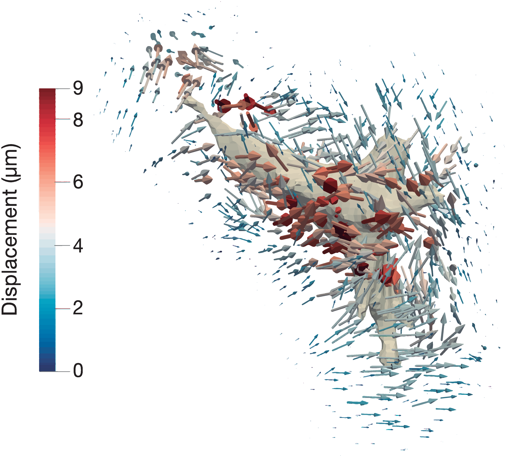
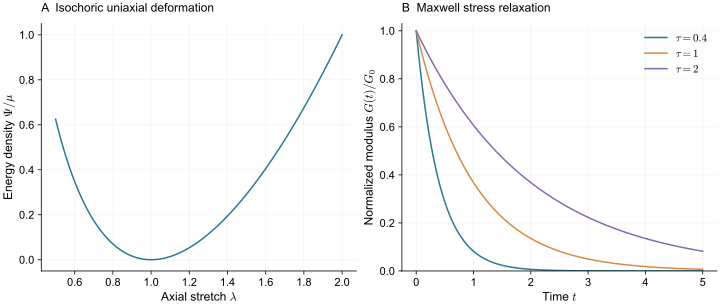
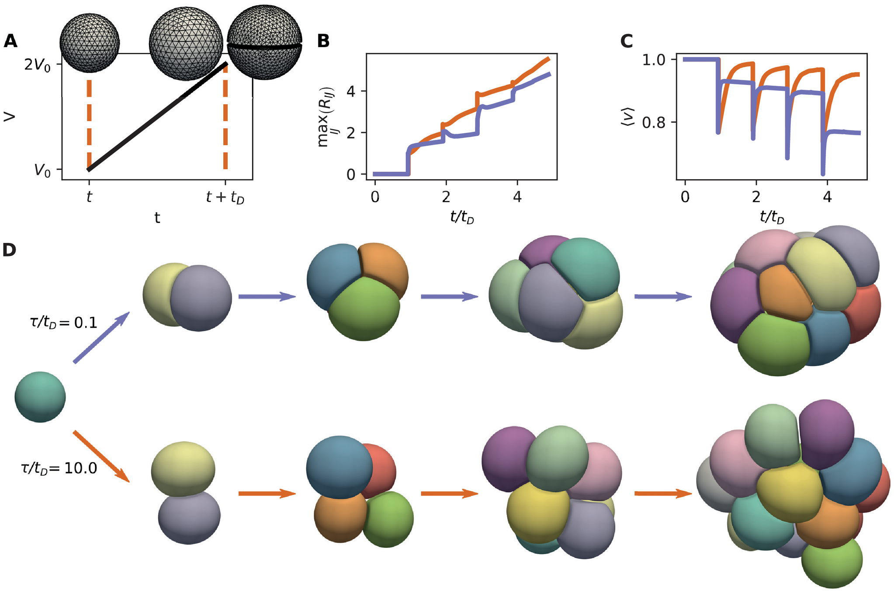
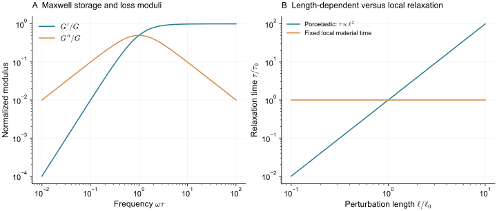

> **Part III · Note 07**　上一篇：[06 · 中心粒子与亚细胞元](/notes/cell_simulation_3d/particles/) · [专题目录](/notes/cell_simulation_3d/) · 下一篇：[08 · 三维形态发生](/notes/cell_simulation_3d/morphogenesis/)

## 1. 从细胞受力到连续材料与流体 {#main-lecture}

同样把一个细胞压扁，可以提出几种不同问题：它的外轮廓和接触面积怎样改变，核附近哪里受压，胞内材料怎样剪切，以及水是否从受压区域流向别处。只保存闭合表面的模型已经能回答其中一部分；若内部位移、应变或排液本身就是目标观测，就需要为它们保留独立变量。

连续材料的出发点，是用局部平均后的应力、应变和速度描述许多微观结构的共同作用。在一个足够大的材料小区内，分子和骨架的细节可以被合并成本构关系；这个小区又必须足够小，能够分辨实验中的空间变化。细胞尺度下，这种尺度分离需要由观测判断。核、皮层和胞质若具有明显不同的材料性质，往往需要分别建模。

固体与流体的选择取决于材料怎样记忆变形。弹性材料通过参考构型记录已经被拉伸和剪切多少，流体应力则主要与当下的形变速率有关；黏弹性与主动重塑把两种行为连接到不同时间。有限元能够求解这些不同本构，它首先是一种将连续方程离散到单元上的方法，材料性质仍由能量、应力关系和内部状态决定。

膜和皮层又可以保留为独立边界。当边界在液体中运动时，需要说明它怎样向流体施力，以及流体怎样带动边界。[Peskin（2002）](https://doi.org/10.1017/S0962492902000077)系统讨论的浸入边界方法，将随动结构与固定流体网格通过力和速度插值联系起来。这使复杂形状的运动不必要求整套流体网格始终贴着每个细胞重新生成。

胞内还可能需要两组分描述：承力骨架与其中的液体相对运动，局部加载先使液体增压，随后通过排液释放一部分应力。[Moeendarbary 等（2013）](https://doi.org/10.1038/nmat3517)的实验将细胞快速松弛与这种多孔弹性解释联系起来。这里的关键预测涉及长度和排液边界，单一的局部松弛时间通常难以概括。

这些方法的共同作用，是把原来由有效阻力或压力概括的过程展开为可测量的材料场。展开以后，边界条件、参考态和组分耦合也成为模型的一部分。以下将从有限变形与接触出发，再比较表面流动、体流体和胞内排液，最后讨论在什么条件下仍可以安全地约化为简单的腔压或局部阻力。

*图 1 · 进入有限元计算的可以是细胞外的位移数据。* [Hervas-Raluy 等（2021），Fig. 5](https://doi.org/10.1371/journal.pone.0249018.g005)，实验位移重建；[CC BY 4.0](https://creativecommons.org/licenses/by/4.0/)。

这张图中的箭头来自细胞周围微珠的位置变化，颜色单位是微米。它表示基质怎样移动，尚不是细胞表面牵引力，也不是胞内应力。该工作用三维有限元和非线性材料描述，从这些位移进一步计算表面牵引。

沿着细胞的细长轮廓看，附近基质位移具有方向性，较远处则逐渐减弱。要把它换成力，必须知道基质的材料规律、远场约束与参考状态。同一组位移放进不同本构，得到的牵引可能不同。这也说明“用了有限元”只交代了求解方式，还没有交代被求解的材料究竟是细胞还是周围基质。

## 2. 有限变形、接触与生长 {#material-and-growth}

设细胞在参考状态中的坐标为 $\mathbf X$，形变后为 $\mathbf x(\mathbf X,t)$。形变梯度与局部体积比为

$$
\mathbf F=\frac{\partial\mathbf x}{\partial\mathbf X},\qquad J=\det\mathbf F.
$$

$\mathbf F$ 告诉我们参考状态中的小线段怎样被拉伸、剪切和旋转；$J$ 告诉我们一小块材料体积变为原来的多少倍。$J=1$ 表示局部体积不变，$J\leq0$ 则说明单元退化或翻转，超出了正常连续材料形变的范围。

小应变理论用 $\boldsymbol\varepsilon=(\nabla\mathbf u+\nabla\mathbf u^{\mathsf T})/2$ 描述变形，其中 $\mathbf u=\mathbf x-\mathbf X$。细胞在迁移、分裂和受限穿孔中可能发生很大旋转与拉伸，此时需要有限变形，而不能把小应变公式一直外推。

参考构型也带来生物含义：纯弹性体始终记得自己原来的形状。活细胞的皮层和骨架可以更新，长期参考态未必固定。下面先把瞬时弹性算清楚，再引入时间依赖。

选一个把形状改变与体积改变分开的 neo-Hookean 型能量密度：

$$
\Psi(\mathbf F)=\frac\mu2\left[J^{-2/3}\operatorname{tr}(\mathbf F^{\mathsf T}\mathbf F)-3\right]
+\frac K2(J-1)^2.
$$

$\mu$ 是小应变剪切模量，$K$ 是小应变体积模量。第一项对各向同性体积缩放不变，主要描述形状改变；第二项惩罚体积偏离。这个分离比只给所有节点接弹簧更容易独立标定剪切与压缩。

第一 Piola 应力为 $\mathbf P=\partial\Psi/\partial\mathbf F$。令 $I_1=\operatorname{tr}(\mathbf F^{\mathsf T}\mathbf F)$，可得

$$
\mathbf P=\mu J^{-2/3}\left(\mathbf F-\frac{I_1}{3}\mathbf F^{-\mathsf T}\right)
+KJ(J-1)\mathbf F^{-\mathsf T}.
$$

换到当前构型，Cauchy 应力为

$$
\boldsymbol\sigma=J^{-1}\mathbf P\mathbf F^{\mathsf T}
=\mu J^{-5/3}\operatorname{dev}(\mathbf B)+K(J-1)\mathbf I,
\qquad\mathbf B=\mathbf F\mathbf F^{\mathsf T}.
$$

这些公式看起来较长，意思却很具体：形状变化产生偏应力，体积变化产生各向同性应力。对严格不可压材料，$J=1$ 作为约束，压力则作为独立乘子出现，不再由有限 $K$ 的体积误差给出。

对缓慢变形忽略惯性，材料内部力与外部载荷满足虚功平衡：

$$
\int_{\Omega_0}\mathbf P:\nabla_X\delta\mathbf u\,dV_0
=\int_{\Omega_0}\mathbf b_0\cdot\delta\mathbf u\,dV_0
+\int_{\partial\Omega_{0,t}}\mathbf t_0\cdot\delta\mathbf u\,dA_0.
$$

将位移用节点形函数展开，$\mathbf u(\mathbf X)=\sum_aN_a(\mathbf X)\mathbf u_a$，就得到每个节点的残余力。牛顿迭代通过切线刚度更新节点，直到残余足够小。

这里的迭代次数是求解器的内部步骤，不是细胞真实经过的时间。若要模拟松弛过程，还需在方程中加入黏性、阻力或其他时间依赖，并给出相应积分器。

[Maas 等（2012）](https://doi.org/10.1115/1.4005694)介绍的 FEBio 面向非线性生物力学，提供多种材料、接触和耦合求解工具。使用这样的框架，可以省去很多基础数值工作；细胞分裂、连接更新和极性继承仍需由具体模型定义。

把 $K/\mu$ 设得很大，可以限制体积变化。但某些低阶纯位移单元难以同时满足局部不可压约束和一般形变，出现体积锁死：模型比所选材料本来应该的响应更硬。

混合位移—压力单元等方法可以更合适地处理这一约束。加密网格与提高 $K$ 不总是能够互相替代；应先做一个已知不可压解的基准，再判断细胞压缩中的高刚度来自材料、几何还是单元。

形变梯度不仅包含拉伸，也包含整体转动。若整个细胞只旋转，$\mathbf F=\mathbf Q$ 且 $\mathbf Q^{\mathsf T}\mathbf Q=\mathbf I$，则 $J=1$、$I_1=3$，上面的能量应为零。小应变公式却可能把有限转动误认成应变。细胞进入弯曲孔道或组织整体翻折时，这种误差会直接进入模拟应力。

再取一个等体积简单剪切，

$$
\mathbf F=\begin{pmatrix}1&s&0\\0&1&0\\0&0&1\end{pmatrix},
\qquad J=1,\qquad I_1=3+s^2.
$$

代入本文的能量，得到 $\Psi=\mu s^2/2$，剪切应力为 $\sigma_{xy}=\mu s$，同时有法向应力差 $\sigma_{xx}-\sigma_{yy}=\mu s^2$。小剪切时，后者是二阶小量；形变较大时，即使材料最初各向同性，剪切也会产生法向响应。

这两个例子分别检验客观性与具体材料预测。将一个单元块施加均匀剪切，计算出的能量与边界反力应随网格细化接近解析值；把同一加载整体旋转后，应得到旋转后的同一应力。若单元在这里已表现过硬，就没有理由先把复杂细胞中的偏差归于核或主动收缩。

将一团细胞各自划成体单元，还没有定义它们之间的作用。若把接触节点永久绑在一起，它们既不能分离也不能自由滑动；若只施加法向不穿透约束，它们可以滑动却不一定能黏附。

对无黏附、无穿透的法向接触，可以用间隙 $g_n$ 与压缩接触压力 $p_n$ 表示互补条件：

$$
g_n\geq0,\qquad p_n\geq0,\qquad g_np_n=0.
$$

有间隙时压力为零，存在压力时表面必须接触。罚函数用很强的短程排斥近似这个条件；乘子方法直接求约束力。前者允许可控穿透，后者增加约束未知量，两者的数值代价和误差不同。

黏附允许一定范围的拉伸牵引，还可以引入连接的损伤与解离。切向作用又需独立决定：完全粘结、摩擦滑动和黏着连接的速率依赖，描述不同的接触历史。若每次接触都永久绑住，组织容易积累过大的长期剪切刚性；若完全无摩擦，则可能低估稳定接触的传力。

邻居改变也会改变哪些接触约束处于激活状态。求解器需要更新候选接触、处理约束出现与消失，并避免把失效的连接保留到下一步。细胞发生分裂时，还要将母细胞体网格和材料状态合理分配到两个子体。复杂生物事件在体有限元中可以实现，但其代价常高于仅跟踪一个连续组织块。

一个接触面积变大，可以是表面发生弹性拉伸，也可以是材料流动使更多皮层进入接触。对于有材料记忆的网格，两种过程有不同的参考态变化。若程序只根据当前几何决定所有力，就没有保存这部分历史；若它保存历史，又在重新划网格时全部清零，则会产生额外松弛。

因此，比较有限元与表面模型时，除了单元类型，还要问材料点究竟随什么运动。Lagrangian 材料点跟随物质，Eulerian 背景点固定在空间，重网格或 ALE 方法则需要在二者之间转移状态。它们对大变形便利性的差别，来自这一层选择。

### 2.1 材料松弛与参考态更新 {#viscoelastic}

在瞬时弹性之外，最常见的简化是黏弹性。Maxwell 模型把弹簧与黏性元串联，其剪切应力满足

$$
\dot\sigma+\frac\sigma\tau=G\dot\gamma,
\qquad\tau=\frac\eta G.
$$

施加并保持一个小阶跃应变 $\gamma_0$，得到 $\sigma(t)=G\gamma_0e^{-t/\tau}$。材料最初储存弹性能，随后流动释放应力。Kelvin–Voigt 模型则有 $\sigma=G\gamma+\eta\dot\gamma$；在相同加载下，它不会以同一种方式释放静态弹性应力。

*图 2 · 瞬时本构与时间过程需要分别指定。* 左图采用 $\mathbf F=\operatorname{diag}(\lambda,\lambda^{-1/2},\lambda^{-1/2})$，因此 $J=1$；右图绘制标准 Maxwell 松弛。没有求解有限元细胞。

周期剪切还可以用来区分二者。Maxwell 的复模量为

$$
G^*(\omega)=G\frac{i\omega\tau}{1+i\omega\tau},
\quad
G'=G\frac{(\omega\tau)^2}{1+(\omega\tau)^2},
\quad
G''=G\frac{\omega\tau}{1+(\omega\tau)^2}.
$$

低频下更容易流动，高频下更接近弹性；$G''$ 在转折区域显著。因而在一种加载速度下拟合出的“细胞刚度”，未必适合另一种加载速度。对大形变，黏弹性还需要采用与整体旋转相容的有限变形形式，不能只把标量方程逐分量套在实验室坐标里。

应力松弛改变既有变形的记忆，生长还会改变材料希望达到的尺寸。两者都涉及参考态，却对应不同的生物过程。

可以把总形变分为弹性部分和生长部分：

$$
\mathbf F=\mathbf F_e\mathbf F_g.
$$

$\mathbf F_g$ 表示局部希望形成的新材料状态，$\mathbf F_e$ 表示在周围约束下实际需要的弹性调整。自由、均匀的各向同性生长可以不产生应力；同样的生长若被外部壳或周围组织限制，就会累积应力并可能屈曲。

生长方向、速率与应力依赖都需要生物规则。若一侧比另一侧增长更快，即使没有主动张力差，也可以使组织弯曲。若细胞更新不断释放弹性应力，组织则可能不会像永久弹性壳那样积累相同的应力。

这一层连续描述适合研究整体折叠和受限增长。若目标包含单细胞分裂朝向、局部挤出或邻居交换，就要保留细胞身份，或建立连续场与细胞事件之间的耦合。

取各向同性生长 $\mathbf F_g=g\mathbf I$。若组织自由膨胀到 $\mathbf F=g\mathbf I$，则 $\mathbf F_e=\mathbf I$，新材料状态不必储存弹性应变。若外壳完全阻止体积改变，实际 $\mathbf F=\mathbf I$，便有 $\mathbf F_e=g^{-1}\mathbf I$：材料相对于其新参考态受压，生长产生的机械负担需要由外壳反力承担。

因此，给目标体积增加同一个比例，在自由培养与包囊培养中并不产生同样的应力。生长不均匀时，各区域希望形成的参考态还可能彼此不相容，即使没有外部约束，也能留下残余应力和弯曲。这个机制与直接规定某个方向存在主动张力不同，卸载或抑制增长后的预测也不同。

连续生长与细胞分裂也应分开。生长改变材料的偏好尺度，分裂改变细胞身份与连接；若分裂前后总体积守恒，单次切分并不凭空产生新体积。但新生接触的张力和几何会重新分配应力，因而细胞数相同的两个组织也可能具有不同的机械历史。

## 3. 主动表面与流体耦合 {#surfaces-and-fluids}

*图 3 · 松弛与分裂的相对速度留下可见的形态差异。* [Torres-Sánchez、Kerr Winter 与 Salbreux（2022），Fig. 7](https://doi.org/10.1371/journal.pcbi.1010762.g007)，主动表面模型模拟；[CC BY 4.0](https://creativecommons.org/licenses/by/4.0/)。

[Interacting active surfaces](https://doi.org/10.1371/journal.pcbi.1010762)把细胞边界描述为可流动的主动黏性曲面，使用曲面有限元处理相互作用。A 交代增长和分裂规则；D 从同一个单细胞出发，比较形状松弛时间与分裂周期的比值。上排松弛较快，形成更紧密的接触；下排在再次分裂前来不及充分调整，保留更多圆钝突起。B、C 的曲线帮助量化这些图像中的差别。

这里的流动主要在细胞表面上求解，不能据此认为模型已经解析了完整三维胞质和外液的速度场。若实验关心的是周围液体怎样运动、流体如何把一个细胞的受力传到另一个细胞，就需要继续增加体流体自由度。下面的浸入边界提供了另一种耦合结构与流体的方法。

### 3.1 结构与流体的耦合 {#immersed-boundary}

显式求解流体时，细胞表面仍可以由随动点表示，而流体速度和压力在固定网格上求解。两套离散之间通过插值核交换力和速度，这就是浸入边界思想。

在低雷诺数、不可压近似下，流体满足

$$
-\nabla p+\eta\nabla^2\mathbf u+\mathbf f=0,
\qquad\nabla\cdot\mathbf u=0.
$$

设结构位置为 $\mathbf X(\mathbf s,t)$，对应结构力密度为 $\mathbf F(\mathbf s,t)$，则

$$
\mathbf f(\mathbf x)=\int\mathbf F(\mathbf s)
\delta_h(\mathbf x-\mathbf X(\mathbf s))\,d\mathbf s,
$$

$$
\partial_t\mathbf X(\mathbf s)=\int\mathbf u(\mathbf x)
\delta_h(\mathbf x-\mathbf X(\mathbf s))\,d^3x.
$$

第一式把膜上的力铺到邻近流体格点，第二式把流体速度插回膜。无滑移、无渗透的结构随这个速度运动。[Peskin（2002）](https://doi.org/10.1017/S0962492902000077)系统建立了这套流固耦合方法。

这里的 $h$ 是核与流体网格相关的数值尺度，不能直接解释成细胞膜真实厚度。积分测度与结构力密度也需要配套：若结构点表示一块面积，离散求和必须带面积权重。

在连续形式下，交换积分顺序可得

$$
\int\mathbf f\cdot\mathbf u\,d^3x
=\int\mathbf F\cdot\partial_t\mathbf X\,d\mathbf s.
$$

流体收到的功率等于结构输出的功率。离散时，如果铺力与插速度的算子在相应权重下互为伴随，就可以保留这条功率关系。若两边随意使用不同插值，耦合本身就可能产生未说明的能量源或耗散。

因此，观察一个封闭膜包在流体里是否保持体积，还只是第一项检查。还应比较外部做功、结构能变化与黏性耗散，判断流固耦合是否一致。

这种耦合在数值上交换力与速度，在物理上则增加了一个能够传递扰动的环境。它与逐点局部阻力的区别，会在细胞间距和边界改变时显现。

在只给每个节点局部阻力的模型中，一个节点运动主要通过几何或接触影响邻居。显式流体则会传递速度与压力扰动，一个细胞可以在不直接接触的情况下影响另一个细胞。流体边界、黏度和狭窄间隙因而都会影响相互作用。

在强阻尼环境或只关心缓慢形状时，局部阻力可能是足够的有效近似。研究薄液隙排水、受限流动、输运或远距离水动力耦合时，这个近似就需要检验。

显式流体也并不自动解决所有接触。核宽度和流体网格无法解析极薄间隙时，真实润滑阻力可能被低估；结构点太稀或时间步过大，还可能发生数值漏液。需要同时控制结构间距、核宽度、流体网格和时间步，并区分物理膜通透与算法产生的体积漂移。

无界三维 Stokes 流中，局部受力 $\mathbf F$ 在距离 $r$ 处产生的速度尺度为 $u\sim F/(\eta r)$。因此求解流体后，一个节点的速度一般取决于许多位置的受力，可以写成非局部迁移率形式 $\mathbf v_a=\sum_b\mathbf M_{ab}\mathbf F_b$。局部阻力近似只保留其中的对角或短程有效部分。

当两细胞几乎接触时，另一种长度成为关键：表面间隙 $d$。在平滑球面、小间隙和无滑移近似下，法向挤压的润滑阻力具有 $F\sim\eta R^2U/d$ 的尺度。间隙越小，排出液体越困难；即使最终形状相同，接触形成时间也会显著改变。

若流体格距和插值核宽度都大于 $d$，这个薄隙内的大速度梯度无法被直接解析。提高细胞表面排斥只能防穿透，并没有恢复丢失的排液阻力。此时可以局部加密，或在适用条件下加入经过匹配的润滑修正，但要避免将已由流体求出的阻力重复加入。研究接触形成速度时，这一误差常比最终穿透量更有影响。

## 4. 胞内排液与均匀腔压近似 {#pressure-and-drainage}

细胞内部不是均匀弹性块，也不是完全没有结构的液体。骨架、细胞器和大分子可以形成多孔的承力网络，胞液在其中迁移。受压区域的应力松弛，一部分可能来自固体材料重塑，另一部分来自水重新分布。

简化的相对流速可用 Darcy 关系表示：

$$
\mathbf v_f-\mathbf v_s\sim-\frac k\eta\nabla p.
$$

$k$ 是渗透率，$\eta$ 是液体黏度。结合骨架弹性和液体守恒，可得到类似扩散的压力松弛，特征扩散系数尺度为 $D_p\sim kK/\eta$，长度为 $\ell$ 的扰动相应有

$$
\tau_p\sim\frac{\ell^2}{D_p}\sim\frac{\eta\ell^2}{kK}.
$$

这里最有辨识力的是 $\ell^2$：改变压头尺寸或局部加载尺度，可能系统性改变松弛时间。具有单一材料时间的局部 Maxwell 模型则没有这个同样的空间依赖。

*图 4 · 同样是松弛，可以有不同来源。* 左图为正文解析复模量，右图比较 $\tau_p\propto\ell^2$ 与固定局部松弛时间。比例系数使用教学归一化，没有拟合细胞实验。

[Moeendarbary 等（2013）](https://doi.org/10.1038/nmat3517)用局部形变实验研究胞内快速松弛，并以多孔弹性将水重分布与胞内结构联系起来。这为“为什么加载尺度会影响测得的材料响应”提供了实验依据。该近似有自己的时空范围，长期骨架更新与主动过程仍可能需要增加。

### 4.1 压力扩散与边界条件 {#poroelastic-equations}

在小应变、饱和且两组分近似不可压的简化极限，令骨架位移为 $\mathbf u_s$，有效骨架应力为 $\boldsymbol\sigma_s$，总应力可写成 $\boldsymbol\sigma=\boldsymbol\sigma_s-p\mathbf I$。缓慢运动满足

$$
\nabla\cdot(\boldsymbol\sigma_s-p\mathbf I)=0,
\qquad
\partial_t(\nabla\cdot\mathbf u_s)=\frac{k}{\eta}\nabla^2p.
$$

第一式让骨架的弹性回复与液体压力平衡，第二式把局部体积应变的变化与排液联系起来。对一个沿单方向变化的纵向变形，线性弹性给出相应模量 $M=K+4G/3$；忽略额外储存项后可得到

$$
\partial_t p=D_p\nabla^2p,
\qquad D_p=\frac{kM}{\eta}.
$$

于是压力需要时间才能在受压区域之间重新分配。加载位置接近可排液边界时，路径短，松弛较快；相同材料被封闭后，排液条件改变，表观响应也改变。一个只含固定局部松弛时间的模型，不能自动保留这种边界与长度效应。

实际胞内结构存在主动更新，且渗透率可能随压缩改变，上述方程只是一个明确可检验的极限。它的价值在于提出与材料时间不同的预测：改变加载尺度和排液边界，应改变响应时间。Moeendarbary 等的实验为这一层解释提供背景，具体模量与渗透率仍需在所研究细胞与时间窗口内测量。

胞内排液需要解析压力的空间变化；对于压力能迅速均匀的腔体，则可以采用相反方向的约化，只保留较慢的体积与输运。

如果上皮包围一个腔，而腔内压力在关心的时间内迅速均匀，可以只用一个全局压力和体积方程，不必解析所有流速。若还关心水交换，便增加渗透通量；若还关心局部分子运输，再增加浓度场。

恒压表示与压力库相连，恒体积表示体积受到严格约束，有限通透表示水交换需要时间。这些设置在外部压缩后给出不同响应。先识别哪一项过程限制时间，再决定是否需要完整流体，会比一开始加入所有场更容易标定。

对受限单细胞，则可以比较皮层张力模型、含核弹性模型和多孔弹性模型在同一加载过程中的预测。它们若都能匹配一条压缩曲线，就继续改变加载速度与尺度；能区分机制的实验条件，通常比增加同一种条件下的数据点更有价值。

## 5. 连续描述的适用尺度与局限 {#model-limits}

连续材料与流体模型适合内部应变、局部牵引、排液或非局部耦合已成为主要观测的情形。它们增加的变量可以把不同机制分开，也增加了对材料参数和边界的要求。将一个细胞内部划分得很细，只能提高所选连续描述的空间分辨率；是否需要弹性骨架、表面皮层、核或液体，仍由实验响应决定。

参考态是固体模型中最重要的假设之一。实验分割通常记录一个正在受力的构型，将它设为无应力状态，会改变推断出的材料与外载。长期生长和重塑又可能持续更新参考态，使同样外形保留不同残余应力。若要从一次几何重建外推加载与卸载，应同时约束材料记忆及初始化时的受力状态。

本构的有效范围也需要随加载说明。小应变实验得到的模量不一定能描述大变形，单一 Maxwell 时间不一定能描述宽频谱，线性多孔弹性也不一定适用于强压缩后的渗透率变化。对细胞的主动调控而言，加载速度还可能决定材料在实验期间是否发生更新。将所有速率依赖拟合成同一个黏度，可能掩盖不同的内部过程。

流体模型的结果则高度依赖可排液与可滑动的边界。开放液池、封闭腔体和狭窄间隙会产生不同的压力和阻力；膜允许水通透时，体积又不再只由无渗透结构携带。流体网格无法解析的薄隙，需要适当的近似或局部处理。体积漂移、漏液和未解析的润滑阻力，应与真实的膜通透分开评估。

均匀腔压和局部阻力仍然是有意义的约化。当腔内压力迅速均匀，关心的又只是较慢的体积与整体形状，就可以保留一个压力和水通量方程；若主要阻力来自短程环境作用，也可能不必解析远处流体。约化是否成立，取决于被省略场的松弛时间及其对目标观测的影响，能够通过改变长度、边界与加载速率来检验。

最后，连续求解器并不自动提供细胞分裂、连接成熟和命运调控。它们需要与材料场交换几何、质量和受力信息，并保持相容的时间推进。前面的细胞表示与这里的连续材料可以组合使用，以保留实际问题需要的变量。下一篇将回到具体形态发生系统，讨论这些耦合怎样形成可被实验区分的生物解释。

## 6. 参考文献 {#references}

1. Peskin (2002). [The immersed boundary method](https://doi.org/10.1017/S0962492902000077). *Acta Numerica*, 11, 479-517.

2. Moeendarbary et al. (2013). [The cytoplasm of living cells behaves as a poroelastic material](https://doi.org/10.1038/nmat3517). *Nature Materials*, 12(3), 253-261.

3. Hervas-Raluy, Gomez-Benito, Borau-Zamora, Cóndor and Garcia-Aznar (2021). [A new 3D finite element-based approach for computing cell surface tractions assuming nonlinear conditions](https://doi.org/10.1371/journal.pone.0249018). *PLOS ONE*, 16(4), e0249018.

4. Maas et al. (2012). [FEBio: finite elements for biomechanics](https://doi.org/10.1115/1.4005694). *Journal of Biomechanical Engineering*, 134(1), 011005.

5. Torres-Sánchez, Kerr Winter and Salbreux (2022). [Interacting active surfaces: A model for three-dimensional cell aggregates](https://doi.org/10.1371/journal.pcbi.1010762). *PLOS Computational Biology*, 18(12), e1010762.

---

[← 06 · 中心粒子与亚细胞元](/notes/cell_simulation_3d/particles/) · [专题目录](/notes/cell_simulation_3d/) · [下一篇：08 · 三维形态发生 →](/notes/cell_simulation_3d/morphogenesis/)
