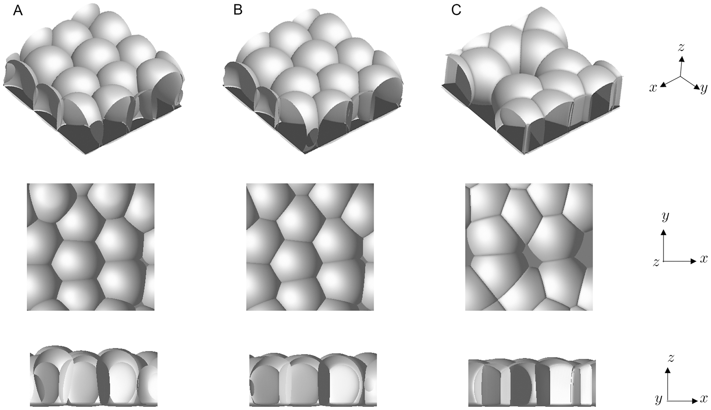
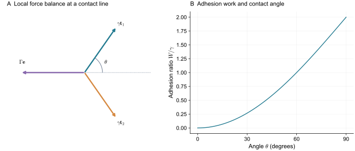
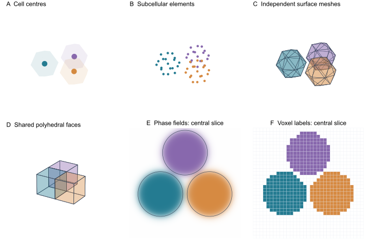

> **Part I · Note 01**　[专题目录](/notes/cell_simulation_3d/) · 下一篇：[02 · 多相场：从弥散界面到细胞形变](/notes/cell_simulation_3d/phase_field/)

## 1. 双细胞接触与三维力学 {#main-lecture}

把两个刚分开的细胞放在一起，它们往往不会像两颗刚性玻璃珠那样，只在一个点上接触。接触处逐渐变平，接触面积增大，外侧轮廓也随之改变。若再用吸管把它们拉开，可能看到接触慢慢缩小，也可能看到黏着连接突然断开。这里已经有几件需要区分的事：细胞怎样变形，接触为什么形成，以及形成和分离各需要多长时间。

用一个中心和一个半径表示细胞，可以记录两个细胞相距多远，却没有直接记录接触面的形状。把细胞画成有许多节点的表面，可以记录变形，但还得说明节点受到什么力。如果用一个连续的场表示细胞，则连表面的位置都要从场中读出。三种表示都能产生“两个细胞靠在一起”的图像，它们回答的力学问题并不相同。

三维还增加了一层困难。在二维切片中，接触显示成一条线；完整接触面可能向切片外伸展，也可能只在很小的高度范围内存在。两个细胞在一张切片上看似没有接触，并不能说明它们在空间中不是邻居。把连续切片的轮廓分别做成二维模型，也会丢失这些切片之间共同受力的约束。

双细胞接触将形状、驱动力与时间尺度放在同一个可测量过程中。相场、网格、Vertex、Potts 和粒子模型可以在这套共同条件下比较。

### 1.1 黏附条件下的细胞高度与接触形态 {#paper-adhesion}

*图 1 · 黏附改变的是整套三维几何。* [Nonomura（2012），Fig. 6](https://doi.org/10.1371/journal.pone.0033501.g006)，相场模拟原图；[CC BY](https://journals.plos.org/plosone/article?id=10.1371/journal.pone.0033501)。

A、B、C 是不同黏附条件，同一列的三行则是同一个细胞群的不同视角。先沿最下面一行比较高度，再回到俯视图看铺展和接触。只看俯视轮廓，很容易漏掉细胞已经变矮；只看侧面，又看不清邻接网络。浅灰与深灰是场的可视化层次，不是两类细胞。

这张图也提示后面需要比较哪些量：细胞高度、基底接触面积、胞间接触面积和总体积。它们同时变化，才能约束黏附与皮层作用的解释。一个“看起来更扁”的终态，还不足以单独确定是哪项参数发生了变化。

## 2. 有效表面张力与皮层受力 {#细胞表面为什么可以用张力描述}

细胞的脂双层膜、肌动蛋白皮层和黏着连接具有不同的结构与时间尺度。细胞尺度的简化模型常把其中一部分作用合并成有效表面张力。这样做的理由是：若增加一小块表面积 $dA$ 需要做功 $\gamma\,dA$，就可以用能量 $E_A=\gamma A$ 描述这部分形变代价。

这里的 $\gamma$ 的单位是能量/面积，也就是力/长度。它与二维 Vertex Model 中沿一条边定义的线张力不同；后者的单位是能量/长度，也就是力。三维细胞交线还可以另外携带真正的线能。读文献时，只看参数名字里的 tension 容易把这几种量混在一起。

对活细胞来说，有效张力也不必是常数。皮层中的马达活动可以改变收缩应力，接触形成可以重排皮层，面积变化可以改变膜储备。一张细胞表面在某一时间尺度上近似张力膜，在更短时间尺度上却可能承受剪切并保留变形历史。

因此，用张力模型并不是说细胞等同于肥皂泡。它是在所关心的尺度上保留一个可测量的表面受力效应。若实验已经表明皮层具有方向性或明显的记忆，就需要在这个起点上增加相应变量。

### 2.1 Laplace 压差与曲率 {#压力与曲率的关系从哪里来}

考虑一个半径为 $R$ 的球形细胞。它的面积与体积为

$$
A=4\pi R^2,\qquad V=\frac{4\pi}{3}R^3.
$$

令球向外膨胀 $dR$。内外压差 $\Delta p$ 所做的功为 $\Delta p\,dV$，增加表面积需要的能量为 $\gamma\,dA$。在平衡时二者相等，因此

$$
\Delta p=\gamma\frac{dA}{dV}=\frac{2\gamma}{R}.
$$

小球在同一张力下需要更大的压差才能维持形状。一般光滑界面相应满足 $\Delta p=\gamma(k_1+k_2)=2\gamma H$，其中 $k_1,k_2$ 为两个主曲率，$H$ 为平均曲率。这里选取球面曲率为正的约定。

这个推导还告诉我们一个测量上的限制：由轮廓曲率通常得到的是压差与张力的比值。仅仅知道一个球的半径，不能同时确定它的压力和张力。两者同时增加一倍，平衡形状仍然相同。

### 2.2 表面能、实际张力与皮层流动 {#surface-stress}

恒定张力是一个有用起点，但“能量中有面积”还没有确定张力是否恒定。例如同时写入面积弹性和恒定收缩项，

$$
E_A=\frac{K_A}{2A_0}(A-A_0)^2+\gamma_0 A,
\qquad
\gamma_{\rm eff}=\frac{dE_A}{dA}
=\gamma_0+K_A\left(\frac A{A_0}-1\right).
$$

这里 $K_A$ 和 $\gamma_0$ 的单位都是力/长度。即使参数 $\gamma_0$ 不变，细胞被拉长、总表面积增加以后，实际张力仍会改变。若只把 $\gamma_0$ 列在“皮层张力”一栏，就会漏掉面积弹性的贡献。接触面积与细胞高度的变化，也会通过总面积反过来改变每块界面的受力。

张力的空间分布同样重要。对外法向为 $\mathbf n$ 的光滑表面，令切向投影为 $\mathbf P_s=\mathbf I-\mathbf n\mathbf n^{\mathsf T}$。各向同性面应力为 $\gamma\mathbf P_s$，其表面散度给出的力密度为

$$
\mathbf f_s=\nabla_s\gamma-2\gamma H\mathbf n.
$$

第二项是前面球形算例中的向内曲率力；第一项沿表面指向较高张力区域。均匀张力的球面可以只靠压差平衡。若张力沿表面变化，压力只能平衡法向部分，切向部分还需由皮层流动、黏性或其他切向应力承担。因而，把肌球蛋白荧光图直接换成一张静态标量张力图，还必须说明局部力怎样被平衡。

在非均匀张力模型中，细胞的整体朝向、接触位置和皮层物质输运往往相互影响。给表面增加更多三角形，可以更精细地保存这种分布；它并不会自动补上缺失的皮层材料规律。

## 3. 黏附功、皮层张力与接触角 {#doublet}

设两个相同细胞的自由表面张力为 $\gamma$。形成单位面积接触后，原来的两块自由表面变为一块细胞间界面。如果把接触带来的单位面积能量降低记为 $W$，则有效界面张力为

$$
\Gamma=2\gamma-W.
$$

这是一种有明确记账方式的简化：每个细胞的完整表面积先计入 $\gamma A_i$，接触面积只在黏附项 $-WA_{12}$ 中减去一次。另一种常见写法直接对自由表面和细胞间表面分别赋予 $\gamma$ 与 $\Gamma$；使用后一种写法时，不再额外减去同一个 $W$。

在接触边缘作一个垂直于接触线的截面。三块表面各沿自己的切向拉动接触线。在对称双细胞中，两侧自由表面的垂直分量抵消，沿接触面的分量与 $\Gamma$ 平衡。令 $\theta$ 为每个自由表面张力方向与接触面张力反方向的夹角，则

$$
\Gamma=2\gamma\cos\theta,\qquad
W=2\gamma(1-\cos\theta).
$$

不同论文常把接触角定义成 $2\theta$、$\pi-2\theta$ 或细胞内部夹角，因此抄写数值前需要先对照图中的角度定义。这里真正使用的是三个张力矢量的平衡，换一种角度记号不会改变它。

*图 2 · 接触角约束的是张力比。* 左图为接触线的局部截面，采用正文的 $\theta$ 定义；右图计算 $W/\gamma=2(1-\cos\theta)$。只考虑各向同性、准静态的表面张力，没有黏着连接的成键动力学。

当 $W$ 增加时，形成接触更有利，两个细胞倾向于建立更大的接触区。但在真实细胞中，接触角改变也可能来自皮层张力改变。[Maître 等（2012）](https://doi.org/10.1126/science.1225399)研究斑马鱼胚层细胞分选时，将黏附与接触处皮层力学联系起来，说明黏着分子既提供连接，也能改变皮层如何传力。由此不能把测得的接触面积直接当作黏附分子数的线性读数。

用能量模型表示这种情况，可以把自由表面张力与接触处的皮层张力分别写出：$\Gamma_{ij}=\gamma_i^{\rm contact}+\gamma_j^{\rm contact}-W_{ij}$。这时，增大接触既可能来自更大的 $W_{ij}$，也可能来自更低的接触皮层张力。后面的反演问题正是从这种不唯一性开始的。

### 3.1 球面片近似下的接触面积 {#从接触角继续算到接触面积}

如果两个相同细胞的外侧都是球面片，接触面平直，就可以把接触面积也算出来。设每个自由表面的曲率半径为 $R$，接触圆半径为 $a$，按上面的角度定义有 $a=R\sin\theta$。每个细胞是一个球去掉接触侧的小球冠，体积为

$$
V=\frac{\pi R^3}{3}(2+3\cos\theta-\cos^3\theta).
$$

给定真实体积 $V$ 与张力比，就先由力平衡求 $\theta$，再由这个体积式求曲率半径，最后得到 $A_c=\pi R^2\sin^2\theta$。这里的 $R$ 不是“将整个细胞当作等体积球”得到的半径，两者在接触形成后会不同。

在弱黏附、小角度极限，$W/\gamma\simeq\theta^2$，而 $R$ 在最低阶接近孤立细胞半径 $R_0$，因此

$$
\frac{A_c}{\pi R_0^2}\simeq\frac W\gamma.
$$

这个近似给出一个可以直接检验的标度：小接触面积与有效黏附功近似成正比，比例还依赖自由表面张力。到了较大接触角，就应使用完整体积关系，不能一直沿用线性式。

这一算例假定接触附近已经充分松弛，没有核、外壳或其他邻居改变轮廓。若同一个双细胞在拉开与靠近过程中出现不同接触面积，就需要考虑连接动力学或材料记忆。静态表面能所能解释的，是给定条件下的平衡分支；实验中的时间顺序可以提供另外的约束。

### 3.2 三细胞交线的受力平衡 {#三细胞接触还能提供额外检验}

对称双细胞只提供一个张力比。增加第三个细胞后，三块界面在交线附近满足矢量平衡，几何角度可以约束更多相对张力。若三张力相同，垂直交线截面中的三个牵引方向相隔 120°；若张力不同，角度也应相应改变。

这提供了一个跨几何检验：用双细胞标定的张力与黏附，能否预测三细胞接触角和接触面积？若必须为三细胞另外重调参数，可能是双细胞数据没有充分约束参数，也可能是多体挤压、接触成熟或皮层调控没有被表达。把体系逐级加复杂，可以比直接拟合一整个胚胎更清楚地发现问题。

### 3.3 接触成熟与形状松弛可以产生相似的时间曲线 {#contact-kinetics}

静态接触角解释的是力平衡。刚碰到一起的两个细胞，还可能一边建立连接，一边改变皮层与外形。用 $b(t)$ 表示已经结合的连接比例，最简单的成键过程为

$$
\dot b=k_{\rm on}(1-b)-k_{\rm off}b,
\qquad
\tau_b=(k_{\rm on}+k_{\rm off})^{-1}.
$$

若有效黏附功随 $b$ 增加，可写 $W=W_0+w_b b$。在小形变附近，再用一个机械松弛方程表示接触面积追随当下的平衡值：

$$
\tau_m\dot A_c=A_c^{\rm eq}[W(t)]-A_c.
$$

这套教学模型含两个不同的时间：连接成熟时间 $\tau_b$ 和形状调整时间 $\tau_m$。当两者相差很大时，快过程很快结束，实验主要看到慢过程；两者接近时，单指数拟合得到的时间常数则可能混合两种作用。接触面积慢慢变大，并不能单独说明黏性很大。

一次靠近—分离实验可以提供更多信息。若在相同外部载荷下，长时间接触的细胞比刚接触的细胞更难分开，就需要检查连接状态是否留下历史；若分离曲线随拉伸速度变化，则还要区分黏性和受力解键。这里增加内部状态的理由来自可观察的滞后，而不只是为了把曲线拟合得更贴近。

## 4. 体积弹性与不可压缩约束 {#体积保持究竟保持到什么程度}

许多组织形变发生时，细胞体积比细胞形状变化小得多。最简单的处理是给体积偏离目标值增加代价：

$$
E_V=\frac{K_V}{2V_0}(V-V_0)^2.
$$

$K_V$ 的量纲是压力。与体积变化共轭的恢复压力为

$$
p=-\frac{\partial E_V}{\partial V}
=K_V\left(1-\frac{V}{V_0}\right).
$$

当细胞被压缩到 $V\lt V_0$，恢复压力为正；当它被拉大，恢复压力为负。有限 $K_V$ 允许细胞偏离目标体积，因而“有体积项”与“严格不可压缩”仍是两种模型。

把这个体积项与球面张力放在一起，会得到一个容易被忽略的结果：自由细胞的平衡体积一般略小于 $V_0$。设 $R_0=(3V_0/4\pi)^{1/3}$，平衡时

$$
K_V\left[1-\left(\frac R{R_0}\right)^3\right]=\frac{2\gamma}{R}.
$$

若压缩很小，写 $R=R_0(1-\delta)$，保留 $\delta$ 的一阶项，得到

$$
\delta\simeq\frac{2\gamma}{3K_VR_0}.
$$

因此，目标体积是体积弹性单独偏好的值，不一定就是加上皮层张力后的平衡体积。若根据成像体积设置 $V_0$，再加入相当强的表面张力，模型细胞可能系统性地缩小。解决方法是标定完整模型的平衡状态，或者用严格体积约束让压力作为乘子随受力求出。

长时间内，细胞还可以通过水交换、渗透调节和生长改变体积。将短时间的不可压缩性外推到整个细胞周期，会把这些过程冻结。第 08 篇会把目标体积的增长与真实水通量分开讨论。

## 5. 细胞表示与允许的形变 {#同一团细胞可以保存哪些信息}

接触力学建立以后，再看几何表示的区别会更清楚。图中的不同表示，都可以围绕相同的细胞中心初始化，但它们允许的后续变形不同。

*图 3 · 六种几何表示。* 自制示意；相场与体素显示一个切面，共享多面体用立方体示意。图中没有进行组织动力学求解。

| 表示 | 保存的量 | 可直接量出的形状信息 | 主要额外假设 |
| --- | --- | --- | --- |
| 中心模型 | 位置、尺寸、极性和细胞状态 | 中心轨迹与模型半径 | 接触形变由距离律近似 |
| 亚细胞元 | 每个细胞的一组粒子 | 粒子分布与重建形状 | 胞内连接、体积与表面提取 |
| 独立表面网格 | 闭合表面节点和三角化 | 面积、曲率与自由表面 | 表面本构和接触处理 |
| 三维 Vertex | 共享面、边、顶点及其关联 | 汇合细胞的体积、面积与邻接 | 多面体几何和拓扑事件 |
| 多相场 | 每个细胞的连续身份场 | 等值面与场积分 | 界面厚度、迁移率和相互作用 |
| Cellular Potts | 每个体素的细胞标签 | 占据体积和离散接触 | 复制规则、邻域与时钟 |
| 体有限元 | 体内位移、压力等场 | 形变梯度和材料应力 | 本构、参考态与边界条件 |

“网格”横跨了这张表的几列。表面三角形离散的是皮层，体有限元单元填充胞内，规则体素则覆盖整个计算域。相场也可以在有限元网格上求解，所以数值方法的名字和细胞表示的名字不总是一一对应。

还要区分曲面单层、有厚度上皮和体组织。球面上的二维 Vertex Model 只保留一个曲面上的铺砌；顶端—基底模型增加了厚度与极性；完整三维模型允许细胞沿厚度换邻居，甚至失去层结构。给二维细胞增加一个用于显示的高度，通常还没有增加后三种运动所需的力学自由度。

## 6. 过阻尼动力学与耗散机制 {#dissipation}

给出能量之后，仍需说明组织如何释放能量。把所有几何坐标记为 $\mathbf q$，一种常见的过阻尼动力学是

$$
\boldsymbol\Xi\dot{\mathbf q}=-\nabla_{\mathbf q}E+\mathbf f^{\rm act}.
$$

在这里，惯性已经被忽略，阻力与当下的速度平衡。细胞尺度的雷诺数通常很小，这支持忽略惯性；但流体黏性和细胞间摩擦仍可能决定运动方式。

若每个节点独立受到与固定环境的阻力，$\boldsymbol\Xi$ 可以近似为对角矩阵。若阻力来自细胞间相对滑动，耗散中则出现 $(\mathbf v_i-\mathbf v_j)^2$。前者会阻碍整个细胞团的平移，后者单独存在时不会阻碍所有细胞共同匀速移动。这是两种耗散机制在集体运动上的实际区别。

用耗散函数可以把它写得更直观：

$$
\mathcal R=\frac12\sum_i\xi_i|\mathbf v_i|^2
+\frac12\sum_{\langle ij\rangle}\xi_{ij}|\mathbf v_i-\mathbf v_j|^2.
$$

对速度求导给出阻力，再与能量梯度及主动驱动力平衡。若考虑法向挤压和切向滑动具有不同阻力，还可以对相对速度作法向、切向分解。

关闭活性并固定材料参数与边界，有

$$
\frac{dE}{dt}=-\dot{\mathbf q}^{\mathsf T}\boldsymbol\Xi\dot{\mathbf q}\leq0.
$$

这时的能量下降不是额外假设，而是所选动力学的直接结果。若给目标体积增加一个时间依赖，便多出 $\partial E/\partial t$；若边界运动，便有外部做功。活组织的能量增加可以有清楚的来源，不宜把所有上升都解释成数值错误，也不能因此放弃记录能量预算。

### 6.1 平衡形状与松弛时间的参数依赖 {#为什么两个模型的终态相同过程却不同}

考虑一个小的形变坐标 $x$，在平衡附近取 $E=kx^2/2$。过阻尼动力学给出

$$
\xi\dot x=-kx,\qquad x(t)=x(0)e^{-t/\tau},\qquad\tau=\xi/k.
$$

终态都是 $x=0$，无论 $k$ 是多少；松弛时间却依赖 $\xi/k$。把刚度与阻力同时乘以 10，整条轨迹也不会改变。由此可见，静态形状、时间序列和绝对受力测量提供的是不同信息。要问某个参数能否测出，必须先说明有哪些观测。

## 7. 单细胞材料与组织流变 {#coarse-graining}

组织的形变有两种来源：每个细胞改变形状，以及细胞之间的相对位置与邻接改变。前者在短时间内可以储存弹性能，后者可以释放应力并留下不可逆形变。仅给每个细胞一个弹性体，并不保证整个组织在长时间也像弹性固体；反过来，单个细胞看起来近似液滴，也不保证组织能立即流动。

例如，一团细胞在很短时间内来不及换邻居，剪切后会有恢复力；等待更久，连接重塑和邻居交换可以逐渐释放剪切应力。细胞分裂与死亡还会持续改变局部受力。[Ranft 等（2010）](https://doi.org/10.1073/pnas.1011086107)建立了将细胞周转与组织应力松弛联系起来的理论，说明稳态细胞数近似不变的组织仍可能通过持续周转表现出长期流动。

因此，比较三维模型时，需要同时指定观察时间。一个只做能量最小化的算法可以研究可达到的平衡形状，却会丢失分裂间隔与力学松弛相近时的应力积累。一个禁止换邻居的网络，可以很好地描述事件发生前的弹性，随后却可能过于坚硬。

### 7.1 消去形状自由度，会改变有效接触刚度 {#eliminating-shape}

中心模型常把接触形变压缩成中心距离的一条力律。这个过程可以在平衡附近明确写出。令 $x$ 表示中心间距的变化，$\mathbf z$ 表示被省略的表面形变，二次能量为

$$
E=\frac12k_xx^2+x\mathbf b^{\mathsf T}\mathbf z
+\frac12\mathbf z^{\mathsf T}\mathbf K_z\mathbf z.
$$

去掉刚体运动后，若 $\mathbf K_z$ 正定，表面充分松弛给出 $\mathbf z_*=-\mathbf K_z^{-1}\mathbf b x$，因此中心感受到的有效刚度为

$$
k_{\rm eff}=k_x-\mathbf b^{\mathsf T}\mathbf K_z^{-1}\mathbf b.
$$

允许表面调整会降低约束下的刚度；把表面冻结，则保留较大的 $k_x$。这解释了为什么从短时间压缩实验标定的中心力，不一定适用于慢过程。若 $\mathbf z$ 的松弛还来不及完成，有效接触就会依赖加载速度与历史，单一的保守距离势不能完整表示它。

多细胞接触进一步改变这项约化：同一个细胞的不同接触面共享体积和皮层，压缩左侧会影响右侧。双细胞中得到的有效力律，只有在这种耦合足够弱时才适合逐对相加。[Osborne 等（2017）](https://doi.org/10.1371/journal.pcbi.1005387)的跨表示比较可以放在这一背景下理解：相同的生物规则进入不同允许变形空间后，并不保证产生相同组织行为。

## 8. 物理尺度与无量纲参数 {#哪些无量纲比值控制近似}

取细胞尺度 $R_0$ 和张力尺度 $\gamma_0$，自然的能量与力尺度分别为 $\gamma_0R_0^2$ 和 $\gamma_0R_0$。若耗散来自节点阻力 $\xi$，时间尺度为 $\xi/\gamma_0$；若来自黏性流体 $\eta$，毛细松弛时间尺度为 $\eta R_0/\gamma_0$。它们对应不同的耗散模型，不能在换模型时沿用同一个裸时间单位。

几个常用的比值是

$$
\frac{K_VR_0}{\gamma_0},\qquad
\frac{W}{\gamma_0},\qquad
\frac{\kappa}{\gamma_0R_0^2},\qquad
\frac{\tau_{\rm relax}}{\tau_{\rm growth}}.
$$

它们分别衡量体积保持、黏附、弯曲和动态生长的重要性。最后一个比值很小时，每次缓慢生长后让组织充分松弛可能是合理近似；接近 1 时，瞬态应力不能轻易省略。对流体问题，$\mathrm{Ca}=\eta v/\gamma_0$ 比较黏性牵引与表面张力；对信号输运，$\mathrm{Pe}=vR_0/D$ 比较平流与扩散。

数值尺度也应单独列出。相场的 $\epsilon/R_0$ 决定弥散界面相对细胞有多厚，$h/\epsilon$ 决定网格是否解析了这个界面。表面模型的 $h/R_0$ 决定几何分辨率，而接触核宽度又是另一项选择。把一个数值长度误当作材料厚度，往往会使细化网格后的模型变成另一种材料。

## 9. 模型分辨率与实验约束 {#怎样阅读不同路线的工作}

[Fletcher、Cooper 与 Baker（2017）](https://doi.org/10.1098/rstb.2015.0519)梳理了上皮形态发生中不同细胞表示的物理来由。对这里的三维问题，模型选择可以落实到一组共同的实验：孤立细胞的体积与形状、双细胞的接触角和形成时间、三细胞的接触平衡，以及小细胞团的压缩或融合。每增加一级空间组织，都会检验上一层标定是否还能成立。

例如，中心模型已经能拟合双细胞的法向力—距离关系，而受压团块的内部体积和压力仍出现系统偏差，问题可能来自多体接触，而不是某个吸引系数不够准确。表面模型可以进一步检查哪些接触面被邻居共同约束；若实验关心的又是胞内剪切与核运动，就需要继续增加内部材料。

### 9.1 细胞力学模型的发展并非单一的分辨率阶梯 {#model-history}

[Van Liedekerke、Palm、Jagiella 与 Drasdo（2015）](https://doi.org/10.1007/s40571-015-0082-3)的综述系统比较了格点、中心、可变形细胞、Vertex 与离散—连续混合模型。这些路线并非从“简单模型”依次升级到一个统一的“完整模型”：有的优先表达人口与微环境，有的优先表达接触形状，有的优先维护组织铺砌。

分辨率增加以后，也可能改变原来的材料假设。将一个中心替换成带永久弹簧的表面，会增加剪切记忆；将它替换成可重排的亚细胞元，则可能增加流动通道。比较模型时，保留共同的单细胞与接触实验，比按节点数排列模型更能说明哪些新增自由度影响了结论。

同一张三维图由此有几个层次的解释：几何表示确定可发生的形变，能量和主动应力确定驱动力，耗散决定运动的速率和相互影响，生物规则再决定分裂、死亡与极性更新。后面的各篇分别展开这些选择。下一篇从相场开始，用连续身份场表示同一套细胞界面与接触问题。

## 10. 参考文献 {#references}

1. Nonomura (2012). [Study on Multicellular Systems Using a Phase Field Model](https://doi.org/10.1371/journal.pone.0033501). *PLOS ONE*.

2. Maître et al. (2012). [Adhesion Functions in Cell Sorting by Mechanically Coupling the Cortices of Adhering Cells](https://doi.org/10.1126/science.1225399). *Science*, 338(6104), 253-256.

3. Ranft et al. (2010). [Fluidization of tissues by cell division and apoptosis](https://doi.org/10.1073/pnas.1011086107). *Proceedings of the National Academy of Sciences*, 107(49), 20863-20868.

4. Osborne et al. (2017). [Comparing individual-based approaches to modelling the self-organization of multicellular tissues](https://doi.org/10.1371/journal.pcbi.1005387). *PLOS Computational Biology*, 13(2), e1005387.

5. Fletcher, Cooper and Baker (2017). [Mechanocellular models of epithelial morphogenesis](https://doi.org/10.1098/rstb.2015.0519). *Philosophical Transactions of the Royal Society B: Biological Sciences*, 372(1720), 20150519.

6. Van Liedekerke, Palm, Jagiella and Drasdo (2015). [Simulating tissue mechanics with agent-based models: concepts, perspectives and some novel results](https://doi.org/10.1007/s40571-015-0082-3). *Computational Particle Mechanics*, 2(4), 401-444.

---

[专题目录](/notes/cell_simulation_3d/) · [下一篇：02 · 多相场：从弥散界面到细胞形变 →](/notes/cell_simulation_3d/phase_field/)
