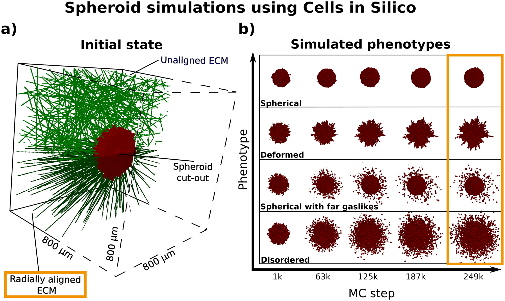
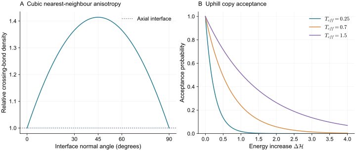
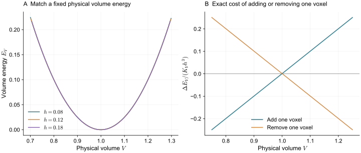

> **Part II · Note 05**　上一篇：[04 · 三维 Vertex：共享多面体与拓扑重排](/notes/cell_simulation_3d/vertex_3d/) · [专题目录](/notes/cell_simulation_3d/) · 下一篇：[06 · 中心粒子与亚细胞元](/notes/cell_simulation_3d/particles/)

## 1. 从 Potts 状态到细胞占据区 {#main-lecture}

Cellular Potts Model，简称 CPM，将细胞看成空间中一片带有共同身份的区域。计算域由体素覆盖，每个体素保存标签，边界便是相邻标签不同的位置。形变通过局部改变空间归属实现：若一个位置从细胞 B 改为细胞 A，A 在这里向外扩张，B 同时回缩。程序不必始终沿着一套膜节点追踪边界。

它的数学来源是格点统计模型。[Potts（1952）](https://doi.org/10.1017/S0305004100027419)用多个离散状态及相邻状态之间的作用研究有序与无序的转变。后来将这类思想用于细胞时，一个标签被赋予了整个细胞的身份，许多同标签格点共同形成细胞形状。局部相互作用使界面有代价，体积等整体项则维持每个细胞的尺度。

[Graner 与 Glazier（1992）](https://doi.org/10.1103/PhysRevLett.69.2013)把扩展 Potts 模型用于差异黏附驱动的细胞分选，[Glazier 与 Graner（1993）](https://doi.org/10.1103/PhysRevE.47.2128)进一步讨论分选与重排。这条路线吸引人的地方，是将接触偏好、形状变化和细胞身份放进同一个离散过程：改变邻域中的标签即可移动边界，胞间接触网络随占据区域一起变化。

身份与类型在这里承担不同作用。两个上皮细胞可以有相同类型，却需要不同身份，否则贴合后会被当成同一个对象。细胞与介质、核与胞质或不同基质区也可以分别编码，但编码以后仍需说明哪些更新被允许、哪些区域必须保持连通。空间标签提供了表达这些结构的工具，具体规则决定它们的物理含义。

随机接受规则使系统能够越过部分局部能垒，产生边界涨落与接触调整。生物应用中的有效涨落强度，通常概括未显式解析的活动和形变过程。将它用于细胞动力学时，需要以运动、接触形成或松弛实验建立时间映射；格点模型的热平衡语言不能直接决定真实细胞的速度和主动驱动。

三维版本沿用身份更新的基本思想，同时把面积、体积、邻域和连通性换成三维对象。它尤其便于将形变与分裂、迁移、化学响应和复杂环境组合。以下先把一次复制的能量和概率写清，再讨论这些规则怎样共同产生可见形态，以及它们受哪些离散尺度限制。

*图 1 · 体素身份更新可以产生不同的组织外形。* [Herold 等（2023），Fig. 1](https://doi.org/10.1371/journal.pcbi.1010471.g001)，Cells in Silico 的三维 CPM 模拟；原文按 [CC0 1.0](https://creativecommons.org/publicdomain/zero/1.0/) 发布。

a 是红色细胞团与绿色纤维基质的空间设置，原图移去前半部以便观察内部。b 每一行是同一类参数条件的时间序列：有的保持紧密球形，有的边界粗糙，有的仍有中心团块却已散出远处细胞。这里应分开量化团块圆整度和离散细胞的迁移距离；二者合成一个“侵袭程度”，会掩盖不同过程。

[这项工作](https://doi.org/10.1371/journal.pcbi.1010471)同时考虑运动、细胞间作用和基质排列。图中时间写作 Monte Carlo step，其物理时长需要另行标定。要理解这些形态如何出现，下面先拆开一次身份复制所改变的能量。

## 2. 接触能、体积与随机复制 {#energy-and-updates}

典型的说明性 Hamiltonian 为

$$
\mathcal H=\sum_{\langle\mathbf x,\mathbf x'\rangle}
J_{\tau(\sigma(\mathbf x)),\tau(\sigma(\mathbf x'))}
[1-\delta_{\sigma(\mathbf x),\sigma(\mathbf x')}]
+\sum_i\lambda_{V,i}(v_i-v_{0,i})^2
+\sum_i\lambda_{S,i}(s_i-s_{0,i})^2.
$$

第一项给异细胞接触赋予代价，格点对在这里只计一次；$v_i$ 是体素数，$s_i$ 是由所选邻域估计的表面量。第二、三项限制细胞体积和表面偏离目标值。有些模型不使用表面罚项，而用接触能与体积项决定形状。

设源体素属于 A，目标体素原来属于 B。复制 A 的标签后，$v_A$ 增加 1，$v_B$ 减少 1，体积能变化可直接展开：

$$
\Delta\mathcal H_V=
\lambda_{V,A}[2(v_A-v_{0,A})+1]
+\lambda_{V,B}[-2(v_B-v_{0,B})+1].
$$

不需要对整个三维域重新求和。接触项也只需计算目标体素附近发生改变的格点对。全局体积虽然通过一个细胞的总体素数进入能量，却可以由局部更新后的计数器维护。

这个展开让体积约束的作用很清楚：一个已经偏大的细胞再增加体素，代价越来越高；一个偏小的细胞失去体素，也会受到惩罚。体积不是被严格锁定，而是在有限涨落中被拉回目标附近。

$J_{AB}$ 是 A、B 接触的离散能量代价。若增大它，通常会使 A、B 的相互接触更不利；但最终分选由多个接触代价的相对大小决定。

例如，将单位面积的 A—介质和 B—介质界面替换成 A—B 接触，能量改变与 $J_{AB}-J_{A0}-J_{B0}$ 有关。在同一几何归一化下，接触有利的程度可与 $J_{A0}+J_{B0}-J_{AB}$ 联系起来。比较两类细胞互相分选，还需考虑不同细胞之间的 A—A 与 B—B 接触；类型相同并不意味着身份相同，因而这些接触项一般也存在。

这使 CPM 很适合表达不同细胞类型的相对接触偏好。但如果真实系统中黏附还改变接触处皮层张力，仅拟合一组 $J$ 通常不能拆出分子黏附与皮层收缩的独立贡献。

### 2.1 随机过程与接受规则 {#updates}

选定源和目标后，计算 $\Delta\mathcal H$。常见接受规则为

$$
P_{\rm acc}=\min\{1,e^{-\Delta\mathcal H/T_{\rm eff}}\}.
$$

能量下降的尝试总被接受；上坡尝试也有一定概率发生。$T_{\rm eff}$ 与能量具有相同单位，控制界面能够跨过多大的能垒。它常被解释为有效涨落强度，不能直接等同于培养温度，也不要求细胞真实的主动活动服从热平衡噪声。

若 $T_{\rm eff}$ 很小，界面可能困在格点造成的局部能垒；若过大，细胞边界可能过于粗糙，甚至发生碎裂。找到一个看起来平滑的范围，只说明得到了一种可用的离散动力学；还需要检查它的迁移、形变与接触时间是否符合问题。

*图 2 · 能垒和格点各向异性分别影响更新。* 左图为平面界面截断最近邻格点键的几何估计，右图为 Metropolis 接受率。它们不是完整 CPM 的形态或迁移结果。

如果想让无主动项的模型采样 $\pi(C)\propto e^{-\mathcal H(C)/T}$，就应检查从构型 $C$ 提议到 $C'$ 的概率 $q(C\to C')$。一般的接受率需要包含

$$
P(C\to C')=\min\left\{1,
 e^{-\Delta\mathcal H/T}
\frac{q(C'\to C)}{q(C\to C')}\right\}.
$$

仅当提议对称时，才退化为简单的 Metropolis 形式。邻居复制中，同一标签可能有多个邻居体素；某个标签消失后，逆向提议甚至可能无法通过同样的步骤产生。连接限制和边界采样也会改变可达状态。

这不是要求所有生物模型都必须满足详细平衡。加入持续迁移、周期和极性后，系统本来就是非平衡的。需要区分的是：哪些非平衡来自明确加入的细胞机制，哪些来自未被注意到的更新器。

[Voß-Böhme（2012）](https://doi.org/10.1371/journal.pone.0042852)对 CPM 的多尺度解释与数学性质作了系统分析，适合在已经理解基本更新之后阅读。它有助于把离散随机过程与想要解释的连续组织动力学分开。

## 3. 格点、时钟与连通约束 {#lattice-and-time}

一 Monte Carlo step 常定义为与总格点数相当的一批复制尝试，也有程序只从边界抽样。相同的 MCS 名称，不代表相同的尝试分布或物理时间。

假设一个细胞边界有更多可尝试位置，即使每个位置的更新规则相同，单位 MCS 内的整体形变也会与边界长度、表面积及细胞尺寸有关。改变 $T_{\rm eff}$ 会改变上坡尝试的接受率；改变邻域又会改变可选位移方向。因此，时间标定应附着于完整参数组和更新规则。

可以用细胞的持续随机运动、双细胞接触形成、压缩后松弛或团块融合建立映射。但标定一种过程并不保证其他过程自动正确。例如，将质心扩散系数匹配好，仍可能没有匹配界面形变的松弛时间。这时需要增加独立的动力学测量，而不是任意重新命名 MCS。

CPM 也不是一般意义上的节点力平衡求解器。局部能量差会影响随机转移概率，但从它到连续速度与牵引的关系，依赖尝试几何、涨落与时间粗粒化。若研究目标直接涉及局部应力，应说明采用什么定义与标定。

将某个有效界面位置简化为一维坐标，每次向前或向后移动 $a$，零偏置时两个方向的尝试率都为 $\nu$。若外力 $f$ 对前进一步做功 $fa$，选择满足局部速率比的教学模型

$$
\nu_+=\nu e^{fa/(2T)},\qquad
\nu_-=\nu e^{-fa/(2T)}.
$$

平均速度与扩散系数分别为

$$
v=a(\nu_+-\nu_-)=2a\nu\sinh\frac{fa}{2T},
\qquad
D=\frac{a^2}{2}(\nu_++\nu_-).
$$

小偏置下，$v\simeq(\nu a^2/T)f$，而零偏置时 $D=\nu a^2$。由此可见，连续迁移率同时依赖跳跃长度、尝试频率与涨落尺度；能量式只决定其中一部分。这个一维过程不是完整 CPM 的解析解，但清楚展示了为什么改变格距或接受率后，不能仍沿用原来的时间换算。

真实细胞边界上，不同位置的尝试还通过体积约束、连通性和形状耦合。质心的一次位移通常由许多局部复制累积而成，不能把一个体素的 $a$ 直接当成整个细胞的步长。实验时间标定因此需要在实际使用的细胞尺寸、邻域和参数下完成，并在另一种动力学观测上交叉检验。

### 3.1 方向偏好与物理参数缩放 {#anisotropy}

在最近邻立方格点中，法向为 $\mathbf n$ 的平面，每单位面积穿过的格点键数正比于

$$
|n_x|+|n_y|+|n_z|.
$$

轴向平面与斜面因此具有不同的离散界面代价。若保持同一最近邻模板，只把格距变小，这个角向依赖仍然存在；细胞会变得更精细，却未必趋向各向同性的连续张力界面。

扩大邻域并为不同距离的键赋权，可以改善方向性，但权重和截断范围需要重新校准。表面积估计、接触能和连接检查也未必使用相同邻域，三者应分别说明。

一个简单检验是把相同的细胞团相对网格旋转，再比较最终外形、迁移方向和分选速度。若差异始终跟着坐标轴走，就不能把它解释成细胞自发选择的生物方向。受限迁移中的孔道也应相对格点转向检查，因为只有少数体素宽的通道尤其容易受离散方向影响。

前面的 $|n_x|+|n_y|+|n_z|$ 并不只是有限像素造成的锯齿。轴向法线取 $(1,0,0)$ 时该量为 1，沿空间对角线的单位法线取 $(1,1,1)/\sqrt3$ 时为 $\sqrt3$。最近邻模型由此赋予不同方向有限比例的界面能，格距变小并不会让这个比例自动趋于 1。

在连续极限的语言里，它可能接近一个方向相关的 $\gamma(\mathbf n)$，而非各向同性张力。这样的材料偏好某些平面取向，平衡细胞外形便可能保留棱面。若研究目标本来是各向同性的细胞皮层，就需要通过邻域与权重改善这一角向依赖，并用旋转实验检验剩余误差。

这与生物极性引起的各向异性不同。生物极性随细胞和组织方向旋转，格点偏好则固定在计算坐标轴上。把组织相对格点转动后，形态差异仍留在实验室方向还是跟着坐标轴走，是区分两者的一项直接对照。

设格距为 $h$，物理体积 $V=h^3v$，物理表面积近似为 $A=h^2s$。若希望离散体积能对应

$$
E_V=\frac{K_V}{2V_0}(V-V_0)^2,
$$

则

$$
v_0=\frac{V_0}{h^3},\qquad
\lambda_V=\frac{K_Vh^6}{2V_0}.
$$

若采用对应的面积罚项 $K_A(A-A_0)^2/(2A_0)$，则 $s_0=A_0/h^2$、$\lambda_S=K_Ah^4/(2A_0)$。接触键能在匹配固定物理张力时大体随 $h^2$ 缩放，还要乘以所选邻域的几何归一化。

这些关系来自同一个物理能量的单位换算，不是所有 CPM 变体通用的一键缩放。有效涨落强度、事件规则和 MCS 对应的物理时间还需另外处理。格距减半后把目标体素数增加八倍，却保留所有能量系数，一般不会得到同一个物理细胞。

*图 3 · 体素数与物理体积要同时换算。* 左图按正文缩放 $v_0,\lambda_V$，绘制同一物理体积能；右图用精确有限差分计算增加或移去一个体素的代价。没有引入随机接受过程。

能量和格距换算约束了更新的代价，允许哪些更新还取决于细胞的完整性。对总体素数的控制不会独自保证这一点。

一个标签占据的总体素数可以完全正确，同时分散成两块。体积罚项只能看到总数，无法知道细胞是否断裂。若研究中的细胞应该保持连通，就必须限制会使标签断开的更新，或采用有明确连通性质的算法。

三维连通还涉及约定：只通过面接触的体素算相连，还是边接触、角点接触也算？细胞与背景的连通定义若选得不相容，可能产生一方看似闭合、另一方仍有对角通道的情况。接触网络也应以有限接触面积为依据，不能把仅有一个角点相遇的细胞视为稳定黏附邻居。

[Durand 与 Guesnet（2016）](https://doi.org/10.1016/j.cpc.2016.07.030)提出了禁止细胞碎裂的 CPM 更新算法，并分析其与详细平衡和效率的关系。这类工作提醒我们，连接限制属于模型动力学的一部分，不能在运行后随手删除小碎片，再假定轨迹没有受到影响。

分裂时也有同样的问题：将母标签沿平面一分为二后，两个子标签可能并不连通。分裂轴、切面与细胞凹陷相互作用，需要在事件完成时检查，而不是只给两个身份分别分配一半目标体积。

## 4. 迁移、分选与基质环境 {#biological-processes}

最简单的持续迁移可以用一个细胞极性方向，偏向接受朝该方向扩展的复制。另一种路线把短期活动记忆赋给新获得的体素：近期扩张处更容易继续扩张，局部正反馈形成前缘，活动又随时间衰减。

[Niculescu、Textor 与 de Boer（2015）](https://doi.org/10.1371/journal.pcbi.1004280)的 Act 模型沿着后一条思路，让局部形状活动产生持续运动。它原本用于形状驱动迁移的模型研究，不能仅凭同样的活动参数就认为三维核受限迁移也已得到标定。

要描述细胞核，可以让同一细胞包含核与胞质两个相互连接的区室，分别赋予体积、表面和形变代价。对周围基质，则可以保存纤维、障碍、黏附位点和可降解区域。这样，细胞通过孔道的速度会同时受前缘推进、核变形、基质几何和降解影响。

[Scianna、Preziosi 与 Wolf（2013）](https://doi.org/10.3934/mbe.2013.10.235)用区室化 CPM 研究二维基底和三维纤维环境中的迁移，显式区分核、胞质与基质，并讨论孔隙、黏附和蛋白水解的作用。它提供了一个比“细胞朝浓度高处复制”更完整的迁移问题：有驱动并不意味着细胞能通过一个比核更窄的通道。

化学信号通常在另一套网格上求解，再影响复制偏置或细胞状态。若两套网格不同，需要定义插值与源汇分配；若细胞摄取的是固定总量，细化化学网格后积分摄取量应保持一致。

若浓度场为 $c(\mathbf x)$，可以让边界扩张偏向浓度升高的方向。一种局部能量偏置写成 $\Delta\mathcal H_{\rm chem}=-\chi[c(\mathbf x_{\rm target})-c(\mathbf x_{\rm source})]$，具体还需指定哪些细胞、扩张或回缩尝试采用该项。

它与让活动强度随 $c$ 增加并不等价。前者直接引入方向选择，后者可以让细胞在高浓度区运动得更快，却未必知道梯度方向。持续性又由极性或局部活动记忆控制。三种机制可能产生相似的平均位移，短时转向和均方位移却不同。

如果信号存在适应，还需增加胞内状态，使细胞响应相对变化或前后差异，而不是永久向一个固定浓度值运动。模型要解释的观测随之从终态分布扩展到转向延迟、速度变化和轨迹持续性。

化学场自身也会被细胞摄取或分泌改变。更新顺序若过粗，细胞可能根据很久以前的浓度作出反应。力学、化学与胞内活动可使用不同子步长，但需要检验它们的耦合误差。

回到开头的四类侵袭形态，一个半径并不足以区分它们。少数细胞远离主体，会显著增大最大半径；主体边缘整体变粗糙，也可能使最大半径增加，但这两个过程涉及的细胞比例、连接与迁移方式很不相同。

可以分别记录主体内细胞所占比例、距主体的径向分布、方向不对称程度，以及连续突起是否仍与主体相连。这些是不同层次的观测：密度分布描述细胞在哪里，形状描述主体如何变形，连通与追踪描述细胞是成群伸出还是单独离开。用同一套观测处理实验与模拟，再比较参数变化，能避免只按渲染外观分类。

[Herold 等（2023）](https://doi.org/10.1371/journal.pcbi.1010471)的工作重点正是从三维细胞点云提取特征，建立模拟与实验球状团之间的比较分数。点云观测尤其适合细胞位置，但并未直接测出每块膜的曲率或局部牵引。因此，分数相近表示在选定特征下接近；若要判断黏附、运动或纤维排列的贡献，还需比较它们对独立干预的预测。

例如，固定细胞周期与运动规则，只改变纤维取向，若侵袭方向随之转向，支持的是基质几何对运动的引导。固定基质而改变胞间作用，若主体连通性变化，则约束另一条机制。两种干预可能都增加最远迁移距离，但空间组织和时间轨迹不必相同。

侵袭强调细胞与外部基质的作用，分选则更集中地检验不同胞间界面及对外表面的竞争。两者都需要将动力学与终态结构配合比较。

一个有说服力的分选模型，应同时比较初始混合比例、团块形状、异类型接触面积、细胞交换速度和最终结构。只比较终态“红细胞在里面、蓝细胞在外面”，很多不同参数组都可能做到。

还可以有针对性地改变细胞—介质接触代价，检验包裹顺序是否改变；改变活动而保留接触能，检验分选速度与终态是否分别受影响。这样才有机会区分差异界面能与差异运动性。若实验在分选期间存在明显增殖，人口增长也可能改变接触统计，需要一起计入。

在相同接触面积权重的简化比较中，将两块 A—B 接触替换为一块 A—A 与一块 B—B，能量变化为 $J_{AA}+J_{BB}-2J_{AB}$。定义

$$
\Gamma_{\rm sort}=J_{AB}-\frac{J_{AA}+J_{BB}}2,
$$

正值意味着减少异类型接触可以降低这部分能量。这给出差异接触能驱动分选的直观判据，却还没有决定哪一类细胞位于外层。

包裹顺序还依赖 A、B 各自与介质的界面代价，以及细胞形状、体积约束和允许的重排。因而两组参数都可以减少 A—B 接触，却得到不同的内外排列。加入增长、死亡与持续活动后，实际观察时间内也未必到达全局最低能量。

这也是分选研究需要同时记录动力学与外轮廓的原因。改变差异活动可能加快跨越能垒，却未必改变被动偏好的终态；改变细胞—介质接触则可能改变包裹方向。把这两类干预分开，模型才有机会提供可区分的解释。

[CompuCell3D 的官方文档](https://compucell3dreferencemanual.readthedocs.io/en/latest/)可以作为具体实现入口，尤其应核对体积、表面、连接与化学场使用的定义。文献中的 Hamiltonian 提供物理图景，程序里的邻域、更新频率与边界规则决定这一图景怎样成为真实轨迹。

## 5. 离散动力学的解释范围与局限 {#model-limits}

CPM 的优势在于将细胞身份与空间占据直接联系起来。组织出现大形变、分选或单细胞迁移时，边界和邻接可以随局部更新一起改变；核、介质和基质又能在相同空间上组合。对于关注形态与细胞状态的多过程问题，这种统一表示十分实用，其解释仍需要落实到完整的更新规则。

格点引入的长度与方向是最基本的限制。少数体素宽的通道、尖端或接触，可能对网格方向和邻域选择高度敏感。细化网格可以减小轮廓的阶梯感，却不一定消除最近邻模板保留的方向相关界面能。真实组织的极性随细胞转动，格点偏好留在计算坐标轴上；二者应通过相对旋转的对照来区分。

能量与运动的关系同样需要谨慎解释。一次局部复制的能量差决定接受倾向，整体迁移率还取决于尝试频率、位移尺度、接受率和允许状态。给同一个 MCS 赋予秒数，只有在这些条件及相应细胞尺寸下才有意义。用质心扩散标定时间以后，仍需检查接触形成、形变和分裂后松弛是否具有合适的相对速度。

有效涨落还会承担多个过程。它可能帮助边界越过离散能垒，也可能被用来表示未解析的活动。两种用途在改变格距、接触能和驱动后未必同时成立。若每次更换条件都重新调整涨落以获得相似轨迹，就难以判断变化来自细胞活动还是更新器。明确的极性、局部活动记忆和化学响应，可以使其中一部分作用得到更直接的实验约束。

连通性与胞内区室也属于动力学。禁止碎裂能够保持细胞完整，同时排除了一组更新路径；它并未自动加入膜张力、核包膜或胞质输运。区室化模型能比较核和胞质的几何限制，但各自的形变代价与耦合仍需标定。对于压力、局部牵引和精细曲率，通常还需要明确的观测定义或与连续力学模型的对应。

因而，CPM 最有说服力的应用，是在统一参数、更新与测量下同时解释形态、迁移和事件统计，再预测独立干预。它可以为生物机制提供空间上的检验，但某个参数名称并不唯一对应一种分子过程。下一篇的无背景格点模型将把这种约化转移到中心和亚细胞元上，进一步讨论接触关系如何代替未解析的形状。

## 6. 参考文献 {#references}

1. Potts (1952). [Some generalized order-disorder transformations](https://doi.org/10.1017/S0305004100027419). *Mathematical Proceedings of the Cambridge Philosophical Society*, 48(1), 106-109.

2. Graner and Glazier (1992). [Simulation of biological cell sorting using a two-dimensional extended Potts model](https://doi.org/10.1103/PhysRevLett.69.2013). *Physical Review Letters*, 69(13), 2013-2016.

3. Glazier and Graner (1993). [Simulation of the differential adhesion driven rearrangement of biological cells](https://doi.org/10.1103/PhysRevE.47.2128). *Physical Review E*, 47(3), 2128-2154.

4. Herold, Behle, Rosenbauer, Ferruzzi and Schug (2023). [Development of a scoring function for comparing simulated and experimental tumor spheroids](https://doi.org/10.1371/journal.pcbi.1010471). *PLOS Computational Biology*, 19(3), e1010471.

5. Voß-Böhme (2012). [Multi-Scale Modeling in Morphogenesis: A Critical Analysis of the Cellular Potts Model](https://doi.org/10.1371/journal.pone.0042852). *PLoS ONE*, 7(9), e42852.

6. Durand and Guesnet (2016). [An efficient Cellular Potts Model algorithm that forbids cell fragmentation](https://doi.org/10.1016/j.cpc.2016.07.030). *Computer Physics Communications*, 208, 54-63.

7. Niculescu, Textor and de Boer (2015). [Crawling and Gliding: A Computational Model for Shape-Driven Cell Migration](https://doi.org/10.1371/journal.pcbi.1004280). *PLOS Computational Biology*.

8. Scianna, Preziosi and Wolf (2013). [A Cellular Potts model simulating cell migration on and in matrix environments](https://doi.org/10.3934/mbe.2013.10.235). *Mathematical Biosciences and Engineering*, 10(1), 235-261.

---

[← 04 · 三维 Vertex：共享多面体与拓扑重排](/notes/cell_simulation_3d/vertex_3d/) · [专题目录](/notes/cell_simulation_3d/) · [下一篇：06 · 中心粒子与亚细胞元 →](/notes/cell_simulation_3d/particles/)
