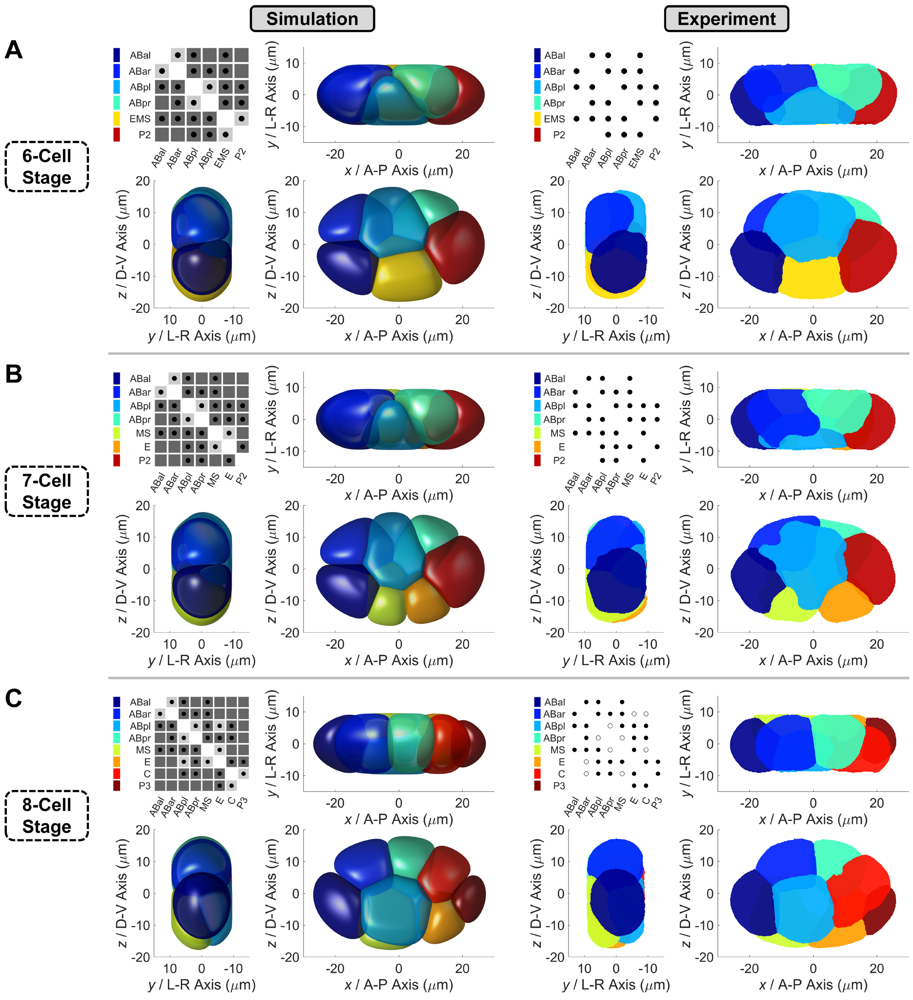
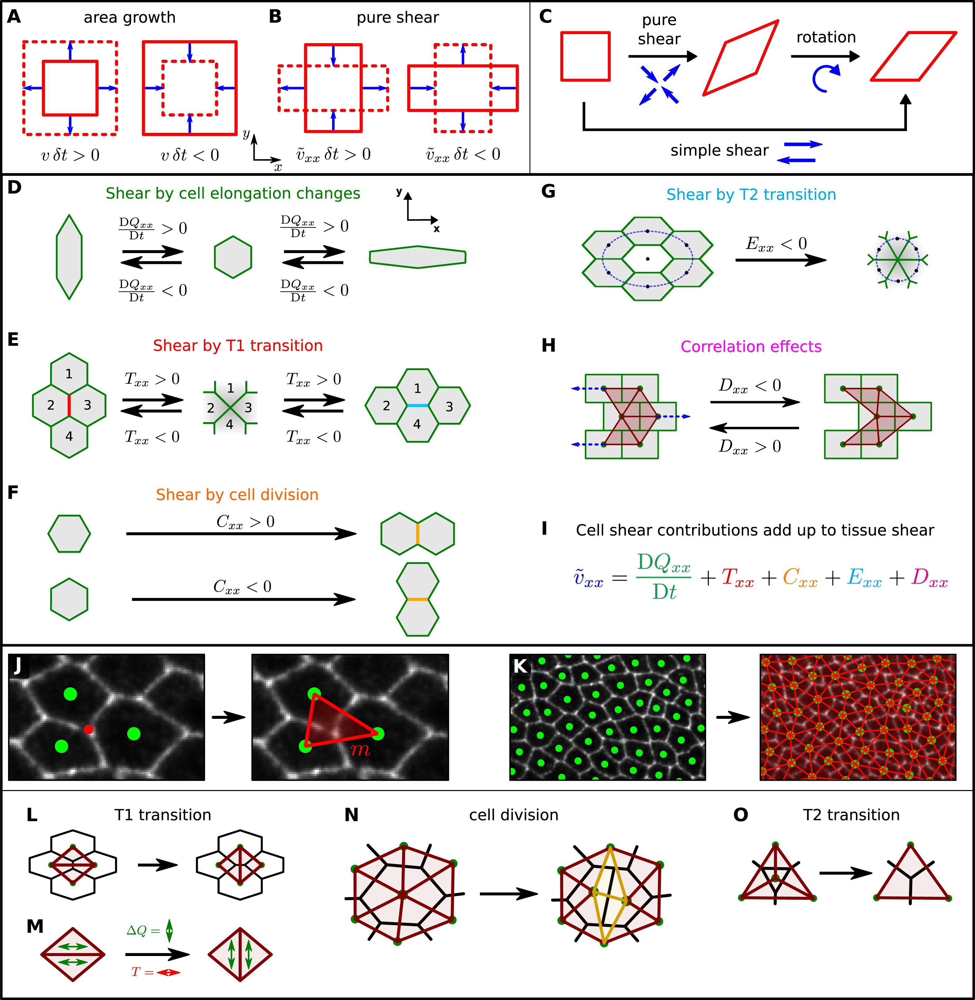
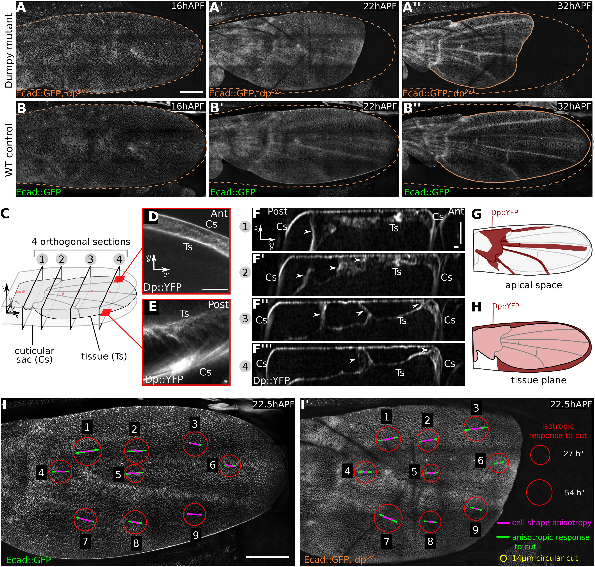
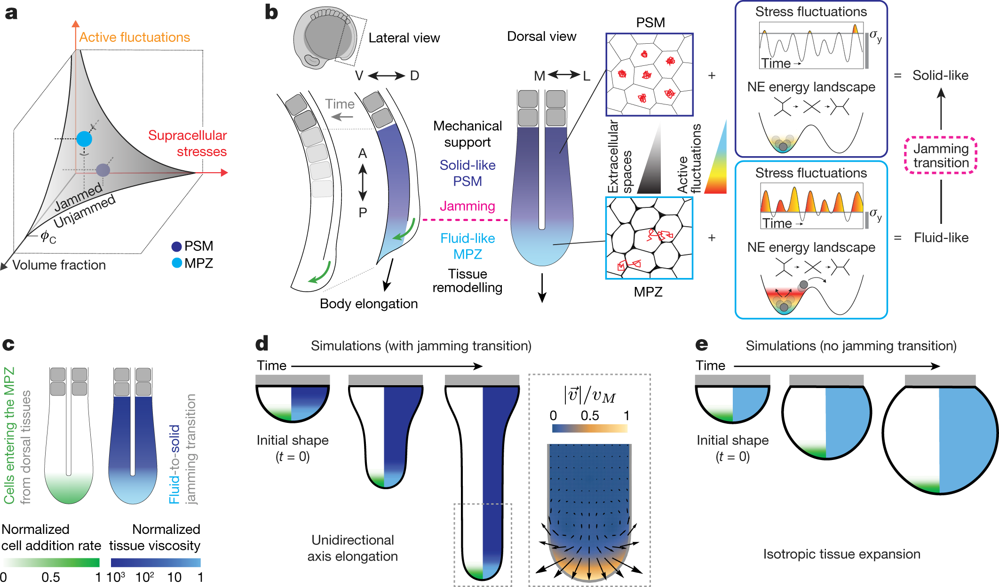
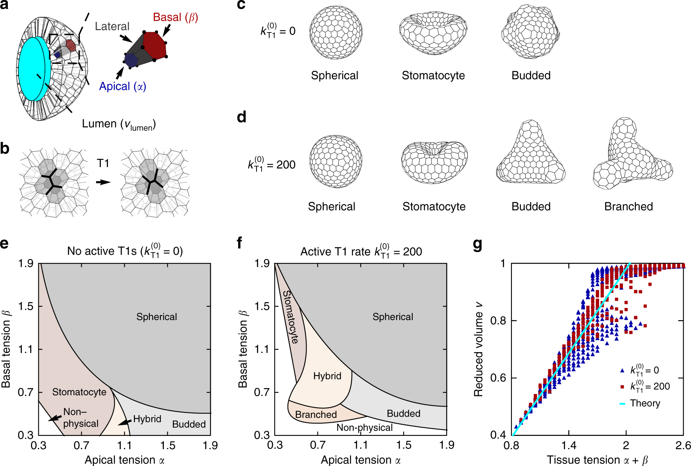
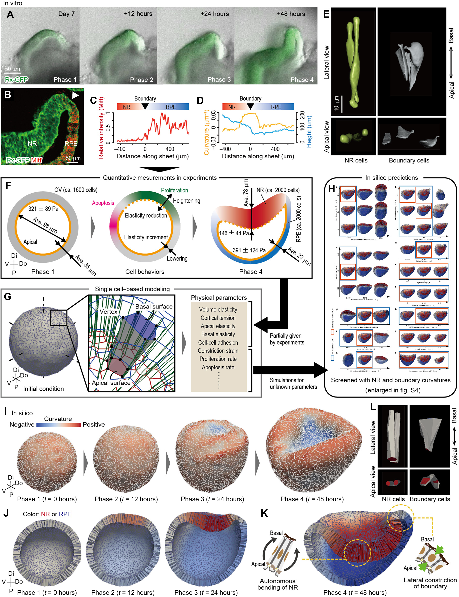
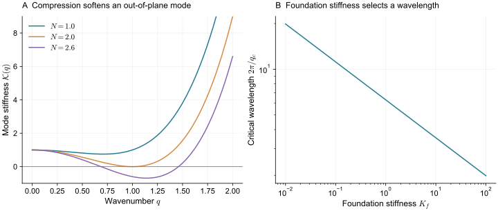
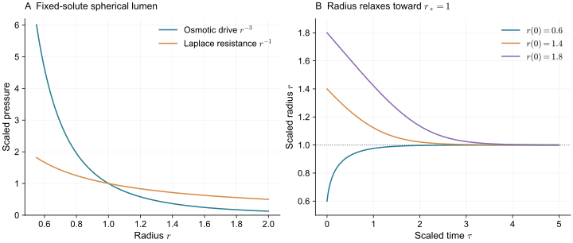
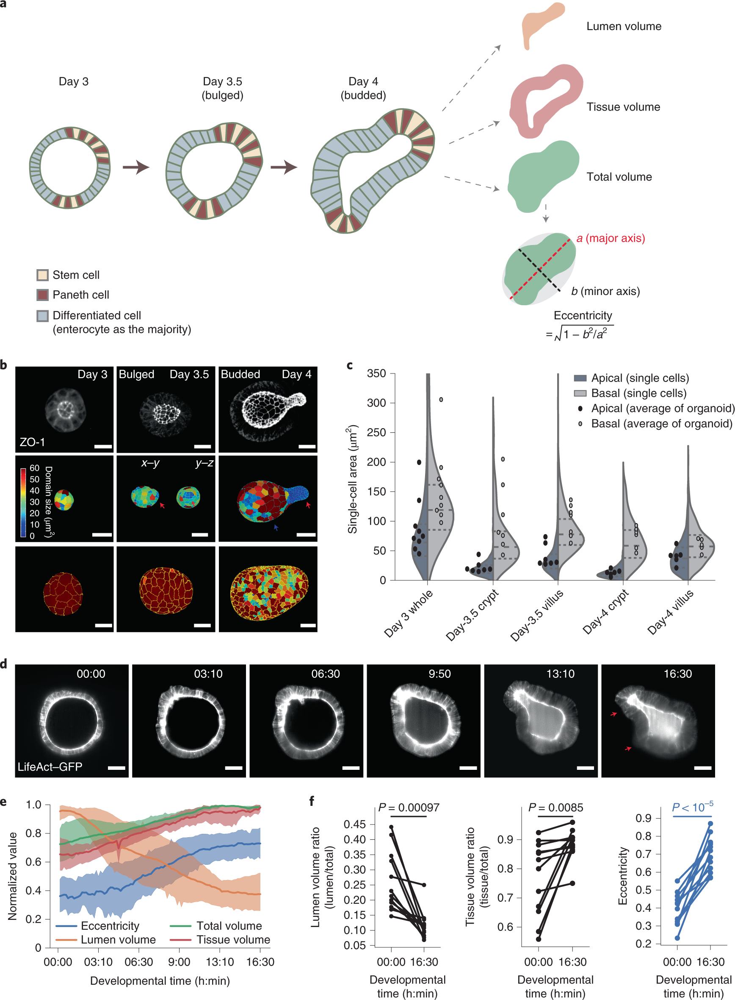
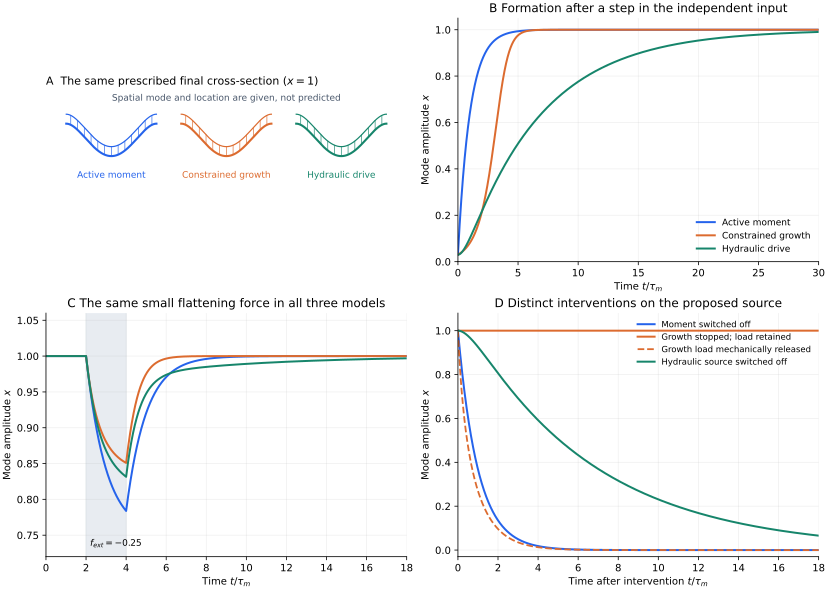

> **Part IV · Note 08**　上一篇：[07 · 连续材料与流固耦合](/notes/cell_simulation_3d/continuum_fluids/) · [专题目录](/notes/cell_simulation_3d/) · 下一篇：[09 · 参数反演、数值验证与可复现模拟](/notes/cell_simulation_3d/validation/)

## 1. 形态发生的运动学与力学层次 {#main-lecture}

形态发生模型试图解释细胞的局部行为怎样形成一个器官的空间结构。显微成像能够记录细胞和组织的形变，分子实验能够改变收缩、连接或输运；中间仍有一个需要计算的环节：这些变化怎样在受约束的三维组织中共同传力，并决定接下来可以到达的形态。

一种自然的起点，是把已有实验提出的机制写成明确的局部规则。顶端收缩改变某些界面的代价，分裂改变体积的分配与邻接，渗透输运改变腔和细胞的体积，基质则对运动施加阻力和牵引。模型据此计算整片组织的响应。局部作用与最终外形之间通常隔着许多细胞的协调，因而很难仅凭直觉判断某项变化是否足够。

早期胚胎、上皮壳和类器官提供了不同的建模入口。谱系清楚的胚胎允许先固定分裂输入，再检验空间排列；有极性的上皮使顶端、侧面和基底的作用能够分别进入几何；有腔类器官还迫使模型把水、溶质和细胞体积一起记账。这些路线由各自可测量、可干预的过程发展而来，通常需要不同程度的细胞与环境分辨率。

[Hannezo、Prost 与 Joanny（2014）](https://doi.org/10.1073/pnas.1312076111)从三维细胞形态讨论上皮曲率，体现了由细胞表面作用推导组织几何的思路。视杯研究进一步考虑形变怎样反过来调节收缩，腔体形成研究则把接触力学与液压通路联系起来。模型中的驱动力因此可以既由细胞状态给出，也随正在发生的组织变化而更新。

同一种凹陷仍可能有多个来源。区域性收缩可以弯曲上皮，受限增长可以积累压应力并屈曲，腔体体积变化又会改变整层组织的几何约束。要在这些解释之间作判断，需要比较它们同时预测的细胞高度、顶基底面积、接触、压力和时间顺序。模型的作用，是将这些附带预测一并算出来，使机制能够接受比外轮廓更严格的检验。

这里将三个层次分开处理。运动学先说明组织的变形由哪些细胞过程承担；力学再说明应力、极性和材料为什么选择这些过程及其方向；机制检验则比较独立干预下的预测。下文先讨论胚胎排列，再把形状变化与定向重排接成组织流动，随后讨论曲率和腔体，最后用同一个内陷模式比较不同驱动。模型需要在这几个层次之间建立联系，外形相似只是其中最先完成的一项。

## 2. 约束、分裂与胚胎排列 {#embryo-mechanics}

早期线虫胚胎的细胞身份和分裂程序较容易追踪，卵壳又提供明确的几何边界，因此适合检验机械模型。已知条件可以包括分裂顺序、分裂轴、母子体积比例与卵壳轮廓，模型再根据细胞间作用计算排列。

[Fickentscher 等（2013）](https://doi.org/10.1016/j.bpj.2013.09.005)采用简化中心力学研究早期细胞运动；[Kuang 等（2022）](https://doi.org/10.1371/journal.pcbi.1009755)则用三维相场结合成像约束研究从单细胞到八细胞的形态。这两条路线的一个自然比较是：先看能否重建质心与接触，再看增加形状自由度以后，接触面积和界面形状提供了哪些新约束。

这里最关键的逻辑是，输入的分裂方向与时刻不会因为出现在模拟中就变成模型预测。模型真正检验的是：给定这些发育信息之后，所写的力学是否足以组织形态；或者，在干预某个力学因素后，是否能预测哪些接触失去、哪些位置改变。

*图 1 · 三个视角与接触矩阵一起检验胚胎排列。* [Kuang 等（2022），Fig. 3](https://doi.org/10.1371/journal.pcbi.1009755.g003)；各组左侧为模拟，右侧为实验分割重建；[CC BY 4.0](https://creativecommons.org/licenses/by/4.0/)。

A、B、C 分别对应六、七、八细胞阶段。沿同一组图的三个视角追踪同色细胞，就能看出一个方向上被遮挡的接触；旁边的矩阵再记录谁与谁相邻。模型可能画出正确的外部椭球，却把内部邻居排错。把身份、接触和三维轮廓一起比较，才使“重建胚胎”成为比拟合轮廓更严格的检验。

卵壳也不只是一个长宽比。两个边界可以具有相同长宽比，却在局部曲率和胚外空间上不同。一团近似不可压的细胞被塞入略有不同的边界后，某块接触可能刚好形成或消失。因此，若拟合失败，除了修改黏附，也应先检查边界与总体积是否重建正确。

实际比较可以按层次进行：先锁定分裂程序与体积，再检验边界；接着引入类型依赖的接触作用；最后才加入额外主动机制。这样每增加一个自由度，都能看见它改善了哪一类观测，而不是让所有参数一起补偿同一个误差。

给定同一组最终细胞体积，不同分裂次序仍可能产生不同排列。原因是每次分裂改变局部接触，随后细胞沿当时可达的运动方向松弛；下一次分裂若发生在松弛结束之前，就从一个尚有残余应力的状态开始。最终构型由经历过的路径决定，不只由最后的细胞数决定。

在固定接触网络附近，可用能量 Hessian 的最软方向描述这种敏感性。一个很小的正特征值意味着某种位移代价很低，轻微的体积差或壳形差便能显著改变位置；特征值接近零、局部稳定性消失时，则可能跳到另一种邻接。确定性模型也因此会对输入误差敏感，而无需先加入很大的随机力。

对胚胎的检验可以据此分开两件事：正常输入是否产生正确排列，以及在分裂时刻、壳形或局部作用发生扰动时，模型是否预测正确的变化方向。后一项才检验正常形态是否由模型中的机制稳定维持。Kuang 等的工作结合了形态重建和扰动分析；不能把完整研究概括成一次终态截图的相似性比较。

这些胚胎排列对分裂历史的依赖，可以进一步推广到分裂本身带来的受力变化。给定轴向和时刻以后，母细胞切分仍会重新组织局部几何与材料。

一次分裂同时改变细胞数、接触网络、局部几何与材料状态。分裂轴、时刻和体积分配是其中一部分；新生界面的张力成熟、子细胞极性和核继承则是另一部分。

如果细胞周期远长于力学松弛，可以近似在每次分裂之后让组织充分松弛。如果两个时间尺度相近，细胞还未恢复平衡，邻近细胞就可能再次分裂，应力会累积并改变后续重排。把每个事件后都直接最小化能量，会抹掉这段过程。

分裂方向也不应被同一种规则统一解释。细胞长轴、上皮极性、局部张力和已知发育程序都可能参与决定方向。用长轴规则是一项可检验的假设；若实验输入了方向，则检验的是该分裂程序与力学如何共同组织组织形态。

细胞死亡与挤出同样改变局部体积和接触。活细胞的机械性离层不必先由凋亡触发。[Monfared 等（2023）](https://doi.org/10.7554/eLife.82435)用三维细胞层研究局部排列、应力与挤出的机械路线。这说明面内密度和面外自由度需要一起观察；二维投影中一个细胞面积缩小，可能对应体内变形，也可能已经开始离层。

## 3. 定向重排与组织流动 {#directed-rearrangements}

一片组织沿左右方向变长，至少可以有两种实现方式。细胞各自被拉长，原来的邻居大体保留；或者细胞不断换邻居，使更多细胞沿左右方向排成一列，单个细胞却只短暂拉长。前一种方式主要把变形留在细胞形状中，后一种方式可以在平均细胞形状趋于稳定后继续伸长。两片组织的外轮廓相似，内部储存的应力和卸载后的恢复却可能不同。

汇聚延伸所涉及的正是这种组织与细胞之间的区别。这里的“延伸”必须相对于一个材料方向定义：整片组织平移不产生应变，整体旋转也不等于沿某个轴伸长。由细胞速度场 $\mathbf v$ 定义局部对称变形率

$$
\mathbf E=\frac12\left(\nabla\mathbf v+(\nabla\mathbf v)^{\mathsf T}\right),
\qquad
\mathbf E^{\rm dev}=\mathbf E-\frac{\operatorname{tr}\mathbf E}{d}\mathbf I.
$$

$d$ 是实际采用的空间维数。迹给出局部面积或体积的相对变化率，无迹部分描述一个方向伸长、另一些方向收缩。细胞数增加、组织面积增加和组织沿某轴变长，因而是三个需要分别测量的量。给定一段电影后，应先把它们分开，才能判断分裂、形变和重排各承担了什么。

[Guirao 等（2015）](https://doi.org/10.7554/eLife.08519)由细胞邻接链的变化构造组织与细胞过程的变形张量。在跟随材料运动的区域内，若只有细胞大小和形状变化、重排、分裂及凋亡或离层，按该文的定义有

$$
\mathbf G=\mathbf S+\mathbf R+\mathbf D+\mathbf A.
$$

各项分别记录组织形变及上述四类过程的贡献。它们不是通过调参数使总和相等，而是从追踪数据中分别计算后检查闭合。若还存在细胞进入、融合或穿过观测边界，需要纳入相应项；固定在实验室坐标中的小窗口，还会出现细胞流经窗口造成的贡献。这里的 $\mathbf G$ 采用原文的测量定义，不能在任意有限形变下直接换成上面的速度梯度。

这类等式首先完成运动学记账。同一次组织延伸究竟靠细胞伸长还是靠邻接更新，可以由电影回答；这些过程为何沿该方向发生，则仍需要应力、极性和材料动力学。把分解中的某一项测得很大，尚不能说明它是独立的驱动力。

*图 2 · 相似的组织伸长可以由不同细胞过程承担。* [Etournay 等（2015），Fig. 4](https://elifesciences.org/articles/07090#fig4)，示意及成像上的三角化；[CC BY](https://creativecommons.org/licenses/by/4.0/)。

A—C 先区分面积、形状和旋转；D—G 再把细胞变长、换邻居、分裂和挤出分开。J、K 的红色三角形连接细胞中心，随邻接变化重新构造。尤其要保留 H、I 中的相关项：不同位置的细胞形状与局部转动、面积变化相关时，平均细胞伸长的变化不能独自代表组织剪切。该图与 Guirao 的分解使用不同变量，不能把两套公式里的同名字母逐项对应。

**事件的方向与频率需要一起统计。** 一次 T1 包含旧接触缩小和新接触形成。若用收缩边的方向记事件，和用组织被拉长的方向记事件，二者可能相差直角。因此图中的横向重排不能直接改称“横向连接收缩”，而应同时记录消失与出现的接触，以及局部材料轴。

为看清方向平均的作用，考虑一个小形变、近似平面的材料片区。将一次彼此可分辨的重排对该片区的有效无迹应变近似写成

$$
\Delta\boldsymbol\varepsilon_e^{\rm r}
=a_e\left(\mathbf n_e\otimes\mathbf n_e-\frac12\mathbf I\right),
\qquad
\mathbf R_{\rm event}\simeq
\nu\left\langle\Delta\boldsymbol\varepsilon_e^{\rm r}\right\rangle.
$$

$\mathbf n_e$ 定义为该事件的伸长轴，$a_e$ 是已经按所观察片区归一化的应变幅度，$\nu$ 是片区内每单位时间的事件数。因此 $\mathbf R_{\rm event}$ 的单位是时间的倒数；$a_e$ 随片区大小变化，不能从一个片区原样搬到另一个片区。若事件的轴与 $x$ 轴夹角为 $\theta_e$，便有

$$
R_{{\rm event},xx}-R_{{\rm event},yy}
\simeq\nu\left\langle a_e\cos 2\theta_e\right\rangle.
$$

均匀取向的同幅度事件相互抵消，频率很高也不产生持续的定向伸长；方向偏置较强的少量事件，反而可能贡献明显的净剪切。这是帮助理解的稀疏事件估计。相邻事件相互影响、局部滑移与转动显著时，应回到完整的追踪和几何分解，不能只把 T1 数乘上一个通用常数。

**细胞为什么选择重排而不是一直拉长？** 用一个线性材料近似，可以将平均细胞形状对应的小弹性应变记为 $\mathbf Q$，在随材料共同转动的坐标系中写

$$
\mathbf E^{\rm dev}=\mathring{\mathbf Q}+\mathbf R_{\rm eff},
\qquad
\boldsymbol\sigma^{\rm dev}=2G\mathbf Q+\boldsymbol\sigma^{\rm act},
\qquad
\mathbf R_{\rm eff}=\frac{\mathbf Q}{\tau}+\mathbf R^{\rm act}.
$$

$\mathring{\mathbf Q}$ 表示剔除刚体转动后的变化率。这里已经把未显式解析的形状相关与重排松弛合并进 $\mathbf R_{\rm eff}$，忽略分裂、离层和强空间不均匀；它是局部线性闭合，不能替代前面的完整实验分解。$G$ 给出形变储能，$\tau$ 给出重排释放该形变的时间，主动应力与主动重排偏置则需要各自的生物来源。

若没有主动项、施加恒定的小剪切率 $\mathbf E_0$，并从 $\mathbf Q=0$ 开始，则

$$
\mathbf Q(t)=\tau\mathbf E_0\left(1-e^{-t/\tau}\right),
\qquad
\mathbf R_{\rm eff}(t)=\mathbf E_0\left(1-e^{-t/\tau}\right).
$$

初期组织主要拉长细胞；经过重排时间后，平均形状不再持续改变，组织却仍以相同速率延伸。这就是单细胞形状有界而组织能够流动的最简单解释。长期弹性应力成为 $2G\tau\mathbf E_0$，对应这个线性模型的黏性系数 $G\tau$。若在更短时间卸载，更多形变仍能恢复；若已经充分换邻居，外形恢复便需要新的重排。

被动松弛项的弹性能释放率为 $2G\mathbf Q:\mathbf Q/\tau\geq0$。主动的接触收缩和极性更新则消耗化学能，可以使重排方向偏离被动松弛的方向。这里称某次响应“被动”，是指它由外部载荷引起并释放储存的应力，并不表示活细胞的连接周转完全不消耗 ATP。判断主动驱动需要活动、应力与事件先后关系，不能只看某条边先缩短。

*图 3 · 边界传力会改变同一上皮的形态演化。* [Etournay 等（2015），Fig. 2](https://elifesciences.org/articles/07090#fig2)，实验成像及组织轮廓；[CC BY](https://creativecommons.org/licenses/by/4.0/)。

[Etournay 等（2015）](https://doi.org/10.7554/eLife.07090)将细胞追踪与 Dumpy 连接缺陷、激光切断等扰动结合。A、B 对比突变体与正常翅在 16、22、32 hAPF 的形态，橙线区分初始和后期轮廓；C—H 显示 Dumpy 所在空间及其与组织、外部角质层的联系。翅铰收缩与这些连接共同影响张力及细胞过程。它说明材料方程还必须放在正确的外部连接中求解：即使局部细胞仍会分裂和重排，失去传力边界后，整体形状也不必沿原来的路径发展。

**三维组织还可以借助材料状态的空间分工延伸。** [Mongera 等（2018）](https://doi.org/10.1038/s41586-018-0479-2)在斑马鱼体轴中使用液滴探针研究局部受力与屈服。后部中胚层祖细胞区（MPZ）较易流动，向前成熟的前体节中胚层（PSM）具有更强的机械完整性。快速细胞尺度涨落与较持久的组织尺度应力承担不同作用：前者有助于局部重排，后者配合材料分区引导整体流动。

*图 4 · 局部能够流动，需要与周围的机械支撑配合。* [Mongera 等（2018），Fig. 4](https://www.nature.com/articles/s41586-018-0479-2/figures/4)。a、b 为机制概括，c—e 为降维连续模型；原作者与出版方保留权利。

b 区分后部重塑与前部支撑，c 给出细胞供给及黏度分布，d、e 比较有无材料状态变化时的伸长与侧向扩张。实验对象是三维胚胎，这里的模拟采用背腹方向投影后的二维连续描述。原文还报告，所测邻居交换没有统一沿体轴定向；因此这幅图不能作为“定向 T1 驱动体轴伸长”的证据。

这个区别具有一般意义。流动性决定组织在给定应力下是否容易变形，方向还取决于应力的偏置、细胞从哪里进入、哪里受到阻挡，以及周围组织能否承载。如果把各区域都设成同一种容易流动的材料，细胞供给可能主要扩大横向尺寸；让部分区域保持支撑，才可能将同样的供给导向轴向。具体结果仍由边界和应力方程共同决定。

二维上皮的分析也不能直接搬到厚上皮。弯曲表面上的方向需要在局部切平面定义，并在空间比较时处理参考基的转动；面积几乎不变的表面可以通过厚度改变体积。完整三维组织的偏应变应减去 $\operatorname{tr}\mathbf E/3$，接触则是面、边与顶点组成的网络。沿厚度本来就不同的邻居，和随时间发生的换邻居，仍是两件事。三维 Vertex 中一次接触面消失的贡献，应从前后体积几何和速度场测量，不能默认等于一个平面 T1。

由此，第 [04 篇的重连规则与长期流变](/notes/cell_simulation_3d/vertex_3d/#topology-and-rheology)才能接到真正的发育问题上：规则既要给出事件何时发生，也要在正确的载荷、极性与边界中给出其方向，并同时预测组织流场和细胞形状。只匹配总事件数，或只匹配组织伸长率，都还容许许多不同的内部机制。

## 4. 主动弯曲、增长屈曲与反馈 {#epithelial-mechanisms}

上皮的顶端与基底由细胞极性决定，通常分别面对腔或外界、面对基底膜。组织翻折后，顶端仍是顶端，不能按实验室的上半边和下半边重新分类。

若顶端与基底的有效张力不同，它们对中面产生不平衡弯矩。对厚度为 $h$ 的薄层，尺度关系为

$$
m\sim\frac h2(\Gamma_b-\Gamma_a).
$$

上皮最终曲率还要与弯曲刚度、面内伸缩、侧面张力和周围组织平衡。这个式子解释方向与尺度，不意味着张力差给定后曲率就能单独求出。

[Hannezo、Prost 与 Joanny（2014）](https://doi.org/10.1073/pnas.1312076111)从三维细胞形态出发讨论上皮片的形状与曲率；[Rozman、Krajnc 与 Ziherl（2020）](https://doi.org/10.1038/s41467-020-17535-4)则使用三维表面张力 Vertex 模型研究上皮壳的芽、分支和内陷，并分析重排活动的作用。两者提供了从细胞各表面受力到整体曲率的联系，也表明壳的形状不能只看一个细胞的顶端面积。

如果使用无厚度的曲面模型，可以把这些效应合并成自发曲率或主动弯矩；如果使用有厚度细胞，则可由表面受力直接产生弯曲。比较两种层次时，要先匹配有效弯曲与面内响应，再比较组织形状。

*图 5 · 从局部表面性质读到整体形态。* [Rozman、Krajnc 与 Ziherl（2020），Fig. 1](https://www.nature.com/articles/s41467-020-17535-4/figures/1)，三维 Vertex 模拟；[CC BY 4.0](https://creativecommons.org/licenses/by/4.0/)。

a 中蓝色顶面朝向腔体，红色基底面朝外；c、d 中的壳使用相同的极性约定。两组使用固定的细胞数和腔体体积，改变张力与主动重排后仍可形成不同形态，因此不能把每个芽都解释为局部多长了一群细胞。e、f 的形态图把这些例子放回参数空间：局部收缩倾向、几何约束与重排能否进行，需要一起解释最终的分支。

### 4.1 视杯的区域分工与机械反馈 {#视杯形变也能反过来改变驱动力}

眼的视杯形成提供了一个机械反馈的例子。[Okuda 等（2018）](https://doi.org/10.1126/sciadv.aau1354)结合实验与三维力学模型，研究宏观组织形变怎样反馈到局部细胞力生成，并参与形成弯曲结构。这里的驱动不是从头到尾都固定的一张张力地图，细胞可以响应自己所受的变形。

这类模型至少包含两层状态：几何形变与调控活动。可以示意地写成 $\tau_a\dot a=a_{\rm target}(\varepsilon)-a$，再让 $\Gamma_a$ 或其他收缩参数依赖 $a$。即便终态张力分布相似，瞬时响应与有延迟的反馈也可能产生不同轨迹，因此需要时间序列和力学扰动来检验。

将所有张力直接设成观测终态所需的值，可以证明一组受力足以支撑形状；要解释组织怎样自发到达该形状，还必须说明这些受力怎样产生和更新。

*图 6 · 实验测量怎样进入视杯的三维模型。* [Okuda 等（2018），Fig. 1](https://pmc.ncbi.nlm.nih.gov/articles/PMC6248953/#F1)；A、B、E 含实验成像，G 为模型几何，I—L 为模拟形态；图片从正式论文 PDF 中完整提取；[CC BY-NC 4.0](https://creativecommons.org/licenses/by-nc/4.0/)。

A 中的实验内陷对应 I、J 中模拟的外形与剖面，G 给出连接这两种空间尺度的细胞网络。L 又把组织弯曲落实到单细胞：神经视网膜区域和交界处的形状不同，顶面以红色标出。模型需要同时解释局部弯曲与边界收缩的配合。只有外部杯状轮廓相似，还不能证明细胞尺度的形变机制正确；厚度和边界处细胞形状是进一步的约束。

视杯由神经视网膜区域与视网膜色素上皮区域共同形成，两区交界处还承担连接与折叠。Okuda 等的研究区分了神经视网膜区域的自主弯曲和交界处的侧向收缩。侧向收缩涉及顶基底方向长度，顶端收缩涉及顶面周界；二者对细胞高度、楔形程度和交界弯曲给出的预测不同。

实验因而需要同时看组织剖面与单细胞形状。若模型只要把一块顶面设得足够紧就能形成杯状，也许已证明某种受力可以支撑这一外形，却还没有解释图中交界细胞的高度和变形。论文将形态筛选与力学干预结合，并通过持续机械变形及钙信号观测研究形变如何触发后续收缩。这里的证据链涉及受力、响应与形态的时间先后，而不是单独比较肌球蛋白信号与凹陷位置。

机械反馈的作用可以用一个独立的低维例子解释。令 $x$ 为折叠程度，$a$ 为可调的收缩活动，$u$ 为外部触发，取

$$
\tau_x\dot x=-x+\chi a+u,
\qquad
\tau_a\dot a=-a+\beta x.
$$

第一式表示收缩推动折叠、弹性使它回复；第二式表示形变诱导活动、活动自身会衰减。关闭外部输入后，线性模式满足

$$
(1+\tau_x s)(1+\tau_a s)-\chi\beta=0.
$$

当 $0\leq\chi\beta\lt1$ 时，扰动最终衰减，但接近 1 时恢复可以很慢；超过 1 后，正反馈使该线性状态失稳，需要活动饱和和有限几何限制新的形态。这个算例不是视杯论文的原模型，也不能凭它断言器官发生某种分岔；它说明相似的终态收缩图背后，可能存在很不相同的触发阈值、响应延迟和卸载行为。这些量需要动态扰动来区分。

### 4.2 受限增长与屈曲 {#受限增长为什么会屈曲}

一个组织也可能在没有顶基底主动张力差时弯曲。设一片上皮希望沿面内增长，周围边界或基质阻止它伸展，面内压缩便逐渐积累。超过阈值后，向面外弯曲可以释放一部分压缩能。

对一个简化薄片，令面外位移为 $w$，弯曲刚度为 $B$，压缩膜力为 $N>0$，周围约束用线性地基刚度 $K_f$ 表示。二次能量为

$$
E^{(2)}=\frac12\int\left[B(\nabla^2w)^2-N|\nabla w|^2+K_fw^2\right]dA.
$$

对于波数为 $q$ 的模式，能量系数是

$$
\mathcal K(q)=Bq^4-Nq^2+K_f.
$$

弯曲惩罚短波，外部地基惩罚位移，压缩则使某些面外模式变得有利。无限均匀系统的临界条件为

$$
N_c=2\sqrt{BK_f},\qquad q_c=(K_f/B)^{1/4}.
$$

若没有地基，允许的波长通常由有限几何和边界条件决定。这一推导不包含细胞分裂细节，却说明为什么相同的生长在不同基质或边界下，可以产生不同褶皱尺度。

*图 7 · 凹陷可以来自受限增长的力学失稳。* 按正文二次能量计算，取 $B=K_f=1$ 比较不同 $N$，并扫描 $K_f$ 的临界波长。是连续薄片算例，没有模拟具体器官。

在细胞分辨模型中，增长由目标体积、参考态或分裂实现，压缩和弯曲可能涌现；在连续模型中，则常直接给定生长张量。实验上可以结合细胞数、细胞面积、局部应变和基质变形，区分主动收缩与受限增长。

## 5. 腔体形成与液压形态发生 {#lumen-and-organoids}

上皮包围的腔里有水、离子和溶质，腔壁又由可变形、可通透的细胞组成。腔体积变化来自水通量，水通量取决于渗透压和机械压差：

$$
\dot V_l=L_pA_l(\Delta\Pi-\Delta p),
\qquad
\dot n=Q_{\rm pump}-Q_{\rm leak}.
$$

若溶液足够稀，$\Delta\Pi=RT(n/V_l-c_{\rm out})$。若腔可近似为恒定有效张力 $\gamma$ 的球面，则 $\Delta p=2\gamma/R$。后一个假设将整层腔壁合并成一个张力界面，不能解析细胞高度、极性和材料记忆。

固定溶质量与固定渗透压具有不同稳定性。取 $n$ 固定、$c_{\rm out}=0$，渗透驱动随 $R^{-3}$ 衰减，Laplace 阻力随 $R^{-1}$ 衰减，平衡半径满足

$$
R_*^2=\frac{3nRT}{8\pi\gamma}.
$$

用这个半径和相应时间作归一化，可以得到

$$
\frac{dr}{d\tau}=r^{-3}-r^{-1}.
$$

在 $r=1$ 附近，偏差满足 $d\delta r/d\tau=-2\delta r$，所以平衡稳定。若外界持续补充溶质以保持固定 $\Delta\Pi$，驱动力不再按相同方式下降，结论也会改变。

*图 8 · 水通量、溶质与力学要同时记账。* 右图使用固定步长 RK4 积分教学方程，比较不同初始半径。未加入细胞泵动力学和完整上皮壳。

早期腔体形成还涉及细胞接触被液体打开、多个小腔之间交换水，最终形成更大腔的过程。[Dumortier 等（2019）](https://doi.org/10.1126/science.aaw7709)研究小鼠囊胚，将液压打开接触与主动粗化联系起来，解释胚腔形成和定位。此时，腔网络的连通与局部接触力学都很关键，只追踪一个从一开始就存在的球形腔，会跳过真正需要解释的形成过程。

如果小腔之间通过液体通道连接，压差可以驱动交换；如果通道被切断，就不能仅根据两个腔的半径假定它们会按同样规律粗化。模型需要显式表示或有效描述这些通道与通量。

两颗小腔能否交换水，取决于它们之间有没有可通液路径。若流量可以线性化为 $Q_{ij}=C_{ij}(p_i-p_j)$，则每个腔的体积变化为

$$
\dot V_i=-\sum_jC_{ij}(p_i-p_j)+Q_i^{\rm in}.
$$

在相同有效张力、近似球形的极限，较小的腔有更高 Laplace 压力，水可经通道流向较大腔。通道导通系数 $C_{ij}$ 为零时，半径再不相同也不会通过这条路径交换水。若界面张力随位置变化，压力排序还可能改变，不能只按大小判断流向。

早期胚腔形成还需要先打开细胞接触，使液体进入原本紧贴的界面。这与两个早已存在、始终连通的液滴不同。模型可把接触打开、通道形成和后续交换分别表示；Dumortier 等讨论的液压破裂与主动粗化，正把腔体位置的问题接回了局部细胞力学。单腔球模型适合解释形成后的膨胀，腔网络则解释液体为什么最终集中到某个位置。

### 5.1 肠隐窝的受力与体积调节 {#肠隐窝细胞命运与渗透性质共同改变形态}

[Yang 等（2021）](https://doi.org/10.1038/s41556-021-00700-2)研究肠类器官隐窝形成，将细胞命运差异、机械性质和渗透调节联系起来。这个案例特别适合说明，同样的腔体体积变化放在不同极性和材料分布的上皮壳中，可以对应不同形态结果。

*图 9 · 将局部出芽放回整个类器官的体积变化中。* [Yang 等（2021），Fig. 1](https://www.nature.com/articles/s41556-021-00700-2/figures/1)，实验成像、示意和重建；原作者与出版方保留权利。

b 的膜连接标记与表面重建显示细胞顶端和基底几何的差别；d 是同一类器官的时间序列，可以看到局部鼓起如何转为更明显的芽。e 再分别测量腔体、组织和总体积。把这三种体积混成一个“类器官大小”，就会漏掉组织增长与腔体变化的不同贡献。建立模型时，要让局部细胞命运、极性受力和水通量各自对应可检验的观测。

建模时，可以让细胞状态分别调控表面收缩、体积调节和溶质通量，再用不同干预约束各条关系。若所有效应都吸收到一个随时间变化的“有效压力”，模型也许能拟合腔体积，却难以解释哪一类细胞发生了何种变化。

Yang 等的类器官实验观察到隐窝出芽伴随腔体体积降低，并将隐窝的顶端收缩、绒毛区域的基底张力和渗透调节联系起来。论文的三维力学模型在给定腔体积下比较准静态形状；这一步筛选哪些受力组合能够产生形态，不等于已经显式求解每条水和离子通量。

体积测量可以将这几层作用分开。对无明显空隙的上皮壳，

$$
V_{\rm total}=V_l+V_{\rm tissue},
\qquad V_{\rm tissue}=\sum_iV_i.
$$

若腔体缩小而组织体积增加，总外形体积未必同步缩小。组织体积的变化又可以来自单细胞体积改变、物质增长和细胞数变化；体积守恒的分裂本身只重新分配母细胞体积。因而，腔体体积、细胞数和单细胞体积三类测量能够排除不同解释。

在机制层面，分化的吸收细胞可以通过跨膜输运改变细胞体积与腔体积，区域性收缩则改变上皮偏好的曲率。两者协同，并不意味着任何腔体缩小都会产生同样的隐窝：张力差不足、区域大小不同或边界约束不同，都可能使相同体积变化得到不同形状。相反，已形成较强区域曲率后，组织对再次充液的响应也可能不同。

一个有区分力的模型应预测充液或改变输运后，腔体积、隐窝开口和细胞高度分别怎样变化；仅重新指定一条能够拟合实验的压力曲线，还不能解释这些区域差异。体积预算把输运问题与受力问题连接起来，同时保留了二者各自需要的数据。

## 6. 机制竞争与可区分预测 {#mechanism-comparison}

前面的例子已经表明，曲率可以来自区域性收缩、受限增长或腔体变化。若每种机制各配一幅内陷截图，仍不容易看出它们究竟在哪里不同。下面固定同一种内陷轮廓，只改变产生它的动力学，并比较形成、短时加载和关闭驱动后的响应。

**先固定几何，明确这一步省略了什么。** 取半径为 $a$ 的局部圆形区域，只保留一个轴对称内陷模式

$$
\begin{gathered}
w(r,t)=-H x(t)\left[1-(r/a)^2\right]^2,\\
0\leq r\leq a.
\end{gathered}
$$

$x$ 是无量纲深度，$H/a=0.12$；边缘的位移和斜率均为零。三个模型都使用这一个空间函数，因此它们在 $x=1$ 时具有完全相同的轮廓。位置、宽度和轴对称性在这里已经给定，算例只能比较这个模式的振幅动力学。它尚未解释组织为什么选择该位置或该波长；那些问题需要回到空间应力、极性分区和稳定性分析。

将模式的被动力学刚度记为 $K$、阻力记为 $\zeta$，用 $\tau_m=\zeta/K$ 归一化时间。以下导数均对 $t/\tau_m$ 而言。主动弯矩、压力对模式的投影及外部探针力，也按同一广义力尺度归一化。真实实验必须通过独立加载确定这些尺度；图中的参数是明确指定的教学数值。

| 假设 | 最小动力学 | 应独立约束的输入 | 静态轮廓没有告诉我们的量 |
| --- | --- | --- | --- |
| 区域主动收缩 | $\dot x=m-x+f_{\rm ext}$ | 活动产生的模式弯矩 $m$、被动刚度与阻力 | 收缩建立和关闭的时间，驱动来自哪一侧 |
| 受限增长屈曲 | $\dot x=\mu x-x^3+f_{\rm ext}$ | 压缩载荷相对阈值的距离 $\mu$、约束、初始偏置 | 增长怎样积累载荷，何时释放，选择哪一个方向 |
| 液压驱动 | $\dot x=p-x+f_{\rm ext}$，$\tau_p\dot p=p_{\rm set}-p-\kappa\dot x$ | 压差来源 $p_{\rm set}$、通透时间 $\tau_p$、形变与压力耦合 $\kappa$ | 压力如何随体积更新，换液和卸载是否有延迟 |

第一个模型中，局部主动收缩对所选模式做功，用 $m$ 表示其广义弯矩。恒定 $m=1$ 后，平衡为 $x=1$；关闭 $m$，被动刚度使组织恢复。这里没有额外模拟肌球蛋白周转，所以“关闭”指实际驱动力已经消失，而不是加药的瞬间。若药物起效需要数分钟，实验时间序列必须与这一差别对齐。

第二个模型来自保留四次稳定项的屈曲能量 $U(x)=-\mu x^2/2+x^4/4$。$\mu$ 与面内压缩超过临界值的程度成正比；$\mu=1$ 时，稳定深度为 $x=\pm1$。一个很小的正初始偏置选择内陷支，负偏置则会选择相反方向。因而受限增长能够提供失稳，但在这个对称模型中不会自己决定向内还是向外。极性、初始曲率或边界偏置需要另外解释。

第三个模型让压力与形变共同演化。$p>0$ 定义为有利于该内陷模式的有效压力差，例如外压相对腔压的增加；形变压缩腔体时，腔内压力上升，因此有 $-\kappa\dot x$ 的负反馈。$p_{\rm set}$ 表示外部压力或渗透输运所维持的驱动水平，$\tau_p$ 则合并有限通透与压力储存的时间。在实际组织中，两者应由水和溶质守恒推导，不能把任意拟合曲线当作已解释的泵动力学。

这里还预设压差对局部内陷有非零投影。一个完全均匀的球壳受到均匀压力时，通常先发生整体胀缩，不能仅靠压力数值就在指定位置长出隐窝。局部较软区域、已有曲率、细胞命运分区或边界几何，才可能把液压变化集中到该模式；本算例把这项空间结构作为共同输入。第 5 节肠隐窝中的区域收缩与体积预算，正说明为什么需要同时保留这两层信息。

*图 10 · 相同终态下的三种动力学。* 自制单模式计算，A 为给定轮廓，B—D 为上述方程的 RK4 解；$m=\mu=p_{\rm set}=1$、$\tau_p=4$、$\kappa=2$，初始 $x=p=0.03$。C 从平衡态施加 $2\leq t/\tau_m\lt4$、幅度 $-0.25$ 的共同压平力；D 从平衡态分别改变所假设的来源。这是低维机制比较，没有运行细胞分辨的三维组织求解器。

B 中三个终态相同，形成速度却不同。主动模型直接向受力平衡松弛；增长模型先放大初始偏置，再由非线性项限幅；液压模型还要等待压力变量建立。增长曲线的早期延迟会随初始偏置改变，液压延迟会随通透性改变。因此这些曲线是给定输入下的预测，并非每种生物机制独有的指纹。若允许随意重调阻力、初态或驱动建立时间，几条曲线也可能再次接近。

C 使用相同外力，而非分别替模型指定有利的干预。主动模型在平衡附近的恢复刚度为 1；增长模型在 $x=1$ 附近的回复项为 $-2\delta x$，所以同样的小载荷产生较小偏移。液压模型中，压平暂时增大有效腔容积，使内外压差变化；它的恢复含有两个耦合时间。若实验已经独立测得局部刚度，这些差异会进一步约束允许的参数，而不能继续靠“更大的黏度”吸收。

D 中的操作则有不同的物理含义。关闭主动弯矩后，$x=e^{-t/\tau_m}$。停止新的增长，并不会立即消除先前积累的面内压缩；在无重塑、边界不变的这个模型里，$\mu$ 仍为 1，内陷保持。若真正释放压缩载荷，使 $\mu$ 从 1 变到 $-1$，形状才逐渐展平。把抑制增殖等同于机械去载，会对实验给出错误的即时预测。

液压源关闭是将 $p_{\rm set}$ 变为零，已经存在的压力仍按有限通透时间释放。这里的 $x$ 因而保留慢恢复。若实验直接把压差钳制为零，$p$ 不再是自由演化变量，响应会退化为 $\dot x=-x$，与关闭主动弯矩的曲线一致。这恰好说明单一恢复曲线未必能识别机制，必须同时知道施加了哪种边界条件，并测量压力或体积是否确实发生预期变化。

计算脚本及参数保存在 [生成脚本](../generate_mechanism_figures.py)中；可直接下载[参数与步长减半检查](../mechanism_comparison/parameters_and_checks.json)、[形成轨迹](../mechanism_comparison/formation.csv)、[共同探针轨迹](../mechanism_comparison/common_probe.csv)和[来源干预轨迹](../mechanism_comparison/targeted_interventions.csv)。下载脚本后，安装 NumPy 和 Matplotlib，运行 `python3 generate_mechanism_figures.py` 即可生成图与轨迹子目录。图中所有模型使用相同机械时间单位，参数没有拟合实验。它比较的是三个力学假设；相场与显式表面在共同物理标定下的完整三维比较，仍需要另外实现两套求解器、测量和收敛检验。

**机械反馈如何加入同一比较？** 第 4 节已经用形变 $x$ 与活动 $a$ 的耦合说明正反馈。它不必作为第四张终态截图，而应在上面的已标定被动响应之外，增加可测量的活动变量。用 $\tau_x\dot x=-x+\chi a+u$、$\tau_a\dot a=-a+\beta x$，并保持同样平衡深度，所需外部触发为 $u=1-\chi\beta$。因此仅测 $x=1$ 无法区分“较强外部驱动、较弱反馈”和“较弱外部驱动、较强反馈”。

在实验中短时改变 $u$ 并同时记录活动，才可以检验形变是否先于活动、活动是否继续影响形变，以及恢复是否含有第二个时间。在线性稳定区 $\chi\beta\lt1$，恢复慢并不自动意味着存在阈值或记忆；超过线性失稳点后，也不能只凭正反馈就宣称有滞后。触发阈值和卸载后维持形态，需要饱和、非线性及其稳定分支的进一步分析。视杯实验提供的是特定系统中应变与后续活动的证据，推广到其他上皮时仍需重新测量。

| 比较层次 | 已经完成的工作 | 仍需要的证据 |
| --- | --- | --- |
| 几何拟合 | 三套方程都能到达相同的预设内陷 | 位置、宽度和三维细胞形状是否由模型自主产生 |
| 机械充分性 | 给定某种弯矩、压缩或压差，计算确实产生该模式 | 驱动幅度、作用区域和材料尺度是否与独立测量相容 |
| 生物机制解释 | 固定标定后，对来源干预、共同加载和联合观测作预测 | 未用于拟合的动态及干预数据是否排除其他解释 |

本篇将模型的局限集中在输入、空间选择与时间尺度三个方面。胚胎中的分裂程序、屈曲算例的压缩来源、液压算例的局部模式，都可以合理地作为输入；但它们不会因为出现在模拟中就变成预测。若要进一步解释位置和方向，必须让极性、材料分区或生长差异由独立证据确定，或者显式建立它们的产生和更新过程。

材料与边界同样属于机制的一部分。细胞能否通过重排释放形变，决定同样的主动作用是先拉长细胞、驱动集体流动，还是积累到屈曲；腔体封闭还是可排液，又决定收缩时压力如何变化。将体外类器官的参数用于体内器官，必须连同培养液、基质和周围组织的约束一起考虑。局部可流动与整体有支撑可以共同组织形态，单独给组织贴上“固体”或“流体”的标签并不充分。

时间上，准静态重建适合机械松弛远快于生长和调控的过程。分裂、接触周转或输运接近机械时间时，先后顺序、残余应力和历史会影响后续状态；平均大小稳定也不意味着内部停止更新。核与基质对迁移的限制见[03](/notes/cell_simulation_3d/surface_mesh/#nuclear-transit)，增长、接触和信号的守恒耦合见[06](/notes/cell_simulation_3d/particles/#signalling)，这些因素需要时可以接回同一组织模型。

[Neagu 等（2026）](https://doi.org/10.3390/cells15020177)整理了类器官中的多种细胞建模路线。面对具体系统，最有价值的比较是在相同观测定义、已知外部条件和固定标定下，计算各机制尚未参与拟合的预测。下一篇将把这种比较写成可识别性、误差传播和预测范围的问题；届时即使不能确定唯一机制，也可以清楚说明哪些已经被排除，哪些仍与现有证据相容。

## 7. 参考文献 {#references}

1. Hannezo, Prost and Joanny (2014). [Theory of epithelial sheet morphology in three dimensions](https://doi.org/10.1073/pnas.1312076111). *Proceedings of the National Academy of Sciences*, 111(1), 27-32.

2. Fickentscher, Struntz and Weiss (2013). [Mechanical Cues in the Early Embryogenesis of Caenorhabditis elegans](https://doi.org/10.1016/j.bpj.2013.09.005). *Biophysical Journal*, 105(8), 1805-1811.

3. Kuang et al. (2022). [Computable early Caenorhabditis elegans embryo with a phase field model](https://doi.org/10.1371/journal.pcbi.1009755). *PLOS Computational Biology*.

4. Monfared, Ravichandran, Andrade and Doostmohammadi (2023). [Mechanical basis and topological routes to cell elimination](https://doi.org/10.7554/eLife.82435). *eLife*, 12, e82435.

5. Guirao et al. (2015). [Unified quantitative characterization of epithelial tissue development](https://doi.org/10.7554/eLife.08519). *eLife*, 4, e08519.

6. Etournay et al. (2015). [Interplay of cell dynamics and epithelial tension during morphogenesis of the Drosophila pupal wing](https://doi.org/10.7554/eLife.07090). *eLife*, 4, e07090.

7. Mongera et al. (2018). [A fluid-to-solid jamming transition underlies vertebrate body axis elongation](https://doi.org/10.1038/s41586-018-0479-2). *Nature*, 561, 401-405.

8. Rozman, Krajnc and Ziherl (2020). [Collective cell mechanics of epithelial shells with organoid-like morphologies](https://doi.org/10.1038/s41467-020-17535-4). *Nature Communications*, 11(1), 3805.

9. Okuda et al. (2018). [Strain-triggered mechanical feedback in self-organizing optic-cup morphogenesis](https://doi.org/10.1126/sciadv.aau1354). *Science Advances*, 4(11), eaau1354.

10. Dumortier et al. (2019). [Hydraulic fracturing and active coarsening position the lumen of the mouse blastocyst](https://doi.org/10.1126/science.aaw7709). *Science*, 365(6452), 465-468.

11. Yang et al. (2021). [Cell fate coordinates mechano-osmotic forces in intestinal crypt formation](https://doi.org/10.1038/s41556-021-00700-2). *Nature Cell Biology*, 23(7), 733-744.

12. Neagu, Robu, Arjoca and Neagu (2026). [Cell-Based Computational Models of Organoids: A Systematic Review](https://doi.org/10.3390/cells15020177). *Cells*.

---

[← 07 · 连续材料与流固耦合](/notes/cell_simulation_3d/continuum_fluids/) · [专题目录](/notes/cell_simulation_3d/) · [下一篇：09 · 参数反演、数值验证与可复现模拟 →](/notes/cell_simulation_3d/validation/)
