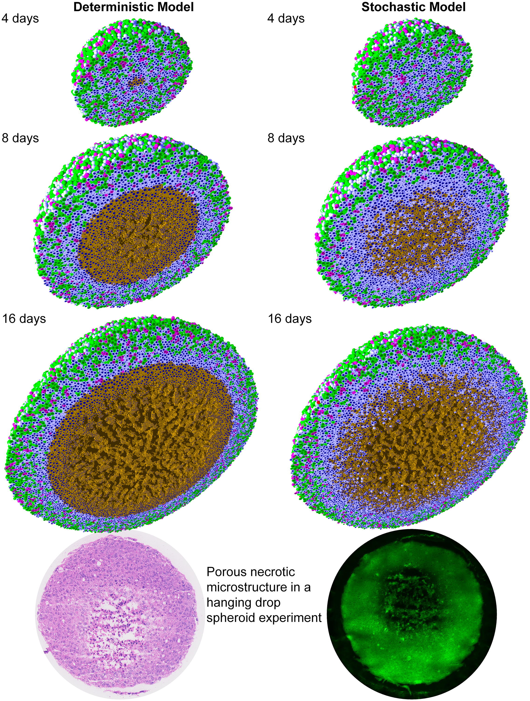
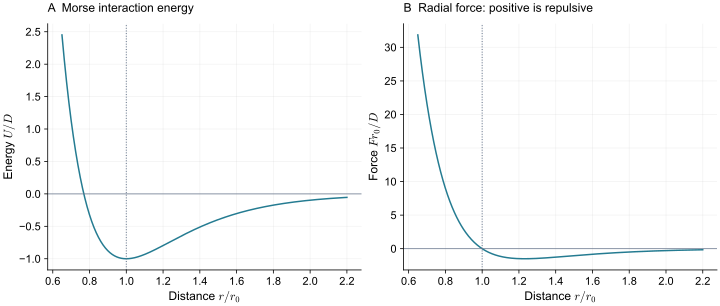
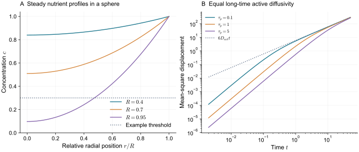
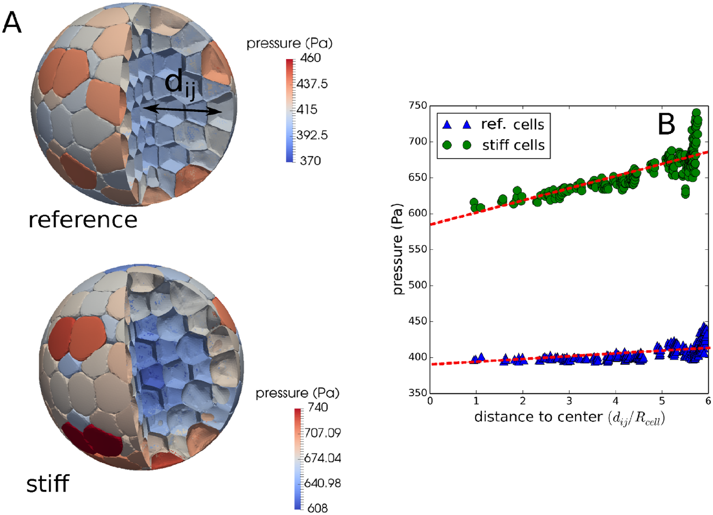

> **Part II · Note 06**　上一篇：[05 · 格点与 Cellular Potts](/notes/cell_simulation_3d/lattice_potts/) · [专题目录](/notes/cell_simulation_3d/) · 下一篇：[07 · 有限元与流固耦合](/notes/cell_simulation_3d/continuum_fluids/)

## 1. 中心模型与亚细胞元的出发点 {#main-lecture}

研究一个大细胞团时，最先需要知道的往往是每个细胞在哪里、有多大、处于什么状态。若目标是细胞数量、营养分布或大尺度迁移，每块接触面的小起伏可能暂时可以省略。中心模型将这些主要状态附着在一个位置上，再用有效接触关系描述周围细胞的挤压和吸引，使长期、多细胞计算成为可能。

这一思想与颗粒力学和离散代理模型相通。粒子的位置是机械变量，细胞周期、类型、极性和死亡状态则作为额外变量演化。它们之间通过明确规则联系：尺寸增加会改变接触，营养不足可以减慢周期，局部拥挤又可能影响运动。细胞不被假定为一颗刚性小球，而是将未显式解析的形变压缩进距离、半径和接触力的关系。

这种约化通常隐含一个时间尺度假设：内部形状能在较短时间调整，中心与细胞状态足以描述较慢的后续运动。如果外部形变太快，或者同一距离对应多种接触历史，这份有效关系就需要增加记忆和内部变量。中心模型的简洁来自这些被消去的过程，适用范围也由它们决定。

早期胚胎提供了一个直观例子。[Fickentscher、Struntz 与 Weiss（2013）](https://doi.org/10.1016/j.bpj.2013.09.005)将细胞中心运动与卵壳中的简化机械模型比较，研究给定分裂和边界条件后的位置排列。这里可以先检验排斥与几何约束是否足以组织中心，再用形状分辨模型检查接触面积和界面曲率提供的新信息。两种分辨率对应逐步增加的实验约束。

若形变本身已成为主要问题，一个中心便可以展开成一组亚细胞元。[Newman（2005）](https://doi.org/10.3934/mbe.2005.2.613)系统建立了这种框架：同一细胞的元通过胞内作用聚在一起，不同细胞的元再通过胞间作用相互影响。形状由元的相对运动产生，胞内网络、流动和主动重塑由此可以逐步加入。元是粗粒化的材料自由度，通常不对应一个特定细胞器。

中心代理、椭球、多球组合和亚细胞元因此组成了几种不同的约化方式。比较它们，需要同时看每个细胞保留哪些运动，以及这些运动实际产生了怎样的材料响应。下面将从接触力、运动与噪声出发，再把它们连接到营养、生长和跨分辨率标定。

*图 1 · 细胞位置与状态已能构成有空间层次的组织。* [Ghaffarizadeh 等（2018），Fig. 2](https://doi.org/10.1371/journal.pcbi.1005991.g002)；上方为模拟，底部为论文所列实验球状细胞团图像；[CC BY 4.0](https://creativecommons.org/licenses/by/4.0/)。

先看 4、8、16 天中内部棕色坏死区域如何形成，再比较确定性和随机性坏死规则。颜色编码周期与死亡状态，显示出外层增殖、内部静息或坏死的空间差异。底部实验图提醒我们，坏死区也有微结构，不能只比较一个核心半径。

这些结果不要求逐面解析每个细胞的皮层，却也不能据图中球形代理的相交直接推断真实膜形变。若研究目标转为细胞穿过狭窄孔隙，就需要更细的几何和接触描述。

## 2. 有效接触与多体受压 {#effective-contact}

设细胞中心为 $\mathbf r_i$，常用过阻尼动力学为

$$
\xi_i\dot{\mathbf r}_i=\sum_{j\ne i}\mathbf F_{ij}
+\mathbf F_i^{\rm mot}+\mathbf F_i^{\rm boundary}.
$$

最简单的排斥根据重叠量 $\delta=R_i+R_j-r_{ij}$ 计算。这里的“重叠”多半是未显式解析的形变代理：模型用两个几何球的相交深度，表示真实细胞接触时被压扁的程度，并不是说胞质可以自由互穿。

若使用小形变、均匀各向同性弹性球的 Hertz 接触，有

$$
F_n=\frac43E^*\sqrt{R^*}\,\delta^{3/2},\qquad
\frac1{R^*}=\frac1{R_i}+\frac1{R_j},
$$

以及

$$
\frac1{E^*}=\frac{1-\nu_i^2}{E_i}+\frac{1-\nu_j^2}{E_j}.
$$

这个公式有清楚的材料假设和长度尺度。它适用于接触区相对球半径较小的弹性变形；若细胞由张力皮层、近似液态胞内和主动重塑主导，就需要不同的力学闭合。很强的压缩还会使单个细胞同时受到多个邻居的非独立作用，简单叠加双球接触未必足够。

黏附接触可以采用相应的弹性黏附理论，也可以使用经验吸引势。两者的参数含义不同。一个经验势的势阱深度，可以用来调节聚合和分离，却不能未经标定就当作某种细胞的 Young 模量或单位面积黏附功。

取

$$
U(r)=D\left[e^{-2a(r-r_0)}-2e^{-a(r-r_0)}\right].
$$

$D$ 决定势阱深度，$a^{-1}$ 决定相互作用范围，$r_0$ 是平衡距离。令 $\hat{\mathbf r}_{ij}=(\mathbf r_i-\mathbf r_j)/r_{ij}$，则

$$
\mathbf F_{ij}=-U'(r_{ij})\hat{\mathbf r}_{ij}.
$$

$r\lt r_0$ 时向外排斥，$r>r_0$ 的一段范围内向内吸引。在 $r_0$ 附近展开，$U''(r_0)=2Da^2$，所以同样势阱深度也可以通过改变作用范围得到不同的小振幅刚度。

*图 2 · 势阱深度、作用范围与局部刚度各有含义。* 取 $D=1,a=3,r_0=1$；正力表示排斥。曲线为解析计算，没有使用实验拟合数据。

在程序中常需截断短程相互作用。若只把超过截断距离的势设为零，却不处理截断处的力，细胞经过这个位置时会遇到不连续驱动。平滑截断应同时考虑势与导数，并检查它是否改变了双细胞的分离功。

距离相同并不意味着接触状态相同。刚碰到一起的两个细胞，黏着连接可能尚未成熟；长时间接触的细胞，则可能形成更强连接或更大摩擦。可以用一个接触变量 $b_{ij}$ 表示结合程度，例如

$$
\dot b_{ij}=k_{\rm on}(1-b_{ij})-k_{\rm off}b_{ij}.
$$

再让吸引或切向阻力依赖 $b_{ij}$。如果解键率还随载荷改变，就可以表达加载速度依赖和滞后。这时，接触的生物状态与几何距离是两个独立变量。

切向摩擦也有类似作用。法向力决定细胞是否被挤压或拉开，切向阻力决定贴在一起的细胞是否容易滑动。若研究长期组织流变，仅匹配双细胞法向力—距离曲线，仍可能没有匹配组织的剪切松弛。

对于纯被动成对势，内力满足 $\mathbf F_{ij}=-\mathbf F_{ji}$。加入与固定环境耦合的主动推进后，细胞可以持续向环境输入力和耗散能量；这部分应与内部成对作用分开。低雷诺数下不保留惯性，也不意味着可以忽略这些作用力的来源。

接触的历史可以通过额外状态保存，接触之间的几何耦合则来自同一个细胞同时受到多个邻居约束。

在双细胞实验中，一条法向力—距离曲线可能足以描述变形。一个细胞被许多邻居同时挤压时，各接触不再独立：左侧压入会改变胞内压力，也会影响右侧表面的外推。即使胞内材料完全各向同性，这种耦合仍会出现。

一个简化模型可以把单细胞体积应变 $e_i=(V_i-V_{0,i})/V_{0,i}$ 作为额外变量。近似球半径随体积变为 $R_i\simeq R_{0,i}(1+e_i/3)$，则各接触的压入量共同依赖 $e_i$。取

$$
E=\sum_i\frac{K_iV_{0,i}}2e_i^2
+\sum_{\langle ij\rangle}\frac{k_{ij}}2
\left[\delta_{ij}^{0}+\frac{R_{0,i}e_i+R_{0,j}e_j}{3}\right]_+^2,
$$

其中 $\delta_{ij}^{0}=R_{0,i}+R_{0,j}-r_{ij}$，$[x]_+=\max(x,0)$。这是展示耦合的教学能量，不是一般细胞接触定律。对 $e_i$ 求平衡时，该细胞所有邻居的接触力都进入同一方程；消去 $e_i$ 后，任意一对细胞的有效作用便间接依赖其他邻居。

这个例子说明，加入可变半径或压力变量可以部分补足多体压缩，而不必立即解析完整表面。它仍无法描述细胞在某个接触面局部凹陷、在另一处突出的形状。增加哪一级变量，应由实验偏差发生在总体积、压力还是局部轮廓上决定。

自由球形中心模型通常只通过距离定义邻居，允许细胞之间留下介质空间。三维 Voronoi 模型则从中心生成一个完全填充空间的多面体剖分，并由多面体面积和体积计算能量。它增加了汇合约束，也获得了接触面，但形状仍受生成点约束。

加权 Voronoi 或 power diagram 可以让不同细胞具有不同大小；椭球中心模型可以增加长轴、朝向和取向力矩；多个相连球可以表示细长细胞。每增加一种变量，都要说明它如何受力与转动，以及它能否独立于中心位置改变。

例如，拿细胞核位置作为 Voronoi 生成点，暗含了核与细胞几何之间的关系。假复层上皮中，核可以沿顶基底方向移动，未必跟随细胞质心；这时由核生成的剖分，可能把核运动误解释成整个细胞边界的变化。

## 3. 运动、形变与胞内重塑 {#motion-and-material}

令细胞以速率 $v_0$ 沿极性 $\mathbf p(t)$ 运动，并设方向相关满足

$$
\langle\mathbf p(t)\cdot\mathbf p(0)\rangle=e^{-|t|/\tau_p}.
$$

对速度相关作两次积分，三维中的质心均方位移为

$$
\langle|\Delta\mathbf r(t)|^2\rangle
=6D_t t+2v_0^2\tau_p\left[t-\tau_p(1-e^{-t/\tau_p})\right].
$$

短时间 $t\ll\tau_p$ 时，主动部分接近 $v_0^2t^2$，像沿着固定方向前进；长时间则接近 $2v_0^2\tau_pt$，对应主动扩散系数 $D_{\rm act}=v_0^2\tau_p/3$。若三维极性做标准旋转扩散，$\tau_p=1/(2D_r)$。

因此，两组模型即使长期扩散系数相同，也可以具有不同的速度和持续时间，在短时间碰撞、拥挤和接触重排中表现不同。只拟合长时间 MSD 的斜率，会丢掉这一差别。

细胞处于组织内部后，质心的停滞还可能来自受限形变、邻居笼困或连接摩擦。自由细胞的 $v_0$ 不是组织中实测速度的直接同义词，应该连同相互作用一起解释。

### 3.1 从中心到可变形材料 {#subcellular}

整体运动可以在中心层次描述，细胞形状若要独立变化，则需要进一步放开内部自由度。亚细胞元提供了一条连续增加这些变量的路线。

将一个细胞分成多个元，记第 $i$ 个细胞第 $\alpha$ 个元的位置为 $\mathbf x_{i\alpha}$。一种基本能量为

$$
E=\sum_i\sum_{\alpha\lt\beta}U_{\rm intra}
(|\mathbf x_{i\alpha}-\mathbf x_{i\beta}|)
+\sum_{i\lt j}\sum_{\alpha,\beta}U_{\rm inter}
(|\mathbf x_{i\alpha}-\mathbf x_{j\beta}|).
$$

胞内作用让同一细胞的元保持一团，胞间作用产生排斥和黏附。细胞可以通过元的相对移动变形，不再具有固定的球形轮廓。[Newman（2005）](https://doi.org/10.3934/mbe.2005.2.613)系统提出了这一框架，并讨论它与更粗粒度细胞描述和连续方程的联系。

“元”是计算自由度，不必对应一个真实细胞器。若所有元都相同，它们代表某种粗粒化胞内材料；若要区分核、皮层与胞质，就需要不同类型、连接方式和相互作用。使用更多元可以解析更复杂的形状，但有效材料不会只由元数决定。

例如，固定的胞内弹簧网络可以承受长期剪切；能够交换邻居的流动元集合则可能更容易松弛。两者即使具有相近的平衡外形，压缩和剪切实验也会不同。需要像标定真实材料那样，对模型细胞施加拉伸、压缩与松弛，测出它实际产生的模量和时间尺度。

如果每对元都保持同样的作用，增加元数会增加作用对数，总能量和刚度通常随之改变。对固定物理作用核的一种连续极限，可以把能量写成带体积权重的积分近似 $\sum_{\alpha\beta}w_\alpha w_\beta U(r_{\alpha\beta})$；对弹簧网络，则应按网络几何标定。这两种细化方式没有同一个通用系数。

噪声也如此。设每个元独立扩散，单元扩散系数为 $D_e$，一个细胞有 $m$ 个等权元，质心扩散系数是 $D_e/m$。若本来希望相同细胞在细化后仍有相同整体噪声，就不能一直保持同一个 $D_e$。

从热噪声类比出发，若固定细胞总阻力 $\xi_c$，每个元的阻力应随 $1/m$ 缩放，单元热扩散随 $m$ 增加，二者才可能给出固定质心扩散。对真实细胞的主动波动，还需决定驱动是在整个细胞上相关，还是各元独立。后者会在平均时互相抵消，前者不会。

可以用密度等值面、alpha shape、外壳网格等方法定义轮廓。简单凸包会填平凹陷，不适合直接测量被邻居压出的复杂接触面。提取算法的平滑长度与阈值，因而也是观测模型的一部分。

亚细胞元在动力学中不显式保存膜，并不妨碍研究整体形状；但如果输出声称是精确接触曲率，就要报告重建方法和误差。与相场、表面网格或成像比较时，应尽可能使用共同的测量流程。

把许多元聚成一个细胞，只确保它有一个稳定外形，还没有确定它的材料。若所有胞内连接永久固定，细胞被剪切后会记住初始连接；若连接随距离重新建立，长期应力可以通过元的重排释放。对受限迁移，两种细胞即使开始时同样圆，进入孔道后的形变与恢复也可能不同。

相应的标定应包含体积压缩、等体积剪切和卸载恢复。压缩检验体积响应，剪切检验形状响应，恢复检验连接是否留下永久变化。只使用球形平衡半径，无法确定这三种性质。若增加元数后单细胞变硬，应先检查作用权重、连接密度和总阻力，再将变化解释为分辨率提高。

主动噪声还需要空间相关。一般地，质心位移是各元位移的平均，因此其方差包含所有元对的交叉相关。独立驱动在平均中被削弱，同向相关的驱动则保留下来。细胞整体迁移与局部皮层起伏可以具有相同的单元噪声幅度，却因为相关范围不同而产生不同质心运动。对模型的约束应同时来自细胞轨迹和形变波动。

[Sandersius 与 Newman（2008）](https://doi.org/10.1088/1478-3975/5/1/015002)通过虚拟体流变与微流变检验亚细胞元模型，讨论其在中等应变与中间时间尺度的黏弹响应。一个重要区别是，被动元相互作用能够产生某些松弛，却不能因此保证长期、大形变下仍有正确的细胞行为。

[Sandersius、Weijer 与 Newman（2011）](https://doi.org/10.1088/1478-3975/8/4/045007)进一步加入主动的亚细胞过程，研究形状适应、组织流动与迁移模式。连接的更新使“原来那一组粒子怎样排布”不再永久决定以后所有的机械响应。这为前面的材料讨论补充了明确路线：先测被动模型实际产生的流变，再根据目标时间尺度加入有物理含义的重塑，而不是把每次数值重排都视为生物活动。

### 3.2 连续密度与组织压力 {#从亚细胞元走向连续密度}

亚细胞元与相场之间也可以建立联系。设 $\rho_i(\mathbf x,t)$ 是细胞 $i$ 的粗粒化元密度。若元受到短程势与独立扩散，在忽略相关性的平均场近似下，可以写

$$
\partial_t\rho_i=D_e\nabla^2\rho_i+
\frac1{\xi_e}\nabla\cdot\left[\rho_i\nabla\Psi_i\right],
$$

$$
\Psi_i=U_{\rm intra}*\rho_i+\sum_{j\ne i}U_{\rm inter}*\rho_j.
$$

星号表示空间卷积。第一项使元分散，第二项使它们沿相互作用势移动。若没有增长、删除或边界通量，对整个空间积分后，$\int\rho_i$ 保持不变，对应元数守恒。

这个连续方程仍不是前面双阱型相场的直接同义词。密度守恒、非局域相互作用和局部形状松弛采用不同动力学；还需要额外近似，才能将它们约化到某种共同形式。高密度、强关联或胞内网络存在时，平均场分解也可能不够。

这一联系的用处是看见粗粒化的来由：元的作用范围、密度与噪声怎样进入连续系数，而不是只凭两幅图都像细胞就认为方法等价。[Newman（2005）](https://doi.org/10.3934/mbe.2005.2.613)的讨论可以作为这条推导路线的起点。

对只含被动成对中心力的体系，一种体积平均的相互作用压力为

$$
p_{\rm int}=\frac1{3\mathcal V}\sum_{i\lt j}
(\mathbf r_i-\mathbf r_j)\cdot\mathbf F_{ij},
$$

这里按正文定义排斥力沿 $\mathbf r_i-\mathbf r_j$ 为正，$\mathcal V$ 是平均区域体积，边界穿越需要一致处理。这是将成对受力粗粒化为压缩量的一种方式；主动驱动、外部牵引和流体应力还需增加相应贡献。

它与单细胞内部压力并不是同一个观测。中心模型中的平均组织压力可以来自许多接触，而单细胞压力还与皮层曲率和体积响应有关。把两者直接代入同一个增长抑制公式，需要先用相同实验或更细模型校准。

## 4. 营养、生长与跨分辨率标定 {#growth-and-calibration}

机械与运动的变量确定以后，还可以让细胞状态对局部环境作出响应。营养输运是这类反馈中最常见、也较容易建立空间尺度的例子。

中心模型便于追踪大量细胞状态，并与背景浓度场耦合。以营养为例，

$$
\partial_t c=D_c\nabla^2c-\rho q(c)+S.
$$

细胞局部摄取降低浓度，浓度再改变周期、死亡或迁移。若扩散远快于细胞增长，可在每个慢时间步求近似稳态；若细胞运动与扩散时间相近，则需保留浓度的瞬态。

一个球形团块的算例能说明空间尺度。设半径为 $R$，内部单位体积恒定摄取率为 $q_v$，表面浓度为 $c_b$，稳态方程为 $D_c\nabla^2c=q_v$。要求中心光滑，解为

$$
c(r)=c_b-\frac{q_v}{6D_c}(R^2-r^2).
$$

中心浓度随 $R^2$ 下降。当 $c(0)$ 降到周期停止阈值 $c_* $ 时，特征半径为

$$
R_* =\sqrt{\frac{6D_c(c_b-c_*)}{q_v}}.
$$

这里是恒定摄取的教学近似。如果它继续预测负浓度，就已超出适用范围，应使用浓度依赖摄取或加入静息、坏死等状态。这个算例的意义在于把团块尺寸与扩散、摄取联系起来，说明大团块不能只用培养液的外部浓度代表每个细胞的环境。

*图 3 · 空间输运与运动持续性提供不同尺度。* 左图按正文球形扩散解计算，取 $D_c=c_b=1,q_v=6$；右图计算相同主动长期扩散系数、不同持续时间的 MSD，平移噪声取零。两者均为解析算例。

[PhysiCell（Ghaffarizadeh 等，2018）](https://doi.org/10.1371/journal.pcbi.1005991)将三维中心代理与多底物微环境、周期和死亡等表型连接起来，是这条路线的代表实现。它适合研究细胞群与环境的双向影响；要输出亚细胞级形变，则需增加相应表示。

并不是所有组织过程都必须由同一分辨率从头算到尾。可以先用可变形细胞模型标定单细胞压缩与接触，再把有效关系放进中心模型；反过来，也可以用中心模型找到候选机制，再用更细的形状表示检查关键条件。

[Van Liedekerke 等（2019）](https://doi.org/10.1371/journal.pcbi.1006273)研究受压生长的肿瘤球时，将高分辨率细胞力学用于校准粗粒度细胞描述，并将体积形变与周期进程联系起来。研究比较了弹性包囊和渗透压等条件，检验标定关系能否预测其他增长条件。由一组条件得到的标定关系，随后用于预测不同机械加载下的增长。

*图 4 · 高分辨率形变可以检验中心力近似。* [Van Liedekerke 等（2019），Fig. 9](https://doi.org/10.1371/journal.pcbi.1006273.g009)，可变形细胞模拟；[CC BY 4.0](https://creativecommons.org/licenses/by/4.0/)。

A 中切开表面后，可以看到内部细胞的扁平接触与多面体形状；上下两组使用不同的皮层刚度，且各有自己的压力色标，不能把相同颜色直接读成相同压力。B 再将压力与径向位置联系起来。中心模型若要代替这种多体受压状态，需要检验它是否还能保持合适的体积、压力梯度与接触响应，而不仅是外部半径相近。

这种跨分辨率方法也有边界。若组织重排改变了接触形状，而有效中心势只由双细胞实验得到，它未必能正确处理强多体挤压。若模型的成功依赖每换一个细胞数就重调一遍参数，粗粒化关系仍不完整。

受压球状团中，“细胞变小”和“细胞停止生长”不是同一变量。前者可以是即时、可逆的体积压缩；后者是周期或物质积累的改变。若把两者都写成半径减小，卸载后便无法判断细胞应立即回弹，还是需要重新积累体积。

可以用真实体积 $V_i$ 表示受力状态，用目标体积 $V_{0,i}$ 表示生长偏好，再用周期相位 $\varphi_i$ 记录分裂进程。例如取

$$
\dot\varphi_i=g(c_i)\,F(V_i/V_{0,i}),
$$

其中营养响应 $g$ 与压缩抑制函数 $F$ 都需要实验约束。该式只是清楚区分两条调控的一种写法：缺氧可能降低 $g$，机械压缩可能降低 $F$，两者都减慢分裂，却对营养恢复、卸载和细胞体积给出不同响应。

[Van Liedekerke 等（2019）](https://doi.org/10.1371/journal.pcbi.1006273)利用高分辨率细胞模型标定中心模型接触，将体积应变与周期推进相连，并比较包囊与渗透压加载。跨条件检验之所以有意义，是因为两种外部加载产生的接触分布不同；若同一套内部响应仍能解释增长，才说明它超出了对单条曲线的经验拟合。

营养场与力学场也有各自时间尺度。扩散快时可以近似求稳态浓度，力学快时可以在增长之间充分松弛；但这两种快过程不必同时成立。快速推进的细胞还可能先改变局部密度，再改变摄取与周期，反馈的延迟应保留在需要解释的观测中。

短程作用可以用空间分箱或邻居表避免遍历全部细胞对。分箱尺寸、邻居表缓冲和更新频率应覆盖作用范围与单步运动距离。对亚细胞元，还要区分胞内邻居和胞间邻居，避免一个细胞在分裂后仍保留错误连接。

生长可以增加目标体积、扩大半径或添加新元；三者可能产生不同瞬态应力。若突然插入新粒子，局部排斥可以造成数值冲击；若将半径瞬间加大，也会瞬间增加多对接触力。增长应按所选物理时间推进，并记录与分裂事件相关的体积和受力变化。

## 5. 粗粒化关系的有效范围 {#model-limits}

中心模型适合细胞位置、人口组成和微环境反馈占主导的问题。它能够把较多计算用于长时间、多细胞和多种实验条件；亚细胞元则在保留身份的同时增加形状与材料变量。两者之间的区别，应由目标观测是否依赖被省略的自由度来判断。

成对接触关系最容易在稀疏、小形变条件下解释。组织受压后，同一细胞的多个接触共享体积、表面和内部压力，力可能具有显著的多体依赖。将双细胞力律逐对相加，未必还能同时给出正确体积、接触面积与组织压力。可以通过可变体积、压力或形状变量改善闭合，但新增关系也需要在共同加载实验上检验。

方向和历史会进一步限制中心距离的描述。两个细胞在同一距离上，可以分别处于刚接触、成熟黏着或正在滑动的状态；一个细长细胞相对邻居转动，也可能改变接触而不改变中心距离。椭球与极性增加了一部分方向信息，连接状态增加了一部分记忆，细长突出和核通过孔道则常需要更局部的几何。用统一吸引力补偿所有这些现象，会使参数随条件变化而失去清楚含义。

亚细胞元将更多运动显式化，同时引入元数、作用核、连接更新与表面重建等选择。增加元数以后，材料与整体噪声若没有一致缩放，模型细胞会变成另一种物体。流动元和永久弹簧网络即使外形接近，也会有不同长期响应。因此，形状分辨率的提高应伴随压缩、剪切和恢复的重新检查，不能只以三维渲染变得细致作为依据。

人口与生长规则也有独立的生物范围。缺氧、体积压缩和周期调控可以共同减慢细胞增长，但它们对卸载、补充营养和细胞体积给出的预测不同。将组织平均压力直接用于单细胞周期抑制，隐含了一个跨尺度响应关系；该关系在新的细胞系或培养条件下应继续接受检验。模型中的每个代理具有状态，并不意味着这些状态已经由机械方程决定。

跨分辨率方法的价值正在这里：用更细的模型和独立实验确定有效关系，再检查它能否预测未用于标定的多细胞条件。若主要偏差出现在胞内应变、核附近受压或排液过程，进一步增加中心势的复杂度可能已经不合适。下一篇将保留材料和流体场，直接讨论这些内部过程及其空间、时间尺度。

## 6. 参考文献 {#references}

1. Fickentscher, Struntz and Weiss (2013). [Mechanical Cues in the Early Embryogenesis of Caenorhabditis elegans](https://doi.org/10.1016/j.bpj.2013.09.005). *Biophysical Journal*, 105(8), 1805-1811.

2. Newman (2005). [Modeling Multicellular Systems Using Subcellular Elements](https://doi.org/10.3934/mbe.2005.2.613). *Mathematical Biosciences and Engineering*, 2(3), 613-624.

3. Ghaffarizadeh et al. (2018). [PhysiCell: An open source physics-based cell simulator for 3-D multicellular systems](https://doi.org/10.1371/journal.pcbi.1005991). *PLOS Computational Biology*, 14(2), e1005991.

4. Sandersius and Newman (2008). [Modeling cell rheology with the Subcellular Element Model](https://doi.org/10.1088/1478-3975/5/1/015002). *Physical Biology*, 5(1), 015002.

5. Sandersius, Weijer and Newman (2011). [Emergent cell and tissue dynamics from subcellular modeling of active biomechanical processes](https://doi.org/10.1088/1478-3975/8/4/045007). *Physical Biology*, 8(4), 045007.

6. Van Liedekerke et al. (2019). [Quantitative cell-based model predicts mechanical stress response of growing tumor spheroids over various growth conditions and cell lines](https://doi.org/10.1371/journal.pcbi.1006273). *PLOS Computational Biology*, 15(3), e1006273.

---

[← 05 · 格点与 Cellular Potts](/notes/cell_simulation_3d/lattice_potts/) · [专题目录](/notes/cell_simulation_3d/) · [下一篇：07 · 有限元与流固耦合 →](/notes/cell_simulation_3d/continuum_fluids/)
