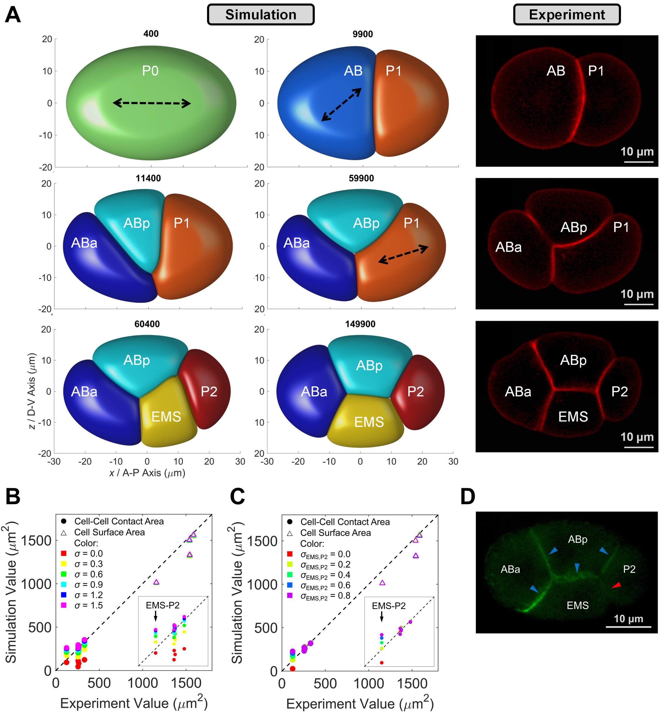
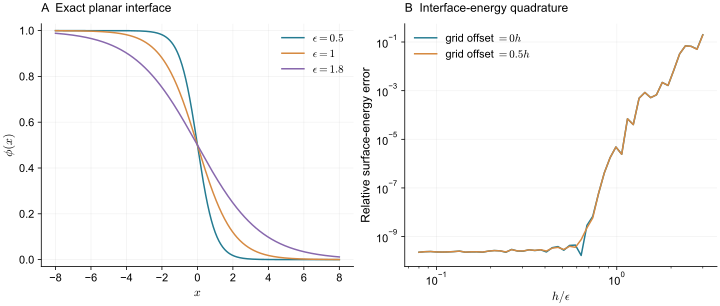
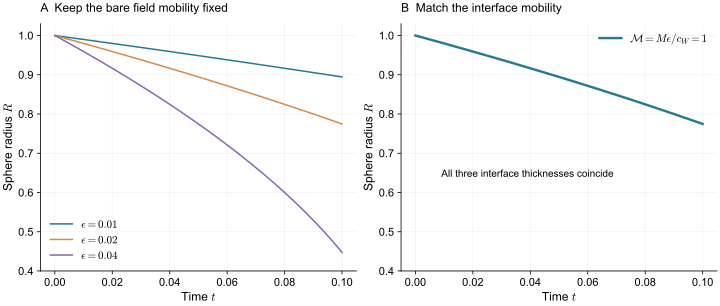
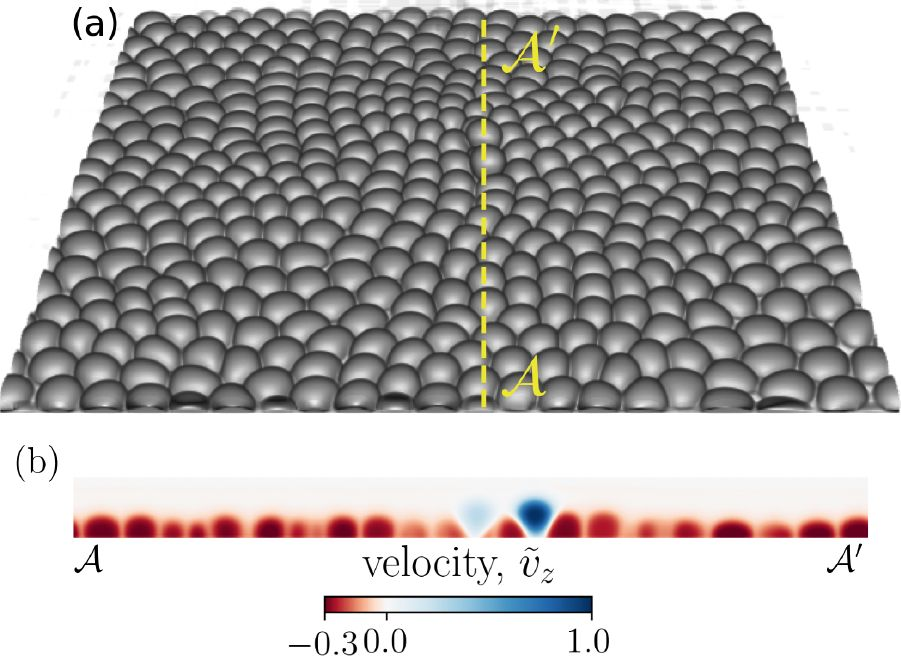
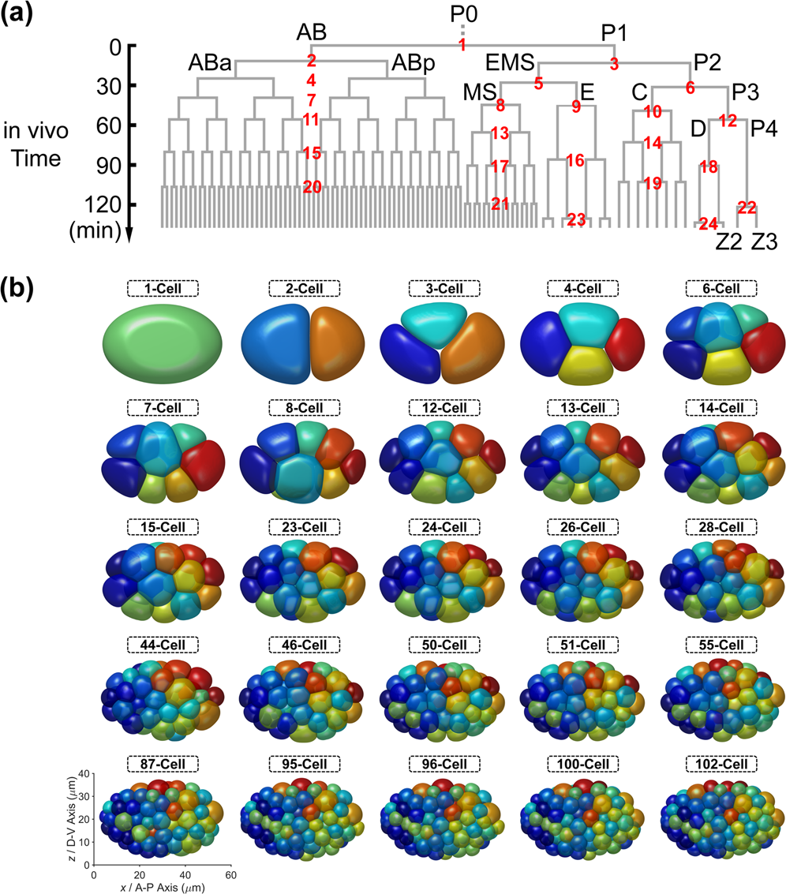

> **Part II · Note 02**　上一篇：[01 · 几何、能量与模型选择](/notes/cell_simulation_3d/foundations/) · [专题目录](/notes/cell_simulation_3d/) · 下一篇：[03 · 表面网格：皮层、接触与重网格](/notes/cell_simulation_3d/surface_mesh/)

## 1. 相场思想的来源与细胞身份 {#main-lecture}

追踪一个变形细胞时，最直接的做法是沿边界放置节点，再计算这些节点怎样移动。细胞一旦拉出细长突起、形成很窄的接触或发生分裂，原来的连接就需要反复修改。相场把问题改写为空间中一个平滑函数的演化：胞内接近 1，胞外接近 0，边界由中间值所处的位置读出。界面的几何变化于是转化成固定空间网格上的数值变化。

这一思想来自非均匀介质和相界面理论。[Cahn 与 Hilliard（1958）](https://doi.org/10.1063/1.1744102)用局部自由能和梯度代价描述平滑过渡的界面，界面的厚度和能量由两者共同决定。它为后来弥散界面的构造提供了重要基础。[Allen 与 Cahn（1979）](https://doi.org/10.1016/0001-6160(79)90196-2)研究有序畴边界的运动，将局部状态的松弛与界面迁移联系起来。将这些工具用于细胞时，需要重新说明场代表什么，以及哪些量应该守恒。

在逐细胞的多相场模型中，每个细胞有自己的身份场 $\phi_i(\mathbf x,t)$。两个细胞即使具有相同的材料和命运，也使用不同编号；否则它们一旦贴合，就无法再从场中区分身份。若只使用一个场描述整团组织与外界，模型仍可研究整体轮廓，但内部细胞的接触、分裂谱系和分选便需要另外表示。这是研究问题决定变量数目的一个直接例子。

细胞身份场通常不等同于可自由扩散的化学组分。一个位置由胞外变为胞内，可以表示边界向外移动；它不必意味着真实物质在该处凭空产生。模型还需要通过体积约束、整体运动或显式流体保证合适的物理过程。因此，采用相同的界面能，并不能确定应使用守恒扩散、局部形状松弛还是流体携带的运动；这些动力学具有不同的耗散含义。

[Nonomura（2012）](https://doi.org/10.1371/journal.pone.0033501)将逐细胞场与体积保持、排斥和黏附结合，展示了这种表示如何组成多细胞体系。随后胚胎、迁移与三维细胞层研究不断增加主动驱动、分裂和复杂边界。相关发展见 [Monfared、Ardaševa 与 Doostmohammadi（2026）](https://doi.org/10.1146/annurev-conmatphys-060625-061354)的综述。其共同出发点是让同一场连续表示细胞的大形变，同时以明确的作用项保存细胞间的区别。

显示时常取 $\phi_i=1/2$ 的等值面。周围有限厚度的过渡层是模型与数值计算的一部分，通常远厚于真实细胞膜。理解相场结果，需要同时理解这层过渡怎样产生张力、怎样形成接触，以及它的厚度是否已经小于研究中重要的几何尺度。

*图 1 · 从场恢复细胞轮廓，再与实验比较。* [Kuang 等（2022），Fig. 2](https://doi.org/10.1371/journal.pcbi.1009755.g002)；A 左两列为模拟，右列为活体膜成像，D 为黏附相关蛋白成像；[CC BY 4.0](https://creativecommons.org/licenses/by/4.0/)。

读 A 时先追踪同一细胞身份：卵裂改变了细胞数，卵壳约束下的接触又使各细胞偏离球形。虚线箭头表示给定的分裂方向，不能算作力学自行预测的结果。B、C 把轮廓比较落到接触面积；D 提供分子分布的独立线索，但荧光强度还需要模型与标定，才能联系到有效黏附参数。

界面能控制细胞边界的剖面和形变代价，体积项维持细胞大小，胞间相互作用组织接触；三者需要共同解释图中的轮廓与排列。

## 2. 从界面能到压力与形变 {#interface-dynamics}

如果只希望胞内为 1、胞外为 0，可以给中间值一个能量代价。取

$$
W(\phi)=\frac12\phi^2(1-\phi)^2.
$$

它在 0 和 1 处为零，在中间为正。但只有这一项时，场可以从 1 突然跳到 0，界面厚度会塌缩到网格尺度。为了限制过于陡峭的变化，再加入梯度代价：

$$
E_{\rm int}=\frac{\gamma}{c_W}\int_\Omega
\left[\frac\epsilon2|\nabla\phi|^2+\frac{W(\phi)}\epsilon\right]d^3x,
\qquad c_W=\int_0^1\sqrt{2W(s)}\,ds=\frac16.
$$

把相同的场变化压进更薄的一层，梯度项会增加；把它摊得更宽，中间值占据的体积增加，双阱项会增加。二者竞争后，过渡层的厚度与 $\epsilon$ 同阶。前面的归一化 $c_W$ 用来让这层界面的单位面积能量正好为 $\gamma$。

这一点可以直接验证。对只沿 $x$ 变化的平界面，能量极小条件为

$$
\epsilon^2\phi''=W'(\phi).
$$

乘以 $\phi'$ 并积分，利用远处 $\phi'=0$ 和 $W=0$，得到

$$
\frac{\epsilon^2}{2}(\phi')^2=W(\phi).
$$

对从 1 下降到 0 的界面，取负号后积分，可得

$$
\phi(x)=\frac1{1+e^{x/\epsilon}}.
$$

将它放回能量，两项在每个位置相等，沿法向积分正好给出 $c_W$，因此 $E_{\rm int}/A=\gamma$。归一化若漏掉，改变双阱函数后，写在参数表里的同一个 $\gamma$ 就不再代表同样的表面张力。

*图 2 · 先把一张平界面算对。* 左图改变 $\epsilon$，右图在约 $[-12\epsilon,12\epsilon]$ 的窗口对能量密度作梯形积分，并改变采样间距与格点偏移。细网格处的误差还包含有限积分窗口的截断误差。

由上面的计算，可把

$$
A_\epsilon[\phi]=\frac1{c_W}\int
\left[\frac\epsilon2|\nabla\phi|^2+\frac{W(\phi)}\epsilon\right]d^3x
$$

视作一张薄界面的面积近似。只有在界面足够薄、剖面接近局部平衡时，它才接近尖锐界面的真实面积。分裂刚完成、界面被快速拉伸或两个场严重重叠时，这个积分还包含剖面偏离平衡的能量，不能全部解释成几何面积增加。

这也是为什么同一篇模拟中最好区分“场能量估计的面积”和“等值面提取后的面积”。两者在平衡、充分分辨的极限下应趋于一致，差异本身则能提示界面是否处于强烈非平衡。

界面能确定剖面与张力，细胞大小还需要独立约束。将一个细胞的总体积写成场积分，可以让同一体积偏差作用于它的整张边界。

定义平滑占据函数 $h(\phi)=\phi^2(3-2\phi)$，以及

$$
V_i=\int_\Omega h(\phi_i)d^3x,
\qquad
E_V=\sum_i\frac{K_{V,i}}{2V_{0,i}}(V_i-V_{0,i})^2.
$$

选择这个 $h$ 的一个好处是 $h'(0)=h'(1)=0$，体积驱动力主要作用在界面，不会在理想胞内、胞外直接推动均匀相的数值偏离 0 或 1。也有模型取 $V_i=\int\phi_i$ 或其他插值；这些约定会改变有限厚度下的体积测量与变分力。

令 $p_i=K_{V,i}(1-V_i/V_{0,i})$，体积项的变分贡献就是 $-p_i h'(\phi_i)$。场的完整变分导数，常称化学势，记为

$$
\mu_i=\frac{\delta E}{\delta\phi_i}
=\frac{\gamma_i}{c_W}\left[-\epsilon\nabla^2\phi_i+
\frac{W'(\phi_i)}\epsilon\right]-p_ih'(\phi_i)+\mu_i^{\rm contact}.
$$

这里的“化学势”是场论中的共轭量，不一定对应某一种真实化学分子的浓度或化学势。它告诉我们，在某个位置增加一点细胞占据值，会让总能量怎样改变。

若 $V_i$ 偏小，$p_i$ 为正，体积项会倾向于向外推进界面；表面项则倾向于缩小高曲率区域。两者竞争后得到与尖锐界面中压力和曲率相同的平衡关系。

将化学势写出来，只完成了模型的一半。对无平流、参数固定的 Allen–Cahn 松弛，$\partial_t\phi_i=-M_i\mu_i$，总能量满足

$$
\frac{dE}{dt}=\sum_i\int\mu_i\partial_t\phi_i\,d^3x
=-\sum_i\int M_i\mu_i^2\,d^3x\leq0.
$$

只要迁移率非负，局部场总是沿能量下降的方向调整。这里的“非守恒”指场可以在某处从 0 变为 1，并不意味着细胞必须随意失去体积：总体积可以通过前面的罚项或全局乘子控制。这种分工适合把场当作细胞身份，而不把每个场值理解为实际物质密度。

加入整体平流后，还能检查平移与形变的功率是否一致。由后文的整体力 $\mathbf F_i=\int\mu_i\nabla\phi_i\,d^3x$，有

$$
\frac{dE}{dt}=-\sum_i\mathbf v_i\cdot\mathbf F_i
-\sum_i\int M_i\mu_i^2\,d^3x.
$$

若 $\xi_i\mathbf v_i=\mathbf F_i+\mathbf F_i^{\rm act}$，则第一项可以改写为 $-\sum_i\xi_i|\mathbf v_i|^2+\sum_i\mathbf v_i\cdot\mathbf F_i^{\rm act}$。被动整体移动与局部形变都耗散能量，主动项提供功率。这一关系让两种运动各有明确含义：整体平流搬运细胞，局部松弛改变轮廓；各自的速率仍需由实验约束。

如果已经给整个细胞施加主动平移，同时又给界面加入另一项朝前运动的驱动，就应分别计算它们的贡献。否则一次观察到的细胞运动，可能在模型中被两条机制重复实现。

### 2.1 薄界面极限与体积约束 {#sharp-interface}

最常见的局部松弛采用 Allen–Cahn 型动力学：

$$
\partial_t\phi_i+\mathbf v_i\cdot\nabla\phi_i=-M_i\mu_i.
$$

先忽略平流与接触。取胞内到胞外的有符号距离 $d$，胞外为正，并写局部剖面 $\phi=q(d/\epsilon)$。界面法向速度为 $v_n$ 时，左边的主导项为 $-v_nq'/\epsilon$。曲面的 Laplace 算子在这一层中给出

$$
\nabla^2\phi\simeq\frac{q''}{\epsilon^2}+\frac{2Hq'}\epsilon.
$$

平界面的 $q''$ 与双阱项抵消，留下曲率项与压力项。把整个方程乘以 $q'$、沿无量纲法向积分，使用 $\int(q')^2ds=c_W$ 与 $\int h'(q)q'ds=-1$，得到

$$
v_n\simeq\frac{M\epsilon}{c_W}(p-2\gamma H).
$$

这个结果有两个用途。首先，静止时确实恢复 $p=2\gamma H$。其次，有效界面迁移率是 $M\epsilon/c_W$，而不是孤立的 $M$。如果在这套方程下减半 $\epsilon$，同时保留相同的 $M$，即使表面张力完全一致，界面也会变慢。不同论文常把 $1/\epsilon$ 吸收进动力学系数，比较速度时必须查看完整方程。

*图 3 · 薄界面极限还需要匹配动力学。* 对无压力的球，$v_n=\dot R=-2\gamma\mathcal M/R$，故 $R^2=R(0)^2-4\gamma\mathcal M t$，其中 $\mathcal M=M\epsilon/c_W$。图中只画到半径仍远大于界面厚度的阶段，没有进行三维场方程求解。

有限 $K_V$ 用体积误差换取恢复压力，因而总有一个有限偏差。如果必须严格固定 $V=\int h(\phi)$，可以让压力成为随时间求出的全局乘子。将不含乘子的变分导数记为 $\mu_0$，取

$$
\partial_t\phi=-M[\mu_0-\lambda(t)h'(\phi)],
\qquad
\lambda=\frac{\int M h'(\phi)\mu_0\,d^3x}
{\int M[h'(\phi)]^2\,d^3x}.
$$

这样 $dV/dt=0$。直观上，先计算能量希望界面怎样运动，再扣去其中改变总体积的分量。这里只写了无平流、固定目标体积的情形；生长或可压缩平流需要在体积平衡里加入对应源项。

另一条路线是 Cahn–Hilliard 动力学 $\partial_t\phi=\nabla\cdot(M\nabla\mu)$。无通量边界下，它守恒 $\int\phi$，并通过空间中的扩散通量迁移物质。它不自动守恒 $\int h(\phi)$，也不与带体积乘子的 Allen–Cahn 具有相同的局部界面速度。选择哪一个，取决于场究竟代表局部物质量，还是用来追踪细胞形状的身份变量。

## 3. 多细胞接触、主动迁移与二维约化 {#multicell-dynamics}

给每个细胞一个独立场后，两个场可以占据同一个位置。最简单的排斥能是

$$
E_{\rm rep}=g\sum_{i\lt j}\int\phi_i^2\phi_j^2d^3x,
\qquad g>0.
$$

它的变分贡献为 $2g\phi_i\sum_{j\ne i}\phi_j^2$。这会惩罚胞内重叠，但不一定使细胞之间形成足够大的稳定接触。为了建立黏附，还需加入适当的界面吸引。

吸引可以局限在两个弥散界面相邻的区域，也可以由梯度耦合或有限范围的非局域核给出。不同写法表达的物理并不完全相同。一个负的体相重叠项虽然能拉近细胞，也可能让两个细胞场互相混合；一个过窄的界面吸引项则可能对网格偏移十分敏感。

比较相互作用最可靠的起点仍是双细胞。固定体积与自由表面张力，扫描吸引系数，测量接触角、接触面积、重叠量和分离所需的功。然后改变 $\epsilon$，检查这些可观测量是否保持。如果接触能集中在厚度为 $\epsilon$ 的区域，体积分系数往往需要随厚度重标定；不能仅因为参数的名字叫 adhesion，就把它等同于尖锐界面中的 $W$。

有些模型进一步要求 $\sum_i\phi_i=1$，相当于用多个场在每个位置分配空间。这适合完全填充的多相介质。若组织存在胞外液体、孔洞或自由边界，则应显式表示介质相，或允许细胞占据之和偏离 1。局部填充条件与每个细胞的总体积约束解决的是两件事。

排斥项负责避免胞内重叠，黏附项则需要在两细胞接近时产生有限的分离功。以两张局部平行界面为例，设法向距离为 $d$，吸引能写成

$$
E_{\rm adh}=-a_\epsilon\int g(\phi_1,\phi_2)\,d^3x.
$$

令法向坐标 $z=\epsilon s$，两个界面的局部剖面都用 $q$ 表示，则单位面积相互作用能具有形式

$$
\frac{E_{\rm adh}}A=-a_\epsilon\epsilon\,
I(d/\epsilon),
\qquad
I(\delta)=\int g\big(q(s),q(\delta-s)\big)\,ds.
$$

这不是某一软件的专用能量，而是说明厚度缩放的一个局部算例。若想在细化界面时保持同一单位面积黏附功，$a_\epsilon$ 通常需要抵消前面的 $\epsilon$；若还包含梯度，缩放又会不同。直接保持裸系数不变，接触就可能随着界面变薄而变弱。

更重要的是，$I(d/\epsilon)$ 同时决定相互作用的距离范围。匹配分离功，并不保证匹配峰值牵引和接触形成速度。两种很窄、很深与较宽、较浅的吸引，可以具有相同积分，却在快速碰撞、拉开或薄间隙中表现不同。因此双细胞标定应同时包含接触角、力—间距曲线和形状松弛；多细胞中再检验由局部相互作用产生的邻接。

在 Kuang 等的胚胎案例中，特定接触面积对统一作用参数的系统偏离，才使类型依赖的胞间作用成为可检验的解释。这个推理比“调高黏附让画面更接近”严格：参数改变必须同时改善相关接触，并保持其他细胞的体积和外形合理。

### 3.1 主动运动与面外自由度 {#activity}

被动梯度流最终停在能量的局部极小处。持续迁移需要能量输入。最简单的做法是给每个细胞一个极性方向 $\mathbf p_i$，令 $\mathbf v_i=v_0\mathbf p_i$，通过平流带动整个场。极性可以作持续随机转动，也可以受邻居、速度或形状影响。

这种写法主要表示细胞整体平移。如果要描述一侧生长突出、另一侧回缩，则需让驱动在界面上具有空间结构，例如将肌动蛋白或极性场与法向界面运动耦合。要比较两种机制，观察量也应随之改变：只有质心轨迹时，它们可能难以区分；加入前后曲率、接触寿命和形变滞后，差异才会显现。

[Wenzel 与 Voigt（2021）](https://doi.org/10.1103/PhysRevE.104.054410)比较了几种不同层次的多相场迁移驱动，包括方向、细胞形变与亚细胞机制。它说明即便采用相同的被动形状能，主动项的选择仍会改变集体行为。该类二维比较提供方法上的参照，三维时还要增加高度、基底接触与面外运动。

三维相场可以让细胞从单层中向外突出。[Monfared 等（2023）](https://doi.org/10.7554/eLife.82435)用三维细胞层研究机械性细胞挤出，将细胞—细胞、细胞—基底作用与局部应力、排列联系起来。在这里，面外自由度是问题的一部分；把同样的二维细胞图投影在一张固定平面上，就无法产生真正的离层过程。

*图 4 · 挤出需要面外自由度。* [Monfared 等（2023），Fig. 1](https://elifesciences.org/articles/82435/figures#fig1)，三维相场模拟原图；[CC BY 4.0](https://creativecommons.org/licenses/by/4.0/)。

a 中隆起的细胞仍与周围细胞相互作用；b 沿黄色虚线切开细胞层，颜色表示归一化的面外速度。它不是刚度图，也不是高度图。把表面隆起和速度截面放在一起，才能区分静态高低起伏与正在发生的离层。若实验只有平面内面积，模型中的面外运动也需要额外的三维成像来检验。

面外形变显著时需要保留三维变量；厚度变化足够快或足够小时，则可以尝试将它们消去。约化的结果应当同时给出二维能量与动力学系数。

平面培养的细胞看起来接近二维，但它们仍有高度、顶端和基底。二维模型能否从三维约化得到，取决于这些厚度方向变量是否迅速松弛，或可以近似固定。[Chiang 等（2024）关于三维到二维的多相场推导](https://doi.org/10.1103/PhysRevE.110.044403)专门讨论了有基底细胞的这一联系。

一个固定高度的柱状算例就能说明参数怎样变化。设高度为 $L_z$，平面面积为 $A$、周长为 $P$，则 $V=L_zA$，侧面积为 $L_zP$。若侧面具有张力 $\gamma_l$，它在二维能量中贡献

$$
E_l=\gamma_lL_zP\equiv\Lambda P.
$$

于是二维线张力为 $\Lambda=\gamma_lL_z$。二维线张力与三维面张力即使具有同样的数值，也具有不同单位；它们之间还隔着细胞高度。

类似地，三维体积罚项化为

$$
\frac{K_V}{2V_0}(V-V_0)^2
=\frac{K_VL_z}{2A_0}(A-A_0)^2,
\qquad V_0=L_zA_0.
$$

二维面积压缩系数因此包含 $L_z$。顶端、基底的能量也要一起约化，而不是只保留侧面。若高度本身随压缩、基底黏附或极性改变，就不能再用一个固定系数把三维效应全部吸收掉。

因此，二维相场有时很好地预测面内运动，却会在细胞挤出、核拥挤或高度波动上失效。三维模型增加的关键变量应与这些观测对应，而不只是增加一个计算轴。

前面将 $\mathbf v_i$ 作为给定速度，另一种做法是由细胞的整体受力求速度。将整个场平移 $\delta\mathbf r_i$，有 $\delta\phi_i=-\delta\mathbf r_i\cdot\nabla\phi_i$，因此

$$
\mathbf F_i=-\frac{\partial E}{\partial\mathbf r_i}
=\int\mu_i\nabla\phi_i\,d^3x.
$$

再用 $\xi_i\mathbf v_i=\mathbf F_i+\mathbf F_i^{\rm act}$ 得到整体平流。局部 Allen–Cahn 项则负责形状松弛。在无边界、内部能量对平移不变时，所有细胞的总内部平移力应抵消，这也是有用的检查。

这种“整体平移加局部变形”与每个位置都由流体速度带动的相场流体模型不同。后者还需求解动量或 Stokes 方程。相场决定界面怎样表示，耗散和速度场决定界面怎样运动，两项选择可以独立变化。

## 4. 分裂、谱系与大规模计算 {#division-and-computation}

界面运动与胞间作用规定了分裂后的机械调整，分裂本身还需要产生新的身份与边界。将这项生物事件放进计算后，体积定义与推进误差会更加直接地影响后续接触。

将母细胞沿给定平面分成两个子场，在几何上很方便。例如用平滑掩膜 $m(\mathbf x)$ 初始化 $\phi_1=m\phi_m$、$\phi_2=(1-m)\phi_m$，再让新界面松弛。但 $h$ 是非线性函数，一般有 $h(m\phi_m)+h((1-m)\phi_m)\ne h(\phi_m)$，所以场值相加相等，不保证按 $h$ 测得的体积严格守恒。

应根据所选体积定义校正子细胞体积，检查新生界面的厚度和场重叠，再记录这一初始化注入或释放的能量。分裂轴、时刻、体积比例与新接触的力学成熟仍属于生物规则，并不会从双阱能量自动出现。

[Kuang 等（2022）](https://doi.org/10.1371/journal.pcbi.1009755)将三维相场与线虫早期胚胎的成像约束结合，输入分裂程序和几何信息，再检验力学作用是否能重建从单细胞到八细胞的形态与接触。阅读这一类工作时，要把已知的发育输入与模型新产生的形状结果分开，才能判断究竟检验了哪一部分机制。

将界面加细不仅会增加网格点，还会增加空间导数的数值刚性。对显式处理的二阶扩散项，稳定时间步通常随网格间距的平方缩小。若每个方向细化一倍，三维网格点增加八倍，推进相同物理时长所需的步数还可能增加约四倍；总成本因此可能远超过八倍。

一种常见改进是把线性梯度项隐式处理。将非线性的双阱、体积和接触贡献合记为 $N^n$，在周期背景网格上用 Fourier 模式表示，可写

$$
\widehat\phi_{\mathbf k}^{\,n+1}=
\frac{\widehat\phi_{\mathbf k}^{\,n}-\Delta t M\widehat N_{\mathbf k}^{\,n}}
{1+\Delta t M\gamma\epsilon|\mathbf k|^2/c_W}.
$$

分母压制高波数模式，缓解最短波长导致的稳定性限制。但“没有发散”不等于“事件发生时间准确”：时间步太大，两个细胞可能在一步内建立过多接触，分裂后的快速松弛也可能被抹平。

[MorphoSim（Kuang 等，2023）](https://doi.org/10.1038/s41540-023-00265-w)围绕多细胞相场的体积控制与稳定化推进改进计算效率。它提供了一条很实际的研究路线：同时比较形状误差、事件结果与计算成本，而不是只比较单步速度。

*图 5 · 谱系输入与三维形态输出放在同一页上。* [Kuang 等（2023），Fig. 5](https://www.nature.com/articles/s41540-023-00265-w/figures/5)；a 为测得的谱系，b 为模拟形态；[CC BY 4.0](https://creativecommons.org/licenses/by/4.0/)。

b 中卵壳内的空间逐渐被更多细胞分割，a 则给出相应的分裂事件。这里输入包含实测的分裂次序、方向和体积比例，彩色细胞团是相场计算的结果。细胞数增加后，不仅要检查外轮廓，还应检查内部接触与身份是否正确；漂亮的整体椭球并不能保证内部排列也正确。这正是计算效率需要和局部几何误差一起报告的原因。

若 $N$ 个细胞各在 $N_g$ 个格点上保存场，内存为 $O(NN_g)$。100 个细胞各保存一个 $128^3$ 单精度场，仅这一组数组就需要约 800 MiB；导数、临时缓冲和输出还未计入。局部移动窗口、窄带或稀疏存储，可以利用细胞只占据局部区域的事实。

局部化也有代价。窗口必须包含足够宽的胞外缓冲；窗口移动时要正确平移场；接近边界的细胞必须找到另一个窗口中的邻居。使用全局 Fourier 方法还需面对周期边界与局部窗口并不天然相容的问题。具体算法应与边界条件一起阅读。

相场中至少有两个不同的极限。先固定 $\epsilon$，减小格距 $h$，检验程序是否求准了这一套弥散界面方程；再减小 $\epsilon/R$，检验弥散模型是否接近目标尖锐界面。若每次同时减半二者，就难以辨认误差来自差分算子，还是来自有限界面厚度。

一套具体比较可以使用相同体积的孤立细胞与双细胞。第一组固定 $\epsilon/R$，逐次提高每个界面厚度内的采样数，比较面积能、压力、接触角和松弛时间。第二组在已经解析充分的条件下改变 $\epsilon/R$，保持自由表面张力、有效界面迁移率和标定的黏附功相同。只有第二组才能讨论厚度近似本身的影响。

时域也应保留物理速率。前面得到 $\mathcal M=M\epsilon/c_W$，因此按本文的约定，减半 $\epsilon$ 时需相应调整 $M$，才能保持相同的界面迁移率。只比较终态体积会漏掉这个变化：终态仍满足 Laplace 平衡，接触到达它所需的时间却已经改变。

[MorphoSim](https://doi.org/10.1038/s41540-023-00265-w)所处理的体积控制与高效推进，正与这些问题相连。稳定算法允许使用更大的步长，但胚胎中相继发生的分裂仍可能把系统推入不同接触分支。因而效率应在相同形态和事件误差下比较，而不是把稳定运行的最大时间步直接当作生物精度。

## 5. 相场表示的适用范围与局限 {#model-limits}

相场将复杂边界的运动变成连续场的演化，适合处理细胞的大形变、多体接触和预先给定的分裂事件。它的可解释性来自界面能、体积、接触和速度的共同定义。质心等积分量往往比较稳健，接触面积和局部曲率则更依赖等值面、阈值与过渡层厚度；比较成像时，应使用能够在相同几何上相互校准的测量。

有限界面厚度是首先需要承认的模型限制。当细胞间隙、突起颈部或刚形成的接触与 $\epsilon$ 相近，两个过渡层会相互影响。这时观察到的接触形成或断开，同时受吸引核、排斥能和界面剖面控制。它们可以近似未解析的短程作用，但若实际现象主要发生在这个长度上，就不能只凭一张平滑等值面把它解释成已分辨的膜力学。

场的几何便利也不保证细胞的生物完整性。一个身份场可以形成窄颈或多个不连通区域；体积罚项只约束总占据量，不会自动禁止碎裂。用掩膜产生两个子场，则把分裂面和时刻作为事件输入。若研究目标正是分裂沟如何形成、细胞何时断开或核是否能通过窄颈，还需增加相应机制和尺度，而不能由默认场更新代替解释。

材料方面，局部梯度流主要规定边界沿能量下降方向松弛。它不独自给出胞质的流动、皮层的切向输运或细胞核的应变。整体平流与局部变形可以组成有效动力学；当速度场、排液或远距离水动力耦合本身是观测对象时，则要与流体或其他材料场联立。使用相场表示界面，与选择何种胞内外材料，是两项需要分别检验的决定。

数值与物理近似还可能互相补偿。较厚的界面容易解析，却会改变小接触；较强的体积罚项减小体积误差，却增加时间刚性；较大步长可以保留平衡形状，却改变分裂后的接触顺序。因此，空间离散、薄界面和时间误差应分别控制，再讨论参数对形态的作用。一个稳定运行的模拟，仍可能在事件时间和可达分支上偏离目标过程。

胚胎案例尤其需要区分预测的层次。给定卵壳、分裂程序与体积分配后，重建细胞位置和接触是在检验这套机械解释；谱系本身仍是输入。随后对边界、胞间作用或时序扰动的预测，才进一步检验其适用范围。显式表面模型提供另一种描述同一问题的方式：它更直接地保存界面几何，同时也把接触、材料和重新划网格的责任放到这些表面上。

## 6. 参考文献 {#references}

1. Cahn and Hilliard (1958). [Free Energy of a Nonuniform System. I. Interfacial Free Energy](https://doi.org/10.1063/1.1744102). *The Journal of Chemical Physics*, 28(2), 258-267.

2. Allen and Cahn (1979). [A microscopic theory for antiphase boundary motion and its application to antiphase domain coarsening](https://doi.org/10.1016/0001-6160(79)90196-2). *Acta Metallurgica*, 27(6), 1085-1095.

3. Nonomura (2012). [Study on Multicellular Systems Using a Phase Field Model](https://doi.org/10.1371/journal.pone.0033501). *PLOS ONE*.

4. Monfared, Ardaševa and Doostmohammadi (2026). [Multiphase-Field Models of Tissues](https://doi.org/10.1146/annurev-conmatphys-060625-061354). *Annual Review of Condensed Matter Physics*, 17(1), 91-113.

5. Kuang et al. (2022). [Computable early Caenorhabditis elegans embryo with a phase field model](https://doi.org/10.1371/journal.pcbi.1009755). *PLOS Computational Biology*.

6. Wenzel and Voigt (2021). [Multiphase field models for collective cell migration](https://doi.org/10.1103/PhysRevE.104.054410). *Physical Review E*, 104(5), 054410.

7. Monfared, Ravichandran, Andrade and Doostmohammadi (2023). [Mechanical basis and topological routes to cell elimination](https://doi.org/10.7554/eLife.82435). *eLife*, 12, e82435.

8. Chiang, Hopkins, Loewe, Marenduzzo and Marchetti (2024). [Multiphase field model of cells on a substrate: From three dimensional to two dimensional](https://doi.org/10.1103/PhysRevE.110.044403). *Physical Review E*, 110(4), 044403.

9. Kuang et al. (2023). [MorphoSim: an efficient and scalable phase-field framework for accurately simulating multicellular morphologies](https://doi.org/10.1038/s41540-023-00265-w). *npj Systems Biology and Applications*, 9(1), 6.

---

[← 01 · 几何、能量与模型选择](/notes/cell_simulation_3d/foundations/) · [专题目录](/notes/cell_simulation_3d/) · [下一篇：03 · 表面网格：皮层、接触与重网格 →](/notes/cell_simulation_3d/surface_mesh/)
