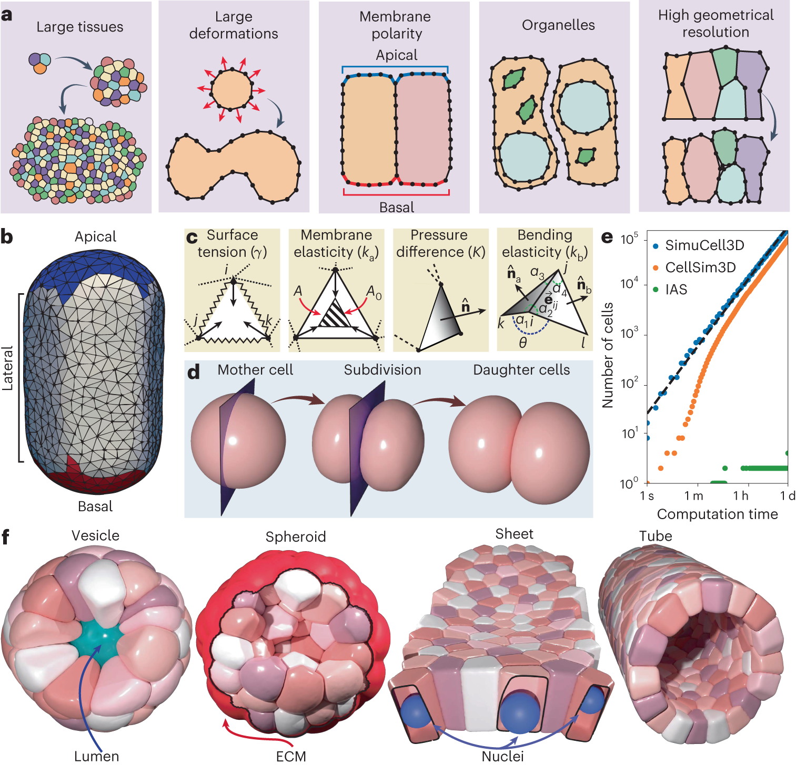
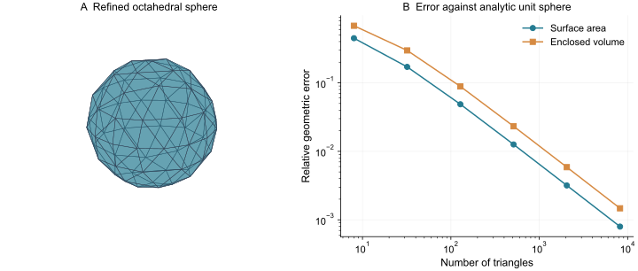
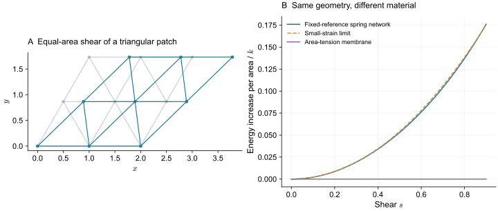
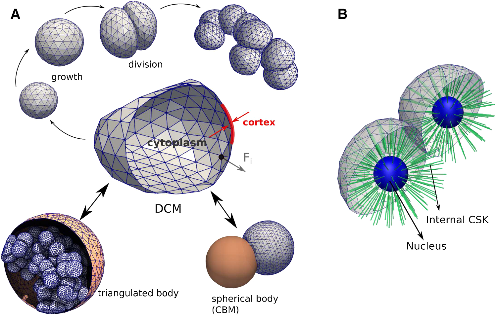
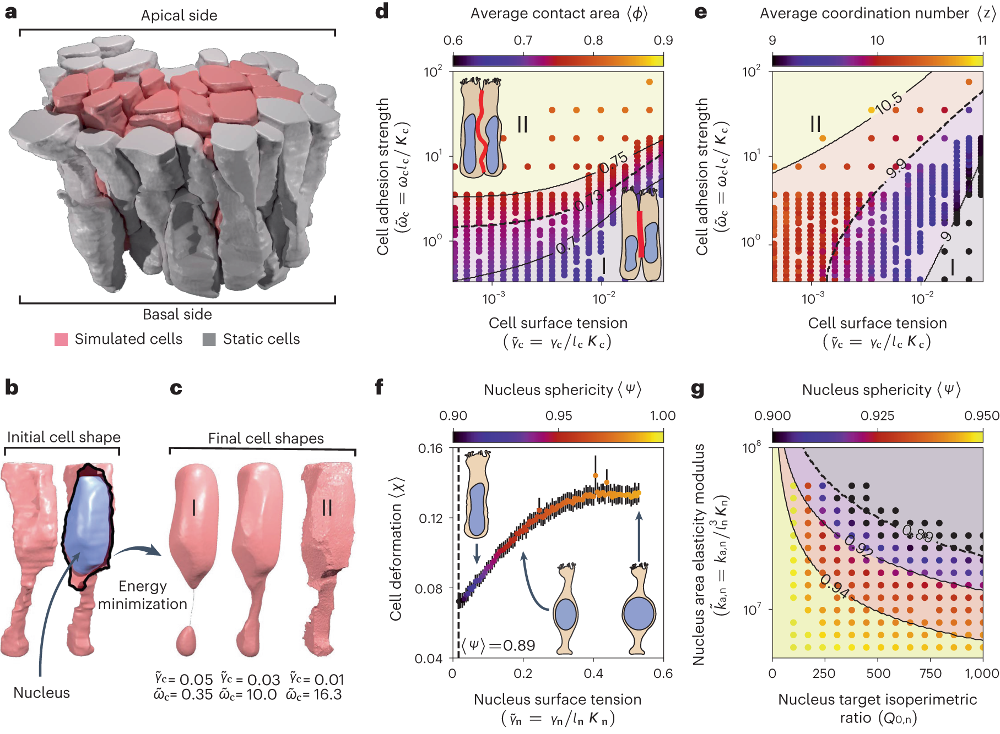

> **Part II · Note 03**　上一篇：[02 · 多相场：从弥散界面到细胞形变](/notes/cell_simulation_3d/phase_field/) · [专题目录](/notes/cell_simulation_3d/) · 下一篇：[04 · 三维 Vertex：共享多面体与拓扑重排](/notes/cell_simulation_3d/vertex_3d/)

## 1. 显式细胞表面的思想与用途 {#main-lecture}

如果研究的核心量是细胞接触面的面积、局部凹陷或细长突起，直接保存表面几何十分自然。表面网格模型用一张闭合的三角曲面包住每个细胞，节点随受力移动。两个细胞各有自己的表面，接触时通过相互作用传力，分离后仍保持各自闭合。外部间隙、自由边界和细胞脱离因而可以在同一种表示中出现。

这种做法继承了膜、薄壳和可变形物体力学的思路。若主要恢复力来自边界，而胞内可近似提供压力或黏性阻力，就不必首先给整个细胞内部划分体单元。表面面积、曲率和形状已经能表达一大部分机械代价。将力从同一个能量对节点坐标求导，还可以把轮廓变化与做功联系起来，而不必逐个猜测节点应该向哪个方向移动。

早期红细胞模型提供了一个具体背景。红细胞膜下的骨架能够承受剪切，封闭膜又限制面积与体积，因而可以用表面网络结合弯曲和耗散描述拉伸与恢复。沿这条路线发展出的几何工具可以迁移到其他细胞，但材料规律需要重新判断：有核细胞的皮层会主动重塑，长期保持固定弹簧原长的网络，可能赋予它过强的形状记忆。

三角形因此只是承载几何与材料的一种离散。面积能使表面像张力界面，带参考度量的面能使它具有弹性，表面黏性和内部状态又决定应力怎样随时间释放。两张外观相同的网格，可以对应完全不同的细胞材料。保持离散与材料参数的一致缩放后，增加节点主要提高这套描述的分辨率；核、骨架或膜储备的机制仍需另外建立。

成像数据让这条路线尤其便于使用：分割得到每个细胞的占据区域，提取闭合边界后便能初始化网格。但从显微图恢复的形状可能正承受邻居和基质的载荷。将它直接设成无应力参考态，会把当时的组织应力吸收进参考几何。图像初始化、材料标定与边界受力由此必须共同处理。

以下先从面积与体积的节点力建立基础，再把材料、接触和重网格连起来。后面的铺展与上皮案例会说明，同一几何框架如何因材料历史、极性和胞内结构的选择，产生不同的组织行为。

*图 1 · 同一种表面表示可以组成多种组织。* [Runser、Vetter 与 Iber（2024），Fig. 1](https://www.nature.com/articles/s43588-024-00620-9/figures/1)，模型示意与模拟原图；[CC BY 4.0](https://creativecommons.org/licenses/by/4.0/)。

先看 b 的闭合三角表面，再看 d 中母细胞如何生成两个闭合子体，最后看 f 的囊、球状团、片层和管。组织空腔与细胞之间的空隙在几何上直接可见；细胞也可以有凹陷，而不必一直保持凸多面体。图中三角边是离散曲面的计算连接，通常不对应真实皮层的一根纤维。决定它是张力膜还是弹性壳的，是接下来赋予的能量与材料规律。

这一框架的发展也反映了不同研究目标：有些工作优先标定单细胞的材料和接触，有些优先实现大量细胞的生长与分裂。

[Odenthal 等（2013）](https://doi.org/10.1371/journal.pcbi.1003267)把三角化红细胞的材料与机械接触结合，研究黏附基底上的早期铺展。该工作先用拉伸与恢复约束细胞材料，再比较接触半径的时间变化，区分接触耗散和皮层耗散的贡献。红细胞的膜下骨架与有核上皮不同，但这套标定顺序直接说明了为什么单看铺展终态无法确定全部材料参数。

[CellSim3D（Madhikar 等，2018）](https://doi.org/10.1016/j.cpc.2018.05.024)则侧重三维生长与分裂的机械计算，将表面弹性、相互作用与压力放入可并行的节点动力学。它说明节点式细胞表示可以面向大细胞群设计；具体的几何限制、分裂规则和参数映射仍属于该模型本身，不能由 GPU 加速这一实现特征推断。

下述高分辨率 DCM 与 SimuCell3D 进一步把自由形状、复杂接触、极性或胞内结构带入不同生物问题。它们共享部分几何语言，却各自选择了材料、耗散和事件处理。理解这一发展脉络，可以避免把不同软件中同名的“膜刚度”当作同一个可直接换算的实验量。

## 2. 几何求力与表面材料 {#geometry-and-material}

设一个有向三角形的顶点为 $\mathbf r_a,\mathbf r_b,\mathbf r_c$，单位法向为 $\mathbf n_f$。面积为

$$
A_f=\frac12\left|(\mathbf r_b-\mathbf r_a)\times(\mathbf r_c-\mathbf r_a)\right|.
$$

若表面能为 $E_A=\gamma\sum_f A_f$，节点 $a$ 的力来自所有相邻三角形面积的变化。对单个面，

$$
\frac{\partial A_f}{\partial\mathbf r_a}
=\frac12(\mathbf r_b-\mathbf r_c)\times\mathbf n_f,
\qquad
\mathbf f_a^{(f)}=-\gamma\frac{\partial A_f}{\partial\mathbf r_a}.
$$

这个导数的方向位于三角面内，垂直于对边。单个面像沿边缘拉紧的小片；把一个节点周围的面贡献加起来，平面区域的许多分量会抵消，弯曲区域则留下与曲率有关的合力。连续曲面中的曲率牵引，正是这样从离散面积梯度出现的。

因此，网格表面张力不需要人为给每条边再加一个相同张力。那样做会增加另一种长度能，并可能使总受力随三角形数改变。

对闭合表面，可用散度定理把体积化为表面积分，得到

$$
V=\frac16\sum_{f=(a,b,c)}\mathbf r_a\cdot(\mathbf r_b\times\mathbf r_c).
$$

每一项可以理解为原点与一张有向三角面构成的有向四面体体积。原点不必在细胞内部，有的项可以为负，只要整张表面闭合并且朝向一致，求和仍给出正确体积。

若将三角面视为独立的一项，它对 $\mathbf r_a$ 的体积导数为 $(\mathbf r_b\times\mathbf r_c)/6$。对共享该节点的所有面求和后，再乘以细胞压力 $p=-\partial E_V/\partial V$，就是压力产生的节点力。面积力与体积力都由同一套几何求导得到，较容易保持能量与力的一致。

如果体积在整体平移后改变，通常说明表面没有闭合、存在方向错误，或数值相消过强。把原点移到细胞附近可以改善浮点精度；把最终体积直接取绝对值，却不能修复局部翻面或自交。

*图 2 · 几何精度应当可以量化。* 从正八面体开始细分，并把新节点投影到单位球面；面积、体积按正文公式计算。它检验几何离散，没有包含接触与动力学误差。

### 2.1 张力、弹性与材料记忆 {#constitutive}

先想象一张没有边界的平面膜，对它施加保持面积不变的面内剪切。如果能量只有 $\gamma A$，面积没变，能量就不变；这张膜本身没有面内静态剪切模量。它仍能通过改变曲率和面积对其他形变产生恢复力。

若改用固定原长的边弹簧，情况不同。取

$$
E_s=\frac12\sum_e k_e(\ell_e-\ell_{e,0})^2.
$$

剪切保持总面积，却改变各方向边的长度，因此会储存能量。$\ell_{e,0}$ 保存了材料参考态，网络知道自己相对于初始构型拉长了多少。若这些原长永不更新，即使等很久，剪切应力也不会自行消失。

规则等边三角弹簧网可以把这一点算得很清楚。在小应变下对三个边方向求和，可得到二维各向同性弹性形式

$$
w=\frac{\lambda_s}{2}(\operatorname{tr}\boldsymbol\varepsilon)^2
+\mu_s\operatorname{tr}(\boldsymbol\varepsilon^2),
\qquad \lambda_s=\mu_s=\frac{\sqrt3}{4}k.
$$

这里 $w$ 是单位参考面积能量，$k$ 是每条边的线性弹簧系数。规则网给出的两个 Lamé 系数受到约束，不能独立调节。对不规则网或其他弹簧形式，关系会改变。这说明简单加边弹簧不仅增加刚度，也隐含地选择了泊松响应。

*图 3 · 相同网格可以承载不同材料。* 使用 $\mathbf F=\begin{pmatrix}1&s\\0&1\end{pmatrix}$，其行列式为 1。纯面积能保持不变，规则三角弹簧网的能量随剪切增加。这里研究平面材料片，不是将整个细胞剪切后仍假定表面积不变。

若皮层在短时间承受剪切、长时间不断更新，可以让参考度量或内部应变随时间松弛。一个标量类比是 $\dot\ell_0=(\ell-\ell_0)/\tau_r$；真实面材料需要采用与旋转相容的张量形式。时间 $\tau_r$ 会把短时弹性与长期流动连接起来。将每次重网格后的新边直接设成无应力状态，则是由数值操作决定松弛，而不是由设定的材料时间决定。

脂双层真实面积的拉伸代价很大，但细胞可以通过褶皱、囊泡和膜储备改变显微尺度下的平滑轮廓面积。一个只解析平滑表面的模型，往往把这些未解析结构合并成有效面积弹性或张力规律。严格锁定重建表面积，可能比真实细胞在同一时间尺度上更硬。

因此，面积约束应根据实验所测的面积和加载速度来定。对有丰富膜储备的细胞，低张力区域与膜储备耗尽后的高张力区域，甚至可能需要不同的面积响应。

### 2.2 局部弯曲与长度尺度 {#弯曲能如何离散}

面内材料控制表面拉伸和剪切，局部折弯还需要独立的代价。否则，总面积相近的轮廓可以具有很不相同的尖锐程度。

面积能惩罚的是总面积，不能独立控制局部弯曲。若需要表达皮层或膜的弯曲代价，可用

$$
E_b=\frac\kappa2\int(2H-C_0)^2dA,
$$

其中 $\kappa$ 是弯曲模量，$C_0$ 是自发曲率。若表面具有独立的弹性厚度，这一项可以来自壳理论；若把膜与皮层一起粗粒化，$\kappa$ 则应作为有效参数标定。

三角网格中常用离散曲率算子。例如在满足相应网格条件的 cotangent 离散中，

$$
(\Delta_s\mathbf r)_a\simeq\frac1{2A_a}
\sum_{b\in\mathcal N(a)}(\cot\alpha_{ab}+\cot\beta_{ab})
(\mathbf r_b-\mathbf r_a).
$$

$A_a$ 是节点对应面积，$\alpha_{ab},\beta_{ab}$ 是共享边两侧的对角。连续曲面上 $|\Delta_s\mathbf r|=2|H|$，因此可以构造离散弯曲能。也有模型使用相邻面二面角；它们需要不同的权重才能在细化时逼近同一连续材料。

固定拓扑、$C_0=0$ 的球面有 $E_b=8\pi\kappa$，而且与球半径无关。这是检查弯曲能归一化的一个好例子。若网格细化后球面的弯曲能不断增长，就应检查权重与曲率估计，而不是直接重新拟合 $\kappa$。

曲率比面积更容易受网格噪声影响。细长三角形、局部节点密度突变和重建表面的锯齿，都会造成很大的离散曲率。去噪可以改善几何，但过度平滑也会抹掉真实接触凹陷；力学与图像处理应使用相容的分辨率。

一个小突起即使只增加很少总面积，也可能具有很大的曲率。把近似平面的界面写成高度 $w(x,y)$，在小斜率下，张力与弯曲的二次能量分别为

$$
E^{(2)}=\frac12\int\left[\gamma|\nabla w|^2
+\kappa(\nabla^2w)^2\right]dA.
$$

对波数 $q$ 的起伏，两项代价分别随 $\gamma q^2$ 与 $\kappa q^4$ 增加。因此存在长度尺度 $\ell_b=\sqrt{\kappa/\gamma}$：波长远小于它时，弯曲强烈抑制尖锐起伏；波长较大时，张力作用更明显。这个长度可帮助判断需要多细的网格，但不能用三角形边长来反向定义材料的弯曲模量。

这也解释了离散接触中的尖角。如果接触力只集中到少数节点，而物理弯曲长度没有被解析，细胞可能出现局部针尖或网格状凹陷。提高弯曲模量可以把画面抹平，却同时改变了细胞的材料。应先检查牵引是否按面积分配、接触作用区是否得到解析，再判断实验是否确实需要更强弯曲。

## 3. 接触、耗散与重网格 {#contact-and-remeshing}

仅在不同细胞的节点之间加排斥，常会漏掉一种穿透：一个节点可能穿过另一张面片的内部，却始终没有靠近那张面片的三个顶点。更完整的处理至少要考察点—三角面与边—边的最近距离；若一步中的运动很大，还需检测整个运动轨迹上的碰撞。

接触力最好从单位面积的牵引出发理解。设两表面的局部间距为 $d$，法向牵引为 $t_n(d)$，则一个小接触片的力约为 $t_n(d)\,dA$。离散时，节点或积分点应携带相应面积权重。

假如把每个节点的吸引力都固定为相同数值，网格细化使节点增加四倍，总吸引就可能增加四倍。接触势没有改变名字，材料却已经改变了。通过两块平行面测试总法向力随节点密度是否收敛，通常比直接在复杂细胞团上找问题容易得多。

黏附还包含法向结合与切向传力两层含义。一个只依赖表面间距的势，可以使细胞贴在一起，但未必阻止它们沿接触面滑动。如果要研究黏着连接的剪切传力，需要额外的切向弹性、摩擦或成键—解键规则。

Hertz 接触假定小接触区中的弹性体形变，黏附接触理论还会加入表面功；一个充满液体、由张力皮层包裹的细胞，受力主要来自曲率、压力与皮层应力，机制不同。两种模型在小变形区间可以拟合相似的力—位移曲线，超出标定区间后却可能给出不同接触面积。

如果目标是接触面的三维形状，就应让表面真正变形并检查局部力平衡。若只关心大量细胞中心的排布，已经标定的接触律可能更经济。这也是高分辨率模型与中心模型可以相互配合的原因。

设单位面积的接触能为 $\psi(d)$，$d$ 是两表面的间隙，约定 $\psi(\infty)=0$，稳定间距为 $d_0$。黏附功是 $W=-\psi(d_0)$，法向牵引则由 $t_n=-d\psi/dd$ 得到。它们不是同一个参数：$W$ 衡量把单位面积接触完全分开需要多少功，峰值牵引衡量分离过程中最大的局部拉力。

若势阱深度相同而宽度为 $\ell_c$，典型峰值牵引尺度为 $W/\ell_c$。较窄的接触势可以给出相同的平衡接触角，却产生更大的峰值力和更短的数值时间尺度。研究接触断裂、挤出或孔道迁移时，仅匹配平衡形状因而还不够。

离散时，一个节点对应面积 $A_a$，贡献应近似为 $A_a\psi(d_a)$。点到三角面的最近位置通常落在面内部，其反力需要按重心权重分给三个顶点；这样才能同时保存作用—反作用，并避免凭空产生总力矩。只给受测节点加力而不给对面相应反力，即使图形没有穿透，也不能作为封闭细胞团的内部接触力。

切向连接则需要额外状态。法向势使两个表面靠近，切向弹簧或滑动摩擦决定细胞能否沿接触面相对运动。增大法向黏附与增大切向摩擦都可能减慢重排，但卸载后的恢复、滑动距离与分离功不同，适合用来区分这两种作用。

接触牵引需要随面积离散，耗散也需要同样的物理归一化。只有两者一起保持，细化网格才会主要改变精度。

即使面积力和接触力都正确加权，阻力也可能留下网格依赖。若每个节点具有固定阻力 $\xi$，总节点数增加后，整张表面的总阻力会增加。对同一物理细胞，网格越细，运动就可能越慢。

若想表达单位面积相对环境的阻力 $\zeta$，可取节点阻力 $\xi_a=\zeta A_a$。若阻力来自膜内或皮层内相对运动，则应采用不同的面黏性离散。局部节点阻力、细胞间滑动阻力与显式胞内外流体，是不同的耗散路线；它们不只在运行速度上有差别。

刚度也会限制时间步。一个很小的三角形或很强的接触罚项，可以产生很短的数值松弛时间。显式推进必须解析它，隐式推进则要处理更困难的非线性系统。选择接触罚系数时，要同时看穿透量和计算条件数。

细胞拉长后，某些边会很长，另一些三角形会接近退化。常见的局部操作包括长边分裂、短边合并和边翻转。它们改变离散连接，目的是更好地解析同一张表面。

这些操作并非完全没有力学后果。合并节点会改变几何，边翻转会改变离散曲率；若边携带弹性历史，新边还需要继承相应状态。面上若保存蛋白总量，转移时应保持 $\sum_f c_fA_f$，而不是简单平均浓度，否则总量会随三角形面积改变。

表面重网格与细胞换邻居也必须分开。前者可以完全发生在同一细胞的外表面上，不改变任何细胞接触；后者改变的是不同细胞之间的邻接。把所有边翻转都计成组织重排，会混合两种尺度的事件。

实际运行中，可将一次重网格前后的体积、面积、能量、总物质量和力矩分别记录。允许很小的可控几何误差，与无意中释放全部弹性应力，是完全不同的事情。

对只有面积、体积和曲率的流体式表面，沿切向移动节点主要改变离散采样；对带弹性参考态的表面，同样的移动却可能改变材料应变。两者需要不同的状态转移。将新三角形的当前几何一律设为参考几何，相当于在重网格时让那部分材料瞬间释放应力。

可以用一个简单实验识别这个问题：把模型细胞拉长并保持外部位移，待节点受力平衡后，连续执行几次重网格。若没有任何物理松弛机制，维持形变所需的外力应当只出现随分辨率下降的小误差；若每次操作后都显著变小，数值步骤就正在充当材料流动。

表面蛋白也有同样的区别。重网格只改变表示时，应把原有总量保守转移到新面片；真实膜流动则由切向速度和输运方程推进。若蛋白参与调控张力，一次不守恒的插值会同时改变分子分布和受力，随后看起来像发生了机械反馈。保存几何、材料参考态与表面总量，才能将这三种变化分开。

## 4. 实验标定与组织应用 {#calibration-and-applications}

一个模型细胞可以同时具有表面张力、面积弹性、弯曲与胞内黏性。只用一种加载得到一条曲线，往往不能把它们分别确定。标定可以从各机制主导的实验窗口开始。

微吸管吸引提供一个例子。对近似液滴、准静态且皮层张力均匀的细胞，吸管内界面在临界时近似半球，半径为 $R_p$；外侧曲率半径为 $R_c$。两侧 Laplace 关系相减，得到吸引压差

$$
\Delta P\simeq2\gamma\left(\frac1{R_p}-\frac1{R_c}\right).
$$

给定几何与压差，可以约束有效张力。若细胞具有显著弹性、吸管入口黏附或流动尚未停止，就需要把这些作用加入模型；同一公式不再独自解释全部压力。

压头缩进则同时涉及皮层、胞内与核。较浅缩进可能主要探测表面附近，较深缩进会改变整体形状并可能压到核。仅拟合一个 Hertz 模量，容易把这些不同贡献合并成加载条件相关的有效数值。表面网格模型可以直接模拟实验几何，再分别改变张力、面积弹性与核材料，观察哪些观测能区分它们。

动态过程还可标定耗散。用同样终态的压缩，比较不同加载速率或卸载后的恢复，能够约束黏性与参考态更新。若只改变一个统一时间单位就能匹配所有过程，简单阻力模型也许足够；若小形变和大形变需要完全不同的时间缩放，就应检查缺失的耗散机制。

对均匀线性弹性薄层，面内拉伸刚度尺度为 $Yd$，弯曲刚度尺度为 $Yd^3/[12(1-\nu^2)]$，其中 $d$ 是材料层厚度。这解释了为什么厚度稍有变化，弯曲与拉伸的相对代价就可能明显改变。

细胞的膜—皮层复合层未必等同于这张均匀薄板，尤其在存在流动、交联更新和膜储备时。可以把薄壳关系作为一个受限本构选择，也可以将有效拉伸与弯曲参数独立标定。后者更灵活，前者参数更少；应由实验是否支持共同材料厚度来决定。

这种标定还有助于区分结构：上皮细胞的整体高度，与单细胞皮层材料层的厚度，是两个相差很大的长度。把它们都写成 thickness 再代入同一弯曲公式，会得到完全不同的物理解释。

[Van Liedekerke 等的高分辨率可变形细胞模型](https://doi.org/10.1007/s10237-019-01204-7)在线发表于 2019 年，卷期出版于 2020 年。它将三角化的细胞表面、接触与可标定的力学结合，并与中心模型比较。研究问题包括生长组织的排列与肝脏再生；比较显示，是否解析细胞形状会影响某些定量结论。这一工作适合沿着“单细胞材料标定—多细胞接触—组织行为”的顺序阅读。

*图 4 · 表面表示与胞内假设要分开阅读。* [Van Liedekerke 等（2020，在线发表于 2019），Fig. 1](https://link.springer.com/article/10.1007/s10237-019-01204-7/figures/1)；[CC BY 4.0](https://creativecommons.org/licenses/by/4.0/)。

A 中三角化皮层包住胞质，并参与生长、分裂和包囊内接触；右下角还画出它与中心球模型的区别。B 展示显式核和内部骨架的扩展结构。这些图不能仅凭外观归为同一种材料：将胞质等效为体积阻力，和解析核—皮层连接，会保留不同的胞内自由度。比较模型时，应同时说明画出来的曲面和曲面里面省略了哪些力学。

[SimuCell3D（Runser、Vetter 与 Iber，2024）](https://doi.org/10.1038/s43588-024-00620-9)进一步把独立闭合表面、局部网格调整、细胞核和极性等设置放进同一实现。成像初始化的层状与假复层上皮，用来研究表面张力、黏附和核如何影响三维细胞组织。这里值得注意的是，同一细胞的顶端、侧面与基底可以有不同性质，单个均匀张力不足以表达这些差异。

两项工作使用的具体本构、积分器和接触算法并不完全相同。本篇的面积梯度与连续材料算例提供比较语言，不能作为任一软件的完整说明书。

*图 5 · 外轮廓与核形状提供两类约束。* [Runser、Vetter 与 Iber（2024），Fig. 4](https://www.nature.com/articles/s43588-024-00620-9/figures/4)；a 为成像导出的几何及模拟区域，b、c 展示模型中的细胞和核；[CC BY 4.0](https://creativecommons.org/licenses/by/4.0/)。

a 中粉色细胞参与模拟，灰色细胞提供固定边界；这不是把整块组织都作为自由细胞重新演化。b 的蓝色核嵌在细长细胞中，c 显示不同表面张力和黏附条件下的形状。读图时可以分别比较细胞腰部、侧面接触和核的变形，再用 d—g 的统计量判断这些变化是否稳定。若只拟合组织厚度，可能漏掉细胞和核承受形变的不同方式。

假复层上皮的细胞核位于不同高度，而细长细胞仍跨越组织厚度。此时一个近似圆柱形的细胞被邻居压出腰部，既会改变接触面积，也会改变核可占据的空间。核的约束因此不能简单吸收到统一的表面张力里。

在图中的模型比较中，黏附有利于增大邻接表面，表面张力倾向于缩小外形，核则为局部收缩提供内部几何限制。整体厚度相似的两组参数，可以对应不同的细胞腰部和核形状。把这几项观测一起拟合，能够比只用组织厚度更有效地约束参数组合。

成像初始化还带来一个边界问题：只允许中央细胞演化、固定外围细胞时，外围既提供几何约束，也会传递反力。这个设置适合研究局部结构在既定组织中的稳定性；若要解释整层上皮的自发弯曲，还需放开相应边界并给出周围组织的力学。固定边界条件与自由组织的结果应分别解释。

显式核的另一项用途是受限迁移。对于穿行在开放基质中的细胞，环境几何通过孔隙、牵引和胞内结构限制运动。

一个细胞能伸出细长前缘，不代表整个细胞都能通过同样宽的通道。核的尺寸、形变与耗散可以限制通过过程；基质还可以被牵拉或降解，从而改变可用孔隙。

[Wolf 等（2013）](https://doi.org/10.1083/jcb.201210152)将三维基质中的迁移限制与孔隙、核变形、蛋白水解和牵引联系起来。这类结果为模型选择提供了直接线索：只有外壳的模型可能难以区分限制来自核还是皮层；只有中心排斥的模型则还需额外闭合形变。

可以让核成为另一个弹性面或体，将基质表示成可变形纤维，再比较通过时间、核长宽比和局部基质位移。若模型只拟合平均速度，改变黏附与改变核刚度都可能补偿同一个结果；加入核形变可以帮助区分两者。

核通过狭窄孔隙需要改变形状，前缘牵引则要提供相应功。若将核的主要形变用 $e$ 表示，一个弹性近似给出 $\Delta E_n\sim K_nV_ne^2$；持续力 $F$ 在距离 $\ell$ 上能提供的功约为 $F\ell$。这个尺度比较说明，更大的核、更窄的孔与更强的牵引会以不同方式改变通过条件。

它还没有给出通过时间。核材料的黏性与参考态更新，会使加载速率产生影响；基质纤维的移动或降解，又会随时间改变孔径。一个细胞最初停住，可能是在积累形变，也可能是在打开环境通道。只把停留时间拟合成更大的局部阻力，会将这几种过程混在一起。

实验中同步追踪核长宽比、孔径、基质位移和质心轨迹，便可区分“细胞被迫变形”和“细胞改变了孔道”。模型若含显式核与纤维，应分别输出这些量；若采用中心代理，则需说明通过规则怎样由这些实验标定。Wolf 等的三维迁移研究为这种联合观察提供了生物学背景。

组织应用还要求在同一曲面框架中处理胞内结构和生物事件。它们增加的自由度，需要与原有材料和接触相容。

细胞核可以用另一张闭合面、一个弹性体或一组粒子表示。只给核一个排斥半径，可以限制细胞压缩，却不能预测核在狭窄孔道中的拉长；若研究受限迁移，需要为核保留相应形变和耗散。胞内还需说明核与皮层之间通过何种连接或介质传力。

分裂时，把网格沿一个平面截开，只完成了第一步。两个子细胞都需要封口，重建新生面的三角化，分配体积与身份，继承材料和极性。若母细胞表面已经携带应变，新生界面是否无应力，也是一项物理假设。

被上皮包围的腔，可以作为受压的内部空域、另一个表面单元或显式流体区域。恒压、恒体积与可渗透腔壁给出的响应不同。高分辨率表面让这些边界可以被表达，但不会替模型自动决定哪一种边界条件正确。

## 5. 表面模型的扩展与局限 {#model-limits}

表面网格的主要优势，是将需要观察的轮廓直接保留下来。细胞的高度、局部凹陷、接触范围和脱离过程都可以从闭合曲面中测量，适合研究自由边界和复杂形变。它同时要求接触、材料和几何操作彼此一致；这些选择比最终画出了多少三角形更能决定结果的物理含义。

表面表示对胞内的压缩尤其值得注意。若胞内只通过总体积和均匀压力出现，模型可以合理描述许多边界受力，却没有解析胞内剪切、局部压力梯度和核附近的应变。加入另一张核表面也只完成核的几何表示，核与皮层之间怎样传力仍需规定。对于受限穿孔、局部压头或快速变形，这些被省略的内部过程可能成为主要阻力。

皮层材料又有独立限制。固定参考态的弹性网格会保存变形记忆，张力曲面则不具有同样的长期剪切响应。真实细胞可以通过连接周转、膜储备和主动调控在两者之间表现出时间依赖。若只用一次静态压缩拟合材料，再将它用于长时间重排，模型可能把生物重塑错误地交给数值重网格承担。动态加载和卸载恢复能更直接地区分这些机制。

接触的有效范围也会影响结果。短程法向势可以标定黏附功，却未必同时标定切向传力、润滑排液与连接成熟；改变势阱宽度还会改变峰值牵引和允许的时间步。细胞从组织中挤出时，需要经历接触滑动、缩小和断开，这些过程可能比终态接触角更敏感。接触参数应在研究实际涉及的加载范围内接受检验。

几何精度与材料精度不能互相代替。更密的节点可以逼近曲率，却也会放大分割噪声和接触搜索代价；更频繁的重网格可以避免退化，却增加历史变量和表面物质的转移。若在固定实验输入下，网格与操作频率改变了主要松弛时间或组织排列，就应先解释这部分数值依赖，再把差异归于细胞性质。

从显微图初始化的局部组织还依赖周围边界。固定外围细胞适合研究给定环境中的内部稳定性，整体弯曲和组织释放则需要相应的外部受力。模型所得到的参数和形态，都应连同这种实验几何解释。下一篇的共享多面体用另一种方式处理密集接触：将相邻细胞共用的界面只保存一次，以更直接的拓扑约束换取部分自由表面细节。

## 6. 参考文献 {#references}

1. Odenthal et al. (2013). [Analysis of Initial Cell Spreading Using Mechanistic Contact Formulations for a Deformable Cell Model](https://doi.org/10.1371/journal.pcbi.1003267). *PLoS Computational Biology*, 9(10), e1003267.

2. Madhikar, Åström, Westerholm and Karttunen (2018). [CellSim3D: GPU accelerated software for simulations of cellular growth and division in three dimensions](https://doi.org/10.1016/j.cpc.2018.05.024). *Computer Physics Communications*, 232, 206-213.

3. Van Liedekerke et al. (2020). [A quantitative high-resolution computational mechanics cell model for growing and regenerating tissues](https://doi.org/10.1007/s10237-019-01204-7). *Biomechanics and Modeling in Mechanobiology*, 19(1), 189-220. 在线发表于 2019 年。

4. Runser, Vetter and Iber (2024). [SimuCell3D: three-dimensional simulation of tissue mechanics with cell polarization](https://doi.org/10.1038/s43588-024-00620-9). *Nature Computational Science*, 4(4), 299-309.

5. Wolf et al. (2013). [Physical limits of cell migration: control by ECM space and nuclear deformation and tuning by proteolysis and traction force](https://doi.org/10.1083/jcb.201210152). *Journal of Cell Biology*, 201(7), 1069-1084.

---

[← 02 · 多相场：从弥散界面到细胞形变](/notes/cell_simulation_3d/phase_field/) · [专题目录](/notes/cell_simulation_3d/) · [下一篇：04 · 三维 Vertex：共享多面体与拓扑重排 →](/notes/cell_simulation_3d/vertex_3d/)
