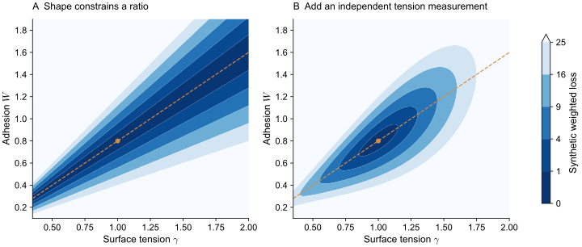
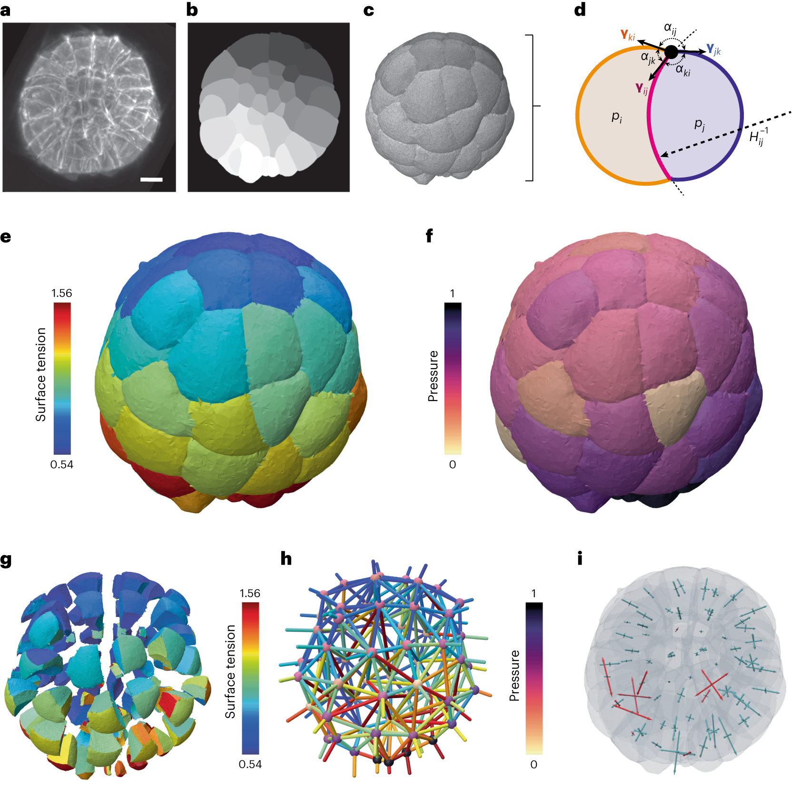
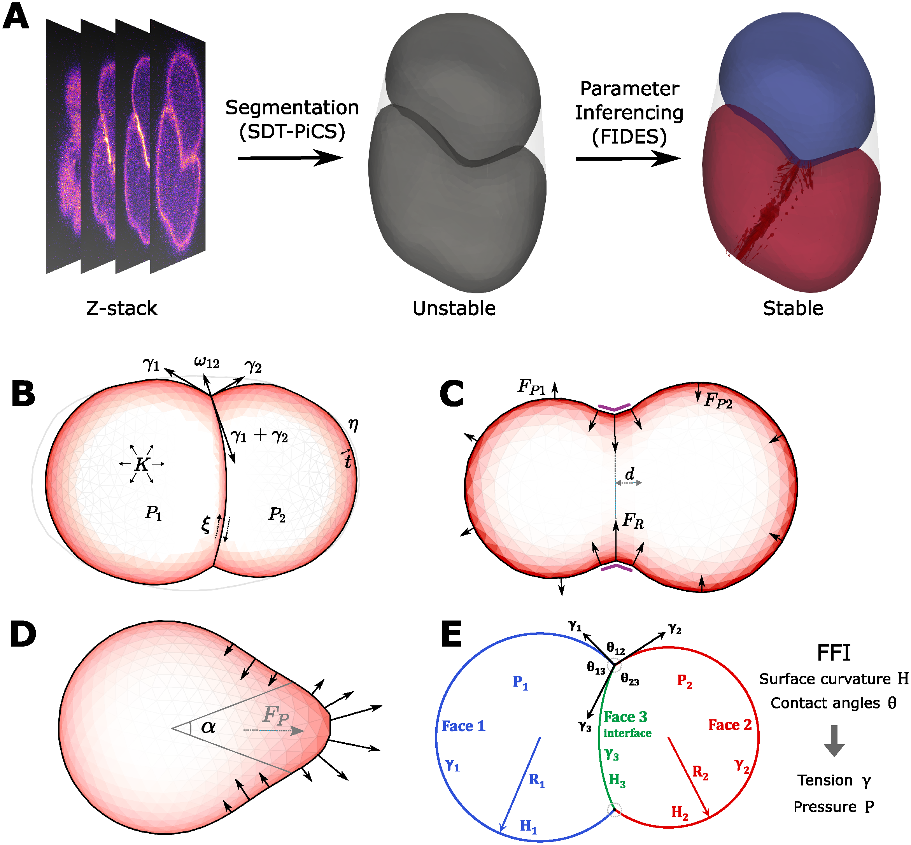
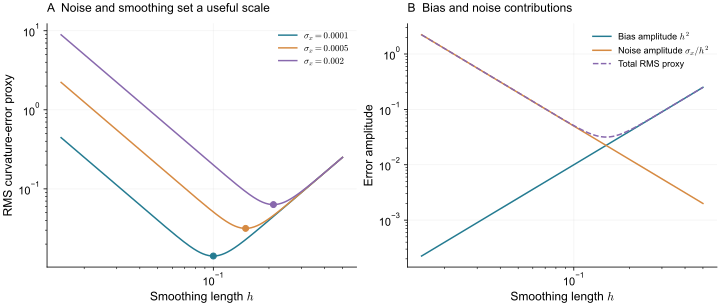

> **Part V · Note 09**　上一篇：[08 · 三维形态发生](/notes/cell_simulation_3d/morphogenesis/) · [专题目录](/notes/cell_simulation_3d/)

## 1. 反问题的来源与力学解释 {#main-lecture}

三维成像让细胞形状、接触与运动变得可测，却没有直接给出每块界面的张力和每个细胞的压力。从图像推断受力，是一个反问题：先选定形状与力之间的物理关系，再利用观测限制其中未知的量。前面各篇的模型提供了不同关系，也分别决定哪些信息能够由数据恢复。

这一想法的基础很直接。若界面近似由均匀张力维持，曲率与压差必须满足相应平衡；若三块界面交于一条线，牵引方向与夹角又约束张力比。一张足够清楚的三维几何因而含有受力信息。它所含的信息仍受模型对材料、主动运动和观察时间的假设限制。

[Ichbiah 等（2023）](https://doi.org/10.1038/s41592-023-02084-7)的 foambryo 把成像、分割、曲面与准静态力平衡连接起来，获得相对界面受力图谱。[Vanslambrouck 等（2024）](https://doi.org/10.1371/journal.pcbi.1012629)的 FIDES 则从分割几何运行候选力学，利用形状的短时变化约束参数。前者更直接地使用几何平衡，后者可以纳入更丰富的细胞机制；它们都需要说明观测如何进入物理关系。

参数拟合与识别由此必须分开考虑。接触较大可以由更强黏附或更低接触皮层张力产生；松弛较慢可以由恢复力较弱或阻力较大产生。优化器即使找到了稳定的最优点，数据也可能只确定这些参数的某个比值。更高分辨率与更多同类图像通常改善精度，独立加载和受控干预则可能增加原来没有的约束方向。

数值验证又解决另一类问题：程序是否求解了所写的方程和事件规则。错误的面积梯度、随节点数增加的接触力、没有收敛的重排阈值，都可以改变同一参数下的结果。若没有先控制这些变化，反演就可能用材料参数补偿数值误差，得到难以跨条件使用的解释。

这篇将几何反演、成像与数值误差、事件统计和独立预测放在同一条论证中。目标是确定一套解释得到哪些数据支持，哪些参数组合仍不可见，以及这些不确定性会怎样进入新的形态预测。完整的验证对象既包括力学模型，也包括从显微图像到最终观测的测量过程。

## 2. 观测、可识别性与三维力学反演 {#inference-and-identifiability}

设双细胞能量为 $E=\gamma A-WA_c$。同时把 $\gamma$ 和 $W$ 乘以同一正数 $a$，所有构型的能量都乘以 $a$，能量极小点不变。因此静态形状通常首先约束的是 $W/\gamma$，而不是两个绝对数。

若动力学为 $\xi\dot{\mathbf q}=-\nabla E$，时间序列还能约束 $\gamma/\xi$ 这一类比值；如果 $\gamma,W,\xi$ 一起乘以 $a$，整条轨迹也不变。仅靠更高帧率，不会消除这项共同尺度自由度。

假设形状给出 $r=W/\gamma$，一个已知几何下的松弛时间给出 $\tau=\xi/(C\gamma)$，其中 $C$ 是由线性化几何决定的系数。若 $\xi$ 已独立测得，则可以恢复

$$
\gamma=\frac\xi{C\tau},\qquad W=r\gamma.
$$

如果 $\xi$ 也未知，就仍保留一个尺度。这个小算例说明为什么独立的力、压力或耗散测量往往比增加同类形状数据更有效。

*图 1 · 拟合损失较小可以沿一条长谷分布。* 合成观测为 $W/\gamma=0.8\pm0.08$，右图再加入 $\gamma=1\pm0.15$。误差为教学设定，不代表真实细胞参数的置信区间。

设观测 $\mathbf y$ 依赖参数 $\boldsymbol\theta$，定义

$$
S_{\alpha k}=\frac{\partial y_\alpha}{\partial\theta_k}.
$$

若两列几乎平行，说明改变两个参数产生的观测变化很相似；若存在很小的奇异值，则有某个参数组合几乎看不见。带观测协方差 $\Sigma$ 时，常考察 $\mathbf S^{\mathsf T}\Sigma^{-1}\mathbf S$。

这是一种局部诊断。组织可以有多个稳定排列，重排阈值还会使响应不光滑。一个极小点附近的窄误差椭球，并不能排除远处还有另一组完全不同的好拟合。可以固定一个参数、重新优化其他参数，得到 profile loss，检查不确定性是否真的闭合。

为了避免量纲影响列的大小，先使用对数参数 $\boldsymbol\theta=(\log\gamma,\log W,\log\xi)$。假设已有的独立观测只有接触比值和松弛时间，令 $y_1=\log(W/\gamma)$、$y_2=\log\tau$，且几何系数固定，则

$$
\mathbf S=
\begin{pmatrix}-1&1&0\\-1&0&1\end{pmatrix},
\qquad
\mathbf S\begin{pmatrix}1\\1\\1\end{pmatrix}=0.
$$

三项参数同时增加相同比例完全不可见。把已有观测测得再精确，也不会增加矩阵的秩。若增加一次能够约束绝对张力的独立加载，便增加与 $(1,0,0)$ 相关的一行，共同尺度才有可能被确定。

这给“需要更多实验”一个具体含义：新增观测应当看到原来不可见的方向。另测十个依赖同一张力比的静态接触角，主要改善已有比值的精度；加入已知压差下的吸引或独立力标定，才可能补充尺度信息。实际组织中几何、黏附和耗散更复杂，但可先用这样的最小模型检查数据究竟缺少哪类约束。

局部矩阵满秩也还不是充分条件。若实验只覆盖一个很窄的加载范围，某些方向虽然数学上可见，信号却小于测量误差；若系统有另一稳定形态，还可能在远处存在另一套好参数。结构性退化、有限精度和多稳定性应分别诊断，不能仅用优化器返回的误差条概括。

### 2.1 几何平衡与前向模拟反演 {#force-inference}

如果细胞在所选时间尺度上近似由表面张力和内部压力平衡，三维几何就提供两类关系。三块表面交于一条线时，在垂直交线的截面中，三个表面牵引应平衡：

$$
\Gamma_1\mathbf t_1+\Gamma_2\mathbf t_2+\Gamma_3\mathbf t_3=0.
$$

在细胞间的光滑界面上，还可使用

$$
p_i-p_j=2\Gamma_{ij}H_{ij}.
$$

前者主要利用接触角，后者利用曲率。将许多交线和界面放在一起，可以构建约束相对张力和压差的方程组。

这里至少有两个规范自由度。所有张力和压差一起缩放，可以保持同一几何平衡；所有细胞压力一起加上相同常数，也不改变细胞间压差。必须通过归一化或外部标定处理这些自由度，否则求解器给出的某个绝对数只是任意选定的尺度或零点。

[Ichbiah 等（2023）](https://doi.org/10.1038/s41592-023-02084-7)的 foambryo 将膜成像、三维网格与力学反演连接起来，输出相对表面张力和压力，并使用模拟、噪声分析及多种胚胎数据验证。这一工作使三维几何成为力学图谱的入口，也清楚依赖细胞近似泡沫式准静态平衡的条件。

*图 2 · 几何数据如何变成有物理含义的颜色。* [Ichbiah 等（2023），Fig. 2](https://www.nature.com/articles/s41592-023-02084-7/figures/2)；a 为膜成像，b、c 为几何处理，e—i 为力学推断及其表示；[CC BY 4.0](https://creativecommons.org/licenses/by/4.0/)。

沿 a→b→c 看，连续荧光首先变成带身份的区域，再变成可计算曲率和交线的表面；d 才引入局部受力平衡。e 的蓝—红是推断的相对界面张力，f 是归一化压力，都不是某种分子荧光的直接读数。g 将细胞拉开以显示内部界面。若分割改变了内部接触或曲率，最终力学图谱也会变化，所以原始图像与重建质量必须和结果一起检查。

若皮层具有明显的切向应力、持续突出、空间非均匀张力或强黏性牵引，曲率与压差的简单关系可能不够。若界面被强行三角化为平直小片，直接逐片估计曲率也会放大噪声。

[Vanslambrouck 等（2024）](https://doi.org/10.1371/journal.pcbi.1012629)提出用生物力学模拟进行图像力学反演的 FIDES 路线，以分割几何为起点，利用候选参数引起的短时形变反复优化受力解释。它提供了将更丰富细胞力学放入逆问题的办法，也相应增加前向模型、耗散和优化的依赖。

*图 3 · 短时形变成为参数反演的检验量。* [Vanslambrouck 等（2024），Fig. 1](https://doi.org/10.1371/journal.pcbi.1012629.g001)，实验—几何—模型流程示意；[CC BY 4.0](https://creativecommons.org/licenses/by/4.0/)。

A 中分割提供初始曲面，候选参数使它在短时模拟中趋向保持或偏离所见形状；B 把张力、压力、黏附与耗散展开，C、D 再加入分裂环和突出力。这样的路线允许比较更多机制，但不同参数仍可能共同稳定同一外形。得到一个能“站住”的模型后，还应预测没有参与拟合的时间序列或干预，检验它能否解释形状接下来怎样变化。

两条路线可以互补：准静态几何反演较直接，前向模拟反演可容纳更多机制。选择时应看哪些假设被实验支持，以及新增机制是否真的受到数据约束。

从分割表面出发做短时前向模拟，衡量的是候选参数使形状偏离多少。若初始状态近似平衡，位移很小确实能约束受力；但位移还依赖阻力和所选模拟时间。把阻力任意增大，短时形状就会看起来更稳定，因此耗散尺度不能作为一个无约束的补偿参数。

若直接使用节点力残差，也需要处理节点面积和分辨率。同一单位面积牵引作用于更密网格后，每个节点的力会变小；把原始节点力平方简单相加，损失便可能随细化改变。可以比较面积加权的牵引残差，或将前向结果交给与实验一致的几何测量，确保拟合对象具有明确的物理单位。

最近表面距离还有另一个限制：两个网格即使很接近，也可能具有不同的细胞身份或错误的小接触。反过来，沿同一曲面切向重新采样的节点坐标可以相差很大，却没有改变形状。反演需要同时说明配准、身份和几何距离如何定义，再选择与实际观测匹配的残差。

foambryo 主要用准静态几何约束相对界面力，FIDES 用更丰富的前向力学解释分割形态。前者需要检验泡沫式受力近似，后者需要检验新增力学与耗散是否可识别。两者的差别在具体假设与数据约束，不能仅按输出图谱是否更细来排序。

## 3. 成像误差、数值误差与事件统计 {#errors-and-validation}

体积是积分量，通常对小尺度表面噪声较稳健；曲率包含二阶导数，对噪声敏感得多。若位置噪声尺度为 $\sigma_x$、求导长度为 $h$，二阶导数的噪声放大尺度约为 $\sigma_x/h^2$。把网格加得非常细，却不改善图像精度，曲率估计反而可能变差。

平滑可以降低方差，也会抹掉真实几何。用一个局部误差模型表示，若平滑偏差为 $b h^2$，噪声项为 $c\sigma_x/h^2$，均方误差约为

$$
\operatorname{MSE}(h)\simeq b^2h^4+\frac{c^2\sigma_x^2}{h^4}.
$$

它随平滑尺度形成折中。这里的幂次来自一个说明性的二阶估计模型，具体曲面、算法和噪声相关性可以改变系数甚至标度；实际应用应通过合成图像和分辨率变化标定。

*图 4 · 更多几何节点并不等于更多成像信息。* 取 $b=c=1$，比较三种合成位置噪声，计算上式的均方根误差。不是某种反演软件的实际性能曲线。

显微成像的轴向分辨率还常与横向不同。把三维分割当作各方向同精度的数据，会使界面法向不同的细胞接触具有不同系统误差。应尽可能把点扩散函数、采样间距、分割阈值和表面重建一起纳入验证。

成像误差通常同时改变多个几何量，拟合时应将这些相关变化保留在观测定义与权重中。否则，同一误差可能被重复当作许多份独立证据。

一个常用损失为

$$
\chi^2(\boldsymbol\theta)=
[\mathbf y_{\rm sim}(\boldsymbol\theta)-\mathbf y_{\rm exp}]^{\mathsf T}
\Sigma^{-1}
[\mathbf y_{\rm sim}(\boldsymbol\theta)-\mathbf y_{\rm exp}].
$$

观测可以包含质心、体积、面积、曲率、接触面积、事件时间与速度。它们往往相关：同一块分割面向外偏移，会同时改变体积与面积；同一个细胞定位错误，会影响多块接触。把这些量当作大量独立数据，容易高估参数精度。

损失也要允许测量误差与模型误差存在。若模型强制接触面平直，实验接触却显著弯曲，再怎样调参数也无法消除这部分结构性误差。让优化器用错误的黏附值去补偿缺失曲率，只会得到不稳定的参数解释。

对接触网络，可以同时报告接触面积误差与邻接的 precision、recall，并改变最小接触面积阈值。一个只有微小噪声接触的细胞对，不应与大面积稳定接触具有相同权重。对随机重排，则应比较事件率、等待时间或概率分布，而不是要求两条随机轨迹逐点重合。

### 3.1 离散方程与事件规则的验证 {#benchmarks}

几何、力、动力学和生物机制可以逐层检查。这样出现偏差时，比较容易定位它来自哪一层。

| 层次 | 最小算例 | 优先比较的量 |
| --- | --- | --- |
| 几何 | 球、棱柱、已知多面体 | 面积、体积、曲率和朝向 |
| 力 | 小幅位移 | 能量差与解析梯度 |
| 被动松弛 | 扰动后的单细胞 | 能量、体积误差和松弛时间 |
| 接触 | 双细胞与平面接触 | 接触面积、力—位移和穿透 |
| 拓扑事件 | 一次重排或分裂 | 闭合性、身份、能量和体积 |
| 材料 | 剪切、压缩、频率扫描 | 模量、滞后与长度依赖 |
| 生物过程 | 未参与拟合的干预 | 独立形态与动态观测 |

对节点力，可以取随机归一化方向 $\mathbf d$，检查

$$
\frac{E(\mathbf q+\delta\mathbf d)-E(\mathbf q-\delta\mathbf d)}{2\delta}
\simeq-\mathbf f(\mathbf q)\cdot\mathbf d.
$$

先关闭随机项与拓扑事件，改变 $\delta$。误差通常应先随差分步长减小而下降，再进入舍入误差区。若只检查一个坐标和一个差分步长，可能恰好漏掉错误。

还可以整体平移、旋转同一初态，检验在无外部方向选择时能量和观测是否不变。CPM 的格点各向异性可能使旋转检验不完全通过，这本身就是应报告的离散效应，而不是把误差平均掉就视为材料各向同性。

设科学观测为 $Q(h,\Delta t)$。在光滑、同一解分支上，可以比较 $Q(h),Q(h/2),Q(h/4)$，检查误差是否按预期阶数下降。若 $Q(h)=Q_*+Ch^p$，三层差分可估计收敛阶数 $p$。但细胞接触和重排可能引入不光滑变化，此时不能强行拟合一个漂亮的幂律。

相场要把 $h/\epsilon$ 的离散收敛与 $\epsilon/R$ 的薄界面近似分开；表面网格要同时标定接触权重与节点阻力；亚细胞元要检查元数改变后的有效材料；Vertex 要扫描重排阈值；CPM 要核对邻域、能量缩放和时钟。

时间步也应针对目标过程收敛。一个大步长可能保留最终平衡，却错误估计接触建立时间；短时重排顺序改变后，终态甚至可能落入另一稳定分支。若只展示终态一致，就无法验证动态解释。

被动固定参数时，所选梯度流应满足耗散关系；加入主动驱动、增长和边界做功后，可以记录

$$
\Delta E=W_{\rm active}+W_{\rm boundary}+W_{\rm growth}
-D_{\rm diss}+\varepsilon_{\rm num}.
$$

具体每项怎样计算取决于模型，但这个预算能区分物理输入与数值残差。重网格、分裂和重排造成的离散跳变也应单独记录。

### 3.2 随机事件与预测范围 {#事件数据也有自己的误差模型}

重排、分裂和挤出常以事件数或等待时间记录。假设在一个固定条件下，事件近似为速率 $\lambda$ 的 Poisson 过程，在观察时间 $T$ 内看到 $n$ 次事件，则负对数似然除去常数后为

$$
-\log L(\lambda)=\lambda T-n\log\lambda.
$$

它与对事件数做任意平方误差拟合并不完全相同。较短观察窗口中没有事件，也提供速率约束；追踪在事件发生前结束，则产生删失，需要保留已经观察的等待时间。

组织重排可能成串发生，分裂也可能受到周期和空间调控，并不总是 Poisson。可以先检验等待时间、时间相关和不同区域的速率，再选择概率模型。若平均事件数匹配，但模拟总是以突发方式重排、实验却较均匀，模型仍缺少时间结构。

随机种子之间的差异与成像误差也要分开。增加种子主要降低模拟均值的抽样误差，不会修复错误的细胞分割或遗漏的受力；增加图像像素也不会自动增加独立样本，因为相邻像素、相邻细胞和连续帧通常相关。

几何、动力学和事件的检查可以继续接到实验测量过程。用已知输入生成图像，再经过同一套分割与反演，能检验误差怎样沿整条链传播。

一个完整测试可以先选定已知参数，生成三维细胞几何，再按显微镜的采样与点扩散函数生成图像。随后使用与实验相同的分割、网格重建、观测提取和反演程序，检查能否恢复已知受力及其不确定性。

这比直接把无噪声模型网格交给反演更严格。它能暴露轴向分辨率、弱接触漏检和表面平滑造成的系统偏差。还可以逐项加入噪声，区分误差主要来自前向模型、成像还是反演。

但用同一前向程序生成数据、再用完全相同的模型反演，仍然是较有利的条件。进一步可以用更细表示生成形状，再用简化模型拟合；或者加入反演模型没有的主动项，观察它会怎样扭曲推得的张力。这样才开始接近真实实验中模型不完全正确的情形。

参数范围应与预测范围一起给出：哪些参数组合还能解释现有数据，它们对新干预的预测分歧在哪里，以及哪一个新增测量最能消除分歧。这些信息决定后续实验应增加绝对受力、动态响应还是新的干预条件。

同一组参数下，随机迁移和重排可以产生不同轨迹；不同参数组又可能都与现有数据相容。这两项不确定性具有不同来源。设新实验观测为 $Q$，参数为 $\boldsymbol\theta$，可用全方差分解表示

$$
\operatorname{Var}(Q)=
\mathbb E_{\theta}\!\left[\operatorname{Var}(Q\mid\boldsymbol\theta)\right]
+\operatorname{Var}_{\theta}\!\left[\mathbb E(Q\mid\boldsymbol\theta)\right].
$$

第一项是同一模型参数下的过程波动，第二项是参数尚未确定造成的预测分歧。增加随机种子能够估计前一项；补充独立实验可以缩小后一项。若模型本身漏掉了某种受力，两项都小也不保证预测可靠，还需要跨条件检验和模型比较。

数据划分应以真正独立的实验单位为基础。同一胚胎相邻帧共享分割误差、边界和发育历史，将其中一半帧用于拟合、另一半用于测试，会高估预测能力。更有意义的测试可以保留另一枚胚胎、另一种加载或某个干预条件，再检查原有参数范围能否预测它。

预测也不必等待所有参数都被精确确定。若所有可行参数都预测某种干预使接触面积下降，而下降幅度尚不确定，可以分别报告方向结论与定量范围。若可行参数连变化方向都不同，则当前数据还不能支持同一机制判断，应优先寻找能区分这些预测的测量。

## 4. 模型比较、实验检验与复现 {#comparison-and-reproduction}

同一个“接触面积”，在相场里可能由等值面距离定义，在网格模型中可能由接触核范围定义，在 CPM 中可能来自异标签键数。先拿已知双细胞几何校准测量，再比较真实模拟，可以避免把观测定义差异误认为物理差异。

参数也不宜按同名一一复制。先匹配孤立细胞体积、有效表面张力、双细胞黏附和主要松弛时间，再比较一个没有参与标定的多细胞过程。此后若重排不同，可以进一步检查形状自由度、耗散或拓扑规则。

[Osborne 等（2017）](https://doi.org/10.1371/journal.pcbi.1005387)的统一框架比较提供了这种方法学参照，具体算例并不是全部三维方法的性能排名。更细的模型也不天然具有更可靠的预测；如果多出来的参数没有数据约束，结果可能更不确定。

计算成本应与精度一起报告：细胞数、单细胞自由度、网格规模、物理时长、时间步、硬件、峰值内存和输出频率。不同精度下的“每步耗时”，不能直接说明谁完成了同一个任务。

从一个明确观测开始，例如双细胞接触面积和松弛时间。先完成几何与力学基准，用独立数据确定体积、张力或阻力的尺度；再加入分裂、重排或信号，分别记录它们对观测的贡献。

将一部分实验条件保留为预测集。例如用正常条件标定，用改变渗透压、基质或某类细胞作用的条件检验。若每次干预都重新自由拟合全部参数，就难以判断原机制是否真的具有解释力。

不确定性也可以贯穿这条流程：改变分割、重建、初态和随机种子，观察结论是否稳定；保留多个可行参数组，比较它们对新条件的预测。如果所有可行参数都预测同一方向的变化，即使单个参数仍不精确，机制结论也可能较稳健。

运行记录应保存初始几何、参数与单位、软件版本、事件日志、随机种子和测量代码。还应记录哪些量来自实验输入，哪些量由模拟生成。只保存终态截图，无法重建模型经历了怎样的接触、应力和事件过程。

这种比较也需要明确的实现记录。不同软件提供了细胞表示、材料和事件的不同组合，原始论文与相应实现共同限定了结果的含义。

| 路线 | 原始论文与官方入口 | 阅读时先核对 |
| --- | --- | --- |
| 多相场 | [MorphoSim 论文](https://doi.org/10.1038/s41540-023-00265-w) · [代码](https://github.com/XiangyuKuang/MorphoSim) | 场定义、体积、推进与薄界面尺度 |
| 可变形表面 | [高分辨率 DCM](https://doi.org/10.1007/s10237-019-01204-7) · [SimuCell3D](https://doi.org/10.1038/s43588-024-00620-9) | 表面本构、接触、耗散与重网格 |
| 三维 Vertex | [三维框架综述](https://doi.org/10.2142/biophysico.12.0_13) · [拓扑转换](https://doi.org/10.1371/journal.pcbi.1012089) | 顶基底与完整体组织的自由度 |
| Cellular Potts | [CompuCell3D 文档](https://compucell3dreferencemanual.readthedocs.io/en/latest/) | 邻域、连通、能量与时钟 |
| 中心代理与微环境 | [PhysiCell 论文](https://doi.org/10.1371/journal.pcbi.1005991) · [代码](https://github.com/MathCancer/PhysiCell) | 力学、表型与输运时间步 |
| 多表示比较 | [Chaste](https://chaste.github.io/) · [比较研究](https://doi.org/10.1371/journal.pcbi.1005387) | 生物规则在不同表示中的实现 |
| 连续材料 | [FEBio](https://febio.org/) · [原始论文](https://doi.org/10.1115/1.4005694) | 材料、单元、接触与参考态 |
| 三维几何反演 | [foambryo](https://doi.org/10.1038/s41592-023-02084-7) · [FIDES](https://doi.org/10.1371/journal.pcbi.1012629) | 机械假设、相对尺度与成像误差 |

## 5. 反演结论的边界 {#model-limits}

模型验证能确定一份解释获得了多强的数据支持，也能说明这种支持到哪里为止。几何反演得到的相对张力、给定耗散下的形状恢复参数、独立加载确定的绝对模量，属于不同层次的结果。清楚保留这些层次，比把所有输出都称为细胞的“真实力学参数”更有助于后续比较和使用。

可识别性具有结构性边界。若观测在全部张力和阻力共同缩放下不变，增加同类图像不能恢复绝对尺度；若两个机制在所测条件下具有相同预测，再精确地拟合这一条件也无法区分它们。这时需要改变加载方式、引入独立物理量或保留只能恢复参数组合的结论。相对参数本身仍可用于比较区域差异，只要不同条件共享同一归一化与物理假设。

模型误差又不能全部由测量误差概括。假定界面始终平直，会排除真实曲率；使用固定参考态，会排除材料更新；缺少切向应力，会让压力和法向张力承担额外补偿。优化得到的小残差，有时说明现有观测对这些错误不敏感。更丰富的形状、动态和干预预测，才有机会暴露它们。

不确定性估计也依赖数据之间的联系。同一胚胎的连续帧共享发育历史，同一分割误差会同时改变面积、体积和多个接触。把它们当作大量独立样本，可能给出过窄的参数范围；随机种子之间的差异，则主要反映模型过程的抽样波动。实验单位、观测协方差和模拟随机性应分别处理，再将它们传递到预测中。

数值收敛所能证明的，是选定方程在指定精度下的结果稳定。它不会独自证明材料假设或生物规则正确。反过来，模型能匹配一次实验，也不能替代几何、力和事件规则的验证。只有两方面结合，跨条件预测失败时才容易判断问题来自物理解释、实验输入还是离散算法。

实际研究常得到一组仍然可行的参数和机制。若它们对某个干预都预测同一变化方向，便可以报告这项稳健结论，同时保留定量幅度的不确定性；若预测方向也分歧，则应将分歧作为下一项实验的依据。三维模拟的价值，在于把这些可比较的后果写得足够明确，使新数据能够继续收紧或修正解释。

## 6. 参考文献 {#references}

1. Ichbiah, Delbary, McDougall, Dumollard and Turlier (2023). [Embryo mechanics cartography: inference of 3D force atlases from fluorescence microscopy](https://doi.org/10.1038/s41592-023-02084-7). *Nature Methods*, 20(12), 1989-1999.

2. Vanslambrouck et al. (2024). [Image-based force inference by biomechanical simulation](https://doi.org/10.1371/journal.pcbi.1012629). *PLOS Computational Biology*, 20(12), e1012629.

3. Osborne et al. (2017). [Comparing individual-based approaches to modelling the self-organization of multicellular tissues](https://doi.org/10.1371/journal.pcbi.1005387). *PLOS Computational Biology*, 13(2), e1005387.

4. Kuang et al. (2023). [MorphoSim: an efficient and scalable phase-field framework for accurately simulating multicellular morphologies](https://doi.org/10.1038/s41540-023-00265-w). *npj Systems Biology and Applications*, 9(1), 6.

5. Van Liedekerke et al. (2020). [A quantitative high-resolution computational mechanics cell model for growing and regenerating tissues](https://doi.org/10.1007/s10237-019-01204-7). *Biomechanics and Modeling in Mechanobiology*, 19(1), 189-220. 在线发表于 2019 年。

6. Runser, Vetter and Iber (2024). [SimuCell3D: three-dimensional simulation of tissue mechanics with cell polarization](https://doi.org/10.1038/s43588-024-00620-9). *Nature Computational Science*, 4(4), 299-309.

7. Okuda, Inoue and Adachi (2015). [Three-dimensional vertex model for simulating multicellular morphogenesis](https://doi.org/10.2142/biophysico.12.0_13). *Biophysics and Physicobiology*, 12(0), 13-20.

8. Sarkar and Krajnc (2024). [Graph topological transformations in space-filling cell aggregates](https://doi.org/10.1371/journal.pcbi.1012089). *PLOS Computational Biology*, 20(5), e1012089.

9. Ghaffarizadeh et al. (2018). [PhysiCell: An open source physics-based cell simulator for 3-D multicellular systems](https://doi.org/10.1371/journal.pcbi.1005991). *PLOS Computational Biology*, 14(2), e1005991.

10. Maas et al. (2012). [FEBio: finite elements for biomechanics](https://doi.org/10.1115/1.4005694). *Journal of Biomechanical Engineering*, 134(1), 011005.

---

[← 08 · 三维形态发生](/notes/cell_simulation_3d/morphogenesis/) · [专题目录](/notes/cell_simulation_3d/) · [相关专题：Vertex Model →](/notes/vertex_model/)
