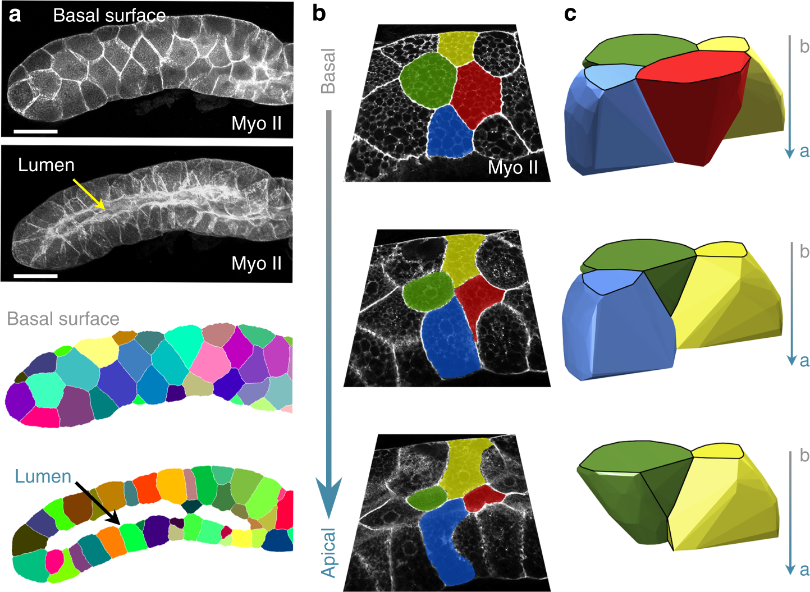
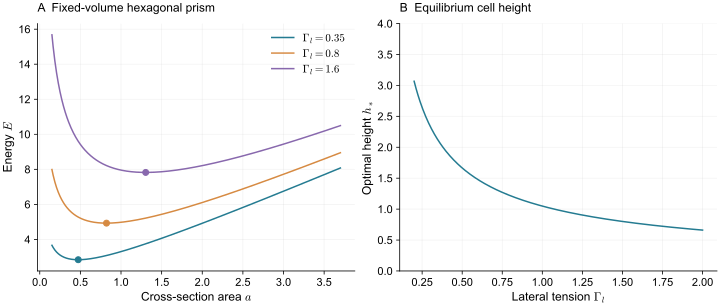
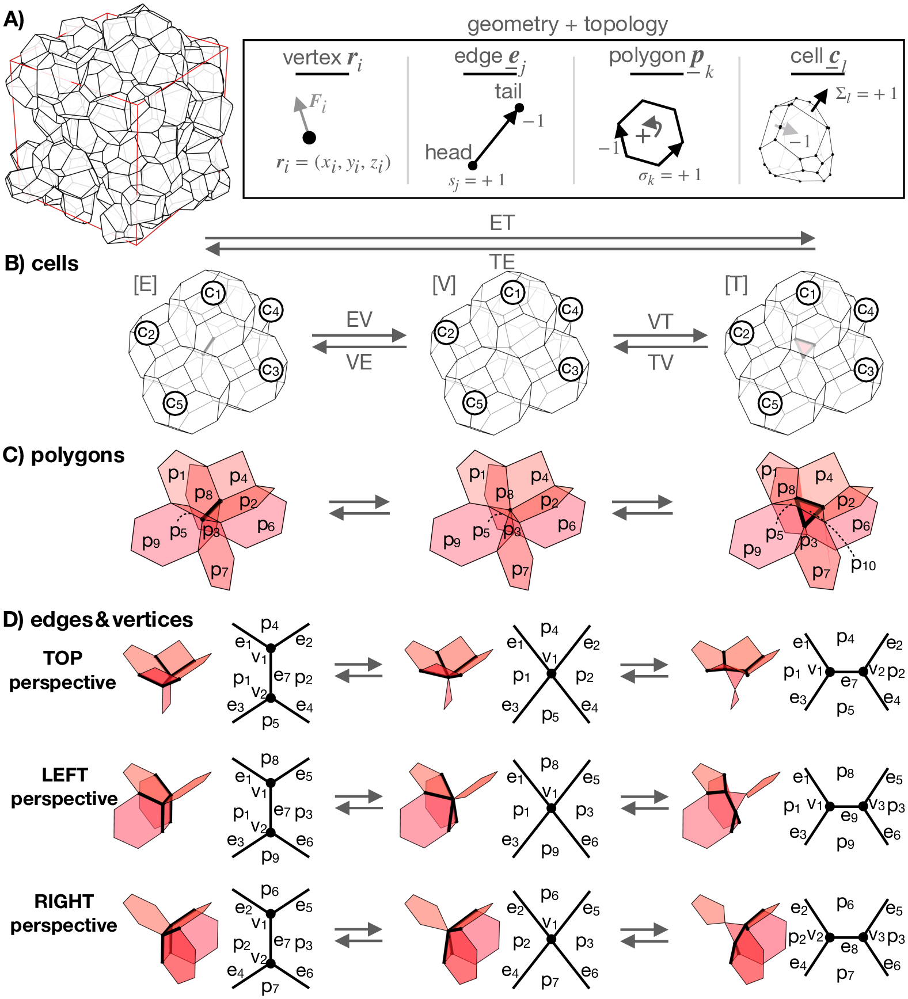
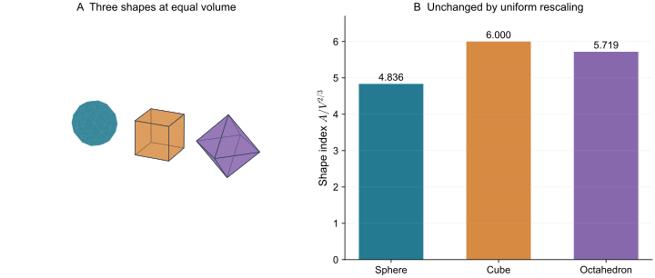
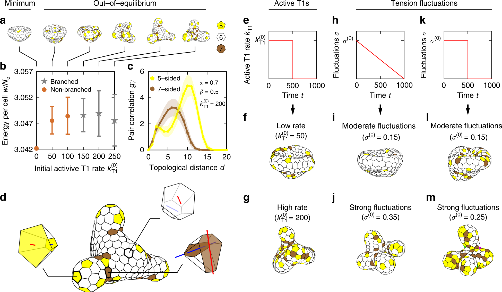

> **Part II · Note 04**　上一篇：[03 · 表面网格：皮层、接触与重网格](/notes/cell_simulation_3d/surface_mesh/) · [专题目录](/notes/cell_simulation_3d/) · 下一篇：[05 · 格点与 Cellular Potts](/notes/cell_simulation_3d/lattice_potts/)

## 1. 三维 Vertex 的出发点与几何选择 {#main-lecture}

密集上皮和许多胚胎组织具有一个很强的几何约束：一个细胞边界向外移动，邻居就必须随之调整。同一块接触面的一侧属于细胞 $i$，另一侧属于细胞 $j$。如果分别保存两套完全独立的表面，程序需要反复让它们靠近并防止穿透；共享界面模型则把这份接触直接作为共同对象保存，细胞体积和受力从同一套网络中计算。

Vertex Model 的基本想法来自对这种细胞拼接结构的简化。二维中，细胞占据多边形，交界由边和顶点组成；三维中，细胞成为由面包围的体，面交于边，边再汇入顶点。顶点运动同时改变多个细胞，恰好表达了组织局部运动必须相互兼容的要求。几何、体积与界面能由此可以写在同一组自由度上。

泡沫和空间铺砌提供了重要的力学参照：压差使界面弯曲，表面张力在交线处平衡，局部接触改变又会重组整个网络。但细胞还会主动调控皮层、保持极性和分裂，界面材料也可能有记忆。细胞网络模型因而保留这些几何关系，并根据研究对象重新规定能量、主动作用和事件规则。相同的多面体网络，可以承载不同的组织材料。

[Honda、Tanemura 与 Nagai（2004）](https://doi.org/10.1016/j.jtbi.2003.10.001)使用空间填充多面体研究细胞团的变形与重排；[Okuda、Inoue 与 Adachi（2015）](https://doi.org/10.2142/biophysico.12.0_13)的综述进一步梳理三维网络如何表达收缩、生长、分裂与重连。这些工作的共同问题，是让网络在大形变中继续代表一群闭合、相邻且具有身份的细胞。

将二维推广到三维，还需要决定保留多少厚度方向的信息。将一张二维多边形图放到曲面上，主要增加组织曲率；为每个细胞保存顶面、底面和侧面，则增加高度与极性；允许顶基底拥有不同邻居，才进一步放开完整三维接触。三种模型可以画出相似的组织外形，允许的细胞运动却不相同。

因此，本篇从棱柱细胞的高宽比开始，将不同表面的张力与细胞形状连接，再讨论共享面的受力、网络合法性及重连。这里的关键选择是将哪些界面视为共同约束，以及当它们出现或消失时，如何让机械过程和拓扑更新保持一致。

厚度方向的三种处理，需要分别考察其允许的运动。

曲面单层把细胞表示成弯曲曲面上的多边形。它记录细胞在这个曲面内如何变形、排列和换邻居，没有独立的顶端、基底或细胞高度。给它增加弯曲能，可以研究一张薄层的形状，但不能直接得到每个细胞内部的厚度变化。

顶端—基底模型保存两层顶点，用侧面连接成细胞。顶端面积、基底面积、高度和倾斜都能改变，因而适合研究柱状、立方状和楔形上皮。但如果顶基底的顶点始终一一对应、两侧邻居永远相同，沿厚度改变邻接的形状仍被排除。

完整三维模型不预设一张单层结构。细胞可以拥有复杂的面网络，不同高度的邻接可以不同，重排也可以改变局部层数。自由度增加后，几何有效性和重连规则变得更难维护。

[Gómez-Gálvez 等（2018）](https://doi.org/10.1038/s41467-018-05376-1)研究弯曲上皮时，用 scutoid 描述一类顶基底邻接不同的三维细胞形状。这个概念的价值在于指出：三维堆积可以通过厚度方向的邻居改变来适应曲率。它并不单独给出张力、本构或动力学；模拟仍要说明这些形状为什么出现、出现需要什么力学代价。

*图 1 · scutoid 首先是一种可观察的三维邻接几何。* [Gómez-Gálvez 等（2018），Fig. 2](https://www.nature.com/articles/s41467-018-05376-1/figures/2)；a、b 为组织成像及标记，c 为三维重建；[CC BY 4.0](https://creativecommons.org/licenses/by/4.0/)。

沿 b 的箭头从基底侧走向顶端，追踪同色细胞，就会发现接触关系发生变化；c 让这些只在部分高度存在的接触面更容易看清。这些截面取自不同深度，不能当作一段随时间换邻居的电影。它给模型提出的要求很具体：若始终把顶端多边形直线拉成棱柱，就没有足够的自由度表达这种组织。

scutoid 图中的邻接变化发生在同一个时刻的不同深度上。可以把每个深度 $z$ 的截面看作一张接触图 $G(z)$：从基底走向顶端，一条截面边可以缩短、消失，并在另一个位置出现新边。细胞的完整三维表面把这些截面连接起来，所以单细胞会出现棱柱没有的顶点和侧面结构。

随时间发生的重排则改变 $G(z,t)$ 的时间参数。它需要界面运动和局部拓扑更新；一个已经具有 scutoid 形状的静态组织，不一定正在重排。实验只比较顶面和底面时，能够证明的是厚度方向邻接不同。要测重排率，还需三维时间序列及一致的细胞身份追踪。

这一差别会直接决定计算结构。若顶面和底面被强制使用一模一样的邻接表，再用侧面一一连接，模型可以弯曲、改变高度，却始终排除了厚度方向的接触变化。允许完整三维面网络以后，几何自由度增加，维持闭合与重连的工作也随之增加。所谓“三维 Vertex”因此不能只由画面有没有厚度来判断。

## 2. 从单细胞形状到共享面能量 {#shape-and-energy}

考虑体积固定为 $V$ 的正六边形棱柱。设横截面积为 $a$，高度为 $h=V/a$，截面周长为 $P=c_6\sqrt a$，其中 $c_6=\sqrt{8\sqrt3}$。顶端与基底的有效张力之和记为 $G=\Gamma_a+\Gamma_b$，侧面张力记为 $\Gamma_l$。

总表面能为

$$
E(a)=Ga+\Gamma_lPh
=Ga+\Gamma_lc_6V a^{-1/2}.
$$

第一项希望减小横截面；第二项来自侧面积，它希望增大横截面、降低细胞高度。对 $a$ 求导，令导数为零，得到

$$
a_* =\left(\frac{\Gamma_lc_6V}{2G}\right)^{2/3},
\qquad h_* =\frac V{a_*}.
$$

这解释了一个乍看并不明显的结果：增大侧面张力，可以让细胞变矮，因为矮而宽的细胞在固定体积下可以减少侧面积；增大顶基底张力之和，则倾向于让细胞变高。

*图 2 · 高度需要通过各表面的代价共同决定。* 取 $V=1$、$G=2$，比较不同 $\Gamma_l$。圆点为解析极小值；这里没有邻居约束或上皮弯曲。

这个算例还区分了两种作用。$\Gamma_a+\Gamma_b$ 影响平直细胞的高宽比，而 $\Gamma_b-\Gamma_a$ 可以对上皮中面产生弯曲趋势。若只把整个表面的张力压缩为一个参数，两种效应就无法独立调节。

真实组织中，横截面受到邻居和外部边界约束，顶基底还可能具有不同的面积弹性。因此，上式提供的是受力方向和标度关系，不是任意细胞高度的直接拟合公式。

单个棱柱给出张力竞争的方向，进入组织以后，每个细胞的多个接触还会通过共享顶点耦合。能量必须对整套相邻对象一起计算。

体组织中常用的能量写法为

$$
E=\sum_i\left[\frac{K_{V,i}}{2V_{0,i}}(V_i-V_{0,i})^2
+\frac{K_{A,i}}{2A_{0,i}}(A_i-A_{0,i})^2\right]
+\sum_f\Gamma_f A_f+\sum_e\Lambda_e L_e.
$$

体积项限制压缩，目标面积项可以表示有效皮层面积偏好，面能与线能表达额外界面和交线作用。这几项不是每个模型都必须具有。若面积弹性与恒定张力一起使用，其实际有效张力由完整能量对面积的导数决定。

共享面在相邻两个细胞的完整表面积里各出现一次，因此细胞面积项的导数会共同作用在这块面上。若还添加显式 $\Gamma_fA_f$，它是额外贡献。比较论文参数时，要先看面积是按细胞计，还是按共享面只计一次。

令顶点坐标为 $\mathbf r_a$，过阻尼受力可写为

$$
\xi_a\dot{\mathbf r}_a=-\frac{\partial E}{\partial\mathbf r_a}.
$$

体积和面积都依赖许多共享顶点，因此梯度需要包含所有相邻细胞。整体平移不应改变内部能量，相应的净内力应为零。这个检查可以发现漏掉某一侧细胞面积导数的错误。

顶点运动后，一块多边形面的所有顶点不一定仍位于同一平面。模型可以限制面接近平面，也可以将它三角化并允许局部弯曲。若引入面中心，面中心位置是独立自由度，还是由顶点平均得到，也会影响求导方式。

这些几何选择与生物问题直接有关。压差不同的两个张力细胞，平衡接触面一般具有曲率。如果模型强制所有接触面平直，它不能精确满足任意压差下的局部 Laplace 平衡；只能将这种形状自由度合并到粗粒化近似中。使用平面多面体仍可能准确描述组织排列，但不宜再用同一个模型预测细胞间界面曲率。

### 2.1 共享面的实际张力 {#effective-face-tension}

以内部共享面 $f=(ij)$ 为例。它同时计入 $A_i$ 和 $A_j$，又可能具有显式面能 $\Gamma_fA_f$。当其他面积变量固定时，增加这块面的面积，完整能量给出的共轭张力为

$$
T_f=\Gamma_f+
\frac{K_{A,i}}{A_{0,i}}(A_i-A_{0,i})+
\frac{K_{A,j}}{A_{0,j}}(A_j-A_{0,j}).
$$

因此，邻居改变形状、使 $A_j$ 增加以后，即使 $\Gamma_f$ 没变，这块面的实际张力也可能上升。将所有面张力当作独立固定参数，与用每个细胞的目标总面积生成张力，是两类不同模型。前者便于指定区域作用，后者把同一细胞的多块接触耦合起来。

相应地，移动一个顶点的力可以组织成

$$
\mathbf F_a=\sum_{i\ni a}p_i\frac{\partial V_i}{\partial\mathbf r_a}
-\sum_{f\ni a}T_f\frac{\partial A_f}{\partial\mathbf r_a}
-\sum_{e\ni a}\Lambda_e\frac{\partial L_e}{\partial\mathbf r_a},
\qquad
p_i=K_{V,i}\left(1-\frac{V_i}{V_{0,i}}\right).
$$

这不是把压力和张力额外加到能量梯度之外，而是把同一个梯度按几何来源展开。所有受影响的细胞、面和边都应进入求和。对于任意整体平移或旋转，内部能量不变，因而总内力与总内力矩应抵消。

几何辅助点也需要一致求导。若一个非平面多边形通过面中心三角化，而面中心取顶点均值，它会随每个顶点移动。求力时漏掉这个间接依赖，等于使用了一个与实际面积公式不同的模型。把面中心设为独立自由度则是另一种合理选择，但此时需为它单独求平衡。

## 3. 拓扑重连与组织流动 {#topology-and-rheology}

考虑一条边，它由两个端点组成；一块面的边首尾相接构成闭环；一个细胞的有向面又组成闭合表面。这三层关系必须互相一致。

可以把它们写成有向关联矩阵。$\partial_1$ 将边映射到端点，$\partial_2$ 将面映射到边，$\partial_3$ 将细胞映射到面，满足

$$
\partial_1\partial_2=0,\qquad \partial_2\partial_3=0.
$$

这两式的直观意义分别是：闭合面边界没有多余端点，闭合细胞表面没有多余边界。相邻细胞共享的面在两侧应使用相反朝向。用这套记法并不是为了让模型更抽象，而是为了在一次重排之后检查有没有漏删一条边或错连一块面。

拓扑正确仍不保证几何有效。一个关联关系完全闭合的多面体，仍可能自交、出现负体积或极薄的退化面。因此，关联检查、体积检查和自交检测需要各自存在。

对拓扑为球的单细胞表面，有 Euler 关系 $n_v-n_e+n_f=2$。它是必要条件，不能识别所有几何问题；周期组织整体的 Euler 特征也不能直接取成 2。

闭合且无自交的网络可以连续变形，但当某些局部几何缩到退化状态时，仅更新坐标已不够。此时需要改变连接，并继续保持细胞身份与封闭性。

二维常见 T1 可以画成一条短边收缩到点，再沿另一方向打开。三维的局部结构包含面与交线，因而不能简单地对一条边“换个方向”就完成重排。

在典型内部构型中，一条逐渐缩短的边可以先并为一个高配位顶点，再打开成一块三角面；反向过程则让三角面缩为顶点，再打开成边。这样的边—顶点—三角面转换会改变一组细胞的邻接。复杂多边形面、边界和其他退化构型还需要相应扩展。

[Okuda 等（2013）](https://doi.org/10.1007/s10237-012-0430-7)的可逆网络重连框架处理了大形变中几何、能量与拓扑的一致性。[Sarkar 与 Krajnc（2024）](https://doi.org/10.1371/journal.pcbi.1012089)进一步将空间填充细胞团中的基本转换写成图拓扑操作。两者都表明，三维重排的难点不仅是找到一条短边，还包括如何生成可逆、有效的新局部结构。

*图 3 · 把“交换邻居”展开到局部网络。* [Sarkar 与 Krajnc（2024），Fig. 1](https://doi.org/10.1371/journal.pcbi.1012089.g001)，算法几何示意；[CC BY 4.0](https://creativecommons.org/licenses/by/4.0/)。

A 列出网络保存的对象；B、C 从细胞与多边形两个层次表示同一转换；D 再从三个方向检查局部结构。沿箭头看，一条边消失后先形成退化顶点，再展开成新的三角面。反向箭头同样重要，因为它要求程序能恢复合法的邻接。这里画的是模型允许的局部拓扑操作，是否在组织中发生、发生多快，还要由力学与事件规则决定。

一套重排算法实际包含触发条件、新结构选择、初始几何放置和后续松弛。长度阈值可以防止边过短导致数值退化，却不自动等于真实组织的重排势垒。若把阈值调大后组织突然更容易流动，就需要区分是物理机制改变，还是算法更早地执行了换邻居。

还有一个常见的问题是重排来回跳动：旧边刚变为小面，小面又立即缩回旧边。处理时可以检查两种构型的能量、局部力与时间连续性，也可以使用有物理含义的滞后规则。无论采用哪种方式，都应能解释它如何改变重排速率。

一条边变短只说明旧表示接近退化，并没有确定新结构应以多快速度打开。令 $s$ 表示新面展开的一个局部坐标，在合法的小面分支上可写

$$
E(s)=E_0+a s+\frac12b s^2+\cdots,\qquad s\geq0.
$$

若展开方向降低能量，局部力会推动新面长大；若所有允许方向在初始阶段都抬高能量，则还存在需要主动驱动或涨落跨越的代价。只要边长小于阈值就无条件换邻居，可能跳过后者。相反，完全禁止能量上升，又会排除组织中由活性驱动的重排。

可以把算法明确分成几何合法性、机械选择和时间过程三个层次。几何层检查新面能否形成闭合、无自交的细胞；机械层比较局部力与能量路径；时间层给出确定性运动或带速率的事件规则。若使用 $r=r_0\exp(-\Delta E/\chi)$ 一类现象学速率，$\chi$ 表示假设的有效驱动尺度，不能直接当作组织处于热平衡的温度。

一个重要检验是事件阈值缩小时，同一物理加载下的重排应力、事件顺序统计和长期流变是否收敛。复杂无序组织不必逐个事件完全相同，但若流动速度持续由阈值本身控制，模型所预测的主要是更新器的时间尺度。重连图解决了“怎样合法地连接”，实际的形态发生还需要解释“为什么此时发生”。

### 3.1 几何刚性与有限时间流变 {#rigidity}

几何约束与刚性并不等价。给定一个能量极小构型，对顶点作小位移 $\mathbf u$，有

$$
E\simeq E_*+\frac12\mathbf u^{\mathsf T}\mathbf H\mathbf u,
\qquad H_{ab}=\frac{\partial^2E}{\partial q_a\partial q_b}.
$$

$\mathbf H$ 的低特征值方向表示低代价变形。除去整体平移等对称性后，若仍有许多很软的模式，组织即使保持接触，也可能容易变形。

对由几何量 $g_m(\mathbf q)$ 与目标值 $g_m^0$ 构成的二次能量，Hessian 可以分为

$$
\mathbf H=\mathbf J^{\mathsf T}\mathbf K\mathbf J
+\sum_m k_m(g_m-g_m^0)\nabla^2g_m,
\qquad J_{ma}=\frac{\partial g_m}{\partial q_a}.
$$

第一项来自几何量的一阶变化，第二项来自已经存在的几何不相容和预应力。正因为有第二项，简单数一数“自由度与约束数目”不一定足以判断刚性。详细的线性响应可与[原 Vertex 专题](/notes/vertex_model/linear_response/)对照。

三维中常用形状指数

$$
s=\frac{A}{V^{2/3}}.
$$

球的 $s=(36\pi)^{1/3}\approx4.836$，是固定体积下的几何下界；球却不能在没有空隙的条件下填满空间。立方体的值为 6，其他规则多面体又有不同的值。这些几何数本身都不是组织的流变临界点。

*图 4 · 形状指数描述几何，临界值还依赖模型。* 对三个解析形体计算 $A/V^{2/3}$；同时画出统一缩放前后的不变性。正八面体在这里用于比较形状，不被假定为能够单独填满空间的细胞铺砌。

[Merkel 与 Manning（2018）](https://doi.org/10.1088/1367-2630/aaaa13)在三维汇合 Voronoi 模型中研究了由目标表面积控制的刚性转变，报告特定模型中的临界目标形状指数约为 5.413。这个数字属于其自由度、能量、边界和采样条件；完整顶点网络、不同主动驱动或不同重排规则不必具有同一阈值。

Voronoi 模型还要单独说明：它从细胞生成点构造整个多面体网络，顶点位置受生成点约束。一般三维 Vertex 则允许顶点独立运动。两者都能保存汇合细胞，却不具有相同的形变空间。

若三张正张力界面在一条线相交，三个牵引矢量必须能闭合成三角形。张力相同才得到 120°；若其中一项大于另外两项之和，就不存在这种静态三界面平衡。体系可能通过改变接触或让一相进入另一接触来降低能量。

所以拓扑规则与能量并非完全可以分开选。若某类接触在设定张力下本来就不稳定，强行维持固定邻接会积累很大残余力；反过来，过于积极的重连可以绕开本来应由材料变形跨越的能垒。实际重排中应检查事件前后的受力与几何，确定算法究竟近似了哪一段过程。

小振幅剪切测得的弹性模量，主要描述给定构型附近的响应。持续剪切中的应力下降，还依赖重排能否发生以及等待多久。可以固定同一个初态，分别做小阶跃剪切、恒定剪切速率和应力控制蠕变，比较短时刚度、应力松弛与长期形变。

若在前一种实验中很硬、后一种实验中能持续变形，说明短时弹性与长期拓扑松弛并存。只根据最终某条边是否触发重连，就把组织归类为固体或液体，会丢掉频率和观察时间。重排率与应力下降量也不一定成正比：有些事件主要释放局部应力，有些会改变后续重排的路径。

事件数量还要与事件方向和实际组织应变一起检验。许多近似均匀取向的重排可以松弛应力，却不产生净定向伸长；平均细胞形状停止变化后，定向重排仍可支持持续流动。这一联系及其三维限制见 [08 · 定向重排与组织流动](/notes/cell_simulation_3d/morphogenesis/#directed-rearrangements)。模型的重连阈值因而不能只靠总 T1 频率标定，还应比较事件取向、细胞形状和材料速度场。

## 4. 顶基底不对称与上皮弯曲 {#epithelial-bending}

在薄层近似中，顶端与基底位于中面的两侧，相距约 $h$。两侧的张力对中面产生不同力矩，弯矩每单位长度的尺度为

$$
m\sim\frac h2(\Gamma_b-\Gamma_a).
$$

上皮实际曲率还要与弯曲刚度、面内拉伸、基质和外部牵引平衡。仅知道某一区域顶端收缩增强，并不能立即确定整片组织朝哪边弯：周围组织可能限制伸缩，腔压也可能支撑内表面。

在完整细胞模型中，厚度和侧面可以显式变化，这个弯矩由各表面受力涌现；在薄壳连续模型中，则常将它合并为主动弯矩或自发曲率。两种层次可以互相标定，但不能在同一模型里无意中把同一主动效应计入两次。

这也解释了三维 Vertex 在形态发生研究中的用途：它能把某个面的收缩与整层组织的弯曲联系起来，同时保留细胞分裂和重排。若研究转向细胞膜褶皱、突出或大量胞外孔隙，则需要增加形状自由度或更换表示。

在中面曲率半径远大于厚度时，两张平行偏置表面的面积元可以展开。令中面平均曲率为 $H$、Gaussian 曲率为 $K_G$，顶基底分别位于 $\pm h/2$，则

$$
dA_\pm\simeq\left(1\pm hH+\frac{h^2}{4}K_G\right)dA.
$$

将它代入顶基底张力能，得到

$$
E_{a+b}\simeq\int\left[(\Gamma_a+\Gamma_b)
\left(1+\frac{h^2K_G}{4}\right)
+(\Gamma_a-\Gamma_b)hH\right]dA.
$$

与平均曲率成线性的项来自张力差，正是弯曲趋势的来源；张力之和还影响面积和高度。式中的符号随顶基底与法向约定改变，物理上的两侧不对称保持不变。

这个展开要求偏置面没有在局部相交，厚度相对曲率半径足够小。强烈内陷、厚度变化和顶基底邻接改变时，显式三维细胞模型提供了超出薄层展开的自由度。反过来，在薄层范围内，可以用展开结果检查离散模型是否给出合理的有效弯矩。

*图 5 · 形态由材料和经历过的重排共同决定。* [Rozman、Krajnc 与 Ziherl（2020），Fig. 2](https://www.nature.com/articles/s41467-020-17535-4/figures/2)，三维 Vertex 模拟；[CC BY 4.0](https://creativecommons.org/licenses/by/4.0/)。

a 在相同顶、基底张力参数下改变初始主动重排率，壳可以停在不同的整体构型；d 放大了其中的三维细胞，顶面和底面的长轴并不必然一致。黄色、白色和棕色区分五、六、七边形细胞，不表示命运类型。将整体分支与局部细胞形状一起看，才能理解为什么仅用瞬时能量最低点，可能解释不了组织的形态历史。

## 5. 几何简化的物理后果与局限 {#model-limits}

共享网络适合研究空间近似填满的组织。它把接触面的两侧锁定为同一几何，能直接保存相邻关系、体积与面积，也能将局部收缩连接到整体变形。在上皮弯曲和密集细胞重排中，这种约束正是需要保留的信息；其适用范围由所选的面几何、厚度自由度与事件规则共同决定。

界面几何的简化首先限制可解释的局部受力。若接触面被强制保持平面，模型可以很好地表达细胞排列，却无法精确实现任意压差下的界面曲率。增加面内节点能够改善这一点，同时也增加新的形变模式和计算成本。因此，同一模型中由总体积得到的压力，与由真实曲率反演的局部压力，可能需要在共同几何近似下重新比较。

空间填充假设也有明确边界。胞外液隙、组织孔洞、自由突出和细胞脱离需要额外的介质单元或边界拓扑；保持封闭铺砌的网络会排除其中一些过程。将实验中的间隙误差全部吸收到细胞面积或张力里，可能得到稳定的多面体形状，却改变了真实的接触和运输路径。实验分割时是否保留介质空间，会直接影响这类模型的初始化。

拓扑重连则决定长期响应中的另一部分。局部连接合法，保证的是新结构仍代表闭合细胞；触发阈值、能量选择和等待时间还会决定它何时出现。若实际重排主要由连接成熟、皮层活动或细胞周期调控，纯长度阈值只能作为一种有效规则。通过一次静态形态或短时模量标定，并不能同时保证长期重排与流变正确。

不同网络的刚性结论也应连同自由度解释。Voronoi 顶点受生成点约束，独立顶点可以探索更多形变，顶基底模型又可能维持固定的层结构。改变这项选择，会改变软模式、预应力和可达接触。因此，某个目标形状指数的阈值属于具体模型与加载协议；它对实验的意义，需要由响应和运动的独立测量确定。

从生物机制看，网络几何仍只是细胞活动的一个承载层。极性、分裂方向和受力反馈若作为输入，就应与由机械演化产生的结果分别说明。模型可以检验这些输入与受力是否足以产生组织形态，再通过扰动检验其稳健性。后面的格点模型将放弃预先保存共享面，以空间身份的局部更新产生另一种形变与邻接动力学。

## 6. 参考文献 {#references}

1. Honda, Tanemura and Nagai (2004). [A three-dimensional vertex dynamics cell model of space-filling polyhedra simulating cell behavior in a cell aggregate](https://doi.org/10.1016/j.jtbi.2003.10.001). *Journal of Theoretical Biology*, 226(4), 439-453.

2. Okuda, Inoue and Adachi (2015). [Three-dimensional vertex model for simulating multicellular morphogenesis](https://doi.org/10.2142/biophysico.12.0_13). *Biophysics and Physicobiology*, 12(0), 13-20.

3. Gómez-Gálvez et al. (2018). [Scutoids are a geometrical solution to three-dimensional packing of epithelia](https://doi.org/10.1038/s41467-018-05376-1). *Nature Communications*, 9(1), 2960.

4. Okuda et al. (2013). [Reversible network reconnection model for simulating large deformation in dynamic tissue morphogenesis](https://doi.org/10.1007/s10237-012-0430-7). *Biomechanics and Modeling in Mechanobiology*.

5. Sarkar and Krajnc (2024). [Graph topological transformations in space-filling cell aggregates](https://doi.org/10.1371/journal.pcbi.1012089). *PLOS Computational Biology*, 20(5), e1012089.

6. Merkel and Manning (2018). [A geometrically controlled rigidity transition in a model for confluent 3D tissues](https://doi.org/10.1088/1367-2630/aaaa13). *New Journal of Physics*, 20(2), 022002.

---

[← 03 · 表面网格：皮层、接触与重网格](/notes/cell_simulation_3d/surface_mesh/) · [专题目录](/notes/cell_simulation_3d/) · [下一篇：05 · 格点与 Cellular Potts →](/notes/cell_simulation_3d/lattice_potts/)
