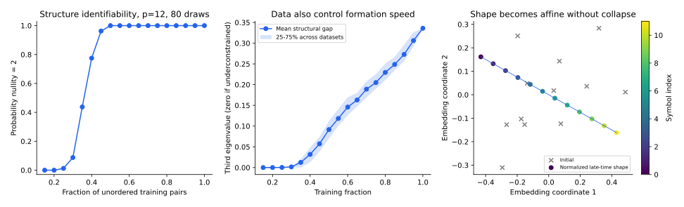

[专题目录](/notes/grokking/) · ← [表示形成与算法电路](/notes/grokking/representation_circuits/) · [实验与机制诊断](/notes/grokking/experiments_diagnosis/) →

## 前言：把表示当作受约束的物理对象

表示学习可以从另一种角度观察：每个符号对应一个嵌入向量，训练数据在这些向量之间施加关系。若许多不同输入得到同一个答案，它们的表示应当以某种方式兼容。随着数据增加，原来松散的向量排列可能逐步被约束成直线、圆或更一般的代数结构。

这种图景与统计物理中的约束、软模和有序结构相近，但要使用得有解释力，必须写出约束是什么、哪些自由度只是坐标选择，以及哪些变化真的影响预测。画出一幅漂亮的嵌入图，还不足以证明存在热力学相变。

[Liu 等，Towards Understanding Grokking](https://arxiv.org/abs/2205.10343)提出表示学习的有效理论，用加法任务中的平行四边形关系连接数据、表征与学习相图。本篇展开其中的约束思想，给出一个中心化、保持尺度的独立模型，再讨论相图、临界减慢与可辨识性的区别。

## 1. 相同答案怎样约束嵌入 {#parallelogram-constraints}

先研究普通整数加法，输入符号 $i,j\in\{0,\ldots,p-1\}$，模型为

$$
f(i,j)=\operatorname{Dec}(E_i+E_j).
$$

$E_i\in\mathbb R^q$ 是可学习嵌入，解码器输出和 $i+j$ 对应的目标。如果两个训练输入满足 $i+j=m+n$，它们具有相同输出。若解码器在相关表示集合上是单射，并且训练误差为零，就有

$$
E_i+E_j=E_m+E_n.
$$

这是一个平行四边形关系。单射条件不能省略：一般神经解码器可以把不同表示映射到同一输出，那时相同标签并不强迫欧氏嵌入和相等。真实网络与这个理想关系的接近程度，是有效理论的一项可检验前提。

### 五个符号的明确例子

取 $p=5$。若训练中包含 $(0,2),(1,1)$，相同答案二给出 $E_0+E_2=2E_1$。再有 $(1,3),(2,2)$ 和 $(2,4),(3,3)$，得到

$$
E_0-2E_1+E_2=0,\quad
E_1-2E_2+E_3=0,\quad
E_2-2E_3+E_4=0.
$$

这些条件令相邻差相同，因此 $E_i=b+iv$。平移向量 $b$ 与方向和尺度 $v$ 仍然自由，但嵌入的相对结构已经是线性的。

反过来，训练集即使包含了所有符号，也未必确定这种结构。例如只看见和为四的 $(0,4),(1,3),(2,2)$，只得到两条独立关系。符号访问覆盖已经完整，关系约束却还不足以唯一确定整条直线。数据量、token 覆盖和结构可辨识性是不同的概念。

## 2. 约束矩阵、零模与额外自由度 {#constraint-rank}

把每条关系写成一行向量 $a_\mu$，在第 $i,j,m,n$ 个位置分别加入 $1,1,-1,-1$，重复下标相加。堆成矩阵 $A$，将嵌入按符号排成 $E\in\mathbb R^{p\times q}$，则理想约束为

$$
AE=0.
$$

对普通加法，常向量 $\mathbf1$ 和位置向量 $v_i=i$ 始终在零空间中。完整约束集合通常只保留这两个符号方向；对每个嵌入坐标，解都是仿射函数。

若训练约束的零空间维数大于二，就存在额外的形变方向，它们不破坏训练中已施加的关系，却可以改变未见组合。这些模式提供一种具体的不可辨识性解释：即使训练完全拟合，数据也还没有排除错误的外推结构。

当零空间恰好为二，约束确定了仿射形状，但没有确定它在 $\mathbb R^q$ 中的绝对位置、尺度和朝向。这些自由度可能是表示的规范选择，不应该被计入尚未学会的任务内容。

### 几何确定也不自动保证完整预测

前面六个训练输入只覆盖了部分输出和。如果目标是每个和对应的任意随机标签向量，未见过某个输出标签，仅凭嵌入变成直线也不能知道那个随机向量是什么。解码器的标签覆盖、平滑性或已知运算结构，还必须另外规定。

因此，约束秩是表征条件，而不是对任意 decoder 的充分泛化定理。把表示唯一性、解码器能力与输出信息分开，能够避免从几何图直接跳到任务完成。

## 3. 有效能量与避免嵌入塌缩 {#effective-flow}

一个自然的约束违背量是

$$
\mathcal E_0(E)=\operatorname{Tr}(E^\top ME),
\qquad M=A^\top A/n_c,
$$

其中 $n_c$ 为约束行数。若直接最小化这个二次型，所有嵌入相等也是零能量状态。它满足关系，却失去区分不同答案的能力，因此必须同时处理平移与尺度。

下面取中心化嵌入 $\mathbf1^\top E=0$，定义 $S=\operatorname{Tr}(E^\top E)\gt0$，使用 Rayleigh 商

$$
\mathcal E(E)=\frac{\operatorname{Tr}(E^\top ME)}{S}.
$$

对它做学习率为 $\kappa$ 的梯度流：

$$
\boxed{\dot E=-\frac{2\kappa}{S}(ME-\mathcal E E).}
$$

直接计算可得

$$
\frac{dS}{dt}=0,\qquad
\frac{d\mathcal E}{dt}=-\kappa\|\nabla_E\mathcal E\|_F^2\leq0.
$$

由于 $M\mathbf1=0$，零均值子空间也保持不变。这样消除了无关平移，并阻止系统仅靠收缩到零来满足约束。有效模型描述的是形状调整，而不是预测函数所有参数的真实梯度流。

### 线性松弛与归一化形状之间的关系

令 $U(t)=\exp[-2\kappa Mt/S]E(0)$，再按初始 Frobenius 范数归一化，

$$
E(t)=\sqrt S\,\frac{U(t)}{\|U(t)\|_F}.
$$

它恰好满足上面的归一化流。不同谱模态的相对幅度仍按指数衰减，但整体尺度被持续补偿。因此“保持尺度的形状流”和“原始线性热流”相关，却不是同一条未经归一化的轨迹。

若初始嵌入在所需零空间方向上有非零投影，正谱模式逐渐衰减，形状接近仿射表示。若初始化恰好完全正交于目标零模，精确动力学不会凭空产生该分量；随机连续初始化通常避免这种特殊情况。

## 4. 数据阈值与谱隙怎样进入形成时间 {#structural-gap}

令 $M$ 的本征值升序为 $\mu_1,\ldots,\mu_p$。普通加法至少有两个零模。只有当额外零模消失时，$\mu_3\gt0$ 才是恢复仿射结构的最慢约束速率。

在目标结构附近，一个不需要的模态满足近似

$$
\delta E_j(t)\propto e^{-2\kappa\mu_jt/S}.
$$

把结构残差降到某个相对幅度 $\epsilon$，慢时间估计为

$$
t_{\rm shape}\sim\frac{S}{2\kappa\mu_3}\log\frac{\delta_0}{\epsilon}.
$$

若零空间维数大于二，$\mu_3=0$，就不能通过延长这个有效流消除额外形变。此时选择“第一个严格正本征值”作学习速率，会掩盖尚未被约束的方向；应先检查零模数量。

有限数据随机划分会同时改变秩和谱隙。同一数据比例下，一些训练集已经足以约束结构，另一些仍有额外自由度；即使秩相同，弱约束也会使速率很小。因此只报一个数据比例对应的平均成功时间，可能混合“能否确定结构”与“多久形成结构”两类问题。

*独立的有限约束模型计算。左侧按训练输入随机抽样构造相同标签约束，统计零空间恰好二维的比例；中间显示相应结构速率；右侧展示归一化有效流。它没有训练神经解码器，也不是原论文相图的重绘。*

### 约束增加与学习时钟的归一化

添加一条独立约束，总会缩小或保持零空间；不会凭空增加不确定自由度。如果用未归一化的 $A^\top A$，增加行还会加上一个正半定矩阵，因此各排序本征值不会下降。

但这里的 $M=A^\top A/n_c$ 采用平均约束能量，增加样本时分母也变化，正谱间隙未必逐点单调。更换为总损失后，相同数值学习率对应的时钟也不同。比较不同数据量的形成时间，必须保持平均或求和的约定一致。

训练输入的数量与诱导关系的数量还不是线性对应。一组同标签输入会产生多条成对关系，其中很多在秩上冗余，却仍会改变加权矩阵。用所有关系、只保留一组独立关系，零空间可能相同，动力学却不同。

因此结构唯一性可以是一个比形成时间更稳健的判断。前者主要由约束张成空间决定；后者还取决于每条关系的权重、学习率以及初始状态在慢模上的投影。这与第一篇固定谱下的结论相呼应：存在一个很慢的模式，并不保证它在实际风险里承载足够大的权重。

## 5. 为什么整数直线不能直接搬到模加法 {#algebraic-geometry}

普通加法允许 $E_i=b+iv$。如果同时要求 $i$ 在模 $p$ 意义下循环，且仍使用实向量的线性加法同态，就会要求 $pv=0$，因而 $v=0$。非平凡的循环结构不能用一条无端点直线直接表示。

模加法更自然的对象是旋转或复相位：$\chi_k(a+b)=\chi_k(a)\chi_k(b)$。表示组合从向量相加变成相位相乘，圆形几何与 Fourier 特征标因而出现。这与上一篇的算法构造衔接，也解释为什么不能把一种任务的零空间公式直接换个标签用于另一种代数。

真实解码器还可能把多个欧氏位置映射到同一个答案，使扇形、弯曲流形或冗余坐标也能完成任务。有效距离应反映下游计算怎样区分表示。欧氏平行四边形是一个清楚的模型，不是所有正确表示的唯一形式。

## 6. 四种学习区域与有限观察时间 {#learning-phases}

按训练与测试是否达到目标，以及两者相隔多久，可以区分四种经验区域：

| 区域 | 训练表现 | 测试表现与时间 |
| --- | --- | --- |
| 快速泛化 | 很好 | 与训练接近同步改善 |
| 延迟泛化 | 很早很好 | 较晚达到目标 |
| 只拟合训练集 | 很好 | 当前预算内未达到目标 |
| 未充分拟合 | 也不好 | 无法仅凭测试判断泛化机制 |

Liu 等的学习相图比较表示学习速度、解码器速度与正则化，展示这些区域如何随超参数变化。表示很慢而解码器足够灵活时，可以较早拟合现有样本，却迟迟没有共享结构；解码器过弱或正则化过强，则可能连训练集也无法完成。

这里的“只拟合训练集”是有限预算的操作定义。若观察时间从一万步增至一百万步，某些点可能转入延迟泛化。若存在真正的不可辨识模式，则再延长时间也未必有帮助。区分二者需要数据约束、连续趋势或更长预算，而不是把所有未达标点都视为同一相。

## 7. 相图不自动意味着热力学相变 {#phase-transition}

神经网络的训练通常不是在采样一个已知平衡分布。控制参数可以是学习率、宽度、训练比例或衰减，它们没有自动对应温度或外场。有限网络中看见陡峭曲线，只说明存在强变化，尚未定义无穷规模极限、自由能或非解析性。

一个最小的连续结构幅度模型能够说明临界减慢的可能性。令 $q\geq0$ 表示某种对齐程度，取有效势

$$
V(q)=-\frac a2q^2+\frac b4q^4,\qquad b\gt0,
\qquad \dot q=aq-bq^3.
$$

当 $a\gt0$，小但非零 $q$ 起初约按 $q_0e^{at}$ 增长，最后趋近 $\sqrt{a/b}$。在小幅度区间，达到固定阈值的时间约为 $a^{-1}\log(q_*/q_0)$；当 $a$ 接近零，形成变慢。

这是一种明确标为假设的正规形示意。它没有从 Transformer 参数推出 $a,b$，也没有预测哪个数据比例是临界点。前面约束谱隙变小造成的减慢、这里的不稳定幅度增长，以及有噪声时跨越势垒的等待，是不同的动力学来源。

若要将相变语言用得更强，需要定义结构序参量，比较多个系统规模，研究阈值与响应怎样缩放，并区分随机样本波动和动力学转变。理论中的零模、实验里的准确率跃升和热力学非解析性，不应只因为都画成一条陡曲线就被等同。

## 结语：物理语言的价值在于明确变量和约束

有效理论将数据组织成约束，将表示的不确定性写成零空间，将慢形成时间连接到谱隙。它也迫使我们保留尺度、解码器与代数结构：满足关系可能只是塌缩，几何唯一也不一定已包含未见标签的信息。

学习相图进一步把这些机制放回有限训练协议。它可以帮助判断增加时间、增加数据或改变表示速度分别解决什么问题；当使用“相变”一词时，则还需要说明采用的是经验区域、有效动力学，还是一个真正定义了规模极限的统计物理结论。

[专题目录](/notes/grokking/) · ← [表示形成与算法电路](/notes/grokking/representation_circuits/) · [实验与机制诊断](/notes/grokking/experiments_diagnosis/) →
