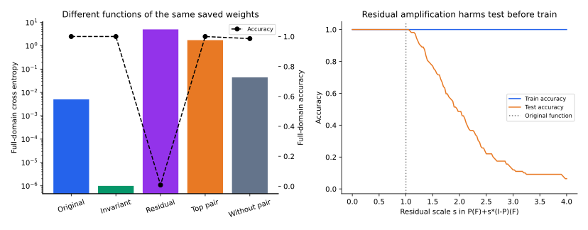

[专题目录](/notes/grokking/) · ← [有效理论与学习相图](/notes/grokking/effective_theory/)

## 前言：把现象、结构与机制放在同一份记录里

理论模型使延迟可以计算，真实训练则检验这种时间分离是否会在具体架构和优化协议下发生。两者之间还有一层工作：保存足够的信息，让曲线、函数结构与干预结果能够相互核对。

这里保留一组真实模加法训练及四个探索对照，并对已保存的末态权重补做函数空间投影、频率删减和残差缩放。训练过程没有重新运行；新增结果来自同一组末态权重的独立计算。它们能够说明最终函数包含什么、预测依赖什么，不能补出原先没有保存的中间权重历史。

这份记录的重点是把结论精确到证据所支持的位置：出现长延迟是一项观测，出现任务对称性是一项结构发现，改变某个成分后行为变化是一次函数干预；若要解释训练为什么在那个时刻泛化，还需要时间序列和训练过程中的干预。

## 1. 任务、模型与训练协议 {#modular-experiment}

任务为 $(a,b)\mapsto(a+b)\bmod19$，完整域包含 $19^2=361$ 个输入。输入采用两个 one-hot 向量拼接，固定随机划分 252 个训练样本和 109 个测试样本。平方激活网络为

$$
h=xW,\qquad z=h^{\odot2}V,
\quad W\in\mathbb R^{38\times128},\quad
V\in\mathbb R^{128\times19}.
$$

训练使用平均交叉熵、全批量 AdamW，学习率 $0.003$，解耦权重衰减 $1$，随机种子 $7$，共四万次更新。每一百步评价同一训练与测试划分，并记录损失、准确率、参数范数与初步 Fourier 指标。

这是一个简化的平方 MLP，区别于原始 Grokking 工作中的 Transformer。它能够表达周期算法，但具体训练不能直接替代其他架构的复现。测试数据不参加梯度更新；展示配置是在几个探索设置中选择出来的，因此这次成功也不代表无调参的平均成功率。

*保留的真实训练记录。训练准确率在第 100 步首次达到 99%；测试准确率在第 14600 步首次达到 99%，截至本次记录从第 38200 步起持续不低于 99%。最终两者均为 100%，训练与测试交叉熵分别约为 $1.18\times10^{-6}$ 和 $0.0166$。*

## 2. 同一条曲线可以有几个不同的延迟时间 {#threshold-times}

从完整评价记录重新计算，测试时间如下：

| 测试准确率目标 | 首次达到 | 在后续记录中持续达到 |
| --- | --- | --- |
| 50% | 300 步 | 300 步 |
| 90% | 2400 步 | 6400 步 |
| 95% | 7500 步 | 33900 步 |
| 99% | 14600 步 | 38200 步 |
| 100% | 15900 步 | 38300 步 |

这次运行显示的是较早开始的泛化改善、较晚完成的尾部错误修正，以及明显的后续波动。它没有在整个等待阶段都停留于随机猜测，也不是一条理想的单步跃迁。采用 99% 阈值，确实得到很大的拟合—泛化时间分离；采用 50% 阈值，则会强调更早的改善。

“持续达到”只相对于已记录到四万步的窗口。每一百步之间是否短暂跌破阈值，当前数据并不知道。把这些边界写清楚，不会削弱现象，反而使不同定义和不同运行可以比较。

### 晚期小幅准确率变化可以对应很不同的概率误差

测试集只有 109 项，一个错误约占 $0.917$ 个百分点。最后几个难样本来回翻转，可以让 99% 与 100% 的首次、持续时间差得很远。交叉熵还会对错误预测的置信度敏感，因此应与准确率共同观察。

如果每次配置都挑选测试最好的时刻，统计结果还包含了时间选择。固定训练预算下的末态、首次达到阈值、验证集选择的检查点，是三个不同评价协议；它们不应在汇总表中悄悄混用。

## 3. 失败设置约束了什么解释 {#controls}

保持模数、宽度、学习率和种子不变，已有探索记录为：

| 激活 | 训练占比 | 衰减 | 更新数 | 最终训练准确率 | 最终测试准确率 |
| --- | --- | --- | --- | --- | --- |
| 平方 | 0.4 | 0.1 | 30000 | 100% | 0% |
| ReLU | 0.5 | 1 | 60000 | 100% | 24.9% |
| 平方 | 0.6 | 1 | 60000 | 100% | 94.5% |
| 平方 | 0.6 | 3 | 40000 | 约 4.2% | 约 6.9% |
| 平方 | 0.7 | 1 | 40000 | 100% | 100% |

过强衰减的设置最终接近零权重，均匀 logits 的交叉熵接近 $\log19$；它属于未能保持训练拟合，而不是“记忆被清除后必然获得规则”。训练占比 0.4 的设置在测试上系统性出错，也说明未见输入的外推可以比随机猜测更差。

这些对照改变的变量不完全单一，例如部分行同时改变数据量与激活，训练预算也不同。因此它们展示协议敏感性，不能单独估计某个超参数的因果效应。一次失败还可能包含未达到目标的删失：预算结束前没有成功，不等于无限时间下永远不会成功。

若汇总许多运行，应同时记录达到目标的比例、成功者的时间分布，以及未成功者的观察终点。只对成功运行平均 Grokking 时间，会把最困难的样本划分和初始化排除掉，产生选择偏差。

## 4. 末态中能看见多少任务对称性 {#endpoint-structure}

对每个输入的 logits 在类别维中心化，得到 $F(a,b,c)$。按 $d=a+b-c\bmod19$ 分组，构造不变部分 $P_GF=\bar F(d)$，并定义残差 $F_\perp=F-P_GF$。投影的完整推导见[表示与电路篇](/notes/grokking/representation_circuits/#symmetry-projection)。

已保存末态的对称能量比例为

$$
\rho=\frac{\|P_GF\|^2}{\|F\|^2}\simeq0.6816,
\qquad
\frac{\|F_\perp\|}{\|F\|}\simeq0.5643.
$$

两者满足 $\rho+\|F_\perp\|^2/\|F\|^2=1$。原模型已经在全部 361 个输入上分类正确，但约三成中心化 logit 平方能量仍在不变子空间之外。

第一层单频 Fourier 功率占比约为 $0.129$，它本身不足以证明一个稀疏算法电路。函数投影则直接检查输入—输出关系，但也依赖我们已知模加法的正确群结构。它是一项使用任务知识的结构分析，而不是额外学习到的无标签能力。

*左图按偏移分组显示中心化 logits 的均值和组内标准差；误差棒表示不同三元组之间的离散程度，不是跨种子置信区间。右图显示不变投影的非零 Fourier 功率。该图描述末态，没有提供结构形成时间。*

## 5. 保留、删除与缩放结构成分 {#interventions}

### 同一组权重的函数干预

在完整输入域上评价原函数、不变投影及其残差，结果为：

| 评价函数 | 全域准确率 | 全域平均交叉熵 |
| --- | --- | --- |
| 原函数 $F$ | 100% | 0.005026 |
| 不变部分 $P_GF$ | 100% | $9.90\times10^{-7}$ |
| 残差 $F_\perp$ | 约 0.83% | 5.028 |
| 不变部分的主频对 $k=3$ | 100% | 1.739 |
| 原函数去掉这个主频对 | 约 98.61% | 0.04406 |

这些操作使用原 logit 尺度，没有温度重新拟合。不变投影的交叉熵显著更低，与完整均匀分布上的凸性结论一致。残差单独分类很差，而主频对单独足以分类所有输入，但其最小间隔只有约 $0.0966$，置信度较低。

去掉主频对后仍能正确分类绝大多数输入，说明这个频率虽然单独足够，却不是原函数全部成功预测的唯一必要成分。其他频率与残差可以提供冗余；“单独能完成任务”不等于“去掉以后任务一定失败”。

主频选择和不变投影使用了完整输入域及已知算术关系，因此这些结果不作为新训练模型的测试性能。它们回答的是同一已训练函数内部的结构问题。

### 逐渐放大非不变残差

令 $F_s=P_GF+sF_\perp$。当 $s=0$ 时是对称投影，$s=1$ 恢复原函数。将 $s$ 增大到二，训练准确率仍为 100%，测试准确率却降到约 $48.62\%$；$s=4$ 时测试约为 $6.42\%$。因此在这个函数干预中，训练拟合可以保持，而测试性能因残差放大明显恶化。

这显示末态残差怎样影响外推，不证明训练晚期恰好沿着 $s$ 变小的路径运动。原来没有保存每个时刻的权重，也就不能从这条事后路径倒推出真实训练轨迹。

*独立重算的函数干预。左图比较不同成分的全域交叉熵与准确率，右图在固定不变部分时缩放残差，比较训练和测试表现。没有进行新的梯度更新，也没有用结果重选训练超参数。*

## 6. 怎样把结构证据推进到形成机制 {#causal-diagnosis}

终点图告诉我们结构与成功共存。若保存中间权重，就可以进一步比较不变能量、投影后的风险、非不变部分风险以及间隔分布的变化顺序。如果不变部分早就能泛化，而完整函数仍然失败，延迟可能涉及清理或读出；如果可泛化成分本身很晚才出现，则更支持表示形成的瓶颈。

这种时间对照仍然是相关证据。更有针对性的干预，是在相近训练误差处冻结表示、重新训练读出，或者在固定时刻改变衰减并继续训练。它们分别改变表示可用性、输出选择或正则化时间，而不只是比较两个最终准确率。

冻结初始特征的参照也有用。如果它在相同数据下始终无法达到完整模型的测试风险，可以排除这个初始字典对该结果的充分解释；但应保证参照已经收敛，并使用匹配的正则化。更大的预算和更合适的调参可能改变基线，不能只比较默认训练步数。

对电路干预还需要区分函数空间与参数空间。直接投影 logits 可以得到原架构未必能以同样小参数表示的函数；删除某个隐藏单元则同时改变多个输出方向。前者有干净的数学分解，后者更接近网络内部实现，两者的因果对象不同。

### 不同测试划分检验不同的泛化

本次测试是在同一个模数的完整输入表中随机保留部分组合。所有输入符号都可以在训练中出现，测试检验的是对未见配对的外推。它并没有检验从模十九迁移到模二十三，也没有检验处理训练词表中从未出现的新符号。

若按行保留所有含某个输入符号的组合，测试就更接近未见符号或未充分约束嵌入的问题；若按输出类别保留，任意类别标签的含义又可能不再有训练信息。把这些划分都叫作“测试集”，会掩盖不同的可辨识性条件。

随机交换离散 token 的编号，也能作为一个有用参照。one-hot 查表模型原则上只看到符号身份，数字距离没有被直接提供；使用标量数值输入的模型则从一开始就获得了顺序与大小。相同的加法标签、不同的输入编码，可以对应很不同的先验与延迟，不能只按架构名比较。

这些区别也关系到“发现规则”的强度。在一个有限域上对所有组合分类正确，是一个明确而有价值的结果；是否恢复了一种能够跨模数执行的算法，需要额外定义输入输出表示与迁移协议。当前函数分解不会自动回答后一个问题。

## 7. 从算法任务到更一般数据，需要改变哪些定义 {#beyond-algorithms}

小型算法任务具有已知的完整输入域、精确规则和可穷举测试。图像、文本和分子数据通常没有这些条件。泛化指标还可能受分布变化、标签噪声和数据混合影响，因此相似曲线不自动指向相同算法电路。

[Omnigrok](https://arxiv.org/abs/2210.01117)展示了超出算法任务的延迟泛化设置，但也说明初始化和参数范数约束会显著影响现象是否明显。研究的对象应是指定数据、模型与训练协议下的时间分离，而不是把所有晚期收益都当作同一种“突然理解”。

在语言模型预训练中，情况更进一步：模型通常沿数据流持续读入新文本，没有一个天然对应某项语法能力的监督训练集。训练 token 更多既意味着训练更久，也意味着见过更多信息，不能直接套用有限样本反复训练的定义。

[2026 年关于语法泛化的预训练类比研究](https://arxiv.org/abs/2606.00230)使用 BLiMP 最小对，根据关键短语在所分析语料窗口中是否逐字出现，构造 proxy-train 与 proxy-validation，研究不同暴露组的时间差。它提供一种具体的操作化办法，而不是把预训练全局损失直接叫作 Grokking 曲线。

逐字未见不等于从未接触同一语法规则，逐字见过也不等于对应能力已经学会。暴露划分可能同时选择不同词汇频率和句子难度，因此匹配随机划分及内容条件很重要。这个方向与[层次语言统计](/notes/hierarchical_data/language_statistics/)相接：更远的上下文、共享规则和稀有结构如何随数据与训练逐渐进入预测。

## 结语：一份可核查的案例应该留下什么

这次运行确实包含训练早拟合、测试晚完成的明显时间分离；同一末态也包含强的任务不变结构。新增函数干预显示，对称部分、主要频率与非不变残差对准确率和概率预测有不同作用。

它仍然只是一组经过探索选择的成功配置。已保存的曲线支持现象判断，末态分解支持结构判断；完整的时间机制还需要中间权重和继续训练干预。把这些层次接起来，Grokking 才能成为研究泛化动力学的具体问题，而不只是一个吸引人的曲线名字。

[专题目录](/notes/grokking/) · ← [有效理论与学习相图](/notes/grokking/effective_theory/)
