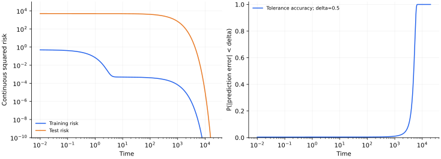
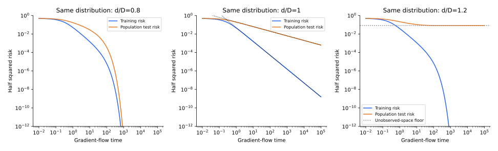

[专题目录](/notes/grokking/) · [正则化与解的竞争](/notes/grokking/solution_competition/) →

## 前言：网络已经拟合以后，还在学什么

训练准确率接近百分之百以后，优化并没有结束。网络还可以继续改变预测置信度、分类间隔、参数方向、隐藏表示，以及对没有见过的输入的外推方式。Grokking 将这些平时不易分辨的变化拉开到不同时间尺度：训练集很早被拟合，测试集却在更晚阶段才明显改善。

[Power 等的原始研究](https://arxiv.org/abs/2201.02177)在小型算法数据上记录了这种延迟，随后出现了固定特征、正则化竞争、表示形成和优化器动力学等不同解释。理解这些工作，首先需要将观测与机制分开。训练和测试不同步是一个现象；“先记忆、后理解”已经是一种额外解释。

一个容易混淆的地方是，测试准确率突然上升，并不意味着函数或参数在同一时刻发生不连续变化。连续的慢运动经过阈值评分，也可以被显示成骤变。反过来，平滑曲线也不排除内部表示已经发生了重要重组。这个专题从可解基线开始，再逐步加入解选择、特征学习与结构诊断。

这里真正值得追问的是，早期拟合究竟还没有确定什么。有限训练集只检查函数在少数输入上的取值；即使这些取值已经正确，未见输入上的延拓仍可能差别很大。训练继续进行时，模型也许在修正同一个表示中的微弱方向，也许在多个拟合解之间重新分配权重，也许在改变表示本身。这几种运动都可能藏在近乎水平的训练准确率下面。将它们分开，才能理解延迟为什么有时来自数据、有时来自参数化，又为什么同一网络换一套评价规则，表观转折就会移动。

## 1. 延迟需要用明确的观测量定义 {#delay-definition}

设训练集为 $\mathcal D_{\rm tr}$，独立保留集为 $\mathcal D_{\rm te}$。训练准确率 $A_{\rm tr}(t)$ 与测试准确率 $A_{\rm te}(t)$ 只是两条观测曲线。给定目标阈值 $a$，可以定义

$$
t_{\rm fit}(a)=\inf\{t:A_{\rm tr}(t)\geq a\},
\qquad
t_{\rm gen}(a)=\inf\{t:A_{\rm te}(t)\geq a\}.
$$

首次越过的延迟是 $\Delta t(a)=t_{\rm gen}(a)-t_{\rm fit}(a)$。如果后面的测试准确率又下降，首次越过可能并不是我们真正关心的泛化时间。对有限观测终点 $T$，也可以要求在 $[t,T]$ 的所有已记录评价点上都不低于阈值，得到“截至当前记录持续达标”的时间。

两种定义回答不同问题。前者测量首次出现能力，后者测量在所观察窗口内保持能力。后者不能保证未来永远不再下降；前者则可能被短暂波动推动。若每一百步评价一次，阈值时间也只能精确到相应的离散窗口。

小测试集还有天然的分辨率限制。若测试样本只有一百个，单个预测翻转就改变一个百分点。平滑后的准确率曲线可以很好看，却不会产生更多独立证据。因此应同时保留连续损失、分类间隔与未平滑的评价结果。

阈值的选择还决定我们关心的是哪一部分样本。达到一半准确率，可能表示大多数较容易的组合已经被处理；从九成到几乎全部正确，则主要由尾部难样本决定。这两个阶段不必受同一个速率控制。若只给出一个“泛化发生在第几步”的数字，就会把能力开始出现、覆盖大多数样本和修复最后几个错误压缩成同一事件。比较不同研究时，先对齐目标阈值和观测窗口，比直接比较两个时间数字更有意义。

此外，一条曲线同时依赖训练集抽样与初始化。前者改变模型实际收到的约束，后者改变各个方向最初拥有的幅度。即使连续动力学本身是确定的，这两类随机性也会让阈值时间波动。因而单次运行的延迟适合描述一个具体过程；要把它解释成某种模型的典型时间尺度，还需要知道这种过程在不同运行中出现得多稳定。

### 连续损失与正确分类并不等价

令正确类为 $y$，logits 为 $z_c$，间隔定义为

$$
m=z_y-\max_{c\neq y}z_c.
$$

准确分类取决于 $m\gt0$；交叉熵取决于所有类别的相对分数：

$$
\ell(z,y)=\log\!\left(1+\sum_{c\neq y}e^{z_c-z_y}\right).
$$

把所有 logits 乘以一个正数，不改变 argmax，却改变交叉熵。一个模型可以全部分类正确而置信度很低，也可以在极少数错误上过度自信，导致平均交叉熵很大。这些情况在研究延迟时都很重要，因为训练准确率饱和后，梯度仍在推动连续损失。

从优化器的角度看，“已经答对”并不是停止更新的条件。一个正确类只比竞争类高一点的样本，仍会贡献明显梯度；即使所有样本都答对，增大间隔仍然能降低交叉熵。在共享参数的网络里，这些更新又会影响未见组合。所以训练准确率的水平段只能说明训练标签的排序已经正确，不能说明训练目标已经没有信号，更不能说明函数在整个输入域中停止变化。

## 2. 两个固定模态已经可以给出很长延迟 {#linear-delay}

考虑无噪声线性回归，经验训练二阶矩为 $H$，参数误差为 $e=w-w_*$。用平均半平方损失的梯度流，

$$
\dot e=-He,
\qquad e(t)=e^{-Ht}e(0).
$$

训练半均方损失为 $\frac12e^\top He$，独立测试输入协方差为 $\Sigma$ 时，测试风险为 $\frac12e^\top\Sigma e$。同一个误差向量被两个不同的度量观察。

取

$$
H=\operatorname{diag}(1,10^{-3}),\quad
\Sigma=\operatorname{diag}(1,10^4),\quad e(0)=(1,1).
$$

于是

$$
\mathcal L_{\rm tr}(t)=\frac12(e^{-2t}+10^{-3}e^{-0.002t}),
\qquad
\mathcal L_{\rm te}(t)=\frac12(e^{-2t}+10^4e^{-0.002t}).
$$

快方向几步就学会，慢方向的恢复时间约为一千。它对训练损失的权重极小，却主导测试风险。训练曲线看起来已经接近零，测试仍然等待同一个缓慢的指数衰减。

可以把两个方向理解成输入的两种变化方式。训练样本在第二种方式上变化很小，于是即便模型沿该方向的系数还错得很多，也只造成很小的训练误差。测试输入对这一方向更敏感，同样的系数错误就会被放大。小训练损失在这里并没有欺骗我们：它确实准确描述了训练样本上的误差，只是这个误差对剩余参数不确定性的权重很低。

这个例子中，决定慢时钟的是训练矩阵，决定测试是否仍然糟糕的则是测试度量。把测试权重增大，会推迟达到目标的时间，却不会让参数衰减得更慢；把训练的小本征值进一步减小，才会直接降低恢复速率。二者在曲线上都可能表现为更久的等待，却对应不同的因果变化。这个区别会贯穿后面的讨论：风险大小、结构幅度与结构形成速率需要分别观察。

这个例子刻意选择了很强的经验训练与测试度量差异，用来展示一个精确机制。它没有说明典型同分布训练集一定出现这么大的差异，也没有隐藏单元或新电路形成。它排除的是一种过强判断：仅凭长延迟，不能推出表示必须在晚期突然产生。

## 3. 阈值怎样把缓慢变化显示成快速转折 {#threshold-metrics}

若测试误差在输入分布下为零均值 Gaussian，标准差为 $q(t)$，定义容差准确率为预测误差绝对值小于 $\delta$ 的概率，那么

$$
A_\delta(t)=\Pr(|f-y|\lt\delta)
=\operatorname{erf}\!\left(\frac\delta{\sqrt2q(t)}\right).
$$

在上面的模型中，$q(t)^2=e^{-2t}+10^4e^{-0.002t}$。慢阶段近似 $q(t)=100e^{-0.001t}$。达到准确率 $a\in(0,1)$ 的时间为

$$
t_a\simeq\frac1{0.001}
\log\!\left[\frac{100\Phi^{-1}((1+a)/2)}\delta\right].
$$

取 $a=1/2,\delta=0.5$，得到约 $4905$。改变容差，准确率转折会平移；参数轨迹和连续风险完全没有变化。这里的准确率是回归容差，不是模加法的多类准确率。

*保留的精确机制计算。左图比较两个度量下的风险，右图把完整测试误差方差映射为容差准确率。它展示慢模态与观测阈值的共同作用。*

分类中也存在类似的观测效应。设一组测试点的间隔近似为 $m(x,t)=\mu(t)+\sigma_m Z$，则准确率为 $\Phi(\mu(t)/\sigma_m)$。当间隔分布很窄，大量样本会在很短时间内共同穿过零；这并不要求 $\mu(t)$ 本身不连续。

直观上，许多样本可以在很长一段时间里都差一点答对。它们的正确类分数持续上升，却还没有超过最强竞争类，准确率因而几乎不动。等到共同的分数趋势接近判别边界，大量样本才相继翻转。若只看二值的对错记录，这段积累是不可见的；看间隔的分布，就能区分“整体正在接近边界”和“只有少量样本偶尔翻转”。前一种情况即使没有新的动力学阶段，也能产生很集中的性能转折。

因此，若要主张动力学分岔或表示相变，需要连续的结构量、响应或稳定性证据。准确率快速上升仍然是实在的性能改善，只是它与微观轨迹的奇点不是同一个结论。

## 4. 同分布随机数据中，经验谱也会制造时间分离 {#random-design}

前面的二维构造依赖明显的度量差异。更接近统计学习的问题是：总体输入协方差为 $I_d$，训练样本也独立来自同一个 Gaussian 分布，但有限样本的经验矩阵 $H=X^\top X/D$ 并不等于 $I_d$。

设 $H$ 的本征值为 $\lambda_i$，初始误差沿对应方向的投影为 $b_i$。条件于这次训练设计，有精确关系

$$
2\mathcal L_{\rm tr}(t)=\sum_i\lambda_i b_i^2e^{-2\lambda_it},
\qquad
2\mathcal L_{\rm te}(t)=\sum_i b_i^2e^{-2\lambda_it}.
$$

训练损失对慢方向额外乘了一个小的 $\lambda_i$。因此即使训练和测试总体同分布，经验训练度量也可能较少重视某些还没有恢复的方向。这不是人为改变测试分布，而是有限抽样造成的差异。

同分布并不要求每一批有限样本都均匀覆盖所有方向。尤其当样本数与维度相近时，某些输入方向可能在这批样本中几乎相互抵消，形成很小的经验本征值。独立测试仍会沿这些方向变化，因此训练中几乎看不见的误差会重新显现。这里训练和测试的区别来自抽样后的几何，而不是两个总体使用了不同的数据生成规则。

还要注意，慢方向必须与初始误差有重叠才会进入实际曲线。谱里有一个极小本征值，并不意味着它一定支配这次任务；如果相应方向一开始就几乎没有错误，它的时间常数再大也可能难以观察。真正进入风险的是谱、初始投影和评价权重的共同作用。单独展示谱尾，可以说明潜在瓶颈，却还不足以确定这次运行的主要瓶颈。

[Levi、Beck 与 Bar-Sinai 的线性估计研究](https://arxiv.org/abs/2310.16441)沿这个方向推导 Gaussian teacher–student 模型，分析损失、容差评分与时间分离。下面统一使用本篇的半平方损失与梯度流归一化，给出其中谱机制的渐近解释。

令比例 $\gamma=d/D$，$\gamma\lt1$ 时经验谱下边缘约为

$$
\lambda_-=(1-\sqrt\gamma)^2.
$$

若初始误差各向同性，且连续谱在下边缘附近具有平方根密度，那么在足够晚、连续谱近似仍适用的窗口里，

$$
\mathcal L_{\rm tr}(t)\asymp
\lambda_- e^{-2\lambda_-t}t^{-3/2},
\qquad
\mathcal L_{\rm te}(t)\asymp
 e^{-2\lambda_-t}t^{-3/2}.
$$

两个风险具有相同的主导指数时间，但相差大约 $1/\lambda_-$ 的权重。对同一个很小的风险阈值，忽略较慢的前因子变化，时间差约为

$$
\Delta t\simeq\frac{\log(1/\lambda_-)}{2\lambda_-}.
$$

当 $\gamma$ 接近一，谱隙变小，延迟可以变长。这个表达需要先有正下边缘，再进入相应的晚期窗口；在有限维最慢单模态占主导以后，连续边缘近似也会改变。

连续谱近似的意思，是在当前时间分辨率下，还有许多接近谱边缘的方向共同贡献。随着训练继续，较快方向逐渐消失，最终可能只剩有限矩阵中最慢的一个或几个方向。此前由大量模式叠加得到的幂次前因子，就不再是最合适的描述。因此“晚期”也有层次：相对于快模态已经很晚，相对于分辨最小本征值之间的间隔却仍可能很早。把维度变大和把训练时间变长交换顺序，会改变我们实际看到的渐近形式。

### 临界点与不可恢复方向

在 $\gamma=1$ 的无隙连续极限，谱密度在零端约为 $\lambda^{-1/2}$，于是

$$
\mathcal L_{\rm te}(t)\propto t^{-1/2},
\qquad
\mathcal L_{\rm tr}(t)\propto t^{-3/2}.
$$

两个指数不同，是因为训练风险多乘了一个 $\lambda$。如果 $\gamma\gt1$，经验矩阵还有零空间，训练损失对它完全不敏感，而测试误差保留平台。此时某些容差目标根本无法达到；“还没泛化”未必只是训练时间不够。

正而很小的本征值与严格的零本征值，在有限窗口里可能都像平台，长期含义却不同。前者仍有恢复梯度，只是时钟很慢；后者在这个模型中完全没有训练信号。延长时间能够解决前一种等待，不能补出后一种缺失信息。实际研究中，把未达标运行统称为“尚未 Grok”，容易忽略这个可辨识性差别，也容易高估继续训练本身能够做到的事情。

*独立积分的 Marchenko–Pastur 机制图。初始误差总能量取一，对各向同性初始投影平均；零空间原子被显式保留。它不是非线性算法网络的训练结果。*

这把延迟问题接到[高维泛化](/notes/neural_network_theory/linear_learning/)与[谱标度](/notes/scaling_laws/spectral_learning/)：慢方向、经验设计、初始对齐和极限顺序，都能改变训练与测试的相对时间尺度。

### 噪声与正则化会改变慢方向的终点

无噪声模型中，正谱方向最终可以恢复教师。若观测标签含噪，正规方程的右侧也包含噪声投影。加 ridge 后，经验本征方向的动力学为

$$
\dot w_i=-(\lambda_i+\lambda)w_i+\lambda_iw_{*,i}+\zeta_i,
\qquad
w_i(\infty)=\frac{\lambda_iw_{*,i}+\zeta_i}{\lambda_i+\lambda}.
$$

正则化提高了最小松弛率，也同时改变稳态：小特征值方向的信号被压低，噪声则不再被任意放大。训练变快，并不保证目标误差更小；达到某个固定测试阈值可能更早，也可能因为稳态偏差而永远无法达到。

若训练样本的标签噪声独立、方差为 $\sigma^2$，在标准线性设计中，条件于 $X$ 有 $\operatorname{Var}(\zeta_i)=\sigma^2\lambda_i/D$。长期独立测试风险因此同时包含信号收缩的偏差与噪声项。观察到晚期测试损失仍在变化时，需要判断模型正在恢复信号，还是继续拟合噪声，不能把所有长训练都视作有益。

这也解释了早停问题为什么不能只靠 Grokking 的一个成功例子回答。无噪声算法任务中的很晚泛化，说明某些训练不能在最初拟合后立即停止；带噪任务中，恰当早停又可能防止慢方向引入过多方差。两者由风险分解和数据条件联系，而不是互相否定。

## 5. 不能把所有晚期改善都叫作同一件事 {#related-phenomena}

普通的优化不足，是训练和测试都尚未充分改善。经典过拟合，是训练继续改善而测试恶化。epoch-wise double descent 则可能包含测试先改善、再恶化、再改善的非单调过程。Grokking 强调训练拟合之后仍有显著的泛化滞后，但这些现象在具体实验里可以重叠。

因此，区分现象不能只用最后一个测试数值。应看训练是否早已达到高性能，测试的连续损失是否仍在下降，是否出现中间恶化，以及最后的改善是否稳定。一个成功终点并不能告诉我们中途究竟经历了哪种动力学。

数据噪声也改变解释。可解无噪声模型中的风险可以趋于零；若标签包含不可约噪声，测试损失有非零底。过度拟合噪声之后的测试改善，可能涉及正则化和解选择；要求全部测试点达到零误差可能根本不合理。比较不同任务时，应同时说明数据生成、评分和可达到的目标。

## 6. 为什么这些基线仍然重要 {#baseline-limits}

固定特征模型没有解释如何发现新表示，但它能精确指出：多长的延迟可以仅由慢方向产生，阈值怎样改变表观时刻，以及什么情况下无论训练多久都不会达到目标。先做这样的参照，才能判断真实网络额外做了什么。

如果初始化切线模型也出现相同的时间分离，说明单凭该现象还不需要诉诸新特征；如果充分训练的冻结特征基线始终失败，而完整网络成功，则初始特征不足以解释这次结果。后一种比较仍需控制正则化、训练程度和预算，不能把一个未收敛的基线当作不可能性证明。

更有信息量的比较还包括延迟如何随条件变化。如果固定特征模型不仅复现两条曲线的先后，还复现数据比例改变后的时间趋势，它就解释了更多现象；如果它只能通过每次重新调节有效速率来贴合曲线，解释力就弱一些。相反，完整网络超出固定基线的部分，也应尽量落实到目标对齐、可用特征或输出结构的变化上。这样，线性模型就成为逐项识别额外机制的参照，而不是一个简单的成败标签。

## 结语：延迟是一项观测，解释需要额外结构

训练拟合、连续测试风险、阈值准确率和隐藏表示，可以具有不同时间尺度。固定谱与经验采样已经能解释其中一部分分离，也能说明评分规则如何放大连续变化。

这些计算为后面几篇设定了参照：正则化会改变已有解之间的选择，特征学习会改变可用方向，有效理论则尝试描述结构怎样在数据约束下形成。它们都需要自己的观测量，而不应只用同一条准确率曲线来互相替代。

[专题目录](/notes/grokking/) · [正则化与解的竞争](/notes/grokking/solution_competition/) →
