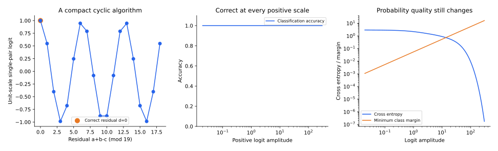

[专题目录](/notes/grokking/) · ← [正则化与解的竞争](/notes/grokking/solution_competition/) · [有效理论与学习相图](/notes/grokking/effective_theory/) →

## 前言：规则不只是一个正确答案，而是一套可复用计算

两个网络可以在训练集上输出相同答案，却在内部使用不同计算。一个可能保存输入组合的局部对应，另一个可能将输入映射成周期表示、组合这些表示，再用共享读出恢复答案。后者可以处理未见组合，前者未必可以。

表示解释之所以比曲线解释更进一步，是因为它要说明网络算了什么。看到隐藏层出现一个圆形图案，只是起点；还需要连接到下游乘法、输出映射及受控消融。规则可以在测试准确率上升以前已经部分存在，也可能在最后阶段才形成。

本篇从初始核与可学习表示的差异进入，推导模加法的 Fourier 算法，再说明如何用函数空间投影与干预辨认结构。存在一个紧凑算法，和优化确实学会了这个算法，是两个需要分别建立的结论。

表示的意义来自它让后续计算变得容易。同一个输入可以被编码成互不相关的向量，也可以被编码成保留任务关系的坐标；两种编码都能区分训练样本，但下游组合所需的复杂度可能完全不同。对 Grokking 而言，重要的变化往往不是网络终于能够区分某个训练输入，而是不同输入开始通过同一组中间关系被处理。这样，有限样本中的局部信息才有机会约束未见组合。

## 1. 初始特征为什么可能足以拟合，却不适合泛化 {#lazy-to-rich}

网络在初始化附近展开为

$$
f_\theta(x)\simeq f_{\theta_0}(x)+J_0(x)(\theta-\theta_0).
$$

如果切线特征 $J_0(x)$ 基本不变，训练等价于在固定字典中选择系数。足够丰富的随机字典可以插值有限训练集，但插值对测试分布的延拓还取决于核与目标的对齐；训练拟合并不保证目标相关方向在初始表示中具有合适权重。

对平方损失，训练残差的精确恒等式是

$$
\dot r(t)=-K_t r(t),\qquad K_t=J_tJ_t^\top/D.
$$

只有当 $K_t$ 可以冻结时，才得到一组固定速率模态。若训练改变 $J_t$，网络就在改变函数空间的局部度量和可用方向。初始核提供一个参照，却不必决定整个训练过程。

这里的“新特征”不必意味着一个过去完全不存在的函数突然被创造出来。在有限训练集上，初始特征可能已经张成全部标签方向，网络照样有特征学习的空间：它可以让目标方向获得更大的权重，让相似任务输入之间的响应更加一致，或者改变这些特征在训练点之外的延拓。因而初始字典能够插值，与训练后表示更适合泛化，可以同时成立。只比较训练集上特征矩阵的秩，会漏掉这些变化。

[Kumar 等的 lazy-to-rich 研究](https://arxiv.org/abs/2310.06110)在多项式回归等设置中展示：网络先接近初始特征的核预测，随后才通过特征学习获得更好的泛化；其中存在不依赖显式权重衰减的例子。它把任务对齐和特征形成速度作为两个重要因素，而不是将所有延迟都归于范数下降。

### 用一个二次任务看清训练信息与表示偏好

设输入 $x\sim\mathcal N(0,I_d)$，模型为

$$
f(x)=\sum_{j=1}^ma_j(w_j^\top x)^2=x^\top Mx,
\qquad M=\sum_ja_jw_jw_j^\top.
$$

教师为 $x^\top M_*x$。对任意对称误差矩阵 $\Delta=M-M_*$，Gaussian 四阶矩给出

$$
\mathbb E[(x^\top\Delta x)^2]
=2\operatorname{Tr}(\Delta^2)+(\operatorname{Tr}\Delta)^2.
$$

若预测和目标都减去各自总体均值，则风险成为 $2\|\Delta\|_F^2$。这使总体泛化可以用矩阵结构直接衡量，而训练集只提供有限条二次测量 $x_\mu^\top Mx_\mu$。

函数对 $M$ 是线性的，对因子 $a_j,w_j$ 却是非线性的。同一组训练测量可以允许许多矩阵；因子化可能逐步加强目标相关的低维方向。在一个初始随机特征较差、但数据仍足够识别教师结构的区域，就有可能先拟合，再改善表示。

这里的矩阵公式是独立的精确风险计算，不等于所有因子化训练都会恢复低秩教师。恢复还需要样本设计、初始化与优化条件。它的价值是把抽象的“表示改善”变成可以与测试风险对照的量。

可以设想教师主要依赖一个投影方向的平方。模型早期用许多随机方向的混合拟合有限测量，其中一些误差在训练点上恰好抵消；换一批输入，抵消关系就可能失效。若后续因子逐渐对齐教师方向，同一条规律便能在更广的输入范围内成立。这个图景中，训练点上的数值变化可能很小，而总体矩阵误差持续下降。它说明表示改善为什么需要总体或独立输入参照，不能只靠训练残差确认。

同时，矩阵表示与神经因子之间存在冗余。多个单元可以共同实现同一个矩阵，一个单元的方向变化也可以被其他单元补偿。因此，单独追踪某个隐藏向量不如同时追踪它们合成的任务算子稳定。研究单元仍有价值，但单元层面的几何应当最终连接到一个明确的函数变化，才能解释它对泛化的意义。

### 什么观测真正表示任务相关的特征改善

核变化的总大小可以定义为 $\|K_t-K_0\|_F/\|K_0\|_F$，但这个量没有包含目标。核沿无关方向大幅变化，未必降低测试风险；核只做整体正比例缩放，则可能主要改变优化时钟。

一个训练集上的目标对齐量是

$$
\mathcal A(K,y)=\frac{y^\top Ky}{\|y\|^2\operatorname{Tr}K},
$$

对正半定核它位于零与一之间，描述目标是否集中在较强方向。整体缩放核不改变它。但它仍然只看训练标签，过度针对训练子集的核也可能提高该指标，因此需要独立数据或总体结构参照。

在二次教师模型中，总体风险允许更直接地检查 $M$ 是否接近 $M_*$。若输入协方差变成 $\Sigma$，同一个矩阵误差的风险为

$$
2\operatorname{Tr}[(\Sigma^{1/2}\Delta\Sigma^{1/2})^2]
+[\operatorname{Tr}(\Sigma\Delta)]^2.
$$

目标方向与测试分布的加权都进入误差。参数移动、核移动、目标对齐和实际泛化是逐层不同的量；如果仅用其中一个量替代其他量，就很难判断表示变化究竟是在学习规则，还是只在更有效地拟合训练数据。

目标对齐量也不是必须单调上升的进度条。训练可能先加强某些有用方向，再调整它们之间的相对尺度；一个单独的归一化比值未必能够忠实表示整个过程。比较结构量与性能时，更有解释力的是具体关系：哪个目标方向变强、哪些输入因此获得更大间隔、相同变化是否也出现在未参与拟合的组合上。这样的联系比一个总体相关系数更接近表示发挥作用的方式。

## 2. 模加法具有怎样的共享算法 {#fourier-algorithm}

设输入 $a,b\in\mathbb Z_p$，标签 $c=a+b\pmod p$。对频率 $k$ 定义复相位函数

$$
\chi_k(a)=e^{2\pi ika/p}.
$$

它满足 $\chi_k(a+b)=\chi_k(a)\chi_k(b)$。加法在原来的离散符号空间里是一个查表问题，在周期表示里则可以通过相位相乘实现。完整标签关系为

$$
\mathbf1_{c=a+b}
=\frac1p\sum_{k=0}^{p-1}e^{2\pi ik(a+b-c)/p}.
$$

不同频率在正确输出上相干叠加，在错误输出上相消。这解释了为什么 Fourier 分析适合这个任务：它利用的是有限循环群的结构，而不是仅仅寻找一组漂亮的正弦图案。

对最低非零频率，可以把十九个符号想成圆周上的十九个等距位置。输入一个符号，相当于转动相应数量的格点；把两个转动合起来，就得到和所处的位置。超过一圈的部分自然被消去，这正对应取模。其他与模数互素的频率只是以另一种绕行顺序标记这些符号，仍保留同样的组合关系。圆在这里有用，是因为旋转能够组合，而不只是因为嵌入图看起来有规律。

### 实值网络如何实现相位乘法

记 $\theta_k(a)=2\pi ka/p$。实部可展开为

$$
\begin{aligned}
\cos[\theta_k(a)+\theta_k(b)-\theta_k(c)]
={}&\cos\theta_k(c)
[\cos\theta_k(a)\cos\theta_k(b)-\sin\theta_k(a)\sin\theta_k(b)]\\
&+\sin\theta_k(c)
[\sin\theta_k(a)\cos\theta_k(b)+\cos\theta_k(a)\sin\theta_k(b)].
\end{aligned}
$$

one-hot 输入接线性层，可以提供任意单输入正弦与余弦。交叉乘积又能通过

$$
uv=\frac{(u+v)^2-(u-v)^2}{4}
$$

实现，因此平方隐藏层加线性读出足以构造周期 logits。上面的四个交叉乘积，直接构造至多需要八个平方单元。这个单频算法对所有输入共享，不需要逐项存储 $p^2$ 个组合。

整个计算因此可以分为相互衔接的三步：从两个符号各自取出相位坐标，通过交叉项合成和的相位，再与候选输出的相位比较。每一步都使用同一套参数处理所有组合。未见配对之所以能够得到正确答案，是因为组合运算已经定义在全部相位坐标上；它不需要为那个配对单独增加一个参数。这也解释了为什么只检查输入嵌入还不够：若下游没有形成正确交叉项，圆周坐标本身并不会自动完成加法。

### 正确分类比精确重建标签更容易

若 $p$ 是素数，任意非零 $k$ 都使

$$
z_c=A\cos[2\pi k(a+b-c)/p],\qquad A\gt0,
$$

在正确类唯一达到最大值。于是一个完整的正弦—余弦频率对，已经足以得到百分之百分类准确率。若模数为合数，则需要 $k$ 与 $p$ 互素，才能避免多个类别在同一相位上并列。

单频 logits 一般不等于 one-hot 标签，它对相邻错误相位仍可能给出相近分数。若要求数值上精确重建指示函数，通常需要完整 Fourier 求和；若只要求正确 argmax，要求弱得多。因此“用了几个频率”必须与正在实现的函数目标一起解释。

从分类的角度看，网络只需要让正确候选略胜所有错误候选；从概率预测的角度看，它还需要拉开足够大的分数差。这给多频结构留下了空间。一个频率已经足以完成排序，多个相容频率仍可以共同改变错误类的分数形状，并在适当权重下扩大间隔。不过，频率越多并不自动越好：相位或读出符号不匹配时，它们也会相互干扰。真正需要检查的是合成后的候选分数，而不是把频率数量直接当作算法质量。

对 $p=19$ 的单频构造，最小分类间隔为

$$
m_{\min}=A[1-\cos(2\pi/19)].
$$

增加 $A$ 不改变准确率，却改善置信度。小 $A$ 时可以全部答对而交叉熵仍然很大，这也是[实验篇](/notes/grokking/experiments_diagnosis/#interventions)中实际权重投影所呈现的现象。

*由显式 Fourier 函数直接计算。图中构造可泛化解，比较有限模数下的单频间隔及尺度变化；它不是训练发现该电路的证据。*

[Gromov 的 Grokking modular arithmetic](https://arxiv.org/abs/2301.02679)直接研究简化的两层网络，给出可解模运算的解析权重，并展示无显式正则化、普通梯度下降下的延迟泛化。这条线索将紧凑周期表示与实际训练连接起来，也表明显式权重衰减不是所有模加法延迟的必要条件。这里推导的平方单元构造用于说明表达能力，实际训练的损失、初始化和形成路径仍需分别比较。

## 3. 从周期图案到实际计算，需要哪些证据 {#progress-measures}

[Nanda 等的机制可解释性研究](https://arxiv.org/abs/2301.05217)分析一层 Transformer 的模加法算法，将周期嵌入、三角交互与输出读出连接起来，并通过 Fourier 空间消融检验。在所分析的运行中，可以追踪记忆、算法电路形成和清理三个连续阶段。

这类分析的关键不是把所有训练曲线分成相同的三段，而是构造与机制有关的进展量：只保留候选算法成分以后，训练和测试损失怎样变化？排除这些成分以后，原来的训练拟合是否仍然存在？如果算法已形成但被其他输出干扰，普通准确率可能很晚才显示成功。

Restricted loss 与 excluded loss 就分别评价保留和去掉候选频率后的函数。它们依赖识别出的算法子空间，并不等于隐藏层权重的单个 Fourier 功率峰。一个峰可以存在，却没有被下游正确组合；若消融正确改变了对应行为，证据就更进一步。

这两种量放到时间轴上，可以区分外观相似的晚期泛化。若保留算法成分的函数很早就能处理测试输入，而完整函数还不行，主要问题可能是其他成分遮住了它；若保留后的函数也一直很差，到后期才改善，则算法成分自身的形成更值得关注。还有一种中间情况：输入周期坐标已经出现，但只有读出逐渐对齐后，保留成分才有用。三种历史都可能留下相近的最终 Fourier 图，却对应不同的训练瓶颈。

需要同时控制尺度。将大量频率置零会改变输出范数、置信度和间隔。比较交叉熵时，应说明是否保持原尺度或另外校准；比较准确率时，应看具体哪些输入翻转。若重新用测试标签选择频率或温度，得到的是事后分析结果，不能当作新的无监督学习性能。

### 核模型也可以通过迭代改变特征

固定核没有特征演化，但“使用核方法”并不总意味着从头到尾固定表示。[Mallinar 等的非神经模型研究](https://arxiv.org/abs/2407.20199)用递归特征机器，在每轮拟合后利用平均梯度外积更新输入度量，并研究模加法中的延迟泛化。

对标量预测，一个典型结构量是

$$
M_f=\mathbb E_x[\nabla_xf(x)\nabla_xf(x)^\top].
$$

它是正半定矩阵，强调预测对哪些输入方向敏感。下一轮可以使用由 $(x-x')^\top M_f(x-x')$ 定义的距离构造核，再重新拟合。于是每一轮内部的训练拟合即使已经很好，迭代形成的表示和泛化仍然可以继续变化。

这个例子提醒我们，固定特征与特征学习的边界应按算法实际更新的对象划分，而不只按“神经网络”或“核方法”的名字划分。它也给出一种有价值的对照：没有相同的神经参数路径，仍可以检验任务相关的循环结构如何形成。原始输入是离散 one-hot 时，梯度来自模型在连续输入空间中的延拓，这个度量还取决于延拓和输入编码，不能把它当作离散任务唯一自然的几何。

从敏感度的角度理解，输入度量更新是在追问：当前预测在哪些方向上变化最大，下一轮是否应更细致地分辨这些方向。它可以形成一个反馈循环，当前函数决定下一轮表示，下一轮表示再改变能够容易拟合的函数。这与一次性固定核具有实质差异，也提示“先拟合、再学习表示”并非神经参数特有的逻辑；关键是算法是否允许表示受到已学函数的持续反馈。

## 4. 与隐藏坐标无关的函数对称投影 {#symmetry-projection}

隐藏单元可以重排，某些层还可以进行基底变换，所以只看单层参数图并不总是稳定。模加法提供一个直接作用在输入—输出函数上的诊断。

先将每个 $(a,b)$ 的 logits 在类别维中心化，得到 $F(a,b,c)$。这样去掉不影响 softmax 的共同平移。定义偏移 $d=a+b-c\pmod p$，对同一偏移取均值：

$$
\bar F(d)=\mathbb E[F(a,b,c)\mid a+b-c=d],
\qquad
(P_GF)(a,b,c)=\bar F(a+b-c).
$$

等价地，考虑群作用

$$
T_{u,v}:(a,b,c)\mapsto(a+u,b+v,c+u+v),
$$

在整个群上平均函数。这个作用保留正确标签关系。均匀全域内积下，群作用是正交置换，平均算符自伴且满足 $P_G^2=P_G$，所以

$$
\|F\|^2=\|P_GF\|^2+\|(I-P_G)F\|^2.
$$

由此得到对称能量比例 $\rho=\|P_GF\|^2/\|F\|^2$。它衡量 logits 与已知任务对称性的接近程度，不受隐藏单元置换影响。

分组平均可以理解为把同一个相对问题的不同写法放在一起。例如，同时平移输入与候选输出以后，候选答案相对正确和的偏移没有改变；任务要求这些写法遵循同一个评分规律。投影保留它们共同的部分，去掉依赖某个具体写法的差异。这样得到的是“偏离正确答案若干格时，应给多少分”的统一曲线，因此能够直接检验函数有没有复用任务关系。

平均之前必须把类别坐标对齐。不同输入的正确答案通常不同，若直接平均原类别编号下的 logits，就会把本应比较的分数错开。群作用同时移动输出坐标，正是为了把语义相同的候选放回同一个位置。这个细节也说明，对称投影并不是任意平滑；它使用了一个明确的、保留标签关系的变换集合。

### 对称能量不是规则使用比例

能量很小的成分也可能刚好翻转许多边界样本；很大的类别共同偏置则根本不影响预测。中心化处理了后一种冗余，却没有把平方能量自动转换成分类贡献。

同样，正交残差不应直接叫作“记忆模块”。它可以包含训练集特有拟合，也可能包含有限宽误差、尚未完全对称的有用特征，或其他任务相关细节。对称分解是一个精确的函数空间操作，记忆与规则则是功能解释。

本专题保留的实际权重具有约 $0.682$ 的对称能量比例，但原模型已经在全部输入上分类正确。这表明完美准确率不要求全部实值输出都落在同一个对称子空间。

## 5. 为什么完整分布上的对称化不会增加交叉熵 {#convex-symmetrization}

交叉熵 $\ell(z,y)=\log\sum_c e^{z_c}-z_y$ 关于 logit 向量凸。在完整均匀模加法域上，分布与标签关系也对上述群作用不变，因此 Jensen 不等式给出

$$
\mathcal R_{\rm full}(P_GF)
\leq\frac1{|G|}\sum_{g\in G}\mathcal R_{\rm full}(gF)
=\mathcal R_{\rm full}(F).
$$

这里的变换同时作用在输入和类别坐标。结论不要求原网络具有对称架构，而是事后使用已知对称性构造一个函数平均。

有限训练或测试子集一般不对群封闭，所以相同不等式不能直接用于任意一个子集。交叉熵的平均改善，也不保证每个样本的准确率都改善，因为 argmax 评分不是凸函数。

这使投影成为一个有解释力但有边界的工具：它能量化并操作已知结构，不能证明网络自动发现了结构。一个投影后很好的预测器，可能使用了任务知识和完整输入域，这些信息必须与原训练过程区分。

这项凸性结论还给出了一个有用的参照：对称化后的平均交叉熵改善，本身已经有数学原因，不必再解释成某种新的学习能力。更值得分析的是，原函数离这个参照有多远，以及训练是否逐步接近它。投影提供了一个已知结构下的比较对象，真实动力学则决定网络会不会、以及多快会走向相应区域。这再次把结构存在与结构形成区分开来。

## 6. 嵌入更新的频率与下游耦合 {#embedding-dynamics}

符号输入的 one-hot 乘以权重矩阵，本身就是一种可学习的查表嵌入。显式增加一层嵌入，再连接下游矩阵，会进一步改变因子化和动力学；它不是只换了一种数据存储格式。

若 token $i$ 在训练分布中的频率为 $q_i$，普通梯度流下其嵌入满足形式关系

$$
\dot E_i=-q_i\,\mathbb E[\nabla_{E_i}\ell\mid i]-\lambda E_i.
$$

低频 token 平均获得的梯度更新较少，衰减却可能持续作用。对 Adam 一类有状态优化器，未出现 token 的坐标还可能保留动量，不能照搬这条无记忆流。即使总体 token 分布均匀，有限训练划分也可能造成不同更新频率。

[2025 年关于嵌入层机制的研究](https://arxiv.org/abs/2505.15624)讨论了更新频率、嵌入与下游权重的双线性耦合，并比较分层学习率等干预。这条线索提示我们把整体范数进一步拆成表示、读出与样本访问；它不意味着所有 Grokking 都必须具有某种独立的嵌入层。

嵌入与读出的配合尤其容易造成观测上的滞后。一组坐标可以已经保留了正确关系，但读出还没有学会利用；读出也可以暂时依赖某些局部差异，使嵌入朝有利于训练拟合的方向移动。两者共同更新时，单独提高某层学习率会改变这种协调，而不只是让整段训练等比例加速。理解表示形成，因此既要看坐标如何排列，也要看下游怎样把这些坐标变成预测。

## 结语：存在、形成与使用是三个问题

Fourier 构造证明一个小网络能够实现共享算法；表示动力学解释网络为什么可能晚些才接近这种结构；函数消融和对称干预则检验实际预测怎样依赖它。三个层次相互连接，却不能互相替代。

研究延迟时，最有帮助的是把结构量放回训练时间轴。某种表示何时出现、下游何时正确使用它、无关成分何时不再破坏间隔，可以早于或晚于准确率的明显转折。下一篇从数据约束出发，讨论这些结构何时能够被唯一确定，以及有限时间相图应当怎样解释。

[专题目录](/notes/grokking/) · ← [正则化与解的竞争](/notes/grokking/solution_competition/) · [有效理论与学习相图](/notes/grokking/effective_theory/) →
