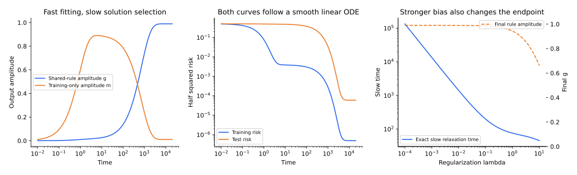

[专题目录](/notes/grokking/) · ← [现象与可解基线](/notes/grokking/phenomenology/) · [表示形成与算法电路](/notes/grokking/representation_circuits/) →

## 前言：很快找到的解，不一定是最终偏好的解

一个小训练集往往允许许多插值函数。有的函数只在已见样本上有效，容易找到；有的函数能复用任务结构，在新样本上也正确，但需要较长时间才能形成或获得足够权重。即使训练误差已经很小，正则化与优化器仍可能改变这些解之间的相对贡献。

“记忆与规则竞争”是理解 Grokking 的一条重要线索，但要使它具有内容，必须说明两类函数怎样定义、代价怎样比较，以及为什么一个先学会、另一个后占优。仅仅观察参数范数下降，还不能证明网络在清除记忆。

本篇从两个已提供特征的凸模型出发，算清快拟合与慢选择的时间分离，再讨论多层参数化、电路效率、范数几何与优化器。这个顺序将“发现一个可泛化表示”和“在已有表示中选择”暂时分开；前者留给下一篇。

## 1. 一个完整可解的竞争模型 {#competition-model}

设教师标签归一化为 $y^2=1$。一个共享特征在训练和测试上都输出 $y$，系数为 $g$；另一组训练点特有的特征，在训练集的对称子空间上贡献 $my$，测试时输出零。因此训练预测是 $(g+m)y$，测试预测是 $gy$。

假设两类特征的有效范数成本为 $c_g g^2$ 与 $c_m m^2$，目标为

$$
F(g,m)=\frac12(g+m-1)^2
+\frac\lambda2(c_g g^2+c_m m^2),
\qquad c_g,c_m,\lambda\gt0.
$$

用不同迁移率 $\gamma_g,\gamma_m$ 做梯度流：

$$
\dot g=-\gamma_g[g+m-1+\lambda c_g g],
\qquad
\dot m=-\gamma_m[g+m-1+\lambda c_m m].
$$

模型没有新特征诞生；它已经把“规则”放在可用字典中。训练与测试半平方风险分别是 $\frac12(g+m-1)^2$ 和 $\frac12(g-1)^2$，而 $F$ 还包含正则化，三者不能混称为同一损失。

### 稳态偏好与学习速度是两个参数组

令两个导数为零，解得

$$
g_\infty=\frac{c_m}{c_g+c_m+\lambda c_gc_m},
\qquad
m_\infty=\frac{c_g}{c_g+c_m+\lambda c_gc_m}.
$$

当记忆成本高于规则成本，且对规则的惩罚不是过强，长期更偏向 $g$。但稳态不告诉我们先后顺序；顺序还依赖迁移率和初始条件。若 $\gamma_m\gg\gamma_g$ 且从零开始，记忆方向先响应，训练误差可以很快下降，测试仍很差。

系统矩阵为

$$
A=\begin{pmatrix}
\gamma_g(1+\lambda c_g)&\gamma_g\\
\gamma_m&\gamma_m(1+\lambda c_m)
\end{pmatrix}.
$$

虽然 $A$ 一般不对称，它与一个对称正定矩阵相似，因此有两个正实松弛率。快拟合与慢选择来自这两个时间尺度，无须真正的动力学不连续。

### 将快记忆变量消去

若 $m$ 很快达到准静态，$m\simeq(1-g)/(1+\lambda c_m)$，代回得到

$$
\dot g\simeq\gamma_g\lambda
\left[\frac{c_m}{1+\lambda c_m}
-\left(c_g+\frac{c_m}{1+\lambda c_m}\right)g\right].
$$

慢松弛时间因而为

$$
\tau_g^{-1}\simeq\gamma_g\lambda
\left(c_g+\frac{c_m}{1+\lambda c_m}\right).
$$

在其他量固定、足够弱的正则化区域中，$\tau_g$ 约随 $1/\lambda$ 增长。很弱的偏好仍然能改变长期解，但可能需要非常久。更强的正则化又会压低 $g_\infty$，因此“越强越容易泛化”并不是这个模型的结论。

*自制凸二次模型的精确矩阵指数解。图中改变正则化与迁移率，比较训练风险、测试风险和两类输出幅度；没有从实际网络权重中拟合这些有效系数。*

### 零正则化与无限时间不能交换

若先令 $\lambda=0$，从零开始有 $g/m=\gamma_g/\gamma_m$，最终 $g+m=1$，因此 $g_\infty=\gamma_g/(\gamma_g+\gamma_m)$。如果记忆迁移率很大，规则分量会一直很小。

若先对每个 $\lambda\gt0$ 训练无限久，再取 $\lambda\to0$，则 $g_\infty\to c_m/(c_g+c_m)$。前者由动力学决定插值解，后者由任意微弱但持续的代价偏好决定插值解。这是很直观的极限顺序问题：一个作用很弱的机制，并不等于它在无限时间后没有影响。

## 2. 为什么深度参数化会让规则启动得很慢 {#multiplicative-dynamics}

上面的迁移率是显式给定的。多层网络提供一种使有效迁移率随参数改变的机制。令标量输出系数 $p=w_1w_2$，目标为 $s\gt0$，半平方损失为 $\frac12(p-s)^2$。梯度流满足

$$
\dot w_1=(s-p)w_2,\qquad
\dot w_2=(s-p)w_1.
$$

平衡正分支 $w_1=w_2$ 上，

$$
\dot p=2p(s-p),\qquad
p(t)=\frac{s}{1+(s/p_0-1)e^{-2st}}.
$$

当 $p_0$ 很小，早期绝对输出很小，即使相对增长是指数的，损失看起来仍近乎不动。达到一半目标的时间为

$$
t_{1/2}=\frac1{2s}\log(s/p_0-1),\qquad p_0\lt s/2.
$$

若记忆与规则都通过这样的因子化路径实现，但规则路径初始化更弱，规则便可能较晚启动。这个标量平台本身没有记忆训练样本，却解释了“可表达”为什么不等于“很快被激活”。完整推导与不平衡初始化可参阅[深度参数化](/notes/neural_network_theory/deep_optimization/#deep-linear)。

## 3. 电路效率：为什么更多数据可能偏向共享规则 {#circuit-efficiency}

[Varma 等，Explaining grokking through circuit efficiency](https://arxiv.org/abs/2309.02390)把快慢学习与电路效率结合：规则电路虽然学得慢，但在相同参数范数下能够产生更有效的训练 logits；记忆更多样本则需要额外代价。这一解释提出并检验了 ungrokking 与 semi-grokking 等更具体的行为。

“效率”应比较相同预测质量或 logit 尺度下的成本。两个电路都达到百分之百训练准确率，并不代表置信度或交叉熵相同；一个只产生极小正间隔的电路，不能因为范数小就被判为更有效。

一个理想计数图景是：规则有固定搭建成本 $C_g$，逐项记忆有 $C_m(D)=cD$。随着独立约束数增加，记忆的累计代价增长，而已正确实现的共享运算不必为每个新样本再造一套规则。交叉点 $D=C_g/c$ 只是这个成本模型的阈值，实际网络中的干扰、共享和参数化可能使成本关系更复杂。

### 齐次性怎样改变输出代价

对一条由 $L$ 个标量因子构成的路径，输出幅度 $u=\prod_{\ell=1}^Lw_\ell$。在固定正 $u$ 下，最小平方范数成本由平衡因子达到：

$$
\min_{\prod_\ell w_\ell=u}\sum_\ell w_\ell^2
=L|u|^{2/L}.
$$

因此在两个独立路径间分配输出时，有效惩罚不一定是 $g^2+m^2$。$L=1$ 是凸二次代价，倾向于混合；$L=2$ 是线性幅度代价；更深路径的 $2/L\lt1$ 具有凹性，可能偏向把幅度集中到较便宜路径。这说明深度可以同时改变启动时间与长期选择。

这个推导要求路径成本可独立相加且没有额外约束。真实电路共享参数时，不能把它直接当作网络的全局范数公式。但它明确显示，前面凸模型的平滑混合与较深模型中的强竞争为什么可以不同。

### 反向与部分泛化提供了更强检验

若一个已经泛化的网络换到更小的数据子集继续训练，记忆相对代价可能降低，在某些条件下重新占优，测试表现回退，这就是 ungrokking 的一种预测路线。若不同子任务的相对成本交叉点不同，最终可能只有一部分任务转入规则解，表现为 semi-grokking。

这些结果比“损失最终下降”更有区分力，因为它们要求解释训练集变化或任务混合后的方向。但数据变化也会改变梯度和可辨识性，因此具体干预仍需比较候选机制，而不能把一切回退都归于效率。

## 4. 范数变化与函数方向必须分开 {#norm-geometry}

[Omnigrok](https://arxiv.org/abs/2210.01117)从降维损失几何讨论训练与测试的失配：在所研究设置中，训练损失随参数范数常呈 L 形，测试损失则可能具有 U 形的较优区间，并将研究扩展到图像、语言和分子任务。这是一种有用的几何图景，参数范数却仍不是完整状态。

写 $\theta=ru$，$\|u\|=1$。对普通梯度流加欧氏衰减，径向与方向动力学分别是

$$
\dot r=-u^\top\nabla L(ru)-\lambda r,
\qquad
\dot u=-\frac1r(I-uu^\top)\nabla L(ru).
$$

范数下降可以与方向重组同时发生；即使范数不变，函数也能因方向变化而完全不同。若把训练中经过的点都投影到一根范数轴，许多不同的表示会重叠。因此一条经验 U 形曲线并不是“测试损失只由范数决定”的状态方程。

多层网络还有重缩放冗余。例如 $w_1\to aw_1,w_2\to w_2/a$ 不改变两层线性函数，却改变总平方范数。比较不同模型或不同层的范数前，需要考虑参数化与平衡条件。

## 5. 晚期偏置可以证明，但结论有具体条件 {#implicit-bias}

[Lyu 等的早晚期隐式偏置研究](https://arxiv.org/abs/2311.18817)在齐次网络、大初始化与小权重衰减等条件下，证明长时间的核预测阶段和后续最小范数或最大间隔偏置可以产生明显的泛化转变。它把“偏好随时间改变”推进到特定模型中的理论结论。

可分分类中，训练准确率饱和并不意味着参数停住。对 logistic 损失，有限参数通常达不到零损失，下确界在无穷远；长期更新可继续改变归一化方向。最大间隔结论还需要数据可分、参数化、优化规则和收敛条件，不能仅从范数增长直接推断。

[2025 年的 Grokking Beyond the Euclidean Norm of Model Parameters](https://arxiv.org/abs/2506.05718)进一步研究稀疏与低秩等偏好。它提醒我们，晚期选择的结构可以由 $\ell_1$ 或核范数等量刻画，欧氏范数可能并不随泛化单调下降。是否有利于泛化，仍取决于这种偏好与任务是否匹配。

从约束优化看，最小二范数、最稀疏和最低秩都在从大量拟合解中选择，但它们通常不是同一个解。正则化产生持续的选择力，不会自动把不合适的先验变成正确知识。

### 稀疏与低秩偏好怎样具体改变解

在一个正交坐标的简单估计问题中，若观测为 $z$，平方拟合加二范数惩罚得到 $\widehat w_i=z_i/(1+\lambda)$，所有坐标按相同比例收缩。若改用一范数惩罚，目标为 $\frac12\|w-z\|^2+\lambda\|w\|_1$，逐坐标最优解为

$$
\widehat w_i=\operatorname{sign}(z_i)(|z_i|-\lambda)_+.
$$

它将小坐标完全置零，同时保留较强方向。一个稀疏教师配上许多噪声坐标时，这种选择与均匀收缩具有不同的泛化含义。二范数较小的解不一定更接近真实稀疏结构。

矩阵情形中，平方拟合加核范数惩罚对奇异值进行同样的软阈值，因而改变有效秩；Frobenius 惩罚则只统一收缩奇异值。若任务需要低秩结构，晚期应该追踪奇异谱和有效秩，而不只是整个参数向量的欧氏范数。

这些闭式静态例子没有产生延迟，却解释了为什么“正则化朝正确结构移动”必须具体到哪一种结构。要进一步得到时间分离，还需一个较快的拟合过程和较慢的选择过程，并确认选择后的解能够在目标分布上泛化。2025 年的工作正将这类偏好放回动态问题，而不是把范数下降本身当作充分解释。

## 6. 纯衰减时钟为什么只能作条件性估计 {#decay-clock}

若某个参数分量暂时没有梯度，离散解耦衰减给出

$$
\theta_n=(1-\eta\lambda)^n\theta_0.
$$

从半径 $r_0$ 缩到 $r_*$ 所需步数为

$$
n_* =\frac{\log(r_0/r_*)}{-\log(1-\eta\lambda)}
\simeq\frac1{\eta\lambda}\log(r_0/r_*).
$$

这个对数时钟可以解释一种弱衰减造成长等待的来源。但真实训练同时有梯度、动量与自适应预条件，相关半径还可能随训练改变。不能只测到约 $1/\lambda$ 的延迟，就认定已经验证纯衰减机制。

[Slingshot 研究](https://arxiv.org/abs/2206.04817)观察到自适应优化器晚期稳定性与层范数的周期变化，并研究它与延迟泛化的联系。它强调优化器内部状态的作用。另一方面，普通梯度下降、无显式衰减的模型也能出现延迟，因此 slingshot 不能成为所有 Grokking 的必要条件。

AdamW 的衰减项与欧氏 L2 梯度惩罚尤其不同：梯度项经过自适应缩放，解耦衰减项直接乘参数。把二者替换为同一个连续目标的梯度流，会改变前面模型的迁移率和稳态解释。

## 结语：快慢过程与长期偏好共同决定结果

已有特征的竞争就能产生先拟合、后泛化；乘法参数化还能使某条路径启动很慢。共享规则的代价、正则化、初始化与优化器，分别改变长期偏好或到达它的时间。

这些模型尚未说明一个神经网络怎样发现规则。在下一篇中，规则不再只是一个给定的系数，而是周期表示、非线性交互与读出共同构成的计算。只有把表达能力、形成动力学和实际使用分开，才能判断某次延迟主要卡在哪里。

[专题目录](/notes/grokking/) · ← [现象与可解基线](/notes/grokking/phenomenology/) · [表示形成与算法电路](/notes/grokking/representation_circuits/) →
