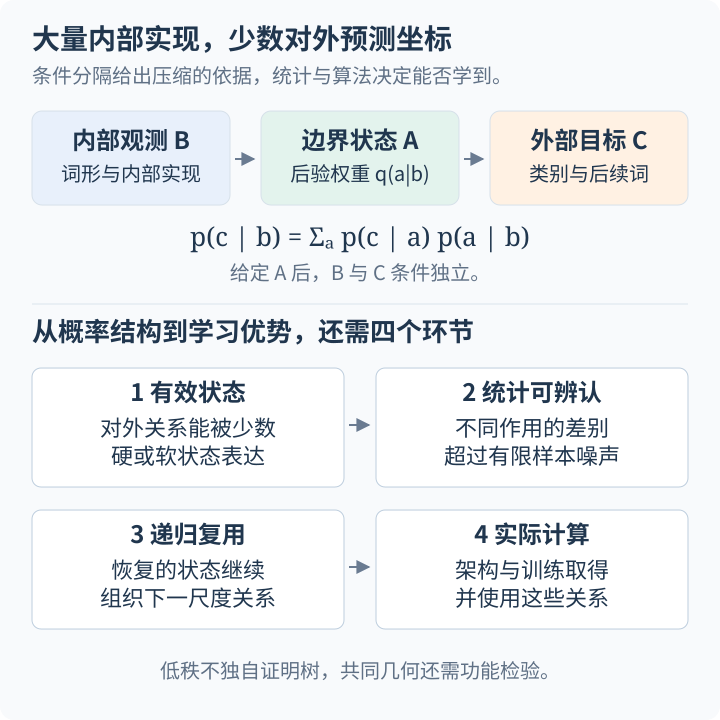

深度网络能够在训练中形成新的表示，但“数据具有层级”本身没有解释这种形成。我们还需要知道：中间状态在观测中留下什么信号，指定学习规则能否取得它，已有表示怎样改变下一步问题，以及上下层如何共同修正。这个专题以 **Hierarchical Learning 的理论机制**为主线，将谱动力学、梯度可达性、非线性表示与跨层反馈接到可控生成模型上。

原有五篇随机层级模型（Random Hierarchy Model，RHM）笔记保留为生成数据部分。RHM 让局部字典、同义变化、推断参照和样本阈值可被定义与测量；它是检验学习机制的重要模型，不是整个领域的通用理论框架。新增理论章节均有编号、公式解释、适用条件、篇末文献和连续阅读链接。

## 1. 专题结构与阅读次序 {#contents}

| 部分 | 正文 | 贯穿问题 |
| --- | --- | --- |
| 理论 01 | [谱结构与集体学习动力学](/notes/hierarchical_data/spectral_dynamics/) | 已有相关模态为什么以不同速率增长？Saxe 2014/2019 与 Neural Race |
| 理论 02 | [梯度可达性与学习瓶颈](/notes/hierarchical_data/gradient_accessibility/) | 哪些结构让新特征获得有效梯度？Staircase、MSP、leap 与鞍区逃逸 |
| 理论 03 | [非线性中间表示与深度优势](/notes/hierarchical_data/nonlinear_depth/) | 表示如何改变核投影、有效维数与组合目标的学习成本？ |
| 理论 04 | [跨层反馈与共同演化](/notes/hierarchical_data/coupled_feature_learning/) | 前向 LoFi 缺少什么？BFC 与 BackLoFi 怎样让高层修正底层？ |
| RHM 01 | [层次生成与表征学习](/notes/hierarchical_data/generative_learning/) | 规则复用、同义不变性、样本阈值、逐层保证与局部学习规则 |
| RHM 02 | [语言统计与学习曲线](/notes/hierarchical_data/language_statistics/) | 长程相关、有限样本分辨率、有效上下文与稀有规则 |
| RHM 03 | [层级推断与扩散生成](/notes/hierarchical_data/inference_generation/) | 已知字典下的最优后验、BP、噪声与生成评价 |
| RHM 04 | [语法解析与隐变量学习](/notes/hierarchical_data/parsing_latents/) | 边界和结构未知时，消歧与预测目标怎样改变学习？ |
| RHM 05 | [跨语言表示与共享几何](/notes/hierarchical_data/shared_representations/) | 共享原因是否形成共享几何、坐标与实际计算？ |
| 综合 | [机制比较与未解决问题](/notes/hierarchical_data/mechanism_comparison/) | 哪些机制相通，哪些不能统一？集体动力学还缺什么？ |

## 2. 先分清五种“层级” {#starting-point}

### 2.1 生成、目标、架构、表示和时间 {#hierarchy-definitions}

**数据生成层级**是潜变量、树和语法产生观测的条件结构；**目标组合层级**是 $f_*(x)=g_2(g_1(x))$ 等预测函数分解；**架构层级**是计算图中的层数、局部连接和共享；**表示层级**是网络实际形成的中间变量；**动力学层级**则是不同特征随训练出现与增长的顺序。多粒度标签又可以额外提供监督层级。

这些结构可以相互支持，也可以错位。数据由多级树生成，不保证根标签保留所有中间状态的信息；深网络可以用近似固定特征完成任务；一个隐层也可以在训练中多次改变其表示。可读出某个潜变量不证明网络以它执行后续计算，逐层可读出也不证明严格的动力学门控。

一个简单对照是：Saxe 语义理论的多级分化发生在一个隐层中，Abbe 的支持逐次发现也能发生在两层网络中；RHM 则把潜在生成结构放进输入分布。不能只凭三者都出现“由粗到细”，便认定它们解释同一种层级。

### 2.2 记号与四条独立坐标轴 {#notation}

理论部分使用下表；具体模型改变约定时会重新声明。

| 记号 | 含义 | 比较时的约束 |
| --- | --- | --- |
| $P$ | 独立训练样本数 | 与相关 token 预算、数据重复轮次分开 |
| $t,T$ | 连续训练时间或离散步数 | 明确是否吸收学习率、是否每步使用新样本 |
| $L_{\rm net},D$ | 网络深度或权重矩阵数 | 原文可能把输入层也计入层数 |
| $\ell,L_{\rm data}$ | 数据潜在层级与总深度 | 不自动对应训练时刻或网络层 |
| $d,r,p_\ell$ | 环境维数、潜在维数与网络宽度 | 有限 $r$ 与随 $d$ 增长的 $r$ 产生不同复杂度 |
| $K,G$ | 表示核与响应核 | 区分固定核、标签自适应核和随时间变化的核 |

RHM 子系列沿用其原记号：叶层为 $0$、根层为 $L$，网络层另用 $k$，分支数 $s$、叶长 $d=s^L$、词表 $v$、每父规则数 $m$、根类别数 $n_c$。某些篇中 $t$ 是扩散噪声时间或上下文变量，会局部定义；不得与本部分的训练时间直接等同。

## 3. 学习新表示必须跨过哪些环节 {#unified-mechanism}

### 3.1 信息存在、统计可辨与梯度可达 {#three-bottlenecks}

首先是**信息条件**：中间原因是否能从观测与可用监督中辨认？若不同隐状态对所有任务目标有相同作用，标签只能识别它们的等价类。其次是**统计条件**：有用相关与谱间隙能否超过有限样本误差？最后是**算法条件**：初始化、激活与学习规则能否取得该相关，而不是被对称性、弱信号或错误路径阻挡？

已有足够数据不自动满足第三项，表示可表达也不满足前两项。反过来，若已经知道潜在规则，最优推断可能很容易；这不等于未知规则能被学习。理论应明确是在研究存在性、样本界、可计算学习保证还是指定训练的实际轨迹。

### 3.2 表示怎样改变后续问题 {#representation-changes-problem}

设 $z=\phi(x)$ 保留任务相关信息。一方面，组合目标可能在 $z$ 中降低次数或维数：$g(p(x))$ 在标量 $p$ 上只剩一维外层拟合；另一方面，当前简单函数空间改变，原先高阶的输入相关可能变成 $\mathbb E[y\phi^2]$ 或 $\mathbb E[y\psi\phi]$ 等低阶信号。层级学习的优势需要同时计入形成 $z$ 的成本和表示误差，不能只计算“假如已经知道 $z$”的后续收益。

RHM 提供一个明确的概率版本。若子树内部观测 $B$ 与外部目标 $C$ 在给定边界状态 $A$ 后独立，则

$$
p(c\mid b)=\sum_a p(c\mid a)p(a\mid b).
$$

无歧义时，后验退化为同义类编码；有歧义时要保留软后验。这个分解解释为什么边界状态可以被递归复用，却还没有证明网络会学得它。[有效状态短章](/notes/hierarchical_data/generative_learning/#effective-states)进一步分析任务充分性和可辨识性。

## 4. 五条理论路线如何连接 {#connections}

### 4.1 谱与时间：放大已经存在的模态 {#route-spectrum}

[Saxe 2014/2019](/notes/hierarchical_data/spectral_dynamics/)把白化数据的输入输出相关分解为奇异模态。在对齐、平衡条件下，两个权重矩阵的端到端幅度满足 $\dot m=2m(s-m)$。奇异值决定早期放大与特征时间，树生成的相关谱可以形成粗到细的语义分化。Neural Race 再把路径复用和竞争引入可解动力学。其可贵之处是时间预测明确，局限是深线性输入输出映射不具有一般非线性组合表达能力。

### 4.2 可达性：先行特征改变有效梯度 {#route-accessibility}

[Abbe 2021/2022/2023](/notes/hierarchical_data/gradient_accessibility/)把目标写成 Fourier/Hermite 项：支持能否按小步接续，决定未知坐标如何被发现。MSP 和 leap 将复杂度联系到最难引入的新方向，而不只是最终次数。2023 年将部分结构推进到有限宽、离散在线 SGD 的鞍区逃逸分析，但面向一般网络的复杂度刻画仍是猜想。

### 4.3 非线性中间表示：改写统计与计算成本 {#route-depth}

[Nichani、Wang、Dandi 2025 与 Tabanelli 2026](/notes/hierarchical_data/nonlinear_depth/)分别研究任务相关核投影、层级多项式、增长潜在维数以及随机张量谱恢复。它们具体展示新表示怎样降低后续有效维数或次数。Chen 2020 的固定随机表示与 Daniely 2026 的可观察多标签，帮助分清“表示有用”“表示被发现”以及“监督已经提供入口”。这些结果多数采用受控逐层训练或谱估计，不能统一改称普通端到端 SGD 定理。

### 4.4 反馈：上层响应修正底层选择 {#route-feedback}

[BFC、Neural LoFi 与 BackLoFi](/notes/hierarchical_data/coupled_feature_learning/)回答不同问题。前向 LoFi 将小初始化局部梯度转成低阶谱滤波与非线性提升；BFC 证明特定信息间隙模型中联合训练可以逐次修正低层偏差；BackLoFi 从相邻输入行和输出列的梯度推出特征—响应配对，并给三层谱替代过程的自洽演化。局部定理、算法设计、受控极限和数值观察在正文中分别标明。

### 4.5 生成结构、架构与学习规则 {#route-rhm}

[RHM 五篇](/notes/hierarchical_data/generative_learning/)让前述问题落到随机语法、同义归并、最优后验、未知边界与共享表示上。新增的 [Delrocq 2026 局部学习规则讨论](/notes/hierarchical_data/generative_learning/#local-learning-rules)比较输入相关 masking、直接反馈与局部自监督，强调有效学习不只有逼近监督 BP 一条路线。规则复用与卷积共享能改变成本，但数据与架构的匹配本身也提供了知识。

## 5. 怎样按科学问题阅读 {#reading-paths}

第一次阅读可按目录的理论 01–04、RHM 01–05、综合比较前进。也可以选择以下路线：

- **学习顺序与特征时间：** [精确模态解](/notes/hierarchical_data/spectral_dynamics/#feature-times) → [leap 与鞍区逃逸](/notes/hierarchical_data/gradient_accessibility/#saddle-dynamics) → [三种机制的干预预测](/notes/hierarchical_data/mechanism_comparison/#three-mechanisms)。
- **深度为什么有用：** [核投影与非线性特征](/notes/hierarchical_data/nonlinear_depth/#nichani) → [有效维数下降](/notes/hierarchical_data/nonlinear_depth/#dandi-depth) → [RHM 逐层保证](/notes/hierarchical_data/generative_learning/#shallow-to-deep-chaining)。
- **反馈与局部学习：** [配对模态](/notes/hierarchical_data/coupled_feature_learning/#backlofi-local) → [自洽替代动力学](/notes/hierarchical_data/coupled_feature_learning/#self-consistent) → [局部学习规则](/notes/hierarchical_data/generative_learning/#local-learning-rules)。
- **语言与生成：** [统计与上下文](/notes/hierarchical_data/language_statistics/) → [BP 与扩散](/notes/hierarchical_data/inference_generation/) → [未知边界解析](/notes/hierarchical_data/parsing_latents/) → [共享表示的功能检验](/notes/hierarchical_data/shared_representations/#functional-tests)。

## 6. 哪些问题仍需进一步理论 {#open-questions}

不能再把“前一个特征帮助后一个特征”作为无人研究的想法：staircase、BFC、LoFi 和 BackLoFi 已经给出不同实例。更具体的问题是：何时只是增长率不同，何时有真正的可达性改变；耦合何时导致明显延迟或突发；模态如何竞争与稳定；有限样本噪声怎样沿自适应训练轨迹改变谱选择；以及何时能从高维权重或函数态约化到少数有预测力的集体变量。

[综合篇](/notes/hierarchical_data/mechanism_comparison/)给出跨文献比较表、可区分机制的干预与有效理论要求。统计场论和 RG 可以作为有条件的研究工具，但网络逐层变换本身不等于 RG。需要先确定消去的自由度、保留的观测量、流动参数和约化误差。

## 7. 与其他笔记的联系 {#perspective}

[神经网络理论与可解模型](/notes/neural_network_theory/)提供固定核、特征学习与优化背景。[层级组合学习](/notes/neural_network_theory/hierarchical_learning/)用预先给定乘法架构的奇偶模型解释弱幅度与等待，本专题进一步研究未知特征怎样被发现。[Scaling Laws](/notes/scaling_laws/)讨论统计、谱与技能增长的曲线机制；[扩散动力学](/notes/diffusion_dynamics/)讨论噪声过程及生成。不同专题中的时间、样本量和尺度变量各自定义。

## 8. 参考文献与研究脉络 {#references}

### 8.1 理论部分的原始文献 {#theory-references}

核心论文的完整作者、年份、发表信息和适用条件见各篇末尾；这里按机制给出入口。

| 机制 | 原始工作 | 本专题讨论 |
| --- | --- | --- |
| 集体模态与语义分化 | [Saxe 2014](https://arxiv.org/abs/1312.6120)、[Saxe 2019，PNAS](https://doi.org/10.1073/pnas.1820226116)、[Neural Race 2022，ICML](https://proceedings.mlr.press/v162/saxe22a.html) | [理论 01](/notes/hierarchical_data/spectral_dynamics/) |
| 支持可达性与跃迁复杂度 | [Abbe 2021，NeurIPS](https://papers.nips.cc/paper_files/paper/2021/hash/e2db7186375992e729165726762cb4c1-Abstract.html)、[2022，COLT](https://proceedings.mlr.press/v178/abbe22a.html)、[2023，COLT](https://proceedings.mlr.press/v195/abbe23a.html) | [理论 02](/notes/hierarchical_data/gradient_accessibility/) |
| 非线性中间表示 | [Nichani 2023](https://papers.nips.cc/paper_files/paper/2023/hash/236b6a814a1d2c0ff504ca7bf380f7ff-Abstract-Conference.html)、[Wang 2024](https://proceedings.iclr.cc/paper_files/paper/2024/hash/af536fa4312b5b2e5c541156cd31e93b-Abstract-Conference.html)、[Dandi 2025](https://papers.nips.cc/paper_files/paper/2025/hash/eb3878c1dcbfff9ee95d5d033e5f5942-Abstract-Conference.html)、[Tabanelli 2026，ICML](https://proceedings.mlr.press/v306/tabanelli26a.html) | [理论 03](/notes/hierarchical_data/nonlinear_depth/) |
| 表示与监督的边界 | [Chen 2020，NeurIPS](https://papers.nips.cc/paper/2020/hash/fb647ca6672b0930e9d00dc384d8b16f-Abstract.html)、[Daniely 2026，ICML](https://proceedings.mlr.press/v306/daniely26a.html) | [理论 03 §6](/notes/hierarchical_data/nonlinear_depth/#other-representations) |
| 前向选择与跨层修正 | [BFC 2023，COLT](https://proceedings.mlr.press/v195/allen-zhu23a.html)、[完整 v6](https://arxiv.org/abs/2001.04413v6)、[LoFi v2](https://arxiv.org/abs/2605.13612v2)、[BackLoFi v1](https://arxiv.org/abs/2610.32849v1) | [理论 04](/notes/hierarchical_data/coupled_feature_learning/)；后两篇为 2026 年预印本 |
| 局部学习与生成层级 | [Delrocq 2026，arXiv v1](https://arxiv.org/abs/2605.18557v1) | [RHM 01 §8](/notes/hierarchical_data/generative_learning/#local-learning-rules)，预印本 |

2026 年文献状态核查截至 **2026-10-29**。预印本版本与正式发表结果分别标明；版本更新可能改变算法或结论，应以正文实际核对的版本为准。

### 8.2 RHM、语言、推断与表示文献 {#rhm-references}

以下保留原专题的研究脉络；每篇正文对相应推导和限制有更详细解释。

| 问题 | 原始文献 | 关注的联系 |
| --- | --- | --- |
| 层级生成与可学习性的早期形式化 | [Deep Learning and Hierarchal Generative Models](https://arxiv.org/abs/1612.09057)，2016 | 区分层级信息和受限低阶统计所能实现的分类 |
| 逐层学习算法 | [A Provably Correct Algorithm for Deep Learning that Actually Works](https://arxiv.org/abs/1803.09522)，2018 | 局部梯度更新、聚类与层级恢复的算法路线 |
| 随机语法与监督分类 | [How Deep Neural Networks Learn Compositional Data: The Random Hierarchy Model](https://arxiv.org/abs/2307.02129)，PRX 2024 | 随机层级模型、同义不变性和样本阈值 |
| RHM 的可证明深层学习 | [Provable Learning of Random Hierarchy Models and Hierarchical Shallow-to-Deep Chaining](https://proceedings.mlr.press/v336/ren26a.html)，COLT 2026 | 根标签监督、RBF 随机特征、逐层梯度训练与误差串联 |
| 稀疏性与空间稳定性 | [How Deep Networks Learn Sparse and Hierarchical Data](https://arxiv.org/abs/2404.10727)，ICML 2024 | 空白位置、离散形变与权重共享 |
| 语言关联与有效上下文 | [Towards a Theory of How the Structure of Language Is Acquired by Deep Neural Networks](https://arxiv.org/abs/2406.00048)，NeurIPS 2024 | 共同祖先、关联平台与有限样本分辨率 |
| 推断与卷积架构 | [U-Nets as Belief Propagation](https://arxiv.org/abs/2404.18444)，2024 年初稿 | 层级生成模型中的推断近似、分类与去噪 |
| Transformer 的层级计算 | [How Transformers Learn Structured Data](https://proceedings.mlr.press/v267/garnier-brun25a.html)，ICML 2025 | 用层级过滤检验不同关联尺度的恢复 |
| 最优去噪中的重建转变 | [A Phase Transition in Diffusion Models Reveals the Hierarchical Nature of Data](https://arxiv.org/abs/2402.16991)，PNAS 2025 | 前向—后向实验与不同层次的重合率 |
| 用协同变化探测隐结构 | [Probing the Latent Hierarchical Structure of Data via Diffusion Models](https://arxiv.org/abs/2410.13770)，ICLR 2025 | 动力学关联、易感性和临界长度 |
| 长尾规则与学习曲线 | [Learning Curves Theory for Hierarchically Compositional Data with Power-Law Distributed Features](https://proceedings.mlr.press/v267/cagnetta25a.html)，ICML 2025 | 规则稀有性、层级前因子与任务依赖 |
| 架构与语言标度 | [Scaling Laws and Representation Learning in Simple Hierarchical Languages](https://arxiv.org/abs/2505.07070)，PRE 2025 | 局部性、共享与高层规则的统计效率 |
| 有限数据下的生成学习 | [How Compositional Generalization and Creativity Improve as Diffusion Models Are Trained](https://arxiv.org/abs/2502.12089)，ICML 2025 | 从局部合法到全局连贯的逐尺度生成 |
| 可变树与解析歧义 | [Deep Networks Learn to Parse Uniform-Depth Context-Free Languages from Local Statistics](https://arxiv.org/abs/2602.06065)，ICML 2026 | 不固定组合边界时的统计学习 |
| 隐变量预测的效率 | [Learn from Your Own Latents and Not from Tokens](https://arxiv.org/abs/2605.27734)，2026 年预印本 | 将预测目标提升到隐层次及其适用条件 |
| 跨语言共享表示 | [A theory of platonic representations in language models](https://arxiv.org/abs/2610.07168)，2026 年 10 月预印本 | 共享高层语法、相似性与对齐、逐层仿射残差 |
| 表示收敛假说 | [Position: The Platonic Representation Hypothesis](https://proceedings.mlr.press/v235/huh24a.html)，ICML 2024 | 跨模型与跨模态表示收敛的经验假说 |
| 表示相似性的统计校准 | [Revisiting the Platonic Representation Hypothesis: An Aristotelian View](https://arxiv.org/abs/2602.14486)，ICML 2026 | 置换空模型、维度与选层效应、局部关系 |
| 概念层次与共现谱 | [Hierarchical Concept Geometry in Language Models Emerges from Word Co-occurrence](https://arxiv.org/abs/2605.23821)，2026 | 概念分类树中的由粗到细谱结构 |
| 连续统计对称性与几何 | [Symmetry in language statistics shapes the geometry of model representations](https://arxiv.org/abs/2602.15029)，2026 | 共现对称性、Fourier 模式与连续几何 |
| 条件统计的集中界 | [Hoeffding：Probability Inequalities for Sums of Bounded Random Variables](https://doi.org/10.1080/01621459.1963.10500830)，1963 | 规则出现次数、信号分离度与估计精度 |
| 概率图模型与消息传递 | [Wainwright 与 Jordan：Graphical Models, Exponential Families, and Variational Inference](https://doi.org/10.1561/2200000001)，2008 | 树上的边缘后验与 sum-product |
| 语法概率估计 | [Lari 与 Young：The estimation of stochastic context-free grammars using the Inside-Outside algorithm](https://doi.org/10.1016/0885-2308(90)90022-X)，1990 | 软解析、外部权重与规则期望计数 |
| 正交坐标对齐 | [Schönemann：A generalized solution of the orthogonal Procrustes problem](https://doi.org/10.1007/BF02289451)，1966 | 允许正交变换后的最小二乘匹配 |
| 真实语言的数据标度 | [Deriving Neural Scaling Laws from the Statistics of Natural Language](https://proceedings.mlr.press/v306/cagnetta26a.html)，ICML 2026 | 关联谱、条件熵与快速学习条件连接到语料学习曲线 |
| Transformer 的解析信息流 | [Physics of Language Models: Part 1, Learning Hierarchical Language Structures](https://tmlr.infinite-conf.org/paper_pages/mPQKyzkA1K.html)，TMLR 2025 | 边界、祖先读出及与动态规划相容的注意力 |
| 局部到全局的解析计算 | [How Transformers Represent Hierarchies: A Local-to-Global Mechanism](https://proceedings.mlr.press/v306/zhou26at.html)，ICML 2026 | 区分训练网络的表示证据与显式计算构造 |

---

[从理论 01 · 谱结构与集体学习动力学开始 →](/notes/hierarchical_data/spectral_dynamics/) · [直接进入 RHM 子系列 →](/notes/hierarchical_data/generative_learning/) · [机制比较与未解决问题](/notes/hierarchical_data/mechanism_comparison/)
