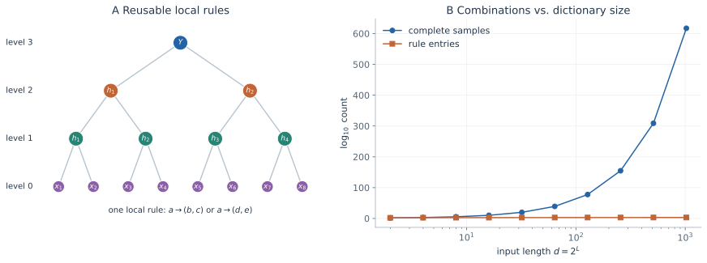

看到“图像由物体组成、物体由部件组成”时，很容易觉得深度网络的成功已经得到解释。但如果中间部件没有标签，网络如何知道两个很不一样的局部图案其实属于同一个部件？又为什么有些组合任务只需有限样本，有些却几乎无法从低阶统计中入手？问题的难点在于：层次是数据的生成规律，而学习器只能看到规律的一次次实现。

这篇从一个有限、离散的生成模型出发，逐步区分样本、规则和表示。基本结论是：组合可以让完整样本数指数增长，同时保留可复用的局部字典；但只有当字典在观测中留下可分辨的统计差异时，有限数据才有机会把它显露出来。后面的[语言统计](/notes/hierarchical_data/language_statistics/)和[跨语言表示](/notes/hierarchical_data/shared_representations/)都建立在这一区分上。

全文把叶节点记为第 $0$ 层，根记为第 $L$ 层；每个节点生成 $s$ 个孩子，输入长度为 $d=s^L$。$v$ 是每层词表大小，$m$ 是每个父符号的规则数，$P$ 是完整训练样本数。网络深度另用 $k$ 表示，避免把数据的层次与计算层次混为一谈。

## 数据的层次性究竟提供了什么 {#structure}

### 层次分类与层次组合

“动物—哺乳动物—猫”是一种类别之间的包含关系；“图像—物体—部件—纹理”则是一种观测的生成关系。前者组织标签，后者说明一个样本由哪些部分构成。这里主要关心后者。一个高层状态不仅决定它属于哪个类别，也决定哪些低层组合有可能出现。

可以把层次生成写成

$$
Y=H^{(L)}\longrightarrow H^{(L-1)}\longrightarrow\cdots\longrightarrow H^{(1)}\longrightarrow X=H^{(0)}.
$$

箭头表示条件分布，不意味着低层特征是高层变量的确定函数。相反，一个高层变量通常对应许多低层实现。学习需要从这些变化中识别共同的生成原因，同时保留对其他任务仍有用的区别。

这种结构提供两种压缩。第一种是**规则的复用**：不同样本、不同位置由同一套局部规则生成。第二种是**与任务有关的等价关系**：若两个局部组合来自同一父变量，在某些预测任务中便可以用同一个表示替代它们。前者减少需要估计的对象，后者减少后续计算需要处理的状态。

这里的“压缩”有明确的条件。例如识别物体时可忽略某些纹理差异，但生成一张具体图像时仍然需要纹理。一个表示是否充分，必须相对于预测目标判断。不能先假定所有表面变化都应该被消去，再把消去变化视为学习成功。

### 表达能力与可学习性之间的距离

设一个目标由许多低维局部映射组合而成。若每个局部映射只依赖 $s$ 个输入，以局部模块近似整个函数，可能比直接近似一个 $d$ 维函数有效得多。但这只是存在某种好表示的理由。实际数据没有标注中间节点，学习器仍需发现模块的输入、识别模块的输出，并判断不同位置是否应该共享模块。

Mossel 的工作把层级生成与受限统计信息下的分类能力联系起来；Malach 与 Shalev-Shwartz 则给出结合梯度更新和聚类的逐层算法及相应条件下的收敛分析。它们使“利用层次”成为具体算法问题，也提醒我们：特定逐层算法的保证，不能直接替换成一般端到端梯度下降的保证。[Mossel，2016](https://arxiv.org/abs/1612.09057)；[Malach 与 Shalev-Shwartz，2018](https://arxiv.org/abs/1803.09522)。

以下讨论始终区分三种成本：已知生成规则后的**推断成本**，从样本估计未知规则的**统计成本**，以及指定网络和训练过程的**优化成本**。层次结构可以同时影响它们，但三者不会自动相等。

## 随机层级模型的生成规律 {#rhm}

### 固定语法与随机样本

令第 $\ell$ 层词表为 $\mathcal V_\ell$，中间层和叶层的词表大小取 $v$，根有 $n_c$ 个类别。主要考虑 $s\geq2$、$v\geq2$、$m\gt1$；$m=1$ 时每个类别只生成一个样本，不再具有同义多样性。对每个父符号 $a\in\mathcal V_\ell$，选定 $m$ 条规则

$$
\mathcal R_\ell(a)=\{\boldsymbol b_{a,1},\ldots,\boldsymbol b_{a,m}\},
\qquad \boldsymbol b_{a,k}\in\mathcal V_{\ell-1}^{s}.
$$

一条规则把一个符号替换成一个有顺序的 $s$ 元组。原始均匀模型在这 $m$ 条规则间等概率选择：

$$
T_\ell(\boldsymbol b\mid a)
=\frac1m\mathbf 1\{\boldsymbol b\in\mathcal R_\ell(a)\}.
$$

规则字典随机抽取一次，随后在整个训练集和测试集中固定。每次生成样本时重新随机的是根类别和各节点采用的规则。若每个样本都重新抽取一套字典，跨样本可复用的统计结构就会被平均掉，这已经是另一种学习问题。

原始模型还要求局部无歧义：同层两个不同父符号不能生成同一个子元组。因此

$$
mv\leq v^s,\qquad m\leq v^{s-1},
$$

而最顶层的约束为 $mn_c\leq v^s$。约束作用于完整元组；它并不禁止同一个子符号出现在多个父符号的规则里。单个词、边缘或纹理可以共享，完整的局部组合才确定父符号。[随机层级模型，PRX 2024](https://arxiv.org/abs/2307.02129)。

在本文的编号下，联合分布写成

$$
p(y,h,x)=\frac1{n_c}
\prod_{\ell=1}^{L}\prod_{u=1}^{s^{L-\ell}}
T_\ell\!\left(
h^{(\ell-1)}_{s(u-1)+1:su}\mid h^{(\ell)}_u
\right),
\qquad h^{(L)}_1=y.
$$

这里一个因子连接父节点与整个子元组。给定父节点，兄弟节点通常仍不独立：规则限制的是它们的联合取值。把这个模型改成各条边独立传递的广播过程，会改变关键的组合约束。

### 指数多个样本与有限规则字典

树的内部节点总数为

$$
N_{\mathrm{int}}=1+s+\cdots+s^{L-1}
=\frac{s^L-1}{s-1}=\frac{d-1}{s-1}.
$$

每个内部节点独立选择 $m$ 条规则之一。在固定树、局部无歧义的条件下，不同规则选择给出不同叶序列，所以每类样本数为

$$
|\mathcal X_y|=m^{(d-1)/(s-1)},\qquad
|\mathcal X|=n_c m^{(d-1)/(s-1)}.
$$

学习器看到的完整样本只占其中极小一部分。若它只是记住整条序列，无法覆盖组合空间；若它恢复了各层字典，就能处理从未同时出现过的规则组合。规则槽位数约为 $Lvm$，每条规则包含 $s$ 个子符号，远小于样本数。但字典规模小本身不保证统计上容易恢复，隐变量置换、微弱关联和不同字典的观测等价性都可能造成困难。

均匀模型还有一个有用的熵计数。固定类别时，规则选择与叶序列一一对应，因此

$$
H(X\mid Y)=\frac{d-1}{s-1}\log m.
$$

可见层次数据可以拥有随 $d$ 广延增长的熵。它的可学习性不要求所有样本都挤在少数几个观测状态上；真正节省的是描述联合规律所需的结构。大量变化与有限规律可以共存。

### 语法占有率与任务的区别

当 $n_c=v$ 时，定义

$$
\rho=\frac{m}{v^{s-1}}.
$$

它是每层全部 $v^s$ 个候选子元组中，被规则字典使用的比例。$\rho\lt1$ 时，局部组合受约束；$\rho=1$ 且规则等概率时，所有叶序列均以相同概率生成，因而无标签的 $p(x)$ 是均匀分布。

这个极限尤其能区分任务。叶序列仍通过固定字典确定根类别，所以监督分类仍有内容；但无标签序列分布不再暴露这些类别划分，下一个 token 也没有可利用的上下文依赖。输入分布中可恢复的结构与输入到标签的结构，并非同一对象。后文涉及语言预测和去噪时，主要考虑 $\rho\lt1$。

## 把一套小语法完整展开 {#worked-grammar}

抽象定义中的规则可以非常具体。取两层二叉树，叶词表为 $\{a,b,c,d\}$，第一层父符号为 $\{A,B,C,D\}$，每个父符号有两条规则：

| 父符号 | 第一条实现 | 第二条实现 |
| --- | --- | --- |
| $A$ | $(a,a)$ | $(b,b)$ |
| $B$ | $(a,b)$ | $(b,a)$ |
| $C$ | $(c,c)$ | $(d,d)$ |
| $D$ | $(c,d)$ | $(d,c)$ |

根有两个类别，其规则为

$$
Y=0\to(A,C)\ \text{或}\ (B,D),
\qquad
Y=1\to(B,A)\ \text{或}\ (C,B).
$$

类别等概率，各节点的两条规则也等概率。生成一个样本时，先选类别，再选根规则，最后各选左右父节点的表面实现。例如 $Y=0$ 经 $(A,C)$ 生成 $(a,a,d,d)$，也可以生成 $(b,b,c,c)$。这两条完整序列不同，但它们在第一层拥有相同的抽象描述 $(A,C)$。

每类恰有 $2\times2\times2=8$ 个样本。即使训练没有见过 $(b,b,d,d)$，只要学到了“$(b,b)$ 属于 $A$”“$(d,d)$ 属于 $C$”和“$(A,C)$ 属于类别 $0$”，就能识别它。这里被复用的是三个局部判断，不是完整样本之间的像素相似度。

再看第一个二元块。$(a,a)$ 和 $(b,b)$ 只会出现在类别 $0$ 的左边，因此标签分布都是 $(1,0)$。$(a,b)$ 和 $(b,a)$ 对应 $B$；$B$ 在两个类别的左边各出现一次，所以标签分布都是 $(1/2,1/2)$。$(c,c)$ 和 $(d,d)$ 在左边只来自类别 $1$，所以分布都是 $(0,1)$。三类不同的标签统计，恰好把六种表面元组分成三个父状态。

这个例子也暴露两点限制。首先，同一个父符号在不同位置的标签统计可能不同，估计时不能随意混合位置。其次，标签分布相同并不总能推出父符号相同；若语法具有额外对称性，不同父符号也可能得到相同统计。随机字典中的“通常能区分”和对任意语法的严格唯一性是不同命题。

## 同义关系怎样成为隐藏表示 {#synonyms}

### 同义是局部生成关系

若 $(b,c)$ 和 $(d,e)$ 是同一个父符号 $a$ 的两条规则，它们就是这个层次的同义实现。改变这两个子符号会改变观测，却不改变其父符号。继续向上生成时，祖先不需要知道父符号到底通过哪条同义规则实现。

这种等价关系可写成

$$
\boldsymbol b\sim_\ell\boldsymbol b'
\quad\Longleftrightarrow\quad
g_\ell(\boldsymbol b)=g_\ell(\boldsymbol b'),
$$

其中 $g_\ell$ 是局部无歧义规则的逆映射。同义类构成局部合法元组空间的商空间。一层理想表示以父符号替换整个元组，便把 $mv$ 种局部观测压成 $v$ 种父状态，同时把序列长度缩短为原来的 $1/s$。

这并不是把所有同标签样本都映射到同一个隐藏状态。位于不同位置、参与不同组合的部件仍需区分。尤其在生成问题中，被压掉的规则编号必须通过条件随机性重新采样；若要求精确还原原样本，它就不能被丢弃。

### 充分统计量与不可辨识的命名

在固定位置，令 $B$ 是一个底层元组，$A=g_1(B)$ 是父符号。生成图给出条件独立性

$$
Y\perp B\mid A,
\qquad p(y\mid B)=p(y\mid A).
$$

因此对于预测根类别，$A$ 是 $B$ 的充分摘要。这说明为什么同义元组应当具有相同的标签条件分布，也说明可以用上下文或标签统计来反推同义类。

恢复的父符号不必叫作真实字典中的名字。对一层全部隐符号施加相同置换，并相应修改上下两层规则，观测分布不会变化。合理的恢复目标通常是“恢复到置换等价”，或者直接检验同义关系、条件分布与组合约束，而非逐坐标比较隐藏神经元和人为编号。

### 如何测量不变性

令 $r_k(x)$ 为网络第 $k$ 层表示，$\mathcal S_\ell$ 对输入执行第 $\ell$ 层同义替换。常用归一化敏感性为

$$
S_{k,\ell}=\frac{
\mathbb E\|r_k(X)-r_k(\mathcal S_\ell X)\|^2
}{\mathbb E\|r_k(X)-r_k(X')\|^2}.
$$

分母用独立样本的典型表示距离去掉整体幅值。小 $S_{k,\ell}$ 表示该层不再显著区分这类同义实现。原始 RHM 实验把泛化改善与这种敏感性的下降联系起来，并观察到不同数据层次在不同网络深度上被消去。[PRX 2024 的表示分析](https://arxiv.org/abs/2307.02129)。

单看敏感性仍不足够。常数表示也不区分任何变换，此时分母会退化。因此应同时考察预测能力、表示方差、父状态的可解码性，以及对非同义替换的响应。理想结果是对同义变化不敏感，又保留区分不同父状态所需的信息。

这种测量比“某个神经元看起来对应部件”更直接，但它描述的是功能关系。它不能单独证明网络执行了某个唯一算法。隐藏空间的可逆变换、冗余编码和不同的计算分解，都可能实现同样的预测与不变性。

## 有限样本怎样显露层级规则 {#sample-complexity}

### 用标签分布识别同义元组

对位置 $j$ 的局部元组 $B_j=b$，定义标签分布向量

$$
\phi_j(b)=\bigl(p(Y=\alpha\mid B_j=b)\bigr)_{\alpha=1}^{n_c}.
$$

同义元组共享父符号，因此共享 $\phi_j$。不同父符号则在随机字典中通常拥有不同的标签偏好。学习器可以先估计这些向量，再按统计相似性分组，得到下一层变量。这个思路把从表面形式恢复隐变量的问题，转化成比较它们与共同预测目标的关系。

均匀分布下的微弱偏离很关键。对固定字典，某个低层组合会略多出现于某些类别。对所有随机字典取平均时，这些偏好消失；但学习面对的是一个固定字典，所以它们正是可利用的信号。无序平均描述典型强度，不能在学习之前把实例中的偏好抹掉。

### 信号和计数噪声的配平

下面给出原始阈值的数量级推导。固定类别和一个底层位置，沿根到该元组的路径有 $L$ 次规则选择，总共约 $m^L$ 条路径实现。合法底层元组约有 $mv$ 种，每种平均获得

$$
\frac{m^L}{mv}
$$

条路径。将路径计数近似看成弱相关随机计数，其相对涨落量级为

$$
\delta_{\mathrm{signal}}
\sim\left(\frac{m^L}{mv}\right)^{-1/2}.
$$

另一方面，$P$ 个训练样本中，落在指定类别、指定局部元组的平均计数约为 $P/(n_cmv)$，对应的相对采样噪声为

$$
\delta_{\mathrm{noise}}
\sim\left(\frac{P}{n_cmv}\right)^{-1/2}.
$$

二者配平得到

$$
P_c\sim n_c m^L
=n_c d^{\log m/\log s}.
$$

这解释了为什么词表因子在该比较中抵消，以及为什么样本复杂度可以是输入长度的幂律。路径间并不严格独立，上面的计数用于展示机制；论文通过规则统计的方差计算支持这个尺度，并发现所研究深网的泛化阈值与它相符。[PRX 2024，相关性与采样噪声](https://arxiv.org/abs/2307.02129)。

应注意，$P_c$ 是辨认指定统计信号的尺度，并非所有算法的信息论下界。使用整个标签分布向量、额外聚类步骤或其他可观测量，可能改变统计效率。这个结论也不意味着深度免费：固定 $m\gt1$ 时成本随 $L$ 指数增长，只因 $d=s^L$ 才变成关于 $d$ 的多项式。

### 梯度为什么能够接触这些统计量

考虑局部特征字典 $e_B$，用隐藏单元 $w_h(B)$ 和输出权重 $a_{h\alpha}$ 预测类别。若初始类别概率为 $1/n_c$，交叉熵的一次更新在适当的局部线性区间内含有

$$
\Delta w_h(b)\propto
\sum_\alpha a_{h\alpha}
\left[
\widehat p(B=b,Y=\alpha)
-\frac1{n_c}\widehat p(B=b)
\right].
$$

方括号就是局部元组与标签的经验关联。因此两个拥有相同标签统计的元组，在平均更新中获得相似方向；足够数据使这种方向超过噪声，才可能形成稳定分组。这里元组特征已经被提供或能够被局部网络区分，论证只说明梯度与统计量之间的联系，不能替代完整多层训练动力学。

特征学习还会改变后续问题的统计强度。得到父状态后，学习器不再每次从原始叶符号间接判断更高层状态，而是可以在已形成的表示上寻找下一组关系。表示既是学习结果，又成为下一阶段的观测变量。

### 层次结构为什么有时仍然难学

若刻意平衡规则，使所有局部元组具有相同标签分布，上述分组信号便消失。层次奇偶任务就是一个鲜明例子：整体标签依赖所有输入，但许多低阶边缘统计完全为零。原始研究通过去除相关性的对照显示，几何结构匹配的深网也可能重新遭遇严重的样本困难。[无相关性对照](https://arxiv.org/abs/2307.02129)。

因此层级组合性、局部可辨认性和算法可达性需要分别考察。已有的[层级组合学习笔记](/notes/neural_network_theory/hierarchical_learning/)专门分析奇偶机制模型中的梯度瓶颈；它与随机语法恰好形成对照：两者都有树状组合，却不具有同样的可观测学习信号。

## 从统计充分性到一次梯度更新 {#gradient-details}

### 标签统计为什么能够消去同义细节

令 $B$ 是某位置的完整子元组，$A$ 是它的父符号。固定 $A$ 后，向下选哪条规则不影响根的其他生成步骤，因此

$$
p(y,b)=p(y,A=a)\,p(b\mid A=a),\qquad a=g(b).
$$

用 $p(b)=p(a)p(b\mid a)$ 相除，局部实现概率约去，得到 $p(y\mid b)=p(y\mid a)$。这个约去不仅在等概率规则时成立：只要同义规则的选择在给定父状态后不再依赖类别，非均匀规则也可以共享同一标签条件分布。

这是一种任务相关的充分性。它告诉我们，预测根类别时可以忘记规则编号；它没有告诉我们生成完整样本时也可以忘记规则频率。后者决定哪些同义实现更常出现。[长尾规则的学习曲线](/notes/hierarchical_data/language_statistics/#rare-rules)会再次用到这个区别。

### 交叉熵怎样把共现计数写进参数

为了看清更新来源，暂把局部元组 $b$ 当作可区分的离散输入，设类别分数为 $z_\alpha(b)$，预测为 $q_\alpha(b)=\operatorname{softmax}(z(b))_\alpha$。对单个训练样本，交叉熵关于分数的导数是

$$
\frac{\partial[-\log q_y(b)]}{\partial z_\alpha}
=q_\alpha(b)-\mathbf1\{y=\alpha\}.
$$

再取 $z_\alpha(b)=\sum_h a_{h\alpha}w_h(b)$。在初始预测均匀时，对训练集平均后有

$$
-\frac{\partial\widehat{\mathcal L}}{\partial w_h(b)}
=\sum_\alpha a_{h\alpha}
\left[\widehat p(b,\alpha)-\frac{\widehat p(b)}{n_c}\right].
$$

于是更新沿着“该元组实际与某类别共同出现的频率，减去类别均匀时应有的频率”发生。标签偏好不是事后解释隐藏单元的图案，而是直接出现在学习信号中。

如果两个同义元组频率不同，右边的整体幅值也可能不同。更准确的判断应比较经频率归一化后的条件统计或更新方向，而不是要求每一个原始参数在一次更新后完全相同。多层网络还必须先形成能够区分完整元组的非线性特征；上面的字典输入把这一困难暂时隔离了出来。

### 为什么见过一次通常不够

设元组 $b$ 在训练集中出现 $N_b$ 次，条件类别概率的估计方差约为

$$
\operatorname{Var}[\widehat p(\alpha\mid b)\mid N_b]
\simeq\frac{p(\alpha\mid b)[1-p(\alpha\mid b)]}{N_b}.
$$

若两个父状态的类别偏好相差 $\delta$，区分它们需要大致 $N_b\delta^2$ 达到有限量级。稀有元组的 $N_b$ 小，深层结构传下来的 $\delta$ 又可能很小，两者共同造成统计瓶颈。完整样本出现过一次，与其中规则已经被识别，不能等同。

这里还存在偏差与方差之间的选择。把多个位置、多个样本归入同一估计能减少方差，但若它们实际上不共享规则，就会引入系统偏差。权重共享的成功，需要数据中确实有可以共享的局部生成机制。

## 稀疏数据与空间变换 {#sparsity}

### 在规则中加入空白

原始 RHM 的组合位置严格固定。Sparse Random Hierarchy Model 在词表中加入不携带信息的空白，让有用子特征可以在局部范围移动。一个简单版本把每个有用特征嵌入长度为 $s_0+1$ 的子区间，其中只有一个位置非空。一个父节点于是生成长度 $s(s_0+1)$ 的块，包含 $s$ 个有用特征。

重复 $L$ 层后，观测长度和有用位置数分别为

$$
d=[s(s_0+1)]^L,\qquad d_{\mathrm{info}}=s^L,
\qquad F=\frac{d_{\mathrm{info}}}{d}=(s_0+1)^{-L}.
$$

局部挪动有用特征并不改变它们的生成父节点，因此也不改变标签。另一个版本允许保持相对顺序的位移，得到离散的平滑形变类比。模型把语义同义变化和位置变化放到同一个生成框架中，但并未赋予任意置换不变性。[Tomasini 与 Wyart，ICML 2024](https://arxiv.org/abs/2404.10727)。

### 权重共享怎样影响样本成本

局部连接网络 LCN 在不同位置分别学习参数；CNN 进一步要求位置间共享参数。针对与生成树匹配的架构，论文在最大规则数 $m=v^{s-1}$ 的主要实验中得到

$$
P^*_{\mathrm{LCN}}\sim
C_0(s,L)(s_0+1)^L n_c m^L,
$$

$$
P^*_{\mathrm{CNN}}\sim
C_1(s_0+1)^2 n_c m^L.
$$

这里 $C_0$ 的观测与 $s^{L/2}$ 相容；两式是该模型与训练协议下的标度关系。值得比较的是稀疏性引入的成本：没有共享时，它随层数累积；有共享时，不同位置可共同支持同一种局部规则的估计。[SRHM 的样本复杂度](https://arxiv.org/abs/2404.10727)。

不能简单地说“越稀疏越容易”。若固定 $s,m,L$ 增大空白，输入变长、出现位置变散，学习可能更贵；若固定总长度，用更少有用组合替换原本更复杂的结构，稀疏性又可能降低任务难度。比较成本前必须说明固定的是观测长度、有效特征数、层数，还是规则数。

### 学到的稳定性与结构带来的等变性

共享卷积参数给出特定的平移等变性；对局部有用特征的移动不敏感，则还依赖表示把这些位置实现归并起来。二者有关但不等价。SRHM 的意义在于把位置扰动是否保持标签这件事写进数据生成过程，而不是先对任意扰动测试鲁棒性。

可以分别定义同义敏感性 $S_{k,\ell}$ 和位置变换敏感性 $D_{k,\ell}$。当两者都下降且分类改善时，有理由认为网络同时学到了局部内容的等价关系和空间实现的等价关系。对图像的启发是：某些稳定性可能来自物体的稀疏、组合式构成，而不只是外加的数据增强规则。

## 从局部规则返回整体学习 {#outlook}

这套模型把“深度有用”拆成了更具体的链条：局部规则在多个样本中复用，同义实现拥有相同的任务条件统计，有限数据使不同父状态的统计差异超过噪声，形成的表示再减少上层需要处理的状态。每个环节都能被单独破坏，因此也能被单独检验。

在解释一个真实模型时，可以依次比较：被视为同义的变换是否确实保持任务，局部条件统计是否足以区分父状态，隐藏表示是否只消除了这些变化，以及新组合是否沿用同一套规则。某一层“看起来像部件”只是线索，只有这些关系同时成立，层次学习的解释才更具体。

下一篇[语言统计与学习曲线](/notes/hierarchical_data/language_statistics/)将去掉直接可见的根标签，改用下一个 token 作为预测目标。局部规则仍相同，但监督信号要穿过另一条生成路径，因而出现与这里不同的样本阈值和有效上下文。

主要文献：[随机层级模型](https://arxiv.org/abs/2307.02129)、[稀疏随机层级模型](https://arxiv.org/abs/2404.10727)、[层级生成与受限统计](https://arxiv.org/abs/1612.09057)、[逐层梯度和聚类](https://arxiv.org/abs/1803.09522)。

[专题目录](/notes/hierarchical_data/) · [下一篇：语言统计与学习曲线](/notes/hierarchical_data/language_statistics/)
