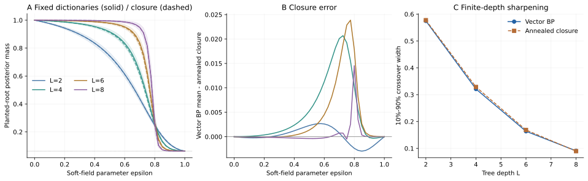

> **Hierarchical Learning · RHM 03**　[← 02 · 语言统计与学习曲线](/notes/hierarchical_data/language_statistics/) · [专题目录](/notes/hierarchical_data/) · [04 · 语法解析与隐变量学习 →](/notes/hierarchical_data/parsing_latents/)

**本篇问题：** 规则已知时怎样精确计算含噪样本的后验，这个最优参照与实际扩散学习相差哪些环节？

**理论定位：** 本篇以已知生成规则的概率推断为参照；学习规则如何取得表示见[梯度可达性](/notes/hierarchical_data/gradient_accessibility/)，训练反馈中的响应则见[跨层耦合](/notes/hierarchical_data/coupled_feature_learning/#exact-gradient)。

**阅读主线：** 以[精确 BP](#belief-propagation)建立基准，区分噪声现象与[均场闭合](#annealed-closure)，再用[固定字典数值对照](#bp-mean-field-comparison)检验近似，并回到有限数据生成。

学习一套语法，与在语法已知时解释一个不完整样本，是两个不同的问题。前两篇讨论有限数据怎样让规则变得可见；这一篇先把规则固定为已知，再追问：如果部分观测被噪声破坏，哪些隐变量仍能被恢复，哪些不同解释应该保留？

树结构让这个问题可以通过信念传播精确求解。它也为扩散模型提供一个可控参照：先把真实样本加噪，再从后验生成另一个样本，观察不同层次何时遗忘、哪些位置一起改变。最后再回到有限训练集，区分“最优推断的限制”与“模型尚未学会规则”。

以下仍用 $\ell=0$ 表示叶层，$\ell=L$ 表示根，$T_\ell(\boldsymbol b\mid a)$ 表示父状态 $a$ 生成子元组 $\boldsymbol b$ 的概率。这里的“消息”是关于一个随机变量的似然或概率向量，不是网络层之间随意传递的特征数值。

已知规则的作用，是给每种候选解释分配明确概率；它不保证受噪观测只剩一个解释。一个完整而正确的推断器，可以输出分散后验，因为数据本身没有提供足够证据。先计算这个参照，才能判断实际网络的错误究竟来自尚未学会规律，还是来自任何模型都无法消除的观测不确定性。

## 1. 已知语法时的精确推断 {#belief-propagation}

### 1.1 自下而上的似然消息 {#自下而上的似然消息}

假设规则字典已知，叶节点经过独立观测通道 $K_\eta(z_i\mid x_i)$。给定观测 $z$，后验为

$$
p(y,h,x\mid z)\propto
\frac1{n_c}\prod_{\ell,u}T_\ell(h_{\mathrm{child}(u)}\mid h_u)
\prod_iK_\eta(z_i\mid x_i).
$$

树上的信念传播可以精确计算边缘概率；一般图模型背景可参见 Wainwright 与 Jordan [[5]](#ref-5)。令 $u_i^{(0)}(a)=K_\eta(z_i\mid a)$，更高层消息为

$$
u_u^{(\ell)}(a)=
\sum_{b_1,\ldots,b_s}T_\ell(b_1,\ldots,b_s\mid a)
\prod_{j=1}^{s}u_{s(u-1)+j}^{(\ell-1)}(b_j).
$$

它是以 $a$ 为该子树根时，子树全部观测的似然。归一化不影响后续概率比。到达根后，$p(y\mid z)\propto u_1^{(L)}(y)/n_c$。

向上消息可以理解为一张兼容度表：如果这棵子树由某个父状态生成，当前全部观测有多合理。每条规则对应一种可能实现，孩子消息相乘是联合考虑该实现的证据，不同合法实现相加则保留解释的不确定性。它既不是简单投票，也不是立即选出得分最高的规则；保留求和才能让上层正确利用多个可能来源。

在每个父符号只有 $m$ 条规则时，求和可以按合法规则组织。所需局部运算量与 $vms$ 成正比，节点数与 $d$ 成正比，因而一次全树推断的成本约为 $O(dvms)$。这一步利用的是已知字典的稀疏性，不等于从数据学习字典也具有同样的复杂度。

### 1.2 自上而下的上下文消息 {#自上而下的上下文消息}

只有向上消息，低层变量尚未使用子树以外的信息。令 $d_u^{(\ell)}(a)$ 汇集外部信息，根的初值为 $1/n_c$。父节点 $u$ 给第 $j$ 个孩子 $c_j$ 的消息为

$$
d_{c_j}^{(\ell-1)}(b_j)=
\sum_a\sum_{\boldsymbol b_{-j}}
d_u^{(\ell)}(a)T_\ell(\boldsymbol b\mid a)
\prod_{k\ne j}u_{c_k}^{(\ell-1)}(b_k).
$$

于是任意节点的完整后验为

$$
p(H_u^{(\ell)}=a\mid z)
\propto u_u^{(\ell)}(a)d_u^{(\ell)}(a).
$$

向下计算重新使用兄弟节点的向上信息，因此局部观测不会脱离全局语境而独立解释。这个结构也解释了编码器、解码器与跨尺度跳跃连接之间的自然联系。

一个模糊的局部块，可能单凭自身看不清，却能被别处信息约束。向上计算先询问各子树分别支持什么，向下计算再把其他子树和更高层语境带回来。两遍计算的分工是避免把局部证据误当成全部证据，也避免在树上重复计算同一份证据。它让局部判断与全局相容性在同一个后验中结合。

Mei 研究了层级生成模型中 CNN、U-Net 对分类和去噪推断的近似及样本复杂度。其理论模型与硬约束 RHM 的假设并不完全相同；尤其一般树上模型的条件独立结构和概率正则性条件需要分别核对。可以借用的是消息传递与架构的对应思路，不能把不同模型的全部定理直接合并。[U-Nets as Belief Propagation](https://arxiv.org/abs/2404.18444) [[4]](#ref-4)。

这里还应与[可证明逐层学习](/notes/hierarchical_data/generative_learning/#shallow-to-deep-chaining)中的条件标签编码区分。BP 消息在语法已知时，根据这一次样本的观测与语境改变；逐层学习得到的编码则按参考位置的总体标签统计辨认部件，再跨位置复用。同样写成概率向量，并不意味着它们是同一种后验。前者解决给定规律后的样本解释，后者帮助从输入与标签中形成可复用的规律表示。

### 1.3 归一化怎样兼顾数值稳定与概率含义 {#归一化怎样兼顾数值稳定与概率含义}

深树上的似然是许多小概率的乘积，直接相乘容易数值下溢。可以在每次更新后，把消息除以它所有分量之和；只要这个因子与候选状态无关，后续的概率比就不变。若需要计算整份观测的边缘似然 $p(z)$，则必须把每次被除去的尺度因子另外累积，不能从最终归一化消息的和反推证据概率。

也可以保存对数消息。对父状态 $a$ 的合法规则 $\boldsymbol b\in\mathcal R(a)$，令

$$
\log u(a)=\operatorname{LSE}_{\boldsymbol b\in\mathcal R(a)}
\left[\log T(\boldsymbol b\mid a)+\sum_j\log u_j(b_j)\right],
$$

其中 $\operatorname{LSE}(x_1,\ldots,x_n)=x_{\max}+\log\sum_re^{x_r-x_{\max}}$。非法规则权重为零，在对数中对应 $-\infty$。这保留了对所有解释求和的含义；若改成直接取最大值，得到的是另一种最大概率解释算法，通常不会给出同样的边缘后验。

向下消息还有一个容易出错的细节：发给某个孩子时，乘积必须排除这个孩子自己的向上证据。否则这份证据先向上传到父节点，又沿原路返回，相当于使用两次。树上两遍算法之所以精确，依赖的正是每条消息只汇集边另一侧的观测。把所有邻居消息不加区分地相乘，会产生虚假的高置信度。

### 1.4 用四种合法组合算一次后验 {#用四种合法组合算一次后验}

取一个只有根与两个叶节点的小语法。根有 $A,B$ 两种状态，先验各为 $1/2$；其规则为

$$
A\to(0,0)\ \text{或}\ (1,1),\qquad
B\to(1,2)\ \text{或}\ (2,1),
$$

每条规则条件概率为 $1/2$。左右观测给出的似然分别为 $u_1=(0.6,0.3,0.1)$、$u_2=(0.1,0.2,0.7)$。这两个向量在这里恰好归一化，但递推只需要它们的比例。

向上计算得到

$$
u(A)=\frac{0.6\times0.1+0.3\times0.2}{2}=0.06,
\quad
u(B)=\frac{0.3\times0.7+0.1\times0.2}{2}=0.115.
$$

由于根先验相同，归一化后 $p(A\mid z)=12/35$、$p(B\mid z)=23/35$。四条完整规则的后验概率依次是

$$
\bigl(p(00\mid z),p(11\mid z),p(12\mid z),p(21\mid z)\bigr)
=\frac1{35}(6,6,21,2).
$$

左叶的边缘后验于是为 $(6,27,2)/35$。它的局部似然原本最偏好 $0$，完整后验却明显偏好 $1$：右侧对 $2$ 的支持，经合法规则 $(1,2)$ 传到了左侧。向下消息做的正是这种上下文修正，并没有额外“猜测”某种语义。

这个例子中，左右观测的最强局部偏好并不一定能够拼成最有可能的完整规则。完整后验会同时考虑局部似然、规则合法性和先验权重，所以某个位置可以被其他位置间接纠正。所谓利用上下文，在这里就是计算这些候选组合的相对证据，而不是无条件地让全局判断覆盖局部观测。

### 1.5 边缘概率不等于独立生成 {#边缘概率不等于独立生成}

得到所有叶节点后验后，逐个独立采样通常会破坏规则约束。正确联合采样先按根后验采样，再在给定父状态与子树证据的条件下，联合选择整条规则，递归向下。兄弟节点必须通过同一个合法元组共同生成。

这个要求不只是在排除极少数异常样本。假如分布主要集中在几种相互配合的组合上，各位置的边缘可以都很宽；独立拼接会把概率分散到许多本来不可能的交叉组合。模型需要学到的因此既是每处可能出现什么，也是这些可能性如何共同实现。联合生成的困难，不能从逐点准确率单独读出。

这一区别贯穿生成模型：逐位置的平均或边缘估计可以是很好的去噪预测，却不等于一个完整、满足全局约束的随机样本。局部平均看起来合理，也不能保证组合之后仍落在数据分布的支持集内。

在刚才的例子里，左叶取 $0$ 的边缘概率为 $6/35$，右叶取 $2$ 的边缘概率为 $21/35$。若独立采样，就会以 $(6/35)(21/35)$ 的正概率生成 $(0,2)$，但这在原语法中完全不合法。精确的每点边缘，仍可能在独立拼接时产生错误联合分布。

正确做法是先选根，再按给定根与观测的规则后验选一个完整元组。对深树继续递归，就得到全局一致的样本。这种由粗到细的随机生成，与每一层都保留所有候选后验的推断，是同一个概率模型的两个操作。

精确去噪均值与合法随机样本由此对应不同输出目标。后面讨论生成质量时，以这里的联合采样条件为参照。

## 2. 扩散过程怎样暴露潜在层次 {#diffusion}

### 2.1 前向加噪与后验重采样 {#前向加噪与后验重采样}

考虑从真实样本 $X_0$ 出发，加噪到 $Z_t$，再按后验生成 $\widehat X_0$：

$$
X_0\longrightarrow Z_t\longrightarrow\widehat X_0,
\qquad \widehat X_0\sim p(x\mid Z_t).
$$

这称为前向—后向实验。它测量在指定噪声水平下，观测还保留哪些约束。这里的 $t$ 是采样过程的噪声时间；它与训练迭代数、训练数据量不同。

固定一套规则改变噪声，考察的是同一个已知世界在不同观测质量下如何被解释；固定噪声增加训练数据，考察的则是学习者对世界规律认识得更准确没有。两种曲线都可以出现转折，但控制的对象完全不同。把噪声恢复阈值直接叫作学习样本阈值，会混合推断与估计这两层问题。

若后验完全正确，$\widehat X_0$ 的边缘分布始终为真实 $p(x)$，但它与原始样本的关联随噪声变化。对任何一个隐变量 $H$，设 $\pi_a(z)=p(H=a\mid Z_t=z)$。原始隐变量与重采样隐变量在给定 $z$ 后是独立同分布的，因此

$$
\Pr(H=\widehat H)
=\mathbb E_{Z_t}\sum_a\pi_a(Z_t)^2.
$$

这个重合率衡量后验集中程度。它与最大后验分类准确率 $\mathbb E\max_a\pi_a$ 不同，也与后验熵不同。比较论文中的“恢复概率”时，应先弄清楚实际计算的是哪一个量。

重采样后的总体分布仍然正确，并不意味着它还保留原样本身份。在无信息极限，后验退回先验，新样本仍来自正确分布，却与原样本不再有关。前向—后向实验因此同时具有两个层面：它可以始终生成正确类型的数据，又逐渐忘记这一次输入中的具体选择。随噪声变化的重合，测量的是后一种记忆。

### 2.2 高斯噪声怎样进入离散语法 {#高斯噪声怎样进入离散语法}

把叶符号 $a$ 编码为标准基向量 $e_a$，在某一噪声水平观察

$$
Z=\sqrt\alpha\,e_a+\sqrt{1-\alpha}\,\xi,
\qquad \xi\sim\mathcal N(0,I).
$$

展开高斯似然中的平方项，所有与候选 $a$ 无关的项约去后，有

$$
K_\alpha(z\mid a)\propto
\exp\!\left(\frac{\sqrt\alpha}{1-\alpha}z_a\right).
$$

因此连续噪声观测可以直接变成每个离散候选的软证据，再交给树上消息传递。无需先把含噪向量硬判为某个词；过早硬判会丢掉其他候选仍有可能正确的信息。

若把整个叶序列的独热向量拼在一起，高斯混合分布的 score 还满足

$$
\nabla_z\log p_\alpha(z)
=-\frac{z-\sqrt\alpha\,\mathbb E[X_0\mid Z=z]}{1-\alpha}.
$$

这条关系来自对混合分布求导：每个高斯分量的梯度按后验权重平均。它说明最优去噪条件均值与精确 score 的联系。但均值通常不在离散语法的支持集上，生成合法样本仍需要正确的联合随机过程。

软证据使噪声通道与语法约束可以分别发挥作用。观测偏向某个叶符号，不等于其他符号已经被排除；后续上下文仍可改变它们的权重。若一开始硬判，后面看到再强的相容证据，也可能无法恢复被删除的路径。概率消息的优势正是延迟这种不可逆选择，把不确定性保留到足够多的信息汇集以后。

### 2.3 全局类别可以比局部细节更突然地遗忘 {#全局类别可以比局部细节更突然地遗忘}

Sclocchi、Favero、Wyart 研究已知 RHM 规则下的最优去噪，发现某些参数区间里，根类别的重合率随噪声出现随树深变尖的转变；较低层变量则更平滑。超过类别转变后，局部特征仍可能被保留，用于组成另一类别的样本。对应的图像实验通过分类网络表示观察到相似现象。[PNAS 2025](https://arxiv.org/abs/2402.16991) [[1]](#ref-1)。

这并不要求所有尺度按同一个噪声阈值一起消失。根状态依赖许多层约束的协调；局部状态还受到自身观测和邻近结构支持。某些低层证据仍可被保留，即使它们已经不足以确定高层共同原因。

这可以理解为知道若干部件，却不再知道它们应该组成哪种整体。局部观测仍支持某些纹理、词组或小块实现，但多个高层解释已经可以同样合理地组织它们。高层状态变化不必伴随全部叶节点重写；相同部件可以被新的整体安排复用。因此，全局类别的遗忘与局部细节的保留能够共存。

这里也有一个观测上的边界：合成模型的节点是真实已知的隐变量，而图像中分类网络的层只是潜在结构的代理。表示相似性发生突变，不等于已经唯一识别了自然图像的生成树。

### 2.4 恢复概率的三种含义 {#恢复概率的三种含义}

给定一次噪声观测，若某隐变量后验为 $\pi=(0.6,0.3,0.1)$，最大后验分类选第一类，其条件准确率是 $0.6$；两个独立后验样本相同的概率是 $0.6^2+0.3^2+0.1^2=0.46$；后验熵则是 $-\sum_a\pi_a\log\pi_a$。三者都描述不确定性，但数值不同，不能混用。

完全失去观测信息时，后验回到先验，重合率基线为 $\sum_a p(a)^2$。只有该隐变量先验均匀时，才等于 $1/v$。根在 RHM 中通常按均匀先验采样，但固定随机字典下的其他节点分布未必精确均匀。

这也解释了为什么“类别发生改变”和“所有原始信息都丢失”不是同一件事。类别重合率只检查一个高层变量；局部后验仍然可能与原图或原句保有明显关联。

## 3. 均场递推：一个独立的近似机制 {#annealed-closure}

以下暂时离开实际加噪通道，给合法参考样本施加可控的软证据，以隔离层级放大机制。BP 仍对给定权重精确；将完整消息压成一个数，才是额外近似。这个区分也限定了后面数值对照能够检验什么。

### 3.1 一个可分析的均场递推 {#一个可分析的均场递推}

为理解转变，取参考合法序列，对每个叶符号赋予软证据：正确符号质量为 $p=1-\epsilon+\epsilon/v$，其他每个符号质量为 $\epsilon/v$。这是一种简化的证据插值；它不是一次实际随机替换后得到的观测，也不与高斯扩散时间一一等同。

设某个父节点的真实子元组已知。它从子消息获得的乘积质量为 $p^s$。剩余全部元组的总质量为 $1-p^s$。随机无歧义字典中，除真实规则外，全部 $v^s-1$ 个候选元组有 $mv-1$ 个合法，其中 $m-1$ 个属于正确父状态。

以平均未归一化权重之比近似平均消息，得到保留有限词表计数的退火递推

$$
F(p)=
\frac{p^s+\frac{m-1}{v^s-1}(1-p^s)}
{p^s+\frac{mv-1}{v^s-1}(1-p^s)}.
$$

“退火”在这里表示先对随机规则的权重取平均，再做归一化；精确固定字典上的平均后验一般不等于这个比值。这是原论文均场思路的计数写法。大词表时，分母中的合法比例接近 $\rho=m/v^{s-1}$。[均场去噪分析](https://arxiv.org/abs/2402.16991)。

可以直接检查两个固定点：$F(1)=1$ 与 $F(1/v)=1/v$。在正确分支附近，

$$
F'(1)=\frac{sm(v-1)}{v^s-1}\simeq s\rho.
$$

若该导数小于 $1$，小的误差可在逐层映射中被压低。若同时存在稳定的均匀固定点，两者之间便有不稳定分界点 $p_*$。初始证据位于分界点两侧时，深树递推分别走向高重合与低重合分支。有限 $L$ 给出平滑曲线；尖锐转变来自不断重复的层级放大。

递推的两种稳定方向分别表达纠错与遗忘。证据足够好时，合法规则排除不相容组合，父状态比孩子更确定；证据较弱时，许多规则贡献接近，向上汇总反而使候选更难区分。不稳定分界点决定一次小改动会被哪种趋势放大。树越深，这个小改动被重复作用越多次，根部曲线便可能越来越陡。

 与对角线，圆点标出三个固定点。右：从 p₀=1−ε+ε/v 出发迭代不同深度所得根消息。曲线仅描述均场向上递推，不包含固定字典涨落或完整向下消息。")

### 3.2 两个稳定分支分别需要什么 {#两个稳定分支分别需要什么}

对上面的有限词表递推，令 $a_0=(m-1)/(v^s-1)$、$b_0=(mv-1)/(v^s-1)$，则

$$
F'(p)=\frac{s p^{s-1}(b_0-a_0)}{[b_0+(1-b_0)p^s]^2}.
$$

在均匀固定点，

$$
F'(1/v)=\frac{s(v-1)v^{s-1}}{m(v^s-1)}\simeq\frac{s}{m}.
$$

因此两个端点能否同时稳定，取决于两个不同方向：正确分支要求噪声能够被局部约束修正，均匀分支要求小偏好在无信息背景上不自行放大。大词表近似下，一个典型双稳区间为 $s\lt m\lt v^{s-1}/s$，还需满足原语法的合法性约束。

这个区间来自当前退火映射的局部稳定性分析。固定字典的完整消息是随机向量，不是一维参数，实际转变位置和有限尺寸行为仍需由完整 BP 或相应分布递推判断。均场曲线帮助理解机制，不能作为任意层级数据都存在相变的证明。

### 3.3 临界尺度从哪里来 {#临界尺度从哪里来}

在不稳定固定点附近，令 $\lambda=F'(p_*)\gt1$。偏离量约按 $\delta p_\ell\simeq\lambda^\ell\delta p_0$ 增长。它保持在临界区域的层数满足

$$
\ell_\xi\simeq-\frac{\log|\delta p_0|}{\log\lambda}.
$$

相应观测空间尺度为 $\xi\sim s^{\ell_\xi}$，所以若初始证据与噪声控制量线性相连，

$$
\xi\sim|\epsilon-\epsilon_*|^{-\nu},
\qquad\nu=\frac{\log s}{\log\lambda}.
$$

这给出均场递推中临界长度的来源：在临界点附近多停留几层，就对应空间中指数更大的块。完整动力学关联的推导还需联合消息；这里只推导尺度放大的核心关系，不把单点递推直接等同于全部两点统计。

临界附近停留很多层，并不意味着每个位置的状态都不动，而是小的证据差异需要经过更多尺度，才被放大成明确的高层分支选择。空间尺度增长来自树的几何转换。这个解释同时需要递推稳定性和层数到长度的关系，只有其中一项还不能确定相关块究竟有多大。

### 3.4 平均与归一化之间究竟丢掉了什么 {#quenched-versus-annealed}

记某次更新中，正确父状态的未归一化权重为 $W$，所有候选的权重和为 $Z$。固定字典上的正确状态质量是 $W/Z$；先对字典平均再归一化，用的是 $\mathbb E[W]/\mathbb E[Z]$。在 $Z$ 的相对涨落较小时，二阶展开给出

$$
\mathbb E\!\left[\frac WZ\right]
\approx\frac{\bar W}{\bar Z}
-\frac{\operatorname{Cov}(W,Z)}{\bar Z^2}
+\frac{\bar W\operatorname{Var}(Z)}{\bar Z^3}.
$$

相关项与分母涨落可能互相抵消，也可能造成系统偏移，没有普遍固定的偏差方向。若少数规则主导、分母波动很大，截断在二阶也不可靠。深层还多丢掉一类信息：即使两个消息的正确分量同为 $p$，其错误质量可以集中在不同候选上；字典选择这些候选的方式不同，下一次更新就不同。一维闭合还假定了错误质量的统计对称性，而完整向量 BP 保留它们的具体分布。

### 3.5 固定字典 BP 与标量闭合的小规模对照 {#bp-mean-field-comparison}

为只检验上述近似，取 $v=16,m=4,s=2$，深度 $L=2,4,6,8$。随机抽取 24 套字典，每套在各位置共享、在不同层独立；每个深度和字典采样 16 棵合法参考树。所有 $\epsilon$ 共用这批参考树，叶似然为

$$
u_i(a)=(1-\epsilon)\mathbf1\{a=X_i^{\mathrm{ref}}\}
+\frac\epsilon v,\qquad 0\leq\epsilon\leq1.
$$

它与标量递推的 $p_0=1-\epsilon+\epsilon/v$ 完全一致。对每套固定字典运行保留全部 $v$ 个候选的 BP，测量

$$
q_L^{(G)}(\epsilon)=\frac1{16}\sum_{r=1}^{16}
\pi_{G,\epsilon}(Y=Y_r^{\mathrm{ref}}\mid X_r^{\mathrm{ref}}).
$$

根后验由完整向量的向上传播已经精确给出；向下传播用于其他节点的边缘，不改变根值。实现另用微型树的全部规则选择枚举，核对根和叶的完整后验。比较对象是 $\overline q_L$ 与 $F^{\circ L}(p_0)$；这里没有随机抽取高斯或替换观测，所以 $\overline q_L$ 是参考状态后验质量，**不等于**前向—后向通道实验中的 $\mathbb E\sum_a\pi_a^2$。

| 深度 $L$ | BP 半高位置 | 均场半高位置 | BP／均场交叉宽度 | 网格上最大均值差 |
| --- | --- | --- | --- | --- |
| 2 | 0.650 | 0.649 | 0.575／0.578 | 0.0030 |
| 4 | 0.730 | 0.724 | 0.321／0.329 | 0.0207 |
| 6 | 0.764 | 0.760 | 0.164／0.169 | 0.0239 |
| 8 | 0.780 | 0.779 | 0.091／0.090 | 0.0145 |

在这组参数下，两种计算都随深度增加而变尖，半高位置与交叉宽度相近；因此均场对层级放大的图像有机制支持，但不是精确替代。字典均值之间的最大标准差由 $L=2$ 的约 $0.024$ 增至 $L=8$ 的约 $0.093$，说明平均曲线的接近并不消除单实例波动。四个有限深度、一个参数组和这个网格，也不足以确认临界指数或无限深度转变位置。

更严格的延伸应增大每字典参考样本数以分离语法无序与树采样误差，检查其他 $\rho$ 与词表，并在随机观测通道下另测真正的重采样重合率。可复现的算法与逐字典曲线分别见[计算脚本](../bp_mean_field_comparison.py)和[原始数值汇总](../figures/bp_mean_field.json)。

## 4. 从类别重合到相关变化的块 {#correlated-changes}

### 4.1 不依赖类别标签的观测量 {#不依赖类别标签的观测量}

若不知道自然数据的隐变量，仍可以比较前向—后向实验中哪些位置一起改变。定义

$$
\Delta_i=\mathbf1\{X_{0,i}\ne\widehat X_{0,i}\}.
$$

先固定初始样本，对随机轨迹求连接关联，再平均初始样本：

$$
\mathcal C_{ij}(t)=
\mathbb E_{X_0}\left[
\langle\Delta_i\Delta_j\rangle_{X_0,t}
-\langle\Delta_i\rangle_{X_0,t}
 \langle\Delta_j\rangle_{X_0,t}
\right].
$$

这个顺序有意义。若直接混合所有初始样本求协方差，不同样本本身的难度差异也会产生整体相关，容易被误解为样本内部的协同变化。用 $2\Delta_i-1$ 替换指示变量，只会整体缩放连接协方差，不改变下面归一化的比值。

令 $Q=\sum_i\Delta_i$，归一化动力学易感性为

$$
\chi(t)=\frac{\sum_{ij}\mathcal C_{ij}(t)}{\sum_i\mathcal C_{ii}(t)}
=\frac{\mathbb E_{X_0}\operatorname{Var}(Q\mid X_0,t)}
{\sum_i\mathbb E_{X_0}\operatorname{Var}(\Delta_i\mid X_0,t)}.
$$

如果各位置独立改变，非对角协方差为零，$\chi=1$。若每个大小为 $B$ 的块内部完全一起变化、块间独立且方差相同，则一个块对分子贡献 $B^2\sigma^2$，对分母贡献 $B\sigma^2$，因此 $\chi=B$。它由此可以近似表征协同变化的体积，而不仅是平均改了多少个 token。

平均改动数只告诉我们变化有多少，不能说明它们是否组织成块。相同数量的改动可以散落各处，也可以集中在共同父状态控制的区域。连接协方差问的是，某个位置改变时，另一个位置是否比各自独立预期更容易一起改变。归一化后的易感性把这种共同波动与单点波动比较，才获得一个与协同尺度有关的量。

### 4.2 层级隐变量引起跨位置变化 {#层级隐变量引起跨位置变化}

一个较高层隐变量改变时，多个后代可能同时改写。靠近重建转变时，变化可能通过更大的共同祖先协调，于是产生大块相关改动。Sclocchi、Favero、Levi、Wyart 在 RHM 中分析这种动力学关联和临界长度，并通过图像、文本扩散实验研究相应诊断。[ICLR 2025](https://arxiv.org/abs/2410.13770) [[2]](#ref-2)。

这个方法把“去噪过程能看到什么层次”转化成可测量问题。它不需要预先标记每个物体或短语，但推断仍依赖所用生成模型、扰动通道和变化的定义。易感性峰可以提示跨位置的集体约束，单独一个峰不能证明数据恰好由唯一的一棵树生成。

有限尺寸也会限制解释。长度不能超过样本自身尺度，有限树深中的发散会被截断。比较不同图像分辨率、句长和模型噪声日程时，应优先比较实际噪声强度及相关尺度，而不是只对齐采样步号。

一个直接的有限尺寸估计是令 $\xi\lesssim s^L$。代入临界标度，得到最窄可分辨区间约满足 $|\epsilon-\epsilon_*|\gtrsim\lambda^{-L}$。在有限树上，曲线可以很陡，却仍是平滑的；只有指定深树极限以后，才谈得上严格的非解析转变。

## 5. 有限训练数据下的生成与组合泛化 {#generation}

### 5.1 去噪能力与规则学习不是同一问题 {#去噪能力与规则学习不是同一问题}

前面的精确后验实验假设字典已知。实际扩散模型从有限训练集估计去噪函数，因而必须先恢复生成规律。即使最优推断很容易，有限样本的模型也可能只学到低层规则。

Favero、Sclocchi、Cagnetta、Frossard、Wyart 研究了这种学习过程：随着数据或训练推进，生成样本先满足局部组合，随后在更大尺度上变得连贯。其解释仍是层级上下文聚类：低层表面形式在相似语境中被归并，得到的表示再支持更高层组合的识别。[ICML 2025](https://arxiv.org/abs/2502.12089) [[3]](#ref-3)。

同样是生成“没见过的样本”，可以有完全不同的含义。任意独立拼接也几乎必然得到新序列，但新序列未必符合语法；复述训练样本可以完全符合语法，却没有组合泛化。需要分别检查新颖性、规则正确性和分布的覆盖程度。

### 5.2 按尺度定义连贯性 {#按尺度定义连贯性}

已知合成语法时，可以递归检验生成样本。若底层元组合法，先映射为父符号，再检查更高层规则。定义

$$
A_\ell=\Pr(\text{生成样本可合法解析至第 }\ell\text{ 层}).
$$

按这个嵌套定义，$A_{\ell+1}\leq A_\ell$。若局部指标很高而全局指标低，模型已经掌握局部字典，却尚未协调它们的组合。用一个总准确率会掩盖这种状态；用每层规则通过率则能辨认错误发生的尺度。

局部合法而全局不连贯，是一种有内容的中间状态。它说明模型已经学习部分规则，生成过程却还没有正确协调规则之间的搭配；全部不合法则可能连底层字典都未掌握。逐层检验把这两种状态分开，也避免只看短片段质量就高估整句生成。层次模型的一个优势，正是能够给这种“连贯到哪里”的判断提供精确定义。

还需谨慎地区分嵌套通过率与“随机选一个第 $\ell$ 层节点，其局部规则是否合法”的平均值。后者并不必然随层数单调。论文与实验使用哪个定义，应在比较曲线之前说明。

### 5.3 合法新组合与分布外组合 {#合法新组合与分布外组合}

固定语法能够产生指数多个样本，训练集只覆盖其中极少部分。因此在同一语法下生成未见序列，已经要求超出整样本记忆，但仍属于同一生成分布。更强的组合分布外任务，会故意从训练集中拿掉某些规则搭配，再检查测试时能否重组。

这类测试需要保证被拿掉的组合确实由已知局部规律决定。若两个不同语法在训练支持集上完全相同、在保留组合上给出不同答案，那么没有额外先验的学习器就无法唯一决定怎样外推。层级结构提供归纳偏置，却不会消除所有由观测等价性带来的不可辨识性。

## 6. 从精确后验到实际去噪器还差哪些环节 {#denoising-diagnostics}

### 6.1 条件均值的最优性可以精确拆开 {#条件均值的最优性可以精确拆开}

令 $\mu(z)=\mathbb E[X_0\mid Z=z]$，实际去噪器为 $f(z)$。在向量平方误差下，把 $X_0-f(Z)$ 拆成 $X_0-\mu(Z)$ 与 $\mu(Z)-f(Z)$，交叉项的条件期望为零，因此

$$
\mathbb E\|X_0-f(Z)\|^2
=\mathbb E\|X_0-\mu(Z)\|^2
+\mathbb E\|\mu(Z)-f(Z)\|^2.
$$

第一项是当前观测通道下的不可约不确定性，第二项才是实际函数偏离最优去噪器的代价。即使已经学会完整语法，噪声很强时第一项仍然很大。反过来，一次观测上的重建误差很小，也不能说明模型正确估计了所有噪声水平、所有低概率分支的后验。

对于前面的独热高斯通道，若模型以 $f$ 代替 $\mu$ 构造 score，其误差还满足

$$
\mathbb E\|\widehat s(Z)-s_*(Z)\|^2
=\frac{\alpha}{(1-\alpha)^2}
\mathbb E\|f(Z)-\mu(Z)\|^2.
$$

不同噪声水平下，同样的去噪均值误差对应不同的 score 误差权重。这里讨论的是固定噪声处两个函数的关系；完整生成过程还取决于时间上的误差分布和数值求解。单个噪声点接近最优，尚不能替代对整条反向过程的检验。

### 6.2 观测通道决定哪些证据被留下 {#观测通道决定哪些证据被留下}

擦除通道把某些叶词完全隐藏，其余叶词保持精确。对已知未擦除词 $a$，叶消息只允许该候选；对一个与符号取值无关的擦除标记，所有候选拥有相同似然。相比之下，高斯通道通常给所有候选非零但不同的权重。同样的平均重建误差，可能对应很不一样的候选集合。

因此，一条在擦除概率下得到的阈值曲线，不能直接按“同样噪声百分比”移到高斯通道上。需要先对齐实际保留的信息、信噪比或所研究的可观测量。理论中的软证据插值又是第三种控制方式：它用于跟踪递推固定点，未必对应任何一次真实噪声观测。

极限情况有助于检查实现。无噪声且树与无歧义语法已知时，叶序列决定内部状态，重采样应回到原样本；完全无信息时，后验回到先验，生成样本仍应满足语法，但与原样本的身份关联消失。在这两个端点之外，应该检查的是完整的后验权重，而非要求每次都恢复唯一原样本。

### 6.3 按尺度和按概率分开评价生成 {#按尺度和按概率分开评价生成}

一个可操作的比较是：固定字典与噪声通道，用精确 BP 计算各层后验重合，再与训练去噪器和完整采样结果对照。若最优后验已失去根信息，网络不应被要求超越这份观测限制；若最优后验仍很集中，网络重合却很低，则说明尚有规则学习或计算误差。

对生成端，还应把规则合法性与分支频率并排测量。设一个语法有两个等概率根类别，而生成器只输出第一类下的合法样本：逐层合法性可以全部为一，根频率的总变差距离却至少为 $1/2$。合法率刻画是否违反约束，频率误差刻画是否覆盖正确分布，两者不能互相替代。

最后，有限数据模型还可能记住训练样本。统计生成样本与训练集的完全重合率、到训练样本的局部距离，以及未见规则搭配的通过率，能够提供不同证据。完全重合少，只说明未逐字复述；局部搭配正确，才进一步支持规则复用。若要求分布外重组，还需明确拿掉了哪些组合，以及其正确延伸能否由保留规则唯一决定。

## 7. 局部规则误差怎样累积成全局分布误差 {#error-accumulation}

“所有局部块看起来都不错”不是一个完整的生成质量判据。若一个样本需要调用 $B$ 次局部规则，每次以概率 $\delta$ 独立失败，则至少失败一次的概率为 $1-(1-\delta)^B\simeq B\delta$。长序列要求单个局部模块越来越可靠，或者要求后续推断能修正局部错误。

对概率估计也有相应的链式分解。假设真实模型和估计模型使用已对齐的同一套隐变量，以 $p_T$、$q_T$ 表示整棵树的联合分布，则

$$
D_{\mathrm{KL}}(p_T\Vert q_T)
=D_{\mathrm{KL}}(p_Y\Vert q_Y)
+\sum_u\mathbb E_{p(H_u)}
D_{\mathrm{KL}}\!\left(T_u(\cdot\mid H_u)\Vert\widehat T_u(\cdot\mid H_u)\right).
$$

叶分布的 KL 不大于完整联合分布的 KL，因为边缘化会丢掉部分可区分信息。这个上界给出一种有用但可能较松的控制：局部条件分布误差累积得足够小，就能控制整个生成分布；反过来，叶样本看起来接近，并不意味着每个隐变量已经被唯一恢复。

如果估计模型把真实规则的概率设为零，对应 KL 可以发散。此时不能只用“多数规则已经正确”替代分布控制；还需选择合适的平滑估计或改用更弱的距离。概率频率、支持集恢复与有限样本下的规则通过率，承担的是不同评价任务。

最后还需区分合法性与频率。一个模型只反复生成某几条合法样本，所有语法检验都可以通过，却严重低估分布多样性。因而评价应该同时看局部与全局约束、训练样本重合率、规则使用频率，以及不同语法分支是否得到覆盖。

三项标准由此需要同时保留：支持集检验样本是否可能，频率检验模型是否正确分配概率，新组合检验它是否超出整样本复述。只保证其中一项都可能产生误导。精确推断提供理想参照，有限数据学习则决定实际模型能够在多大尺度上同时满足这些要求。

这一篇把最优推断当作参照，而不是把它当作实际网络已经获得的能力。下一篇[语法解析与隐变量学习](/notes/hierarchical_data/parsing_latents/)将去掉固定边界假设，考察同一段观测有多个结构解释时，局部压缩为什么必须变成带权重的候选推断。

## 8. 参考文献 {#references}

以下编号仅用于本篇；正文首次引入相应工作时给出对应编号。文中的算例、概率恒等式和诊断步骤分别说明其假设。

1. Sclocchi A, Favero A, Wyart M（2024 年初稿）。[A Phase Transition in Diffusion Models Reveals the Hierarchical Nature of Data](https://arxiv.org/abs/2402.16991)。*arXiv:2402.16991*。已知层级语法中的最优去噪、重合率与重建转变。

2. Sclocchi A, Favero A, Levi NI, Wyart M（2025）。[Probing the Latent Hierarchical Structure of Data via Diffusion Models](https://arxiv.org/abs/2410.13770)。*ICLR 2025；arXiv:2410.13770*。前向—后向轨迹的连接关联、易感性与协同尺度。

3. Favero A, Sclocchi A, Cagnetta F, Frossard P, Wyart M（2025）。[How Compositional Generalization and Creativity Improve as Diffusion Models are Trained](https://arxiv.org/abs/2502.12089)。*ICML 2025；arXiv:2502.12089*。有限数据下局部规则与大尺度连贯性的逐步学习。

4. Mei S（2024）。[U-Nets as Belief Propagation: Efficient Classification, Denoising, and Diffusion in Generative Hierarchical Models](https://arxiv.org/abs/2404.18444)。*arXiv:2404.18444*。消息传递与编码器、解码器和跳跃连接的理论联系。

5. Wainwright MJ, Jordan MI（2008）。[Graphical Models, Exponential Families, and Variational Inference](https://doi.org/10.1561/2200000001)。*Foundations and Trends in Machine Learning 1(1–2):1–305*。树上 sum-product、边缘推断与近似推断的系统背景。

---

[← 02 · 语言统计与学习曲线](/notes/hierarchical_data/language_statistics/) · [专题目录](/notes/hierarchical_data/) · [04 · 语法解析与隐变量学习 →](/notes/hierarchical_data/parsing_latents/)
