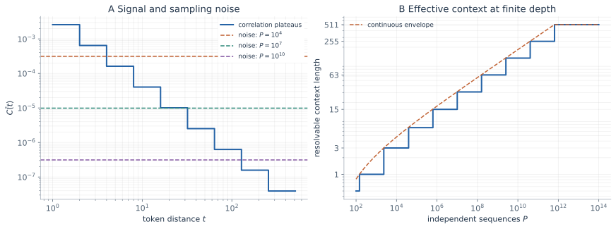

> **层次结构数据 · Note 02**　[← 01 · 层次生成与表征学习](/notes/hierarchical_data/generative_learning/) · [专题目录](/notes/hierarchical_data/) · [03 · 层级推断与扩散生成 →](/notes/hierarchical_data/inference_generation/)

**本篇问题：** 远处上下文包含什么信息，需要多少独立样本才能利用它，为什么不同机制都可能给出幂律？

**阅读主线：** 先计算关联与条件信息，再看[真实语料的条件标度理论](#natural-language-scaling)，随后比较架构和长尾，最后用[二维诊断](#context-diagnostics)分开统计与算法限制。

一句话的远处内容为什么还能影响下一个词？“模型有很长的窗口”只说明它能够接收远处输入，并没有说明训练数据足以教会它怎样利用这些输入。若远距离关系极弱，窗口再长也可能只增加估计噪声。

这篇把问题分成三步：先看层级生成怎样在观测序列上留下长程关联，再看有限样本能够分辨到哪个尺度，最后把可分辨尺度与预测损失联系起来。长尾规则和网络结构会改变其中的不同环节，因此外观相似的幂律并不一定有相同来源。

这里还有三个不同的长度：数据中真实关系能够跨越多远，模型允许接收多长输入，以及训练后模型实际利用了多远信息。第一种由生成规律决定，第二种由架构与设置决定，第三种还受到统计精度和优化限制。一个很大的窗口只是提供可能性；要变成预测收益，远处信号还需要被识别、被压缩成可用表示，并在当前任务中提供额外信息。

沿用[生成模型笔记](/notes/hierarchical_data/generative_learning/)的记号：树深为 $L$，分支数为 $s$，叶词表大小为 $v$，每父符号有 $m$ 条规则，$\rho=m/v^{s-1}$。这里主要取 $\rho\lt1$，并把 $P$ 定义为独立生成的完整序列数。预测目标是末尾 token；语言模型的计算层数与数据树深仍然分开。

## 1. 语言中的长程关联与有效上下文 {#language}

### 1.1 共同祖先把树深变成空间尺度 {#共同祖先把树深变成空间尺度}

去掉类别标签后，可以通过预测最后一个 token 研究语法的自监督学习。令

$$
C_{ij}(a,b)=p(X_i=a,X_j=b)-p(X_i=a)p(X_j=b),
$$

并以词表均方根定义典型关联强度

$$
\widetilde C(t)=
\left[\frac1{v^2}\sum_{a,b}C_{d-t,d}(a,b)^2\right]^{1/2}.
$$

固定规则树中，两个 token 的依赖经过它们的最近共同祖先。若共同祖先位于第 $\ell$ 层，相应的线性距离属于 $s^{\ell-1}\leq t\lt s^\ell$。随着距离跨越这些区间，关联逐级下降，因而出现阶梯，而不是严格光滑的幂律。

在大 $v,m$、均匀随机规则的近似下，关联平台为

$$
\widetilde C_\ell\simeq
\sqrt{\frac{1-\rho}{v^3m^{2\ell-1}}},
\qquad \rho=\frac{m}{v^{s-1}}\lt1.
$$

忽略阶梯的细节，用 $t\sim s^\ell$ 替换层数，便得到包络

$$
\widetilde C(t)\sim t^{-\beta},\qquad
\beta=\frac{\log m}{\log s}.
$$

关于树距离的指数衰减，变成关于序列距离的幂律衰减。这里的长程性来自树上尺度与观测空间尺度之间的指数关系。[Cagnetta 与 Wyart，NeurIPS 2024](https://arxiv.org/abs/2406.00048) [[1]](#ref-1)。

序列上遥远，不一定意味着生成图上需要经过同样多的局部步骤。一段很长的叶序列可以由少数高层状态组织，两个远处词之间的联系也许只需向上找到共同原因，再向下传递。层次把大量表面位置放在同一个高层关系之下，因此短程生成规则可以组织出长程观测统计，而不必为每一对远距离位置单独规定连接。

### 1.2 为什么树上的短程关系在序列里变成长程关系 {#为什么树上的短程关系在序列里变成长程关系}

先用一个更简单的广播模型理解尺度变换。取根变量 $Z=\pm1$ 等概率，每条边让子变量与父变量的相关系数为 $\theta$。两个叶节点到共同祖先各有 $\ell$ 条边，且在给定祖先后独立，那么它们的关联为 $\theta^{2\ell}$。沿树走得更远，关联指数衰减。

但是，在叶序列中，同一高度祖先覆盖的是大约 $s^\ell$ 个位置。令 $t\sim s^\ell$，就有

$$
\theta^{2\ell}=t^{2\log\theta/\log s}.
$$

这就是指数关系转为幂律的原因。它只用了“层数与空间长度呈对数关系”这一几何事实。广播模型中兄弟条件独立，RHM 中兄弟通过完整元组规则关联，所以两者的具体系数、推断阈值不能互换；这里借用前者只是为了把尺度转换看清楚。

阶梯也由此变得自然。与末尾 token 距离为 $4$ 和 $7$ 的位置，在二叉固定树中可能通过同一高度的共同祖先联系，而距离从 $7$ 变成 $8$ 就跨过了一层。真实语言并不严格服从固定二叉边界，所以经验关联通常比合成模型的台阶更平滑。

### 1.3 有限训练集给出可分辨的距离 {#有限训练集给出可分辨的距离}

从 $P$ 条独立序列估计 token 对的共现，典型联合概率约为 $1/v^2$，对应噪声幅值约为

$$
\delta C\sim\frac1{v\sqrt P}.
$$

将其与第 $\ell$ 个平台比较，得到该关联可见的尺度

$$
P_\ell\sim\frac{vm^{2\ell-1}}{1-\rho}.
$$

因此，沿这条统计机制，能够辨认的层数仅随 $\log P$ 增长，而有效距离随幂律增长：

$$
\ell_*(P)\simeq\frac{\log P}{2\log m}+\text{常数},
\qquad t_*(P)\sim P^{\log s/(2\log m)}.
$$

“有效上下文”在这里指可从有限样本辨认关联的距离，不等于网络允许输入的最大长度。把窗口继续扩大，并不自动使远处 token 的相关统计变得可靠。这也不是对所有学习算法的硬上限；利用已恢复隐变量、参数共享或更强统计量，可以改变可用信号。

信号低于计数噪声，不是说这一次远处词没有影响答案，而是仅靠当前这类经验统计，很难稳定区分真实依赖与偶然共现。模型若逐项拟合所有远处配对，可能主要学到训练样本的随机偏差。若能先恢复共享隐变量，多种表面配对便能共同支持同一个关系。因此，更有效的表示可以改变可辨认尺度，而不只是增加模型允许接收的位置。

### 1.4 一个数值例子：多十六倍数据才跨过下一层 {#一个数值例子多十六倍数据才跨过下一层}

取图中的 $v=32,m=4,s=2$，于是 $\rho=1/8$。将参数代入 $P_\ell\sim vm^{2\ell-1}/(1-\rho)$，得到以下数量级。这里直接把被省略的常数取为一，表中的值用于比较尺度，不能当作某个训练程序的精确成功门槛。

| 共同祖先高度 $\ell$ | 与末位的距离区间 $t$ | 配平给出的序列数 $P_\ell$ |
| --- | --- | --- |
| 1 | 1 | 约 $1.46\times10^2$ |
| 2 | 2–3 | 约 $2.34\times10^3$ |
| 3 | 4–7 | 约 $3.74\times10^4$ |
| 4 | 8–15 | 约 $5.99\times10^5$ |
| 5 | 16–31 | 约 $9.59\times10^6$ |

相邻平台的信号幅值相差 $m=4$ 倍，要用计数噪声追上，就需要把数据增大 $m^2=16$ 倍；与此同时，可见距离只增加约 $s=2$ 倍。因此在这个例子中 $t_*\sim P^{1/4}$。若输入窗口一直为 $256$，模型也可能长期只从最接近目标的几个平台获得稳定收益。窗口设置没有变化，实际可用的统计尺度仍会随数据增长。

反过来，若已恢复的父状态能够被共享复用，就不必每次从两端的叶词重新估计全部联系，表中的门槛可能下降。这是后面比较架构的出发点。数值表给出的是一条特定统计路径的成本；它让“长窗口为什么仍然缺数据”变得可计算，也让更高效的表示方法有了可比较的参照。

### 1.5 计数噪声为什么是平方根规律 {#计数噪声为什么是平方根规律}

用 $U_p=\mathbf1\{X_i^{(p)}=a\}$、$V_p=\mathbf1\{X_j^{(p)}=b\}$ 表示第 $p$ 条序列的两个位置，经验共现是 $P^{-1}\sum_pU_pV_p$。在近独立、边缘近均匀的情形，$U_pV_p$ 成功概率约为 $1/v^2$，因此

$$
\operatorname{Var}\!\left[\frac1P\sum_pU_pV_p\right]
\simeq\frac{v^{-2}(1-v^{-2})}{P}.
$$

减去经验边缘概率的乘积会引入相关修正，但大词表下，主要量级仍为 $1/(v^2P)$。标准差于是按 $P^{-1/2}$ 缩小。数据量增加一百倍，只把这个噪声幅值降低十倍；若下一层信号又弱了许多，恢复更远尺度自然需要很大的数据增长。

这一推导也说明 $P$ 的单位不可随意改成 token 总数。合成序列之间独立，而同一序列内的位置本来就是相关的。真实语料中的相邻窗口、重复文本和同源文档还会进一步降低有效样本数。

对一个平稳统计量，若不同观测间的归一化自相关为 $r(\tau)$，一个常用的方差近似是

$$
P_{\mathrm{eff}}\simeq
\frac{P}{1+2\sum_{\tau\geq1}r(\tau)}.
$$

它需要可求和的相关与合适的长样本极限，不是语料通用换算公式。但它清楚地表明：重复已有的信息，不会像新增独立信息那样有效地降低统计噪声。

同理，把多个位置的统计汇总起来，并不总能按位置数线性增加独立证据。它们可能共享同一个高层原因，也可能受到同一训练序列的相关性影响。共享能够减少待估对象，却不等于每个相关实例都变成独立样本。统计效率的收益，需要同时考虑复用了什么参数以及观测之间保留了什么依赖。

### 1.6 条件熵决定恢复一层结构的收益 {#条件熵决定恢复一层结构的收益}

令 $X_{d-t:d-1}$ 表示长度为 $t$ 的上下文。最优预测的交叉熵是

$$
\mathcal L_*(t)=H(X_d\mid X_{d-t:d-1}).
$$

扩大上下文带来的收益恰好等于条件互信息：

$$
\mathcal L_*(t)-\mathcal L_*(t')
=I\!\left(X_d;X_{d-t':d-t-1}\mid X_{d-t:d-1}\right),
\qquad t'\gt t.
$$

这条恒等式把“更长的上下文有用”写得更精确：新增部分必须在已有上下文之外继续提供信息。层级恢复的收益由这些条件互信息决定，成本则由对应统计信号的估计难度决定。仅知道相关函数的包络，还不足以确定全部学习曲线。

例如，前缀已经明确了某种局部关系，再看一处表达同样关系的远处片段，未必继续降低最优损失；一个较远片段如果指出尚未确定的主题或候选状态，则可能有额外收益。条件互信息恰好避免把重复证据逐项累加。长程关联的存在，与长程信息在已有上下文之外是否仍有价值，需要分别计算。

若在某个尺度区间内，有限上下文的超额损失满足 $\mathcal L_*(t)-\mathcal L_*(\infty)\sim t^{-\gamma}$，再假设学习器能有效利用所有已分辨尺度，就有一个条件性预测

$$
\mathcal L(P)-\mathcal L_*(\infty)
\sim P^{-\gamma/(2\beta)}.
$$

这里 $\gamma$ 描述预测信息如何跨尺度分布，$\beta$ 描述信息的可见程度。这个一般配平关系解释了幂律可能怎样产生；具体语法的条件熵仍需独立计算，不能把它当作所有语言模型的统一指数。

“可见”与“有价值”是两个独立问题。一种很弱的关联如果消除了重要歧义，学会以后可能带来明显收益；一种很强的关联如果已经被近期上下文解释，再加入它的收益则可能很小。相关幅度控制识别难度，条件互信息控制新增预测价值。把两者分别保留，才能解释为什么相同关联包络不一定对应相同损失曲线。

## 2. 从合成层级到真实语言的数据标度 {#natural-language-scaling}

### 2.1 可见程度与预测收益怎样共同给出指数 {#horizon-limited-scaling}

前面的条件性配平在 [Cagnetta、Raventós、Ganguli 与 Wyart，ICML 2026](https://proceedings.mlr.press/v306/cagnetta26a.html) [[5]](#ref-5)中被用于真实语言。为避免把训练单位混在一起，以下用 $D$ 表示训练 token 数；论文原记号为 $P$，而本篇前文的 $P$ 是独立完整序列数。用 $n$ 表示历史距离与上下文尺度，定义

$$
H_n=H(X_0\mid X_{-n:-1}),\qquad
c_{\mathrm{op}}(n)=\|C(n)\|_{\mathrm{op}}.
$$

先假定 $c_{\mathrm{op}}(n)\asymp n^{-\beta}$，相应估计噪声按 $D^{-1/2}$ 下降。信号噪声配平给出 $D_n^*\asymp n^{2\beta}$，即 $n_*(D)\asymp D^{1/(2\beta)}$。这一步给出能够分辨到的尺度；再假定 $H_n-H_\infty\asymp n^{-\gamma}$，才能把尺度换成尚未获得的预测收益：

$$
H_{n_*(D)}-H_\infty\asymp D^{-a},
\qquad a=\frac{\gamma}{2\beta}.
$$

但这还没有计入已可分辨尺度内部的学习误差。用一个简化的连续尺度模型说明它为何重要：每个尺度的新增最优收益为 $-dH_n\asymp n^{-\gamma-1}dn$；当 $D\gg D_n^*$ 时，若尚未取得的收益比例按 $(D_n^*/D)^\delta$ 下降，并以有界的门槛过渡把这条幂尾接到 $D\sim D_n^*$，则累计窗口内误差的尺度估计为

$$
E_{\mathrm{in}}(D)\asymp
D^{-\delta}\int_1^{n_*(D)}
n^{2\beta\delta-\gamma-1}\,dn.
$$

当 $\delta>a$，积分由不断扩大的边界尺度主导，仍得到 $D^{-a}$；当 $\delta<a$，旧尺度学得太慢，误差按 $D^{-\delta}$ 下降；相等时多出 $\log D$。因此在这一共同指数的尺度假设下，

$$
\mathcal L(D)-H_\infty\asymp
\begin{cases}
D^{-a},&\delta>a,\\
D^{-a}\log D,&\delta=a,\\
D^{-\delta},&\delta<a.
\end{cases}
$$

这段积分是对机制的简化推导，具体差分损失的条件见原文 Appendix A。它明确了“快速学习”要快在哪里：已经可见的关系需要足够快地被利用，数据瓶颈才主要位于不断外移的边界。还要求最大窗口 $T\gg n_*(D)$；若先碰到 $T$，延长可用尺度的收益就被截断。统计结构给出潜在收益，架构和优化决定能否进入这个区间。

### 2.2 均方根关联与 operator norm 不能直接代换 {#correlation-norms}

前文的词表均方根是 $\widetilde C=\|C\|_F/v$；这里用最大奇异值 $\|C\|_{\mathrm{op}}$。两者满足

$$
\|C\|_{\mathrm{op}}\leq\|C\|_F
\leq\sqrt{\operatorname{rank}C}\,\|C\|_{\mathrm{op}}.
$$

固定有限词表时，这些界约束真正渐近的纯幂指数；有限尺度区间的拟合仍可能不同。若定义有效秩 $r_{\mathrm{eff}}=\|C\|_F^2/\|C\|_{\mathrm{op}}^2$，局部对数斜率满足

$$
\beta_F(n)=\beta_{\mathrm{op}}(n)
-\frac12\frac{d\log r_{\mathrm{eff}}(n)}{d\log n}.
$$

因此不能把原 RHM 的均方根指数直接填入一个使用 operator norm 的实证公式；应在同一词表、同一距离区间测量两种范数和有效秩。原文在所用语料上比较了两种范数，其近似一致是一项经验支持，而非所有语料都必须满足的额外恒等式。

### 2.3 token 预算、统计假设与现实检验 {#natural-language-evidence}

训练 token 数还不等于独立 token 对的数量。若 $Z_i$ 是估计某个距离关联的计数变量，使用 $N_n$ 个可用位置对时，方差精确地包含

$$
\operatorname{Var}\!\left(\frac1{N_n}\sum_i Z_i\right)
=\frac1{N_n^2}\sum_{i,j}\operatorname{Cov}(Z_i,Z_j).
$$

相邻窗口、重复文档和长程依赖都会影响右侧。只有相应相关性足够受控时，才能沿用平方根噪声；否则应测量噪声随语料量的实际下降，并改用相应阈值。这里的统计假设不由“训练使用了 $D$ 个 token”这一事实自动保证。

原文在 TinyStories、WikiText 上比较 GPT-2、LLaMA 风格模型。论文报告的 $(\gamma,\beta)$ 分别约为 $(0.325,0.88)$ 与 $(0.265,0.94)$，给出的预测指数约为 $0.185$ 与 $0.141$；重标度的 $n$-gram 曲线与总损失提供支持。这里必须保留测量边界：$\beta$ 来自共现统计，$\gamma$ 则由趋于稳定的模型条件损失估计，不是直接精确读取真实条件熵。不同模型的一致性增强了这一估计的可信度，却不能替代所有尺度上的收敛证明。具体数值、误差与实验见[原文 §§4–5](https://arxiv.org/html/2602.07488#S4)。

这项连接给出的是可检验的条件理论。二点统计能否控制实际可用尺度、窗口内学习是否足够快、测量区间能否外推，都仍需分别检验；它没有从真实语料的幂律唯一反演出 RHM。其价值是把“有层次所以能学习”推进为三个可分开检查的对象：信号阈值、条件信息收益，以及将两者接起来的实际计算。

## 3. 预测损失包含哪些不同的误差 {#prediction-risk}

### 3.1 最优损失也未必为零 {#最优损失也未必为零}

即使完全知道语法，上下文也可能对应多个合法后续词。例如“把杯子放在……”之后，具体位置并不总由前缀唯一决定。自回归生成的随机性在合成语法中也存在。因此应该区分模型预测错误和数据本身的条件不确定性。

若真实条件分布为 $p(x\mid c)$，模型给出 $q(x\mid c)$，则

$$
\mathcal L(q)
=H(X\mid C)
+\mathbb E_C D_{\mathrm{KL}}\!\left(p(\cdot\mid C)\Vert q(\cdot\mid C)\right).
$$

第一项是给定上下文后的不可约熵，第二项才是预测分布与真分布的差异。对完整损失直接拟合 $P^{-\alpha}$，可能把这个平台误当成很小的幂律指数。

### 3.2 丢掉远处信息与估计有限样本分布 {#丢掉远处信息与估计有限样本分布}

把上下文分成近期部分 $C_t$ 与更远部分 $F$，若模型只能使用 $C_t$，那么

$$
\begin{aligned}
\mathcal L(q_t)-H(X\mid C_t,F)
={}&I(X;F\mid C_t)\\
&+\mathbb E_{C_t}D_{\mathrm{KL}}\!\left(p(\cdot\mid C_t)\Vert q_t(\cdot\mid C_t)\right).
\end{aligned}
$$

第一项是窗口或表示截断造成的信息损失，第二项是窗口内的分布仍未估准。扩大上下文主要尝试降低第一项，增加数据与改进统计共享主要影响第二项；两者需要配合。

真实条件熵随信息增加不会上升，但需要估计的情境也变得更丰富；如果学习器无法把相似情境有效共享，估计误差就可能抵消信息收益。这解释了长窗口为什么可以在理论上有利、在有限训练中却暂时没有收益。问题不是远处上下文有没有用，而是它的可用信息能否以当前数据和表示被可靠提取。

在层级模型中，恢复新的父变量可以同时帮助两项：它既把远处语境压成少数状态，又让许多不同表面语境共用一个条件估计。因此有效上下文增长不仅是记住更长的字符串，而是改变了字符串的描述方式。

### 3.3 二点相关并没有概括所有可预测性 {#二点相关并没有概括所有可预测性}

若前两个比特独立且均匀取正负一，并令 $X_3=X_1X_2$，则 $X_3$ 与每个单独比特的相关为零，但给定两个比特就能完全预测。这说明 $C_{ij}=0$ 不代表没有高阶依赖，二点信号低于噪声也不代表所有算法都无法预测。

这里第三个比特并不与前两个联合独立；它只是与其中任意一个单独看都没有关联。这种区别提醒我们，局部统计看起来像随机，不等于整体规律不存在。一个依赖组合的任务，可能需要先形成非线性摘要，预测信号才会显现。二点相关提供的是一条可分析的学习路径，并没有穷尽全部可利用信息。

随机语法研究中的相关性机制，是针对典型随机规则的一条可解释路径。它的价值在于给出可检验的阈值与架构比较，而不是证明任意语言只能通过二点共现被理解。这也解释了为什么[语法解析](/notes/hierarchical_data/parsing_latents/)需要进一步考察子串和候选父变量的统计量。

## 4. 架构怎样改变可利用的统计信号 {#architectures}

### 4.1 局部规则能够跨位置转移 {#局部规则能够跨位置转移}

如果同一层字典用于所有位置，在某个位置识别出的父变量映射，也可以用于别的位置。随后更高层的预测不必始终依赖原始 token 的微弱关联，而可以直接利用恢复后的局部表示。

2025 年对简单层级语言的架构比较，把这一差别转化成不同的层级恢复阈值。在论文的深度编号下，基于表面 token 关联的策略有 $P_\ell\sim(1-\rho)^{-1}vm^{2\ell+1}$，有效转移已恢复规则的策略则有 $\bar P_\ell\sim(1-\rho)^{-1}vm^{\ell+2}$。所研究 CNN 与后者相容，Transformer 与前者相容。[Cagnetta、Favero、Sclocchi、Wyart，2025](https://arxiv.org/abs/2505.07070) [[2]](#ref-2)。

这些指数依赖具体任务、位置编码、参数共享和训练设置。它们说明同一数据结构可以因架构而获得不同统计效率，不能据此断言卷积普遍优于注意力。固定、规则、与卷积步幅对齐的树，正好提供了很强的局部先验；真实语言中的可变边界会改变这个条件。

这里的层号值得多解释一步。前面的 $P_\ell\propto m^{2\ell-1}$ 是两个可见 token 的关联阈值，$\ell$ 代表共同祖先高度；这里讨论的是从元组的上下文关系中辨认新的隐变量，底层第一步已对应约 $vm^3$ 的数据尺度。两种公式统计的对象不同，不能只比较上标后便认定相差一个理论结果。

若把需要恢复的隐层记为 $r\geq1$，表面统计策略每向上推进一层，相关路径中有两侧表面通道需要处理，因而出现 $m^{2r+1}$；有效复用先前隐表示的策略可减少一侧持续向下传递的成本，得到 $m^{r+2}$。这是统计路径长度的差别，不是每个训练样本突然包含了更多 token。

直观上，两种策略的区别在于每次向上学习时，是否还必须从最底层重新辨认已知部件。能够转移表示的学习器把许多同义实现合成一个状态，再估计状态之间的关系；表面统计则继续承担多种实现带来的分散。架构优势在这个模型中表现为信息汇总的方式更符合生成规律，而不是拥有更多原始观测。

### 4.2 层级过滤与 Transformer 的计算 {#层级过滤与-transformer-的计算}

另一种做法是不只观察训练曲线，而是主动改变数据中保留的关联尺度。Garnier-Brun 等人提出层级过滤，对树上序列的关联范围进行控制，再比较网络预测与精确推断。实验显示编码器式 Transformer 能在所研究设置中近似精确推断，并在训练中逐步纳入更长程关联。[层级过滤，ICML 2025](https://proceedings.mlr.press/v267/garnier-brun25a.html) [[3]](#ref-3)。

这种对照的价值在于，它能区分几个解释：模型究竟只利用短程统计，还是利用跨块的信息；某层表示只是与高层变量相关，还是已足以支持相应的预测。注意力图中的块状结构可以作为线索，但若没有预测分布和受控数据的比较，单看图案无法确定网络执行了怎样的消息传递。

还应区分两个“逐层”：增加训练样本后恢复更深数据结构，是统计分辨率的变化；固定数据集上随训练时间先学某个尺度，是优化轨迹的变化；同一个样本在前向传播中经过不同网络层，则是计算深度。三者可以相互对应，却不是同一个时间变量。

一张网络层数对应隐变量层数的图，只回答当前前向计算如何组织；它不能单独告诉我们那种结构用了多少数据、在哪个训练时刻形成。将样本量、训练时间和网络深度分别考察，才有机会判断某种尺度是信息尚未足够、优化尚未发现，还是计算路径没有有效利用。三者都可能造成表面上的上下文利用不足。

## 5. 稀有规则怎样把阈值展宽为学习曲线 {#rare-rules}

### 5.1 从等概率规则到长尾规则 {#从等概率规则到长尾规则}

均匀 RHM 中每个父符号的 $m$ 条规则同样常见，因此许多局部对象在相近样本数上变得可辨认。若规则频率有很宽的分布，常见规则先学到，罕见规则在更大的数据集上才出现或获得足够统计精度。

令一层规则频率为

$$
f_k=\frac{k^{-q}}{Z_m(q)},\qquad
Z_m(q)=\sum_{j=1}^{m}j^{-q},\qquad q=1+a\gt1.
$$

2025 年的研究在某一层引入这种分布，其他层保持均匀。它发现分类的渐近误差可由长尾规则频率控制，而层级结构显著改变进入渐近区间的成本；对下一个 token 预测，两种因素的作用又不同。[Cagnetta、Kang、Wyart，ICML 2025](https://proceedings.mlr.press/v267/cagnetta25a.html) [[4]](#ref-4)。

### 5.2 一个能够完整计算的覆盖模型 {#一个能够完整计算的覆盖模型}

先考虑独立规则覆盖这一简化问题：规则 $k$ 至少见过一次后被视为已知，未见规则在测试时带来错误。其剩余概率质量为

$$
M(P)=\sum_k f_k(1-f_k)^P
\simeq\sum_k f_k e^{-Pf_k}.
$$

这是一种出现次数模型，尚未包含语法分组所需的估计精度。它的用途是隔离长尾本身如何产生幂律。若 $f_k\simeq ck^{-q}$，将和式近似为积分，令 $u=Pc k^{-q}$，得到

$$
\begin{aligned}
M(P)&\simeq\int_1^\infty ck^{-q}e^{-Pc k^{-q}}\,dk\\
&\sim\frac{c^{1/q}}{q}
\Gamma\!\left(1-\frac1q\right)P^{-(q-1)/q}.
\end{aligned}
$$

因此指数为

$$
\alpha=\frac{q-1}{q}=\frac{a}{1+a}.
$$

在这个模型里，幂律不需要临界优化动力学。它来自不断被覆盖的长尾：典型分界规则满足 $Pf_{k_*}\sim1$，故 $k_*\sim P^{1/q}$；尚未覆盖的尾部质量约为 $k_*^{1-q}$。

### 5.3 层次把覆盖成本和错误机会同时放大 {#层次把覆盖成本和错误机会同时放大}

真实的局部规则需要从与任务的关系中被识别，不是见一次就知道它属于哪个父符号。以底层非均匀规则的分类近似为例，论文得到规则相关阈值

$$
P_k^*\sim\frac{vm^{L-1}}{f_k}.
$$

令 $A=vm^{L-1}$，将已辨认规则的总质量记为

$$
G(P)=\sum_{k:P f_k\gtrsim A}f_k.
$$

每个样本含 $B=s^{L-1}$ 个底层规则实例。若用“所有底层实例都可辨认”作为成功的近似标准，则

$$
\varepsilon(P)\approx1-G(P)^B.
$$

当未覆盖质量足够小时，$1-G^B\simeq B(1-G)$，所以

$$
\varepsilon(P)\sim
s^{L-1}\left(\frac{P}{vm^{L-1}}\right)^{-a/(1+a)}.
$$

这解释了一个容易被拟合掩盖的区别：指数相同，不表示学习难度相同。更深层次既抬高每条规则的识别成本，也增加样本中遇到未知规则的机会。为了使线性化自洽，还需要 $B(1-G)\ll1$，因而可能有很长的渐近前区间。[长尾层级分类的分析](https://arxiv.org/abs/2505.07067)。

局部识别成本使曲线向更大数据量移动，多个错误机会则使达到低误差更难。一个长样本可能包含许多已经大概率可辨认的部件，却仍容易在其中某一处遇到尾部规则；只有局部错误足够低，整条序列才可靠。这说明同一个渐近斜率可以对应很不同的数据门槛，实际难度不能只用指数比较。

^B，展示多个局部错误机会如何推迟低误差区间。右图是覆盖模型的示意计算，没有加入语法学习所需的额外识别成本 A。")

有限字典还会切断幂律：若最罕见规则的频率也已被充分采样，剩余误差最终比中间区间的幂律下降更快。把任何有限范围内的直线外推到无限数据，或者仅凭相同指数判断两个模型具有相同机制，都不可靠。

对语言预测，则应使用条件交叉熵，并扣除语法自身不可约的条件熵。分类错误只要一个关键部件未识别就可能发生，预测一个 token 时不同尺度提供的是不同条件信息。因此长尾频率对分类指数的影响，不能原样移植到语言模型损失。

预测一个位置时，并不是所有规则都同样关键。有些远处结构只轻微调整候选词概率，有些局部结构则直接排除大多数候选。分类成功的“全部部件都正确”近似强调最薄弱环节，平均交叉熵强调按出现概率加权的分布偏差。目标不同，规则错误汇总成损失的方式也不同；比较标度之前，这一步汇总本身就需要明确。

## 6. 怎样辨认窗口、数据与规则长尾各自的作用 {#context-diagnostics}

### 6.1 在二维实验中分开改变窗口与数据 {#在二维实验中分开改变窗口与数据}

只画一条损失随 $P$ 下降的曲线，很难知道改善来自哪里。更直接的方法是对多个训练规模 $P$，分别测量多个上下文长度 $t$ 下的损失 $\mathcal L(P,t)$。在同一 $P$ 下加长上下文，观察当前模型有没有利用新增信息；在同一 $t$ 下增加数据，则观察这个窗口内的统计是否仍未学好。

| 观测到的行为 | 可以优先检验的解释 | 进一步比较 |
| --- | --- | --- |
| 小数据时加长窗口几乎无收益，大数据时才有收益 | 远处关系早已存在，但尚未统计可见 | 关联平台与经验估计噪声 |
| 增加数据后，所有长窗口都停在同一平台 | 已达当前任务的条件熵，或表示与优化仍有瓶颈 | 已知语法的 $H(X_d\mid C_t)$ 与网络损失 |
| 局部条件已学好，罕见规则相关错误仍持续下降 | 规则频率长尾影响覆盖与辨认 | 按规则频率分组的条件误差 |
| 更强参数共享显著降低跨尺度门槛 | 不同位置在复用同一个隐变量编码 | 位置转移和同义替换实验 |

这些现象只是提出待检验机制，不能单凭曲线形状完成归因。例如，长窗口没有收益，也可能是优化没能学会使用它；训练损失很低，也不能证明远处关系已经正确泛化。在合成语法里，可以直接计算条件熵并知道哪些规则被调用，从而把这些解释逐项分开。

### 6.2 给有效上下文一个可操作的定义 {#给有效上下文一个可操作的定义}

真实语料通常没有严格台阶，可以选一个预先固定的容差 $\varepsilon>0$，以最优条件损失定义任务的信息尺度

$$
t_\varepsilon^{\mathrm{info}}
=\min\{t:\mathcal L_*(t)-\mathcal L_*(\infty)\leq\varepsilon\}.
$$

它回答“多长的上下文已经保留几乎全部预测信息”。有限数据的 $t_*(P)$ 则回答“某类统计在当前样本下能分辨多远”。前者可以很大，后者暂时很小。模型行为还可以用遮去远处信息后的损失变化定义，但这种操作需要重新说明模型是否训练于相同输入分布。

直接把远处 token 换成随机词，会同时破坏真实语法和输入分布，结果可能混入模型对非法文本的敏感性。若可使用已知生成模型，更合适的是在保留近期上下文的条件下重新采样远处部分，或者分别训练不同窗口的预测器。前者问固定模型怎样使用输入，后者问受限信息下能够达到什么性能，两种实验各有明确目标。

### 6.3 拟合指数之前先检查截断与误差平台 {#拟合指数之前先检查截断与误差平台}

若一个有限字典满足 $f_k\propto k^{-q}$，近似幂律需要分界排名 $k_*\sim(Pc)^{1/q}$ 同时远离 $1$ 和 $m$。也就是常见规则已经充分出现，而最稀有规则仍未全部覆盖。$k_*$ 接近 $m$ 后，尾部耗尽；$k_*$ 接近 $1$ 时，积分近似还不能描述离散的几个常见对象。

类似地，相关尺度理论要求 $t_*(P)$ 尚未碰到输入窗口和完整句长。当 $t_*(P)\gtrsim t$，继续增加数据已经不能通过扩大当前窗口中的可用距离获得同样收益。曲线转折因此可以来自有限字典、有限长度、不可约条件熵或学习器限制；它们不必具有相同的统计含义。

若损失形式是 $\mathcal L(P)=\mathcal L_\infty+AP^{-\alpha}$，直接对 $\log\mathcal L$ 求斜率得到

$$
-\frac{d\log\mathcal L}{d\log P}
=\alpha\frac{AP^{-\alpha}}{\mathcal L_\infty+AP^{-\alpha}}.
$$

即使真正的超额损失指数始终为 $\alpha$，表观斜率也会在接近平台时变小。由此，指数的报告需要同时说明拟合了总损失还是扣除参照后的超额损失、使用了哪个数据区间，以及窗口是否已经饱和。把这些对象定义清楚，才能将语言学习曲线与第一篇的规则阈值联系起来。

## 7. 从一条幂律曲线返回它的机制 {#learning-curve-interpretation}

同一条曲线可能同时包含三个区间：常见局部结构尚未学会时的快速改善，逐步覆盖长尾时的近似幂律，以及有限规则字典被充分覆盖后的截断。若在过渡区间拟合一条直线，得到的斜率可能随数据范围变化。

还有一个容易忽略的放大因素。设单个局部位置失败概率为 $u\ll1$，样本需要协调 $B$ 个位置。如果这些失败近独立，整体失败为 $1-(1-u)^B$；但即使 $u$ 很小，只要 $Bu$ 仍不小，整体误差就可能接近一。对长句而言，局部词组正确与整句结构连贯之间可以相距很远。

长尾覆盖给出的指数主要描述“还有多少罕见规律没有被掌握”；跨尺度信息给出的指数描述“更高层关系何时可见、可见后减少多少预测不确定性”。两者可以共存。看到幂律以后，应把规则频率、相关平台、条件熵与架构共享放在一起比较，才有可能辨认真正的限制因素。

这一区分在真实语料中尤其重要。一个新句子可以复用已经反复出现的句法关系，一个常见片段也可能没有提供当前任务需要的高层证据。将层级模型用于语言时，真正可迁移的是对信息来源与共享方式的分析，而不是直接把句子、token 或规则的计数互相替换。

下一篇[层级推断与扩散生成](/notes/hierarchical_data/inference_generation/)将暂时假定规则已知，直接计算最优后验。这样可以把“规律没有学到”与“规律已知但观测仍不确定”分开，也为最后一篇跨语言表示中的消息计算建立基础。

## 8. 参考文献 {#references}

以下编号仅用于本篇；正文首次引入相应工作时给出对应编号。文中的算例、概率恒等式和诊断步骤分别说明其假设。

1. Cagnetta F, Wyart M（2024）。[Towards a theory of how the structure of language is acquired by deep neural networks](https://arxiv.org/abs/2406.00048)。*NeurIPS 2024*。token 关联、有限数据分辨率与有效上下文。

2. Cagnetta F, Favero A, Sclocchi A, Wyart M（2025）。[Scaling Laws and Representation Learning in Simple Hierarchical Languages: Transformers vs. Convolutional Architectures](https://arxiv.org/abs/2505.07070)。*arXiv:2505.07070*。固定层级语言中架构与规则复用的比较。

3. Garnier-Brun J, Mezard M, Moscato E, Saglietti L（2025）。[How Transformers Learn Structured Data: Insights From Hierarchical Filtering](https://proceedings.mlr.press/v267/garnier-brun25a.html)。*ICML，PMLR 267:18831–18847*。通过过滤关联尺度诊断 Transformer 的计算。

4. Cagnetta F, Kang H, Wyart M（2025）。[Learning curves theory for hierarchically compositional data with power-law distributed features](https://proceedings.mlr.press/v267/cagnetta25a.html)。*ICML，PMLR 267:6149–6164*。长尾产生式对分类与下一词预测的不同影响。

5. Cagnetta F, Raventós A, Ganguli S, Wyart M（2026）。[Deriving Neural Scaling Laws from the Statistics of Natural Language](https://proceedings.mlr.press/v306/cagnetta26a.html)。*ICML，PMLR 306:10450–10480*。[完整推导与实验，arXiv v3](https://arxiv.org/html/2602.07488)。关联谱、条件熵、快速学习条件与真实语料的数据标度。

---

[← 01 · 层次生成与表征学习](/notes/hierarchical_data/generative_learning/) · [专题目录](/notes/hierarchical_data/) · [03 · 层级推断与扩散生成 →](/notes/hierarchical_data/inference_generation/)
