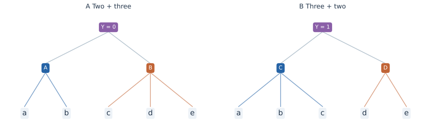

> **Hierarchical Learning · RHM 04**　[← 03 · 层级推断与扩散生成](/notes/hierarchical_data/inference_generation/) · [专题目录](/notes/hierarchical_data/) · [05 · 跨语言表示与共享几何 →](/notes/hierarchical_data/shared_representations/)

**本篇问题：** 组合边界也未知时，怎样保存候选解析，并把可靠的隐变量继续用作下一层的学习对象？

**理论定位：** 本篇研究生成边界与任务状态；非线性中间表示降低后续学习成本的其他模型，见[理论 03](/notes/hierarchical_data/nonlinear_depth/)。把逐层处理称为 RG 之前需要的条件，见[综合篇](/notes/hierarchical_data/mechanism_comparison/#effective-theory)。

**阅读主线：** 第一部分由未知结构进入后验和[网络计算](#transformer-parsing)；第二部分研究[有效状态的再次预测](#latent-prediction)与粗粒化，最后按任务界定恢复目标。

前面的固定树有一个很强的便利：相邻哪些词组成一个块，已经由位置决定。真实句子通常没有这样的边界提示。读到一个子串时，它可能属于不同短语，当前看起来最自然的解释还可能被后文推翻。

这一篇关注两个相互连接的问题。第一，组合边界和父状态都未知时，怎样保留并消解多个解释？第二，当底层隐变量已经学到，能否把后续预测搬到这些变量上，避免始终通过表面 token 的微弱关联学习？两者分别涉及表示应当保存什么，以及下一阶段应当预测什么。

固定边界与未知边界之间，增加的不只是更多候选标签，而是连“哪一段应被当成一个对象”也要推断。早期把词归错了块，后面的局部模块可能即使完全正确，也是在处理错误输入。因此，解析问题中的表示需要保存结构上的未决状态，隐变量预测则要在这些状态足够可靠后，才能将它们作为新的学习单位。

这里所讨论的可变树模型仍有受控的深度和规则结构。它为一般语言解析增加了关键困难，但不代表所有自然语言歧义都已被涵盖。固定树上的精确消息可参见[上一篇](/notes/hierarchical_data/inference_generation/#belief-propagation)。

> **第一部分 · 发现与推断结构。** 先区分未知规则的统计学习、已知规则的后验推断，以及网络是否实现所需计算。

## 1. 可变树与歧义使问题发生什么变化 {#parsing}

### 1.1 固定边界隐藏了一个重要困难 {#固定边界隐藏了一个重要困难}

规则树的第一个局部块总是 $x_{1:s}$，下一个是 $x_{s+1:2s}$。学习器即使不知道父符号，也已经知道哪些叶属于同一个父节点。一般语法的解析还必须确定边界：相邻符号应该两两组合，还是三个一起组合；同一段文字是否有多个解释。

Parley、Cagnetta、Wyart 的 ICML 2026 工作引入可变树 RHM，通过不同长度的产生式控制组合边界与局部歧义。各条推导路径的总层数仍统一，因此它比固定分支模型丰富，又没有覆盖任意深度的一般自然语言语法。其研究把根类别与局部子串的统计关系用于逐层消除歧义，并与 CNN、Transformer 的学习进行比较。[ICML 2026 论文](https://arxiv.org/abs/2602.06065) [[1]](#ref-1)。

### 1.2 可变树模型怎样控制句长与歧义 {#可变树模型怎样控制句长与歧义}

更具体地，每个父符号有 $m_2$ 条二元规则和 $m_3$ 条三元规则。先以概率 $p_2,p_3$ 选择规则长度，再在相应规则中均匀选择，因此单条规则概率分别为 $p_2/m_2$ 和 $p_3/m_3$，其中 $p_2+p_3=1$。规则数量与使用概率是两组参数，不要求三元规则更多就必然更常使用。

生成仍经过固定的 $L$ 次展开，但每个节点的分支数可以不同。随机句长 $D$ 满足

$$
2^L\leq D\leq3^L,\qquad
\mathbb E[D]=(2p_2+3p_3)^L.
$$

均值关系来自每一代的期望节点数乘以平均分支数；即使句长已知，内部边界也可能有许多种安排。固定句长并不能恢复固定树带来的便利。

知道整串有几个词，并没有告诉我们每个局部规则消耗几个词。不同分支长度还会让上层边界影响下层解释，局部切分无法彼此独立决定。这是固定步幅模型省略的一项计算：它预先提供了块的归属。可变树则要求学习器把这份归属也从规则和语境中恢复。

将规则数量写成 $m_2=f_2v$、$m_3=f_3v^2$，则 $f_2,f_3$ 分别衡量合法二元和三元组合在候选空间中的占比。规则越密，偶然出现合法局部分割和替代解析的机会越多。论文用已知规则的 inside 后验计算 $H(Y\mid X)$，从而把全局歧义与实际网络尚未达到最优性能的差距分开。[可变树模型的定义与歧义分析](https://arxiv.org/abs/2602.06065)。

### 1.3 相同字符串为何可以对应不同类别 {#相同字符串为何可以对应不同类别}

考虑观测序列 $abcde$。它可能按 $ab\mid cde$ 分块，由 $A\to ab$、$B\to cde$ 和根规则 $Y=0\to AB$ 生成；也可能按 $abc\mid de$ 分块，由 $C\to abc$、$D\to de$ 和 $Y=1\to CD$ 生成。

每条局部规则都可以无歧义：没有两个父符号生成完全相同的子元组。但因为边界未知，整串仍有两棵合法树，且根类别不同。局部无歧义在固定边界模型中足以逐层逆推；边界变化以后，它不再保证全局唯一。

若两种类别先验相同，且各自只生成这个字符串，那么观察整串后仍有 $p(Y=0\mid X)=p(Y=1\mid X)=1/2$。任意分类器的错误率至少为 $1/2$，增加训练数据也无法突破。困难来自观测本身没有区别，不是网络深度不够。

不可约歧义不应被理解为学习失败。若同一字符串确实来自两个不同类别，正确结果就是按照生成概率保留它们，而不是强行找出唯一的“真实答案”。给模型更多相同形式的数据，可以让后验比例估得更准，却不会让本来重叠的类别突然可分。这个参照能够把统计不足与问题本身的不确定性分开。

这个极端例子帮助区分两类问题：一种是在有限数据下尚未辨认正确规则；另一种是规则完全已知，仍必须保留多个后验解释。一般情况下局部歧义常可由更大范围的语境解除，但不能事先假设它一定能解除。

### 1.4 从树上传播到区间动态规划 {#从树上传播到区间动态规划}

当树结构未知时，固定树的单次向上消息需要扩展为对候选区间和分割求和。以二元产生式为例，定义 inside 权重

$$
I_A(i,j)=p(X_{i:j}\mid A).
$$

在有限、无循环的分层语法中，其递推形式为

$$
I_A(i,j)=\sum_{A\to BC}\theta_{A\to BC}
\sum_{k=i}^{j-1}I_B(i,k)I_C(k+1,j).
$$

三元规则还需对两个分割点求和。固定树模型已经选定这些分割；一般解析需要把它们作为隐变量边缘化。计算量因而取决于句长、可用规则数、产生式元数和允许的层次结构。

这也说明局部歧义与全局歧义的区别：一个子串可以有多个局部解释，但放到整句中，只有其中一个解释与周围组合相容。反过来，若整句在不同根类别下都具有合法推导，类别的不可约错误就可能大于零。

区间动态规划之所以能避免逐棵树完整枚举，是因为许多候选树重复使用相同子区间的解释。一个区间的总权重算过以后，可以被多个更高层候选复用。这里的计算共享与数据中的规则共享相呼应，但不是同一概念：前者节省一次推断的重复运算，后者让不同训练样本共同约束同一规律。

### 1.5 Inside 求和与最优解析的区别 {#inside-求和与最优解析的区别}

Inside 算法求的是一个区间由某符号生成的总概率。它把所有合法分割、所有产生式、所有下层解释的权重相加。若某类别有两棵树，各贡献后验权重 $0.3$，另一类别只有一棵树贡献 $0.4$，按类别边缘化会选择前者，因为总质量是 $0.6$。

如果只寻找概率最大的单棵树，结果却会选择后者。这是求和与取最大值的区别。把 inside 递推中的加和换成最大化，可以得到相应的最优解析递推，但它不再返回正确的类别边缘或预测分布。

最有可能的一棵树与最有可能的类别，分别对细粒度解释和解释集合做判断。多个普通解释的总质量可以超过一个最强解释，所以先选树再读类别，会丢掉集合中的概率贡献。这种差异在后验很集中时不明显，在歧义较大时却可能直接改变输出。保持求和不是形式上的细节，而是在保留任务真正需要的概率质量。

在语言预测中，多个解析可能都支持相似的下一个词，此时单棵树是否正确未必是最相关的评价。更直接的目标是比较预测分布：把所有解析路径的权重加总之后，模型是否给出正确的下一词概率。

### 1.6 Inside–outside 怎样把局部候选放回整句 {#insideoutside-怎样把局部候选放回整句}

Inside 权重只使用区间内部的观测。要计算一个候选在整句中的后验，还需要外部权重。这里展开经典 inside–outside 方法，其规则概率估计背景可参见 Lari 与 Young [[5]](#ref-5)。记整句概率为 $Z_X=p(x_{1:D})$，对一个根先验为 $\pi_y$ 的分层语法，

$$
Z_X=\sum_y\pi_yI_y(1,D).
$$

令 $O_A(i,j)$ 是将区间 $[i,j]$ 暂时留给符号 $A$ 后，所有外部推导的总权重。根部初始化为 $O_y(1,D)=\pi_y$。对二元规则 $A\to BC$ 及分割点 $k$，需要累积

$$
O_B(i,k)\mathrel{+}=O_A(i,j)\theta_{A\to BC}I_C(k+1,j),
\qquad
O_C(k+1,j)\mathrel{+}=O_A(i,j)\theta_{A\to BC}I_B(i,k).
$$

这里的 $\mathrel{+}=$ 表示来自所有可能父区间、规则和分割的贡献都要相加。因此某个具体规则调用及分割的后验为

$$
q(A\to BC,i,k,j\mid X)
=\frac{O_A(i,j)\theta_{A\to BC}I_B(i,k)I_C(k+1,j)}{Z_X}.
$$

这与固定树的向下消息有相同的概率分工：外部证据乘以内部证据，再用整句概率归一化。差别是同一个区间可以嵌入许多树，外部贡献也必须求和。仅把每个局部 inside 向量归一化，不会自动得到整句条件下的候选后验。

若每条推导路径必须具有统一深度，$A$ 还隐含所在层；使用通用符号集合时，应显式写成 $I_{\ell,A}(i,j)$，并只允许层号匹配的产生式。叶层初始化为 $I_{0,a}(i,i)=\mathbf1\{x_i=a\}$，其他不允许的跨度权重为零。这样不会把本来不属于该模型的更浅或更深解析混入求和。

对长度 $D$、二元规则集合 $\mathcal R_2$ 的普通图表递推，直接计算的时间上界为 $O(|\mathcal R_2|D^3)$；加入三元规则后，直接枚举两个分割点可产生 $O(|\mathcal R_3|D^4)$ 的项。深度、可行跨度和稀疏性能够减少实际运算。这解释了未知边界为什么带来额外成本，也说明固定树上线性于叶数的 BP 成本不能直接移用。

### 1.7 学习需要比较条件分布而非过早做硬决定 {#学习需要比较条件分布而非过早做硬决定}

无歧义固定树中，可以用一个离散父符号替换局部元组；存在歧义时，更自然的表示是候选父状态的权重，或者足以表达这些权重的向量。上下文使不相容解释逐渐失去质量，最终才形成较集中的解析。

因此，“网络是否找到真实树”也应改写为它是否恢复正确后验、是否处理必要的多种解释，以及错误是否来自样本不足、优化失败或不可约歧义。若真实后验本来是多峰的，强迫所有样本对应唯一解析反而会误判学习结果。

还可能出现多棵树都支持相同下一个词的情况。此时模型不必先解决全部结构歧义，就能给出准确预测；反过来，一个看起来合理的单棵树，也未必产生正确概率。结构恢复与预测质量之间有联系，但任务究竟要求辨认到哪一层，需要通过后验对输出的作用来判断。

## 2. 局部语境怎样解除歧义 {#context-disambiguation}

### 2.1 多看一些上下文到底增加了什么 {#多看一些上下文到底增加了什么}

令 $u$ 表示一个局部子串，$c$ 表示其外部语境，$H$ 表示候选父状态与候选区间。两个解释的后验比满足

$$
\frac{p(H=A\mid u,c)}{p(H=B\mid u,c)}
=\frac{p(H=A\mid u)}{p(H=B\mid u)}
\frac{p(c\mid u,H=A)}{p(c\mid u,H=B)}.
$$

左侧是看完整语境后的判断；右侧第一项是只看局部时的倾向，第二项是外部证据修正。若两个候选对后续语境的预测不同，新的观测就能累积支持其中一个。如果它们对所有可见语境都给出相同分布，更多同类观测仍不能区分它们。

外部语境提供的是候选之间的相对证据。如果两个候选都同样预期某个后续词，看到这个词并不会帮助消歧；只有它们对语境作出不同预测，新信息才会改变比值。因此，增加上下文的价值取决于候选的预测差异，而不只是多读了几个位置。这个观点也把解析与语言统计中的条件信息联系起来。

这也说明，局部共现不等于简单地数哪些符号经常相邻。真正有用的可能是整个子串与类别、相邻候选块或更高层上下文的条件统计。候选结构被表示出来以后，可用统计量的定义本身就会改变。

### 2.2 从硬标签到候选权重 {#从硬标签到候选权重}

无歧义时，块的表示可以是一个父符号的独热编码；有歧义时，可以表示成 $q(H=A),q(H=B),\ldots$。一个错误但高置信度的硬决定会排除后来可能被语境支持的路径，软表示则允许证据继续修正。

但保存所有候选也有成本。若大量候选几乎没有概率，精确求和或近似剪枝可以节省计算；若多个候选都很重要，剪掉它们会系统改变后验。不能把某种高效近似的成功，直接推广到高歧义、长句或规则高度重叠的区域。

软表示还应保留候选来自哪个区间、怎样与其他候选组合。单独记录每个位置最像哪类父状态，未必足以表达不同分割之间的排斥关系。解析表同时组织位置、跨度、父符号与权重，正是为了让局部不确定性在整句中保持相容。向量化实现可以采用别的坐标，但需要保留的依赖不会因此自动消失。

### 2.3 不把所有相邻词都误认成兄弟 {#不把所有相邻词都误认成兄弟}

一个相邻二元组可能确实来自同一个二元父节点，也可能只是一个三元规则的前半段或后半段，还可能跨过两个父节点的边界。这几种来源都会出现在同一个共现统计中。

因此可变树研究比较二元、三元子串与根标签的协方差向量。对一个候选二元组 $(a,b)$，可以把它与各根类别的协方差排成向量 $u_{ab}$：幅值用于判断是否存在可靠信号，方向用于比较它更接近哪个父状态的标签关系。三元统计再帮助区分完整三元规则和由相邻二元结构造成的偶然贡献。

识别一些规则后，把它们应用到所有可能区间，得到候选非终结符指示量；再对这些候选块计算与根的关系，进入下一轮。这里保存的是一个解析表，而不是在每个位置过早确定一个唯一父符号。原文的正确性分析取特定大词表和规则密度极限，网络实验检验相应样本标度；它没有把所有一般 PCFG 的学习困难一并解决。[由局部统计推断规则](https://arxiv.org/abs/2602.06065)。

### 2.4 候选多了以后，噪声阈值也会变化 {#候选多了以后噪声阈值也会变化}

若只估计一个有界统计量，标准误差按 $P^{-1/2}$ 缩小。若同时比较 $M$ 个候选，并希望所有估计以至少 $1-\delta$ 的概率可靠，一个由集中不等式和并合界得到的典型误差尺度为

$$
\Delta_P\sim\sqrt{\frac{\log(M/\delta)}{P}}.
$$

这里假设样本独立、各统计量有合适的有界性；它不是可变树论文的完整样本复杂度公式。它说明一个一般现象：从已知边界走向未知区间，除了单个信号弱，还增加了需要同时排除的候选。高相关候选之间的依赖，有时可让这个界变松，但不会自动消除结构搜索的困难。

候选数量增加还使偶然高分更容易出现。单个子串的经验关联看起来突出，可能只是许多比较中的一次波动；需要判断它是否在更多样本、更多相关语境中保持同样作用。结构搜索的统计成本因此不仅取决于真实规则多弱，也取决于错误解释有多少机会暂时像真的。这与已知边界下只比较少数候选有实质差异。

### 2.5 软解析还怎样参与规则学习 {#软解析还怎样参与规则学习}

如果规则支持集已经确定，但各规则概率 $\theta_r$ 未知，可以用整句后验统计每条规则的期望调用次数。对一个有多个合法解析的句子，不应只给概率最大的树记一次数，而应将其概率质量分配给所有候选调用。

以二元规则 $r=A\to BC$ 为例，在一个语料集上的期望计数为

$$
C_r=\sum_{n}\sum_{i,k,j}
q(r,i,k,j\mid X^{(n)}),
\qquad
\theta_r^{\mathrm{new}}
=\frac{C_r}{\sum_{r':\operatorname{lhs}(r')=A}C_{r'}}.
$$

这是已知概率语法支持集下的一种 EM 更新：先用当前规则概率推断软解析，再用期望计数更新规则概率。分母为零时还需规定先验或平滑；有终结、三元等其他产生式时，也应将同一左侧符号的所有合法选择一并归一化。

这套计算把推断与学习联系起来，却没有消除学习难度。当前参数若给正确解释极小权重，更新可能强化错误分组；似然具有局部最优，隐符号的重命名也不会改变观测分布。更重要的是，估计已列出规则的概率，与从所有可能规则中发现支持集，是两个不同问题。后者还包含前面讨论的候选搜索和统计分辨率。

根标签监督、局部语境统计和隐变量预测，正是在为不同环节提供额外信号：标签有时帮助区分可见分布下等价的类别，局部统计帮助提出和归并候选，隐变量目标则尝试避免把高层信号重新稀释到词表。它们可以组合，但每一步使用了什么信息，需要明确记录。

## 3. Transformer 的计算与解析算法怎样对应 {#transformer-parsing}

### 3.1 可解码的边界，怎样与动态规划联系 {#boundary-computation}

前两节回答候选怎样从统计中出现，以及已知规则后怎样汇总它们。另一个问题是：训练出的网络有没有组织足以完成这些计算的中间状态？Allen-Zhu 与 Li 在[层级语言结构研究，TMLR 2025](https://tmlr.infinite-conf.org/paper_pages/mPQKyzkA1K.html) [[6]](#ref-6)中，用可控 CFG 研究祖先符号、短语边界的线性读出，以及扣除距离偏置后的边界注意力。

对二元规则 $A\to BC$，区间动态规划的一次组合需要同时取得左区间、右区间与规则的信息。如果左区间的摘要存于它的右端点 $k$，右区间与父区间摘要存于更右侧的 $j$，就需要一次从 $j$ 读取 $k$ 的信息传递。这说明为什么邻近短语端点之间的注意力可以支持一种解析解释，也说明仅仅看到模型偏好近邻还不够：必须比较与短语边界有关的额外结构。原文的[§5.3](https://arxiv.org/html/2305.13673#S5.SS3)也将这种对应表述为与动态规划相容的信息流，而非唯一实现的识别。

这里需要逐项区分存储、寻址和组合。探针能读出符号，支持它被保存；注意力关联某个端点，支持可能的读取路径；规则所需的联合运算是否真的发生，还需要检查读取后的表示和预测变化。三个环节相互支持，仍不能由其中一个代替另外两个。

### 3.2 局部到全局的构造说明了什么 {#local-to-global-construction}

[Zhou、Wang 与 Yang，ICML 2026](https://proceedings.mlr.press/v306/zhou26at.html) [[7]](#ref-7)进一步比较训练网络的逐层表示与显式解析构造：局部模式先被汇集，随后成为服务预测的更大尺度摘要，并给出能够解析二叉 PCFG、深度随序列长度对数增长的 Transformer 构造。

这是一项表示和计算的存在性结果；其具体编码、宽度、精度与语法条件需要随构造一起保留，不能从“深度是对数”推出任意普通网络都以同样成本被梯度找到。它与第一篇的学习定理、这里的规则发现机制分别处理不同环节。

| 层面 | 已给定的对象 | 要检验的结论 |
| --- | --- | --- |
| 未知语法的统计学习 | 训练样本与指定监督 | 哪些候选能超过噪声、被正确归并？ |
| 已知语法的最优推断 | 规则、概率及观测 | 怎样求和全部解析并预测后续词？ |
| 网络的显式构造 | 设计好的编码与权重 | 此架构是否能实现足够的计算？ |
| 训练网络的机制解释 | 学到的隐藏状态与输出 | 它实际保存、读取和使用了什么？ |

### 3.3 怎样从相关证据走向功能检验 {#parsing-functional-evidence}

一个位置向量可能附带保存解析信息，真正的输出却主要依赖另一条统计捷径。因此，解析可被探针解码，并不单独证明预测依赖该解析。可以固定规则和局部词频，改变远处信息以消解候选，再检查网络后续分布是否按精确后验更新；也可以在匹配边界和语境的样本间替换候选摘要，比较被影响的后续词是否正是相应产生式约束的部分。

替换内部状态可能造成不自然的中间输入，所以还需同位置、同语言、同激活尺度的控制，以及无关区间或无关状态的替换。预测对某个摘要的受控依赖，比静态读出更接近计算证据；它仍不保证整张 inside 表都以唯一方式存在。此处形成的问题是：网络是否保存了**任务需要的有效状态**并按正确关系使用它，而非它是否逐项复制教科书图表。

> **第二部分 · 在有效状态上继续学习。** 已发现的中间对象怎样成为下一轮输入与预测目标，以及这种复用何时降低统计成本，是下面的重点。

## 4. 预测隐表示能否绕开表面统计瓶颈 {#latent-prediction}

### 4.1 让预测目标也随尺度上移 {#让预测目标也随尺度上移}

在 token 预测中，即使上下文已被压成高层变量，目标仍是表面符号。较高层关系到达目标时，必须穿过多个随机产生步骤，信号因而衰减。如果预测目标本身也提升到已学到的隐变量层次，下一轮任务就可能重新变成强局部信号的分组问题。

Korchinski、Favero、Wyart 在 2026 年预印本中分析了这一可能性。在其固定树 RHM 设置及分离等条件下，逐层隐变量聚类能以大致 $\widetilde O(vm^3)$ 的样本恢复非根层次，主要深度依赖退到对数因子；他们还研究了相应网络与 data2vec 的行为。[2026 年预印本](https://arxiv.org/abs/2605.27734) [[2]](#ref-2)。

这是对学习目标的实质性改变。它不能解释成所有层级数据都只需与深度无关的样本，更不能从这一合成结果直接比较真实 token 预测和隐空间预测的全部能力。结论涉及固定共享语法、特定分组机制、所需恢复精度和成功概率。

### 4.2 带根标签的串联与隐变量预测 {#带根标签的串联与隐变量预测}

[COLT 2026 的 shallow-to-deep chaining](https://proceedings.mlr.press/v336/ren26a.html) [[4]](#ref-4)提供了一个重要对照。它也从浅到深学习，但每一阶段的监督目标始终是可见根标签；中间表示由局部块的条件标签分布构成。隐变量预测路线则把后续目标提升到已经恢复的非根状态，并不需要假定这些状态在人为命名下与真实字典逐项相同。二者都复用中间结构，却不是同一个统计任务。

这也解释了为什么根标签监督下的深度相关样本上界，与非根隐变量恢复的较弱深度依赖，并不构成直接冲突。根标签传到低层的信号会随生成路径减弱；把目标移到相邻抽象尺度，改变了信号来源。反过来，根类别的具体划分在无标签分布中可能不可辨识，而有监督路线已经拿到了这份额外信息。比较复杂度时，需要同时保留目标、信息权限、信号分离和成功标准。

另一个区别是拓扑。上述串联定理假定固定、已知的分支与分块，用随机特征和逐层回归保证中间簇可复用；它没有解决本篇前半部分的未知边界搜索。因而不能把它视为任意可变树语法已经具有同样的训练保证。其具体算法与定理条件见[第一篇的完整展开](/notes/hierarchical_data/generative_learning/#shallow-to-deep-chaining)。

早期的 [Malach 与 Shalev-Shwartz（2018）](https://arxiv.org/abs/1803.09522) [[3]](#ref-3)已将局部梯度更新与聚类组合成逐层算法。其生成模型与附加条件需要独立核对；这条历史联系说明局部信号如何接入训练，并不替代这里的可变边界推断或隐变量目标分析。

### 4.3 为什么同时提升输入与目标有帮助 {#为什么同时提升输入与目标有帮助}

可以把每一轮想象成两个局部块之间的预测。设 $B$ 是待归并的子元组，$Z$ 是其附近语境的有效状态。若多个表面元组由同一个父状态产生，它们通常具有相似的条件向量 $\phi(B)=p(Z\mid B)$，于是可以按这组关系聚类。

最底层的 $B,Z$ 来自表面观测；恢复第一层以后，可以把新的父状态放回数据，构造更高层的块与语境。若两边都随尺度上移，下一轮仍在相近的抽象高度上比较统计关系。相反，如果目标始终是表面词，高层关系仍要经过向下随机通道才能影响预测目标，信号会额外被稀释。

提升预测目标的直觉，是让问题的两端处在相近的抽象尺度。已经把输入理解成短语状态以后，再去预测另一边的短语状态，可以直接比较高层关系；若仍要求还原某个具体词，高层状态到该词之间的随机实现会继续分散证据。这并不意味着词预测错误，而是不同目标把同一潜在关系变成了不同强度的学习信号。

这种“每一轮重新变成局部问题”的直觉，是深度成本能够显著降低的原因。它依赖规则跨位置共享以及可分离的条件统计。若第一轮聚类把不同父状态混在一起，下一轮并不会自动纠正所有损失的信息。

逐层方法的节省来自重复利用已经恢复的规律，而不是把发现规律的工作取消。每一级仍需足够分离的条件统计和稳定的分组；若把重要差异过早合并，下一阶段可能根本看不到这些差异。理解深度成本降低时，应当同时保留局部步骤为何可靠，以及可靠性怎样跨层维持，才能知道优势来自哪里。

### 4.4 隐空间预测怎样避免常数解 {#隐空间预测怎样避免常数解}

若只要求两个视图的表示接近，常数编码器就能把损失降到零。理论中的聚类恢复还要求不同潜在状态有足够区分度；实际隐空间预测方法则会使用具体的非塌缩机制。必须分析完整目标与约束，不能只抽出“预测自己的表示”这一句话。

非塌缩也不只意味着向量数值有波动。表示可以保留位置、样本编号或表面噪声，方差很大，却没有保留下一阶段需要的父状态。有效隐变量学习要求变化对应可复用的任务关系，同时把同义实现汇聚起来。因此，方差、可解码性和新组合预测需要一起解释，才能知道表示为何足够好。

一个简单的诊断是同时考察表示协方差。若 $Z$ 几乎恒定，$\operatorname{Cov}(Z)$ 的所有特征值都会接近零；若仅保留少数粗类别，仍可能有非零方差，却不足以区分所有需要的父状态。因此方差不塌缩是必要线索之一，不是恢复全部语法的充分证据。

### 4.5 根类别的不可辨识性 {#根类别的不可辨识性}

无监督序列分布未必决定根类别的划分。若根均匀采样、每根有 $m$ 条等概率规则，最高层的 $vm$ 个合法元组每个出现概率相同。把它们重新分成 $v$ 组、每组 $m$ 个，并不会改变叶序列分布，却会改变根标签。

因此从无标签数据恢复“全部非根层次”和恢复“有语义命名的类别”是两个目标。增加数据不能消除一个在观测分布中完全不可见的自由度；需要标签、额外视图、非均匀根先验或其他结构才能进一步约束它。

### 4.6 多层误差为什么不能被忽略 {#多层误差为什么不能被忽略}

设第 $\ell$ 级错误率为 $\delta_\ell$，后续预测依赖多个已恢复变量。即使每级局部成本相同，整体成功概率也可能随层数下降。简单的并合界给出

$$
\Pr(\text{至少一次必要恢复失败})
\leq\sum_\ell\delta_\ell.
$$

若要求整个深度上的总错误小于 $\delta$，便需将各级精度收紧到约 $\delta/L$；高概率集中界中的置信参数因此重新带入层数。这说明“与深度无关到对数修正”的含义：局部信号不再逐层指数减弱，但多阶段可靠性仍有代价。

上面的 $\delta_\ell$ 应理解为第 $\ell$ 级规则恢复步骤整体失败的概率。若它只表示单个节点的错误率，而目标是整棵树每个节点都正确，还必须计入所有节点的错误机会，数量约为 $d$。恢复一个有限字典后再把同一字典应用于所有位置，与分别估计每个位置的隐状态，可靠性要求也不同。

字典恢复问的是共享映射有没有学错，状态推断问的是给定某次不完整观测能否认出它调用了哪条映射。即使字典完全正确，噪声仍可能使个别状态不确定；即使许多训练状态都能猜对，共享字典也可能尚未恢复。把这两种错误分开，逐层样本复杂度与实际预测错误之间的关系才会清楚。

## 5. 与统计物理中的粗粒化如何联系 {#coarse-graining}

逐层把同义元组替换为父状态，与粗粒化具有清楚的形式联系。原始变量数目减少，局部实现被积分或归并，后续计算使用有效变量；关联长度又通过层数转化为空间尺度。去噪递推的固定点和不稳定方向，也自然给出临界尺度分析。

但学习出的粗变量有任务依赖性。对根分类充分的表示，不必对生成、密度估计或另一种下游分类仍充分。若一个粗粒化映射 $Z=g(X)$ 用于目标 $Y$，预测信息损失可以精确写成

$$
H(Y\mid Z)-H(Y\mid X)=I(Y;X\mid Z)\geq0.
$$

等号表示 $Z$ 对该目标充分。换一个目标，右边一般会变化。这比笼统地说网络“扔掉了无关信息”更具体：必须先指定对谁无关。

充分性是相对于目标的承诺。例如，只要知道某个物体类别就能回答分类问题，并不表示这个类别能够决定姿态、颜色或具体实例。表示把这些差异删除以后，分类仍然可以正确，其他任务却可能受损。因而“更抽象”不是保留信息越少越好，而是以更紧凑的形式保留当前任务所需关系。

生成问题还需要恢复条件分布 $p(x\mid z)$。只有粗变量分布 $p(z)$，无法确定所有细节。理想的层级生成把高层状态采样与低层条件采样组合起来，而不是把细节作为错误统一消除。

还可以从数据处理不等式理解层级信号的衰减。沿一条生成路径，上游状态经过随机通道后，可被单个后代保留的信息不会增加。可学习性来自联合利用多个后代、同义分组和跨位置共享；它们让统计估计摆脱只追踪一条衰减路径的限制。正是在这里，层次数据同时表现出困难和机会。

这种联系不要求网络训练等价于某个平衡重整化群流。训练参数的演化、表示的逐层变换和噪声下的消息递推，分别作用在不同对象上。将它们统一成精确理论，需要明确每一步保留的分布、观测量与近似，而不只依靠图像上的相似。

### 5.1 用两个比特看清任务充分性 {#用两个比特看清任务充分性}

令 $X_1,X_2$ 独立且均匀取 $\{0,1\}$。若任务是预测 $Y_1=X_1$，表示 $Z=X_1$ 完全充分，第二个比特可以删除。但换成 $Y_2=X_1\oplus X_2$，给定同一个 $Z$ 后，输出仍然等概率取零或一，因此

$$
H(Y_1\mid Z)-H(Y_1\mid X_1,X_2)=0,
\qquad
H(Y_2\mid Z)-H(Y_2\mid X_1,X_2)=\log2.
$$

同一个压缩对第一个任务没有代价，对第二个任务却丢掉全部可预测性。若改成 $Z=X_1\oplus X_2$，则正好对第二个任务充分，但不能还原两个原始比特。抽象变量的有效性来自它保留了什么关系，无法单按维度更小或重建更差排序。

在层级学习中，父状态可以对外部语境预测充分，却不足以还原本次采用的同义规则。生成器可以在给定父状态后重新采样那条规则；自编码器若要准确复原这一次输入，就需要另外保存细节。分类、条件生成与实例重建因而对同一个中间表示提出不同要求。

这也解释了为什么粗粒化需要同时说明保留的分布族和观测量。若只验证根标签读出，得到的是对根任务的证据；若还要声称恢复语法，就需要检验局部规则、候选后验和新组合。把任务换掉以后重新检查充分性，是连接表示学习与粗粒化时必需的一步。

## 6. 哪一种表示才算学到了结构 {#representation-goals}

对分类而言，只要表示 $Z$ 保留预测 $Y$ 所需的信息就足够；对解析而言，需要保留候选树之间的后验权重；对生成而言，还需要每个抽象状态下面的条件分布。这三种目标可以共享很多计算，却不会选择完全相同的信息压缩。

例如某两种纹理对物体分类等价，分类器可以合并它们；生成器则仍需知道它们各自出现的频率。如果只保留父状态，生成并不一定失败，因为可以按 $p(x\mid z)$ 重新采样细节；但若要求还原输入中的那一次具体实现，就还需要保存相应的细节信息。

同样地，能够从隐藏表示线性读出一个真实隐变量，并不意味着其他任务所需的结构都已恢复。表示还可能把语言身份、位置、频率和局部实现一起保存。最后一篇[跨语言表示与共享几何](/notes/hierarchical_data/shared_representations/)正是利用这种共存解释一个现象：翻译句的中间表示可以几何相似，同时仍然清楚地区分来自哪种语言。

这条研究线逐渐把“抽象”从一个笼统形容词，变成一组可以分别检查的条件：是否归并同义实现，是否保留有效候选，是否对新组合有效，是否支持指定预测，是否能跨语言复用。没有一个单独指标能替代所有这些问题。

整个解析与隐变量学习问题由此可以分成三个环节：从观测提出候选，用上下文给候选分配概率，再在适当尺度上复用已确定的关系。硬聚类是后验集中的特例，保留多种解释则是歧义存在时的正常状态。理解这条连续链条，比要求网络在所有输入上给出同一种固定树形编码更贴近任务本身。

## 7. 参考文献 {#references}

以下编号仅用于本篇；正文首次引入相应工作时给出对应编号。文中的算例、概率恒等式和诊断步骤分别说明其假设。

1. Parley JT, Cagnetta F, Wyart M（2026）。[Deep networks learn to parse uniform-depth context-free languages from local statistics](https://arxiv.org/abs/2602.06065)。*ICML 2026；arXiv v4，2026-09-03*。可变边界、局部歧义与多尺度统计恢复。

2. Korchinski DJ, Favero A, Wyart M（2026）。[Learn from your own latents and not from tokens: A sample-complexity theory](https://arxiv.org/abs/2605.27734)。*arXiv:2605.27734，预印本*。隐变量预测的样本效率及其固定语法条件。

3. Malach E, Shalev-Shwartz S（2018）。[A Provably Correct Algorithm for Deep Learning that Actually Works](https://arxiv.org/abs/1803.09522)。*arXiv:1803.09522*。结合局部梯度更新与聚类的逐层算法。

4. Ren Y, Dandi Y, Krzakala F, Lee JD（2026）。[Provable Learning of Random Hierarchy Models and Hierarchical Shallow-to-Deep Chaining](https://proceedings.mlr.press/v336/ren26a.html)。*COLT，PMLR 336:5556–5597*。根标签监督下的条件概率编码、逐层训练和误差串联。

5. Lari K, Young SJ（1990）。[The estimation of stochastic context-free grammars using the Inside-Outside algorithm](https://doi.org/10.1016/0885-2308(90)90022-X)。*Computer Speech & Language 4(1):35–56*。概率上下文无关语法中的软解析与规则概率估计。

6. Allen-Zhu Z, Li Y（2025；初稿 2023）。[Physics of Language Models: Part 1, Learning Hierarchical Language Structures](https://tmlr.infinite-conf.org/paper_pages/mPQKyzkA1K.html)。*Transactions on Machine Learning Research，2025 年 12 月*。[arXiv 全文](https://arxiv.org/html/2305.13673)。边界、祖先符号与动态规划信息流的实验对照。

7. Zhou Z, Wang T, Yang Z（2026）。[How Transformers Represent Hierarchies: A Local-to-Global Mechanism](https://proceedings.mlr.press/v306/zhou26at.html)。*ICML，PMLR 306:165889–165934*。逐层解析表示与二叉 PCFG 的 Transformer 构造。

---

[← 03 · 层级推断与扩散生成](/notes/hierarchical_data/inference_generation/) · [专题目录](/notes/hierarchical_data/) · [05 · 跨语言表示与共享几何 →](/notes/hierarchical_data/shared_representations/)
