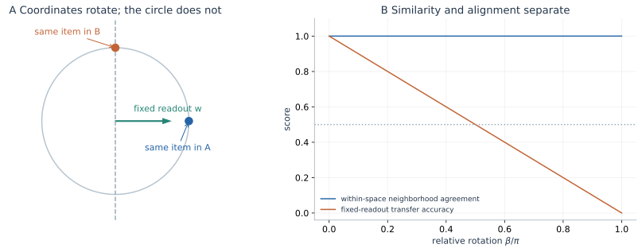
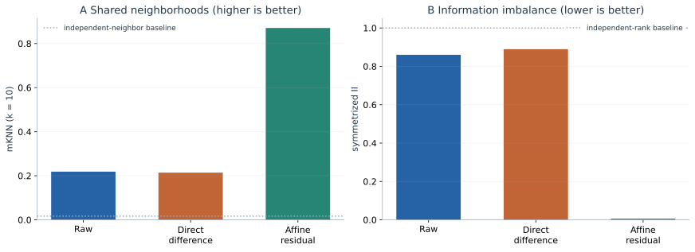
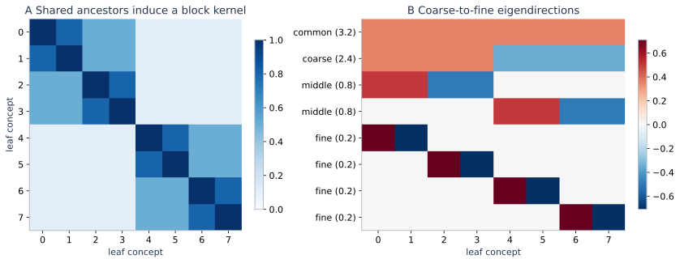

> **Hierarchical Learning · RHM 05**　[← 04 · 语法解析与隐变量学习](/notes/hierarchical_data/parsing_latents/) · [专题目录](/notes/hierarchical_data/) · [综合比较 →](/notes/hierarchical_data/mechanism_comparison/)

**本篇问题：** 两种语言共享内容以后，什么时候表现为共同邻域、共同坐标，以及可复用的计算？

**理论定位：** 共享几何的谱机制还可对照[Saxe 语义理论](/notes/hierarchical_data/spectral_dynamics/#semantic-hierarchy)与[Neural Race](/notes/hierarchical_data/spectral_dynamics/#neural-race)；相似表示是否承担相同计算，最终需要功能干预。

**阅读主线：** 先分开共享关系与共享坐标，再计算多语言推断；测量与残差之后，以[替代机制](#concept-geometry)和[功能检验](#functional-tests)界定几何证据能说明什么。

“猫坐在窗边”和它的另一种语言译文，词形、词序和局部语法都可能不同，却描述相近的内容。多语言模型处理这些句子时，为什么常在中间层形成较相似的表示？这种相似是否意味着它已经使用一套完全相同的内部语言？如果表示相似，为什么一个语言上训练的读出器仍可能无法直接用于另一个语言？

这些问题把前几篇的数据层次结构，接到了表示几何。这里重点讨论 Doshi、Zhou、Wegner、Korchinski、Acevedo、Wyart 的 [A theory of platonic representations in language models](https://arxiv.org/abs/2610.07168) [[1]](#ref-1)，并把它与表示相似性的测量、词共现导致的概念几何联系起来。它在 2026 年 10 月以预印本发表；其具体理论对象是共享上层规则的合成语言，真实语言实验提供相应现象的检验。

核心想法并不复杂：不同语言可以共享一部分高层生成结构，同时拥有不同的低层实现。预测下一个词需要先从表面观测形成高层判断，再把判断转回具体语言。表示因此可能在计算中途更相似，在输入和输出附近更有语言特异性。这个解释需要同时讨论“计算中形成了什么”和“用什么指标说它们相似”。

一个贯穿全文的区分是，共同内容、共同关系与共同坐标并非同一层次的共享。两种语言可以指向相同潜在状态，模型却未必恢复它；模型可以恢复相似邻域，读出方向却未必兼容；即使一些方向兼容，也不意味着整个隐藏状态相同。把共享拆开以后，许多看似矛盾的表示实验便可以放在同一个图景中理解。

## 1. 几何相似与坐标对齐 {#similarity-alignment}

### 1.1 两张地图可以相同却不能叠放 {#两张地图可以相同却不能叠放}

想象两张同一区域的地图，一张向北，另一张旋转了九十度。每张地图内部，哪些城市相邻、距离多远，都可以完全相同；但拿第一张地图上的“向东”方向直接用于第二张，就会指向不同地方。比较相对关系，与共享方向坐标，是两个问题。

设 $N$ 对翻译句的表示分别为 $h_i^A,h_i^B$。若两种表示满足

$$
h_i^B=Qh_i^A,\qquad Q^\top Q=I,
$$

那么所有成对欧氏距离相同，因为 $\|Q(h_i^A-h_j^A)\|^2=\|h_i^A-h_j^A\|^2$。余弦关系也在统一正交变换下保持。任何只看单个表示空间内部邻域的方法，都不能判定两者使用相同坐标。

若在语言 $A$ 训练线性读出 $w^\top h^A$，直接用于语言 $B$ 则得到 $w^\top Qh^A$。要恢复原功能，通常需要把读出也变成 $Qw$；不重新拟合的迁移才要求更强的方向兼容性。

邻域比较允许我们分别在两张地图上寻找最近的城市，再检查城市名单是否一致；直接迁移则把一张地图的指令原封不动用于另一张。前者关心关系，后者关心坐标中的操作是否兼容。因此，相似性分数很高而跨语言探针失败，不必意味着其中一项实验出错；它们可能正好测到了不同层次的共享。

### 1.2 共享几何可以与语言身份共存 {#共享几何可以与语言身份共存}

设语义变量为单位向量 $z$，构造同一空间中的表示

$$
h^A=(z,0,c),\qquad h^B=(0,z,-c),\qquad c\gt0.
$$

在任一语言内部，最后一个常数坐标在计算距离时消去，前两个块给出相同的语义邻域。两种表示的范数也相同，所以各自余弦邻域一致。最后一维却能被线性读出，准确判断语言身份。

同时，在第一块上读出语义的分类器，在第二种语言上只会看到零。于是几何相似、语言可区分、直接迁移失败，可以在同一个例子中同时成立。抽象内容被恢复，并不要求所有表面身份都被删除。

语言身份的保留还可能服务于预测本身。知道正在使用哪种语言，才能把相同内容转换成相应词形和局部语法；若把这种信息完全删除，后续输出反而可能困难。高层内容与表面条件可以在不同坐标或子空间中共同存在。更有意义的问题，是共享内容能否被稳定读出并复用，而不是表示是否已经完全忘记来源。

### 1.3 允许一次对齐后，应该测量什么 {#允许一次对齐后应该测量什么}

如果两套表示确实只差一个旋转，可以先用少量配对句估计映射，再在留出句对上评价。经典正交 Procrustes 解法来自 Schönemann [[6]](#ref-6)。将中心化后的向量按列组成 $H_A,H_B\in\mathbb R^{p\times N}$，问题写为

$$
Q_* =\arg\min_{Q^\top Q=I}\|QH_A-H_B\|_F^2.
$$

展开平方后，前两项与 $Q$ 无关，只需最大化 $\operatorname{tr}(Q^\top H_BH_A^\top)$。若 $H_BH_A^\top=U\Sigma V^\top$，一个最优解是 $Q_*=UV^\top$。这个映射允许旋转与反射，不改变每个空间内部的距离，适合检验“是否主要差一套正交坐标”。

要分开报告三种结果：未经对齐的固定探针迁移、用拟合句对估计 $Q_*$ 后的迁移，以及在目标语言重新训练探针。第一项测方向兼容，第二项测能否用这类坐标变换接通，第三项测目标是否可读出。若第二项高而第一项低，几何可能已经共享，但坐标尚未直接兼容；若三项都低，还应检查该隐变量是否已被恢复。

拟合与评价必须使用不同句对，否则高维映射可能记住配对噪声。若两种表示维度不同、仅某个子空间共享，或者二者关系明显非线性，还需要相应的受限映射和独立验证。允许的映射越灵活，越不能把拟合成功直接解释为原始表示已经相同。

## 2. 共享高层规则的多语言模型 {#multilingual-model}

### 2.1 怎样让两种语言表达同一个内容 {#怎样让两种语言表达同一个内容}

从单语言 RHM 开始：每个父符号有 $m$ 条随机规则，树深为 $L$，叶位于第 $0$ 层。设较低的 $L_{\mathrm{surface}}$ 层使用语言各自的规则和符号，较高的层次则共享，满足

$$
L=L_{\mathrm{surface}}+L_{\mathrm{shared}}.
$$

生成一对译文时，先共同采样树的上半部分，直到分界层；再用语言 $A$ 和 $B$ 的规则分别向下展开。两条句子共享的是同一次高层隐变量实现，而不仅是“属于同一种主题”的总体分布。

若把分界层整组变量记为 $Z$，单语言生成可以写成 $p(Z)p_A(x^A\mid Z)$ 与 $p(Z)p_B(x^B\mid Z)$。独立选择低层实现时，一对译文的联合分布为

$$
p(x^A,x^B)=\sum_Zp(Z)p_A(x^A\mid Z)p_B(x^B\mid Z).
$$

共享的 $Z$ 是相关性的来源：给定它以后，两种表面实现可以各自变化。这是一个可控制的共同内容模型，不声称自然语言译文在所有细节上都满足条件独立。

共享上层意味着两条表面序列受到同一组潜在约束，而不要求它们逐词对应。不同语言可以在低层使用不同组合实现同一高层状态。这样，表面相似与内容相似就能够被分别操作：只改低层规则会改变实现，共同的上层随机选择则保留这一次表达的内容。模型正是借此给跨语言比较提供明确的配对依据。

### 2.2 语言距离在模型中是什么意思 {#语言距离在模型中是什么意思}

增大 $L_{\mathrm{surface}}$，意味着两种语言在更多层次上各自展开，能够共享的规则更少。这给“语言相近”一个可操作的代理，而不是把所有真实语言差异压成词表重叠率。

这里还应区分三种配对：共享全部高层树实现的译文、仅共享根类别的同主题句、完全独立的两句。越弱的配对保留越少共同信息。比较表示时若换了配对定义，邻域相似性也会变化，不能把它全归因于模型能力。

配对定义还会改变评价所包含的内容尺度。如果句对只共享主题，相似邻域可能主要反映主题分类；若共享更细的事件结构，就能检验主题内部关系。一个模型在粗配对上表现很好，并不说明它恢复了所有细节。合成层级模型的优势，是能明确指定哪些隐变量在两种实现之间相同，再检验指标是否真的对这些变量敏感。

### 2.3 混合语言语境提供什么额外信息 {#混合语言语境提供什么额外信息}

论文在分界层的各个子树处，以概率 $\epsilon$ 把一种语言的低层实现替换为另一种语言实现。这样一个样本可以在局部使用不同语言，又共享同一套上层结构。这是对 code-switching 的受控建模。[多语言随机层级模型](https://arxiv.org/abs/2610.07168)。

为什么它可能有用？纯单语语料只要求各自预测正确，并不一定约束两套隐符号的相对命名；混合语境却要求某个语言的局部表示能够服务于另一语言附近的预测。这会为两套坐标建立统计联系。

混合语境的意义不只是让两种词表出现在同一个文件中，而是让它们共同参与同一预测关系。相邻区域使用不同语言时，一边形成的高层判断需要为另一边提供有效信息。若两套内部命名完全互不相容，预测就必须额外学会转换。这样的样本因此能够约束相对表示，而单纯增加彼此独立的单语数据未必提供同样约束。

## 3. 从词形到抽象判断再回到词形 {#layer-profile}

### 3.1 编码阶段怎样聚合证据 {#编码阶段怎样聚合证据}

给定前缀 $x_{1:t}$，最优预测是 $p(x_{t+1}\mid x_{1:t})$。在已知固定树与规则时，可以用[信念传播](/notes/hierarchical_data/inference_generation/#belief-propagation)完成它：可见 token 提供叶似然，未见 token 被边缘化，消息逐层向上。

低层消息表示某个局部父符号的可能性。两种语言的词表和规则不同，所以早期消息主要表达各自的表面组织；到了共享层，消息开始描述同一类高层状态。相近内容因而可能形成相近的关系结构。

论文构造一种理论网络，把依次得到的消息线性编码在不同计算层。编码阶段的一个表示选择是

$$
h_t^{(k)}=u_t^{(1)}\oplus\cdots\oplus u_t^{(k)},
$$

其中 $\oplus$ 表示把向量并列拼接，而非把它们相加。保留旧消息是为了随后预测时使用。因而即使已经恢复高层内容，低层语言特异信息仍可能占据隐藏表示的一部分。

### 3.2 解码阶段为什么重新变得具体 {#解码阶段为什么重新变得具体}

预测并不止于“知道在说什么”，还要给具体语言中的下一个词分配概率。高层判断必须经由相应的低层规则，沿目标位置的祖先路径向下变成词概率。不同语言的低层规则不同，输出附近的计算自然会重新分开。

这给出一个中间层共享程度更高的图景：开始时处理不同表面形式，中间形成相近的高层后验，最后再分别实现语言特定预测。它描述的是计算所需对象的变化，而不是“越深越抽象”的单调序列。

这里可以把编码理解为从许多具体线索推断共同原因，把解码理解为在共同原因下选择具体实现。前半段把差异汇聚起来，后半段又必须恢复任务要求的差异。中间的共享峰因此不是抽象突然出现又消失，而是当前计算对共享判断与表面实现的相对需求发生变化。真实网络是否采用这种安排，仍需要与相应结构量核对。

### 3.3 为什么中间的相似也不必完美 {#为什么中间的相似也不必完美}

相同内容的两个前缀不一定暴露了完全相同的信息，表面规则的随机选择也会影响推断的置信度。另外，表示可能同时保留早期消息和已经使用过的消息；共享成分只是其中一部分。

即使两条完整译文对应同一个高层实现，截取到当前位置的前缀也可能提供不同强度的证据。一个语言较早表达了某种关系，另一个语言可能稍后才明确；对应消息的候选集合和置信度便不完全一致。共享生成原因与相同后验是不同要求，前者不能单独保证任意位置的隐藏状态都精确重合。

对保留的旧消息，论文使用一个逐步衰减因子 $\gamma$ 描述它们使用后仍留在表示中的程度。这个构造能连接到 Transformer 的残差保留现象，但 $\gamma$ 是理论表示模型的选择，不是所有真实网络中都能逐层直接读出的一个固定物理参数。

### 3.4 一个算法可以有多种计算安排 {#一个算法可以有多种计算安排}

依次编码和解码的消息网络给出约 $2L-1$ 个步骤；固定拓扑下还可以把部分向下计算合并到最终更新，形成更短的安排。论文在不同混合语言比例和数据区间观察到与两类安排相容的表示。

因此不能把“相似性在中间达到峰值”当作每个最优预测器都必须满足的定理。它需要指定表示怎样存储消息、哪些计算被合并、网络层如何对应推断步骤。可变解析边界会削弱某些固定拓扑捷径，这与[语法解析笔记](/notes/hierarchical_data/parsing_latents/)直接相接。

## 4. 有限数据怎样限制共享内容的恢复 {#exposure}

如果模型只学会最底层规则，它恢复的对象仍位于两种语言各自的表面部分。即使两种语言的生成过程确实共享更高层结构，模型的当前表示也未必显现这种共享。随着数据增加，能够辨认的层次进入共享区间，共同几何才更明显。

用 $\ell_*^A(P_A)$、$\ell_*^B(P_B)$ 表示两种语言各自的有效恢复深度，形成可比较的共享表示至少要求较弱的一方也到达共享层。总数据量固定时，提高高资源语言的样本数，不会自动补足另一种语言的低层规则学习。

共同高层像两条路径最后汇入同一条主干，但学习器首先需要走通各自的入口。若一种语言的表面规则尚未恢复，原本共享的原因对它仍然不可用；另一种语言的更多数据可以强化主干知识，却未必教会这个入口怎样连接。对低资源语言而言，词表与局部规则的辨认，可能比增加高层共享知识更早成为瓶颈。

这是一个统计解释，而不是把语言差异全归结于样本量。实际语言还可能在分词、语序和语法规则上具有不对称性；同样数量的 token 也未必携带同样数量的有效独立样本。论文的受控模型分别操作共享层数、语言样本比例和训练规模，正是为了区分这些因素。[有限数据与语言暴露的实验](https://arxiv.org/abs/2610.07168)。

## 5. 怎样测量两种表示是否相似 {#metrics}

### 5.1 邻域重合与随机基线 {#邻域重合与随机基线}

令 $\mathcal N_A^k(i)$ 是第 $i$ 个句子在语言 $A$ 表示中的 $k$ 个最近邻，$B$ 中使用相同句对索引。邻域重合指标为

$$
\operatorname{mKNN}_k(A,B)
=\frac1N\sum_{i=1}^N
\frac{|\mathcal N_A^k(i)\cap\mathcal N_B^k(i)|}{k}.
$$

若每个邻域都一致，值为 $1$。若两套邻域在 $N-1$ 个候选中独立均匀抽取，交集期望为 $k^2/(N-1)$，归一化后基线为

$$
\mathbb E[\operatorname{mKNN}_k]\simeq\frac{k}{N-1}.
$$

比较时固定句对、$N$、$k$、距离与归一化；$k$ 和各表示成分的尺度共同决定指标侧重粗关系还是细关系。具体数值与空模型放在本节最后一起比较。

### 5.2 Information Imbalance 怎样使用排序 {#information-imbalance-怎样使用排序}

先在 $A$ 中找第 $i$ 个句子的最近邻 $j_A(i)$，再看这个邻居在 $B$ 中排第几，记为 $r_B(i,j_A(i))$。论文使用的方向性 Information Imbalance 是

$$
\Delta(A\to B)=\frac2{N^2}
\sum_{i=1}^Nr_B(i,j_A(i)).
$$

如果邻域完全相同，有限样本最小值为 $2/N$，而非严格为零；如果排序独立，邻居平均排在约 $N/2$ 的位置，基线约为 $1$。数值越小，表示 $A$ 中的近邻关系在 $B$ 中保留得越好。

它是方向性的，因为 $A$ 能区分的结构未必都存在于 $B$。一种表示可能额外保存局部纹理或语言身份，另一种只保留较粗内容。将两个方向平均适合展示总体趋势，但也会隐藏这种不对称性。

### 5.3 数据对应关系与并列距离 {#数据对应关系与并列距离}

两组向量不必共享坐标，但必须知道样本对应关系。离散消息还会产生并列距离；若两边都按同一样本索引打破并列，可能人为提高重合，应使用独立随机处理或计算相应期望。[原论文的测量定义](https://arxiv.org/abs/2610.07168)。

### 5.4 全局指标与局部指标回答不同问题 {#全局指标与局部指标回答不同问题}

Centered Kernel Alignment 等全局指标比较整张样本关系矩阵，邻域指标则比较局部排序。Gröger、Wen、Brbić 指出模型宽度、深度与选层机会可能改变分数，需用相应空模型校准 [[3]](#ref-3)。两边都区分主题，可能使粗邻域一致；主题内部的事件关系和距离仍然不同。因此相似性应指明共享了哪个尺度的关系，再按下一小节检验它是否超出无关基线。

### 5.5 一个分数必须和它的空模型一起解释 {#一个分数必须和它的空模型一起解释}

取 $N=1000,k=10$，独立邻域的 mKNN 基线约为 $10/999\simeq0.010$。实际分数 $0.10$ 相对这个基线很高，但仍意味着平均只有十分之一的近邻重合；它既不是“相同表示”，也不是“没有共享”。若改用 $N=100,k=10$，基线本身就约为 $0.101$，同一个数值的含义会完全不同。

对 mKNN 这类数值越大越相似的统计量 $S$，可保持各语言空间内部的向量不变，只随机置换两组样本的配对。用 $B$ 次置换得到 $S_{\pi_1},\ldots,S_{\pi_B}$，一个有限次 Monte Carlo 检验写成

$$
\widehat p=\frac{1+\sum_{b=1}^B\mathbf1\{S_{\pi_b}\geq S_{\mathrm{obs}}\}}{B+1}.
$$

这个检验需要无关假设下样本配对可交换；重复句、同源改写或同一文档的多个片段，可能要求按组置换。它评价观测值是否超出相应无关分布，并不把显著性转换成共享内容的比例。样本很多时，较小的效应也可能非常显著，所以还应保留原始分数和与基线的差。

若观测统计量是许多层对中的最大相似性，置换后也必须重新搜索同一批层对，再比较最大值。否则真实结果享有挑选机会，空模型却没有，容易夸大证据。对越小越相似的 Information Imbalance，比较方向也应反过来。这些步骤落实了前面所说的相似性校准，而没有预设所有表示只会趋于同一种全局几何。

## 6. 对齐为何需要跨语言联系 {#cross-lingual-signal}

### 6.1 各自预测正确仍留下坐标自由度 {#各自预测正确仍留下坐标自由度}

只在两套单语分布上训练时，两种语言可以各自形成有效表示，再配各自的读出规则。对其中一个隐空间施加合适的可逆重参数化，并相应修改后续映射，预测仍可保持不变。仅靠两个单语损失，通常不足以唯一决定相对坐标。

这个自由度不禁止某种实际网络因为共享参数而偶然对齐，但它表明共享生成结构本身不保证直接迁移。论文通过 cross-probing 检验更强性质：在 $A$ 的表示上训练一个预测共享隐变量的线性探针，固定参数后用于 $B$。

固定探针比重新拟合探针要求更强。分别训练成功，说明两种表示各自包含可读取的目标；固定迁移成功，还说明相应读出方向兼容。若允许一个对齐映射后再迁移，则又是在测试两种坐标能否通过该类映射联系。三者构成不同强度的证据，不能把“都能读出同一隐变量”直接等同于“使用同一坐标”。

### 6.2 混合样本的有效数量 {#混合样本的有效数量}

在论文的混合语言实验区间，一个数据集提供跨语言联系的有效样本量与 $\epsilon P$ 有关。维持固定对齐程度的阈值近似满足

$$
\epsilon P_{\mathrm{align}}\sim\text{常数},
\qquad P_{\mathrm{align}}\propto\epsilon^{-1}.
$$

这是特定混合生成机制下的标度：稀释混合样本，就需要更多总样本补回相应信号。它不是所有弱相关问题都满足的法则。如果另一个模型让每个样本中的关联幅度缩小为 $\epsilon$，而不是仅让提供有效信息的样本比例变为 $\epsilon$，信号噪声配平可能产生不同指数。

这一区别可以理解为稀释有信息样本与削弱每个样本中的信号。前者让我们等待足够多次有效跨语言接触，后者让每一次接触都更难判断。两者都随混合参数减小而变难，但统计机制不同。给出有效样本数的含义，才能知道反比关系为什么在当前模型中成立，以及它能够迁移到哪些设置。

现实中能够提供相对坐标约束的也不只有混合语境。平行文本、共享词、监督任务和多模态配对都可能提供联系。论文具体控制的是其中一种机制，不能从该设置反推所有真实语言对齐都必须来自同一种数据。[坐标对齐与混合语言比例](https://arxiv.org/abs/2610.07168)。

## 7. 逐层残差：信息传递、非线性计算与抽象 {#layerwise-novelty}

### 7.1 原始隐藏状态混合了新旧成分 {#原始隐藏状态混合了新旧成分}

假设某层新算出一个高层后验，同时把较低层消息带到下一层。直接比较完整隐藏向量时，旧的表面成分可能压过新算出的共享成分。只减去前一层向量 $h^{(k)}-h^{(k-1)}$ 也不总合适，因为网络可以对旧信息旋转、缩放或混合后再保留。

论文用前一层对当前层做仿射预测，再取残差：

$$
r^{(k)}=h^{(k)}-\bigl(h^{(k-1)}W_k+b_k\bigr).
$$

它试图去掉当前层中能从上一层线性预测的部分。$W_k$ 不必是恒等矩阵，所以能够消去更一般的旧消息编码。跨 token 的残差随后可平均成句表示，再比较翻译句的邻域。

### 7.2 仿射残差怎样拟合，怎样留出评价 {#仿射残差怎样拟合怎样留出评价}

把拟合集上的上一层和当前层中心化表示分别写成 $H_-\in\mathbb R^{p\times N}$、$H_+\in\mathbb R^{q\times N}$。取 $\lambda>0$，带岭正则的线性预测器解为

$$
A_\lambda=H_+H_-^\top
(H_-H_-^\top+\lambda I)^{-1},
\qquad
b=\bar h_+-A_\lambda\bar h_-.
$$

这里中心化均值与映射都只由拟合集估计。对新的句子，再计算 $r=h_+-A_\lambda h_--b$，并用这些留出残差比较跨语言关系。$\lambda$ 可在独立验证集选择；两种语言分别拟合时，还需保证各自的样本规模、正则化选择和句子权重可比。

为什么留出如此关键？若上一层维度很高，拟合样本矩阵又具有接近满列秩，一个不加限制的映射可能把有限训练点的当前表示全部插值。训练残差接近零，这时“新成分很少”只是拟合能力太强造成的结果。留出句子是否仍有同样残差结构，才能检验规律是否可复用。

还应报告残差的尺度和有效维度。若处理后向量几乎为零，邻域会主要由数值误差与并列距离的处理决定；若只剩少数粗主题方向，高相似性也未必包含细粒度内容。残差测量的可靠性，需要与它到底保留了哪些可读出变量放在一起判断。

### 7.3 残差中的新成分可能从哪里来 {#残差为什么不等于信息论上的新信息}

需要先区分整层状态 $H^{(k)}=(h_1^{(k)},\ldots,h_T^{(k)})$ 与单个位置的向量。固定参数、不引入新观测的前馈网络满足 $X\to H^{(k-1)}\to H^{(k)}$；在互信息有限或离散的设置中，数据处理不等式给出

$$
I(X;H^{(k)})\leq I(X;H^{(k-1)}).
$$

但注意力使 $h_t^{(k)}$ 依赖上一层**其他位置**，并非只依赖 $h_t^{(k-1)}$。因而不能对两个同位置向量直接套用同一条 Markov 链，$I(X_{-t};h_t^{(k)})$ 完全可能增加。

取独立等概率的 $X_t,X_{t-1}\in\{-1,1\}$，令

$$
h_t^{(0)}=X_t,\qquad
h_t^{(1)}=X_t+X_{t-1}.
$$

总体最优仿射预测是 $\widehat h_t^{(1)}=h_t^{(0)}$，残差恰好为 $r_t^{(1)}=X_{t-1}$。局部互信息从 $I(X_{t-1};h_t^{(0)})=0$ 变为 $I(X_{t-1};h_t^{(1)})=\tfrac12\log2$，残差更能完整读出邻词。这里没有新的高层变量，只有已有信息从邻近位置传入。

另一类新成分来自非线性计算。令 $U_1=R,U_2=ZR$，其中独立的 $R=\pm1$ 与零均值、有限方差的 $Z$ 组成表面编码。虽然 $Z=U_1U_2$，却有 $\mathbb E[U_1Z]=\mathbb E[U_2Z]=0$。下一层把乘积显式写出后，原先已经包含的信息才变为线性可读。此时残差可能凸显计算结果，而非其他位置的新观测。

只有当计算结果对多个表面实现稳定、支持新的组合和后续预测时，才进一步支持形成了可复用的高层有效状态。线性不可预测、邻域更相似和承担这种抽象功能，是三个需要接起来检验的条件。

### 7.4 怎样避免把拟合误差当成抽象能力 {#怎样避免把拟合误差当成抽象能力}

仿射映射应在拟合数据上估计，在独立数据上选择正则化并评价。若在样本很少、维度很高时对同一批点拟合和测量，残差可以因为过拟合而变得很小或呈现偶然关系。句长也会影响统计权重，不能让长句在拟合中无意占据更多权重。

在总体最小二乘、无正则且已中心化的理想情况下，残差与预测变量线性正交；有限样本、岭正则或分布变化都会改变这个性质。即使线性正交，也不等于统计独立，更不等于残差只剩“纯语义”。

原论文在合成模型及多个预训练语言模型的平行语句上检验这种处理，发现中间层的跨语言邻域相似性通常得到增强；较后层则可能因为移除了保留的共享消息而降低相似性。[逐层残差分析](https://arxiv.org/abs/2610.07168)。有用的判断是它是否在留出数据上改善目标关系，而非是否把某层称为更抽象。

实际残差可以同时包含三种贡献：

| 来源 | 残差为什么不为零 | 进一步区分的方法 |
| --- | --- | --- |
| 非线性显式化 | 旧信息不能被同位置仿射预测器读出 | 比较非线性预测器与对应目标读出 |
| 跨位置传递 | 预测器没有看到上一层的其他 token | 扩大预测输入到相邻位置或完整前层状态 |
| 有效状态形成 | 多种局部信息形成可复用的外部预测摘要 | 同义替换、新组合与功能干预 |

扩大预测器的信息权限以后，残差的定义也随之改变；不能把所有差别归因于抽象程度。残差分析改变的是观察表示的方式，保留成分仍可能负责词形输出、语言选择和后续细节恢复。要判断功能必要性，还需单独干预。

## 8. 替代机制：共现谱怎样产生相似的层次几何 {#concept-geometry}

### 8.1 生成树与概念分类树需要区分 {#生成树与概念分类树需要区分}

前面研究的是一个样本内部的组合树，例如句子如何由局部单位生成。“麻雀是一种鸟、鸟是一种动物”则是概念之间的分类树。这两种树不相同，但都可能在表示几何中留下层次结构。

Nava 与 Wyart 的工作从词共现出发，研究分类关系怎样反映在词向量中。核心假设是概念树中更近的词通常更容易共同出现；在相应核的衰减和正性条件下，主要谱方向会先分开较大分支，再分开更细分支。该文在词嵌入和部分语言模型表示中检验这一图景。[概念层次与词共现，2026](https://arxiv.org/abs/2605.23821) [[4]](#ref-4)。

### 8.2 一个八叶树的谱可以直接写出 {#一个八叶树的谱可以直接写出}

只取一棵三层二叉分类树的八个叶概念。将相似度核设为

$$
K_{ij}=a_0+a_1\mathbf1\{i,j\text{ 同属一个四叶分支}\}
+a_2\mathbf1\{i,j\text{ 同属一个二叶分支}\}
+a_3\mathbf1\{i=j\},
\quad a_r\gt0.
$$

每一项都是块内全一矩阵的非负组合，因此 $K$ 半正定，可以作为欧氏嵌入的 Gram 矩阵。它的几个特征子空间非常直观：常数方向表示全部概念共有成分；左四叶为正、右四叶为负的方向区分最粗分支；随后在每个四叶分支内部区分两对叶；最后区分每一对中的两个叶。

对应特征值分别为

$$
\begin{aligned}
\lambda_{\mathrm{const}}&=8a_0+4a_1+2a_2+a_3,\\
\lambda_{\mathrm{coarse}}&=4a_1+2a_2+a_3,\\
\lambda_{\mathrm{middle}}&=2a_2+a_3\quad(2\text{ 重}),\\
\lambda_{\mathrm{fine}}&=a_3\quad(4\text{ 重}).
\end{aligned}
$$

这给出由粗到细的谱排序。它是叶节点块核的简化计算，原文还处理包含中间概念的更一般层次结构与归一化共现统计；不能把这个特例的四个公式当作所有词嵌入的精确谱。

粗分支对应较大特征值，是因为许多概念对共同贡献同一种大尺度差异；细分支只区分较小范围中的概念。谱排序由此把层次关系转成由粗到细的方向。不过，方向的重要性还与任务有关：一个只需判断细类别的读出，仍可能高度依赖较小特征值的部分。几何中的大方向并不自动等于所有任务中最有用的方向。

### 8.3 几何图案不唯一决定计算机制 {#几何图案不唯一决定计算机制}

即使一个浅层词嵌入只是对共现矩阵做近似分解，也可能出现上述层次几何。这说明几何可以来自输入统计本身，不必先假设模型逐句执行层级解析。反过来，一个真正执行复杂推断的网络，也可能因为编码方式或保留细节而没有非常清晰的低维图案。

相似的思路还适用于连续对称性。如果词关系主要依赖周期差值，相关矩阵接近循环矩阵，其特征向量是离散 Fourier 模式；主要正弦、余弦分量便可产生圆形几何。Karkada 等人用语言统计中的对称性研究月份、年份和空间等关系，并强调潜在连续变量对这种结构稳健性的作用。[语言统计与表示几何，2026](https://arxiv.org/abs/2602.15029) [[5]](#ref-5)。

| 候选机制 | 什么在形成层次 | 不能单凭几何确定的部分 |
| --- | --- | --- |
| 一个样本内部的生成树 | 语境证据汇集为潜在组合状态的后验 | 是否恢复了正确的候选与组合依赖 |
| 概念分类树的共现谱 | 跨语料的成对关系经矩阵分解显出粗细方向 | 是否逐句执行了层级解析 |
| 连续统计对称性 | 差值关系的谱模式形成圆等流形 | 是否存在相同的离散隐树 |

这几条机制可以在同一个模型里共存。区分它们需要改变语境、组合结构或内部状态，再比较预测；静态的树状分叉或圆形图案不足以唯一识别算法。

## 9. 怎样检验共享几何是否承担共享计算 {#functional-tests}

### 9.1 从共同生成原因走到可用读出 {#从共同生成原因走到可用读出}

合成模型可以把证据按层次排列。首先，研究者知道句对共享哪些真实隐变量；其次，分别训练探针，检验这些变量能否从两种表示读出；再固定一个探针跨语言迁移，检验读出方向是否兼容。邻域相似性与这些功能读出应同时报告，因为它们对共享提出不同要求。

| 证据 | 能支持的判断 | 仍需补充的检验 |
| --- | --- | --- |
| 翻译句共享已知隐变量 | 数据生成过程具有共同内容 | 模型是否恢复这些变量 |
| 两边分别训练的探针准确 | 各自包含可读出的目标 | 读出方向是否兼容 |
| 留出样本的邻域显著重合 | 某些局部关系一致 | 这些关系对应哪个内容尺度 |
| 固定探针可跨语言迁移 | 指定任务的方向可以复用 | 网络实际预测是否依赖该方向 |
| 受控干预改变相应预测 | 被操作成分参与当前功能 | 干预是否也改变了其他关键成分 |

这些证据逐步缩小解释范围，却不要求所有隐藏坐标都重合。例如，模型可以共享事件结构的读出方向，同时保留用于词形输出的语言身份方向。对后者进行删除，可能损害预测，但不否定前者已经共享。

### 9.2 用新组合和受控扰动排除表面捷径 {#用新组合和受控扰动排除表面捷径}

如果探针只在重复出现的句子模板上成功，可能读出了模板或频率，而非高层关系。可以把模板、规则搭配或同一潜在树的多个表面实现按组划分到训练与测试中，再检验新的实现是否仍能读出同一目标。分组依据必须与所声称的泛化对象一致，不能让同一内容的近重复版本同时进入拟合和评价。

还可以只改变低层语言实现、固定共享树，观察共享读出是否稳定；再固定低层规则集合、改变高层状态，观察读出和预测是否响应。前一种干预问是否对表面变化稳定，后一种问是否保留真正有用的内容差异。它们沿用第一篇的不变性检验，但把任务变为跨语言复用。

可以进一步利用合成模型做状态替换：生成共享同一个高层 $Z$、低层实现不同的两条句子，在同一推断阶段交换候选共享状态，再比较后续分布与精确 BP 的差异。如果共享状态承担外部预测，保持 $Z$ 的替换应较稳定；改成另一个 $Z'$，则应沿该高层变量控制的规则改变预测。对照应包括只换语言身份、交换无关子空间，以及匹配位置和激活尺度的替换。

这种设计让“共享几何是否承担共享计算”成为输出层面的问题，但状态替换可能落到不自然的激活组合上，仍需检查干预范围与输入分布。对真实语言模型，可分别检验主题、事件角色和句法关系；几何、可读出性与受控功能依赖相互支持时，解释才逐步具体。

## 10. 共享表示假说获得了怎样的具体含义 {#interpretation}

[最初的表示收敛假说](https://proceedings.mlr.press/v235/huh24a.html) [[2]](#ref-2)提出跨模型、跨模态表示可能趋于共同结构。多语言层级模型给出其中一条可计算的实现路径：高层生成变量共享，表面展开不同；学习到共同层次后，部分邻域关系趋于一致；是否共享坐标，则还依赖跨语言联系和具体参数化。

这条路径同时解释了共享与特异信息为何能共存，也明确了理论的边界。共享层次是模型假设，不是从所有自然语言中唯一反演出的真实结构；BP 消息的层级编码是一种可分析表示安排，不是对每个 Transformer 隐层的一一辨认；残差改善和合成实验为机制提供支持，不能单独证明所有高能力模型最终具有相同的完整世界表示。

更具体的研究对象因此是：哪些关系在不同输入实现中保持，哪些尺度上这些关系可被有限数据恢复，哪些共同方向得到训练信号约束，以及保留表面细节怎样影响测量。这些问题既能连接层次数据理论，也能直接指导表示实验的解释。

本专题从[局部规则与同义关系](/notes/hierarchical_data/generative_learning/)出发，经由[语言统计](/notes/hierarchical_data/language_statistics/)、[后验推断](/notes/hierarchical_data/inference_generation/)和[隐变量学习](/notes/hierarchical_data/parsing_latents/)，最后回到这里的共享几何。贯穿的对象始终是数据中可复用的关系，以及学习器怎样把这些关系变成有效计算。

## 11. 参考文献 {#references}

以下编号仅用于本篇；正文首次引入相应工作时给出对应编号。文中的算例、概率恒等式和诊断步骤分别说明其假设。

1. Doshi D, Zhou W, Wegner CE, Korchinski DJ, Acevedo S, Wyart M（2026）。[A theory of platonic representations in language models](https://arxiv.org/abs/2610.07168)。*arXiv:2610.07168，2026-10-05 预印本*。共享高层语法、相似性与坐标对齐、逐层仿射残差。

2. Huh M, Cheung B, Wang T, Isola P（2024）。[Position: The Platonic Representation Hypothesis](https://proceedings.mlr.press/v235/huh24a.html)。*ICML，PMLR 235:20617–20642*。跨模型与跨模态表示收敛的假说、经验现象及其边界。

3. Gröger F, Wen S, Brbić M（2026）。[Revisiting the Platonic Representation Hypothesis: An Aristotelian View](https://arxiv.org/abs/2602.14486)。*ICML 2026；arXiv:2602.14486*。相似性指标的规模混杂与置换校准。

4. Nava A, Wyart M（2026）。[Hierarchical Concept Geometry in Language Models Emerges from Word Co-occurrence](https://arxiv.org/abs/2605.23821)。*arXiv:2605.23821，预印本*。分类树上的共现统计与由粗到细的谱结构。

5. Karkada D, Korchinski DJ, Nava A, Wyart M, Bahri Y（2026）。[Symmetry in language statistics shapes the geometry of model representations](https://arxiv.org/abs/2602.15029)。*ICML 2026；arXiv:2602.15029*。连续统计对称性与表示流形的联系。

6. Schönemann PH（1966）。[A generalized solution of the orthogonal Procrustes problem](https://doi.org/10.1007/BF02289451)。*Psychometrika 31(1):1–10*。在允许正交坐标变换时，以最小二乘估计表示间的对齐。

---

[← 04 · 语法解析与隐变量学习](/notes/hierarchical_data/parsing_latents/) · [专题目录](/notes/hierarchical_data/) · [综合比较 →](/notes/hierarchical_data/mechanism_comparison/)

后续阅读：[神经网络理论中的层级组合学习](/notes/neural_network_theory/hierarchical_learning/)进一步比较高阶统计与优化信号；[Scaling Laws 机制与学习曲线](/notes/scaling_laws/)将这里的层级统计与其他学习曲线机制放在一起讨论。
