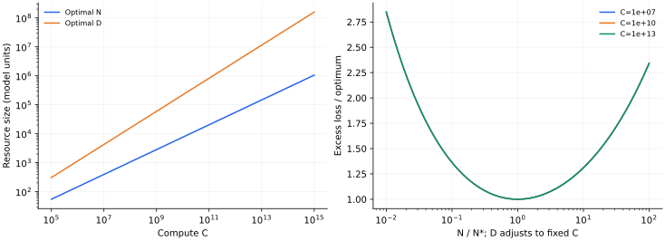

> **V · Scaling Laws · Note 20**
>
> ← [Note 19](/notes/neural_network_theory/model_scaling/) · [系列目录](/notes/neural_network_theory/)

**可解性层次：** 给定损失模型下精确优化。

## 1. 计算最优配置是一个条件明确的优化问题

给定训练计算量，应训练一个更大的模型，还是用更多数据训练较小模型？要回答它，需要两类输入：损失怎样依赖模型与数据，以及计算成本怎样计数。优化本身可以严格完成，但这不等于已经从学习动力学推导出经验损失模型。

本篇先把常见的双幂律假设解到底，再说明经验拟合、资源决策与微观机制之间的区别。

## 2. 损失与成本的最小假设

假设已充分优化、在某个尺度区间内

$$
L(N,D)=L_\infty+AN^{-\alpha}+BD^{-\beta},
\qquad A,B,\alpha,\beta\gt 0,
$$

其中 $N$ 为按统一规则计数的模型规模，$D$ 为训练中使用的数据量。若一个样本重复出现，独立数据量与处理 token 数不同；本模型只有一个 $D$，所以使用前必须说明采用哪种操作定义。

先取训练成本 $C=kND$。这里的 $k$ 由架构、前反向传播和计量单位决定，不是普遍常数；推理、数据获取、通信及超参数搜索尚未计入。

## 3. 约束优化：指数和常数一起算

令 $D=C/(kN)$，超额损失变成

$$
E_C(N)=AN^{-\alpha}+B(kN/C)^\beta.
$$

对 $\log N$ 求导，最优条件为

$$
\alpha AN^{-\alpha}=\beta BD^{-\beta}.
$$

因此两项在最优点具有相同量级，但只有 $\alpha=\beta$ 时数值相等。解得

$$
\boxed{N_*=
\left(\frac{\alpha A}{\beta B}\right)^{1/(\alpha+\beta)}
\left(\frac Ck\right)^{\beta/(\alpha+\beta)},}
$$

$$
\boxed{D_*=
\left(\frac{\beta B}{\alpha A}\right)^{1/(\alpha+\beta)}
\left(\frac Ck\right)^{\alpha/(\alpha+\beta)}.}
$$

将 $u=\log N$ 代入后，目标是两个指数函数之和，二阶导数严格为正，所以这个内部驻点唯一且为全局最小值。代回还得到

$$
\boxed{L_*(C)-L_\infty\propto
C^{-\alpha\beta/(\alpha+\beta)}.}
$$

这三条指数关系都是**给定损失与成本模型内**的严格结果。它们没有证明语言、图像或任意网络都具有相同 $\alpha,\beta$。

## 4. 一个明确数值例子

取 $\alpha=0.4,\beta=0.3,A=2,B=3,k=6$。则

$$
N_*\propto C^{3/7},\qquad D_*\propto C^{4/7},
\qquad E_*\propto C^{-6/35}.
$$

计算量增加 100 倍，最优模型约增大 $100^{3/7}\simeq7.20$ 倍，数据约增大 $100^{4/7}\simeq13.89$ 倍，超额损失乘以 $100^{-6/35}\simeq0.454$。这些参数是用于具体计算的示例设定，不是对某个现实模型的拟合。

固定预算时，如果模型比最优值大 $r$ 倍，数据就少 $r$ 倍，损失为

$$
E(r)=A N_*^{-\alpha}r^{-\alpha}
+B D_*^{-\beta}r^\beta.
$$

利用最优配平条件，可直接计算配置偏离的代价。最优附近对 $\log r$ 的一阶项消失，因此预算选择可能存在一段较平坦区间；不要把拟合不确定性下的一个最优数字报告到无意义的小数位。

## 5. Kaplan 与 Chinchilla 的比较应比较什么

[Kaplan 等（2020），Scaling Laws for Neural Language Models](https://arxiv.org/abs/2001.08361)研究模型、数据和训练计算下的经验尺度关系，给出偏向增长模型规模的资源配置；[Hoffmann 等（2022），Training Compute-Optimal Large Language Models](https://arxiv.org/abs/2203.15556)通过不同尺度与预算实验，提出模型和训练 token 应近似共同增长的配置，并以 Chinchilla 检验。

两者的比较涉及拟合范围、训练时长、优化规则和模型族，不能把不同实验的指数当成对同一数学定理的真假投票。上述双幂律是在固定训练协议和区间上的有效拟合；把它外推到远离测量尺度、不同数据质量或不同成本组成时，需要重新验证。

也要分清“独立样本增多”和“处理 token 增多”。在数据受限、重复训练或混合质量语料下，一个 $BD^{-\beta}$ 项通常不足以同时描述新信息、重复次数和优化程度。

## 6. 成本模型改变，配置指数怎样变

若 $C=kN^aD^b$，$a,b\gt 0$，同样求导得到

$$
\alpha AN^{-\alpha}=\frac{a\beta}{b}BD^{-\beta},
$$

$$
N_*\propto C^{\beta/(b\alpha+a\beta)},\qquad
D_*\propto C^{\alpha/(b\alpha+a\beta)}.
$$

可检查 $a\log N_*+b\log D_*$ 对 $\log C$ 的系数恰为 1。如果还存在数据上限 $D_{\max}$、模型下限或推理成本，最优点可能落在边界，内部配平不再适用。

若训练没有充分收敛，应加入时间或优化残差 $E_{\rm opt}(N,D,T)$，成本也应随实际更新次数计数。先假设所有点都充分优化，再用同一预算要求所有点短训，是不一致的。

## 7. 数值结果

*图 1 · 自制约束优化。* 参数取第 4 节设定。左图显示 $N_*(C),D_*(C)$；右图在三个计算预算下画 $E(r)/E(1)$。双幂律的齐次性使三条归一化曲线重合，脚本同时检查配平条件，误差约为机器精度。这是模型内计算，不涉及大语言模型的实际训练测量。

复现命令为 `python experiments.py --note 20`。若加入数据上限，最优点可能从内部配平转到边界，原先的 $N,D$ 指数便不再同时适用。

## 8. 几个模型之间的联系

线性谱让我们精确计算松弛；高维几何解释插值附近的噪声放大；不同宽度极限区分固定特征和表示演化；深度参数化产生额外时间尺度；谱尾与统计噪声产生不同的标度指数。它们可以彼此连接，但每次连接都需要核对模型假设与观测量。

**后续研究。** 需要微观理论解释的是 $L(N,D,T)$ 为什么具有某种形式、指数如何受数据结构及特征学习影响。资源优化公式完成的是给定模型后的分配问题；它为实验设计提供参照，也把哪些假设需要测量清楚地暴露出来。

---

← [Note 19](/notes/neural_network_theory/model_scaling/) · [系列目录](/notes/neural_network_theory/)
