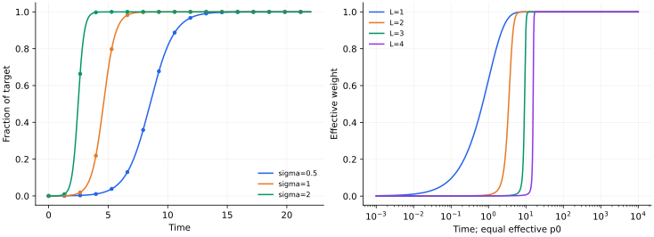

> **III · 深度与优化动力学 · Note 09**
>
> ← [Note 08](/notes/neural_network_theory/lazy_and_mean_field/) · [系列目录](/notes/neural_network_theory/) · [Note 10](/notes/neural_network_theory/implicit_bias/) →

**可解性层次：** 对齐和平衡条件下精确可解。

## 1. 同一个线性函数类，可以有完全不同的学习时间

单层线性回归沿每个模态指数接近目标；把同一个线性映射写成多层矩阵乘积后，优化可以先停在平台，再快速下降。激活函数没有非线性，动力学却已经非线性，因为梯度分别作用在每个因子上。

本篇的精确解有清楚条件：输入白化，学习模态对齐，标量因子处在平衡分支。一般矩阵初始化会发生模态旋转与耦合，不能直接把所有奇异值独立代入 Logistic 方程。

## 2. 两层标量模型与平衡守恒量

令有效权重 $p=w_2w_1$，目标 $\sigma\gt 0$，损失

$$
\mathcal L=\frac12(w_2w_1-\sigma)^2.
$$

单位迁移率的梯度流为

$$
\dot w_1=(\sigma-p)w_2,\qquad
\dot w_2=(\sigma-p)w_1.
$$

因此

$$
\frac d{dt}(w_1^2-w_2^2)=0,\qquad
\dot p=(w_1^2+w_2^2)(\sigma-p).
$$

只有 $w_1^2=w_2^2$ 且选取同号、$p\gt 0$ 分支时，才有 $w_1^2+w_2^2=2p$。于是

$$
\boxed{\dot p=2p(\sigma-p).}
$$

若初始不平衡常数为 $c=w_1^2-w_2^2$，精确的有效方程是 $\dot p=\sqrt{c^2+4p^2}(\sigma-p)$。平台与初始化尺度会受 $c$ 影响；将任意初始化都设成平衡分支会丢掉这个物理量。

### 有效权重方程与因子空间的几何

从 $p=w_1w_2$ 求导，需要同时保留两条参数路径：$\dot p=\dot w_1w_2+w_1\dot w_2$。有效迁移率是 $w_1^2+w_2^2$，而不是一个固定学习率。守恒量 $c=w_1^2-w_2^2$ 与恒等式 $(w_1^2+w_2^2)^2=c^2+4p^2$，才将两个因子压缩成一个精确的有效 ODE。

在函数坐标 $p$ 中，直接优化 $\mathcal L(p)$ 的梯度流应是 $\dot p=\sigma-p$；因子优化却得到 $\dot p=G(p)(\sigma-p)$。因此两种训练轨迹在一维中可以通过时间重参数化相关，但这个时钟依赖当前位置。多模态模型的各方向有不同的时钟，通常无法用一个全局时间变换同时消去深度效应。

### 平衡并不意味着总在可学习的分支

当 $c=0$，既可能 $w_1=w_2$，也可能 $w_1=-w_2$。前者对应正乘积，后者对应负乘积。若目标 $\sigma\gt 0$，严格反号平衡分支上的 $p\lt 0$ 满足

$$
\dot p=-2p(\sigma-p)\gt 0.
$$

它趋近零，却不会在有限时间跨过零；两个权重都逐渐趋零，无法到达正目标。零点是一个退化驻点，恰好的对称性可以把流困在它的稳定流形上。若 $c\neq0$，$p=0$ 处的迁移率为 $|c|\gt 0$，则可以穿越零点。这说明不平衡不只是对平台长度作小修正，有时还改变流能否跨越退化点。

### 不平衡两层模型也可继续求到闭式

当 $c_0=|w_1^2-w_2^2|\gt 0$ 时，令 $p=(c_0/2)\sinh u$。代入有效方程，$\cosh u$ 抵消，得到 $\dot u=2\sigma-c_0\sinh u$。再令 $z=e^u\gt 0$，方程成为 Riccati 形式

$$
\dot z=2\sigma z-\frac{c_0}{2}(z^2-1)
=-\frac{c_0}{2}(z-z_+)(z-z_-),
$$

其中 $z_\pm=(2\sigma\pm\sqrt{4\sigma^2+c_0^2})/c_0$。分离变量后，

$$
\frac{z(t)-z_+}{z(t)-z_-}
=\frac{z(0)-z_+}{z(0)-z_-}
e^{-\sqrt{4\sigma^2+c_0^2}\,t},
\qquad p(t)=\frac{c_0}{4}[z(t)-z(t)^{-1}].
$$

给定右边的指数函数，可以直接解出 $z(t)$，从而恢复任意初始乘积的轨迹。$z_+\gt 0$ 对应长期目标 $p=\sigma$，负根只参与解的分式结构。非零不平衡允许跨越 $p=0$；严格平衡的反号分支则是一个奇异极限，不能通过先假设同号的 Logistic 解来描述。

这也说明平衡模型为什么既重要又特殊：它把函数原点的有效迁移率压到零，从而最清楚地显示深度慢启动；若始终保持较大的因子不平衡，函数初期的运动可以明显更快。

## 3. Logistic 解、平台与快速学习

分离变量：

$$
\int\frac{dp}{p(\sigma-p)}=2t+\mathrm{const},
$$

得到 $0\lt p_0\lt \sigma$ 下的精确解

$$
\boxed{p(t)=\frac\sigma{1+(\sigma/p_0-1)e^{-2\sigma t}}.}
$$

早期 $p\ll\sigma$ 时，$p\simeq p_0e^{2\sigma t}$。它的**相对**增长率并不小，但绝对函数变化仍很小，所以损失看起来近乎不动。到 $p=O(\sigma)$ 时，输出快速改变；接近目标后，误差又指数衰减。

达到一半目标的时间为

$$
t_{1/2}=\frac1{2\sigma}\log\left(\frac\sigma{p_0}-1\right),
$$

适用于 $p_0\lt \sigma/2$。强信号 $\sigma$ 较早学会，小初始化使平台按对数延长。若 $w_1=w_2=0$，梯度严格为零，不会自行离开；“极小但非零”与“恰好为零”不同。

例如 $\sigma=1,p_0=10^{-4}$ 时，$t_{1/2}\simeq4.605$；若把 $p_0$ 再缩小 100 倍，平台仅再延长约 $2.303$。这些数值使用的是当前损失与迁移率归一化。

### 从损失导数理解平台的可见程度

有效损失的下降率是

$$
\dot{\mathcal L}=-(w_1^2+w_2^2)(\sigma-p)^2,
$$

平衡正分支上为 $-2p(\sigma-p)^2$。当 $p$ 很小，残差仍接近 $\sigma$，但有效迁移率趋零，因此绝对损失下降很慢。这个平台不是“模型已完成一部分样本的记忆”产生的，因为标量模型根本没有可区分的样本记忆方向。

Logistic 曲线还有两个值得区分的时刻：输出增长率 $\dot p=2p(\sigma-p)$ 在 $p=\sigma/2$ 最大；损失下降速率 $-\dot{\mathcal L}=2p(\sigma-p)^2$ 则在 $p=\sigma/3$ 最大。用输出拐点、损失最大斜率或达到某个误差阈值定义“学习时间”，常数会不同。谈分阶段学习时应先固定所采用的时间定义。

若多个对齐模态共享很小的初始乘积，$t_{i,1/2}\simeq[\log(\sigma_i/p_{i0})]/(2\sigma_i)$。强模态较早出现，是因为它既提供较大的驱动力，也有较短的增长时间。目标本身的奇异谱与输入协方差谱在一般数据上并不相同，不能把这个顺序直接命名为低频到高频。

## 4. 多层标量网络与更强的启动瓶颈

深度 $L$、$p=\prod_{\ell=1}^Lw_\ell$，同样使用 $\mathcal L=(p-\sigma)^2/2$。所有 $w_\ell^2-w_k^2$ 在梯度流下守恒。在平衡、正权重分支 $w_\ell=p^{1/L}$ 上，

$$
\boxed{\dot p=L p^{2-2/L}(\sigma-p).}
$$

$L=1$ 是线性松弛，$L=2$ 是 Logistic；$L\gt 2$ 时早期 $\dot p\simeq L\sigma p^{2-2/L}$，从 $p_0$ 长到一个固定的小阈值 $p_c$ 的时间为

$$
t_{\rm esc}\simeq
\frac{p_0^{-(1-2/L)}-p_c^{-(1-2/L)}}
{L\sigma(1-2/L)}.
$$

对 $p_0$ 的依赖从对数变成幂次。比较深度时还应说明固定的是单层初始化 $w_0$ 还是乘积初始化 $p_0=w_0^L$；两种比较给出不同的量级。

### 任意深度的链式因子与不变量

对 $p=\prod_\ell w_\ell$，梯度为 $\dot w_\ell=(\sigma-p)\prod_{k\neq\ell}w_k$。无论某个因子是否为零，都可以用这个乘积形式计算；写成 $p/w_\ell$ 则在零点引入了人为奇点。于是

$$
\frac d{dt}w_\ell^2=2(\sigma-p)p
$$

对所有层相同，平方差因而守恒。在正平衡分支，把 $w_\ell=p^{1/L}$ 代入 $\dot p=\sum_\ell(\prod_{k\neq\ell}w_k)^2(\sigma-p)$，便得到 $L p^{2-2/L}(\sigma-p)$。深度指数来自链式梯度中其余 $L-1$ 个因子的平方。

### 因子权重衰减诱导非二次的函数惩罚

若因子损失加上 $\lambda\sum_\ell w_\ell^2/2$，平衡正分支上的有效目标为

$$
F(p)=\frac12(p-\sigma)^2+\frac{\lambda L}{2}p^{2/L}.
$$

其动力学为

$$
\dot p=-L p^{2-2/L}F'(p)
=L p^{2-2/L}(\sigma-p)-L\lambda p.
$$

当 $L=2$，得到 $\dot p=2p(\sigma-\lambda-p)$，长期活跃模态为 $(\sigma-\lambda)_+$。因子 L2 惩罚在有效正权重上变成线性惩罚，对奇异模态表现为软阈值。

当 $L\gt 2$，$p^{2/L}$ 是凹函数，靠近零点的正则化漂移 $-L\lambda p$ 比学习项更强，零点可稳定；较大的初值又可能进入非零恢复态的盆地。这时初始化和正则化共同产生选择性，不再只是将无正则化平台平移。虽然全网络函数类仍是线性映射，因子结构已经能产生非凸的有效正则化景观。

## 5. 矩阵模态何时可以独立求解

设输入已白化 $\mathbb E[xx^\top]=I$，输入输出交叉矩阵 $S=\mathbb E[yx^\top]$，两层映射 $M=W_2W_1$。忽略与 $M$ 无关的常数，总体损失为 $\|M-S\|_F^2/2$，梯度流

$$
\dot W_1=W_2^\top(S-W_2W_1),\qquad
\dot W_2=(S-W_2W_1)W_1^\top.
$$

直接相减可验证

$$
\frac d{dt}(W_2^\top W_2-W_1W_1^\top)=0.
$$

若 $S=U\operatorname{diag}(\sigma_i)V^\top$，初始化恰能写成 $W_2=UA$、$W_1=BV^\top$，且 $A,B$ 为匹配的对角矩阵，流保持这一子空间。每个 $p_i=A_{ii}B_{ii}$ 因而独立满足前面的标量方程；平衡时各自具有 Logistic 解。

这给出分阶段学习的可解模型：不同 $\sigma_i$ 产生不同启动时间。一般未对齐初始化、非白输入或瓶颈秩不足，会改变这些方程。精确模态分离是一个有用的理论控制条件，而非所有深度线性训练的默认事实。

### 从 Frobenius 微分到矩阵流

令 $G=M-S$。对 $M=W_2W_1$ 的微扰，$\delta M=\delta W_2W_1+W_2\delta W_1$，所以

$$
\delta\mathcal L
=\operatorname{Tr}(G^\top\delta W_2W_1)
+\operatorname{Tr}(G^\top W_2\delta W_1).
$$

循环移动 trace 中的矩阵，得到 $\nabla_{W_2}\mathcal L=GW_1^\top$ 和 $\nabla_{W_1}\mathcal L=W_2^\top G$。两项代回 $\dot M$，有效矩阵动力学是

$$
\boxed{\dot M=-W_2W_2^\top G-GW_1^\top W_1.}
$$

左、右特征子空间各提供一个随训练变化的预条件算子。若因子平衡且具有匹配的非零奇异空间，$W_2W_2^\top=(MM^\top)^{1/2}$、$W_1^\top W_1=(M^\top M)^{1/2}$。因此即使不选择教师对齐坐标，仍能看见小奇异值方向的有效迁移率较小。只有进一步与 $S$ 共用奇异基，才变成独立的标量流。

### 白化是模型假设，不总是动力学等价变换

若输入协方差为 $C\neq I$，总体梯度变成 $G=MC-S$。可以对输入作 $x'=C^{-1/2}x$ 并重新定义第一层参数，使函数关系写成白化形式；但对重定义参数做欧氏梯度下降，未必等价于原参数上的欧氏梯度下降，因为坐标变换也改变了优化度量。

因此白化在这里不只是让公式简洁，而是选定了一个特定训练问题。一般相关输入会使输入统计与教师映射的模态竞争，奇异向量也可能转动。静态最优解可通过变量变换对应，并不保证训练轨迹及平台时间也相同。

若隐藏瓶颈宽度为 $r$，$\operatorname{rank}M\leq r$。在白化平方损失下，最优线性映射是 $S$ 的秩 $r$ 截断，残余映射误差为 $\frac12\sum_{i\gt r}\sigma_i^2$，另加教师自身的不可预测残差。这个静态秩约束与前面的动态慢启动是两个机制：前者决定哪些模态最终无法表示，后者决定可表示模态多久才出现。

## 6. 数值结果

*图 1 · 自制精确解与 ODE。* 左图用 $p_0=10^{-4}$、$\sigma=0.5,1,2$ 展示两层精确解，圆点为独立数值积分。右图固定 $\sigma=1$ 与有效乘积初始化 $p_0=10^{-3}$，比较 $L=1,2,3,4$ 的平衡 ODE；横轴按需使用对数尺度。两幅图没有加入标签噪声或特征旋转。

复现命令为 `python experiments.py --note 9`。完整因子方程中的平衡守恒量提供了独立的数值检查；离散梯度下降只近似守恒，较大学习率还会引入连续时间模型之外的效应。

## 7. 物理解释与相关文献

深度在这里改变参数空间的有效迁移率：$p$ 的移动速度乘上 $L p^{2-2/L}$。靠近小乘积处，函数坐标上的运动很慢。平台可以来自参数化造成的瓶颈，不必意味着模型先在记忆训练样本。

**原始文献。** [Saxe、McClelland 与 Ganguli，Exact solutions to the nonlinear dynamics of learning in deep linear neural networks](https://arxiv.org/abs/1312.6120)是本主题的核心阅读。本文将其可解思想落实到明确的白化、对齐和平衡设定，不宣称任意深度线性矩阵流都具有相同闭式解。

---

← [Note 08](/notes/neural_network_theory/lazy_and_mean_field/) · [系列目录](/notes/neural_network_theory/) · [Note 10](/notes/neural_network_theory/implicit_bias/) →
