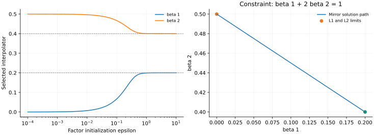

> **III · 深度与表征形成 · Note 05**
>
> ← [Note 04](/notes/neural_network_theory/lazy_and_mean_field/) · [系列目录](/notes/neural_network_theory/) · [Note 06](/notes/neural_network_theory/teacher_student_theory/) →

**可解性层次：** 对齐平衡分支精确可解；分类方向与因子偏置均保留相应条件。

## 前言：参数怎样分解函数，也怎样选择学习路径

深度线性网络与隐式偏置共享一个问题：即使最终可表示函数相同，参数化与优化器仍可能改变学多快、先学什么，以及在许多训练解中选哪一个。前者强调有限时间的非线性因子动力学，后者强调长期极限中的解选择；将它们连起来，便能从路径几何一路追到统计偏好。

这一篇先求乘法参数化中的平衡不变量、平台与 Logistic 解，再进入矩阵流。随后比较平方回归的有限最小范数点、可分分类中发散但方向收敛的路径，以及有符号因子模型中依赖初始化的 Bregman 几何。

我会始终区分三个层次：一个函数存在怎样的低代价分解，某种梯度流能够沿什么路径运动，以及它是否收敛到那个低代价解。代数变分恒等式、动力学机制和长期选择定理不能相互替代，但可以在明确条件下接起来。

## 1. 深度因子化：线性函数的非线性恢复 {#deep-linear}

### 两层标量流、平衡与不平衡分支

令有效权重 $p=w_2w_1$，目标 $\sigma\gt 0$，损失

$$
\mathcal L=\frac12(w_2w_1-\sigma)^2.
$$

单位迁移率的梯度流为

$$
\dot w_1=(\sigma-p)w_2,\qquad
\dot w_2=(\sigma-p)w_1.
$$

因此

$$
\frac d{dt}(w_1^2-w_2^2)=0,\qquad
\dot p=(w_1^2+w_2^2)(\sigma-p).
$$

只有 $w_1^2=w_2^2$ 且选取同号、$p\gt 0$ 分支时，才有 $w_1^2+w_2^2=2p$。于是

$$
\boxed{\dot p=2p(\sigma-p).}
$$

若初始不平衡常数为 $c=w_1^2-w_2^2$，精确的有效方程是 $\dot p=\sqrt{c^2+4p^2}(\sigma-p)$。平台与初始化尺度会受 $c$ 影响；将任意初始化都设成平衡分支会丢掉这个物理量。

#### 有效权重方程与因子空间的几何

从 $p=w_1w_2$ 求导，需要同时保留两条参数路径：$\dot p=\dot w_1w_2+w_1\dot w_2$。有效迁移率是 $w_1^2+w_2^2$，而不是一个固定学习率。守恒量 $c=w_1^2-w_2^2$ 与恒等式 $(w_1^2+w_2^2)^2=c^2+4p^2$，才将两个因子压缩成一个精确的有效 ODE。

在函数坐标 $p$ 中，直接优化 $\mathcal L(p)$ 的梯度流应是 $\dot p=\sigma-p$；因子优化却得到 $\dot p=G(p)(\sigma-p)$。因此两种训练轨迹在一维中可以通过时间重参数化相关，但这个时钟依赖当前位置。多模态模型的各方向有不同的时钟，通常无法用一个全局时间变换同时消去深度效应。

#### 平衡并不意味着总在可学习的分支

当 $c=0$，既可能 $w_1=w_2$，也可能 $w_1=-w_2$。前者对应正乘积，后者对应负乘积。若目标 $\sigma\gt 0$，严格反号平衡分支上的 $p\lt 0$ 满足

$$
\dot p=-2p(\sigma-p)\gt 0.
$$

它趋近零，却不会在有限时间跨过零；两个权重都逐渐趋零，无法到达正目标。零点是一个退化驻点，恰好的对称性可以把流困在它的稳定流形上。若 $c\neq0$，$p=0$ 处的迁移率为 $|c|\gt 0$，则可以穿越零点。这说明不平衡不只是对平台长度作小修正，有时还改变流能否跨越退化点。

#### 不平衡两层模型也可继续求到闭式

当 $c_0=|w_1^2-w_2^2|\gt 0$ 时，令 $p=(c_0/2)\sinh u$。代入有效方程，$\cosh u$ 抵消，得到 $\dot u=2\sigma-c_0\sinh u$。再令 $z=e^u\gt 0$，方程成为 Riccati 形式

$$
\dot z=2\sigma z-\frac{c_0}{2}(z^2-1)
=-\frac{c_0}{2}(z-z_+)(z-z_-),
$$

其中 $z_\pm=(2\sigma\pm\sqrt{4\sigma^2+c_0^2})/c_0$。分离变量后，

$$
\frac{z(t)-z_+}{z(t)-z_-}
=\frac{z(0)-z_+}{z(0)-z_-}
e^{-\sqrt{4\sigma^2+c_0^2}\,t},
\qquad p(t)=\frac{c_0}{4}[z(t)-z(t)^{-1}].
$$

给定右边的指数函数，可以直接解出 $z(t)$，从而恢复任意初始乘积的轨迹。$z_+\gt 0$ 对应长期目标 $p=\sigma$，负根只参与解的分式结构。非零不平衡允许跨越 $p=0$；严格平衡的反号分支则是一个奇异极限，不能通过先假设同号的 Logistic 解来描述。

这也说明平衡模型为什么既重要又特殊：它把函数原点的有效迁移率压到零，从而最清楚地显示深度慢启动；若始终保持较大的因子不平衡，函数初期的运动可以明显更快。

### Logistic 解、启动平台与转折

分离变量：

$$
\int\frac{dp}{p(\sigma-p)}=2t+\mathrm{const},
$$

得到 $0\lt p_0\lt \sigma$ 下的精确解

$$
\boxed{p(t)=\frac\sigma{1+(\sigma/p_0-1)e^{-2\sigma t}}.}
$$

早期 $p\ll\sigma$ 时，$p\simeq p_0e^{2\sigma t}$。它的**相对**增长率并不小，但绝对函数变化仍很小，所以损失看起来近乎不动。到 $p=O(\sigma)$ 时，输出快速改变；接近目标后，误差又指数衰减。

达到一半目标的时间为

$$
t_{1/2}=\frac1{2\sigma}\log\left(\frac\sigma{p_0}-1\right),
$$

适用于 $p_0\lt \sigma/2$。强信号 $\sigma$ 较早学会，小初始化使平台按对数延长。若 $w_1=w_2=0$，梯度严格为零，不会自行离开；“极小但非零”与“恰好为零”不同。

例如 $\sigma=1,p_0=10^{-4}$ 时，$t_{1/2}\simeq4.605$；若把 $p_0$ 再缩小 100 倍，平台仅再延长约 $2.303$。这些数值使用的是当前损失与迁移率归一化。

#### 从损失导数理解平台的可见程度

有效损失的下降率是

$$
\dot{\mathcal L}=-(w_1^2+w_2^2)(\sigma-p)^2,
$$

平衡正分支上为 $-2p(\sigma-p)^2$。当 $p$ 很小，残差仍接近 $\sigma$，但有效迁移率趋零，因此绝对损失下降很慢。这个平台不是“模型已完成一部分样本的记忆”产生的，因为标量模型根本没有可区分的样本记忆方向。

Logistic 曲线还有两个值得区分的时刻：输出增长率 $\dot p=2p(\sigma-p)$ 在 $p=\sigma/2$ 最大；损失下降速率 $-\dot{\mathcal L}=2p(\sigma-p)^2$ 则在 $p=\sigma/3$ 最大。用输出拐点、损失最大斜率或达到某个误差阈值定义“学习时间”，常数会不同。谈分阶段学习时应先固定所采用的时间定义。

若多个对齐模态共享很小的初始乘积，$t_{i,1/2}\simeq[\log(\sigma_i/p_{i0})]/(2\sigma_i)$。强模态较早出现，是因为它既提供较大的驱动力，也有较短的增长时间。目标本身的奇异谱与输入协方差谱在一般数据上并不相同，不能把这个顺序直接命名为低频到高频。

### 任意深度与权重衰减的有效代价

深度 $L$、$p=\prod_{\ell=1}^Lw_\ell$，同样使用 $\mathcal L=(p-\sigma)^2/2$。所有 $w_\ell^2-w_k^2$ 在梯度流下守恒。在平衡、正权重分支 $w_\ell=p^{1/L}$ 上，

$$
\boxed{\dot p=L p^{2-2/L}(\sigma-p).}
$$

$L=1$ 是线性松弛，$L=2$ 是 Logistic；$L\gt 2$ 时早期 $\dot p\simeq L\sigma p^{2-2/L}$，从 $p_0$ 长到一个固定的小阈值 $p_c$ 的时间为

$$
t_{\rm esc}\simeq
\frac{p_0^{-(1-2/L)}-p_c^{-(1-2/L)}}
{L\sigma(1-2/L)}.
$$

对 $p_0$ 的依赖从对数变成幂次。比较深度时还应说明固定的是单层初始化 $w_0$ 还是乘积初始化 $p_0=w_0^L$；两种比较给出不同的量级。

#### 任意深度的链式因子与不变量

对 $p=\prod_\ell w_\ell$，梯度为 $\dot w_\ell=(\sigma-p)\prod_{k\neq\ell}w_k$。无论某个因子是否为零，都可以用这个乘积形式计算；写成 $p/w_\ell$ 则在零点引入了人为奇点。于是

$$
\frac d{dt}w_\ell^2=2(\sigma-p)p
$$

对所有层相同，平方差因而守恒。在正平衡分支，把 $w_\ell=p^{1/L}$ 代入 $\dot p=\sum_\ell(\prod_{k\neq\ell}w_k)^2(\sigma-p)$，便得到 $L p^{2-2/L}(\sigma-p)$。深度指数来自链式梯度中其余 $L-1$ 个因子的平方。

#### 因子权重衰减诱导非二次的函数惩罚

若因子损失加上 $\lambda\sum_\ell w_\ell^2/2$，平衡正分支上的有效目标为

$$
F(p)=\frac12(p-\sigma)^2+\frac{\lambda L}{2}p^{2/L}.
$$

其动力学为

$$
\dot p=-L p^{2-2/L}F'(p)
=L p^{2-2/L}(\sigma-p)-L\lambda p.
$$

当 $L=2$，得到 $\dot p=2p(\sigma-\lambda-p)$，长期活跃模态为 $(\sigma-\lambda)_+$。因子 L2 惩罚在有效正权重上变成线性惩罚，对奇异模态表现为软阈值。

当 $L\gt 2$，$p^{2/L}$ 是凹函数，靠近零点的正则化漂移 $-L\lambda p$ 比学习项更强，零点可稳定；较大的初值又可能进入非零恢复态的盆地。这时初始化和正则化共同产生选择性，不再只是将无正则化平台平移。虽然全网络函数类仍是线性映射，因子结构已经能产生非凸的有效正则化景观。

## 2. 矩阵动力学：状态依赖度量与模态形成 {#matrix-dynamics}

标量结果揭示了乘法启动，但一般矩阵训练还会旋转奇异方向。只有在输入度量、初始化和平衡条件配合时，才可以把它简化为独立模态。

### 矩阵微分、白化条件与秩瓶颈

设输入已白化 $\mathbb E[xx^\top]=I$，输入输出交叉矩阵 $S=\mathbb E[yx^\top]$，两层映射 $M=W_2W_1$。忽略与 $M$ 无关的常数，总体损失为 $\|M-S\|_F^2/2$，梯度流

$$
\dot W_1=W_2^\top(S-W_2W_1),\qquad
\dot W_2=(S-W_2W_1)W_1^\top.
$$

直接相减可验证

$$
\frac d{dt}(W_2^\top W_2-W_1W_1^\top)=0.
$$

若 $S=U\operatorname{diag}(\sigma_i)V^\top$，初始化恰能写成 $W_2=UA$、$W_1=BV^\top$，且 $A,B$ 为匹配的对角矩阵，流保持这一子空间。每个 $p_i=A_{ii}B_{ii}$ 因而独立满足前面的标量方程；平衡时各自具有 Logistic 解。

这给出分阶段学习的可解模型：不同 $\sigma_i$ 产生不同启动时间。一般未对齐初始化、非白输入或瓶颈秩不足，会改变这些方程。精确模态分离是一个有用的理论控制条件，而非所有深度线性训练的默认事实。

#### 从 Frobenius 微分到矩阵流

令 $G=M-S$。对 $M=W_2W_1$ 的微扰，$\delta M=\delta W_2W_1+W_2\delta W_1$，所以

$$
\delta\mathcal L
=\operatorname{Tr}(G^\top\delta W_2W_1)
+\operatorname{Tr}(G^\top W_2\delta W_1).
$$

循环移动 trace 中的矩阵，得到 $\nabla_{W_2}\mathcal L=GW_1^\top$ 和 $\nabla_{W_1}\mathcal L=W_2^\top G$。两项代回 $\dot M$，有效矩阵动力学是

$$
\boxed{\dot M=-W_2W_2^\top G-GW_1^\top W_1.}
$$

左、右特征子空间各提供一个随训练变化的预条件算子。若因子平衡且具有匹配的非零奇异空间，$W_2W_2^\top=(MM^\top)^{1/2}$、$W_1^\top W_1=(M^\top M)^{1/2}$。因此即使不选择教师对齐坐标，仍能看见小奇异值方向的有效迁移率较小。只有进一步与 $S$ 共用奇异基，才变成独立的标量流。

#### 白化是模型假设，不总是动力学等价变换

若输入协方差为 $C\neq I$，总体梯度变成 $G=MC-S$。可以对输入作 $x'=C^{-1/2}x$ 并重新定义第一层参数，使函数关系写成白化形式；但对重定义参数做欧氏梯度下降，未必等价于原参数上的欧氏梯度下降，因为坐标变换也改变了优化度量。

因此白化在这里不只是让公式简洁，而是选定了一个特定训练问题。一般相关输入会使输入统计与教师映射的模态竞争，奇异向量也可能转动。静态最优解可通过变量变换对应，并不保证训练轨迹及平台时间也相同。

若隐藏瓶颈宽度为 $r$，$\operatorname{rank}M\leq r$。在白化平方损失下，最优线性映射是 $S$ 的秩 $r$ 截断，残余映射误差为 $\frac12\sum_{i\gt r}\sigma_i^2$，另加教师自身的不可预测残差。这个静态秩约束与前面的动态慢启动是两个机制：前者决定哪些模态最终无法表示，后者决定可表示模态多久才出现。

### 深度线性恢复的数值结果

*图 1 · 自制精确解与 ODE。* 左图用 $p_0=10^{-4}$、$\sigma=0.5,1,2$ 展示两层精确解，圆点为独立数值积分。右图固定 $\sigma=1$ 与有效乘积初始化 $p_0=10^{-3}$，比较 $L=1,2,3,4$ 的平衡 ODE；横轴按需使用对数尺度。两幅图没有加入标签噪声或特征旋转。

完整因子方程中的平衡守恒量提供了独立的数值检查；离散梯度下降只近似守恒，较大学习率还会引入连续时间模型之外的效应。

## 3. 隐式偏置：从路径几何到解选择 {#implicit-bias}

有限时间的恢复速度并不直接决定长期解。先用线性平方回归固定解选择的定义，再比较不同参数度量；前面的深度流则说明，当这个度量随状态变化时，问题会更加复杂。

### 初始化、零空间与最小范数解

对 $\mathcal L=\|Xw-y\|^2/(2D)$，梯度始终在 $X$ 的行空间，故零空间分量不变。若从零出发并收敛，

$$
\hat w=X^+y.
$$

当数据可插值时，这是满足 $Xw=y$ 的欧氏最小范数解。证明很直接：任意其他解为 $X^+y+z$，$z\in\ker X$，两项正交，所以范数平方相加。

若用预条件更新 $\dot w=-P\nabla\mathcal L$，$P\succ0$ 固定，从零出发选择的通常是 $w^\top P^{-1}w$ 最小的插值解。算法的度量已经改变，不能继续沿用相同的欧氏结论。非零初始化则保留对应不可观测分量。

#### 初始化与优化度量同时进入解选择

用 $w=P^{1/2}z$ 重写预条件流，可将其变为 $z$ 上的欧氏梯度流。最小 $\|z\|^2$ 等价于最小 $w^\top P^{-1}w$。如果学习率矩阵依时间或参数而变，这个固定度量变换一般不存在，不能将 Adam 或自适应预条件方法直接归结成同一个范数最小化问题。

非零初始化下，平方回归的长期解是 $X^+y+(I-X^+X)w_0$。因此“梯度下降有最小范数偏置”完整的表述还应包括：针对哪一组参数坐标，使用什么度量，从什么初值出发，是否达到插值，以及损失是否在有限点取到最小值。省掉其中任一项，都可能把一个正确的特例变成错误的普遍陈述。

### 一个约束就能看见坐标几何的作用

只有一个约束 $w_1+w_2=1$。欧氏梯度流从零开始选择 $(1/2,1/2)$。若迁移率为 $M=\operatorname{diag}(m_1,m_2)$，最小 $M^{-1}$ 范数解为

$$
w_1=\frac{m_1}{m_1+m_2},\qquad
w_2=\frac{m_2}{m_1+m_2}.
$$

两者训练误差都为零，但对测试输入 $(1,-1)$ 的预测分别为零与 $(m_1-m_2)/(m_1+m_2)$。这说明优化器不是只负责更快到达一个预定函数；在欠定问题里，它可以参与决定函数本身。

若测试目标恰好主要依赖第一坐标，某个非均匀迁移率可能更好；若目标对称，欧氏偏置可能更合适。隐式偏置没有脱离数据分布的绝对好坏，它的统计价值来自与目标结构匹配。

## 4. 分类极限：范数发散与最大间隔方向 {#classification}

### 为什么可分 logistic 没有有限最优点

标签 $y_\mu\in\{-1,1\}$，模型无单独偏置项，损失

$$
\mathcal L(w)=\sum_\mu\log(1+e^{-y_\mu w^\top x_\mu}).
$$

若存在 $v$ 使所有 $y_\mu v^\top x_\mu\gt 0$，则沿 $w=cv$、$c\to\infty$，损失趋于零。不存在有限 $w$ 达到这个下确界。梯度流为

$$
\dot w=\sum_\mu\frac{y_\mu x_\mu}{1+e^{y_\mu w^\top x_\mu}}.
$$

大间隔点的梯度指数变小，靠近当前分类边界的样本主导长期更新。因此训练分类准确率已经为 100%，参数方向仍可缓慢转动。

### 支持向量、指数尾与 KKT 配平

定义硬间隔解

$$
\hat w=\arg\min_w\frac12\|w\|^2
\quad\text{s.t.}\quad y_\mu w^\top x_\mu\geq1.
$$

其 KKT 条件为

$$
\hat w=\sum_\mu\alpha_\mu y_\mu x_\mu,\quad
\alpha_\mu\geq0,\quad
\alpha_\mu(y_\mu\hat w^\top x_\mu-1)=0.
$$

用渐近 ansatz $w(t)=\hat w\log t+\rho(t)$ 理解其来源。支持向量的梯度约为 $t^{-1}$，非支持点的梯度约为 $t^{-m_\mu}$，其中 $m_\mu=y_\mu\hat w^\top x_\mu\gt 1$，衰减更快。主导向量只能由支持向量的非负组合构成，与 KKT 条件一致。

这段配平给出机制解释，而完整定理还要控制余项。对可分数据、相应指数尾损失和合适步长的梯度下降，可证明方向趋向 $\hat w/\|\hat w\|$；普通情形余项较温和，退化数据可能出现 $\log\log t$ 等修正。因此不要把“余项永远有界”写成一般定理。

范数主项为 $O(\log t)$，方向误差通常只按对数速度缩小。分类准确率的饱和远早于方向收敛，解释了继续训练仍可能改变测试预测，但不保证所有测试分布都因此改善。

#### 指数尾怎样选择支持向量

令 $z_\mu=y_\mu x_\mu$。假设渐近展开 $w(t)=\hat w\log t+\rho(t)$，且先考虑 $\rho$ 有界的非退化情形。第 $\mu$ 个梯度项为

$$
\frac{z_\mu}{1+e^{z_\mu^\top w}}
\simeq z_\mu\,t^{-z_\mu^\top\hat w}
e^{-z_\mu^\top\rho}.
$$

左边的参数速度主项是 $\hat w/t$。要使右边与它配平，最小的 $z_\mu^\top\hat w$ 必须归一化到 1。大于 1 的项积分后仅产生次领先修正，等于 1 的项则构成主导组合 $\hat w=\sum_{\mu\in\mathcal S}c_\mu z_\mu$，其中 $c_\mu\geq0$。这恰好是最大间隔 KKT 条件的活跃集结构。

退化数据中，某些支持向量的系数和几何约束不能由一个有限 $\rho$ 同时满足，需要更慢发散的余项。这不改变方向收敛的核心结论，却会显著影响有限时间拟合。将有限步数下的方向差异解释成不同隐式偏置之前，需要先排除这种对数级收敛造成的长暂态。

#### 最大间隔方向不等于任意分布下最优分类器

最大间隔是相对训练样本和指定参数度量的几何性质。测试分布若在不同区域集中，或者教师边界与最大间隔方向不同，继续增大训练间隔未必单调降低测试误差。该定理解释算法选择哪条分离方向，并没有独立解决这条方向为何适合真实数据的统计问题。

加入可训练偏置、不同样本权重、非可分噪声、显式正则化或非指数尾损失，都可能改变长期结构。特别是有噪声且不可分时，logistic 最优点可能是有限的，参数范数不再按 $\log t$ 发散；把可分渐近套到所有分类训练尾部，会失去问题本身的条件。

### 损失饱和之后的方向变化

*图 2 · 自制二维可分数据实验。* 用三种已吸收标签的向量 $z_\mu=y_\mu x_\mu=(1,0),(1,1),(2,-0.2)$。硬间隔解为 $(1,0)$，因为第一约束要求 $w_1\geq1$，其余约束在该点满足。对 logistic 梯度流进行数值积分；左图比较损失和参数范数，右图测量与 $(1,0)$ 的方向夹角。横轴为优化时间，未加入权重衰减。

训练准确率饱和后，参数方向仍继续变化。加入非零 L2 正则化后，最优点变为有限范数，长期行为不再是无正则化的 $\log t$ 发散。

## 5. 因子模型：初始化依赖的函数空间几何 {#factorization}

深度线性流中随状态变化的迁移率，在一些对角模型中还可以被精确积分成镜像几何。这提供一个能够真正推导解选择的例子，也显示小初始化与大初始化为何不必对应相同偏好。

### 核范数变分式与有符号对角模型

考虑正坐标因子化 $\beta_i=u_i^2$。若损失只通过 $\beta$ 依赖 $u$，则

$$
\dot u_i=-2u_i\partial_{\beta_i}\mathcal L,
\qquad
\dot\beta_i=-4\beta_i\partial_{\beta_i}\mathcal L.
$$

有效坐标的迁移率与自身大小成正比，小坐标增长慢；这与直接优化 $\beta$ 的欧氏梯度流不同。若允许正负分支、改变初始化或增加层数，偏置还会改变，所以一个因子化例子不足以证明通用稀疏性定理。

矩阵分解还有一个常用的变分恒等式：

$$
\|M\|_*=\inf_{UV^\top=M}
\frac12(\|U\|_F^2+\|V\|_F^2).
$$

用 $M=A\Sigma B^\top$ 的 SVD，取 $U=A\Sigma^{1/2}$、$V=B\Sigma^{1/2}$ 得到等号；反向不等式来自核范数与因子 Frobenius 范数的界。这个式子说明**显式**惩罚因子范数与核范数的关系，却不能直接证明无正则化因子梯度下降总选择最小核范数解。初始化、观测算子、可交换性及极限顺序都可能重要。

#### 一个能精确看见偏置连续变化的有符号对角模型

取 $\beta_i=u_i^2-v_i^2$，损失仅通过线性预测 $X\beta$ 依赖参数，记 $g_i=\partial_{\beta_i}\mathcal L$。欧氏梯度流为 $\dot u_i=-2u_ig_i$、$\dot v_i=2v_ig_i$，因此 $c_i=u_iv_i$ 守恒。

若初始化 $u_i=v_i=\epsilon_i\gt 0$，则 $c_i=\epsilon_i^2$，初始预测为零，但参数并非零。利用 $(u_i^2+v_i^2)^2=\beta_i^2+4c_i^2$，有效流为

$$
\boxed{\dot\beta_i=-4\sqrt{\beta_i^2+4c_i^2}\,g_i.}
$$

定义严格凸势函数

$$
\Phi_c(\beta)=\frac14\sum_i\left[
\beta_i\operatorname{arsinh}\!\left(\frac{\beta_i}{2c_i}\right)
-\sqrt{\beta_i^2+4c_i^2}\right].
$$

它的二阶导数为 $\partial_i^2\Phi_c=1/[4\sqrt{\beta_i^2+4c_i^2}]$，所以流可以改写为

$$
\frac d{dt}\nabla\Phi_c(\beta)=-\nabla_\beta\mathcal L.
$$

这是一种 mirror 型动力学：在原坐标中的状态依赖迁移率，变成对偶坐标 $\nabla\Phi_c$ 的线性受迫运动。对于平方回归，$\nabla\mathcal L=X^\top(X\beta-y)/D$，因此对偶坐标变化始终落在 $X$ 的行空间。

若轨迹收敛到一个有限插值解，令 $\beta_0=0$，则其极限满足

$$
X\beta_\infty=y,\qquad
\nabla\Phi_c(\beta_\infty)-\nabla\Phi_c(\beta_0)
\in\operatorname{im}X^\top.
$$

这正是约束最小化 Bregman 距离
$D_{\Phi_c}(\beta,\beta_0)=\Phi_c(\beta)-\Phi_c(\beta_0)-\nabla\Phi_c(\beta_0)^\top(\beta-\beta_0)$
的 KKT 条件。这里解选择可以完整推出来，而不是只给出一个“倾向稀疏”的定性判断；但仍须保留插值收敛这个前提。

#### 小初始化与大初始化的两端

当全部 $c_i=c$ 很大、相关解满足 $|\beta_i|\ll c$ 时，$\Phi_c$ 在原点附近近似 $\sum_i\beta_i^2/(16c)$，因而接近 L2 型解选择。小初始化 $c=\epsilon^2\to0$ 时，对固定非零 $\beta_i$，

$$
\Phi_c(\beta)-\Phi_c(0)
\simeq\frac14\sum_i|\beta_i|
\left[\log\frac{|\beta_i|}{c}-1\right].
$$

若所有坐标以同一速度缩小，领先项是 $\frac14\log(1/c)\|\beta\|_1$，表现出 L1 型选择；余项仍会在多个 L1 最优解之间作进一步区分。坐标初始化若不均匀，则对应不同的有效权重。

函数类始终是线性预测，但初始化尺度已经能把偏置从近似 L2 连续推向稀疏选择。这一例子与 [Woodworth 等，Kernel and Rich Regimes in Overparametrized Models](https://arxiv.org/abs/2002.09277)讨论的尺度依赖机制相关。它同时解释为什么“同架构、同损失、同训练误差”不足以决定最终泛化。

*图 3 · 初始化尺度控制解选择。* 约束为 $\beta_1+2\beta_2=1$，两个因子均从 $u_i=v_i=\epsilon$ 出发。曲线由 mirror KKT 方程求得，另用原始有效梯度流独立核对，最大差约 $7.2\times10^{-10}$。大初始化接近 L2 解 $(0.2,0.4)$，极小初始化向 L1 解 $(0,0.5)$ 移动。有限小初始化仍有次领先修正，并不在某个有限阈值突然等于 L1 解。

### 显式正则化路径与无正则梯度流怎样对应

对可分数据考虑 $\mathcal L(w)+\lambda\|w\|^2/2$。每个 $\lambda\gt 0$ 给出有限解，$\lambda\to0$ 时范数发散，方向在相应条件下接近最大间隔。这个路径可以帮助理解无正则梯度流，但二者的有限时间轨迹一般不同。

平方回归里，$\lambda\to0$ 的 ridge 选择最小欧氏范数解；零初始化梯度流长期也选择它。共享长期极限不意味着早停与 ridge 逐模完全相同。同理，某种因子化的显式最优正则代价即使有漂亮形式，也不能据此断言所有无正则梯度路径等价于优化那个正则函数。

### 低秩或稀疏终点不足以证明机制

如果最终解低秩，可以有多种原因：架构瓶颈、数据本身低秩、有限时间只学到强模态、显式衰减，或真正的长期路径选择。仅凭奇异值图不能确定哪一种起作用。更有信息的对照包括改变初始化、改变参数分解深度、保持函数类不变而改变优化度量，以及延长训练观察弱模态是否继续进入。

同样，若某个正则化问题的解与一次实验输出接近，这只是兼容证据。真正的偏置定理还要说明对哪些数据、哪些初始化、哪个极限，以及是否所有收敛轨迹都满足该变分原则。把这些限定放在旁边，可以避免把有条件的漂亮例子扩写成无条件普遍规律。

## 6. 有限时间结构与长期偏好怎样连接 {#path-and-limit}

### 永久秩瓶颈与动态低秩需要分开

若隐藏宽度为 $r$，端到端矩阵秩至多为 $r$。在白化输入、Frobenius 风险中，最佳秩 $r$ 近似保留教师前 $r$ 个奇异模态，剩余风险为奇异值平方尾和。这个结论属于表达能力；梯度流是否到达它、多久到达，则是优化问题。

当 $r$ 足够大，函数类已经包含教师，但有限时间仍可能只恢复强模态，于是产生动态低秩。它与永久的瓶颈低秩不同：延长训练可能继续释放弱模态；加入噪声后，这种延迟也可能具有早停正则化效果。看到低秩表示，不能单独判断它是架构约束、隐式偏置还是尚未收敛。

### 线性因子模型能够解释哪一部分表示过程

深度线性模型不能创造新的非线性输入特征，但它可以重组方向、选择低秩结构，并通过因子化改变恢复速度。这使它适合研究已有相关结构如何逐渐显露，而不适合解释一个原本没有线性相关的奇偶目标如何被发现。

因此与非线性层级任务比较时，应保留这个边界：前者能精确展示乘法路径和模态放大，后者还需要解释有用非线性组合如何进入表示。共享 S 形曲线只说明可能共享某种正反馈，不证明共享完整表示机制。

小初始化既能使弱方向启动很慢，也可能改变最终约束几何；这两种效应需要通过延长训练和改变初始化分别判断。一个有限时间低秩解，未必是长期最小某种范数的解；一个长期偏好，也未必在现实预算内已经显露。

## 相关文献

深度在这里改变参数空间的有效迁移率：$p$ 的移动速度乘上 $L p^{2-2/L}$。靠近小乘积处，函数坐标上的运动很慢。平台可以来自参数化造成的瓶颈，不必意味着模型先在记忆训练样本。

**原始文献。** [Saxe、McClelland 与 Ganguli，Exact solutions to the nonlinear dynamics of learning in deep linear neural networks](https://arxiv.org/abs/1312.6120)是本主题的核心阅读。本文将其可解思想落实到明确的白化、对齐和平衡设定，不宣称任意深度线性矩阵流都具有相同闭式解。

**相关文献。** [Soudry 等，The Implicit Bias of Gradient Descent on Separable Data](https://arxiv.org/abs/1710.10345)给出线性分类方向收敛理论；[Gunasekar 等，Implicit Regularization in Matrix Factorization](https://arxiv.org/abs/1705.09280)提出并分析矩阵因子化的偏置。后者原文包含猜想与特定证据，不应被简化成任意矩阵观测下的普遍最小核范数定理。

## 结语：把“简单解”还原为明确的几何

参数化改变的不只是表达方式。因子平衡、状态依赖迁移率和初始化共同形成路径，而损失尾部与收敛条件继续决定长期选择。平方回归、可分分类与因子化模型因此可能偏好不同对象，没有一个脱离条件的统一“简单性”。

将深度动力学与隐式偏置放在一起后，平台与终点不再是两个孤立故事。它们可以来自同一几何的不同阶段，但每次连接仍需明确时间、步长、初始化和任务。这样的描述也更容易判断偏好是否与真实目标相匹配。

---

← [Note 04](/notes/neural_network_theory/lazy_and_mean_field/) · [系列目录](/notes/neural_network_theory/) · [Note 06](/notes/neural_network_theory/teacher_student_theory/) →
