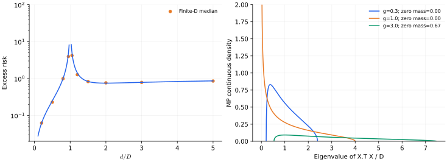

> **I · 泛化与高维模型 · Note 02**
>
> ← [Note 01](/notes/neural_network_theory/linear_regression/) · [系列目录](/notes/neural_network_theory/) · [Note 03](/notes/neural_network_theory/random_features/) →

**可解性层次：** Gaussian 模型精确期望与高维渐近。

## 1. 先固定任务，再讨论参数数量

当模型刚好能插值训练数据时，测试风险有时出现尖峰；继续增大模型，风险又下降。这个现象不能只用“参数多更复杂”描述，因为插值附近最重要的是数据矩阵的小奇异值。

本篇先研究一个干净的模型族：每个维数 $d$ 下，输入都是标准 Gaussian，教师信号范数固定。这样能精确计算两侧风险。它不是“在同一个无限维任务上依次增加前 $d$ 个坐标”的完整嵌套模型；后者还要计入遗漏信号，才会自然出现最左侧的经典下降段。

## 2. Gaussian 设计与风险的条件分解

设 $X_{\mu i}\sim\mathcal N(0,1)$ 独立，$y=Xw_*+\varepsilon$，$\|w_*\|^2=r^2$，噪声方差 $\sigma^2$。测试输入 $x\sim\mathcal N(0,I_d)$，所以超额风险等于参数误差平方。

最小范数估计为 $\hat w=X^+y$。令 $P=X^+X$，则

$$
\hat w-w_*=-(I-P)w_*+X^+\varepsilon,
$$

$$
\mathbb E_\varepsilon[R_{\rm ex}\mid X]
=\|(I-P)w_*\|^2+\sigma^2\operatorname{Tr}[(X^+)(X^+)^\top].
$$

第一项是教师在不可观测空间中的投影；第二项是反演小奇异值时放大的噪声。两者都由几何决定。

## 3. 欠参数侧：逆 Wishart 给出发散

当 $D\gt d$ 且矩阵满列秩时，$P=I_d$，普通最小二乘没有条件偏差。

$$
\hat w=w_*+(X^\top X)^{-1}X^\top\varepsilon.
$$

若 $D\gt d+1$，逆 Wishart 的一阶矩为

$$
\mathbb E[(X^\top X)^{-1}]=\frac{I_d}{D-d-1},
$$

因而得到有限维的精确期望

$$
\boxed{\mathbb E R_{\rm ex}=\sigma^2\frac{d}{D-d-1}.}
$$

注意这里没有遗漏变量偏差，所以这一侧风险随 $d$ 增加而上升。将它直接画成一条先下降再上升的曲线，会掩盖任务设定发生了变化。

### 逆 Wishart 一阶矩可以直接推导

令 $W=X^\top X$。对 $D\geq d$ 的标准 Gaussian 设计，正定矩阵上的 Wishart 密度为

$$
p(W)\propto |W|^{(D-d-1)/2}e^{-\operatorname{Tr}W/2}.
$$

记 $a=(D-d-1)/2$。对一个对角矩阵元作积分分部，边界项在相应可积条件下消失，因而

$$
0=\int\frac{\partial p(W)}{\partial W_{ii}}dW
=a\,\mathbb E[(W^{-1})_{ii}]-\frac12.
$$

旋转不变性使 $\mathbb E W^{-1}$ 必为单位阵的倍数，于是得到 $\mathbb E W^{-1}=I/(D-d-1)$。分母中额外的 $-1$ 是有限样本效应；只从“自由度约为 $D-d$”的计数无法恢复它。

同时，这个积分并不是在 $D\gt d$ 时总收敛。矩阵可以几乎奇异，小概率事件对应极大的逆矩阵元；$D\leq d+1$ 时，逆的一阶矩不再有限。一次计算通常得到有限参数，不意味着跨设计矩阵的平均误差有限。插值附近需要明确报告均值、中位数或某个分位数，而不是将它们当作同一个极限。

更直接的几何图像来自最小奇异值。对标签噪声的一维投影 $\varepsilon_i$，反演产生的参数噪声为 $\varepsilon_i/\sqrt{Ds_i}$。当一个训练方向几乎由其他方向线性组合得到时，数据几乎无法区分沿该方向的大幅参数变化，却仍要求精确拟合标签；巨大的参数系数就是这个不适定反演的代价。

## 4. 过参数侧：未恢复信号与噪声竞争

当 $d\gt D$，

$$
\hat w=X^\top(XX^\top)^{-1}y.
$$

Gaussian 行空间在 $d$ 维中均匀取向，故 $\mathbb E P=(D/d)I_d$。对固定教师，平均不可恢复信号为 $r^2(1-D/d)$。若 $d\gt D+1$，噪声部分由另一侧的逆 Wishart 得到

$$
\boxed{\mathbb E R_{\rm ex}
=r^2\left(1-\frac Dd\right)+\sigma^2\frac{D}{d-D-1}.}
$$

增大 $d$ 降低噪声放大，却增加未恢复教师分量。过参数侧并不保证始终下降，也不保证最终优于所有小模型。取 $\gamma=d/D$ 固定并令规模趋于无穷，

$$
R_{\rm ex}\longrightarrow
\begin{cases}
\sigma^2\gamma/(1-\gamma),&\gamma\lt 1,\\
r^2(1-\gamma^{-1})+\sigma^2/(\gamma-1),&\gamma\gt 1.
\end{cases}
$$

总测试 MSE 还要加不可约噪声 $\sigma^2$。在 $\gamma=1$ 附近，某次有限矩阵的风险通常有限，但它的重尾可能使期望发散。有限次重复的中位数、均值与理论期望不是同一个量。

### 为什么“最小范数”仍然留下偏差

把教师写成 $w_*=Pw_*+(I-P)w_*$。前一部分可由训练行空间观察，后一部分对所有训练输入都没有输出。最小范数规则将后一部分设为零，不是因为知道它在真实教师里不存在，而是因为训练数据没有提供关于它的信息。

对 Gaussian 设计，行空间是均匀随机的 $D$ 维子空间。由投影矩阵 $P^2=P$、$\operatorname{Tr}P=D$ 和旋转不变性，$\mathbb EP=(D/d)I$。因此

$$
\mathbb E\|(I-P)w_*\|^2
=w_*^\top(I-\mathbb EP)w_*
=r^2(1-D/d).
$$

这一步没有把教师随机化，只平均了随机训练子空间。若教师与设计矩阵存在共同生成的结构，或者某些输入方向方差特别大，均匀投影的结论就会改变。良好的过参数泛化常常与“信号集中在可恢复方向、剩余方向主要吸收噪声”有关，而不是仅由零空间维数决定。

高维过参数风险对 $\gamma$ 的导数为

$$
\frac{dR_{\rm ex}}{d\gamma}
=\frac{r^2}{\gamma^2}-\frac{\sigma^2}{(\gamma-1)^2}.
$$

若 $r\leq\sigma$，这一侧单调下降；若 $r\gt \sigma$，内部极小点为 $\gamma_*=r/(r-\sigma)$，之后风险又向 $r^2$ 上升。极端增大模型会恢复到接近“什么都没有学到”的风险基线。这说明即使存在第二次下降，最优点也未必在无限参数处。

## 5. Marchenko–Pastur 谱怎样讲同一个故事

令 $H=X^\top X/D$，按 $d$ 个特征值归一化的极限谱为

$$
\rho_\gamma(s)=\left(1-\gamma^{-1}\right)_+\delta_0(s)
+\frac{\sqrt{(s_+-s)(s-s_-)}}{2\pi\gamma s}
\mathbf1_{[s_-,s_+]}(s),
\quad s_\pm=(1\pm\sqrt\gamma)^2.
$$

当 $\gamma\to1$，连续谱下边缘碰到零，逆谱矩变大。过参数侧的零特征值不参与噪声反演，却留下偏差；真正被反演的是非零谱，不能把 $\delta_0/s$ 写成一个普通积分。

ridge 通过滤波 $s/(s+\lambda)$ 避免直接反演小 $s$。若教师方向相对 $X$ 各向同性，风险可写成

$$
\mathbb E R_{\rm ex}\simeq
r^2\int\frac{\lambda^2}{(s+\lambda)^2}\rho_\gamma(s)\,ds
+\sigma^2\gamma\int\frac{s}{(s+\lambda)^2}\rho_\gamma(s)\,ds.
$$

这里 $\lambda\gt 0$，积分连零原子一起定义。记 resolvent $m(\lambda)=\int(s+\lambda)^{-1}\rho_\gamma(s)ds$，两项分别涉及 $-\lambda^2m'(\lambda)$ 与 $m(\lambda)+\lambda m'(\lambda)$。因此“风险取决于谱”可以转化为求 resolvent 及其导数的技术问题。

### Resolvent 的分支与插值奇点

这里将 resolvent 定义在正实正则化参数上：$m(\lambda)=d^{-1}\operatorname{Tr}(H+\lambda I)^{-1}$。MP 极限满足二次方程

$$
\gamma\lambda m^2+(\lambda+1-\gamma)m-1=0.
$$

取 $m\gt 0$ 且 $m\sim1/\lambda$ 的分支，得到

$$
m(\lambda)=\frac{-(\lambda+1-\gamma)
+\sqrt{(\lambda+1-\gamma)^2+4\gamma\lambda}}
{2\gamma\lambda}.
$$

平方根的选取是物理条件的一部分，另一根不能表示正定矩阵的逆迹。对 $\gamma\lt 1$，$m(0)=1/(1-\gamma)$；对 $\gamma\gt 1$，$m(\lambda)\sim(1-1/\gamma)/\lambda$，发散系数恰好是零谱原子的质量。$\gamma=1$ 则有 $m(\lambda)\sim\lambda^{-1/2}$，对应连续谱直接接触原点。

把 $m$ 代回 ridge 风险，可以在一个表达式中同时保留偏差、噪声与零空间。先令 $\lambda\to0$ 再靠近 $\gamma=1$，和固定 $\lambda\gt 0$ 穿越插值阈值，得到不同的曲线。正则化不是事后修饰尖峰，而是改变了对整个小谱端的探测分辨率。

### 同一个嵌套任务怎样产生完整双下降

前面固定信号范数的模型族，在欠参数侧只有方差上升。若要研究同一个任务随可用特征增多的变化，可以取一组无限正交 Gaussian 坐标，教师为 $y=\sum_{j\geq1}\theta_jx_j+\varepsilon$，学生只用前 $d$ 个坐标。记尾部能量 $T_d=\sum_{j\gt d}\theta_j^2$。

未使用坐标与已使用坐标独立，所以对该学生而言，训练有效噪声方差是 $v_d=\sigma^2+T_d$。当 $D\gt d+1$ 时，相对完整教师的超额预测风险为

$$
\boxed{R_d=T_d+(\sigma^2+T_d)\frac{d}{D-d-1}.}
$$

第一个项随模型增大下降，第二项在插值附近上升。这里经典的左侧下降段来自遗漏信号减少，插值尖峰来自同时拟合不可预测的有效噪声，两者有不同来源。

当 $d\gt D+1$ 时，同一任务的风险变成

$$
R_d=T_d+\left(1-\frac Dd\right)\sum_{j\leq d}\theta_j^2
+(\sigma^2+T_d)\frac{D}{d-D-1}.
$$

现在信号尾部、已表示信号的不可恢复投影和噪声放大同时竞争。这一式子解释为什么增加模型、增加独立数据、减少噪声不能简单地视为同一个控制方向。它也说明双下降曲线的具体形状需要指定教师系数序列，而不是由“过参数化”四个字自动给出。

### 泛化良好与风险下降的区别

一个风险从很大的插值尖峰降到一个仍然很大的平台，也属于第二次下降，但不能据此称为良好泛化。接近噪声底、低于零预测器、接近 Bayes 风险，是更强且不同的要求。各向同性模型中，未恢复信号比例通常不会因为无限加宽自行消失；具有结构的协方差谱才可能改变这个结论。随机矩阵理论真正提供的是可计算的比较标准，而不是“越大越好”的普遍口号。

## 6. 数值图：把发散与有限样本分开看

*图 1 · 自制 Gaussian 回归实验。* 左图为 $r^2=1,\sigma^2=0.25$ 的高维公式，并叠加脚本中 $D=80$、每个维数 24 次独立设计的风险中位数。误差直接用 $\|\hat w-w_*\|^2$ 测量，不引入有限测试集误差。右图为三个 $\gamma$ 的 MP 连续密度；零原子单独在图例标注，未画成无限高竖线。

复现命令为 `python experiments.py --note 2`。无噪声时，插值尖峰消失，而过参数偏差仍然存在。ridge 改变的是估计器及其整个谱滤波，不能等同于将原风险曲线的尖峰截平。

一个清楚的算例是 $D=100,d=200$：偏差为 $0.5r^2$，噪声为 $100\sigma^2/99$。若 $d=1000$，噪声降至 $100\sigma^2/899$，偏差却增到 $0.9r^2$。这说明“更多参数有益”需要说明信噪比和比较区间。

## 7. 什么能推广，什么还需要证明

小奇异值噪声放大是可推广的机制；Gaussian 逆 Wishart 公式不是任意相关、重尾输入的通式。特征学习也会改变谱与教师对齐，不能把训练后的非线性网络直接替换成独立 Gaussian 矩阵。

**相关文献。** [Hastie、Montanari、Rosset 与 Tibshirani，Surprises in High-Dimensional Ridgeless Least Squares Interpolation](https://arxiv.org/abs/1903.08560)给出更一般的高维风险结果；[Mei 与 Montanari，随机特征回归的精确渐近](https://arxiv.org/abs/1908.05355)研究非线性固定特征。这里的线性推导不冒充后者的全部理论。

---

← [Note 01](/notes/neural_network_theory/linear_regression/) · [系列目录](/notes/neural_network_theory/) · [Note 03](/notes/neural_network_theory/random_features/) →
