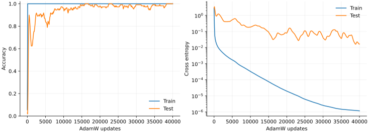

> **IV · 记忆与集体动力学 · Note 13**
>
> ← [Note 12](/notes/neural_network_theory/hierarchical_learning/) · [系列目录](/notes/neural_network_theory/) · [Note 14](/notes/neural_network_theory/sgd/) →

**可解性层次：** 线性机制精确；非线性实验与有效解释。

## 1. 先定义延迟泛化，再寻找机制

Grokking 通常指训练表现已经很好，独立测试表现却长期滞后，随后明显改善。原始小算法任务给出了引人注意的曲线，但曲线形状本身不唯一指定机制：固定特征慢模态、准确率阈值、正则化下的解竞争，以及新表示形成，都可能产生不同程度的延迟。

本篇把一个精确线性机制与一个实际模加法训练实验分开。前者让时间尺度可以算清，后者展示真实参数优化，并保留没有成功泛化的对照。二者不能互相充当完整证明。

## 2. 固定谱也能产生很长的延迟

构造经验训练二次型 $H=\operatorname{diag}(1,10^{-3})$，零噪声梯度流从参数误差 $e(0)=(1,1)$ 开始。由 Note 01，

$$
e_1(t)=e^{-t},\qquad e_2(t)=e^{-10^{-3}t}.
$$

训练损失为

$$
\mathcal L_{\rm train}(t)=\frac12[e^{-2t}+10^{-3}e^{-0.002t}].
$$

若测试输入的二阶矩取 $\Sigma=\operatorname{diag}(1,10^4)$，测试半均方风险为

$$
\mathcal L_{\rm test}(t)=\frac12[e^{-2t}+10^4e^{-0.002t}].
$$

几步以后训练损失已很小，测试却还由慢方向支配。这个特意选择的例子含有很强的经验训练度量与测试度量差异，展示一个数学上完全可解的机制；它没有证明典型同分布数据会产生同样巨大的延迟。

在这里，隐藏表示从头到尾没有变化。只看训练与测试曲线，不能声称网络发生了“从记忆到理解”的结构突变。

## 3. 准确率可以把连续松弛显示成骤变

若 Gaussian 测试输入使预测误差标准差为 $q(t)$，定义容差准确率 $A_\delta=\mathbb P(|f-y|\lt \delta)$，则

$$
\boxed{A_\delta(t)=\operatorname{erf}\left(
\frac\delta{\sqrt2 q(t)}\right).}
$$

本例 $q(t)^2=e^{-2t}+10^4e^{-0.002t}$。慢阶段 $q\simeq100e^{-0.001t}$，准确率达到一半的时间近似为

$$
t_{1/2}\simeq\frac1{0.001}
\log\frac{100\,\Phi^{-1}(0.75)}\delta.
$$

取 $\delta=0.5$，得到约 4905。改变容差会平移准确率曲线，而连续风险的微观动力学没有任何相变。因此应同时画交叉熵或 MSE、准确率以及相关参数或表示量。

*图 1 · 自制精确机制模型。* 左图为第 2 节两个二次型的风险；右图使用全部测试误差方差计算 $\delta=0.5$ 的容差准确率。它是带明确测试加权差异的回归例子，右图不是模加法分类准确率。运行 `python experiments.py --note 13` 可复现。

## 4. 实际实验：模加法二层网络

任务为 $(a,b)\mapsto(a+b)\bmod19$，共有 $19^2=361$ 个输入。输入由两个 one-hot 向量拼接，固定随机划分 252 个训练样本、109 个测试样本。网络为

$$
h=xW,\qquad \ell=h^{\odot2}V,
\quad W\in\mathbb R^{38\times128},
\quad V\in\mathbb R^{128\times19}.
$$

$\ell$ 为分类 logits，使用平均交叉熵、全批量 AdamW，学习率 0.003、解耦权重衰减 1、随机种子 7，共 40000 次更新。脚本显式实现 softmax 梯度、Adam 偏差修正和衰减，每 100 步同时评价固定训练与测试划分。

这是平方激活的简化 MLP，不是原始论文的 Transformer 复刻。解耦 AdamW 衰减也不应在推导时直接等同于普通欧氏梯度流上的 L2 惩罚。

*图 2 · 本仓库实际运行结果，自制。* 训练准确率在第 100 步首次达到 99%，测试在第 14600 步首次达到 99%，在本次记录中从第 38200 步起持续不低于 99%；第 40000 步两者都为 100%。最终训练与测试交叉熵约为 $1.18\times10^{-6}$ 与 0.0166。这里测试表现逐步改善并有波动，展示明显时间分离，没有把它描述为理想的单步跃迁。记录频率为 100 步，所有阈值时间都受此离散采样限制。

在[目录的复现区](/notes/neural_network_theory/#reproduce)下载脚本，直接运行 `python modular_grokking.py`。输出包括完整 CSV、配置 JSON、划分和权重 NPZ。没有在测试集上运行梯度更新；本篇展示的设置是在下表几个探索设置中选出的实验配置，因此其性能不能作为无调参的统计估计。

## 5. 失败对照也是机制信息

保持 $p=19$、宽度 128、学习率和种子不变，改变训练占比、激活或衰减，实测结果为：

| 激活 | 训练占比 | 衰减 | 更新数 | 最终训练准确率 | 最终测试准确率 |
| --- | --- | --- | --- | --- | --- |
| 平方 | 0.4 | 0.1 | 30000 | 100% | 0% |
| ReLU | 0.5 | 1 | 60000 | 100% | 24.9% |
| 平方 | 0.6 | 1 | 60000 | 100% | 94.5% |
| 平方 | 0.6 | 3 | 40000 | 约 4.2% | 约 6.9% |
| 平方 | 0.7 | 1 | 40000 | 100% | 100% |

过强衰减的设置最终坍缩到接近零权重，均匀 logits 的交叉熵接近 $\log19$。因此“正则化越强越会 Grok”不是这里的规律。0.4 设置中测试准确率甚至低于随机猜测，说明记忆解的外推可以具有系统性错误。

这些只是单种子探索，不能估计各设置成功概率。后续应固定候选协议，对多个划分与初始化重复，并用单独验证集选择超参数，报告延迟时间分布及未泛化的删失样本。

## 6. 如何判断出现了结构化表示

模加法具有 Fourier 结构。对 $k\in\{0,\ldots,p-1\}$，复特征 $\chi_k(a)=e^{2\pi ika/p}$ 满足

$$
\chi_k(a+b)=\chi_k(a)\chi_k(b),
\qquad
\mathbf1_{c=a+b}=\frac1p\sum_k e^{2\pi ik(a+b-c)/p}.
$$

这给出可泛化解的一种表示，但不是训练必定找到它的证明。脚本记录第一层权重在输入索引上的离散 Fourier 功率集中度，作为初步诊断；本次最终单频功率占比约 0.129，本身不足以证明形成了特定稀疏 Fourier 电路。

更有力的证据包括：训练中周期基对齐是否增长；删去某频率是否因果破坏对应行为；模型是否对 $(a,b)\mapsto(a+s,b-s)$ 保持输出不变；训练数据外的全输入 logits 是否近似只依赖 $a+b$。应将这些结构量的形成时间与风险变化放在同一横轴比较。

## 7. 机制边界与相关文献

固定谱机制解释慢松弛和阈值非线性；模加法实验表明有限网络能在训练拟合之后继续改善测试。它们还没有单独证明本次网络的延迟由哪一种表示竞争造成，若要做因果结论还需上述干预。

**原始文献。** [Power 等，Grokking: Generalization Beyond Overfitting on Small Algorithmic Datasets](https://arxiv.org/abs/2201.02177)给出现象；[Levi、Beck 与 Bar-Sinai，Grokking in Linear Estimators](https://arxiv.org/abs/2310.16441)提供线性可解机制；[Liu 等，Towards Understanding Grokking](https://arxiv.org/abs/2205.10343)研究表示学习的有效理论。这三条线索分别对应现象、固定特征解释与表示机制，不被合并成一个已证明的普适理论。

---

← [Note 12](/notes/neural_network_theory/hierarchical_learning/) · [系列目录](/notes/neural_network_theory/) · [Note 14](/notes/neural_network_theory/sgd/) →
