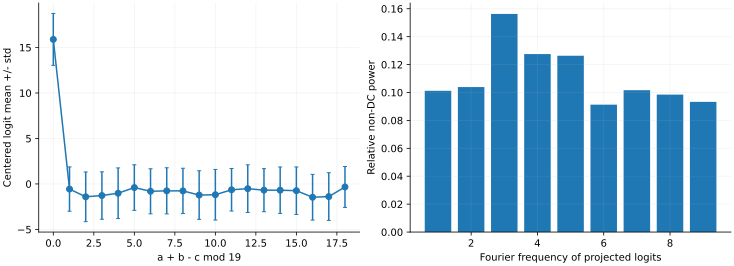

> **IV · 记忆与集体动力学 · Note 08**
>
> ← [Note 07](/notes/neural_network_theory/hierarchical_learning/) · [系列目录](/notes/neural_network_theory/) · [Note 09](/notes/neural_network_theory/sgd/) →

**可解性层次：** 线性机制精确；非线性实验与有效解释。

## 前言：延迟泛化为何不止一个故事

Grokking 的吸引力来自时间上的不协调：网络似乎早已记住训练集，却过了很久才在新样本上表现良好。这很容易被叙述成一次突然理解规则的事件。但时间曲线本身只告诉我们训练与测试观测不同步，并没有唯一指定内部机制。

至少有三种需要分开的情形。固定特征中的慢模态可以很晚才被恢复；连续变化的预测经过准确率阈值以后，可以显示成骤变；非线性网络也确实可能逐渐形成更适合任务的表示。这些机制可以单独出现，也可能同时发生。若不先建立简单参照，任何延迟都会被归入一个过于宽泛的“涌现”。

本篇因此先保留完全可解的线性例子，再进入实际模加法网络。前者明确说明指定训练与测试度量后，延迟如何发生；后者记录真实优化、参数衰减和函数结构，避免用玩具模型冒充实验复现。失败设置也保留，因为它们约束了哪些解释有可能成立。

我更关心的不是寻找所有 grokking 共享的单一原因，而是建立一个能够区分机制的观测顺序：先定义延迟，再比较连续风险与准确率，再测表示结构，最后用干预或控制判断结构与泛化是否存在因果联系。

## 1. 先定义延迟泛化，再寻找机制

Grokking 通常指训练表现已经很好，独立测试表现却长期滞后，随后明显改善。原始小算法任务给出了引人注意的曲线，但曲线形状本身不唯一指定机制：固定特征慢模态、准确率阈值、正则化下的解竞争，以及新表示形成，都可能产生不同程度的延迟。

本篇把一个精确线性机制与一个实际模加法训练实验分开。前者让时间尺度可以算清，后者展示真实参数优化，并保留没有成功泛化的对照。二者不能互相充当完整证明。

## 2. 固定谱也能产生很长的延迟

构造经验训练二次型 $H=\operatorname{diag}(1,10^{-3})$，零噪声梯度流从参数误差 $e(0)=(1,1)$ 开始。由 Note 01，

$$
e_1(t)=e^{-t},\qquad e_2(t)=e^{-10^{-3}t}.
$$

训练损失为

$$
\mathcal L_{\rm train}(t)=\frac12[e^{-2t}+10^{-3}e^{-0.002t}].
$$

若测试输入的二阶矩取 $\Sigma=\operatorname{diag}(1,10^4)$，测试半均方风险为

$$
\mathcal L_{\rm test}(t)=\frac12[e^{-2t}+10^4e^{-0.002t}].
$$

几步以后训练损失已很小，测试却还由慢方向支配。这个特意选择的例子含有很强的经验训练度量与测试度量差异，展示一个数学上完全可解的机制；它没有证明典型同分布数据会产生同样巨大的延迟。

在这里，隐藏表示从头到尾没有变化。只看训练与测试曲线，不能声称网络发生了“从记忆到理解”的结构突变。

## 3. 准确率可以把连续松弛显示成骤变

若 Gaussian 测试输入使预测误差标准差为 $q(t)$，定义容差准确率 $A_\delta=\mathbb P(|f-y|\lt \delta)$，则

$$
\boxed{A_\delta(t)=\operatorname{erf}\left(
\frac\delta{\sqrt2 q(t)}\right).}
$$

本例 $q(t)^2=e^{-2t}+10^4e^{-0.002t}$。慢阶段 $q\simeq100e^{-0.001t}$，准确率达到一半的时间近似为

$$
t_{1/2}\simeq\frac1{0.001}
\log\frac{100\,\Phi^{-1}(0.75)}\delta.
$$

取 $\delta=0.5$，得到约 4905。改变容差会平移准确率曲线，而连续风险的微观动力学没有任何相变。因此应同时画交叉熵或 MSE、准确率以及相关参数或表示量。

*图 1 · 自制精确机制模型。* 左图为第 2 节两个二次型的风险；右图使用全部测试误差方差计算 $\delta=0.5$ 的容差准确率。它是带明确测试加权差异的回归例子，右图不是模加法分类准确率。

### 延迟时间依赖评分规则，而不只是参数动力学

在慢模态阶段，达到任意容差准确率 $a\in(0,1)$ 的时间近似为

$$
t_a\simeq\lambda_s^{-1}
\log\left[\frac{q_0\Phi^{-1}((1+a)/2)}\delta\right].
$$

因此缩小容差 $\delta$、增大初始误差 $q_0$，都会按对数延长表观延迟；慢松弛率 $\lambda_s$ 则整体放大这些变化。即使所有参数轨迹连续且解析，准确率曲线也可能在很晚的有限时间窗内显著上升。

分类评分还需要另一层区分：将所有 logits 乘以正数不改变 argmax 准确率，却能显著改变交叉熵。因此训练准确率饱和后的交叉熵下降，既可能来自方向或表示变化，也可能主要来自已有正确 margin 的尺度增长。反过来，少量测试点的 margin 穿过零，能造成准确率台阶，而平均连续损失变化仍很平滑。两类评分必须放在一起观察。

### 一个可以求解的“泛化分量–记忆分量”竞争模型

再引入一个与前面两模态松弛不同的有效模型。假设已提供一个能在训练和测试中都正确输出教师标签的特征，系数为 $g$；另有只在训练点起作用的记忆特征，沿对称子空间的总输出为 $m y$。训练预测是 $(g+m)y$，测试预测只有 $gy$。

把两组特征的有效范数成本写成 $c_g g^2$ 和 $c_m m^2$，得到

$$
F(g,m)=\frac12(g+m-1)^2
+\frac\lambda2(c_g g^2+c_m m^2).
$$

迁移率为 $\gamma_g,\gamma_m$ 的流满足

$$
\dot g=-\gamma_g[g+m-1+\lambda c_g g],
\qquad
\dot m=-\gamma_m[g+m-1+\lambda c_m m].
$$

这是凸二次系统。若 $\gamma_m\gg\gamma_g$，记忆分量先迅速变化，训练误差很快变小，泛化分量尚未明显增长。在快变量准静态近似中，$m\simeq(1-g)/(1+\lambda c_m)$，代入慢方程得到

$$
\dot g\simeq\gamma_g\lambda
\left[\frac{c_m}{1+\lambda c_m}
-\left(c_g+\frac{c_m}{1+\lambda c_m}\right)g\right].
$$

所以慢时间尺度及长期泛化分量为

$$
\tau_g^{-1}\simeq\gamma_g\lambda
\left(c_g+\frac{c_m}{1+\lambda c_m}\right),
\qquad
g_\infty=\frac{c_m}{c_g+c_m+\lambda c_gc_m}.
$$

当 $c_m\gg c_g$、$\lambda c_g$ 又不太大，长期更偏好低成本的泛化分量；但正则化过强会使 $g_\infty$ 也受到压制。于是先拟合、再逐渐减少记忆分量并增加泛化分量，可以在一个固定特征、没有新电路诞生的模型中出现。

这里的泛化特征已由模型提供，并未解释神经网络如何发现它。$\gamma_g,c_g,c_m$ 也是显式给定的有效参数。这个模型适合分离“发现特征”与“在已有特征中选择”的时间成本，不应被当作原始模加法网络的微观推导。下面实际训练使用 AdamW，参数迁移率与解耦衰减也不等同于这套欧氏梯度流。

## 4. 实际实验：模加法二层网络

任务为 $(a,b)\mapsto(a+b)\bmod19$，共有 $19^2=361$ 个输入。输入由两个 one-hot 向量拼接，固定随机划分 252 个训练样本、109 个测试样本。网络为

$$
h=xW,\qquad \ell=h^{\odot2}V,
\quad W\in\mathbb R^{38\times128},
\quad V\in\mathbb R^{128\times19}.
$$

$\ell$ 为分类 logits，使用平均交叉熵、全批量 AdamW，学习率 0.003、解耦权重衰减 1、随机种子 7，共 40000 次更新。每 100 步同时评价固定训练与测试划分。

这是平方激活的简化 MLP，不是原始论文的 Transformer 复刻。解耦 AdamW 衰减也不应在推导时直接等同于普通欧氏梯度流上的 L2 惩罚。

*图 2 · 本次数值实验结果。* 训练准确率在第 100 步首次达到 99%，测试在第 14600 步首次达到 99%，在本次记录中从第 38200 步起持续不低于 99%；第 40000 步两者都为 100%。最终训练与测试交叉熵约为 $1.18\times10^{-6}$ 与 0.0166。这里测试表现逐步改善并有波动，展示明显时间分离，没有把它描述为理想的单步跃迁。记录频率为 100 步，所有阈值时间都受此离散采样限制。

没有在测试集上运行梯度更新；本篇展示的设置是在下表几个探索设置中选出的实验配置，因此其性能不能作为无调参的统计估计。

## 5. 失败对照也是机制信息

保持 $p=19$、宽度 128、学习率和种子不变，改变训练占比、激活或衰减，实测结果为：

| 激活 | 训练占比 | 衰减 | 更新数 | 最终训练准确率 | 最终测试准确率 |
| --- | --- | --- | --- | --- | --- |
| 平方 | 0.4 | 0.1 | 30000 | 100% | 0% |
| ReLU | 0.5 | 1 | 60000 | 100% | 24.9% |
| 平方 | 0.6 | 1 | 60000 | 100% | 94.5% |
| 平方 | 0.6 | 3 | 40000 | 约 4.2% | 约 6.9% |
| 平方 | 0.7 | 1 | 40000 | 100% | 100% |

过强衰减的设置最终坍缩到接近零权重，均匀 logits 的交叉熵接近 $\log19$。因此“正则化越强越会 Grok”不是这里的规律。0.4 设置中测试准确率甚至低于随机猜测，说明记忆解的外推可以具有系统性错误。

这些只是单种子探索，不能估计各设置成功概率。后续应固定候选协议，对多个划分与初始化重复，并用单独验证集选择超参数，报告延迟时间分布及未泛化的删失样本。

## 6. 如何判断出现了结构化表示

模加法具有 Fourier 结构。对 $k\in\{0,\ldots,p-1\}$，复特征 $\chi_k(a)=e^{2\pi ika/p}$ 满足

$$
\chi_k(a+b)=\chi_k(a)\chi_k(b),
\qquad
\mathbf1_{c=a+b}=\frac1p\sum_k e^{2\pi ik(a+b-c)/p}.
$$

这给出可泛化解的一种表示，但不是训练必定找到它的证明。以第一层权重在输入索引上的离散 Fourier 功率集中度作为初步诊断；本次最终单频功率占比约 0.129，本身不足以证明形成了特定稀疏 Fourier 电路。

更有力的证据包括：训练中周期基对齐是否增长；删去某频率是否因果破坏对应行为；模型是否对 $(a,b)\mapsto(a+s,b-s)$ 保持输出不变；训练数据外的全输入 logits 是否近似只依赖 $a+b$。应将这些结构量的形成时间与风险变化放在同一横轴比较。

### 平方网络为什么具有实现 Fourier 规则的能力

令 $\theta_k(a)=2\pi ka/p$。由三角恒等式，

$$
\begin{aligned}
\cos[\theta_k(a)+\theta_k(b)-\theta_k(c)]
={}&\cos\theta_k(c)
[\cos\theta_k(a)\cos\theta_k(b)-\sin\theta_k(a)\sin\theta_k(b)]\\
&+\sin\theta_k(c)
[\sin\theta_k(a)\cos\theta_k(b)+\cos\theta_k(a)\sin\theta_k(b)].
\end{aligned}
$$

one-hot 输入的线性层可以表示任意单输入正弦、余弦。每个交叉乘积又可由 $(u+v)^2-(u-v)^2=4uv$ 实现，因此平方隐藏层和线性读出足以构造这些周期 logits。一个频率需要四个交叉乘积，直接构造至多使用八个平方单元。

对素数模数 $p=19$，取任意非零频率 $k$，$\cos[2\pi k(a+b-c)/p]$ 在正确类 $c=a+b\bmod p$ 唯一达到 1。因此单个完整的非零 Fourier 频率对就足以给出正确 argmax；若要求输出恰好为 Kronecker 标签指示函数，则通常需要完整 Fourier 求和。这区分了“准确分类”和“精确重建 one-hot 数值”两种表示要求。

上述构造证明该架构存在紧凑的算法解，但不证明优化必然偏好它，也不证明当前训练权重就是这种稀疏构造。表达能力、范数成本和可达动力学仍是三个不同问题。

### 对实际权重做函数空间的对称投影

第一层 Fourier 功率只检查参数的一部分，还可能受到隐藏层基底变换影响。一个更直接的函数诊断，是检查所有 logits 是否仅依赖 $d=a+b-c\bmod p$。

先对每个 $(a,b)$ 的 logits 减去其在类别上的均值，得到 $F(a,b,c)$，消除不影响 softmax 的共同平移。对所有具有同一 $d$ 的三元组取平均，定义

$$
\bar F(d)=\mathbb E[F(a,b,c)\mid a+b-c=d],
\qquad (\Pi F)(a,b,c)=\bar F(a+b-c).
$$

在均匀全输入网格的平方内积下，条件平均是一个正交投影。因此 $\|F\|^2=\|\Pi F\|^2+\|F-\Pi F\|^2$，可以用 $\|\Pi F\|^2/\|F\|^2$ 衡量与模加法对称结构一致的 logit 能量比例。

对已保存的第 40000 步权重重新计算，这个比例约为 **0.682**，相对投影残差约为 **0.564**。这说明模型虽在全部 361 个输入上分类正确，logits 中仍有显著的非对称成分。完全正确的分类，不要求所有实值输出都精确满足同一个平移不变结构。

该诊断使用整个有限输入网格，仅用于训练后的结构分析。它没有参与梯度更新，也不能单独证明对称部分在优化中先出现，或者是准确率改善的因果来源。要判断形成顺序，需要保存中间权重；要判断必要性，则需要投影、消融或替换后的受控比较。

*补充图 · 已保存权重的函数结构分析。* 左图按 $a+b-c\bmod19$ 分组，显示中心化 logits 的均值和组内标准差；误差棒表示同一偏移下不同三元组之间的离散程度，不是跨种子置信区间。右图是对称投影曲线的非零 Fourier 功率分布。投影保留约 68.2% 的总中心化 logit 能量，余下部分在分类全部正确时仍然存在。

## 7. 机制边界与相关文献

固定谱机制解释慢松弛和阈值非线性；模加法实验表明有限网络能在训练拟合之后继续改善测试。它们还没有单独证明本次网络的延迟由哪一种表示竞争造成，若要做因果结论还需上述干预。

**原始文献。** [Power 等，Grokking: Generalization Beyond Overfitting on Small Algorithmic Datasets](https://arxiv.org/abs/2201.02177)给出现象；[Levi、Beck 与 Bar-Sinai，Grokking in Linear Estimators](https://arxiv.org/abs/2310.16441)提供线性可解机制；[Liu 等，Towards Understanding Grokking](https://arxiv.org/abs/2205.10343)研究表示学习的有效理论。这三条线索分别对应现象、固定特征解释与表示机制，不被合并成一个已证明的普适理论。

## 延伸讨论：阈值、结构与受控机制比较

### 延迟泛化需要先选定两个时间

可以定义首次达到训练阈值的时间 $t_{\rm fit}$，以及测试指标稳定达到目标水平的时间 $t_{\rm gen}$。差值 $\Delta t=t_{\rm gen}-t_{\rm fit}$ 取决于阈值、记录频率与是否要求持续保持。若测试准确率在阈值附近来回波动，首次越过与稳定越过可能相差很大。

因此一条曲线标出的“grok 时间”不是唯一自然常数。本文同时记录首次达到与后续持续达到的时间。这样才能区分真正长时间的泛化改善与少数评估点偶然越线，也能让不同阈值下的结论可重算。

对极小测试集，单个样本翻转就会产生明显台阶。模数、训练比例与有限组合数因此影响准确率曲线的分辨率。连续交叉熵、错误间隔分布和准确率应该一起看，而不只看一条平滑后的百分比曲线。

### 最简单的延迟已经包含目标对齐

在线性固定谱例子中，训练损失按经验模态加权，测试风险按另一个协方差加权。若测试重视一个经验小特征值方向，这个方向可以对训练损失贡献很小，却在测试中很重要。于是训练很早接近零，测试仍然等待慢方向恢复。

这种机制无需任何表征变化，但它依赖明确的训练与测试度量失配。若改成同分布、无限样本且谱权重相同，原来的巨大延迟可能不再存在。因此线性例子支持的是“固定谱足以在某些设定产生延迟”，不是“模加法 grokking 已被线性谱解释”。

它还指出应测什么：在真实实验中，晚期改善究竟来自已经存在的慢方向，还是来自新的可用特征？初始化切线模型、冻结表示读出和真实网络的并行比较，可以帮助分辨，但每个对照都需要控制训练程度和正则化。

### 准确率阈值怎样放大一个连续变化

对某个测试点，正确类别 logit 与最大错误类别 logit 的差为间隔 $m(x,t)$。准确率为 $\mathbb E\mathbf1_{m\gt 0}$，交叉熵则随全部 logit 平滑变化。若一大批样本的间隔集中在零附近，即使所有间隔连续移动，准确率也可以快速上升。

例如 $m=\mu(t)+\sigma_m z$，$z$ 标准 Gaussian，则准确率为 $\Phi(\mu(t)/\sigma_m)$。当 $\sigma_m$ 很小时，一个相对平缓的 $\mu(t)$ 变化就会映射成陡峭准确率曲线。这是观测函数的非线性，并不要求参数轨迹有真正不连续。

因此若要主张动力学发生分岔，应检查连续序参量、稳定性或多个尺度上的响应，而不是只凭准确率台阶。反过来，准确率快速上升依然有实际意义，只是它与内部动力学奇点不是同一结论。

### 模加法的结构为何适合用 Fourier 分析

任务 $c=a+b\pmod p$ 具有平移群结构。若预测 logit 主要依赖 $a+b-c$，则沿保持这一组合不变的变换，函数应近似不变。将完整输入输出张量投影到这个不变子空间，能够得到一个与隐藏神经元坐标无关的函数级结构指标。

Fourier 基底把群作用对角化。对复相位 $\omega=e^{2\pi i/p}$，$\omega^{k(a+b)}=\omega^{ka}\omega^{kb}$，所以加法可以在乘法组合的频率表示中显露。平方激活又能通过 $(u+v)^2-u^2-v^2=2uv$ 产生交叉项，这解释架构为何能表达相应组合。

然而可表达性不是发现机制。网络可能同时使用多个频率，也可能靠有限样本上的非结构化成分拟合。最终权重中出现 Fourier 峰，只说明某种结构与成功共存；它何时形成、是否在泛化之前、消融以后是否仍成功，都需要额外记录。

### 衰减可能改变竞争，但不能由曲线倒推

一种有效图像是记忆成分和规则成分具有不同表示代价，衰减逐渐压低昂贵记忆，而规则成分保留较多。但要将这幅图像变成具体机制，需要定义两种成分、它们的可比较范数，以及真实优化是否近似服从该分解。

在 AdamW 中，解耦权重衰减与自适应梯度同时作用，不能直接等价于普通梯度流最小化原损失加欧氏 L2。即使最终范数下降，也可能同时包含重缩放、层间补偿和参数对称性。本文的两特征玩具模型只展示一种竞争如何造成延迟，不把其参数直接对应为真实网络的记忆与规则幅度。

要检验衰减作用，可以在相近训练误差处改变衰减或停止衰减，并观察测试风险、结构投影和参数范数怎样共同变化。若只改变一个超参数同时训练到不同拟合程度，则难以区分正则化收益与欠训练。

### 单次成功实验能提供什么证据

保存权重、数据划分与完整评估，使这次运行成为可核查的事实：在指定设置下确实出现了长延迟与最终泛化。它不能给出成功概率，也不能说明该设置在所有种子、宽度或训练比例下都稳定。

保留失败对照的意义，是显示现象对协议的敏感性。某个失败可能只是训练尚不够久，也可能处于不同动力学区域；若没有更长预算或多种子扫描，不能强行决定是哪一种。相应地，一次成功也不能被当作参数无关的普遍规律。

我会把现有证据分成三个层次：完整时间曲线是现象证据，函数对称投影是结构证据，改变结构后预测随之变化才更接近机制证据。当前结果主要覆盖前两层，为进一步实验提供基础，但没有把第三层当作已完成。

## 与相邻模型的对照

延迟与快速转折可以在完全平滑、可解的乘法动力学中出现。下面 [Note 05](/notes/neural_network_theory/deep_optimization/#deep-linear) 的 Logistic 解提供一个与准确率阈值不同的转折来源：

### Logistic 解、平台与快速学习

分离变量：

$$
\int\frac{dp}{p(\sigma-p)}=2t+\mathrm{const},
$$

得到 $0\lt p_0\lt \sigma$ 下的精确解

$$
\boxed{p(t)=\frac\sigma{1+(\sigma/p_0-1)e^{-2\sigma t}}.}
$$

早期 $p\ll\sigma$ 时，$p\simeq p_0e^{2\sigma t}$。它的**相对**增长率并不小，但绝对函数变化仍很小，所以损失看起来近乎不动。到 $p=O(\sigma)$ 时，输出快速改变；接近目标后，误差又指数衰减。

达到一半目标的时间为

$$
t_{1/2}=\frac1{2\sigma}\log\left(\frac\sigma{p_0}-1\right),
$$

适用于 $p_0\lt \sigma/2$。强信号 $\sigma$ 较早学会，小初始化使平台按对数延长。若 $w_1=w_2=0$，梯度严格为零，不会自行离开；“极小但非零”与“恰好为零”不同。

例如 $\sigma=1,p_0=10^{-4}$ 时，$t_{1/2}\simeq4.605$；若把 $p_0$ 再缩小 100 倍，平台仅再延长约 $2.303$。这些数值使用的是当前损失与迁移率归一化。

#### 从损失导数理解平台的可见程度

有效损失的下降率是

$$
\dot{\mathcal L}=-(w_1^2+w_2^2)(\sigma-p)^2,
$$

平衡正分支上为 $-2p(\sigma-p)^2$。当 $p$ 很小，残差仍接近 $\sigma$，但有效迁移率趋零，因此绝对损失下降很慢。这个平台不是“模型已完成一部分样本的记忆”产生的，因为标量模型根本没有可区分的样本记忆方向。

Logistic 曲线还有两个值得区分的时刻：输出增长率 $\dot p=2p(\sigma-p)$ 在 $p=\sigma/2$ 最大；损失下降速率 $-\dot{\mathcal L}=2p(\sigma-p)^2$ 则在 $p=\sigma/3$ 最大。用输出拐点、损失最大斜率或达到某个误差阈值定义“学习时间”，常数会不同。谈分阶段学习时应先固定所采用的时间定义。

若多个对齐模态共享很小的初始乘积，$t_{i,1/2}\simeq[\log(\sigma_i/p_{i0})]/(2\sigma_i)$。强模态较早出现，是因为它既提供较大的驱动力，也有较短的增长时间。目标本身的奇异谱与输入协方差谱在一般数据上并不相同，不能把这个顺序直接命名为低频到高频。

有限时间窗口还会掩盖最终渐近行为。[Note 12 · 时间标度](/notes/neural_network_theory/scaling_laws/#time-scaling) 的截断与极限顺序讨论，有助于判断“长平台”究竟是永久停滞还是尚未到达慢尺度：

### 有限窗口、谱隙与极限顺序

若谱仅在 $[\lambda_{\min},\lambda_{\max}]$ 上近似该幂律，那么幂律通常需要

$$
\lambda_{\max}^{-1}\ll t\ll\lambda_{\min}^{-1}.
$$

太早时，所有模态都未明显变化，损失接近初值；太晚时，谱下边缘或最慢单模态支配。连续密度若在正下边缘附近为 $B(\lambda-\lambda_{\min})^a$，长时间会出现 $e^{-2\lambda_{\min}t}t^{-(a+1)}$，而非无限延续的纯幂律。

任何有限正定矩阵最终都有最慢指数。先取系统规模无穷、再取时间无穷，才可能得到无谱隙幂律；反过来则一般得到最慢模态指数。两个极限不应默默交换。

分类损失趋零以后参数仍可能继续变化。下面 [Note 05](/notes/neural_network_theory/deep_optimization/#implicit-bias) 的可分 logistic 情形提醒我们，训练准确率饱和不代表动力学结束：

### 可分 logistic 分类：最优点在无穷远

标签 $y_\mu\in\{-1,1\}$，模型无单独偏置项，损失

$$
\mathcal L(w)=\sum_\mu\log(1+e^{-y_\mu w^\top x_\mu}).
$$

若存在 $v$ 使所有 $y_\mu v^\top x_\mu\gt 0$，则沿 $w=cv$、$c\to\infty$，损失趋于零。不存在有限 $w$ 达到这个下确界。梯度流为

$$
\dot w=\sum_\mu\frac{y_\mu x_\mu}{1+e^{y_\mu w^\top x_\mu}}.
$$

大间隔点的梯度指数变小，靠近当前分类边界的样本主导长期更新。因此训练分类准确率已经为 100%，参数方向仍可缓慢转动。

### 函数对称投影能保证什么，不能保证什么

在完整均匀模加法域上，考虑变换 $T_{u,v}:(a,b,c)\mapsto(a+u,b+v,c+u+v)$。正确标签关系保持不变。对任意 logit 张量 $F(a,b,c)$，定义群平均

$$
(P_GF)(a,b,c)=\frac1{p^2}\sum_{u,v\in\mathbb Z_p}
F(a+u,b+v,c+u+v).
$$

这个平均只依赖残差 $a+b-c$，并满足 $P_G^2=P_G$。在完整均匀张量的欧氏内积下，变换是正交置换，且群包含逆元，所以 $P_G$ 自伴，从而是到不变子空间的正交投影：

$$
\|F\|^2=\|P_GF\|^2+\|(I-P_G)F\|^2.
$$

因此保存实验中的能量比例具有清楚几何含义，但它不是分类准确率的上界或下界。一个能量很小却恰好改变关键类别间隔的成分，可以翻转许多预测；一个能量很大的类别共同偏置则完全不改变 softmax。

所以计算结构能量前应先说明是否沿类别维中心化。令 $\bar F(a,b)=p^{-1}\sum_cF(a,b,c)$，以 $F-\bar F$ 去掉 softmax 的平移冗余，再计算投影更贴近预测相关结构。若不中心化，指标仍可定义，但其含义包含无关 logit 偏置，不能直接称为“规则占比”。

### 对称化与交叉熵之间有一个条件明确的关系

对固定正确类别，交叉熵 $\ell(z,y)=\log\sum_c e^{z_c}-z_y$ 关于 logit 向量凸。在完整均匀输入域上，任务对上述群作用不变，因此 Jensen 不等式给出

$$
\mathcal R_{\rm full}(P_GF)
\leq\frac1{|G|}\sum_{g\in G}\mathcal R_{\rm full}(gF)
=\mathcal R_{\rm full}(F).
$$

这里 $gF$ 同时变换输入与类别坐标。结论说：若确实知道任务对称性，完整分布上的 logit 群平均不会增加平均交叉熵。它依赖损失凸性与完整分布不变性，不要求原网络本身有对称架构。

但有限训练子集一般不对这个群封闭，因此相同不等式不能直接用于该子集风险。更重要的是，这是一种事后使用已知任务对称性的操作，并不是网络自动发现对称性的证明。它能作为诊断或显式归纳偏置，却不能替代训练机制。

交叉熵的改善也不保证每个样本的准确率改善，甚至不保证平均准确率严格提高，因为准确率是非凸阈值观测。群平均可以降低极端过度自信错误，同时让少量边界样本改变类别。这进一步说明连续风险与分类指标应同时记录。

### 结构消融需要同时控制 logit 尺度

可写 $F=F_{\rm inv}+F_\perp$，再分别评估二者或 $F_{\rm inv}+sF_\perp$。这种干预能显示预测对非不变成分的敏感性，但将某部分直接归零，也会改变 logit 幅度、置信度和类别间隔分布。

若比较交叉熵，应同时报告是否重新校准一个温度；若比较准确率，应检查哪些样本翻转以及原始间隔。未经校准的交叉熵变差，可能部分来自尺度变化；准确率不变，则也不意味着该成分对概率预测完全无用。

此外，正交于群不变子空间的部分并不等于“记忆模块”。它可以包含训练子集特有拟合，也可以包含有限宽误差、坐标偏置或尚未形成完整对称性的有用特征。记忆与规则是功能解释，对称与非对称是函数空间分解；二者可能相关，却不应直接画等号。

### 时间序列诊断比终点图更接近机制

若未来保存中间权重，可以在每个检查点计算中心化后的投影能量、投影模型风险、非不变部分风险与类别间隔。若结构指标在测试准确率上升很久以前已稳定，延迟更可能涉及尺度或读出；若结构投影在同一时间快速增长，则支持表示重组，但仍要排除它只是预测改善的伴随结果。

当前分析主要支持终点结构的判断，因此本文没有据此宣称确定了结构形成时间。把可重算的终点证据与尚未记录的时间因果信息明确分开，是这次实验能留下的可靠边界。

### 从这个案例能带走的实验判断

若测试交叉熵在准确率上升以前已长期下降，延迟的一部分可能来自阈值；若冻结表示重新训练读出已经能泛化，而原读出还不能，瓶颈可能在输出权重；若初始化切线模型在相同数据上始终失败，而真实网络成功，则固定初始特征不足以复现该训练结果，但仍需控制正则化和训练预算。每一种比较都排除一部分解释，而不立即证明唯一机制。

这种逐层排除的方式也能避免两种相反过度解释：既不因为一个线性例子存在，就把所有延迟都归于慢谱；也不因为最终有结构化特征，就认定全部延迟都来自结构突然形成。对一份个人研究记录，写清哪些解释仍然相容，通常比给现象指定一个过于确定的名字更有后续价值。

## 结语：时间分离不唯一指定机制

Grokking 最值得保留的不是一个神秘转折，而是训练拟合、泛化和表示结构可以具有不同时间尺度。固定谱、阈值观测、正则化竞争与新特征形成，都可能参与这种分离。只有通过对照才能知道某次实验主要落在哪一种情形。

这里的线性解说明延迟并不必然需要表示涌现；实际模加法实验则说明真实非线性训练可以形成与任务群结构相关的函数成分。二者相互约束，却不能互相替代。将玩具模型、真实训练与结构诊断分开叙述，是为了让每个结论都有对应证据。

我还会把时间延迟与资源问题联系起来：如果泛化需要极晚阶段，训练预算、数据复用和衰减协议就成为结果的一部分。最终准确率并不足以描述学习效率，首次拟合之后还付出了多少计算，同样值得记录。这会在最后的 compute scaling 中重新出现。

---

← [Note 07](/notes/neural_network_theory/hierarchical_learning/) · [系列目录](/notes/neural_network_theory/) · [Note 09](/notes/neural_network_theory/sgd/) →
