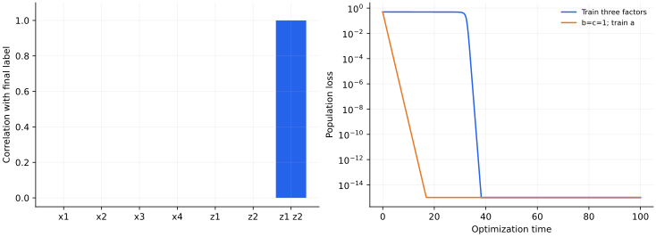

> **III · 深度与优化动力学 · Note 12**
>
> ← [Note 11](/notes/neural_network_theory/nonlinear_teacher_student/) · [系列目录](/notes/neural_network_theory/) · [Note 13](/notes/neural_network_theory/grokking/) →

**可解性层次：** 明确的机制模型与研究型推导。

## 1. 最终标签是否足以决定中间表示

深层网络只接收最终输出监督，却可能形成可复用的中间特征。解释这个现象有两个问题：任务是否含有层级结构，优化是否真的学出了这种结构。一个输入输出函数可以有多种等价因子化，因此最终误差降低并不保证每个隐藏单元都对应唯一的潜在变量。

本篇是研究型机制笔记。先给出可精确计算的层级奇偶任务，再用受限学生推导梯度瓶颈，最后建立一般层级实验的测量标准。受限模型的闭式结果不被冒充为任意深层网络的解析理论。

## 2. 一个最小的层级任务

令 $x_1,\ldots,x_4$ 独立、等概率取 $\pm1$，隐藏教师变量为

$$
z_1=x_1x_2,\qquad z_2=x_3x_4,\qquad y=z_1z_2.
$$

共有 16 种输入，可以精确枚举。由于独立性与零均值，

$$
\mathbb E[yx_i]=0,\qquad
\mathbb E[yz_1]=\mathbb E[yz_2]=0,
\qquad \mathbb E[y z_1z_2]=1.
$$

因此单输入或单隐藏特征对最终标签都没有边缘相关，但两个隐藏特征的乘积恰好完成任务。一个只看 $\mathbb E[yx_i]$ 的相关检测器无法发现信号，并不意味着该任务对所有非线性算法不可学习。

## 3. 受限组合学生的精确梯度瓶颈

先把局部输入组合结构提供给学生，只训练特征幅度：

$$
h_1=a x_1x_2,\quad h_2=b x_3x_4,
\quad f=c h_1h_2=(abc)y.
$$

总体平方损失恰为 $\mathcal L=(abc-1)^2/2$。设 $p=abc$，则

$$
\dot a=(1-p)bc,\quad
\dot b=(1-p)ac,\quad
\dot c=(1-p)ab.
$$

在 $a=b=c\gt 0$ 的平衡分支上，

$$
\boxed{\dot p=3p^{4/3}(1-p).}
$$

这与 Note 09 的三层标量动力学相同。最小模型揭示的是：链式梯度需要其他因子同时提供信号，小初始化使所有通道互相等待。它没有证明学生从原始坐标里发现了 $x_1x_2$，因为局部组合已经写进架构。

若 $a=b=c=0$，所有梯度为零；若只固定 $b=c=1$ 再训练 $a$，则 $\dot a=1-a$，平台消失。这给出一个明确干预：提供上层或下层的部分结构，能否显著缩短学习延迟？

## 4. 为什么单个 overlap 可能误导

在本受限学生里，$h_1=a z_1$ 对任何 $a\neq0$ 都有归一化相关系数 $\operatorname{corr}(h_1,z_1)=\operatorname{sign}(a)$。即使 $a$ 很小、网络仍未输出有效信号，相关系数已经是 1。仅用归一化 overlap 会误认为特征从一开始就“完全形成”。

应同时测量特征幅度、带噪线性探针误差、对其他潜变量的选择性，以及将该表示送到下游后的性能。对多维隐藏层 $H$ 与潜在教师矩阵 $Z$，可用子空间投影误差

$$
E_{\rm repr}=\min_A\frac1D\|HA-Z\|_F^2,
$$

并在独立样本上测试探针。允许无约束探针时需注意可逆线性变换不改变可解码性，但可能改变单个神经元解释；若研究不变性，还应测试同义输入变换前后的表示距离。

## 5. 从一般链式梯度得到可检验时间尺度

设 $h^{\ell+1}=\phi(W_\ell h^\ell)$，最终误差为 $\delta^L$，反向误差为

$$
\delta^\ell=J_\ell^\top\delta^{\ell+1},
\qquad \nabla_{W_\ell}\mathcal L
=\mathbb E[\delta^{\ell+1}(h^\ell)^\top]
$$

（$J_\ell$ 包含对应激活导数，梯度中的局部导数应按层定义一致吸收）。沿某个信号方向的平均梯度可能被上层 Jacobian、小激活概率或对称抵消压低。如果有效初始信号为 $s$，经验平均的标准误差约为 $D^{-1/2}$，那么可检测条件的量级是 $Ds^2\gtrsim1$。

这只是独立样本、有限方差下的信噪比估计，不是所有深层网络的样本复杂度定理。若 $s$ 本身随训练增长、不同样本相关或噪声非 Gaussian，阈值和形成顺序都可能改变。

随机层级模型进一步给每个高层符号配置多种等价的低层组合，研究网络是否对这些替换形成不变性。其数据生成规则与本篇确定性奇偶树不同；前者包含同义关系和统计检验，不能把两套任务的样本指数直接互换。

## 6. 数值图与两个可执行实验

*图 1 · 自制精确枚举与受限模型。* 左图枚举 16 个输入，显示 $y$ 对单叶、单隐藏变量及组合变量的相关；右图比较 $a=b=c=0.03$ 的联合训练与固定 $b=c=1$ 的单因子训练。横轴是相同单位迁移率下的时间，联合训练用 ODE 求解，没有人为拼接两段学习曲线。绘图下限设为 $10^{-15}$，更低的积分残差不再作为有效动力学展示。

复现命令为 `python experiments.py --note 12`。当输入分布使 $\mathbb E z_2\neq0$ 时，$\mathbb E[yz_1]=\mathbb E z_2$，原先缺失的边缘信号便会出现。受限学生与通用网络的区别则在于局部组合是否已由架构提供，这决定了需要学习的是组合幅度还是局部规则本身。

## 7. 哪些判断可以作为研究结论

若声称形成了层级表示，至少应展示独立测试集上的潜变量可解码性、对等价输入替换的不变性、对中间层的因果干预，以及多个种子的形成时间分布。只有最终准确率阶跃，无法确定是层级恢复、阈值效应还是优化的慢模态。

**相关文献。** [Cagnetta、Petrini、Tomasini、Favero 与 Wyart，How Deep Neural Networks Learn Compositional Data: The Random Hierarchy Model](https://arxiv.org/abs/2307.02129)提供层级数据与不变表示的研究模型。本文奇偶树与三因子 ODE 是一个简化构造，用来限定可以精确推导的机制。

---

← [Note 11](/notes/neural_network_theory/nonlinear_teacher_student/) · [系列目录](/notes/neural_network_theory/) · [Note 13](/notes/neural_network_theory/grokking/) →
