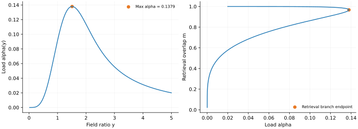
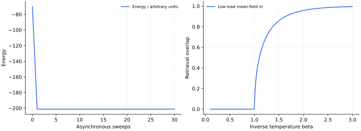

> **IV · 记忆与集体动力学 · Note 10**
>
> ← [Note 09](/notes/neural_network_theory/sgd/) · [系列目录](/notes/neural_network_theory/) · [Note 11](/notes/neural_network_theory/random_rnn/) →

**可解性层次：** 低负载平均场；广延负载需自洽修正。

## 前言：记忆作为可抵达的动力学状态

普通监督学习把知识存进从输入到输出的映射，Hopfield 模型则把记忆存进状态空间的吸引子。给出不完整或受扰动的线索以后，系统通过内部动力学回到某个稳定模式。这让“记住”不只意味着能够输出标签，还意味着具有纠错的动力学盆地。

这种视角把神经网络与自旋系统直接连接起来：对称耦合允许定义能量，异步更新下降能量，有限温度更新引入 Gibbs 分布，多个随机模式又产生串扰与玻璃态。它也是一个适合辨认物理概念边界的例子，因为能量下降不保证到达所希望的记忆，稳定状态也不等于所有存储模式都能被可靠检索。

我在本篇先从单模式和有限负载出发，再讨论广延负载。单模式可通过规范变换化为铁磁问题；模式数随神经元数增长时，其他模式的反馈不再是简单独立噪声，需要自洽响应修正。容量数字只有连同检索定义、温度、更新规则与极限一起出现才有意义。

更重要的是，最终 overlap、完整逐位正确和有限线索下的成功率是不同指标。一张记忆可能是稳定吸引子，却具有很小的吸引域；系统也可能恢复高度相似但并不逐位相同的状态。下面会将这些差别放进公式与解释中。

## 1. 将记忆存成动力学的稳定状态

联想记忆的任务是：输入一个被破坏的模式，系统经过自身动力学恢复原模式。Hopfield 模型把记忆编码在相互作用里，将回忆过程实现为能量下降。这里没有用输出标签反向传播；学习规则与检索动力学是两个独立步骤。

经典模型非常适合展示序参量：一个微观状态有 $N$ 个自旋，而与某个存储模式的重叠可以直接描述回忆是否成功。

## 2. Hebbian 耦合与异步更新

存储模式 $\xi_i^\mu\in\{-1,1\}$，$\mu=1,\ldots,P$，设

$$
J_{ij}=\frac1N\sum_{\mu=1}^P\xi_i^\mu\xi_j^\mu,
\quad i\neq j,\qquad J_{ii}=0,
$$

$$
E(s)=-\frac12\sum_{i\neq j}J_{ij}s_is_j,
\qquad h_i=\sum_jJ_{ij}s_j.
$$

一次只更新一个自旋 $s_i\leftarrow\operatorname{sign}(h_i)$，$h_i=0$ 时保持原值。若发生翻转，能量变化为

$$
\Delta E=2s_i^{\rm old}h_i\leq0.
$$

有限状态空间与严格能量下降保证这种零温异步动力学最终进入不再翻转的固定点。这个证明使用了对称耦合、无自耦合与单点更新；并行同步更新可以产生二周期，非对称耦合也未必存在同样的能量函数。

## 3. 检索重叠与串扰

定义 $m_\mu=N^{-1}\sum_i\xi_i^\mu s_i$。局部场可重写为

$$
h_i=\sum_\mu\xi_i^\mu m_\mu-\frac PN s_i.
$$

最后一项正是去掉 $J_{ii}$ 的修正。低负载 $P/N\to0$ 时可忽略；广延负载 $P=\alpha N$ 时不能在中间计算中随意丢失。

若系统接近第一个模式，$m_1=O(1)$、其他重叠较小，$\xi_i^1m_1$ 提供信号，其余模式提供串扰。但这些串扰不是独立外加白噪声：自旋受到所有模式影响，又反过来进入所有 $m_\mu$，所以存在反馈相关。

### 模式重叠为何成为集体变量

将 Hebbian 耦合代入能量，得到

$$
E(s)=-\frac N2\sum_{\mu=1}^P m_\mu^2+\frac P2.
$$

因此与任一模式形成宏观重叠都会降低能量。但同时与几个模式部分对齐也可能降低能量，能量式本身没有保证最终一定落到某个原始存储模式。混合态与伪吸引子是模型结构的一部分，而不是数值算法出了错。

检索的动力学意义是一个吸引域：许多不同的破坏输入落入同一个最终状态。能量低、固定点稳定和吸引域大是不同性质。一个存储模式即使对应局部稳定态，也可能只能纠正很少的位翻转；若实验任务要求从 30% 的破坏中恢复，其操作性容量会比只要求“存在检索解”更严格。

## 4. 低负载单模式的自洽方程

先取 $P=1$、$N\to\infty$，采用符合详细平衡的随机单自旋更新，逆温度为 $\beta$。平衡条件下

$$
\langle s_i\rangle=\tanh(\beta\xi_i m),
\qquad
\boxed{m=\tanh(\beta m).}
$$

也可从每自旋自由能

$$
F(m)=\frac{m^2}2-\frac1\beta\log[2\cosh(\beta m)]
$$

求驻点得到。小 $m$ 展开为

$$
0=(\beta-1)m-\frac{\beta^3}{3}m^3+O(m^5),
$$

所以 $\beta_c=1$，$\beta\gt 1$ 时出现非零检索解，临界附近 $m^2\simeq3(\beta-1)/\beta^3$。这是低负载热噪声转变，不是随存储模式数量变化的容量转变。

### 单模式的配分函数可以完整降到一维

对 $P=1$，作 gauge 变换 $\tau_i=\xi_i s_i$。独立随机模式被消去，能量成为 Curie–Weiss 形式

$$
E=-\frac1{2N}\left(\sum_i\tau_i\right)^2+\frac12.
$$

利用 Gaussian 积分恒等式，将平方耦合线性化：

$$
Z=e^{-\beta/2}\sqrt{\frac{N\beta}{2\pi}}
\int dm\,e^{-N\beta m^2/2}[2\cosh(\beta m)]^N.
$$

在 $N\to\infty$ 时用 Laplace 方法，配分函数由指数最大的 $m$ 控制，因此每自旋自由能就是前面的 $F(m)$ 的极小值。这个计算明确展示了熵与能量的竞争：$m^2/2$ 项来自集体场的代价，$\log\cosh$ 项来自给定场下独立自旋的状态求和。

在 $m=0$ 附近，

$$
F(m)=\mathrm{const}+\frac{1-\beta}{2}m^2
+\frac{\beta^3}{12}m^4+O(m^6).
$$

二次系数在 $\beta=1$ 变号，四次系数为正，给出连续转变。零场下正、负 $m$ 两个检索态对称；有限系统若在二者之间充分采样，总体平均 $\langle m\rangle$ 可以为零，但 $\langle|m|\rangle$ 不为零。研究自发对称破缺时，取热力学极限、外场趋零与长时间平均的顺序必须区分。

## 5. 广延负载下，为什么简单 Gaussian 噪声不够

一种最朴素的近似把串扰看成方差为 $\alpha$ 的 Gaussian，写成 $m=\int Dz\tanh[\beta(m+\sqrt\alpha z)]$。它能说明噪声破坏检索，却忽略模式反馈，不能据此精确算出经典容量。

标准广延负载平衡分析在相应副本对称鞍点中引入 $q,r$：

$$
m=\int Dz\tanh[\beta(m+\sqrt{\alpha r}\,z)],
$$

$$
q=\int Dz\tanh^2[\beta(m+\sqrt{\alpha r}\,z)],
\qquad
r=\frac{q}{[1-\beta(1-q)]^2}.
$$

其中 $Dz=e^{-z^2/2}dz/\sqrt{2\pi}$，$r$ 反映串扰反馈放大。这些方程仍需比较自由能和检查稳定性；检索解存在、检索吸引域足够大、热平衡占优是不同判据。

经典常说的 $\alpha\simeq0.138$ 是独立无偏随机模式、Hebbian 耦合和零温极限下的检索容量尺度，带有具体稳定性判据。它不是所有联想记忆架构的信息容量，更不适用于稀疏模式、相关模式或修改过的学习规则。混合模式等伪吸引子也会占据状态空间。

有检索时某个 $m_\mu\neq0$；顺磁态没有宏观检索且平衡自旋玻璃序参量为零；自旋玻璃态可有冻结而无单个模式检索。有限系统的一次静态重叠，不能独自区分这些热力学相。

### 串扰的反馈如何改变方差

若把第一个模式当作信号，其他 $P-1$ 个小重叠各约为 $N^{-1/2}$，总串扰幅度可以为 $O(1)$。最初的 Gaussian 估计给出方差约 $\alpha$；但每个非检索模式又会扰动自旋，再通过自旋响应增强它自己的重叠。

在相应平均场响应近似中，记 $U=\beta(1-q)$，一次反馈把重叠乘上 $U$，反复响应形成 $1/(1-U)$ 的放大。方差因而乘上其平方，得到 $r=q/(1-U)^2$。这解释了自洽方程中的反馈分母从何而来，也说明为什么将串扰直接视为外加独立噪声会错估容量。严格推导还需要处理 quenched 平均与反应项，不能仅靠这个几何级数图像代替。

### 零温检索分支与 0.138 的来源

在零温检索分支上 $q\to1$，但 $U=\beta(1-q)$ 可以保持有限。有效场 $h=m+\sqrt{\alpha r}\,z$ 的符号平均给出

$$
m=\operatorname{erf}\!\left(\frac m{\sqrt{2\alpha r}}\right).
$$

另一方面，$\beta\operatorname{sech}^2(\beta h)$ 在分布意义下趋于 $2\delta(h)$，因此

$$
U=\sqrt{\frac2{\pi\alpha r}}
e^{-m^2/(2\alpha r)},\qquad r=(1-U)^{-2}.
$$

令 $y=m/\sqrt{2\alpha r}$，先由 $m=\operatorname{erf}y$ 得到
$U=2ye^{-y^2}/(\sqrt\pi\operatorname{erf}y)$，再消去 $r$，得到单参数检索分支

$$
\boxed{\alpha(y)=\left[
\frac{\operatorname{erf}y}{\sqrt2\,y}
-\sqrt{\frac2\pi}e^{-y^2}\right]^2.}
$$

这一分支的最大负载约为 $0.138$，对应经典零温检索解消失的容量尺度。这个数来自信号、串扰与反馈的自洽竞争，不是简单用每个模式占用 $N$ 个比特对总权重数作除法。若研究热平衡全局占优或更严格的稳定性区域，还需比较其他态与相应稳定性条件，不能把单参数分支的存在当作全部相图。

### 近似检索与精确存储每一位的不同容量

在一个原始模式上，忽略反馈的初步估计把局部场视为 $\xi_i^1h_i\simeq1+\sqrt\alpha z$，单个位不稳定概率约为 $\Phi(-1/\sqrt\alpha)$。对于固定 $\alpha\gt 0$，这个概率虽可很小，却不随 $N$ 消失，因此原模式并不必然逐位都是精确固定点。

如果要求一个给定模式的所有 $N$ 位都不出错，至少要让 $N\Phi(-1/\sqrt\alpha)$ 变小。Gaussian 尾部提示负载需按 $1/\log N$ 的量级缩小，远比允许少量错误但有宏观重叠的检索要求严格。这里是局部场近似的尺度判断，不把其前因子当作所有模式联合稳定的严格容量。

这一区分消除了两个表面矛盾：$P=O(N)$ 的联想检索能力，与更严格精确模式稳定性下较小的容量，可以同时成立。所谓“记住一个模式”，必须说明允许多少错误、从多大破坏恢复，以及观察多长时间。

*补充图 · RS 检索分支的显式计算。* 左图直接计算 $\alpha(y)$，最大值为 0.137906；右图将同一分支参数化为 $(\alpha,m)$，转折点重叠约为 0.9674。曲线包括不同分支，不将整条曲线都视为稳定检索态。这里分析的是指定零温自洽方程的解结构，完整热平衡相图还需要自由能与稳定性判据。

## 6. 数值图与实验

*图 1 · 两个不同极限的自制计算。* 左图是 $N=400,P=12$ 的零温异步检索，初始将模式 1 的 20% 自旋翻转；每个 sweep 随机遍历所有自旋，能量单调不增，本次重叠从 0.6 恢复至 1。右图独立求解低负载方程 $m=\tanh(\beta m)$。右图没有用于拟合左图的有限负载结果。

有限尺寸下的检索成功率同时依赖负载和初始破坏比例，得到的是操作性容量。它与热力学相图中的解存在、稳定性及自由能判据需要分别讨论。

## 7. 相关文献

**相关文献。** [Hopfield（1982），Neural networks and physical systems with emergent collective computational abilities](https://www.pnas.org/doi/10.1073/pnas.79.8.2554)建立能量吸引子记忆；[Amit、Gutfreund 与 Sompolinsky（1985），Storing Infinite Numbers of Patterns in a Spin-Glass Model of Neural Networks](https://journals.aps.org/prl/abstract/10.1103/PhysRevLett.55.1530)分析广延存储。低负载方程与广延负载理论在本篇始终分别标明。

## 延伸讨论：检索协议、串扰与容量定义

### 吸引子记忆与函数拟合的区别

设存储模式 $\xi^\mu\in\{-1,1\}^N$，网络状态 $s$ 自身也是一个 $N$ 位向量。检索不是预测一个外部标签，而是从初态 $s(0)$ 出发，判断 $s(t)$ 是否进入与指定模式有关的吸引子。初态分布因此是任务定义的一部分。

若只从恰好等于记忆的状态开始，检验的是局部稳定；若从独立翻转一定比例的位开始，检验的是纠错盆地；若从随机状态开始，可能主要看到混合态或玻璃态。这三种实验即使使用同一耦合矩阵，也会给出不同成功率。

### 能量下降为什么依赖更新协议

对对称 $J$ 且 $J_{ii}=0$，翻转第 $i$ 个自旋的能量差为 $\Delta E=2s_ih_i$。异步选择一个与局部场不一致的位更新，能量不会增加。因为状态数有限，若排除零场引起的等能循环并给出固定的平局规则，系统最终到达局部稳定状态。

同步更新时，多个位同时改变，彼此相互作用的交叉项不能逐个忽略，原来的单翻转证明不成立。即使 $J$ 对称，也可能出现二周期。因此“Hopfield 有能量函数所以任意更新都收敛到固定点”是一个过强结论。

有限温度的热浴更新则允许上坡：$P(s_i=1\mid s_{-i})=[1+e^{-2\beta h_i}]^{-1}$。在相应异步随机扫描和对称耦合下，它与 Gibbs 分布相容。确定性纠错和热平衡采样分别强调动力学吸引与分布探索，不应把二者的容量概念直接混用。

### 单模式为什么等价于铁磁序

只有一个模式时，令 $\sigma_i=\xi_i s_i$，模式方向被变成全正方向，重叠变为普通磁化 $m=N^{-1}\sum_i\sigma_i$。忽略有限 $N$ 常数，能量为 $-Nm^2/2$。状态数的组合熵与能量竞争，使有限温度下出现 $m=\tanh(\beta m)$。

在临界点附近展开 $\tanh(\beta m)=\beta m-(\beta m)^3/3+\cdots$，得到

$$
m^2\simeq\frac{3(\beta-1)}{\beta^3},\qquad\beta\gt 1.
$$

这是低负载检索序的连续出现，不是广延随机存储容量。它说明热噪声如何破坏一个集体记忆，却没有包含大量无关模式带来的串扰。

### 串扰不是独立于被检索状态的外部噪声

若 $P=\alpha N$，局部场中非目标模式贡献很多项，可以在某些条件下近似 Gaussian。但状态 $s$ 本身由同一个耦合矩阵产生，因此串扰与状态反馈相关。朴素地给它方差 $\alpha$，会忽略系统对弱随机场的响应。

RS 方程中的 $r$ 正是这种反馈放大的记录。它使有效串扰方差为 $\alpha r$，而 $r$ 又通过响应与 overlap 自洽确定。零温容量约 $0.138$ 是特定随机无偏模式、Hebbian 耦合与检索分支条件下的经典数值，不是所有联想记忆架构的上界。

### 高 overlap 与完整正确的尺度不同

如果每个位错误概率为 $p_e\gt 0$，预期错位数为 $Np_e$，但全部位都正确的概率可能随 $N$ 很快下降。即使 $m=1-2p_e$ 很接近 1，只要 $p_e$ 不随 $N$ 足够快地趋零，逐位精确恢复仍然困难。

反过来，若研究存储模式本身是否每个位都稳定，就要控制 $N$ 个局部场的极端值，而不是只看典型局部场。极端值问题经常引入对数尺度，因此它与宏观检索分支消失的负载尺度不同。容量的定义改变，渐近标度也会改变。

### 混合态为何不是一个意外缺陷

Hebbian 能量可写成多个 overlap 平方之和，系统同时奖励与若干模式对齐。因此某些模式的符号组合也可能形成局部极小点。它们不是数值误差，而是能量景观本身的一部分。

这说明存储更多模式不仅增加需要检索的目标，也改变吸引子之间的竞争。学习规则若要压低混合态，往往需要改变耦合构造或加入其他约束。不能一边保持原来的 Hebbian 能量，一边假设所有非目标吸引子都可以忽略。

### 与现代可微记忆模型比较时保留什么

现代注意力或能量记忆可以使用不同相似度、连续状态和归一化规则，有时也能写成检索更新。但这不意味着它们自动继承二元 Hebbian 模型的相图和容量。相似的“从查询回忆模式”功能，可以由不同能量、不同状态空间与不同存储规则实现。

比较时更有用的是问：什么是状态，什么是模式，更新是否下降某个函数，盆地如何定义，检索误差怎样随模式数增长。把这些对象逐项对应，比仅凭公式外形相似就迁移容量数字更可靠。

## 与相邻模型的对照

存储容量与恢复教师方向是不同问题。下面 [Note 06](/notes/neural_network_theory/teacher_student_theory/#perceptron) 的版本空间与球面容量推导，提供另一个需要严格定义约束与阈值的例子：

### 从可解估计走向版本空间与学习相变

对球面学生 $\|w\|^2=d$，可定义零训练错误的版本空间体积

$$
Z(X,y)=\int d\mu(w)\prod_{\mu=1}^D
\Theta\!\left(y_\mu\frac{w^\top x_\mu}{\sqrt d}\right).
$$

其中 $d\mu$ 是球面归一化测度。若希望研究典型样本而非罕见样本主导的平均，应研究 $\mathbb E\log Z$。副本方法形式上使用

$$
\mathbb E\log Z=\lim_{n\to0}\frac{\mathbb E Z^n-1}{n}.
$$

对正整数 $n$，引入副本间重叠 $q_{ab}=w^a\cdot w^b/d$ 和教师重叠 $R_a=w^a\cdot w_*/d$，Gaussian 输入平均只依赖这些协方差，于是高维积分可转为序参量鞍点问题。

这一步解释了自洽方程为什么出现，但**从整数副本继续到 $n=0$ 并不是由该恒等式自动证明的**。还要选择对称性假设、检查稳定性，必要时处理副本对称破缺。本篇不给未推导的鞍点方程贴上“严格精确”的标签。

无噪声、匹配的教师数据保证教师自己始终可行；任意随机标签的可满足性容量是另一个问题。对连续球面、零间隔感知机，经典随机标签阈值 $D/d=2$ 不能直接解释为“有结构教师在两倍样本前完全不能泛化”。离散学生、稀疏先验、非单调激活等设定才可能产生不同的恢复阈值或突变。

#### 一个确实产生阈值的对照：随机标签存储

为了看到学习相变的数学来源，可以暂时换成没有教师结构的随机标签任务。连续球面权重满足 $\|w\|^2=d$，要求所有 $D=\alpha d$ 个样本都有间隔 $y_\mu w^\top x_\mu/\sqrt d\geq\kappa$。独立随机标签可吸收到 Gaussian 输入符号里，所以约束等价于全部局部场大于 $\kappa$。

版本空间体积为 $Z=\int d\mu(w)\prod_\mu\Theta(h_\mu-\kappa)$。对整数副本数 $n$，固定副本重叠矩阵 $Q$ 后，各样本的局部场协方差就是 $Q$；权重构型的几何体积在指数阶贡献 $\exp[(d/2)\log\det Q]$。这一步解释了熵项与样本约束项为什么有相同的 $O(d)$ 规模，二者可以竞争产生阈值。

在副本对称 ansatz 中，$Q_{aa}=1$、$Q_{ab}=q$。共同场分解为 $h_a=\sqrt q\,z+\sqrt{1-q}\,t_a$，其中 $z,t_a$ 独立 Gaussian。记 $H(u)=\int_u^\infty Dz$，单个样本的副本约束平均为

$$
\int Dz\left[H\!\left(\frac{\kappa-\sqrt q\,z}{\sqrt{1-q}}\right)\right]^n.
$$

另一方面，$\det Q=(1-q)^{n-1}[1+(n-1)q]$。形式上展开到 $n$ 的一阶，得到每维熵的 RS 鞍点函数（省略与 $q$ 无关的常数）

$$
s_{\rm RS}(q)=\frac12\log(1-q)+\frac{q}{2(1-q)}
+\alpha\int Dz\log H\!\left(
\frac{\kappa-\sqrt q\,z}{\sqrt{1-q}}\right).
$$

几何项偏好较大的可行空间，最后一项是加入样本造成的体积损失。容量边界上，所有可行解挤向彼此，$q\to1$。令 $\epsilon=1-q$，对 $z\lt \kappa$ 使用 Gaussian 尾部 $\log H(u)\simeq-u^2/2$，得到最强发散项

$$
s_{\rm RS}\simeq\frac1{2\epsilon}
\left[1-\alpha\int_{-\infty}^{\kappa}Dz(\kappa-z)^2\right]
+O(\log\epsilon).
$$

临界配平因而给出

$$
\boxed{\alpha_c(\kappa)=
\left[\int_{-\kappa}^\infty Dz(z+\kappa)^2\right]^{-1}.}
$$

在零间隔处，该积分为 $1/2$，得到 $\alpha_c(0)=2$。正间隔使约束更严格，容量降低。这里列出的是经典球面感知机非负间隔问题的 RS 推导；整数副本到零副本的解析延拓和鞍点稳定性仍不是上述代数自动证明的，对负间隔等不同区域更不能直接沿用同一稳定性结论。

#### 存储阈值、恢复阈值和算法阈值

这个 $\alpha_c$ 回答随机标签是否仍能被所有约束同时满足。无噪声教师标签始终由教师本身满足，不会在 $\alpha=2$ 突然变得不可满足。若问的是教师方向是否能被唯一恢复，需要研究后验或版本空间沿教师方向的集中；若问某个梯度算法是否能找到恢复态，还要研究动力学盆地与时间尺度。

因此至少有三种不同的阈值概念：解存在的可满足性阈值，给定数据允许达到的统计恢复阈值，以及指定算法实际达到的动力学阈值。简单模型里它们可能重合，也可能分离。Teacher–student 设定的价值，正是让这些问题有独立的定义，而不是把所有陡峭曲线都称作同一种学习相变。

有限温度更新可以具有平衡解释，而一般随机梯度未必如此。下面 [Note 09](/notes/neural_network_theory/sgd/) 对概率流与有效温度的讨论，有助于辨认两类随机动力学的差别：

### 什么时候可以说“有效温度”

如果 $A=TI$，驻态为 $p_*(u)\propto\exp[-u^\top Hu/(2T)]$，$S=TH^{-1}$，满足详细平衡。一般各向异性 $A$ 产生的 Gaussian 驻态仍然存在，但未必是关于原损失的单温度 Gibbs 分布。

Fokker–Planck 概率流为

$$
j(u)=(-H+A S^{-1})u\,p_*(u).
$$

详细平衡要求 $HS=A$。对称 $H,A$ 不对易时，这通常不成立，驻态可以持续有旋转概率流；“分布不再随时间变”不等于“没有非平衡流”。即使 $H,A$ 对易但 $A\neq TI$，也往往只有逐方向温度，不能用一个标量温度乘原损失。

若 $H$ 有零模、而 $A$ 沿零模仍注入噪声，该方向是扩散，没有可归一化的 OU 驻态。若有负曲率，则局部线性模型不稳定。将这些方向硬塞进 $S=A/H$ 没有意义。

#### 概率流可以存在于一个完全稳定的 Gaussian 分布中

对常系数扩散，Fokker–Planck 方程是 $\partial_tp=-\nabla\cdot j$，$j=-Hu\,p-A\nabla p$。代入 Gaussian 驻态 $\nabla p=-S^{-1}up$，就得到前面的流。驻态只要求散度为零，而不是流在每一点为零。

本文数值例中 $HS-A=\begin{pmatrix}0&-0.48\\0.48&0\end{pmatrix}$，不为零。这个反对称结构对应概率质量在稳定椭圆上的循环，不改变总体密度，却破坏时间反演的详细平衡。

当 $A\succ0$ 时，可以用

$$
\dot S_{\rm prod}=\int\frac{j^\top A^{-1}j}{p}\,du
=\operatorname{Tr}(B_0^\top A^{-1}B_0S),
\quad B_0=-H+AS^{-1},
$$

量化这个 OU 过程的不可逆概率流。它非负，详细平衡时为零。这里使用的是给定扩散模型的概率流定义，不应直接将它等同于神经网络硬件消耗的热量。

#### 状态依赖噪声下的 Gibbs 条件

若 $dw=b(w)dt+\sqrt{2A(w)}dW$ 按 Itô 解释，概率流变成

$$
j_i=b_i p-\sum_j\partial_j(A_{ij}p).
$$

扩散矩阵导数也进入流。若希望 $p_*\propto e^{-\mathcal L/T}$ 且详细平衡，必须有
$b=\nabla\cdot A-(A/T)\nabla\mathcal L$。对于 $A=TM(w)$，漂移要含 $T\nabla\cdot M-M\nabla\mathcal L$。普通 SGD 的漂移通常只有 $-\nabla\mathcal L$，其梯度噪声并没有自动满足这个匹配关系。

因此把 $\eta/B$ 称为温度，至多是一个局部、定性或指定方向下的比喻。它可能帮助比较同一训练协议的小变化，但不能单独导出真实网络在所有极小值之间的 Gibbs 权重。

## 结语：吸引子之外还要看盆地

Hopfield 模型把记忆转成了动力学几何：模式不仅被写进耦合，还要成为能被线索抵达的稳定状态。能量下降解释更新为何有方向，平均场解释集体重叠，串扰自洽则解释大量模式如何互相影响。

我会把容量与检索协议放在同一句话里。局部稳定、宏观 overlap、逐位恢复和吸引域成功率分别强调不同尺度；忽略这种差别，一个精确数字也可能被用在错误问题上。有限温度、同步更新与相关模式又会进一步改变答案。

这篇与下一篇随机 RNN 构成一个有用对照：对称结构支持能量与平衡语言，非对称反馈则可能产生持续的非平衡活动与混沌。两者都研究集体动力学，但可用的物理工具不同。

---

← [Note 09](/notes/neural_network_theory/sgd/) · [系列目录](/notes/neural_network_theory/) · [Note 11](/notes/neural_network_theory/random_rnn/) →
