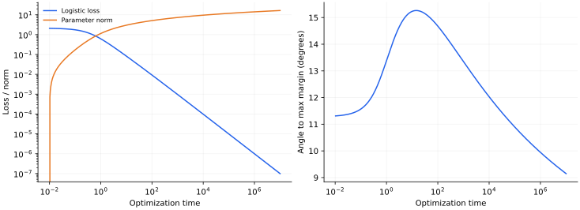

> **III · 深度与优化动力学 · Note 10**
>
> ← [Note 09](/notes/neural_network_theory/deep_linear/) · [系列目录](/notes/neural_network_theory/) · [Note 11](/notes/neural_network_theory/nonlinear_teacher_student/) →

**可解性层次：** 线性模型定理；因子化结论依赖条件。

## 1. 训练误差为零以后，优化还在选择什么

过参数化平方回归有无穷多个插值解；线性可分分类的 logistic 损失则没有有限范数的最小点。两种情形都需要问：优化算法沿什么方向前进，它究竟在解空间中偏好什么？

隐式偏置指目标函数未显式写出正则项时，由算法、参数化、初始化和损失共同造成的解选择。这个词没有指定某个普遍范数，更不自动意味着偏置总有利于真实任务。

## 2. 平方回归：为何零初始化选择最小欧氏范数

对 $\mathcal L=\|Xw-y\|^2/(2D)$，梯度始终在 $X$ 的行空间，故零空间分量不变。若从零出发并收敛，

$$
\hat w=X^+y.
$$

当数据可插值时，这是满足 $Xw=y$ 的欧氏最小范数解。证明很直接：任意其他解为 $X^+y+z$，$z\in\ker X$，两项正交，所以范数平方相加。

若用预条件更新 $\dot w=-P\nabla\mathcal L$，$P\succ0$ 固定，从零出发选择的通常是 $w^\top P^{-1}w$ 最小的插值解。算法的度量已经改变，不能继续沿用相同的欧氏结论。非零初始化则保留对应不可观测分量。

## 3. 可分 logistic 分类：最优点在无穷远

标签 $y_\mu\in\{-1,1\}$，模型无单独偏置项，损失

$$
\mathcal L(w)=\sum_\mu\log(1+e^{-y_\mu w^\top x_\mu}).
$$

若存在 $v$ 使所有 $y_\mu v^\top x_\mu\gt 0$，则沿 $w=cv$、$c\to\infty$，损失趋于零。不存在有限 $w$ 达到这个下确界。梯度流为

$$
\dot w=\sum_\mu\frac{y_\mu x_\mu}{1+e^{y_\mu w^\top x_\mu}}.
$$

大间隔点的梯度指数变小，靠近当前分类边界的样本主导长期更新。因此训练分类准确率已经为 100%，参数方向仍可缓慢转动。

## 4. 最大间隔方向的渐近结构

定义硬间隔解

$$
\hat w=\arg\min_w\frac12\|w\|^2
\quad\text{s.t.}\quad y_\mu w^\top x_\mu\geq1.
$$

其 KKT 条件为

$$
\hat w=\sum_\mu\alpha_\mu y_\mu x_\mu,\quad
\alpha_\mu\geq0,\quad
\alpha_\mu(y_\mu\hat w^\top x_\mu-1)=0.
$$

用渐近 ansatz $w(t)=\hat w\log t+\rho(t)$ 理解其来源。支持向量的梯度约为 $t^{-1}$，非支持点的梯度约为 $t^{-m_\mu}$，其中 $m_\mu=y_\mu\hat w^\top x_\mu\gt 1$，衰减更快。主导向量只能由支持向量的非负组合构成，与 KKT 条件一致。

这段配平给出机制解释，而完整定理还要控制余项。对可分数据、相应指数尾损失和合适步长的梯度下降，可证明方向趋向 $\hat w/\|\hat w\|$；普通情形余项较温和，退化数据可能出现 $\log\log t$ 等修正。因此不要把“余项永远有界”写成一般定理。

范数主项为 $O(\log t)$，方向误差通常只按对数速度缩小。分类准确率的饱和远早于方向收敛，解释了继续训练仍可能改变测试预测，但不保证所有测试分布都因此改善。

## 5. 参数化改变了有效偏置

考虑正坐标因子化 $\beta_i=u_i^2$。若损失只通过 $\beta$ 依赖 $u$，则

$$
\dot u_i=-2u_i\partial_{\beta_i}\mathcal L,
\qquad
\dot\beta_i=-4\beta_i\partial_{\beta_i}\mathcal L.
$$

有效坐标的迁移率与自身大小成正比，小坐标增长慢；这与直接优化 $\beta$ 的欧氏梯度流不同。若允许正负分支、改变初始化或增加层数，偏置还会改变，所以一个因子化例子不足以证明通用稀疏性定理。

矩阵分解还有一个常用的变分恒等式：

$$
\|M\|_*=\inf_{UV^\top=M}
\frac12(\|U\|_F^2+\|V\|_F^2).
$$

用 $M=A\Sigma B^\top$ 的 SVD，取 $U=A\Sigma^{1/2}$、$V=B\Sigma^{1/2}$ 得到等号；反向不等式来自核范数与因子 Frobenius 范数的界。这个式子说明**显式**惩罚因子范数与核范数的关系，却不能直接证明无正则化因子梯度下降总选择最小核范数解。初始化、观测算子、可交换性及极限顺序都可能重要。

## 6. 数值图与实验

*图 1 · 自制二维可分数据实验。* 用三种已吸收标签的向量 $z_\mu=y_\mu x_\mu=(1,0),(1,1),(2,-0.2)$。硬间隔解为 $(1,0)$，因为第一约束要求 $w_1\geq1$，其余约束在该点满足。脚本数值积分 logistic 梯度流；左图比较损失和参数范数，右图测量与 $(1,0)$ 的方向夹角。横轴为优化时间，未加入权重衰减。

复现命令为 `python experiments.py --note 10`。训练准确率饱和后，参数方向仍继续变化。加入非零 L2 正则化后，最优点变为有限范数，长期行为不再是无正则化的 $\log t$ 发散。

## 7. 相关文献与理论边界

**相关文献。** [Soudry 等，The Implicit Bias of Gradient Descent on Separable Data](https://arxiv.org/abs/1710.10345)给出线性分类方向收敛理论；[Gunasekar 等，Implicit Regularization in Matrix Factorization](https://arxiv.org/abs/1705.09280)提出并分析矩阵因子化的偏置。后者原文包含猜想与特定证据，不应被简化成任意矩阵观测下的普遍最小核范数定理。

---

← [Note 09](/notes/neural_network_theory/deep_linear/) · [系列目录](/notes/neural_network_theory/) · [Note 11](/notes/neural_network_theory/nonlinear_teacher_student/) →
