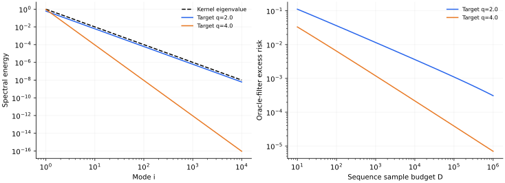

> **I · 泛化与高维模型 · Note 02**
>
> ← [Note 01](/notes/neural_network_theory/linear_learning/) · [系列目录](/notes/neural_network_theory/) · [Note 03](/notes/neural_network_theory/wide_networks/) →

**可解性层次：** 有限特征精确求解；序列风险可解；随机设计近似需附加条件。

## 前言：从一份随机字典，到它怎样学习一个目标

随机特征与核学习曲线可以从同一个问题出发：先决定函数由哪些方向组合，再问有限数据能把这些方向估计多好。随机特征让字典本身随机，核极限组织无限字典的几何，总体谱则说明目标相对于这套几何有多容易。三个层次连起来，才能看清更多特征、更多样本和更合适先验分别改善什么。

这一篇从冻结隐藏层的有限矩阵开始，先解输出层，再构造随机 Fourier 特征并讨论核极限。随后转到 Mercer 模态，计算偏差、方差、有效维数和随机设计的采样反馈。这里不会把核元素收敛直接当成预测风险收敛，也不会把总体正交直接代替有限样本正交。

固定字典仍然能够产生插值、谱偏置与长学习尾部，因此它也是可训练表征的重要对照。若网络优于这个基线，还需要判断收益来自找到新方向、改善条件数，还是改变了优化与正则化。

## 1. 有限随机特征：非线性映射与线性求解 {#random-features}

### 模型归一化与原始–对偶解

抽取 $w_j\sim\mathcal N(0,I_d)$，定义

$$
\Phi_j(x)=\frac1{\sqrt N}\phi(w_j^\top x/\sqrt d),
\qquad f_a(x)=\Phi(x)^\top a.
$$

给定训练特征矩阵 $\Phi\in\mathbb R^{D\times N}$，优化

$$
\frac1{2D}\|\Phi a-y\|^2+\frac\lambda2\|a\|^2.
$$

直接求导得到

$$
a_\lambda=(\Phi^\top\Phi+D\lambda I_N)^{-1}\Phi^\top y.
$$

令 $K_N=\Phi\Phi^\top$，利用 $ (\Phi^\top\Phi+cI)^{-1}\Phi^\top=\Phi^\top(\Phi\Phi^\top+cI)^{-1}$，可将测试预测写成

$$
\boxed{f_\lambda(x)=k_N(x,X)^\top(K_N+D\lambda I_D)^{-1}y,}
\quad k_N(x,X)=\Phi\Phi(x).
$$

这是同一个解的原始与对偶表达；$N\lt D$ 时解 $N$ 维线性系统，$D\lt N$ 时通常解 $D$ 维系统。实际计算应使用线性求解或 SVD，避免显式求逆。

### 随机 Fourier 特征、正定性与函数范数

希望近似 RBF 核 $k(x,x')=\exp[-\|x-x'\|^2/(2\ell^2)]$。取 $\omega\sim\mathcal N(0,\ell^{-2}I)$、$b\sim\mathrm{Unif}[0,2\pi]$，定义

$$
z_j(x)=\sqrt{\frac2N}\cos(\omega_j^\top x+b_j).
$$

先对随机相位平均：

$$
\mathbb E_b[2\cos(u+b)\cos(v+b)]=\cos(u-v).
$$

再用 Gaussian 特征函数：

$$
\mathbb E_\omega\cos[\omega^\top(x-x')]
=e^{-\|x-x'\|^2/(2\ell^2)}.
$$

于是 $\mathbb E[z(x)^\top z(x')]=k(x,x')$。随机性只是对核积分的 Monte Carlo 近似，并没有使用标签选择 $\omega_j$。

这个例子还指出：输入非线性可以很强，但如果特征由事先确定的采样分布生成，训练仍未改变该分布。若把 $\omega_j$ 也设为可训练量，才跨过本篇的固定特征假设。

#### 随机特征核为何必为正定

对任意训练点和任意系数 $c_\mu$，

$$
\sum_{\mu\nu}c_\mu k_N(x_\mu,x_\nu)c_\nu
=\left\|\sum_\mu c_\mu\Phi(x_\mu)\right\|^2\geq0.
$$

因此有限随机特征首先定义了一个合法的、秩至多为 $N$ 的 Gram 矩阵。大数定律只在此基础上说明该随机核趋近确定核。增加 $N$ 同时改变随机积分精度和训练矩阵的秩；在 $N$ 接近 $D$ 的区域，这两件事对插值稳定性都有影响。

对 Fourier 特征，乘积恒等式也解释了随机相位的作用。没有对 $b$ 平均时，$2\cos(u+b)\cos(v+b)=\cos(u-v)+\cos(u+v+2b)$，第二项破坏平移不变性。随机相位并不是装饰，而是在期望中消去了这一项。有限 $N$ 时它仍以随机涨落的形式存在，只有控制其矩阵效应后，才可以把有限网络替换成平移不变核。

#### 输出层正则化对应怎样的函数范数

同一个函数可能由多个 $a$ 表示，因为特征可能线性相关。有限特征空间的自然核范数是

$$
\|f\|_{\mathcal H_N}^2=
\inf_{a:\,f=\Phi^\top a}\|a\|^2.
$$

若只是把特征整体乘上常数 $c$，函数类没有改变，但表达相同函数所需的输出系数变成 $a/c$，范数惩罚相应减小 $c^2$ 倍。因此比较两个随机特征模型时，仅仅设置相同的数值 $\lambda$ 并不保证相同的函数正则化。$N^{-1/2}$ 归一化的一个目的，就是让增大特征数时核尺度保持有限。

这一点也解释核方法与神经网络比较中的常见混淆。固定特征的最小输出权重范数与全参数网络的最小参数范数，对应不同的函数几何。即使两者能表示同一组训练预测，算法对训练集外的延拓仍可能不同。

## 2. 从有限字典到核极限：收敛与覆盖的区别 {#kernel-limit}

### 核积分的大数定律

有限特征核是

$$
k_N(x,x')=\frac1N\sum_{j=1}^N
\phi(w_j^\top x/\sqrt d)\phi(w_j^\top x'/\sqrt d).
$$

对固定的一对输入，若乘积可积，大数定律给出

$$
k_N(x,x')\to k_\infty(x,x')
=\mathbb E_w[\phi(w^\top x/\sqrt d)\phi(w^\top x'/\sqrt d)].
$$

若有有限方差，单个核元素的标准误差通常为 $O(N^{-1/2})$。这不是自动的全空间一致误差，更不是无正则化插值风险的同阶保证。矩阵反演会放大靠近零特征值处的近似误差；当 $D$ 与 $N$ 一起增长时，应控制算子范数和正则化，而非只看单个元素收敛。

### 特征数、样本数与输入维数的三个极限

固定 $D,d$ 而 $N\to\infty$，主要研究核近似。让 $D,N,d$ 同时增大且比例有限，则有限特征谱和统计误差始终参与竞争。固定 $N$ 而增大 $D$，模型最终只能逼近目标在这 $N$ 维特征空间中的投影。

训练动力学也直接继承 [Note 01](/notes/neural_network_theory/linear_learning/#regression)：零初始化、无正则化时

$$
\dot f_X=-\frac{K_N}{D}(f_X-y).
$$

增加 $N$ 可能提高秩，也可能改善条件数；它不会自动让所有目标方向都变容易。若目标主要位于核小本征值方向，即使核近似非常精确，统计学习仍可能很慢。

风险可以按“目标在特征空间外的残差、有限样本估计误差、正则化偏差”理解。但有限样本随机设计下这些项可能耦合，不能随意把三个独立幂律相加后称为精确分解。

#### 核元素收敛为什么不够保证预测收敛

记 $K$ 为极限核矩阵，$\Delta K=K_N-K$，$c=D\lambda\gt 0$。逆矩阵恒等式给出

$$
(K_N+cI)^{-1}-(K+cI)^{-1}
=-(K_N+cI)^{-1}\Delta K(K+cI)^{-1}.
$$

由于两核均半正定，两个逆的算子范数不超过 $1/c$，故

$$
\|(K_N+cI)^{-1}-(K+cI)^{-1}\|_{\rm op}
\leq\frac{\|\Delta K\|_{\rm op}}{c^2}.
$$

训练预测平滑矩阵 $S_N=K_N(K_N+cI)^{-1}=I-c(K_N+cI)^{-1}$ 则满足 $\|S_N-S\|_{\rm op}\leq\|\Delta K\|_{\rm op}/c$。若使用归一化核 $\bar K=K/D$，稳定条件的量级是 $\|\bar K_N-\bar K\|\ll\lambda$，而不只是某个核元素的误差很小。

测试预测还涉及交叉核向量的误差。令 $k_N,k$ 是测试点与训练点的核向量，则

$$
|f_N(x)-f(x)|\leq
\frac{\|k_N-k\|\,\|y\|}{c}
+\frac{\|k\|\,\|\Delta K\|_{\rm op}\,\|y\|}{c^2}.
$$

这不是最紧的统计界，但把敏感性来源直接暴露出来：当正则化趋零，反演可以比随机积分的误差更快地变得病态。因此固定 $D$ 先取 $N\to\infty$，与让 $N/D$ 保持有限并同时取无正则化极限，不是同一个问题。

#### 一个可分离“特征覆盖”和“估计误差”的圆周模型

取输入 $x\in[0,2\pi)$ 均匀，随机抽频率 $m\geq1$，概率为 $p_m$。每次抽到一个频率就同时加入 $\cos mx,\sin mx$。期望核为 $k(x,x')=\sum_mp_m\cos[m(x-x')]$；在归一化基 $\sqrt2\cos mx,\sqrt2\sin mx$ 下，每对模态的核本征值为 $p_m/2$。

若目标只含一个频率 $m_*$，抽取 $N$ 次后完全没覆盖它的概率是 $(1-p_{m_*})^N$。即使数据无限多，缺失频率上的目标也不能从这些固定特征中恢复。无限数据下的平均近似误差因此是

$$
\mathbb E E_{\rm app}(N)
=\sum_m A_m(1-p_m)^N,
$$

其中 $A_m$ 为目标在该正弦、余弦对子上的总能量。这个模型中，增加数据只帮助估计已出现频率的系数；增加特征数才有机会覆盖此前不可表示的模态。

若 $p_m\asymp m^{-p}$、$A_m\asymp m^{-q}$，远尾可用 $e^{-Np_m}$ 近似，主要截止频率约为 $m_N\sim N^{1/p}$，剩余能量给出 $E_{\rm app}\asymp N^{-(q-1)/p}$。这里的模型指数依赖随机特征的抽样分布，不只是目标本身。任务适应的特征选择可以改变抽样分布，端到端特征学习则进一步改变特征方向；这些都是固定随机特征无法主动完成的步骤。

### 随机子空间首先限制哪些函数能够表示

记单个未归一化特征为 $\psi_w(x)$，采样分布为 $\pi(dw)$。无限字典中的函数可表示为

$$
f(x)=\int a(w)\psi_w(x)\,\pi(dw),
\qquad \int a(w)^2\pi(dw)\lt \infty.
$$

若不同的 $a$ 给出同一函数，则自然范数是所有表示中系数平方积分的下确界：

$$
\|f\|_{\mathcal H_k}^2
=\inf_{a:\,f=\int a\psi\,d\pi}\int a(w)^2\pi(dw),
\qquad k(x,x')=\int\psi_w(x)\psi_w(x')\pi(dw).
$$

这解释了为什么输出层的欧氏惩罚能够在核极限中变成函数范数惩罚，也解释了为什么特征的幅度归一化会影响隐式偏置。它不仅是为了让曲线数值好看，而是在定义哪些函数被认为代价低。

有限采样时只能使用 $\mathcal V_N=\operatorname{span}\{\psi_{w_1},\ldots,\psi_{w_N}\}$。令 $P_N$ 是总体 $L^2(\rho)$ 度量下到这个子空间的正交投影，则任何输出层学习器都满足

$$
\|\widehat f-f_*\|_{L^2(\rho)}^2
=\|(I-P_N)f_*\|_{L^2(\rho)}^2
+\|\widehat f-P_Nf_*\|_{L^2(\rho)}^2.
$$

第一项是这份随机字典无法表示的部分，第二项才是子空间内部的估计和优化误差。数据增加可以降低第二项，却无法在固定 $N$、固定字典下消除第一项。这个分解比把所有误差都归因于训练不充分更有诊断价值。

### 同一个无限核可以有不同有限特征算法

更一般地，可以用重要性采样改变字典分布。若 $q(w)\gt 0$ 覆盖 $\pi$ 的支持，令 $w_j\sim q$，用重加权特征

$$
\widetilde\psi_w(x)=\sqrt{\frac{d\pi}{dq}(w)}\,\psi_w(x)
$$

便仍有 $\mathbb E_q\widetilde\psi_w(x)\widetilde\psi_w(x')=k(x,x')$。无限核相同，有限 $N$ 的核估计方差却可不同。重加权过大时还可能造成重尾和不稳定。它说明“同一个核”并不能唯一确定有限特征算法；特征采样方案也是算法的一部分。

### 有限特征的数值结果

*图 1 · 自制随机特征实验。* 一维输入区间 $[-\pi,\pi]$、$\ell=0.7$，目标 $\sin x+0.3\cos3x$。左图为固定网格上核矩阵相对 Frobenius 误差，24 个随机特征种子给出均值及标准差；右图为 $D=40$ 个有噪声样本、$N=256$ 的预测和无限特征 RBF 对照，采用相同 $\lambda=10^{-3}$。

增加特征数主要改善核近似，增加样本数主要减少估计误差，两者对应不同的规模极限。这里的隐藏层始终固定，预测改善不涉及表示适应。

对于 $\sin20x$ 这样的高频目标，在核长度尺度不变时，即使训练误差很小，目标对核谱的错配仍可能导致差的测试误差；这正是后文总体谱展开所描述的目标对齐问题。

## 3. 总体核谱：哪些目标方向代价更低 {#mercer}

从这里开始固定输入分布，研究核积分算子。有限字典的 Gram 矩阵与总体算子相联系，但它们的谱并不是同一份数据。

### Mercer 模态、目标能量与 RKHS 几何

输入分布为 $\rho$，总体核积分算子为

$$
(Tg)(x)=\int k(x,x')g(x')\,d\rho(x').
$$

对适当平方可积正定核，取 $L^2(\rho)$ 正交本征函数 $\psi_i$，则

$$
k(x,x')=\sum_i\eta_i\psi_i(x)\psi_i(x'),
\qquad f_*(x)=\sum_i a_i\psi_i(x),
$$

其中 $\int\psi_i\psi_jd\rho=\delta_{ij}$、$\eta_i\geq0$。$\eta_i$ 是总体算子的谱；训练矩阵 $k(X,X)/D$ 的特征值是随机经验谱，有限 $D$ 时二者不等同。

若目标在核零空间有能量，该部分无法由该核表示，形成不可约近似误差。对于正谱方向，RKHS 范数为 $\sum_i b_i^2/\eta_i$，所以小特征值系数受到更强的正则化。

#### RKHS 与总体平方误差使用不同的度量

在正谱方向上写 $f=\sum_i b_i\psi_i$。由于 $\psi_i$ 在输入分布下正交，函数误差是 $\|f-f_*\|_{L^2(\rho)}^2=\sum_i(b_i-a_i)^2$；但 RKHS 范数是 $\sum_i b_i^2/\eta_i$。同一个坐标在两种度量下具有不同权重，正则化的谱选择正是从这个差异产生。

若目标有一部分 $f_\perp$ 正交于所有正谱本征函数，它会给总体误差增加 $\|f_\perp\|_{L^2}^2$。这与标签观测噪声不同：它可能是确定而有结构的函数，只是当前核无法表达。将不可表示目标都并入一个常数噪声项，只有在另有独立性或统计等效论证时才合理。

核回归的 representer 结构也可从几何上得到。将函数分成训练核截面的线性组合与其 RKHS 正交补，$f=f_\parallel+f_\perp^{\mathcal H}$。由再生性质，正交补在每个训练点的值都是零；它不会降低训练误差，却增加范数。因此带正则化的最优解位于 $\operatorname{span}\{k(x_\mu,\cdot)\}$。这只是训练解所在的函数子空间，没有保证该子空间已经覆盖所有总体重要模态。

## 4. 学习曲线：滤波后的偏差与方差 {#learning-curves}

### Gaussian 序列代理与真实设计矩阵

考虑 Gaussian 序列实验

$$
z_i=a_i+\frac\sigma{\sqrt D}\xi_i,
\qquad \xi_i\sim\mathcal N(0,1).
$$

最小化每模的 $(b_i-z_i)^2/2+\lambda b_i^2/(2\eta_i)$，得到

$$
\hat a_i=\frac{\eta_i}{\eta_i+\lambda}z_i.
$$

这是一个有明确定义的代理观测问题。在有限个正交经验特征且经验 Gram 恰好为单位阵时，它也对应普通回归；无限多个独立白噪系数本身不在 $\ell_2$ 中，需要滤波后的方差和收敛。

平均超额风险为

$$
\boxed{E(D,\lambda)=\sum_i
\underbrace{\left(\frac\lambda{\eta_i+\lambda}\right)^2a_i^2}_{\text{偏差}}
+\underbrace{\frac{\sigma^2}{D}
\left(\frac{\eta_i}{\eta_i+\lambda}\right)^2}_{\text{方差}}.}
$$

若对总体损失做梯度流而不加正则化，同样有 $\hat a_i(t)=(1-e^{-\eta_it})a_i$。所以核谱既控制优化速度，也控制正则化下可恢复的模态；但改变 $t$ 与改变样本数 $D$ 是不同操作。

#### 从真实随机采样到代理，中间缺少的矩阵

暂时截断到 $M$ 个总体本征函数，令 $Z_{\mu i}=\psi_i(x_\mu)$、$E=\operatorname{diag}(\eta_i)$。真实样本给出的是 $y=Za+\varepsilon$，不是直接给每个 $a_i$ 加一个独立噪声。核回归等价于

$$
\min_b\frac1{2D}\|Zb-y\|^2+\frac\lambda2 b^\top E^{-1}b.
$$

记 $S=Z^\top Z/D$、$A=S+\lambda E^{-1}$，则

$$
\hat a=A^{-1}Z^\top y/D,
\qquad
\hat a-a=-\lambda A^{-1}E^{-1}a+A^{-1}Z^\top\varepsilon/D.
$$

给定设计矩阵、对标签噪声平均后，有限维模型的总体误差恰为

$$
\boxed{\mathbb E_\varepsilon[E_g\mid Z]
=\|\lambda A^{-1}E^{-1}a\|^2
+\frac{\sigma^2}{D}\operatorname{Tr}(A^{-1}SA^{-1}).}
$$

右边的条件平均记号表示先固定 $Z$。关键障碍是 $S$ 随采样波动，而且一般与 $E$ 不对易。总体正交性只给出 $\mathbb ES=I$，并没有给出 $S=I$，也没有给出 $\mathbb E A^{-1}=(\mathbb EA)^{-1}$。

如果恰好 $S=I$，各模态才解耦成 $\hat a_i=\eta_i z_i/(\eta_i+\lambda)$，前面的序列风险随之恢复。这明确指出代理省略了什么：经验模态之间的混合、有限秩约束，以及矩阵反演对这些涨落的放大。即使每个 $S_{ij}$ 的误差只有 $D^{-1/2}$，当模态数与 $D$ 同阶时，整个算子的谱误差也未必小。

对于被截断的无限尾部，$y=Za+f_{\rm tail}(X)+\varepsilon$。尾部与已保留本征函数在总体上正交，但有限样本的相关不为零；它会像混叠项进入估计。这也是从有限 $M$ 公式推广到无限核时，需要控制截断而不能直接丢掉尾部的原因。

### 有效维数和目标对齐

定义两个相关但不同的量

$$
d_{\rm eff}(\lambda)=\sum_i\frac{\eta_i}{\eta_i+\lambda},
\qquad d_2(\lambda)=\sum_i\left(\frac{\eta_i}{\eta_i+\lambda}\right)^2.
$$

本代理的方差恰为 $\sigma^2d_2/D$，不是无条件等于 $\sigma^2d_{\rm eff}/D$。对于常见规则谱，两者常有相同标度，但常数与精确公式不同。

一个两模态例子很说明问题。令 $\eta_1=1,\eta_2=0.01$，取 $\lambda=0.1$。目标若全在第一模态，信号恢复比例约 $0.909$；若全在第二模态，只恢复 $0.091$。两个任务使用相同核、相同数据预算，却具有完全不同的偏差。

因此“低频先学”只有在核本征函数恰好按某个频率指标排序时才成立。在不平移不变的分布或核中，谱模态可能是局域、几何或语义结构，不能靠本征值大小直接命名空间频率。

#### 两种有效维数的物理含义

$d_{\rm eff}$ 是平滑算子 $T(T+\lambda I)^{-1}$ 的迹，可以理解成模型保留的连续自由度：每个模态按恢复比例贡献 0 到 1。$d_2$ 则是该平滑算子平方的迹，表示独立噪声经过滤波后的总能量。前者计数响应，后者计数涨落，二者结构相近而不相同。

若 $\eta_i\sim c i^{-p}$、$p\gt 1$，将求和变成积分并以 $i=(c/\lambda)^{1/p}u$ 重标，可得

$$
d_{\rm eff}\sim(c/\lambda)^{1/p}
\int_0^\infty\frac{du}{1+u^p},
\quad
d_2\sim(c/\lambda)^{1/p}
\int_0^\infty\frac{du}{(1+u^p)^2}.
$$

第一个积分等于 $\pi/[p\sin(\pi/p)]$，第二个是前者的 $(1-1/p)$ 倍。所以在这个规则谱里 $d_2/d_{\rm eff}\to1-1/p$。它们有相同幂次，却连领先常数都不同；用“有效参数数”一个词代替所有谱迹，会把这种区别抹平。

### 规则谱学习曲线的数值结果

*图 2 · 自制高斯序列代理。* 使用 10000 个模态、$\eta_i=i^{-2}$，对比 $a_i^2\propto i^{-2}$ 与 $i^{-4}$，均归一化为单位目标能量。左图给出两种目标的谱能量与核谱；右图对每个 $D$ 在对数网格上选择最小解析风险，噪声 $\sigma=0.3$。这是在已知教师下计算的最优正则化基线，实际实验必须用验证集选择超参数。

核谱和目标系数是影响学习曲线的两个独立因素。有限模态截断会在极大数据处引入新的区间，因此单一指数只适用于远离截断的尺度窗口。

## 5. 随机采样：为什么谱之外还需要数据几何 {#sampling}

独立序列代理直接给出每个系数的带噪观测。真实输入样本却会混合不同模态，因此需要控制经验 Gram 矩阵及其反演。下面保留自洽近似的假设，再用局域模态说明仅有特征值列表还不够。

### 等效正则尺度、采样反馈与插值分母

真实训练样本只观察 $f_*(x_\mu)+\varepsilon_\mu$，不同谱系数通过随机采样混合。对某类随机特征设计或统计物理近似，可使用等效尺度 $\kappa$ 与涨落因子 $\gamma$：

$$
\kappa=\Lambda+\sum_i\frac{\kappa\eta_i}{\kappa+D\eta_i},
\qquad
\gamma=\sum_i\frac{D\eta_i^2}{(\kappa+D\eta_i)^2},
$$

$$
E\simeq\frac1{1-\gamma}
\sum_i\frac{\kappa^2a_i^2+\sigma^2D\eta_i^2}
{(\kappa+D\eta_i)^2}.
$$

这里使用**未除以 $D$ 的平方损失**加 $\Lambda\|f\|_{\mathcal H}^2/2$；与前一节参数比较时，$\Lambda=D\lambda$。上述方程不是对所有 Mercer 本征函数分布都无条件精确的定理。它展示经验采样涨落如何改变有效正则化，$1/(1-\gamma)$ 如何放大误差；使用时需检查设计假设、极限和解的稳定分支。

Scaling Laws 中的数据幂律计算采用前述可解代理；这些自洽方程不被直接用于未经论证的数据集。

#### 自洽方程的尺度结构

将 $\kappa$ 方程除以 $\kappa$，可写成

$$
1=\frac\Lambda\kappa+\sum_i\frac{\eta_i}{\kappa+D\eta_i}.
$$

对于 $\Lambda\gt 0$，右边随 $\kappa$ 单调降低，因此正解唯一。$\kappa/D$ 扮演的并不是手动设置的 $\lambda$，而是将有限采样反馈吸收后的等效谱截止。在样本数有限时，即使显式正则化趋零，等效截止仍可能非零。

涨落因子 $\gamma$ 包含模态响应平方。可以把 $1/(1-\gamma)$ 形式地看成反复反馈的几何级数 $1+\gamma+\gamma^2+\cdots$：一次样本扰动改变估计，估计改变又通过同一份设计反馈到其他方向。这个图像有助于理解误差放大，但不能替代严格的 cavity、replica 或随机矩阵推导；对具体设计，正是这些方法需要证明反馈项如何集中。

#### 等谱特例把核曲线接回双下降

取 $M$ 个模态、全部 $\eta_i=1$、目标能量 $\sum_i a_i^2=r^2$，考察 $\Lambda\downarrow0$ 的分支。当 $M\gt D$ 时，自洽方程有 $\kappa=M-D$，且 $\gamma=D/M$。代入得到

$$
E_g=\left(1-\frac DM\right)r^2
+\sigma^2\frac{D}{M-D}.
$$

当 $D\gt M$ 时 $\kappa\to0$、$\gamma=M/D$，于是 $E_g=\sigma^2 M/(D-M)$。这正好恢复 Note 01 的高维各向同性风险，有限样本逆 Wishart 的 $-1$ 修正则不在该渐近方程里。

这一检查很重要：独立序列代理若在 $\lambda=0$ 时只给出 $\sigma^2M/D$，它没有插值分母；自洽采样理论则恢复 $D-M$ 或 $M-D$ 的病态。这两套曲线回答不同观测模型的问题，不能在推导数据指数时随意交换。

#### 谱与本征函数统计都属于问题定义

在某些高维随机设计极限中，谱和目标能量分布足以决定风险的领先项。但对一般输入，本征函数可能高度局域化，少数样本才落入关键区域；即使本征值完全相同，采样覆盖也可能不同。两个核积分算子同谱，不等于其随机采样 Gram 矩阵具有相同统计。

因此将谱理论应用到实际网络时，除了测 $\eta_i$ 和 $a_i$，还需要检查本征函数的集中性、训练/测试分布变化以及经验模态的稳定性。谱偏置给出了清晰语言，但只有把采样几何纳入，才可能成为完整的泛化解释。

### 局域模态使覆盖难度重新进入问题

取某个稀有区域 $A$，概率 $\rho(A)=p$，定义归一化函数 $e_A(x)=\mathbf1_A(x)/\sqrt p$。它的总体平方范数为 1，但一次训练集完全没有落入 $A$ 的概率是 $(1-p)^D$。

若目标仅在这个方向上有系数 $a$，并允许符号为 $\pm a$ 且先验等概率，在没有观察到 $A$ 的事件中，两种目标生成完全相同的训练观测。任何估计器对这一符号不确定性的平均平方风险至少为 $a^2$，所以总 Bayes 风险至少含

$$
R_D\geq a^2(1-p)^D.
$$

这里说的是对两种目标平均的下界，不是对每个固定目标都成立的逐点结论。它突出一个事实：即使给该模态设置相同核本征值，改变其空间支持，也能改变有限样本的覆盖难度。对均匀有界、广泛分布的 Fourier 模态与高度局域的模态，单纯本征值列表未必给出相同学习曲线。

因此常见谱近似往往还隐含对本征函数统计、集中性或 Gaussian 设计的假设。写出这些条件，不是削弱谱理论，而是在说明它成功压缩掉了哪些数据几何。

### 有限设计下的 Bayesian 风险与秩一更新

取前 $M$ 个正交模态，设计矩阵 $Z_{\mu i}=e_i(x_\mu)$，教师系数向量为 $a$。给出先验 $a\sim\mathcal N(0,\Lambda)$，观测噪声方差 $\sigma^2$。条件于这份随机设计，后验为

$$
C_D=(\Lambda^{-1}+\sigma^{-2}Z^\top Z)^{-1},
\qquad m_D=C_DZ^\top y/\sigma^2.
$$

新输入上的无噪声预测误差，对教师后验平均后为 $\operatorname{Tr}(C_D)$，这里用到总体模态正交。再对随机设计平均，学习曲线就是 $\mathbb E_Z\operatorname{Tr}C_D$。若直接用 $Z^\top Z\approx DI$，便得到独立模态近似

$$
\operatorname{Tr}C_D\approx
\sum_{i=1}^M\frac{\tau_i^2\sigma^2}{\sigma^2+D\tau_i^2}.
$$

这清楚展示出序列代理从哪里来，也展示它略去了什么：经验模态不正交、稀有区域覆盖与随机逆矩阵涨落。对于固定 $M$ 且 $D$ 很大，这些差异可能渐小；若 $M$ 与 $D$ 同时增加，便没有同样简单的保证。

每加入一条样本 $z=e(x)$，后验协方差按秩一更新：

$$
C_{D+1}=C_D-
\frac{C_Dzz^\top C_D}{\sigma^2+z^\top C_Dz}.
$$

这是矩阵求逆引理的直接结果。相应总不确定性下降量为

$$
\operatorname{Tr}(C_D-C_{D+1})
=\frac{z^\top C_D^2z}{\sigma^2+z^\top C_Dz}\geq0.
$$

它说明匹配 Bayesian 模型中，每个新观测都使后验协方差在半正定序上缩小，但缩小多少取决于该样本覆盖哪些尚不确定的方向。重复观察已很确定的方向，边际信息会减小；观察高不确定性但与目标预测相关的方向，可能更有效。这给主动采样和数据冗余提供了一个精确线性参照。

注意，这种单调性是后验不确定性与 Bayes 平均风险的性质，不意味着任意固定教师、任意正则化算法在每增加一个随机样本后，其实际误差都逐次下降。一次异常标签可以把点估计推离固定教师，错误先验也能使后验过度自信。随机样本学习曲线的平均趋势与逐次单调是两件事。

还可以对噪声很小的情形取极限。若 $Z$ 秩不足，后验仅在已观测线性组合上收缩，未观测子空间仍保留先验不确定性；若先固定有限 $M$ 并得到满秩 $Z$，无噪声下则可完全恢复系数。无限维任务没有统一有限 $M$，新的弱模态持续进入，才会出现更持久的幂律尾部。

这也解释了为什么“数据量大于参数数目以后 $D^{-1}$”与非参数幂律并不冲突。前者固定有限有效维数，后者允许需要估计的分辨率随数据增长。学习曲线不是只看 $D$，还必须说明函数空间的复杂性是否同时进入极限。

### 学习曲线的波动不只是平均值的误差条

以上多数公式讨论平均风险，但两份同样大小的数据可能覆盖不同区域，导致明显不同的误差。对局域模态例子，是否至少观察到一次区域 $A$ 就是 Bernoulli 事件，均值风险可能下降平滑，单次曲线却呈现突变。

假设为了单独看覆盖效应，观察到 $A$ 后即可精确恢复该模态，未观察到时误差为 $a^2$。则随机风险 $R_D$ 满足

$$
\mathbb E R_D=a^2(1-p)^D,
\qquad\operatorname{Var}R_D
=a^4(1-p)^D[1-(1-p)^D].
$$

在 $Dp\sim1$ 的交叉区，相对波动可以很大。此时平均风险并非最典型一次实验的平滑轨迹，而是不同覆盖事件的混合。用多个随机划分、误差条或分位数描述学习曲线，能避免把采样偶然性误判为算法阶段变化。

对大量具有不同 $p$ 的局域模态，平均覆盖风险又是 $\sum_i a_i^2(1-p_i)^D$，在小 $p_i$ 连续分布下可以产生数据幂律。这个机制与独立 Gaussian 系数噪声下的偏差–方差幂律形式相似，却有不同有限样本分布。若要辨认机制，需要观察错误是否集中在未覆盖区域，以及增加重复观测与增加新区域各自带来多少收益。

它也提供一个具体的反例：只报告平均指数，可能无法判断错误来自广泛的小估计误差，还是少数完全未见区域的大误差。这两类系统的总均方风险可以相近，但错误结构和后续数据采集策略会不同。

## 6. 从固定核回到可学习表示 {#representation}

### 为什么随机特征适合作为控制组

比较冻结隐藏层与训练隐藏层时，保持架构、初始化尺度、训练数据和输出层优化尽可能一致，才有机会把差异归因于字典移动。即使可训练模型获得较低误差，也还需判断它是在原字典附近改变条件数，还是发现原字典需要极大 $N$ 才能近似的任务方向。

一个有意义的观测是：在相近输出拟合程度下，隐藏层核对目标的投影是否提高、少量可训练神经元能否替代大量固定特征，以及这种优势是否在新的数据规模上保持。参数移动本身只说明发生了变化；变化与任务结构之间的关联，才说明这种表征改变为何有用。

### 表征改变可能重排谱，也可能旋转目标方向

固定核理论把“哪些模态便宜”预先写进 $\eta_i$。如果网络能通过标签改变表征，它可能重排谱，也可能旋转本征函数，使目标能量转向容易学习的方向。两者都可以改善学习曲线，但机制不同。

因此比较训练前后核时，除了总有效维数，还可观察目标的累计投影能量：在给定谱阈值以上，究竟包含多少目标。更大有效维数可能意味着能表达更多细节，也可能意味着估计更多噪声；更小有效维数可能是丢失信息，也可能是发现了充分的低维表示。只有与目标对齐一起看，复杂度指标才有预测含义。

谱尾如何进一步给出数据与模型幂律，以及 ridge 在过平滑目标上的饱和，集中放在 Scaling Laws 中继续推导。这里先保留有限样本学习曲线的完整组成，避免用一个渐近指数替代整个风险面。

## 相关文献

随机特征是“线性可解训练 + 随机非线性表示”。它能够呈现插值、双下降和核谱偏置，却没有隐藏表示的任务适应。比较它与端到端网络时，应匹配样本、优化预算、初始化分布和正则化，不能只比较参数数目。

**相关文献。** [Rahimi 与 Recht（2007），Random Features for Large-Scale Kernel Machines](https://proceedings.neurips.cc/paper/2007/hash/013a006f03dbc5392effeb8f18fda755-Abstract.html)给出经典随机特征构造；[Mei 与 Montanari](https://arxiv.org/abs/1908.05355)处理高维随机特征回归的精确渐近。本文的 Fourier 计算是可独立检验的特例，不替代高维谱理论。

**原始文献。** [Bordelon、Canatar 与 Pehlevan（2020），Spectrum Dependent Learning Curves in Kernel Regression and Wide Neural Networks](https://proceedings.mlr.press/v119/bordelon20a.html)系统研究谱与目标对齐。本文的独立高斯序列实验用于给出透明的逐模推导；随机采样的自洽描述则保留其额外假设。

## 结语：字典、目标与样本共同决定难度

固定字典决定允许表示什么，核范数决定哪些函数便宜，目标谱决定需要恢复什么，采样过程则决定能够获得多少信息。随机特征与核学习曲线放在一起以后，这几种限制可以在同一个风险分解里比较。

我会同时保留有限矩阵答案、序列代理和随机设计近似的边界。相同无限核不唯一确定有限算法，相同总体谱也不唯一确定有限覆盖。理解这些差别，才能判断一个网络的收益究竟来自更大的字典，还是来自更适合任务的表示。

---

← [Note 01](/notes/neural_network_theory/linear_learning/) · [系列目录](/notes/neural_network_theory/) · [Note 03](/notes/neural_network_theory/wide_networks/) →
