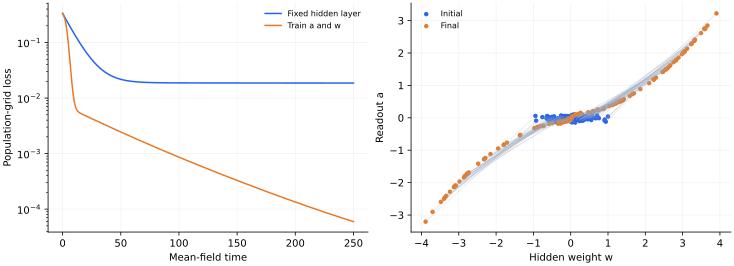

> **II · 无限宽与特征学习 · Note 04**
>
> ← [Note 03](/notes/neural_network_theory/wide_networks/) · [系列目录](/notes/neural_network_theory/) · [Note 05](/notes/neural_network_theory/deep_optimization/) →

**可解性层次：** 相应参数化下的平均场极限。

## 前言：宽度极限保留什么运动

“无限宽以后还会不会学习特征”没有脱离参数化的统一答案。宽度增加时，单个神经元的输出幅度、参数移动速度与总函数变化，可以按不同方式配平。某种配平让每个神经元几乎不动，整体输出依靠很多微小改变量变化；另一种配平让神经元分布发生有限移动，输出通过分布演化改变。

这两种极限分别把网络投向不同的可解对象。Lazy 描述保留初始化切线空间，平均场描述保留参数粒子的分布。前者往往产生固定核，后者通常产生非线性输运方程。它们并不是先后精度等级，也不应被理解成同一个宽度极限的两个名字。

从物理上看，平均场在此处更像大量粒子的确定性密度动力学。每个粒子受到由整体预测误差决定的场，整体误差又由粒子分布形成。宽度无穷使经验分布的涨落在适当条件下消失，却没有使场不再依赖自身。因此“平均场”不等于“线性”，也不等于只剩几个序参量。

我希望这一篇回答一个具体问题：表征移动如何进入函数动力学，以及怎样区分数学上允许移动与实际获得统计优势。先把尺度和方程写清，再讨论凸性、噪声、有限粒子效应与诊断，这样比把特征学习当作一个定性的标签更有用。

## 1. “无限宽”为什么不唯一

增加隐藏单元数时，输出归一化、初始化尺度、学习率和观察时间必须一起指定。同样是两层网络，一种极限中每个特征几乎不动，另一种极限中单个特征会移动有限距离，经验参数分布发生演化。

所以宽度不是唯一控制量。固定核与特征学习可以分别成为不同缩放下的自洽理论；不能用其中一个极限否认另一个极限的存在。

## 2. 两种参数化的尺度比较

NTK 型参数化采用 $f_N=N^{-1/2}\sum_jh(x;\theta_j)$，在常规学习率和相应初始化下，单粒子梯度通常是 $O(N^{-1/2})$。大量微小贡献可以改变函数，Jacobian 却在合适条件下保持接近初始化。

平均场型参数化采用

$$
f_N(x)=\frac1N\sum_{j=1}^N h(x;\theta_j),
\qquad h(x;\theta)=a\phi(w^\top x),\quad\theta=(a,w).
$$

对总体风险 $\mathcal R_N=\frac12\mathbb E[(f_N(x)-y)^2]$，有

$$
\nabla_{\theta_j}\mathcal R_N=
\frac1N\mathbb E[(f_N-y)\nabla h(x;\theta_j)].
$$

若仍用固定学习率，有限时间粒子会冻结。选择 $N$ 倍粒子学习率，等价于重标时间，得到

$$
\dot\theta_j=-\mathbb E[(f_N-y)\nabla h(x;\theta_j)].
$$

现在速度为 $O(1)$，粒子可以移动有限距离。还可以给 $a,w$ 选择不同迁移率；它们会改变极限度量，不能默默吸收成同一个常数。

### 可以连续调节的 lazy 缩放

宽度之外，还可以对一个一般可微模型 $g_\theta$ 定义中心化输出 $f_\alpha=\alpha(g_\theta-g_{\theta_0})$，以 $\alpha^{-2}$ 倍迁移率优化其平方损失。记 $J_g$ 为 $g$ 的 Jacobian，则

$$
\dot\theta=-\frac1{\alpha D}J_g^\top r,
\qquad
\dot f_\alpha=-\frac1D J_gJ_g^\top r.
$$

函数演化仍为 $O(1)$，参数速度却为 $O(\alpha^{-1})$。在有限时间内若 Jacobian、Hessian 等量有适当界，$\Delta\theta=O(\alpha^{-1})$，Taylor 展开中的输出二阶项为 $\alpha O(\|\Delta\theta\|^2)=O(\alpha^{-1})$，于是模型趋向初始化切线动力学。

这里甚至没有改变模型宽度。它把 lazy 行为归结为函数尺度、迁移率和初始化附近几何的共同选择。这类尺度分析见 [Chizat、Oyallon 与 Bach，On Lazy Training in Differentiable Programming](https://arxiv.org/abs/1812.07956)。对有限网络而言，与其问“是否已经足够宽”，更可操作的问题是：在完成任务所需的函数变化期间，特征坐标到底移动了多少。

### 对称平均场初始化为何仍能学习

在平均场参数化中，若 $a$ 为独立、对称零均值随机变量，则 $f_{\rho_0}=0$。但读出速度 $\dot a=-\mathbb E[(f-y)\phi(w^\top x)]$ 一般不为零：不同 $w$ 与教师的相关不同，会产生 $a$ 和 $w$ 的依赖关系，随后隐藏权重也随之移动。

因此分布的初始某个低阶均值为零，并不意味着整个分布流静止。真正的不变性要检查完整速度场是否在支持上为零，或者对称性是否严格禁止相应相关量产生。只追踪均值可能错过开始形成的参数–特征相关。

## 3. 从粒子系统推导分布方程

定义经验分布 $\rho_N=N^{-1}\sum_j\delta_{\theta_j}$，极限预测写为

$$
f_\rho(x)=\int h(x;\theta)\rho(d\theta).
$$

风险泛函的一阶变分为

$$
\Psi(\theta;\rho)=\frac{\delta\mathcal R}{\delta\rho}(\theta)
=\mathbb E[(f_\rho(x)-y)h(x;\theta)],
$$

差一个与 $\theta$ 无关的常数不会影响速度。对光滑测试函数 $g(\theta)$，

$$
\frac d{dt}\int g\,d\rho_N
=-\int\nabla g\cdot\nabla\Psi(\theta;\rho_N)\,d\rho_N.
$$

若粒子经验分布在相应正则性和矩条件下收敛，弱形式对应

$$
\boxed{\partial_t\rho
=\nabla_\theta\cdot[\rho\nabla_\theta\Psi(\theta;\rho)].}
$$

这是参数空间的连续性方程：概率质量由速度 $v=-\nabla\Psi$ 输运。它常被称作 Wasserstein 梯度流。写成偏微分方程后仍需要边界衰减和可积性，才能合法地分部积分。

### 变分导数从风险展开中出现

取保持总质量的扰动 $\rho\to\rho+\epsilon\delta\rho$，其中 $\int\delta\rho=0$。函数变化为 $\delta f(x)=\int h(x;\theta)\delta\rho(d\theta)$，因而

$$
\delta\mathcal R
=\mathbb E[(f_\rho-y)\delta f]
=\int\mathbb E[(f_\rho-y)h(x;\theta)]\delta\rho(d\theta).
$$

这给出 $\Psi$。由于总质量固定，给 $\Psi$ 加一个常数不会改变一阶变分；连续性方程又只使用它的参数梯度，所以该自由度自然消失。

风险作为 $\rho$ 的函数有一个特殊结构：$f_\rho$ 对测度线性，平方损失对输出凸，因此风险对测度的线性混合是凸的。但粒子梯度流并非在所有测度方向上作普通欧氏下降，而是用输运移动已有质量。测度凸性本身并不足以保证任意有限粒子初始化都能找到全局最优：支持不足、退化速度或参数空间拓扑都可能阻碍有效的输运路径。

## 4. 风险耗散与时变函数核

在无通量边界或充分衰减条件下，

$$
\frac{d\mathcal R}{dt}
=-\int\|\nabla\Psi(\theta;\rho)\|^2\rho(d\theta)\leq0.
$$

这证明该流降低风险，却不单独证明收敛到全局最优。全局结论还需要激活、参数支持、齐次性或初始分布等额外条件。

对预测求导还得到

$$
\partial_t f_\rho(x)
=-\mathbb E_{x',y'}[K_\rho(x,x')(f_\rho(x')-y')],
$$

$$
K_\rho(x,x')=\int
\nabla h(x;\theta)\cdot\nabla h(x';\theta)\,\rho(d\theta).
$$

形式上仍像核动力学，但核由正在移动的分布决定。固定核解不能直接使用，因为 $\rho_t$ 与残差互相耦合。闭合在一个分布上，并不等于闭合在有限个均值或重叠上。

### 线性激活给出少见的有限矩闭合

为看清分布方程与有限闭合的区别，取一维输入、$\mathbb Ex^2=1$、教师 $y=sx$，每个粒子贡献 $h=awx$。令 $m=\int aw\,d\rho$，则 $f_\rho=mx$，风险是 $(m-s)^2/2$。粒子方程为

$$
\dot a=(s-m)w,\qquad \dot w=(s-m)a.
$$

再定义 $S=\int(a^2+w^2)d\rho$，直接求导得到

$$
\boxed{\dot m=(s-m)S,\qquad\dot S=4(s-m)m.}
$$

所以 $S^2-4m^2$ 守恒；每个粒子的 $a^2-w^2$ 也分别守恒。这里 $K_\rho(x,x')=Sxx'$，特征分布的变化被两个矩完全概括。若 $S=2m\gt 0$，便回到两层平衡标量网络的 Logistic 动力学。

非线性激活时，$\dot m$ 一般包含 $\phi(w^\top x)$、$\phi'(w^\top x)$ 和残差的联合平均，再对这些量求导又引入更高阶函数。除非 Gaussian 对称性、少量教师结构或特殊激活带来额外简化，矩层级不会在有限阶自动终止。平均场 PDE 是一个闭合的无限维描述，这与给出几个序参量的 ODE 有本质计算差别。

### 输运观点中的特征学习

固定随机特征相当于禁止 $w$ 方向输运，只沿 $a$ 移动。全参数平均场则允许质量在参数空间中重新分配，使更多粒子靠近任务有用的方向。对应的函数核仍然正定，但它随 $\rho_t$ 改变；特征学习可以理解为核几何与输出残差共同演化。

这也给出比“参数变了”更强的诊断：新的核变化是否提高了目标方向的响应，是否增大了原来弱模态的学习速率，或者是否仅对所有方向做共同缩放。单纯核范数变大可能只改变时钟，而目标对齐或本征空间旋转才改变哪些函数变得容易学习。

## 5. 一个能看见粒子移动的特征学习实验

取 $x\sim\mathrm{Unif}[-1,1]$，教师为 $\tanh(3x)$，学生为 $N^{-1}\sum_ja_j\tanh(w_jx)$。初始化 $a_j$ 为小随机数、$w_j$ 从窄 Gaussian 取样。全批量训练时

$$
\dot a_j=-\mathbb E[r(x)\tanh(w_jx)],
\quad
\dot w_j=-\mathbb E[r(x)a_jx\operatorname{sech}^2(w_jx)].
$$

固定 $w_j$ 只训练 $a_j$ 是本实验的随机特征对照。它与同时训练 $a,w$ 共享输入、初始化、损失和时间约定；两者的区别有直接的动力学来源。

*图 1 · 自制有限粒子计算。* $N=128$、201 点固定积分网格、步长 0.05，更新使用上面的 $N$ 倍学习率约定。左图比较全参数与固定隐藏层风险；右图用相同粒子连线展示 $(w_j,a_j)$ 的初末位置。它是平均场方程的粒子近似，不是一个无限宽定理的数值证明。

不同宽度下自然比较的是经验分布，粒子坐标之间没有天然的一一对应。严格对称初始化也可能使流停留在不变子流形，逃逸时间依赖初始扰动及有限尺寸涨落。

## 6. 隐式噪声、熵与理论边界

若给粒子加独立 Brownian 噪声 $\sqrt{2T}\,dB_j$，分布方程增加 $T\Delta\rho$，可以解释为风险加熵泛函的梯度流。真实小批量 SGD 的噪声通常状态依赖且在粒子间相关，不能无条件等同于这里的独立各向同性扩散；Note 08 会详细讨论。

**相关文献。** [Mei、Montanari 与 Nguyen，A Mean Field View of the Landscape of Two-Layers Neural Networks](https://arxiv.org/abs/1804.06561)和 [Chizat 与 Bach，On the Global Convergence of Gradient Descent for Over-parameterized Models using Optimal Transport](https://arxiv.org/abs/1805.09545)给出相关平均场理论。本文只在明确缩放下推导输运方程，不将特定全局收敛条件推广到任意深层网络。

## 延伸讨论：输运几何、目标对齐与有限粒子

### 两个极限为什么不能只靠改写符号互换

设 $f_N=N^{-1}\sum_i a_i\phi(w_i\cdot x)$。在原始参数上的普通梯度，单粒子梯度含 $1/N$；若不相应放大学习率，固定时间内粒子移动会随 $N$ 消失。平均场时间通常把这一因子补回，使粒子有 $O(1)$ 运动。另一方面，NTK 的 $N^{-1/2}$ 输出尺度下，普通参数学习率可使总函数速度保持有限。

同一组符号若没有同时给出学习率，动力学尺度是不完整的。比较不同宽度时，训练步数也必须说明是原始迭代次数、吸收学习率的时间，还是单位计算预算。把学习率重新标度以后，两种模型的初始输出分布也未必相同，例如平均场中独立零均值粒子的初始均值函数可能趋零，而 NTK 参数化保留非退化随机函数。

### 经验粒子分布如何产生输运

定义 $\rho_N=N^{-1}\sum_i\delta_{\theta_i}$。若粒子速度为 $\dot\theta_i=v[\rho_N](\theta_i)$，对任意光滑测试函数 $h$，

$$
\frac{d}{dt}\int h(\theta)\rho_N(d\theta)
=\frac1N\sum_i\nabla h(\theta_i)\cdot v[\rho_N](\theta_i).
$$

在能够通过极限的条件下，右侧趋向 $\int\nabla h\cdot v[\rho]\,d\rho$。对 $\theta$ 分部积分便得到弱形式的连续性方程。这样推导的好处，是不要求经验分布先有光滑密度；有限 $N$ 时它始终是原子测度。

若 $v=-\nabla_\theta\Psi_\rho$，则

$$
\partial_t\rho=\nabla_\theta\cdot(\rho\nabla_\theta\Psi_\rho),
\qquad \Psi_\rho=\frac{\delta\mathcal R}{\delta\rho}.
$$

它描述质量在参数空间移动，不是任意重设每个位置的概率。即使风险作为 $\rho$ 的线性函数组合是凸的，输运路径也受当前支持与速度场限制。这就是为什么分布凸性不能单独推出从任意初始化全局收敛。

### 凸混合与质量移动的区别

取两个分布 $\rho_0,\rho_1$。线性混合 $\rho_s=(1-s)\rho_0+s\rho_1$ 可以在远处直接生成质量；Wasserstein 路径则要将已有质量搬运过去。对风险 $\mathcal R(\rho)=\frac12\|f_\rho-y\|^2$，由于 $f_\rho$ 对分布线性，线性混合下容易得到凸性；但粒子梯度流沿第二种几何运动。

因此一个参数空间的驻点条件是 $\nabla\Psi_\rho=0$ 在支持上成立，而全局分布优化还涉及将质量放到支持之外能否下降。若初始化支持过于受限、激活函数使某些方向梯度恒零，粒子可能看不到一个统计上有用的特征。

这也解释了有限网络与连续分布之间的差异。一个连续分布可以在大量方向拥有极小质量，有限粒子样本却可能完全没有覆盖它们。极限系统可达的下降方向，未必在给定宽度下被初始化实际提供。

### 一个可直接观察的目标对齐量

在平方损失中，令残差 $r(x)=f_\rho(x)-f_*(x)$。定义时变函数核

$$
K_\rho(x,x')=\int
\nabla_\theta\psi_\theta(x)\cdot
\nabla_\theta\psi_\theta(x')\,\rho(d\theta).
$$

则总体预测满足 $\partial_t f=-T_{K_\rho}r$，风险耗散为 $\dot{\mathcal R}=-\langle r,T_{K_\rho}r\rangle$。为区分残差变小与核更有利，可比较归一化量

$$
\mathcal A_t=
\frac{\langle r_t,T_{K_t}r_t\rangle}
{\|r_t\|^2\,\operatorname{Tr}T_{K_t}},
$$

在迹有限且残差非零时定义。它度量当前核资源有多少落在当前错误方向上，但不是万能指标：归一化可能隐藏总核幅度改变，当前残差也会随时间变化。更有说服力的对照是固定同一个探测目标，同时比较不同时间的核。

### 有限宽、噪声与扩散是三件事

确定性全批量平均场极限只保留输运。有限宽会留下经验分布涨落；小批量训练会给粒子速度增加数据采样噪声；显式 Langevin 更新则可加入人为设定的扩散。这三种随机性可能有不同协方差与宽度标度，不能统称为“平均场温度”。

若确实加入独立各向同性 Brownian 噪声 $\sqrt{2T}\,dB_i$，形式上的密度方程才出现 $T\Delta\rho$，相应自由能为 $\mathcal R+T\int\rho\log\rho$。若 SGD 噪声状态依赖、各向异性且粒子间相关，这个简单熵项一般不足以描述它。这里与 SGD 篇的非平衡讨论有直接联系。

### 表征收益需要一个资源相当的比较

移动特征能降低固定字典的表示代价，但也引入更复杂优化。若比较无限宽平均场与小规模冻结随机特征，观察到优势并不能直接归因于“移动”本身；两者的容量和计算可能不同。相反，某次平均场实验没有超过核基线，也不能证明特征学习无用，目标也许已经与初始核高度对齐。

我更关注能够分解收益的情形：相同数据下所需神经元更少、相同模型规模下样本效率更高，或者训练后目标投影显著集中在少数新方向。这样才能把数学上时变的核，连接到统计上有用的表示改变。

## 与相邻模型的对照

平均场通常保留整个分布；少数高维在线模型却能借 Gaussian 场闭合到有限个 overlap。下面的 [Note 06](/notes/neural_network_theory/teacher_student_theory/#committee) 推导给出这种额外简化究竟来自哪里：

### Q、R、T 的动力学闭合

定义

$$
Q_{ij}=w_i^\top w_j/d,\qquad
R_{ia}=w_i^\top B_a/d,\qquad
T_{ab}=B_a^\top B_b/d.
$$

局部场 $(h,v)$ 为零均值 Gaussian，协方差为块矩阵 $\begin{pmatrix}Q&R\\R^\top&T\end{pmatrix}$。教师不动，所以 $T$ 固定。

一次更新的教师重叠增量为 $\Delta R_{ia}=\eta F_iv_a/d$。学生重叠的增量包含两类项：

$$
\Delta Q_{ij}=\frac\eta d(F_ih_j+F_jh_i)
+\frac{\eta^2}{d^2}F_iF_j\|x\|^2.
$$

由于 $\|x\|^2/d\to1$，在新样本独立、高维极限下得到

$$
\boxed{\frac{dR_{ia}}{d\tau}=\eta\langle F_iv_a\rangle,}
$$

$$
\boxed{\frac{dQ_{ij}}{d\tau}
=\eta\langle F_ih_j+F_jh_i\rangle
+\eta^2\langle F_iF_j\rangle.}
$$

尖括号是上述有限维联合 Gaussian 积分，因此方程闭合。$\eta^2$ 项来自单步权重变化的平方，是在线有限学习率的贡献；即使 $d\to\infty$ 也不会在当前时间缩放中消失。若再取小学习率并改用时间 $t=\eta\tau$，该项才降为 $O(\eta)$。

反复使用固定有限训练集时，权重与样本产生历史相关，不能继续直接使用“新样本 Gaussian 场”的闭合。这是在线理论与普通多轮训练的重要边界。

#### 为什么这里能平均，而固定数据回用时不能直接平均

在第 $\mu$ 次在线更新前，权重只依赖过去样本。当前 $x_\mu$ 与过去独立，所以给定权重，当前局部场仍然严格联合 Gaussian，协方差由 $Q,R,T$ 决定。先在这个条件分布下平均，再令 $d\to\infty$，序参量的随机增量在 $O(d)$ 次更新上集中为确定漂移。

若反复使用固定数据，当前样本曾参与构造权重，它不再与权重独立。此时仅知道 $Q,R,T$，一般不足以确定它在每个训练样本上的局部场分布。需要额外跟踪记忆、响应函数或训练样本上的过程。Gaussian 输入这一事实本身，不能消除训练造成的条件相关。

#### 学习率平方项与极限顺序

单步 $\Delta w_i$ 的每个坐标约为 $d^{-1/2}$，总范数却为 $O(1)$。因此 $\Delta w_i\cdot\Delta w_j/d$ 是 $O(1/d)$，与两个线性项处在相同的每步阶数。经过 $d$ 次更新后，它累积成有限的 $\eta^2\langle F_iF_j\rangle$。

这也说明“高维极限等于总体梯度流”并不总成立。若保持 $\eta$ 固定，高维在线极限包含随机更新的二阶效应；若随后取 $\eta\to0$、用 $t=\eta\tau$ 观察，方程中的二阶项才消失。学习率不仅重标时钟，还会改变 $Q$ 的演化轨迹与稳定性。

如果向粒子动力学加入随机梯度，还需要先知道噪声在什么时间尺度下出现。下面的离散到扩散计算来自 [Note 08](/notes/neural_network_theory/sgd/)，用于对照确定性输运：

### 从离散更新到局部扩散

设总体经验损失 $\mathcal L=D^{-1}\sum_\mu\ell_\mu$，单样本梯度 $g_\mu$ 的均值为 $g$，定义

$$
C(w)=\frac1D\sum_\mu(g_\mu-g)(g_\mu-g)^\top.
$$

大小为 $B$、有放回独立采样的批次均值满足 $\operatorname{Cov}(g_B)=C/B$。无放回采样则为 $(D-B)C/[B(D-1)]$。SGD 更新为

$$
w_{k+1}=w_k-\eta g(w_k)+\eta\xi_k,
\qquad \operatorname{Cov}(\xi_k\mid w_k)=C(w_k)/B.
$$

取时间 $t=k\eta$，匹配每单位时间的一、二阶矩，得到小步长扩散近似

$$
dw=-\nabla\mathcal L(w)dt+
\sqrt{\frac\eta B C(w)}\,dW_t.
$$

它省略高阶批次累积量、离散误差与批次间相关。Brownian 近似要求相应小步长与局部统计条件，不能只因算法名字是 SGD 就直接使用。

#### 批次协方差的有限总体修正

有放回采样时，批次均值的交叉协方差因独立而消失，留下 $C/B$。无放回采样中，不同抽样项具有负相关，协方差为 $-C/(D-1)$，所以

$$
\operatorname{Cov}(g_B)
=\frac1{B^2}\left[BC-B(B-1)\frac{C}{D-1}\right]
=\frac{D-B}{B(D-1)}C.
$$

当 $B=D$ 时噪声严格消失。只有 $B\ll D$ 时，两种采样才近似给出同样的 $1/B$ 缩放。不同批次若共享样本或按固定顺序循环，时间相关还会改变白噪声近似；只给出一个批次大小并不足以完全指定随机动力学。

#### 扩散系数为何带一个学习率

单步随机位移是 $\eta\xi$，方差为 $\eta^2C/B$。每单位连续时间包含约 $1/\eta$ 步，因此总方差率为 $\eta C/B$，噪声振幅为其平方根。若保持优化时间不变而令 $\eta\to0$，这里的 SGD 扩散也趋于零；若希望得到有限强度扩散，需要另外指定噪声或批次的联合缩放。

这与直接给优化方程添加固定温度 Langevin 噪声不同。后者可以独立调节漂移和扩散，前者的噪声来自实际样本梯度，通常既各向异性又状态依赖。

## 结语：分布移动怎样连接预测

平均场的关键不是“所有粒子都服从平均值”，而是单粒子在由整体分布自洽决定的场中运动。无穷宽消除了一部分采样涨落，却保留分布与预测之间的反馈。由此得到的输运方程，可以比原网络更清楚，也仍然可以很难求解。

Lazy 与平均场之间最重要的分界，是训练时允许保留多大的特征变化。这个分界由参数化、初始化和时间标度共同定义，而不是由宽度一个数字决定。实际有限网络可能处于两者之间，或在不同训练阶段呈现不同程度的核漂移。

对我而言，这篇为后续深度与非线性 teacher–student 讨论提供了一个提醒：能移动并不意味着已经发现结构，风险凸也不意味着路径容易，分布可解也不意味着有限矩闭合。真正的表征理论仍需解释哪些方向被放大、何时发生、为何有助于新样本预测。

---

← [Note 03](/notes/neural_network_theory/wide_networks/) · [系列目录](/notes/neural_network_theory/) · [Note 05](/notes/neural_network_theory/deep_optimization/) →
