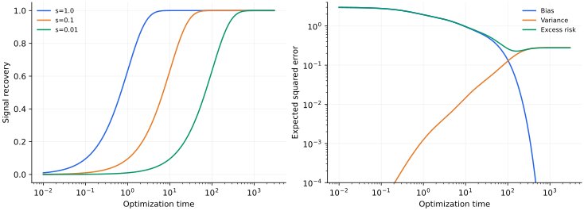

> **I · 泛化与高维模型 · Note 01**
>
> [系列目录](/notes/neural_network_theory/) · [Note 02](/notes/neural_network_theory/double_descent/) →

**可解性层次：** 有限维精确可解。

## 1. 现象：训练得更久，为什么测试误差可能回升

一个模型可以不断降低训练损失，同时逐渐拟合标签里的随机噪声。要理解这个分离，不必从深层网络开始。线性回归已经包含三个关键对象：数据允许观察的方向、每个方向的恢复速度，以及测试分布怎样给这些方向加权。

本篇只用平方损失和连续时间梯度流，先把每个方向精确求解。它是后面 NTK、double descent 和时间幂律共同使用的动力学基线。这里的“时间”是吸收了学习率的优化时间，没有物理秒的含义。

## 2. 最小模型与三个不同的误差

训练集有 $D$ 个样本、$d$ 个输入坐标，设计矩阵 $X\in\mathbb R^{D\times d}$ 的第 $\mu$ 行是 $x_\mu^\top$。设

$$
y=Xw_*+\varepsilon,\qquad
\mathbb E\varepsilon=0,\qquad
\mathbb E\varepsilon\varepsilon^\top=\sigma_\varepsilon^2 I_D,
$$

$$
\mathcal L_\lambda(w)=\frac{1}{2D}\|Xw-y\|^2+
\frac\lambda2\|w\|^2,\qquad \lambda\geq0.
$$

噪声与输入独立，教师参数 $w_*$ 固定。测试输入独立于训练集，二阶矩 $\Sigma=\mathbb E[xx^\top]$。于是未加 $1/2$ 的测试均方误差为

$$
R_{\rm test}=\mathbb E_{x,\varepsilon_{\rm new}}
[(x^\top w-y_{\rm new})^2]
=\underbrace{(w-w_*)^\top\Sigma(w-w_*)}_{R_{\rm ex}}
+\sigma_\varepsilon^2.
$$

$R_{\rm ex}$ 是超额预测风险，$\|w-w_*\|^2$ 是参数误差；只有 $\Sigma=I_d$ 时两者相等。训练损失则用同一份参与拟合的数据计算，不能把上式的独立测试平均直接搬过去。

例如，测试输入几乎不沿某个方向变化，那么该方向参数即使估计得很差，对预测的影响仍可很小。反过来，测试分布偏重训练数据很少覆盖的方向时，训练误差可能严重低估实际风险。

## 3. 从矩阵方程到独立松弛模态

记 $H=X^\top X/D$、$b=X^\top y/D$，梯度流为

$$
\dot w=-(H+\lambda I)w+b.
$$

分解 $H=V\operatorname{diag}(s_i)V^\top$，其中 $s_i\geq0$。令 $z_i=v_i^\top w$、$b_i=v_i^\top b$，便有

$$
\dot z_i=-(s_i+\lambda)z_i+b_i,
$$

$$
\boxed{z_i(t)=e^{-(s_i+\lambda)t}z_i(0)+
\frac{1-e^{-(s_i+\lambda)t}}{s_i+\lambda}b_i.}
$$

若 $s_i=\lambda=0$，由 $Xv_i=0$ 知 $b_i=0$，该方向保持初始化。不要把上式写成 $0/0$ 后随意赋值。用矩阵指数与伪逆可以统一表达，但逐模写法更清楚地显示了可学习子空间。

无正则化时，非零模态的松弛时间 $\tau_i=s_i^{-1}$。大特征值方向先学会，小特征值方向很慢；这首先是**经验协方差方向**上的顺序，不等于任意输入坐标或空间频率上的顺序。

## 4. 早停怎样形成谱滤波

取 $w(0)=0$、$\lambda=0$，并令

$$
\eta_i=\frac{v_i^\top X^\top\varepsilon}{D},
\qquad b_i=s_i z_i^*+\eta_i,
\qquad
\mathbb E[\eta_i\eta_j\mid X]
=\frac{\sigma_\varepsilon^2}{D}s_i\delta_{ij}.
$$

于是

$$
z_i(t)-z_i^*=-e^{-s_it}z_i^*
+\frac{1-e^{-s_it}}{s_i}\eta_i,
$$

$$
\boxed{\mathbb E[(z_i(t)-z_i^*)^2\mid X]
=e^{-2s_it}(z_i^*)^2+
\frac{\sigma_\varepsilon^2}{Ds_i}(1-e^{-s_it})^2.}
$$

第一项是尚未恢复的信号，第二项是已经拟合的噪声。小 $s_i$ 使最终噪声误差很大，但也使噪声进入得很慢。这就是早停能够有益的最小机制。

若 $\Sigma$ 与 $H$ 共用本征向量，测试风险是这些式子乘以对应测试权重后求和。一般情况下应保留 $V^\top\Sigma V$：给定 $X$ 的偏差向量可在测试度量下产生交叉项。简单地把每个参数误差相加，已经额外假设了各向同性测试分布。

早停滤波器为 $g_t(s)=1-e^{-st}$，最终 ridge 的信号滤波器为 $g_\lambda(s)=s/(s+\lambda)$。在 $s\ll t^{-1}$ 时前者约为 $st$，在 $s\ll\lambda$ 时后者约为 $s/\lambda$，所以 $\lambda\sim t^{-1}$ 能匹配低谱端的量级；两种完整滤波曲线并不相同，也不存在适用于所有谱与目标的精确换算。

## 5. 训练残差、零空间与离散梯度下降

令 $r=Xw-y$，在无正则化梯度流下

$$
\dot r=-\frac{XX^\top}{D}r,
\qquad r(t)=e^{-Kt}r(0),\qquad K=XX^\top/D.
$$

无法落入 $\operatorname{im}X$ 的标签分量不会消失。若 $X$ 满行秩、$d\geq D$，则训练集可以插值，但参数零空间里的教师分量依然没有被数据确定。

离散更新 $w_{n+1}=w_n-\eta(Hw_n-b)$ 中，每个齐次模态乘以 $1-\eta s_i$。收敛条件是 $0\lt \eta\lt 2/s_{\max}$；要让所有模态单调松弛还需 $\eta\leq1/s_{\max}$。连续时间解不能用于解释越过稳定边界后的振荡或发散。

## 6. 数值结果

*图 1 · 精确谱模型，自制计算。* 脚本使用 $s=(1,0.1,0.01)$、$z_i^*=1$、$D=100$、$\sigma_\varepsilon=0.5$。左图为信号滤波 $1-e^{-s_it}$；右图将条件期望中的偏差和方差分别求和，测试二阶矩取单位阵。右图没有重新抽训练集，也不是深度网络的实测曲线。

复现命令为 `python experiments.py --note 1`，脚本见[系列目录](/notes/neural_network_theory/#reproduce)。最慢方向是否含有教师信号，决定了晚期拟合是在恢复有用结构，还是主要吸收噪声。

作为数值核对，取 $s=0.01$、$t=100$：信号恢复比例约为 $0.632$，噪声项为 $0.25(1-e^{-1})^2\simeq0.100$。损失是否除以样本数会使噪声项相差 $D$ 倍。

## 7. 解释范围与相关文献

这里精确解释的是固定设计矩阵、平方损失下的优化与噪声拟合。它没有产生新特征，没有解释非线性网络的表征重组。随机训练集的风险平均，还需要下一篇的随机矩阵工具。

**相关文献。** [Advani 与 Saxe（2017），High-dimensional dynamics of generalization error in neural networks](https://arxiv.org/abs/1710.03667)把线性可解动力学与高维谱联系起来。本文的有限维计算直接从上述损失推导；该预印本的作者为两人，后续扩展版本的书目信息不与之混用。

---

[系列目录](/notes/neural_network_theory/) · [Note 02](/notes/neural_network_theory/double_descent/) →
