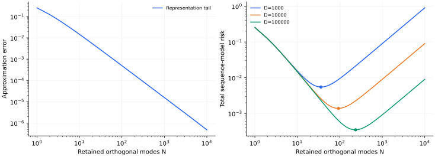

> **V · Scaling Laws · Note 19**
>
> ← [Note 18](/notes/neural_network_theory/data_scaling/) · [系列目录](/notes/neural_network_theory/) · [Note 20](/notes/neural_network_theory/compute_scaling/) →

**可解性层次：** 嵌套正交特征模型可解。

## 1. 模型变大究竟增加了什么

参数总数、独立特征数、表示秩和可训练自由度不是同一个量。要推导 model scaling，先指定一种模型族，以及增加规模时它如何扩展可表达函数。

本篇选择最清楚的嵌套模型：第 $N$ 个学生能表示总体正交基的前 $N$ 个模态。这样可以把近似误差与统计误差完整分开。真实随机特征和深度网络随后作为对比，而不是被强行塞进同一个 $N$。

## 2. 正交谱截断的精确近似误差

总体输入空间中 $\{\psi_i\}$ 正交，教师

$$
f_* =\sum_{i\geq1}a_i\psi_i,\qquad
\mathcal H_N=\operatorname{span}(\psi_1,\ldots,\psi_N).
$$

已知教师时的最佳表示是正交投影 $f_N^*=\sum_{i\leq N}a_i\psi_i$，故

$$
\boxed{E_{\rm app}(N)=\|f_*-f_N^*\|_{L^2}^2
=\sum_{i\gt N}a_i^2.}
$$

若 $a_i^2\sim A_0i^{-q}$、$q\gt 1$，积分比较得到

$$
E_{\rm app}(N)\sim\frac{A_0}{q-1}N^{-(q-1)}.
$$

因此模型幂律指数 $\alpha=q-1$ 在这里来自表示能量尾部。它不是参数计数的维度分析；改变模态排序或表示族，就会改变模型规模对应的截止位置。

### 目标平均误差与最坏情形逼近宽度

前面的尾部和描述一个指定教师，或一个具有已知能量分配的教师集合的平均误差。若研究最坏情形，指数可能不同。考虑函数椭球

$$
\mathcal E=\left\{\sum_i b_i c_i\psi_i:
\sum_i c_i^2\leq1\right\},\qquad b_1\geq b_2\geq\cdots.
$$

用前 $N$ 个模态表示时，最坏误差为 $b_{N+1}^2$：对手可以把全部允许能量放在第一个被遗漏方向。任意其他 $N$ 维子空间也无法同时覆盖前 $N+1$ 个独立方向，因此不能改善这个最坏阶数。

如果改为平均随机系数，且第 $i$ 模态平均能量为 $b_i^2$，平均截断误差则为 $\sum_{i\gt N}b_i^2$。当 $b_i^2\sim i^{-q}$ 时，前者按 $N^{-q}$，后者按 $N^{-(q-1)}$。二者没有矛盾，因为教师集合及平均方式不同。把逼近论的最坏界直接当作真实任务的平均 model scaling 指数，可能错一个幂次。

## 3. 加上可估计性：模型不是越大越合适

采用与 Note 18 相同的高斯序列观测 $z_i=a_i+\sigma\xi_i/\sqrt D$，保留前 $N$ 项、其余设为零。于是

$$
\boxed{E(N,D)=\sum_{i\gt N}a_i^2+\frac{\sigma^2 N}{D}.}
$$

这是本序列模型的精确偏差–方差分解。若用 $E\simeq AN^{-\alpha}+\sigma^2N/D$，优化 $N$ 得到

$$
N_*\simeq\left(\frac{\alpha AD}{\sigma^2}\right)^{1/(\alpha+1)},
\qquad
E_*\asymp D^{-\alpha/(\alpha+1)}.
$$

增加数据后，值得保留的模态也应增加。固定数据不断提高硬截止秩，噪声方差最终上升；如果采用软滤波或显式正则化，可以让名义模型更大而有效维数仍有限。

在随机输入回归中，$\sigma^2N/D$ 通常只在经验设计足够接近正交、远离插值病态时是合理近似。一般有限样本方差涉及经验 Gram 的逆，Note 02 的尖峰就在这里被简单序列代理省略了。

## 4. 数据与模型指数为什么有关却不必相等

本嵌套模型的模型指数为 $\alpha=q-1$；在有噪序列实验中最优数据指数为

$$
\beta=\frac{q-1}{q}=\frac\alpha{\alpha+1}.
$$

它们共享目标尾部，但数据增长还要支付每个估计模态的噪声成本，因而指数不同。若观测噪声、正则化或表示族改变，这个关系也可能失效。经验上观察两个相近指数，不能据此断言存在同一个微观谱机制。

若网络的参数数 $P$ 与有效秩满足 $N\sim P^\zeta$，则当前近似误差对参数数的指数为 $\zeta(q-1)$。这个映射必须由架构或独立测量给出，不能把 $\zeta=1$ 当成默认事实。

### 参数计数与谱截止之间需要一个映射

一个秩 $r$ 的 $d_{\rm out}\times d_{\rm in}$ 矩阵可由两个因子表示，名义参数数为 $r(d_{\rm in}+d_{\rm out})$，实际自由度还要扣掉因子内部的等价变换。若输入、输出维数固定且远大于 $r$，参数数大致正比于秩；若两个外部维数也与 $r$ 同阶增长，则参数数为 $O(r^2)$。

若教师奇异值平方尾部为 $\sigma_i^2\sim i^{-q}$，最优秩截断误差为 $r^{-(q-1)}$。前一种规模比较对参数数仍给出指数 $q-1$，后一种却给出 $(q-1)/2$。相同的教师奇异谱，仅因模型族的扩展方式不同，就会得到不同的参数标度指数。

神经网络中，宽度增加还可能同时改变特征数量、特征质量、优化路径和隐式范数。因此 $N$ 是表示秩、隐藏单元数还是非嵌入参数数，并非可以事后忽略的记号差别，它决定了理论横轴究竟是什么。

## 5. 随机特征与可学习特征的区别

增加随机特征数量提高的是一个随机子空间的维数，未必按教师最有用的模态顺序扩展。其核近似误差、设计谱和统计误差可能耦合，因此未必满足本篇的理想尾部公式。

端到端特征学习还可以改变子空间方向。一个低秩教师若被任务适应的表示准确找到，可能只需少量特征；固定随机方向则可能需要很多。此时把改善全部拟合成一个固定 $N^{-\alpha}$，会把“表示方向变化”与“表示数量增加”混在一起。

一个实用实验是同时记录名义参数数、隐藏特征矩阵的奇异值、相对教师的投影误差和测试风险。有效秩可作摘要，但阈值定义和目标对齐也应报告；仅有谱平坦或秩高，并不能保证保留了任务方向。

### 同样的表示维数，方向选择可以造成数量级差异

在一个有限 $M$ 维总体正交空间里，固定教师向量 $a$，随机取一个均匀的 $N$ 维子空间，投影为 $P_N$。由旋转不变性 $\mathbb EP_N=(N/M)I$，于是

$$
\mathbb E\|(I-P_N)a\|^2
=\left(1-\frac NM\right)\|a\|^2.
$$

若允许根据已知教师选择子空间，只用一维 $\operatorname{span}(a)$ 就能精确表示该教师。但这个 oracle 选择已经使用了全部目标知识；真实特征学习要用有限数据和有限优化找到相近方向，不能把寻找表示的成本当作零。

这给出一个清楚的分工：近似理论研究存在怎样的好表示，统计理论研究数据能否辨认它，动力学研究指定训练能否到达它。固定随机特征与端到端网络的性能差，可能发生在这三步中的不同位置，仅测最终秩无法区分。

### 随机特征数量也可能通过覆盖概率产生幂律

Note 03 的随机频率模型中，平均近似误差为 $\sum_i a_i^2(1-p_i)^N$。若 $p_i\asymp i^{-p}$，它近似一个关于特征预算 $N$ 的 Laplace 和，给出 $N^{-(q-1)/p}$。理想按序谱截断却给出 $N^{-(q-1)}$，因为每增加一个模态都优先覆盖尚未表示的方向。

两种表示即使最终趋向同一个无限核，也可以有不同的有限规模曲线。特征抽样、冗余和目标对齐的差异，决定了名义特征数到有效覆盖模态数的转换。这也使 model scaling 与 time scaling 产生形式上的联系：两者都可能是对一组不同难度方向的逐渐覆盖，但横轴与实际机制仍然不同。

### 模型变大后的饱和与统计包络

固定有限数据时，表示尾部可以继续下降，而统计估计误差或优化误差已开始主导。若更大模型允许复用小模型的函数，最小训练目标不会变差；但测试误差并没有同样的单调性保证，因为算法可能选择了另一个插值延拓。

重新选择正则化、停止时间和训练预算，可以得到更低的风险包络；固定协议下的原始曲线则可能出现饱和、尖峰或回升。经验 model scaling 若来自每个规模都充分调参的包络，其指数不能直接解释为一个固定动力学过程的自然指数。

## 6. 数值图与复现

*图 1 · 自制序列模型。* 使用 $q=2.5$、100000 项归一化教师能量、$\sigma=0.3$。左图为精确尾部和；右图比较 $D=10^3,10^4,10^5$ 的总风险，标点为离散网格最优秩，本次分别约为 36、93、235。右图的上升来自直接估计更多带噪模态，不含随机设计插值尖峰。

复现命令为 `python experiments.py --note 19`。固定 $D$ 改变 $N$ 与沿 $N_*(D)$ 同时改变两者，是不同的规模曲线。每个规模重新调参所得的包络，也不同于固定训练协议下的原始曲线。

有限 100000 模态只是数值截断；接近该上限时尾部不再代表无限幂律。图中选择的 $N\leq10000$，仍需在更精细指数估计时检查截断敏感性。

## 7. 相关文献与研究边界

**相关文献。** [Mei 与 Montanari](https://arxiv.org/abs/1908.05355)展示随机特征模型中容量、数据和输入维数的非平凡竞争；[Bahri 等](https://arxiv.org/abs/2102.06701)讨论模型与数据规模的不同机制。本篇的正交截断是一个可解参照，不代表一般深度网络的参数–秩关系已被推导。

---

← [Note 18](/notes/neural_network_theory/data_scaling/) · [系列目录](/notes/neural_network_theory/) · [Note 20](/notes/neural_network_theory/compute_scaling/) →
