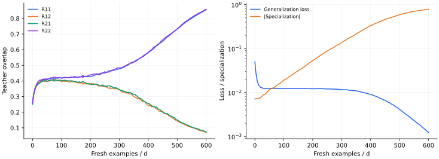

> **III · 深度与优化动力学 · Note 11**
>
> ← [Note 10](/notes/neural_network_theory/implicit_bias/) · [系列目录](/notes/neural_network_theory/) · [Note 12](/notes/neural_network_theory/hierarchical_learning/) →

**可解性层次：** Gaussian 新样本在线极限下闭合。

## 1. 特征涌现需要比输出拟合更多的观测量

两个隐藏单元一开始可能做近似相同的事，随后分别对应不同的教师方向。这种专门化改变隐藏表示，固定 NTK 无法描述它的完整演化。为了获得可处理的理论，选择少量隐藏单元、Gaussian 输入与每次使用新样本的在线学习。

这里闭合的不是全部权重坐标，而是权重之间的重叠矩阵。关键在于：对 Gaussian 输入，局部场的联合分布完全由这些重叠决定。

## 2. 教师、学生与高维缩放

设 $x\sim\mathcal N(0,I_d)$，教师权重 $B_a$、学生权重 $w_i$ 的范数均为 $O(\sqrt d)$。定义

$$
v_a=B_a^\top x/\sqrt d,\quad h_i=w_i^\top x/\sqrt d,
\quad y=\sum_{a=1}^M g(v_a),\quad f=\sum_{i=1}^K g(h_i).
$$

本篇固定读出系数为 1，激活取 $g(h)=\operatorname{erf}(h/\sqrt2)$。采用每个新样本上的损失 $(f-y)^2/2$，更新

$$
\Delta w_i=\frac\eta{\sqrt d}F_i x,
\qquad F_i=(y-f)g'(h_i).
$$

令训练时间 $\tau=\mu/d$，其中 $\mu$ 为已使用样本数。$\eta$ 是该在线规则的学习率，而非已经吸收进 $\tau$ 的量。

## 3. Q、R、T 的动力学闭合

定义

$$
Q_{ij}=w_i^\top w_j/d,\qquad
R_{ia}=w_i^\top B_a/d,\qquad
T_{ab}=B_a^\top B_b/d.
$$

局部场 $(h,v)$ 为零均值 Gaussian，协方差为块矩阵 $\begin{pmatrix}Q&R\\R^\top&T\end{pmatrix}$。教师不动，所以 $T$ 固定。

一次更新的教师重叠增量为 $\Delta R_{ia}=\eta F_iv_a/d$。学生重叠的增量包含两类项：

$$
\Delta Q_{ij}=\frac\eta d(F_ih_j+F_jh_i)
+\frac{\eta^2}{d^2}F_iF_j\|x\|^2.
$$

由于 $\|x\|^2/d\to1$，在新样本独立、高维极限下得到

$$
\boxed{\frac{dR_{ia}}{d\tau}=\eta\langle F_iv_a\rangle,}
$$

$$
\boxed{\frac{dQ_{ij}}{d\tau}
=\eta\langle F_ih_j+F_jh_i\rangle
+\eta^2\langle F_iF_j\rangle.}
$$

尖括号是上述有限维联合 Gaussian 积分，因此方程闭合。$\eta^2$ 项来自单步权重变化的平方，是在线有限学习率的贡献；即使 $d\to\infty$ 也不会在当前时间缩放中消失。若再取小学习率并改用时间 $t=\eta\tau$，该项才降为 $O(\eta)$。

反复使用固定有限训练集时，权重与样本产生历史相关，不能继续直接使用“新样本 Gaussian 场”的闭合。这是在线理论与普通多轮训练的重要边界。

## 4. 泛化误差的显式高斯积分

对方差 $A,B$、协方差 $C$ 的联合 Gaussian $u,v$，erf 激活满足

$$
\mathcal C(A,B,C)=\mathbb E[g(u)g(v)]
=\frac2\pi\arcsin\frac C{\sqrt{(1+A)(1+B)}}.
$$

因此总体泛化损失 $E_g=\mathbb E[(f-y)^2]/2$ 可直接由重叠算出：

$$
2E_g=\sum_{ij}\mathcal C(Q_{ii},Q_{jj},Q_{ij})
-2\sum_{ia}\mathcal C(Q_{ii},T_{aa},R_{ia})
+\sum_{ab}\mathcal C(T_{aa},T_{bb},T_{ab}).
$$

这比不断抽取大测试集更精确，也提供了检查重叠动力学程序的办法。得到的块协方差必须半正定；若 ODE 数值解使其出现显著负特征值，应先检查步长或闭合实现。

## 5. 对称平台与专门化

取 $M=K=2$、$T=I_2$。在学生交换对称的流形上，可能有 $R_{11}=R_{12}=R_{21}=R_{22}$，两个单元都学习教师的共同方向。定义专门化序参量

$$
S=\frac12(R_{11}-R_{12}-R_{21}+R_{22}).
$$

若最终按对角线配对，$S$ 变大；按反对角线配对则 $S$ 变负，两者物理等价。比较训练种子时可用 $|S|$，但多单元情况更适合先做最优置换匹配。

在对称解附近将闭合流线性化，反对称扰动满足 $\dot S\simeq\lambda_{\rm sp}S$。若 $\lambda_{\rm sp}\gt 0$，小初始扰动 $S_0$ 被放大，到达可见阈值 $S_c$ 的延迟约为 $\lambda_{\rm sp}^{-1}\log(S_c/|S_0|)$。这里没有给出所有设定通用的 $\lambda_{\rm sp}$ 数值，它需从指定激活与平台状态的 Jacobian 计算。

严格对称的确定性初始条件可以永远留在对称流形上；有限维涨落、初始化不对称或噪声才提供种子。把浮点误差造成的逃逸当成一个可重复的物理时间，会误判平台尺度。

## 6. 数值结果

*图 1 · 自制在线委员会机实验。* $d=200$、两个正交单位方差教师、两个学生、$\eta=0.15$。学生从共同教师方向加小独立扰动初始化，每步重新抽 Gaussian 输入。左图记录四个 $R_{ia}$，右图用解析高斯积分计算泛化损失和 $|S|$。这是有限维单次轨迹；有无明显平台及其长度依赖初始化与学习率，不将单次曲线命名为普适相变。

复现命令为 `python experiments.py --note 11`。不同学习率的轨迹需换算到共同时间 $t=\eta\mu/d$。固定数据集上的多轮训练还会引入样本历史相关，不能直接沿用新样本在线闭合。

## 7. 相关文献

**原始文献。** [Saad 与 Solla（1995），On-line learning in soft committee machines](https://journals.aps.org/pre/abstract/10.1103/PhysRevE.52.4225)建立这类重叠动力学。本文使用固定读出、erf 激活与独立新样本，以完整列出能够闭合的模型条件。

---

← [Note 10](/notes/neural_network_theory/implicit_bias/) · [系列目录](/notes/neural_network_theory/) · [Note 12](/notes/neural_network_theory/hierarchical_learning/) →
