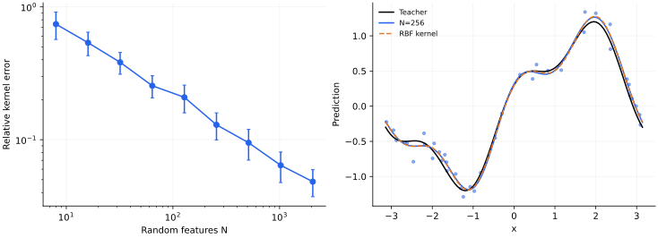

> **I · 泛化与高维模型 · Note 03**
>
> ← [Note 02](/notes/neural_network_theory/double_descent/) · [系列目录](/notes/neural_network_theory/) · [Note 04](/notes/neural_network_theory/teacher_student/) →

**可解性层次：** 有限特征精确求解；核极限渐近。

## 1. 非线性输入映射，也可以只做线性训练

设两层网络的隐藏层在初始化以后完全固定，只调整最后一层。输入到输出仍是非线性函数，但训练问题是一个线性回归。这让我们单独研究“选了一套什么特征”，而不把收益全部归因于特征学习。

这种模型有两种用途：它是核方法的有限维近似，也是在讨论可学习隐藏层之前的控制组。如果一个现象在固定随机特征下已经存在，就不能仅凭这个现象证明网络产生了新表示。

## 2. 最小模型与归一化

抽取 $w_j\sim\mathcal N(0,I_d)$，定义

$$
\Phi_j(x)=\frac1{\sqrt N}\phi(w_j^\top x/\sqrt d),
\qquad f_a(x)=\Phi(x)^\top a.
$$

给定训练特征矩阵 $\Phi\in\mathbb R^{D\times N}$，优化

$$
\frac1{2D}\|\Phi a-y\|^2+\frac\lambda2\|a\|^2.
$$

直接求导得到

$$
a_\lambda=(\Phi^\top\Phi+D\lambda I_N)^{-1}\Phi^\top y.
$$

令 $K_N=\Phi\Phi^\top$，利用 $ (\Phi^\top\Phi+cI)^{-1}\Phi^\top=\Phi^\top(\Phi\Phi^\top+cI)^{-1}$，可将测试预测写成

$$
\boxed{f_\lambda(x)=k_N(x,X)^\top(K_N+D\lambda I_D)^{-1}y,}
\quad k_N(x,X)=\Phi\Phi(x).
$$

这是同一个解的原始与对偶表达；$N\lt D$ 时解 $N$ 维线性系统，$D\lt N$ 时通常解 $D$ 维系统。实际计算应使用线性求解或 SVD，避免显式求逆。

## 3. 从有限特征到核

有限特征核是

$$
k_N(x,x')=\frac1N\sum_{j=1}^N
\phi(w_j^\top x/\sqrt d)\phi(w_j^\top x'/\sqrt d).
$$

对固定的一对输入，若乘积可积，大数定律给出

$$
k_N(x,x')\to k_\infty(x,x')
=\mathbb E_w[\phi(w^\top x/\sqrt d)\phi(w^\top x'/\sqrt d)].
$$

若有有限方差，单个核元素的标准误差通常为 $O(N^{-1/2})$。这不是自动的全空间一致误差，更不是无正则化插值风险的同阶保证。矩阵反演会放大靠近零特征值处的近似误差；当 $D$ 与 $N$ 一起增长时，应控制算子范数和正则化，而非只看单个元素收敛。

## 4. 一个可以完整算出的例子：随机 Fourier 特征

希望近似 RBF 核 $k(x,x')=\exp[-\|x-x'\|^2/(2\ell^2)]$。取 $\omega\sim\mathcal N(0,\ell^{-2}I)$、$b\sim\mathrm{Unif}[0,2\pi]$，定义

$$
z_j(x)=\sqrt{\frac2N}\cos(\omega_j^\top x+b_j).
$$

先对随机相位平均：

$$
\mathbb E_b[2\cos(u+b)\cos(v+b)]=\cos(u-v).
$$

再用 Gaussian 特征函数：

$$
\mathbb E_\omega\cos[\omega^\top(x-x')]
=e^{-\|x-x'\|^2/(2\ell^2)}.
$$

于是 $\mathbb E[z(x)^\top z(x')]=k(x,x')$。随机性只是对核积分的 Monte Carlo 近似，并没有使用标签选择 $\omega_j$。

这个例子还指出：输入非线性可以很强，但如果特征由事先确定的采样分布生成，训练仍未改变该分布。若把 $\omega_j$ 也设为可训练量，才跨过本篇的固定特征假设。

## 5. 三个规模不能混成一个“无限大”

固定 $D,d$ 而 $N\to\infty$，主要研究核近似。让 $D,N,d$ 同时增大且比例有限，则有限特征谱和统计误差始终参与竞争。固定 $N$ 而增大 $D$，模型最终只能逼近目标在这 $N$ 维特征空间中的投影。

训练动力学也直接继承 [Note 01](/notes/neural_network_theory/linear_regression/)：零初始化、无正则化时

$$
\dot f_X=-\frac{K_N}{D}(f_X-y).
$$

增加 $N$ 可能提高秩，也可能改善条件数；它不会自动让所有目标方向都变容易。若目标主要位于核小本征值方向，即使核近似非常精确，统计学习仍可能很慢。

风险可以按“目标在特征空间外的残差、有限样本估计误差、正则化偏差”理解。但有限样本随机设计下这些项可能耦合，不能随意把三个独立幂律相加后称为精确分解。

## 6. 数值结果

*图 1 · 自制随机特征实验。* 一维输入区间 $[-\pi,\pi]$、$\ell=0.7$，目标 $\sin x+0.3\cos3x$。左图为固定网格上核矩阵相对 Frobenius 误差，24 个随机特征种子给出均值及标准差；右图为 $D=40$ 个有噪声样本、$N=256$ 的预测和无限特征 RBF 对照，采用相同 $\lambda=10^{-3}$。

复现命令为 `python experiments.py --note 3`。增加特征数主要改善核近似，增加样本数主要减少估计误差，两者对应不同的规模极限。这里的隐藏层始终固定，预测改善不涉及表示适应。

对于 $\sin20x$ 这样的高频目标，在核长度尺度不变时，即使训练误差很小，目标对核谱的错配仍可能导致差的测试误差；这会在 Note 07 变成可计算的谱系数问题。

## 7. 适用边界与相关文献

随机特征是“线性可解训练 + 随机非线性表示”。它能够呈现插值、双下降和核谱偏置，却没有隐藏表示的任务适应。比较它与端到端网络时，应匹配样本、优化预算、初始化分布和正则化，不能只比较参数数目。

**相关文献。** [Rahimi 与 Recht（2007），Random Features for Large-Scale Kernel Machines](https://proceedings.neurips.cc/paper/2007/hash/013a006f03dbc5392effeb8f18fda755-Abstract.html)给出经典随机特征构造；[Mei 与 Montanari](https://arxiv.org/abs/1908.05355)处理高维随机特征回归的精确渐近。本文的 Fourier 计算是可独立检验的特例，不替代高维谱理论。

---

← [Note 02](/notes/neural_network_theory/double_descent/) · [系列目录](/notes/neural_network_theory/) · [Note 04](/notes/neural_network_theory/teacher_student/) →
