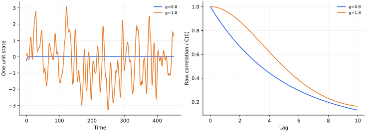

> **IV · 记忆与集体动力学 · Note 11**
>
> ← [Note 10](/notes/neural_network_theory/hopfield/) · [系列目录](/notes/neural_network_theory/) · [Note 12](/notes/neural_network_theory/scaling_laws/) →

**可解性层次：** 非对称稠密随机耦合的无限规模极限。

## 前言：非对称反馈产生的内生时间结构

一个没有训练、耦合均值为零的循环网络，也可以产生稳定、缓慢或混沌的集体活动。这里的时间结构不是外部输入直接写进去的，而是大量非对称反馈自洽形成的。这使随机 RNN 成为研究内生活动和高维非线性动力学的重要基线。

它与 Hopfield 的差别不只是连续状态替代二元自旋。耦合的非对称性通常破坏简单能量下降，因此系统可以维持非平衡轨迹，而不必落入某个静态记忆。零固定点的谱稳定性能够定位局部失稳，却不能单独告诉我们失稳后是新固定点、周期轨道还是混沌。

动力学平均场进一步将多体反馈换成一个具有自洽时间相关的 Gaussian 驱动。这里保留下来的不是一个静态方差，而是整个相关函数。它既要由单神经元滤波产生，又要反过来等于网络反馈的统计。这是本篇最核心的闭合关系。

我会先区分零态失稳、持续活动、相关衰减和扰动指数增长，再讨论它们在经典稠密非对称模型中怎样关联。这样可以避免把“活动看起来不规则”直接等同于混沌，也避免把长相关时间直接等同于有用记忆。

## 1. 随机连接也会产生集体时间结构

循环网络的状态不断反馈，即使不接受外部输入，也可能衰减到静止态、进入其他固定点，或持续表现不规则活动。区分这些行为需要动力学稳定性、时间相关函数和扰动增长率；单看一条复杂曲线不能确认混沌。

本篇讨论经典的稠密、非对称 Gaussian 耦合网络。耦合若改成对称、稀疏或具有强结构，平均场与转变都可能改变。

## 2. 最小模型与零态失稳

令单元时间常数为 1：

$$
\dot x_i=-x_i+g\sum_{j=1}^N J_{ij}\phi(x_j),
\qquad J_{ij}\sim\mathcal N(0,1/N),
\quad \phi(x)=\tanh x.
$$

不同有向边独立，特别是 $J_{ij}$ 与 $J_{ji}$ 不相关。零态总是解，线性化为

$$
\delta\dot x=(-I+gJ)\delta x.
$$

大 $N$ 时 $J$ 的复特征值铺满单位圆盘，最大实部趋近 1。因此 $g\lt 1$ 的零态线性稳定，$g\gt 1$ 零态失稳。这个阈值仅是零态稳定性分析；单靠圆律没有证明失稳后一定混沌。

### 零态稳定性之外还有瞬态放大

线性扰动的精确传播子是 $e^{(-I+gJ)t}$。非对称随机矩阵通常非正规，特征向量并不正交，因此最大实部为负只保证长期衰减，不保证所有初始扰动的范数从第一刻就单调变小。短时输入响应和长期 Lyapunov 稳定性可能不同。

当讨论循环网络作为储备池时，这种差别很实际：系统可以在最终稳定的同时，对某些短时输入有较大增益；增益太大又会放大噪声。仅用谱半径或最长线性时间尺度判断“记忆能力”，没有包含读出方向和信噪比。

## 3. 从多体反馈到自洽 Gaussian 过程

对非对称稠密随机耦合，在合适的 $N\to\infty$ 极限中，典型单元可描述为

$$
(\partial_t+1)x(t)=\eta(t),\qquad
\mathbb E[\eta(t)\eta(t')]=g^2 C_\phi(t,t'),
$$

$$
C_\phi(t,t')=\mathbb E[\phi(x(t))\phi(x(t'))].
$$

$\eta$ 是由网络自洽产生的有色 Gaussian 场。它不是任意给定的外部白噪声；其协方差反过来取决于单元自身的统计。高度非对称性使反馈的某些反应项在该极限下消失，对称耦合通常需要额外记忆项。

若稳态均值为零且时间平移不变，记 $\Delta(\tau)=\mathbb E[x(t)x(t+\tau)]$。对相关函数作用两次线性滤波算子，得到

$$
\boxed{\Delta''(\tau)=\Delta(\tau)-g^2 C_\phi(\tau).}
$$

其中 $C_\phi(\tau)$ 由方差 $\Delta_0$、协方差 $\Delta(\tau)$ 的二元 Gaussian 积分给出：

$$
C_\phi(\tau)=\mathbb E_{u,v}\big[\tanh u\tanh v\big],
\quad \operatorname{Cov}(u,v)=
\begin{pmatrix}\Delta_0&\Delta(\tau)\\\Delta(\tau)&\Delta_0\end{pmatrix}.
$$

因此未知量是整个函数 $\Delta(\tau)$ 加上其初值 $\Delta_0$，不只是一个静态方差。

### 自洽场经过泄漏滤波后才成为状态

稳定的单元解可写为 $x(t)=\int_0^\infty e^{-u}\eta(t-u)du$，所以

$$
\Delta(\tau)=g^2\int_0^\infty\!du\int_0^\infty\!dv\,
e^{-u-v}C_\phi(\tau+u-v).
$$

对两个时间分别作用 $\partial_t+1$ 和 $\partial_{t'}+1$，在平稳条件下 $\partial_t\partial_{t'}\Delta=-\Delta''$，得到 $-\Delta''+\Delta=g^2C_\phi$。这一步的负号来自两个时间差导数方向相反。

特别在 $\tau=0$，卷积可以化为

$$
\Delta_0=g^2\int_0^\infty e^{-\tau}C_\phi(\tau)d\tau.
$$

它依赖整条相关函数，而不是只有 $C_\phi(0)$。静态方差 ansatz 相当于把时间依赖忽略，才会得到类似 $q=g^2\mathbb E\phi(\sqrt qz)^2$ 的方程。这个对照直接显示，时间相关不是在静态平均场上加一个附属指标，而是决定活动幅度本身的组成部分。

### 二元 Gaussian 积分的实际构造

给定 $\Delta_0$ 和 $c=\Delta/\Delta_0$，可取 $u=\sqrt{\Delta_0}z_1$、$v=\sqrt{\Delta_0}[cz_1+\sqrt{1-c^2}z_2]$，将 $C_\phi$ 化为两个独立 Gaussian 的积分。端点 $|c|=1$ 需按连续极限处理。任何候选 $\Delta(\tau)$ 都应满足 $|\Delta(\tau)|\leq\Delta_0$，更强地还应作为一个正定相关函数；仅数值满足一个二阶 ODE，不自动保证它是可实现的随机过程。

## 4. 势能类比与边界条件

对固定 $\Delta_0$ 定义

$$
V(\Delta;\Delta_0)=-\frac{\Delta^2}{2}
+g^2\int_0^\Delta C_\phi(u;\Delta_0)du.
$$

相关方程变成 $\Delta''=-\partial_\Delta V$。对可微平稳过程，$\Delta'(0)=0$。若考虑零均值混合解，还要求 $\Delta(\tau)\to0$、$\Delta'(\tau)\to0$，对应势能匹配 $V(\Delta_0;\Delta_0)=V(0;\Delta_0)$。

这个边界值问题用于确定非零活动方差及相关衰减。若有非零长期相关平台，边界条件应改变，不能强制设为零。

有时看到静态方程 $q=g^2\int Dz\tanh^2(\sqrt qz)$。它属于时间不变随机场的固定点 ansatz；在持续时变的混沌态中，滤波器会混合不同时间，不能用它替代完整 DMFT 方程求活动方差。

### 机械能匹配并不是任意初值积分

将 $\Delta''=-\partial_\Delta V$ 乘以 $\Delta'$，得到守恒量 $\frac12(\Delta')^2+V(\Delta;\Delta_0)$。混合解从 $\Delta(0)=\Delta_0$、$\Delta'(0)=0$ 出发，并在无穷远趋近零，所以必须同时满足两端机械能相同。

$\Delta_0$ 不只是可随意设置的初始振幅，因为它还出现在 $C_\phi(\Delta;\Delta_0)$ 的边缘方差中，因而改变整个势函数。求解流程实际上是：对一个候选方差构造势，再检查能量匹配和相关函数边界；只有自洽方差才能给出物理解。任意从某个方差出发积分出的振荡或发散曲线，不一定代表网络的一种稳态。

## 5. 混沌要用扰动增长检验

对同一条轨迹的微小扰动，

$$
\delta\dot x_i=-\delta x_i+
g\sum_jJ_{ij}\phi'(x_j(t))\delta x_j.
$$

最大 Lyapunov 指数定义为适当线性极限下的长期平均增长率

$$
\lambda_{\max}=\lim_{T\to\infty}\frac1T
\log\frac{\|\delta x(T)\|}{\|\delta x(0)\|}.
$$

数值上应反复归一化切向量并累加对数伸长，避免扰动饱和。正指数表示敏感依赖初值；相关衰减、宽频谱和复杂轨迹是辅助现象，不能替代这一检验。有限时间接近零的指数也可能来自周期轨道、慢暂态或有限尺寸，需改变时间、步长和规模。

### 两副本稳定性把 Lyapunov 问题化为谱问题

考虑两条极近轨迹，在相同自洽活动背景上研究它们的交叉相关扰动 $k(t,t')$。在非对称大规模 DMFT 的相应线性化中，Gaussian 协方差求导给出

$$
(\partial_t+1)(\partial_{t'}+1)k(t,t')
=g^2 C_{\phi'}(t-t')k(t,t'),
$$

其中 $C_{\phi'}(\tau)=\mathbb E[\phi'(x(t))\phi'(x(t+\tau))]$。它仍依赖两个时刻，不能只用 $\mathbb E\phi'^2$ 替代。

令中心时间 $T=(t+t')/2$、相对时间 $\tau=t-t'$，并取 $k=e^{\omega T}\psi(\tau)$。利用 $\partial_t\partial_{t'}=\frac14\partial_T^2-\partial_\tau^2$，得到

$$
\left[-\frac{d^2}{d\tau^2}+1-g^2C_{\phi'}(\tau)\right]\psi
=\left(-\omega-\frac{\omega^2}{4}\right)\psi.
$$

因此一个一维 Schrödinger 型算子的最低本征值 $E_0$ 控制最强相关扰动增长。相关扰动对应扰动幅度的平方，故最大 Lyapunov 指数为

$$
\boxed{\lambda_{\max}=-1+\sqrt{1-E_0}.}
$$

这是在所述平稳大规模自洽理论中的关系；有限网络与有限时间估计需要另行比较。$E_0\lt 0$ 时指数为正，零态失稳和持续混沌于是由不同层次的谱问题联系起来。

### 非平凡衰减相关为何对应不稳定轨迹

对相关方程求一次 $\tau$ 导数，并使用 Price 恒等式 $dC_\phi/d\Delta=C_{\phi'}$，得到

$$
\left[-\frac{d^2}{d\tau^2}+1-g^2C_{\phi'}(\tau)\right]\Delta'(\tau)=0.
$$

因此平稳相关的平移导数是零能解。对一条平滑、偶对称且向零衰减的非平凡相关函数，$\Delta'$ 是有节点的奇函数。在适用的全实线束缚态问题中，最低能态无节点，能量低于这个零能奇态，因此 $E_0\lt 0$。这个论证解释了相关函数形状与正 Lyapunov 指数之间的物理联系，而不只是观察一条不规则轨迹后给它贴上混沌标签。

若相关有不衰减平台、外部噪声使原点边界出现尖点，或耦合对称性引入记忆反应项，上述边界和谱论证都要重新检查。随机循环网络的可解性来自完整的模型条件，不是任意复杂反馈系统都能照搬同一个 Schrödinger 算子。

## 6. 数值实验与记忆时间

*图 1 · 自制有限网络模拟。* 稠密非对称随机矩阵，比较稳定侧与高增益侧；参数取 $N=400$、$g=0.8,1.8$、Euler 步长 0.05。左图为单元轨迹，右图为暂态后跨单元平均的未去均值相关 $\Delta(\tau)/\Delta(0)$。稳定侧的幅度会趋近零，因此其归一化相关不能解释成一个有限幅度平稳活动的记忆函数。

有限时间切向增长率的估计依赖步长、运行时长和规模。靠近 $g=1$ 时线性慢时间尺度约为 $(1-g)^{-1}$，而信息记忆还依赖输入、读出和噪声的定义。

## 7. 相关文献与理论范围

**原始文献。** [Sompolinsky、Crisanti 与 Sommers（1988），Chaos in Random Neural Networks](https://journals.aps.org/prl/abstract/10.1103/PhysRevLett.61.259)给出经典动力学平均场理论及混沌转变。本文的有限网络轨迹是模型说明，理论极限与数值证据分别陈述。

## 延伸讨论：相关、响应与混沌的区别

### 随机矩阵只回答线性化附近的问题

在 $x=0$ 附近，$\phi(x)\simeq\phi'(0)x$，Jacobian 为 $-I+g\phi'(0)J$。若 $J$ 的大规模谱服从单位圆分布，最右实部触及零给出局部失稳条件。这是小扰动围绕零态的结论。

但非正规矩阵可能有明显瞬态放大，即使所有本征值实部都负。因为本征向量不正交，$\|e^{At}\|$ 可以先增长再衰减。反过来，零态失稳也不自动保证正最大 Lyapunov 指数；非线性饱和可能把轨迹稳定到别的吸引子。

因此线性谱、有限扰动响应与长期轨迹应分别测量。将它们放在同一参数轴上比较，才有可能判断失稳以后发生了什么。

### 有效驱动为什么必须是有色的

令反馈场 $\eta_i(t)=g\sum_jJ_{ij}\phi(x_j(t))$。在适当非对称、稠密、大规模条件下，单元受到近似 Gaussian 场，其协方差为

$$
\mathbb E\eta(t)\eta(s)=g^2C_\phi(t,s),
\qquad C_\phi(t,s)=\mathbb E[\phi(x(t))\phi(x(s))].
$$

原系统的时间记忆转移到了噪声颜色中。若直接把它换成白噪声，只保留同一时刻方差，便改变了有效单神经元的滤波结果，也无法重新得到同一个 $C_\phi$。

对平稳线性滤波 $\dot x=-x+\eta$，频域有 $S_x(\omega)=S_\eta(\omega)/(1+\omega^2)$。这个式子已经说明零时差方差由整个驱动频谱积分决定，而不只由 $C_\eta(0)$ 决定。动力学自洽需要保留函数，是由反馈的时间结构决定的。

### 自洽相关不是一条任意拟合曲线

平稳态相关 $\Delta(\tau)=\mathbb E x(t)x(t+\tau)$ 应满足偶对称、正定性以及由动力学得到的边界条件。将高斯场积分写成 $C_\phi(\tau)=F(\Delta(\tau);\Delta_0)$ 后，得到关于 $\Delta$ 的二阶方程。

机械势类比把 $\tau$ 当作形式时间，但它不是原网络轨迹的真实时间演化方程：它描述两时相关随时间差变化。势能守恒是相关方程的积分结构，不意味着原非对称网络存在守恒能量。把这两层时间分开，可以避免一个很容易发生的物理误读。

解方程还必须选出合法相关函数。仅找到满足微分方程的一条数值轨道，不保证其 Fourier 变换非负，也不保证它对应真实平稳 Gaussian 过程。经典边界条件与自洽方差在这里起选择作用。

### 两条相近轨迹才定义混沌检验

最大 Lyapunov 指数研究相同耦合、相同外部驱动下，两条初态极近轨迹的指数分离。若给两条轨迹独立噪声，它们分开可能只因驱动不同，不是确定性敏感性。

在线性扰动层面，$\delta\dot x_i=-\delta x_i+g\sum_jJ_{ij}\phi'(x_j(t))\delta x_j$。这里的系数由正在运动的背景轨迹决定，所以零态的静态 Jacobian 不能直接代替它。两副本平均场将这种乘性时间结构转化为相关响应算子，才进一步得到 Lyapunov 判据。

实际估计时需定期归一化扰动并累计增长率，避免初期瞬态、数值舍入和非线性饱和污染斜率。直接画两条轨迹距离，长时间会因饱和而看起来不再增长，不能据此判定指数为零。

### 临界慢化不等于计算能力最大

接近稳定边界时，某些响应时间可能增长，输入痕迹保持更久。但同时系统可能更敏感于噪声、有限规模涨落与参数扰动。长期相关既可能是有用输入记忆，也可能是与任务无关的内生活动。

若要讨论计算收益，需要指定输入编码、读出训练、任务时延和噪声水平，然后测可恢复信息或预测风险。仅有自相关时间的峰，不能确定哪个参数最适合任务。所谓临界附近有益，必须连同任务和评价协议一起说。

### 经典 DMFT 的结构边界

部分对称耦合会引入反馈响应，稀疏网络可能保留非 Gaussian 输入，重尾权重可能破坏普通 CLT，结构化低秩连接则会产生额外集体模态。它们都可能需要扩展平均场，而不是只在原方程里换一个 $g$。

训练后的 RNN 还会让耦合与活动相关，不再是独立随机矩阵。随机模型仍可作为背景基线，帮助辨认训练产生了什么结构；但不能把未经训练的相图直接当作训练网络的完整动力学。

## 与相邻模型的对照

对称耦合允许逐次更新的能量下降，而一般非对称 RNN 没有这项保证。下面 [Note 10](/notes/neural_network_theory/hopfield/) 的证明给出明确对照：

### Hebbian 耦合与异步更新

存储模式 $\xi_i^\mu\in\{-1,1\}$，$\mu=1,\ldots,P$，设

$$
J_{ij}=\frac1N\sum_{\mu=1}^P\xi_i^\mu\xi_j^\mu,
\quad i\neq j,\qquad J_{ii}=0,
$$

$$
E(s)=-\frac12\sum_{i\neq j}J_{ij}s_is_j,
\qquad h_i=\sum_jJ_{ij}s_j.
$$

一次只更新一个自旋 $s_i\leftarrow\operatorname{sign}(h_i)$，$h_i=0$ 时保持原值。若发生翻转，能量变化为

$$
\Delta E=2s_i^{\rm old}h_i\leq0.
$$

有限状态空间与严格能量下降保证这种零温异步动力学最终进入不再翻转的固定点。这个证明使用了对称耦合、无自耦合与单点更新；并行同步更新可以产生二周期，非对称耦合也未必存在同样的能量函数。

长时间曲线也可以来自大量线性速率的叠加。下面 [Note 12 · 时间标度](/notes/neural_network_theory/scaling_laws/#time-scaling) 的有限模态计算提供一个非混沌的慢动力学基线：

### 有限模态的精确表达

在线性回归、固定随机特征或冻结 NTK 下，残差可写成

$$
r_k(t)=a_ke^{-\lambda_kt},\qquad
\mathcal L(t)=\frac12\sum_k a_k^2e^{-2\lambda_kt}.
$$

常数 $1/D$ 可吸收进 $a_k^2$；必须在整篇计算中保持一致。零模态给出永久平台 $\mathcal L_0=\frac12\sum_{\lambda_k=0}a_k^2$。

定义损失加权的谱测度

$$
d\mu(\lambda)=\sum_{\lambda_k\gt 0}a_k^2\delta(\lambda-\lambda_k)d\lambda.
$$

于是 $\mathcal L(t)-\mathcal L_0=\frac12\int e^{-2\lambda t}d\mu(\lambda)$，是谱测度的 Laplace 变换。仅知道特征值计数密度还不够：初始化或目标在各模态上的能量同样进入权重。

有效 Gaussian 场背后的概率压缩，与前向随机网络 CLT 有相似之处，但动态反馈增加了自洽条件。下面 [Note 03](/notes/neural_network_theory/wide_networks/#gaussian-process) 的有限输入推导有助于明确共享与不同的部分：

### 从两层网络开始的中心极限定理

设

$$
f_N(x)=\frac{\sigma_a}{\sqrt N}\sum_{j=1}^N
a_j\phi(w_j^\top x/\sqrt d)+b,
$$

其中 $a_j\sim\mathcal N(0,1)$、$w_j\sim\mathcal N(0,\sigma_w^2I_d)$、$b\sim\mathcal N(0,\sigma_b^2)$，各组独立。对固定 $x_1,\ldots,x_D$，每个神经元贡献一个 $D$ 维随机向量。若其二阶矩有限，多元中心极限定理给出

$$
(f_N(x_1),\ldots,f_N(x_D))
\Rightarrow\mathcal N(0,K),
$$

$$
K(x,x')=\sigma_b^2+\sigma_a^2
\mathbb E_w[\phi(w^\top x/\sqrt d)\phi(w^\top x'/\sqrt d)].
$$

输出均值为零来自读出权重的零均值，并不要求 ReLU 特征自身零均值。独立性、有限矩与 $N^{-1/2}$ 归一化都是结论的一部分。

#### 条件 Gaussian 与混合分布的区别

由于 $a_j$ 本身是 Gaussian，固定全部隐藏权重以后，有限宽输出向量已经严格为 Gaussian，条件协方差为一个随机经验核。但对隐藏权重再平均，得到的是协方差随机变化的 Gaussian 混合，一般不再严格 Gaussian。无限宽的作用，是让这个随机协方差集中到确定核，而不只是让单点输出“看上去像钟形”。

单个输入的高阶累积量可以显示有限宽修正。写 $b_j=\phi(w_j^\top x/\sqrt d)$，暂去偏置并取 $\sigma_a=1$，则

$$
\mathbb E f_N^2=\mathbb E b^2,\qquad
\operatorname{cum}_4(f_N)
=\frac3N\left[\mathbb E b^4-(\mathbb E b^2)^2\right].
$$

这里使用了 $\mathbb E a^4=3$ 和独立求和时累积量可加。有限四阶矩下，非 Gaussian 性通常以 $1/N$ 衰减；如果四阶矩发散，这条有限宽估计就不成立。对一组输入，还需要对应的联合高阶累积量一起消失，不能仅检查一个输入的峰度。

“固定有限输入集”也有实际含义。宽度无穷时，对任意事先给定的有限样本集都有联合分布极限；若样本数、网络深度或所观察的极端输入随宽度增长，需要对误差作一致控制。有限维分布收敛本身没有给出所有这些同时增长极限。

### 外部输入响应与内生自相关需要分开

若加入小外部输入 $I(t)$，线性稳定区的响应为 $\delta x(t)=\int_{-\infty}^t e^{A(t-s)}I(s)ds$。自相关测量的是没有特定输入时活动如何与自身相关，响应则测量输入怎样影响后续状态。平衡系统中某些涨落–响应关系可将二者连接，一般非平衡随机 RNN 没有自动成立的同一关系。

因此一个网络可以有很长的内生相关时间，却对任务输入不敏感；也可以自相关不长，却通过结构化方向保留可读出的输入痕迹。讨论记忆容量时，需要把输入耦合向量、读出方向和噪声一并指定。

在非正规线性系统中，短时间响应放大还可能提高某些信号的可读性，但也放大相同方向噪声。净收益取决于输入和噪声在奇异向量上的投影，而不是只取决于最大瞬态增益。这个结论与线性回归中的测试度量相呼应：方向在哪里，比一个全局幅度数字更重要。

有限规模实验中，靠近转变区域还应延长预热、比较多个初态和多个耦合样本。非常慢的瞬态可能看起来平稳，有限时间 Lyapunov 指数也可能在零附近波动。经典无限规模相图给出参照，不能消除有限观察窗口带来的不确定性。

### 非平稳过程不能只写时间差相关

若系统仍在从初态松弛，相关应写成两时函数 (C(t,s))，不能预先缩成 (C(t-s))。只有进入平稳区，时间平移不变性才允许前面的单变量相关方程。有限时间模拟若预热不足，相关衰减里会混入初态漂移；在很慢或多稳态区域，这种混合尤其明显。先验证平稳性，再求平稳 DMFT 的数值解，才能让理论和模拟讨论同一个对象。

## 结语：随机反馈的三个观测层次

随机 RNN 的核心认识是，高维反馈能够在没有精心设计连接的情况下产生自洽时间结构。局部谱定位零态失稳，相关函数描述持续活动，两副本响应判断敏感依赖。三种工具各自回答不同问题，合起来才接近完整动力学图景。

DMFT 的力量来自把大量单元压缩成一个有色驱动的有效过程，其代价是特定耦合与极限假设。保留时间相关而不只保留方差，是这类动力学平均场区别于静态平均场的关键。

与前面的记忆模型并置后，可以看见两条不同的组织方式：能量景观中的吸引子与非平衡反馈中的持续轨迹。真实神经与人工循环系统可能同时包含结构化模式和随机背景，经典模型给出了拆解它们的两个起点，而不是一个可以包办所有现象的统一答案。

---

← [Note 10](/notes/neural_network_theory/hopfield/) · [系列目录](/notes/neural_network_theory/) · [Note 12](/notes/neural_network_theory/scaling_laws/) →
