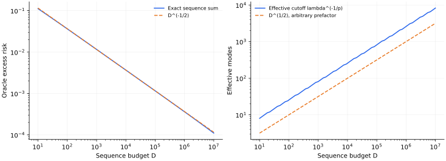

> **V · Scaling Laws · Note 12**
>
> ← [Note 11](/notes/neural_network_theory/random_rnn/) · [系列目录](/notes/neural_network_theory/)

**可解性层次：** 固定谱与序列模型可解；经验标度依赖观测和成本假设。

## 前言：把四种增长放在同一个问题里

训练更久、数据更多、模型更大，往往都能让损失继续下降，但三种改善并不是同一件事。延长训练使已有信息有更多时间被提取，增加独立数据改善估计与覆盖，扩大模型则允许表示更多方向。计算预算把这些选择耦合起来：模型变大以后，固定预算下能处理的数据或更新次数可能减少。

将它们放在一起讨论，有助于看清幂律到底来自哪里。一种可能来源是目标能量具有长尾，学习过程逐步获得更细分辨率；另一种来源是大量不同速率的松弛叠加；还有一些经验规律只是某个训练协议下最优结果的包络。形式相似的指数关系，不保证背后是同一种微观机制。

这一篇沿着一条共同主线展开：先定义目标、观测和风险，再看时间、数据与容量分别限制哪些模态，最后加入成本约束，计算怎样分配资源。这样可以在需要时比较指数，也能看见什么时候不能比较。讨论始终保留损失地板、噪声、有限尺度窗口与极限顺序，避免把一条双对数直线直接当作普遍定律。

## 1. 一个共同的谱模型：学习的是哪些方向 {#joint-risk}

设总体正交基为 $\{\psi_i\}$，目标为 $f_* =\sum_i a_i\psi_i$。用 $\eta_i\gt 0$ 描述第 $i$ 个方向的学习速率或核尺度。理想化的序列观测是 $z_i=a_i+\sigma\xi_i/\sqrt D$，其中 $\xi_i$ 独立、均值为零、方差为 1；模型只能保留前 $N$ 个方向。

为了同时看见三种限制，令保留模态按 $\dot{\widehat a}_i=\eta_i(z_i-\widehat a_i)$ 从零开始训练。它对应加权序列平方损失

$$
\mathcal L_N(\widehat a)=\frac12\sum_{i\leq N}\eta_i(\widehat a_i-z_i)^2
$$

的梯度流。这里的损失给不同方向不同曲率，最终评价的总体函数风险则使用正交基的 $L^2$ 度量。这个构造不是任意随机输入回归的自动等价物。解为

$$
\widehat a_i(t)=
\begin{cases}
(1-e^{-\eta_i t})z_i,&i\leq N,\\
0,&i\gt N.
\end{cases}
$$

对观测噪声平均，总体函数的超额均方风险精确分解为

$$
\boxed{
R(t,N,D)=
\underbrace{\sum_{i\leq N}a_i^2e^{-2\eta_i t}}_{\text{保留方向中的优化偏差}}
+\underbrace{\sum_{i\gt N}a_i^2}_{\text{未表示的目标尾部}}
+\underbrace{\frac{\sigma^2}{D}\sum_{i\leq N}(1-e^{-\eta_i t})^2}_{\text{已经进入预测的观测噪声}}.}
$$

这三个项分别说明为什么“更多”不必单调改善全部风险。延长时间降低第一项，也逐渐放开第三项；增大模型降低第二项，却增加需要估计的方向；增加独立观测精度能降低第三项，但无法替固定模型表示遗漏方向。真实采样还会引入经验设计的随机性，后文会指出这一代理没有包含的部分。

若 $\eta_i\asymp i^{-p}$、$a_i^2\asymp i^{-q}$，$p\gt 1,q\gt 1$，则时间对应大约 $i_t\asymp t^{1/p}$ 的分辨率，模型给出硬截止 $N$，正则化则给出软截止 $i_\lambda\asymp\lambda^{-1/p}$。它们可以放进同一张谱图，但使用不同滤波器，不能任意把 $t,N,D$ 相互替换。

| 资源或观测 | 当前模型中改变的对象 | 需要另行确认的条件 |
| --- | --- | --- |
| 训练时间 $t$ | 已表示方向的恢复程度与噪声进入程度 | 时钟、学习率和核是否固定 |
| 独立数据量 $D$ | 谱系数的估计精度 | 真实采样是否也改善覆盖与设计 |
| 模型规模 $N$ | 可表示方向与近似尾部 | 参数数怎样映射到秩或模态数 |
| 计算预算 $C$ | 可行的模型、数据和训练组合 | 成本与损失曲面是否匹配训练协议 |

这里的 $R$ 是总体函数误差。训练损失还会给模态乘上不同权重；如果评价带噪新标签，还要另加不可约噪声。因此以下各节都先说明观测量，再比较它的标度。

## 2. 时间标度：指数模态怎样形成幂律 {#time-scaling}

训练时间首先是一个动力学变量。下面从固定特征或冻结核出发；[Note 01](/notes/neural_network_theory/linear_learning/#regression) 给出有限矩阵的完整解，[Note 03](/notes/neural_network_theory/wide_networks/#ntk) 说明固定核何时能近似非线性网络。

### 有限模态与损失加权谱

在线性回归、固定随机特征或冻结 NTK 下，残差可写成

$$
r_k(t)=b_ke^{-\lambda_kt},\qquad
\mathcal L(t)=\frac12\sum_k b_k^2e^{-2\lambda_kt}.
$$

这里的 $b_k$ 是初始残差投影，不是第一节的目标系数 $a_i$。常数 $1/D$ 可吸收进 $b_k^2$；必须在整篇计算中保持一致。零模态给出永久平台 $\mathcal L_0=\frac12\sum_{\lambda_k=0}b_k^2$。

定义损失加权的谱测度

$$
d\mu(\lambda)=\sum_{\lambda_k\gt 0}b_k^2\delta(\lambda-\lambda_k)d\lambda.
$$

于是 $\mathcal L(t)-\mathcal L_0=\frac12\int e^{-2\lambda t}d\mu(\lambda)$，是谱测度的 Laplace 变换。仅知道特征值计数密度还不够：初始化或目标在各模态上的能量同样进入权重。

### 小速率端决定长期指数

假设相关窗口内 $d\mu/d\lambda\simeq A\lambda^{\nu-1}$，$\nu\gt 0$。若下边缘为零且其他部分可控，则

$$
\mathcal L(t)-\mathcal L_0\simeq
\frac A2\int_0^\infty\lambda^{\nu-1}e^{-2\lambda t}d\lambda.
$$

令 $u=2\lambda t$，得到

$$
\boxed{\mathcal L(t)-\mathcal L_0
\sim\frac{A\Gamma(\nu)}{2^{\nu+1}}t^{-\nu}.}
$$

指数来自小速率端的**加权**谱。若计数密度 $\rho(\lambda)\sim\lambda^a$、每模态平均初始能量 $\mathbb E[b_k^2\mid\lambda]\sim\lambda^b$，则 $\nu=a+b+1$。忽略目标权重会把时间指数算错。

当 $\nu\leq0$ 时，该连续密度在零端不可积；有限初始损失需要截断或不同权重，不能沿用这个公式再声称得到负指数增长。

#### 从谱推导曲线，与从曲线反推谱

前面的计算是 Abelian 方向：给定小速率端的规则谱，推出长期损失。反方向需要额外的 Tauberian 条件，例如正测度的适当正则变化性质。有限时间窗内一条近似直线，并不足以唯一重建微观谱；不同谱、若干离散时间尺度，甚至时变核都可能产生相似曲线。

若 $d\mu/d\lambda=A\lambda^{\nu-1}\ell(1/\lambda)$，其中 $\ell$ 是缓变函数，损失也会带上 $\ell(t)$ 的缓慢修正。有限尺度拟合把对数因子吸收到有效指数里，可能误以为指数随时间变化。区分真正不同的幂次与缓变修正，需要比一次线性拟合更多的尺度信息。

#### 局部斜率对应正在主导损失的速率

对去掉零模平台后的损失 $L_+(t)$，定义随时间倾斜的概率测度

$$
dP_t(\lambda)=\frac{e^{-2\lambda t}d\mu(\lambda)}{2L_+(t)}.
$$

直接微分可得

$$
\beta_{\rm eff}(t)=-\frac{d\log L_+}{d\log t}
=2t\langle\lambda\rangle_t,
\qquad
\frac{d\beta_{\rm eff}}{d\log t}
=\beta_{\rm eff}-4t^2\operatorname{Var}_t(\lambda).
$$

纯幂律加权谱对应随时间尺度化的 Gamma 分布：均值 $\nu/(2t)$、方差 $\nu/(4t^2)$，局部指数因而保持 $\nu$。物理上是损失权重不断从快模态转移到速率约为 $1/t$ 的慢模态，每个单模态始终仍为指数松弛。

### 有限窗口、谱隙与极限顺序

若谱仅在 $[\lambda_{\min},\lambda_{\max}]$ 上近似该幂律，那么幂律通常需要

$$
\lambda_{\max}^{-1}\ll t\ll\lambda_{\min}^{-1}.
$$

太早时，所有模态都未明显变化，损失接近初值；太晚时，谱下边缘或最慢单模态支配。连续密度若在正下边缘附近为 $B(\lambda-\lambda_{\min})^a$，长时间会出现 $e^{-2\lambda_{\min}t}t^{-(a+1)}$，而非无限延续的纯幂律。

任何有限正定矩阵最终都有最慢指数。先取系统规模无穷、再取时间无穷，才可能得到无谱隙幂律；反过来则一般得到最慢模态指数。两个极限不应默默交换。

### 模态编号、误差权重与优化时钟

若 $\lambda_k\sim k^{-p}$、$b_k^2\sim k^{-q}$，$p\gt 0,q\gt 1$，则

$$
\mathcal L(t)\simeq\frac12\int_1^\infty
k^{-q}e^{-2t k^{-p}}dk.
$$

变量替换 $u=2t k^{-p}$ 给出

$$
\boxed{\mathcal L(t)\sim
\frac{\Gamma((q-1)/p)}{2p}(2t)^{-(q-1)/p}.}
$$

直观上，时间 $t$ 大致学会 $k\lesssim t^{1/p}$ 的快模态，剩余尾部 $\sum_{k\gt t^{1/p}}k^{-q}\sim t^{-(q-1)/p}$。精确积分与这个移动截止尺度给出同一指数。

同一核谱的时间指数还依赖目标系数；后续数据指数又包含估计噪声与正则化，二者不能只因共享一个谱就直接相等。

#### 插值临界点中的三个不同时间指数

取 Note 01 的 Gaussian 回归，$d/D\to1$，小谱端为 $\rho(s)\simeq1/(\pi\sqrt s)$。零初始化，教师相对样本方向各向同性，平均信号能量为 $r^2$。训练信号损失带有额外的 $H$ 权重：参数误差映射到输出时乘 $\sqrt s$，平方后再乘 $s$。因此

$$
\mathbb E\mathcal L_{\rm train,signal}
\simeq\frac{r^2}{2}\int s\rho(s)e^{-2st}ds
\propto t^{-3/2}.
$$

标签噪声在训练预测空间近似各向同性，其残差损失则为

$$
\mathbb E\mathcal L_{\rm train,noise}
\simeq\frac{\sigma^2}{2}\int\rho(s)e^{-2st}ds
\propto t^{-1/2}.
$$

同一谱的两种初始能量权重产生不同训练指数。测试参数偏差没有训练损失中的额外 $s$，所以 $R_{\rm bias}\propto t^{-1/2}$。拟合噪声造成的测试方差更特别：

$$
R_{\rm var}(t)\simeq\sigma^2\int
\frac{\rho(s)}s(1-e^{-st})^2ds
\propto t^{1/2}.
$$

变量替换 $u=st$，并对积分分部，可以得到领先系数

$$
R_{\rm var}(t)\sim
\frac{4\sigma^2}{\sqrt\pi}
\left(1-\frac1{\sqrt2}\right)\sqrt t.
$$

临界谱既使训练损失幂律下降，也使测试噪声风险持续增长。训练幂律因而不是泛化改善的充分证据。有限矩阵最终还有最小正本征值，这些幂律仍受时间窗和极限顺序限制。

#### 学习率日程改变优化时钟

离散模态为 $r_{k,n}=r_{k,0}\prod_{j\lt n}(1-\eta_j\lambda_k)$。当所有相关 $\eta_j\lambda_k$ 足够小，$\log r_{k,n}\simeq-\lambda_k\sum_j\eta_j$，自然优化时间是 $t_n=\sum_j\eta_j$。

若 $\eta_j\propto j^{-a}$，$0\leq a\lt 1$ 时 $t_n\propto n^{1-a}$，原先的 $t^{-\nu}$ 表现为更新数上的 $n^{-\nu(1-a)}$；$a=1$ 时则可能表现为 $(\log n)^{-\nu}$。同一固定谱仅因时钟变化，就能产生不同的表观指数。实验横轴采用更新数、样本处理量还是累计学习率，会直接影响理论比较。

*图 1 · 同一个谱对应不同风险指数。* 使用 $\gamma=1$ 的完整 MP 密度，信号与噪声幅度均取 1，直接积分三个风险式。左图的晚期拟合斜率约为 $-1.5000,-0.5000,+0.5028$；右图将测试方差除以 $\sqrt t$，趋向解析常数 0.66099。图中没有训练非线性网络，也没有重新拟合谱。它展示的是误差权重和谱反演怎样改变同一谱的时间表现。

### 非负指数混合对曲线形状的限制

固定正半定核下，去掉不可学习平台后，损失可写成 $E(t)=\int_0^\infty e^{-2\lambda t}\mu(d\lambda)$，其中 $\mu$ 是非负有限测度。于是对所有整数 $n\geq0$，

$$
(-1)^nE^{(n)}(t)=\int(2\lambda)^ne^{-2\lambda t}\mu(d\lambda)\geq0.
$$

除损失下降以外，曲线还具有凸性及更高阶交替导数符号。这是固定非负模态混合的限制。真实曲线若出现明显加速下降的凹区，或者平台后损失下降速度重新增强，就不能用同一个固定非负速率测度完整解释；可能存在时变特征、时钟变化或观测噪声。

数值微分很敏感，因此这不是要求从有噪曲线直接估计高阶导数，而是提供一个结构判断：固定谱模型能产生长尾，却不能产生任意形状。它的解释力来自限制，也应由这些限制来检验。

### 少数离散速率也会产生很长的交叉区

取 $E(t)=ae^{-2\lambda_1t}+be^{-2\lambda_2t}$，$\lambda_1\gt \lambda_2\gt 0$。瞬时对数衰减率为

$$
-\frac12\frac d{dt}\log E(t)
=\frac{a\lambda_1e^{-2\lambda_1t}+b\lambda_2e^{-2\lambda_2t}}
{ae^{-2\lambda_1t}+be^{-2\lambda_2t}}.
$$

它从能量加权平均速率逐渐靠近慢速率。即使只有两个指数，有限窗口的双对数曲线也可以看起来近似一段直线，但拉宽窗口后会显露交叉区，最终仍转为指数。

若慢模态权重 $b$ 极小，它要等到 $t\sim\log(a/b)/[2(\lambda_1-\lambda_2)]$ 才主导。这说明“长时间由最小特征值决定”还需要时间足以压过初始能量比。谱最慢不等于在实际预算里最重要。

### 有限规模怎样截断幂律窗口

设有 $M$ 个近似独立速率，其低端累积分布为 $P(\lambda\leq s)\simeq cs^a$。最小速率的典型尺度由 $Mcs^a\sim1$ 给出，即 $\lambda_{\min}\asymp M^{-1/a}$。因此由连续低谱产生的幂律，最晚大约在 $t\sim M^{1/a}$ 附近遇到有限规模截断，之后转向少数最慢模态。

这个估计忽略速率间相关及能量权重；真实随机矩阵的极端谱可能需要更精确理论。它仍清楚说明宽度增加可能主要拉长幂律窗口，而不改变窗口内指数。若只在固定窄窗口拟合，就可能误以为宽度完全不影响动力学；若只观察最终指数衰减，又可能错过先前很长的幂律区。

还要检查最慢模态是否有足够损失权重。若其标签投影随 $M$ 极小，实际可见截断时间会被推迟。最低特征值、最低加权速率与实验噪声地板共同决定能够看到什么，这三者不宜混成一个“有限尺寸效应”参数。

从可检验预测看，固定谱解释通常要求随着可用模态数增加，交叉窗口按某种规律移动；特征学习则可能连加权谱本身都改变。比较多个宽度的完整局部斜率曲线，比在每个宽度上分别拟合一个指数更能区分这两种情形。

### 时间曲线的数值结果

*图 2 · 自制积分。* 左图取 $d\mu/d\lambda=\lambda^{\nu-1}$、$0\lt \lambda\lt 1$，$\nu=0.5,1,2$，用不完全 Gamma 函数计算完整曲线；右图在 $\nu=1$ 时加入 $\lambda_{\min}=10^{-3}$，用 1500 点谱积分比较无下截断结果。幂律窗口和最终偏离都来自同一个谱模型。

$\nu=1$ 时积分简化为 $\mathcal L(t)=(1-e^{-2t})/(4t)$，短时极限为 $1/2$，长时为 $1/(4t)$，与完整数值曲线一致。

实验拟合应同时报告局部斜率 $\beta_{\rm eff}(t)=-d\log(\mathcal L-\mathcal L_0)/d\log t$。若未知平台未减去、指数窗过短或时间横轴采用更新数而学习率在变化，直线拟合可能给出没有机制意义的指数。

### 核变化以后，需要重新辨认机制

若核随时间改变，模态会旋转，能量也会在方向间转移，通常不能继续写成同一组固定指数的非负叠加。即使瞬时特征值变化不大，基底旋转与不同时刻核的非对易性仍可能重要。幂律既不能单独证明固定谱解释，也不能单独证明特征学习；谱、目标投影与切线模型对照提供了进一步区分的依据。

第一节的共同模型还提示一个实际区别：无噪声的函数恢复可以随时间持续改善，含噪风险则可能先降后升。时间幂律解释训练曲线，并不自动解释泛化；同一张谱必须通过对应风险的权重才能进入预测。

## 3. 数据标度：偏差尾部与估计方差怎样配平 {#data-scaling}

现在将关注点从恢复速度转向信息精度。数据增加可以降低观测噪声，也可能改变方向覆盖；本节先使用独立 Gaussian 序列观测，将这两种效应分开。它允许完整计算最优分辨率，但不是一般有限点采样的无条件描述。

### 观测模型与目标正则性

设 $\eta_i\asymp i^{-p}$、$a_i^2\asymp i^{-q}$，其中 $p\gt 1,q\gt 1$。前者使核迹有限，后者保证目标 $L^2$ 能量有限。观察

$$
z_i=a_i+\frac\sigma{\sqrt D}\xi_i,
\qquad\hat a_i=\frac{\eta_i}{\eta_i+\lambda}z_i.
$$

风险为

$$
E(D,\lambda)=\sum_i\left(\frac\lambda{\eta_i+\lambda}\right)^2a_i^2
+\frac{\sigma^2}{D}\sum_i\left(\frac{\eta_i}{\eta_i+\lambda}\right)^2.
$$

记有效截止模态 $k_\lambda\asymp\lambda^{-1/p}$。大于它的模态被强烈抑制，小于它的模态主要受观测噪声限制。这里 $i$ 是排序后的模态编号；若原始系统有多维频率及简并度，必须先把简并度计入编号谱，才能使用下面的指数。

### 偏差估计与 ridge 饱和

高模态尾部满足

$$
B_{\rm tail}\asymp\sum_{i\gt k_\lambda}i^{-q}
\asymp k_\lambda^{1-q}.
$$

低模态残余偏差则为

$$
B_{\rm low}\asymp\lambda^2\sum_{i\leq k_\lambda}i^{2p-q}.
$$

若 $1\lt q\lt 2p+1$，求和由上端主导，两部分同阶 $k_\lambda^{1-q}$。若 $q=2p+1$，出现 $\lambda^2\log k_\lambda$；若 $q\gt 2p+1$，低模态求和收敛，偏差变成 $\lambda^2\asymp k_\lambda^{-2p}$，这是普通 ridge 的平滑度饱和。

因此不能对任意光滑目标都一直使用 $B\sim k^{1-q}$。换用更高阶谱滤波器或硬截止，饱和性质也会改变。

#### 连续谱积分还能保留领先常数

取 $\eta_i=c i^{-p}$、$a_i^2\sim A i^{-q}$，令 $k=(c/\lambda)^{1/p}$。在不饱和区域，对完整滤波作积分，

$$
B\sim A k^{1-q}\int_0^\infty
\frac{u^{2p-q}}{(1+u^p)^2}du,
\qquad
V\sim\frac{\sigma^2k}{D}\int_0^\infty
\frac{du}{(1+u^p)^2}.
$$

第一个积分在零端要求 $q\lt 2p+1$，在无穷远要求 $q\gt 1$，重新给出偏差估计的有效区间。饱和的本质，是误差主导位置从高编号尾部转移到有限个低模态，而不是积分方法失效。

第二个积分为 $\Gamma(1/p)\Gamma(2-1/p)/p$，与 [Note 02](/notes/neural_network_theory/kernel_methods/#learning-curves) 的噪声有效维数相同。因此有效截止模态的图像可以精确到领先常数，而不只匹配指数。

### 方差、最优分辨率与数据指数

方差的低模态贡献约为 $\sigma^2 k_\lambda/D$。高模态部分为

$$
V_{\rm tail}\asymp\frac{\sigma^2}{D\lambda^2}
\sum_{i\gt k_\lambda}i^{-2p}
\asymp\frac{\sigma^2}{D}k_\lambda,
$$

所以两者同阶。在不饱和区间 $1\lt q\lt 2p+1$，

$$
E\asymp C_bk^{-(q-1)}+C_v\frac{\sigma^2 k}{D}.
$$

求导或配平得到

$$
k_*\asymp(D/\sigma^2)^{1/q},\qquad
\lambda_*\asymp(D/\sigma^2)^{-p/q},
$$

$$
\boxed{E_*(D)\asymp(\sigma^2/D)^{(q-1)/q},
\qquad\beta=\frac{q-1}{q}.}
$$

在饱和区间，偏差指数用 $2p$ 替换 $q-1$，给出 $\beta=2p/(2p+1)$，临界处带对数修正。这个可解代理里 $p$ 控制所需 $\lambda$，在不饱和区间最终的最优 $D$ 指数主要由目标能量尾部决定；这依赖当前用 $a_i$ 定义目标的方式，换成 RKHS 标准化系数时表达会重写。

#### 与数值图一致的完整常数：$p=q=2$

取 $\eta_i=i^{-2}$、$a_i^2=A i^{-2}$，无限模态单位能量归一化给出 $A=6/\pi^2$。两个积分都可算出：$\int_0^\infty u^2/(1+u^2)^2du=\int_0^\infty(1+u^2)^{-2}du=\pi/4$。于是

$$
E(k)\sim\frac{A\pi}{4k}+\frac{\pi\sigma^2k}{4D},
\quad k_*\sim\sqrt{\frac{AD}{\sigma^2}},
\quad\lambda_*\sim\frac{\sigma^2}{AD},
$$

$$
\boxed{E_*(D)\sim\frac{\sqrt6}{2}\frac\sigma{\sqrt D}.}
$$

图中 $\sigma=0.3$，领先系数约为 0.3674。在远离低模态离散效应和高模态截断的区间，$\sqrt D\,E(D)$ 应接近这个数。只匹配指数通常不够约束理论，常数与交叉尺度提供了更严格的比较。

#### 函数正则性与维数怎样进入指数

若一个 $d_x$ 维问题按频率排列后的目标尾部满足 $\sum_{i\gt k}a_i^2\asymp k^{-2r/d_x}$，当前模型中便有 $q-1=2r/d_x$，于是

$$
\beta=\frac{2r}{2r+d_x}.
$$

这里 $r$ 是由尾部衰减定义的有效正则性。这与 Sobolev 非参数回归的速率结构相同：更平滑的目标高阶能量衰减更快，更多输入维数使同一分辨率包含更多模态。

这不意味着可以从现实网络的数据指数直接反推出输入的真实维数。数据可能位于低维流形，核模态可能不是普通 Fourier 波，目标也可能只依赖少量特殊方向。恰在幂律边界上的系数序列，还可能需要对数修正才能属于相应的严格 Sobolev 空间。指数对应的是一组尾部与观测假设，并不能独立鉴定数据几何。

#### Source 条件解释 ridge 的饱和

另一种目标描述为 $a_i=\eta_i^s b_i$，$\sum_i b_i^2\lt \infty$。偏差是 $\sum_i[\lambda\eta_i^s/(\eta_i+\lambda)]^2b_i^2$。对于 $0\lt s\leq1$，令 $\eta_i=\lambda u$，乘子可由常数乘 $\lambda^s$ 控制，故 $B\lesssim\lambda^{2s}$。当 $s\gt 1$，有限低模态的残余收缩使普通 ridge 的典型领先偏差停在 $\lambda^2$。

这与按 $q$ 分类的饱和，是同一个滤波机制的两种写法。谱硬截断、迭代正则化或高阶滤波器可以改变目标光滑度与偏差的关系，因此数据指数既反映目标，也反映估计器。

### 噪声、重复观测与无噪声极限

若评价有噪声测试标签的 MSE，应加上 $\sigma^2$ 的不可约底噪；拟合幂律时要对超额风险做拟合。若学习的是确定性函数而只有训练观测含噪，则底噪的含义另行指定。

早停滤波 $1-e^{-\eta_it}$ 也产生 $k_t\asymp t^{1/p}$；但有限数据中的噪声滤波和经验谱必须重新计算，不能只把 $D$ 换成 $t$ 就宣称得到同一学习曲线。

尤其在 $\sigma=0$ 的高斯序列模型中，所有 $z_i=a_i$ 已被直接无噪声观测，$D$ 不再控制信息量，令 $\lambda\to0$ 就能恢复目标。它不能预测真实有限点采样的无噪声数据指数。若另定义“只观察前 $D$ 个模态”的任务，尾部给出 $D^{-(q-1)}$，但那已经是另一个观测模型。

#### 新样本、重复观测与相关数据

在序列实验中，$D$ 被定义为每个谱系数噪声方差缩小到 $\sigma^2/D$ 的观测预算。真实数据中，增加独立输入还会改善方向覆盖与经验算子估计；重复相同输入主要平均该点的观测噪声，未必增加新的可辨识模态。

若样本具有时间相关，均值估计的方差包含自协方差和，而不是简单的 $1/D$。不同模态还可能有不同相关时间，因此未必存在一个有效样本数替换所有 $D$。去重、数据质量与采样分布变化，都可能同时改变噪声和目标，不能只按条目数比较同一学习曲线。

处理 token 数能反映计算量，却不自动等于独立信息量。数据大量重复时，$BD^{-\beta}$ 的统计含义必须重新定义；后文的成本优化只有在这种操作定义固定后才有可比较的指数。

### 匹配先验时的 Bayes 学习曲线

若教师系数独立，先验方差为 $\tau_k^2$，观测 $z_k=a_k+\xi_k$、$\operatorname{Var}\xi_k=\sigma^2/D$，则后验方差为

$$
V_k(D)=\left(\tau_k^{-2}+D/\sigma^2\right)^{-1}
=\frac{\tau_k^2\sigma^2}{\sigma^2+D\tau_k^2}.
$$

Bayes 平均风险是 $\sum_kV_k(D)$。当 $\tau_k^2\sim Bk^{-q}$ 时，转折由 $D\tau_k^2\sim\sigma^2$ 决定，同样得到 $D^{-(q-1)/q}$。但它平均了教师先验；固定教师上的 ridge 风险则包含具体 $a_k^2$。平均先验平滑度与每个目标的精确尾部，并不是同一假设。

这个表达还展示边际数据收益：$-\partial_DV_k=V_k^2/\sigma^2$。不确定性越大的方向，新增观测的潜在收益越大；已经估得很准的强模态则很快饱和。整体长尾来自新模态不断接替成为主要不确定性，而不是每个方向永远保持相同难度。

### 从序列观测回到随机输入采样

总体正交并不保证一份有限数据上的经验模态正交。真实样本只给出 $f_*(x_\mu)+\varepsilon_\mu$，不同系数通过采样矩阵混合，误差会涉及随机 Gram 矩阵的逆。因此序列模型里的方差和，不包含插值附近的全部病态；即使本征值相同，局域与广泛分布的本征函数也可能有不同覆盖难度。

[Note 02](/notes/neural_network_theory/kernel_methods/#learning-curves) 进一步推导了有限设计风险与自洽尺度，并用等谱特例连接双下降。这里保留序列模型的观测定义，避免在推导途中把它换成随机设计。实际数据若有相关、去重或分布变化，还可能对不同模态产生不同有效样本数。

按系数幂尾、源条件或 Sobolev 正则性描述目标，也对应不同层次的假设：指定目标、函数类约束和随机教师平均并不相同。现实数据的一个拟合指数，不能独立识别输入维数或任务的全部光滑性。

### 数据曲线的数值结果

*图 3 · 自制可解序列实验。* 使用 100000 个模态、$p=q=2$、归一化目标能量、$\sigma=0.3$。每个 $D$ 在对数网格上最小化解析期望风险。左图比较所得风险与 $D^{-1/2}$；右图显示最优 $\lambda$ 对应的有效模态数。此次生成的中间区间斜率为 $-0.4998$。有限模态截断和超参数网格限制了可用拟合窗口。

在 $p=2$ 时，$q=4$ 对应不饱和指数 $3/4$；$q=7$ 则进入 ridge 饱和区间，指数为 $4/5$。这些是风险式的解析预测，图中实际计算采用 $p=q=2$。

这里按已知教师选取最优 $\lambda$，是一条 oracle 基线。实际学习算法需要验证集或其他选择规则，选择误差与计算预算不在当前解析风险里。

## 4. 模型标度：可表示模态与可估计模态 {#model-scaling}

数据限制估计精度，模型则限制允许使用的函数方向。参数总数、特征数、隐藏宽度与表示秩并不是同一个量。先在嵌套正交子空间中计算近似误差，再加入有限数据，才能区分最佳表达能力与实际学习风险。

### 正交投影与近似误差尾部

总体输入空间中 $\{\psi_i\}$ 正交，教师

$$
f_* =\sum_{i\geq1}a_i\psi_i,\qquad
\mathcal H_N=\operatorname{span}(\psi_1,\ldots,\psi_N).
$$

已知教师时的最佳表示是正交投影 $f_N^*=\sum_{i\leq N}a_i\psi_i$，故

$$
\boxed{E_{\rm app}(N)=\|f_*-f_N^*\|_{L^2}^2
=\sum_{i\gt N}a_i^2.}
$$

若 $a_i^2\sim A_0i^{-q}$、$q\gt 1$，积分比较得到

$$
E_{\rm app}(N)\sim\frac{A_0}{q-1}N^{-(q-1)}.
$$

因此模型幂律指数 $\alpha=q-1$ 在这里来自表示能量尾部。它不是参数计数的维度分析；改变模态排序或表示族，就会改变模型规模对应的截止位置。

#### 目标平均误差与最坏情形逼近宽度

前面的尾部和描述一个指定教师，或一个具有已知能量分配的教师集合的平均误差。若研究最坏情形，指数可能不同。考虑函数椭球

$$
\mathcal E=\left\{\sum_i b_i c_i\psi_i:
\sum_i c_i^2\leq1\right\},\qquad b_1\geq b_2\geq\cdots.
$$

用前 $N$ 个模态表示时，最坏误差为 $b_{N+1}^2$：对手可以把全部允许能量放在第一个被遗漏方向。任意其他 $N$ 维子空间也无法同时覆盖前 $N+1$ 个独立方向，因此不能改善这个最坏阶数。

如果改为平均随机系数，且第 $i$ 模态平均能量为 $b_i^2$，平均截断误差则为 $\sum_{i\gt N}b_i^2$。当 $b_i^2\sim i^{-q}$ 时，前者按 $N^{-q}$，后者按 $N^{-(q-1)}$。二者没有矛盾，因为教师集合及平均方式不同。把逼近论的最坏界直接当作真实任务的平均 model scaling 指数，可能错一个幂次。

### 有限数据下的最优模型规模

采用前文相同的高斯序列观测 $z_i=a_i+\sigma\xi_i/\sqrt D$，保留前 $N$ 项、其余设为零。于是

$$
\boxed{E(N,D)=\sum_{i\gt N}a_i^2+\frac{\sigma^2 N}{D}.}
$$

这是本序列模型的精确偏差–方差分解。若用 $E\simeq AN^{-\alpha}+\sigma^2N/D$，优化 $N$ 得到

$$
N_*\simeq\left(\frac{\alpha AD}{\sigma^2}\right)^{1/(\alpha+1)},
\qquad
E_*\asymp D^{-\alpha/(\alpha+1)}.
$$

增加数据后，值得保留的模态也应增加。固定数据不断提高硬截止秩，噪声方差最终上升；如果采用软滤波或显式正则化，可以让名义模型更大而有效维数仍有限。

在随机输入回归中，$\sigma^2N/D$ 通常只在经验设计足够接近正交、远离插值病态时是合理近似。一般有限样本方差涉及经验 Gram 的逆，Note 01 的尖峰就在这里被简单序列代理省略了。

### 模型指数与数据指数的联系

本嵌套模型的模型指数为 $\alpha=q-1$；在有噪序列实验中最优数据指数为

$$
\beta=\frac{q-1}{q}=\frac\alpha{\alpha+1}.
$$

它们共享目标尾部，但数据增长还要支付每个估计模态的噪声成本，因而指数不同。若观测噪声、正则化或表示族改变，这个关系也可能失效。经验上观察两个相近指数，不能据此断言存在同一个微观谱机制。

若网络的参数数 $P$ 与有效秩满足 $N\sim P^\zeta$，则当前近似误差对参数数的指数为 $\zeta(q-1)$。这个映射必须由架构或独立测量给出，不能把 $\zeta=1$ 当成默认事实。

#### 参数计数与谱截止之间需要一个映射

一个秩 $r$ 的 $d_{\rm out}\times d_{\rm in}$ 矩阵可由两个因子表示，名义参数数为 $r(d_{\rm in}+d_{\rm out})$，实际自由度还要扣掉因子内部的等价变换。若输入、输出维数固定且远大于 $r$，参数数大致正比于秩；若两个外部维数也与 $r$ 同阶增长，则参数数为 $O(r^2)$。

若教师奇异值平方尾部为 $\sigma_i^2\sim i^{-q}$，最优秩截断误差为 $r^{-(q-1)}$。前一种规模比较对参数数仍给出指数 $q-1$，后一种却给出 $(q-1)/2$。相同的教师奇异谱，仅因模型族的扩展方式不同，就会得到不同的参数标度指数。

神经网络中，宽度增加还可能同时改变特征数量、特征质量、优化路径和隐式范数。因此 $N$ 是表示秩、隐藏单元数还是非嵌入参数数，并非可以事后忽略的记号差别，它决定了理论横轴究竟是什么。

### 随机字典、方向适应与统计包络

增加随机特征数量提高的是一个随机子空间的维数，未必按教师最有用的模态顺序扩展。其核近似误差、设计谱和统计误差可能耦合，因此未必满足本篇的理想尾部公式。

端到端特征学习还可以改变子空间方向。一个低秩教师若被任务适应的表示准确找到，可能只需少量特征；固定随机方向则可能需要很多。此时把改善全部拟合成一个固定 $N^{-\alpha}$，会把“表示方向变化”与“表示数量增加”混在一起。

一个实用实验是同时记录名义参数数、隐藏特征矩阵的奇异值、相对教师的投影误差和测试风险。有效秩可作摘要，但阈值定义和目标对齐也应报告；仅有谱平坦或秩高，并不能保证保留了任务方向。

#### 同样的表示维数，方向选择可以造成数量级差异

在一个有限 $M$ 维总体正交空间里，固定教师向量 $a$，随机取一个均匀的 $N$ 维子空间，投影为 $P_N$。由旋转不变性 $\mathbb EP_N=(N/M)I$，于是

$$
\mathbb E\|(I-P_N)a\|^2
=\left(1-\frac NM\right)\|a\|^2.
$$

若允许根据已知教师选择子空间，只用一维 $\operatorname{span}(a)$ 就能精确表示该教师。但这个 oracle 选择已经使用了全部目标知识；真实特征学习要用有限数据和有限优化找到相近方向，不能把寻找表示的成本当作零。

这给出一个清楚的分工：近似理论研究存在怎样的好表示，统计理论研究数据能否辨认它，动力学研究指定训练能否到达它。固定随机特征与端到端网络的性能差，可能发生在这三步中的不同位置，仅测最终秩无法区分。

#### 随机特征数量也可能通过覆盖概率产生幂律

Note 02 的随机频率模型中，平均近似误差为 $\sum_i a_i^2(1-p_i)^N$。若 $p_i\asymp i^{-p}$，它近似一个关于特征预算 $N$ 的 Laplace 和，给出 $N^{-(q-1)/p}$。理想按序谱截断却给出 $N^{-(q-1)}$，因为每增加一个模态都优先覆盖尚未表示的方向。

两种表示即使最终趋向同一个无限核，也可以有不同的有限规模曲线。特征抽样、冗余和目标对齐的差异，决定了名义特征数到有效覆盖模态数的转换。这也使 model scaling 与 time scaling 产生形式上的联系：两者都可能是对一组不同难度方向的逐渐覆盖，但横轴与实际机制仍然不同。

#### 模型变大后的饱和与统计包络

固定有限数据时，表示尾部可以继续下降，而统计估计误差或优化误差已开始主导。若更大模型允许复用小模型的函数，最小训练目标不会变差；但测试误差并没有同样的单调性保证，因为算法可能选择了另一个插值延拓。

重新选择正则化、停止时间和训练预算，可以得到更低的风险包络；固定协议下的原始曲线则可能出现饱和、尖峰或回升。经验 model scaling 若来自每个规模都充分调参的包络，其指数不能直接解释为一个固定动力学过程的自然指数。

### 模型曲线的数值结果

*图 4 · 自制序列模型。* 使用 $q=2.5$、100000 项归一化教师能量、$\sigma=0.3$。左图为精确尾部和；右图比较 $D=10^3,10^4,10^5$ 的总风险，标点为离散网格最优秩，本次分别约为 36、93、235。右图的上升来自直接估计更多带噪模态，不含随机设计插值尖峰。

固定 $D$ 改变 $N$ 与沿 $N_*(D)$ 同时改变两者，是不同的规模曲线。每个规模重新调参所得的包络，也不同于固定训练协议下的原始曲线。

有限 100000 模态只是数值截断；接近该上限时尾部不再代表无限幂律。图中选择的 $N\leq10000$，仍需在更精细指数估计时检查截断敏感性。

### 三种“最优”不能混为一条曲线

最佳表示误差假设目标已经知道，只问函数空间里存在怎样的近似；统计最优风险问有限数据能否辨认这种表示；指定训练算法的结果还要支付发现与优化的成本。一个适应性一维子空间可以包含已知教师，不意味着学习者用一个参数就能找到它。

同样，嵌套表达类的最佳误差单调下降，不保证独立初始化网络的测试误差也单调下降。每个规模分别调正则化和停止时间得到的风险包络，与固定协议下的原始曲线，需要在经验比较中分别标明。

## 5. 计算标度：在共同预算下分配模型与数据 {#compute-scaling}

时间、数据与模型的限制在预算中重新耦合。给定一个损失曲面，资源优化可以严格求解；但这个解并没有替代对曲面本身的测量或微观推导。下面先完整求解可分双幂律，再与上一节的耦合风险作比较。

### 损失曲面与成本约定

假设已充分优化、在某个尺度区间内

$$
L(N,D)=L_\infty+AN^{-\alpha}+BD^{-\beta},
\qquad A,B,\alpha,\beta\gt 0,
$$

其中 $N$ 为按统一规则计数的模型规模，$D$ 为训练中使用的数据量。若一个样本重复出现，独立数据量与处理 token 数不同；本模型只有一个 $D$，所以使用前必须说明采用哪种操作定义。

先取训练成本 $C=kND$。这里的 $k$ 由架构、前反向传播和计量单位决定，不是普遍常数；推理、数据获取、通信及超参数搜索尚未计入。

### 最优配置：指数与领先常数

令 $D=C/(kN)$，超额损失变成

$$
E_C(N)=AN^{-\alpha}+B(kN/C)^\beta.
$$

对 $\log N$ 求导，最优条件为

$$
\alpha AN^{-\alpha}=\beta BD^{-\beta}.
$$

因此两项在最优点具有相同量级，但只有 $\alpha=\beta$ 时数值相等。解得

$$
\boxed{N_*=
\left(\frac{\alpha A}{\beta B}\right)^{1/(\alpha+\beta)}
\left(\frac Ck\right)^{\beta/(\alpha+\beta)},}
$$

$$
\boxed{D_*=
\left(\frac{\beta B}{\alpha A}\right)^{1/(\alpha+\beta)}
\left(\frac Ck\right)^{\alpha/(\alpha+\beta)}.}
$$

将 $u=\log N$ 代入后，目标是两个指数函数之和，二阶导数严格为正，所以这个内部驻点唯一且为全局最小值。代回还得到

$$
\boxed{L_*(C)-L_\infty\propto
C^{-\alpha\beta/(\alpha+\beta)}.}
$$

这三条指数关系都是**给定损失与成本模型内**的严格结果。它们没有证明语言、图像或任意网络都具有相同 $\alpha,\beta$。

#### 从一个微观可解风险推到计算配置

前一节给出了不同于双幂律可加 ansatz 的联合风险：$E(N,D)=A N^{-a}+\sigma^2N/D$。第一项是正交截断尾部，第二项是估计 $N$ 个带噪系数的代价。这里的数据与模型项显式耦合。

在 $C=kND$ 下代入 $D=C/(kN)$，得到

$$
E_C(N)=A N^{-a}+\frac{k\sigma^2N^2}{C},
\qquad
N_* =\left(\frac{aAC}{2k\sigma^2}\right)^{1/(a+2)}.
$$

因而 $D_*\propto C^{(a+1)/(a+2)}$、$E_*\propto C^{-a/(a+2)}$。这些指数在这个序列观测与成本模型中有完整的微观来源，而不只是经验拟合后的分配计算。

如果先对 $N$ 优化，前一节的最优数据包络指数是 $b=a/(a+1)$；将 $(a,b)$ 代入双幂律配置公式，恰好得到相同的计算指数。但两种损失曲面在偏离最优点时不同，领先常数也不同。沿最优包络的指数一致，并不证明全局联合损失必为两个独立幂律之和。

这个例子体现了两种理论层次如何连接：先由可解学习模型得到联合风险，再对明确成本作优化；而现实网络若尚无微观风险理论，则应把有效拟合与后续约束优化分别标明。

#### 最优条件的一般边际解释

在 $ND$ 固定时，令 $u=\log N$，则 $d\log D/du=-1$。对任意光滑损失函数，内部最优点都满足

$$
N\partial_N L=D\partial_D L.
$$

两边都是负数，表示将同一小比例预算分别投入模型或数据所能减少的损失。在最优点，两种边际收益配平。只有进一步代入双幂律，才变成 $\alpha AN^{-\alpha}=\beta BD^{-\beta}$。因此资源分配思想比幂律 ansatz 更一般；如果能可靠测量局部损失曲面，也可以在没有全局纯幂律的情况下寻找局部最优。

#### 偏离最优配置的代价通常是二阶的

记最优点的模型、数据误差贡献为 $U=AN_*^{-\alpha}$、$V=BD_*^{-\beta}$，则 $\alpha U=\beta V$。将模型放大 $r=e^u$ 倍并相应缩小数据，

$$
\frac{E(e^u)}{E(1)}
=\frac{Ue^{-\alpha u}+Ve^{\beta u}}{U+V}
=1+\frac{\alpha\beta}{2}u^2+O(u^3).
$$

最优附近的一阶项消失，曲率只由两指数的乘积控制。因而最优指数具有理论意义，但一个精确到很多位的最优参数数往往没有实验意义：损失曲面可能相当平坦，数据质量、训练稳定性和系统效率造成的差异更大。

### 数值例子与偏离最优线的代价

取 $\alpha=0.4,\beta=0.3,A=2,B=3,k=6$。则

$$
N_*\propto C^{3/7},\qquad D_*\propto C^{4/7},
\qquad E_*\propto C^{-6/35}.
$$

计算量增加 100 倍，最优模型约增大 $100^{3/7}\simeq7.20$ 倍，数据约增大 $100^{4/7}\simeq13.89$ 倍，超额损失乘以 $100^{-6/35}\simeq0.454$。这些参数是用于具体计算的示例设定，不是对某个现实模型的拟合。

固定预算时，如果模型比最优值大 $r$ 倍，数据就少 $r$ 倍，损失为

$$
E(r)=A N_*^{-\alpha}r^{-\alpha}
+B D_*^{-\beta}r^\beta.
$$

利用最优配平条件，可直接计算配置偏离的代价。最优附近对 $\log r$ 的一阶项消失，因此预算选择可能存在一段较平坦区间；不要把拟合不确定性下的一个最优数字报告到无意义的小数位。

### 固定计算预算的数值结果

*图 5 · 自制约束优化。* 参数取上一小节设定。左图显示 $N_*(C),D_*(C)$；右图在三个计算预算下画 $E(r)/E(1)$。双幂律的齐次性使三条归一化曲线重合。这是模型内计算，不涉及大语言模型的实际训练测量。

### 数据复用、成本模型与推理需求

若 $C=kN^aD^b$，$a,b\gt 0$，同样求导得到

$$
\alpha AN^{-\alpha}=\frac{a\beta}{b}BD^{-\beta},
$$

$$
N_*\propto C^{\beta/(b\alpha+a\beta)},\qquad
D_*\propto C^{\alpha/(b\alpha+a\beta)}.
$$

可检查 $a\log N_*+b\log D_*$ 对 $\log C$ 的系数恰为 1。如果还存在数据上限 $D_{\max}$、模型下限或推理成本，最优点可能落在边界，内部配平不再适用。

若训练没有充分收敛，应加入时间或优化残差 $E_{\rm opt}(N,D,T)$，成本也应随实际更新次数计数。先假设所有点都充分优化，再用同一预算要求所有点短训，是不一致的。

#### 数据集大小、训练 token 与训练轮数必须分开

令独立数据量为 $D_{\rm unique}$，实际处理量为 $P$，重复轮数为 $E=P/D_{\rm unique}$。稠密网络的训练计算近似 $C_{\rm train}=kNP$，而统计误差未必由 $P$ 单独决定。最初的 $C=kND$ 隐含了一个将数据量和处理量对应起来的训练协议。

如果加入优化残差，损失应更一般地写为 $L(N,D_{\rm unique},P)$。更多重复可以降低未收敛误差，却不能无限提供新的输入覆盖；是否值得重训取决于数据瓶颈和优化时间尺度。前文的时间标度与数据标度在这里同时进入，单独一条数据幂律不足以决定多轮训练的最优预算。

#### 生命周期成本会改变最优方向

若还要服务固定规模的推理需求，可以用一个简化成本 $C_{\rm total}=kND+qN$，其中 $q$ 包含推理 token 数与单位模型推理成本。固定总预算时

$$
D=\frac{C_{\rm total}}{kN}-\frac qk,
\qquad N\lt \frac{C_{\rm total}}q.
$$

模型增大会同时挤占训练数据预算和推理预算，原先纯 $ND$ 的齐次结构被打破。只有 $kD\gg q$ 时，训练主导的幂律配置近似恢复。系统吞吐、显存、并行通信和部署时延还可能引入额外约束，所以理论计算最优和实际成本最优需要采用一致的计量模型。

这不是说经验 scaling law 没有价值，而是其最有用的角色是一个在已测量区间内可检验、可更新的有效模型。损失形式、成本形式、数据定义和优化程度都固定后，约束优化才给出清楚的资源结论。

### 把训练轮数也作为决策变量

用一个额外可解模型说明优化不足的作用。令 $D$ 为独立数据量，$T$ 为全数据遍历轮数，成本 $C=kNDT$。假设统计风险为 $AN^{-\alpha}+BD^{-\beta}$，优化残差人为设为 $Ge^{-\kappa T}$，且 $\kappa$ 暂不依赖规模。这个最后假设很强，只为隔离第三个资源维度。

给定 $T$，统计部分相当于在预算 $C/T$ 下优化，因而最优统计风险为

$$
R_{\rm stat}^*(C,T)=K(C/T)^{-r},
\qquad r=\frac{\alpha\beta}{\alpha+\beta}.
$$

再优化 $T$，总风险为 $KC^{-r}T^r+Ge^{-\kappa T}$，内部最优满足

$$
\frac{r}{T}KC^{-r}T^r=\kappa Ge^{-\kappa T}.
$$

取对数整理，得到

$$
\kappa T=r\log C+(1-r)\log T
-\log\!\left(\frac{rK}{\kappa G}\right).
$$

因此主导尺度为 $T_*\sim(r/\kappa)\log C$，最佳风险含 $C^{-r}(\log C)^r$ 的缓慢修正。即使统计部分是纯双幂律，只要还需要额外训练轮数压低优化残差，计算曲线也不必严格保持纯幂律。

这不是实际大模型训练轮数的预测，因为真实 $\kappa$ 可依赖 $N,D$、学习率与任务，优化残差也可能幂律而非指数。它的用途是展示：一旦把“训练充分”从默认条件改为待分配资源，最优问题就改变。一个二维损失曲面可能是在第三维上取过最优后的包络，其指数已经包含优化协议。

## 6. 经验幂律与外推：哪些证据能够区分机制 {#interpretation}

前面给出了几种可解来源：固定谱松弛、目标尾部与估计方差、容量截止，以及给定成本下的边际配平。经验网络可以在某个尺度区间与这些结构相容，但相容并不表示机制已经唯一确定。拟合窗口、损失地板与训练协议，决定了指数应当怎样解释。

### Kaplan 与 Chinchilla：比较的是训练协议与风险面

[Kaplan 等（2020），Scaling Laws for Neural Language Models](https://arxiv.org/abs/2001.08361)研究模型、数据和训练计算下的经验尺度关系，给出偏向增长模型规模的资源配置；[Hoffmann 等（2022），Training Compute-Optimal Large Language Models](https://arxiv.org/abs/2203.15556)通过不同尺度与预算实验，提出模型和训练 token 应近似共同增长的配置，并以 Chinchilla 检验。

两者的比较涉及拟合范围、训练时长、优化规则和模型族，不能把不同实验的指数当成对同一数学定理的真假投票。上述双幂律是在固定训练协议和区间上的有效拟合；把它外推到远离测量尺度、不同数据质量或不同成本组成时，需要重新验证。

也要分清“独立样本增多”和“处理 token 增多”。在数据受限、重复训练或混合质量语料下，一个 $BD^{-\beta}$ 项通常不足以同时描述新信息、重复次数和优化程度。

#### 对数斜率与损失底的拟合退化

若真实单变量曲线为 $L=L_\infty+BD^{-\beta}$，直接拟合原损失的局部斜率得到

$$
-\frac{d\log L}{d\log D}
=\beta\frac{BD^{-\beta}}{L_\infty+BD^{-\beta}}.
$$

它会在接近损失底时下降，即使超额损失的指数完全没变。若 $L_\infty$ 未知，较小的底和较缓的幂律、较大的底和较陡的幂律，可能在有限区间里产生相近拟合。于是外推误差不仅来自指数估计方差，还来自损失分解是否可辨识。

双幂律还假设模型项和数据项可加，因此在对数坐标下的混合二阶导数为零。如果实验发现增大模型显著改变数据学习曲线的局部斜率，就可能需要交互项、交叉尺度或训练未收敛修正，而不是继续给同一可加模型增加拟合精度。

#### 指数误差怎样放大为资源配置误差

模型计算指数 $n=\beta/(\alpha+\beta)$ 的灵敏度为

$$
\delta n=\frac{\alpha\,\delta\beta-\beta\,\delta\alpha}
{(\alpha+\beta)^2}.
$$

在跨多个数量级的计算外推中，$\delta\log N_*\simeq\log(C/k)\,\delta n$，还要加上常数项的不确定性。因此很小的指数差，也可能在大幅外推时产生显著配置差。更合理的报告是带置信区间或稳健区间的预算曲线，并在新尺度上重新测量，而不是把一次拟合的最优比例当作普遍常数。

### 仅凭时间曲线不能唯一恢复微观谱

从 $E(t)$ 推断 $\mu(d\lambda)$ 是逆 Laplace 变换问题。有限、含噪的时间窗口通常只能分辨有限范围的速率，多个不同谱测度可以产生几乎相同曲线。训练时间很短看不到极慢模态，采样频率有限又看不到极快模态。

所以一条幂律曲线支持存在一组相容的慢尺度解释，却不能唯一恢复 Hessian 谱，更不能确定网络参数空间结构。额外的谱测量、目标投影与核漂移诊断，能显著减少这种不确定性。这里也回到了系列开头的原则：曲线是数据与算法共同投影后的观测，不是系统所有自由度的直接照片。

### 寻找配置本身也需要实验预算

寻找配置本身需要计算。若用很多小规模试验拟合指数，再把剩余预算用于最终训练，试验成本也属于总资源。对一张很平的最优谷，精确定位最优点的额外搜索可能得不偿失；对外推不确定性很大、失败代价很高的场景，更多校准又可能更有价值。

一个合理的实验设计会优先选择能区分候选曲面的点。例如可分模型 $AN^{-\alpha}+BD^{-\beta}$ 与耦合方差模型 $AN^{-a}+\sigma^2N/D$，在最优线附近可能相似，偏离最优线的固定规模切片却更容易区分。所有试验都沿预计最优线采样，反而会保留机制不可辨识性。

因此经验规律的用途可以分层：预算内插值要求局部预测准确，远预算外推要求指数和地板稳定，机制判断则要求多方向切片与可区分实验。三种目标使用同一拟合公式，也可能需要完全不同的数据点。

### 领先常数与有限预算同样重要

即使两个任务具有相同指数，系数 (A,B) 或成本常数 (k) 不同，实际最优模型也可能相差很大。指数描述预算变化时的相对增长速度，常数确定当前预算落在什么位置。有限范围规划往往更受常数和交叉区影响，不能只报告渐近斜率。

若训练包含固定启动成本、数据获取成本或最小批量约束，低预算区还可能完全偏离渐近公式。此时直接在可行配置上求解约束问题，比继续外推一个漂亮幂律更合适。理论公式仍然有用，但它应当帮助理解数值优化，而不取代实际约束。

对损失做常数归一化不会改变最优配置，但若归一化因子随模型或数据变化，就可能改变被优化的目标。跨任务比较时，损失单位与不可约地板也应一起保存；否则相同的纵轴数字未必表示相同质量。

## 7. 统一回看：同一目标尾部，不同的资源指数 {#summary}

若目标能量为 $a_i^2\asymp i^{-q}$、学习速率为 $\eta_i\asymp i^{-p}$，可以把几条结果并排放置。但每一行都保留自己的观测与优化条件：

| 问题 | 相应模型中的超额风险或最优标度 | 条件 |
| --- | --- | --- |
| 无噪声时间恢复 | $R(t)\asymp t^{-(q-1)/p}$ | 固定模态，目标系数直接恢复，截止足够远 |
| 最佳模型近似 | $R_{\rm app}(N)\asymp N^{-(q-1)}$ | 按既定顺序保留前 $N$ 个总体模态 |
| 有噪数据学习 | $R_*(D)\asymp D^{-(q-1)/q}$ | 不饱和 ridge 区或硬截止序列估计，按数据优化分辨率 |
| 耦合风险下的计算最优 | $R_*(C)\asymp C^{-(q-1)/(q+1)}$ | $R=AN^{-(q-1)}+\sigma^2N/D$，成本 $C=kND$ |
| 可分经验曲面的计算最优 | $R_*(C)\asymp C^{-\alpha\beta/(\alpha+\beta)}$ | $R=AN^{-\alpha}+BD^{-\beta}$，同一成本约定 |

前四行可以在共同的理想谱背景中连接，但不是将同一个变量换名字。时间指数含恢复速率 $p$，模型指数只看表示尾部，有噪数据指数支付每个方向的估计成本，计算指数再加入资源之间的竞争。若 ridge 进入饱和区、真实采样出现病态，或参数数与秩不是线性对应，表中的关系就需要相应改写。

尤其值得记住的是，先对模型规模优化得到的数据曲线，已经是一个包络。将包络指数放回另一个可分曲面，可能碰巧得到相同计算指数，却不能据此恢复完整联合风险。离开最优线的固定规模或固定数据切片，通常能提供更多可区分信息。

这使我对 scaling laws 的理解更接近“分辨率如何被不同资源限制”，而不只是为每条曲线保存一个斜率。可解模型提供明确机制，经验规律提供可检验预测，二者通过目标、观测和预算的共同定义连接。它们的价值在于能够随条件改变而重新计算，而不是给所有神经网络指定同一套指数。

## 相关文献

[Advani 与 Saxe](https://arxiv.org/abs/1710.03667)讨论高维学习动力学；[Bordelon、Canatar 与 Pehlevan](https://proceedings.mlr.press/v119/bordelon20a.html)研究核谱与目标对齐下的学习曲线；[Mei 与 Montanari](https://arxiv.org/abs/1908.05355)分析随机特征中模型、数据和输入维数的竞争。这里的有限模态与序列推导分别为这些问题提供可核查的基线。

[Bahri 等，Explaining Neural Scaling Laws](https://arxiv.org/abs/2102.06701)比较不同标度机制；[Kaplan 等，Scaling Laws for Neural Language Models](https://arxiv.org/abs/2001.08361)与 [Hoffmann 等，Training Compute-Optimal Large Language Models](https://arxiv.org/abs/2203.15556)给出不同训练协议下的经验资源研究。本文将经验曲面拟合与给定曲面后的约束优化分别讨论，不将某个代理模型的指数直接用于所有现实任务。

## 结语：从分散的幂律回到共同的学习问题

时间、数据、模型与计算标度可以围绕同一组模态组织，却限制不同环节：信息是否被观察，函数是否可表示，已有方向是否恢复，以及有限预算如何在这些环节之间分配。把它们放在一起，最重要的收获不是指数更整齐，而是每条关系的来由和边界更清楚。

固定谱给出了可精确检验的动力学基线，序列模型把偏差与方差拆开，有限容量展示表示尾部，计算优化则将这些代价放到同一约束中。真实网络若改变特征、复用数据或尚未收敛，需要回到对应环节修改模型。这个次序也为整个系列收束：先明确被研究的对象，再选择保留哪些结构，最后判断观测证据支持哪一层解释。

---

← [Note 11](/notes/neural_network_theory/random_rnn/) · [系列目录](/notes/neural_network_theory/)
